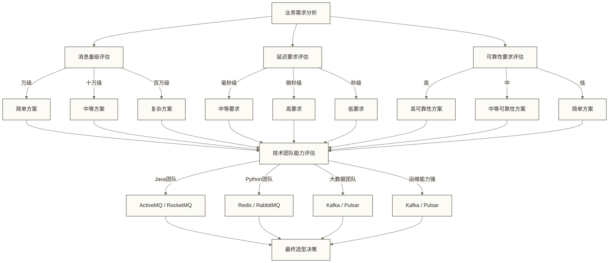

# Kafka与其他消息系统对比 - 选择最适合的消息中间件

> [!abstract] 📋 本节概览
> - 🎯 学习目标：了解不同消息系统的特点，学会技术选型
> - 📚 前置知识：[[【技术与工具】/Kafka/03-Kafka核心术语|Kafka核心术语]]
> - ⏱️ 预计用时：25分钟
> - 🔗 后续学习：[[【技术与工具】/Kafka/05-Kafka环境安装与配置|Kafka环境安装与配置]]

## 🎯 实际应用价值

Kafka与其他消息系统对比在实际工作中的应用价值和最佳实践，能够显著提升工作效率。

在实际工作环境中，这样的挑战每天都在发生。理解相关知识不仅能解决当前问题，更能提升整体的专业能力。
## 🌟 主流消息系统概览

### 📊 技术特征对比表

| 特性 | Kafka | RabbitMQ | Redis | ActiveMQ | RocketMQ | Pulsar |
|---|---|---|---|---|---|---|---|
| **吞吐量** | 极高(100万+/s) | 高(10万/s) | 极高 | 中等(万级/s) | 高(10万/s) | 极高 |
| **延迟** | 低(ms级) | 很低(μs级) | 极低(μs级) | 低(ms级) | 低(ms级) | 低(ms级) |
| **持久化** | ✅ 强持久化 | ✅ 可选 | ⚠️ 弱持久化 | ✅ 支持 | ✅ 强持久化 | ✅ 分层存储 |
| **分布式** | ✅ 原生支持 | ⚠️ 集群复杂 | ✅ 集群模式 | ⚠️ 主从模式 | ✅ 原生支持 | ✅ 原生支持 |
| **消息回溯** | ✅ 保留期内支持 | 普通队列不提供日志式回放；Streams支持 | Pub/Sub不支持；Stream可读取保留的历史记录 | 需区分实现与消费机制 | ✅ 保留期内支持 | ✅ 保留期内支持 |
| **事务支持** | ⚠️ 简单 | ✅ 完善 | ⚠️ 简单 | ✅ 完善 | ✅ 完善 | ✅ 支持 |
| **消息路由** | ⚠️ 简单 | ✅ 灵活 | ⚠️ 简单 | ✅ 灵活 | ✅ 灵活 | ✅ 灵活 |
| **学习曲线** | 陡峭 | 适中 | 简单 | 适中 | 适中 | 陡峭 |
| **运维复杂度** | 高 | 中等 | 低 | 中等 | 中等 | 高 |

## 🐰 RabbitMQ：传统消息队列的典型代表

### 🔍 核心特点
**生活类比：** 像邮局的分拣系统

```text
RabbitMQ消息流：
生产者 → Exchange(交换器) → Queue(队列) → 消费者
              ↓
        灵活的路由规则
```

### ✅ 优势

**1. 灵活的消息路由**
```python
# RabbitMQ的复杂路由示例
# 直接路由
channel.basic_publish(
    exchange='direct_exchange',
    routing_key='order.created',
    body=message
)

# 主题路由  
channel.basic_publish(
    exchange='topic_exchange',
    routing_key='user.profile.updated',
    body=message
)

# 扇出广播
channel.basic_publish(
    exchange='fanout_exchange',
    routing_key='',
    body=message
)
```

**2. 消息确认机制完善**
```python
# 消费者确认
def callback(ch, method, properties, body):
    try:
        process_message(body)
        ch.basic_ack(delivery_tag=method.delivery_tag)
    except Exception:
        ch.basic_nack(delivery_tag=method.delivery_tag, requeue=True)
```

**3. 低延迟特性**
- 微秒级延迟
- 适合实时性要求高的场景
- 推送模式，消息立即投递

### ❌ 劣势

**1. 吞吐量限制**
```text
RabbitMQ: 单机约10万TPS
Kafka:   单机可达100万TPS

原因：
- 基于Erlang的Actor模型
- 每个队列是一个进程
- 消息确认开销大
```

**2. 集群复杂度**
- 可按部署需求使用HAProxy等负载均衡方案，并非所有部署都必须配置
- 镜像队列配置复杂
- 脑裂问题处理困难

**3. 消息持久化开销**
- 持久化消息的磁盘写入开销取决于队列类型、消息持久化设置及相关配置
- 对磁盘IO要求较高

### 🎯 适用场景

**最佳场景：**
- 💬 **即时通讯**：聊天消息、通知推送
- 🔄 **工作流处理**：任务分发、状态流转
- 📧 **邮件系统**：邮件发送队列
- 🏪 **小型电商**：订单处理、库存更新

**代码示例：**
```python
# RabbitMQ工作队列模式
import pika

# 生产者
connection = pika.BlockingConnection(pika.ConnectionParameters('localhost'))
channel = connection.channel()
channel.queue_declare(queue='task_queue', durable=True)

channel.basic_publish(
    exchange='',
    routing_key='task_queue',
    body='Hello World!',
    properties=pika.BasicProperties(delivery_mode=2)  # 消息持久化
)
```

## 🔴 Redis：高性能的内存消息系统

### 🔍 核心特点
**生活类比：** 像高速公路的信息广播系统

| 消息模式 | 特点 |
|---------|------|
| Pub/Sub 模式 | 发布订阅，实时广播 |
| List 模式 | 队列模式，FIFO处理 |
| Stream 模式 | 类似Kafka的日志流 |
| Sorted Set 模式 | 延迟队列，定时处理 |

### ✅ 优势

**1. 极低延迟**
```python
# Redis Pub/Sub示例
import redis

# 发布者
r = redis.Redis()
r.publish('notifications', 'New order arrived!')

# 订阅者  
pubsub = r.pubsub()
pubsub.subscribe('notifications')
for message in pubsub.listen():
    print(f"Received: {message['data']}")
```

**2. 简单易用**
```python
# List作为队列
r.lpush('task_queue', 'task1')    # 入队
task = r.brpop('task_queue')[1]   # 出队(阻塞)

# Stream作为日志
r.xadd('events', {'user': '123', 'action': 'login'})
```

**3. 丰富的数据结构**
- List：队列、栈
- Set：去重、集合运算
- Sorted Set：优先级队列、延迟队列
- Stream：持久化发布订阅

### ❌ 劣势

**1. 持久化限制**
| 持久化方式 | 特点 |
|-----------|------|
| RDB快照 | 定期备份，可能丢失数据 |
| AOF日志 | 记录写操作；落盘策略可配置，性能与数据丢失风险取决于配置 |
| 重启风险 | 内存数据易丢失 |

**2. 集群模式限制**
- 不支持跨节点的事务
- 某些命令在集群模式下不可用
- 数据分片需要客户端路由

**3. 消息可靠性**
- Pub/Sub模式不保证消息到达
- Pub/Sub模式下，消费者离线期间的消息不会为其保留
- Pub/Sub模式没有消息确认机制；Stream消费组支持确认与待处理消息管理

### 🎯 适用场景

**最佳场景：**
- 🎮 **游戏应用**：实时排行榜、玩家状态
- 📱 **移动App**：推送通知、实时消息
- 📊 **实时统计**：访问计数、在线用户
- 🔄 **缓存更新**：缓存失效通知

## ☕ ActiveMQ：企业级传统消息中间件

### 🔍 核心特点
**生活类比：** 像银行的柜台服务系统

| 特性 | 说明 |
|------|------|
| JMS标准实现 | 符合Java企业标准 |
| 多协议支持 | OpenWire、STOMP、AMQP |
| 企业级特性 | 事务、持久化、安全 |
| 管理界面 | Web控制台监控 |

### ✅ 优势

**1. 企业级特性完整**
```java
// JMS事务支持
Session session = connection.createSession(true, Session.SESSION_TRANSACTED);
MessageProducer producer = session.createProducer(destination);

// 发送消息
producer.send(message);

// 提交事务
session.commit();
```

**2. 标准化接口**
```java
// 符合JMS标准的代码
ConnectionFactory factory = new ActiveMQConnectionFactory("tcp://localhost:61616");
Connection connection = factory.createConnection();
Session session = connection.createSession(false, Session.AUTO_ACKNOWLEDGE);
```

**3. 丰富的协议支持**
- OpenWire：ActiveMQ原生协议
- STOMP：跨语言协议
- AMQP：高级消息队列协议
- MQTT：物联网协议

### ❌ 劣势

**1. 性能相对较低**
```text
性能对比：
ActiveMQ: 万级TPS
Kafka:   十万~百万级TPS
RabbitMQ: 十万级TPS
```

**2. 资源消耗较大**
- JVM堆内存需求大
- 启动时间较长
- 线程模型复杂

**3. 集群配置复杂**
- 主从模式配置繁琐
- 网络分区问题处理困难

### 🎯 适用场景

**最佳场景：**
- 🏢 **企业应用**：ERP、CRM系统集成
- 💰 **金融系统**：交易处理、风控系统
- 🏥 **医疗系统**：设备数据、诊疗流程
- 🏭 **制造业**：生产调度、设备监控

## 🚀 RocketMQ：阿里巴巴的分布式消息中间件

### 🔍 核心特点
**生活类比：** 像物流公司的分拣中心网络

| 组件 | 角色 |
|------|------|
| NameServer | 路由注册中心 |
| Broker Cluster | 消息存储集群 |
| Producer Group | 生产者集群 |
| Consumer Group | 消费者集群 |

### ✅ 优势

**1. 高可用设计**
```java
// RocketMQ事务消息
TransactionMQProducer producer = new TransactionMQProducer("transaction_group");
producer.setTransactionListener(new TransactionListenerImpl());

// 发送事务消息
SendResult result = producer.sendMessageInTransaction(message, localTransactionArgs);
```

**2. 丰富的消息类型**
- 普通消息：标准消息队列
- 顺序消息：在指定消息分组或队列及相应生产、消费约束下提供顺序保证，并非全局顺序保证
- 事务消息：分布式事务支持
- 延迟消息：定时投递

**3. 运维友好**
- 完善的监控界面
- 丰富的管理工具
- 详细的性能指标

### ❌ 劣势

**1. 社区生态相对较小**
- 主要在中国使用
- 英文文档相对较少
- 第三方工具支持有限

**2. 学习曲线较陡**
- 概念较多且复杂
- 配置项繁多
- 调优需要经验

### 🎯 适用场景

**最佳场景：**
- 🛒 **电商平台**：订单流水、库存同步
- 💳 **支付系统**：交易流水、对账处理
- 📊 **大数据系统**：数据采集、ETL流程
- 🏢 **企业应用**：事件驱动架构

## 🌟 Apache Pulsar：下一代消息系统

### 🔍 核心特点
**生活类比：** 像云存储的文件同步系统

| 组件 | 角色 |
|------|------|
| Broker Layer | 无状态计算层 |
| BookKeeper | 分布式存储层 |
| ZooKeeper | 元数据管理 |
| Pulsar Proxy | 负载均衡代理 |

### ✅ 优势

**1. 计算存储分离**
```python
# Pulsar客户端示例
import pulsar

client = pulsar.Client('pulsar://localhost:6650')
producer = client.create_producer('my-topic')

# 发送消息
producer.send('Hello Pulsar'.encode('utf-8'))
```

**2. 多租户支持**
```text
租户隔离：
tenant1/namespace1/topic1
tenant2/namespace1/topic1
tenant3/namespace1/topic1
```

**3. 分层存储**
- 热数据存储在BookKeeper
- 配置分层存储及卸载策略后，可将数据卸载到对象存储
- 可借助对象存储扩展容量，但仍受配额、成本及保留策略等约束

### ❌ 劣势

**1. 复杂度较高**
- 组件较多，运维复杂
- 学习成本高
- 故障排查困难

**2. 生态不够成熟**
- 社区相对较小
- 第三方工具较少
- 最佳实践有限

## 🎯 技术选型决策矩阵

### 📊 基于场景的候选方案讨论

下表是用于讨论的简化选型假设，“首选”“次选”和“不推荐”不是通用结论，需结合消息可靠性、顺序、回放需求、部署规模与测试结果判断。

| 场景 | 首选方案 | 次选方案 | 不推荐 |
|---|---|---|---|
| **大数据处理** | Kafka | Pulsar | RabbitMQ |
| **实时通讯** | RabbitMQ | Redis | Kafka |
| **高频交易** | Redis | RabbitMQ | Kafka |
| **日志收集** | Kafka | Pulsar | ActiveMQ |
| **IoT数据** | Kafka | RocketMQ | RabbitMQ |
| **企业集成** | ActiveMQ | RocketMQ | Redis |
| **电商系统** | RocketMQ | Kafka | Redis |
| **游戏应用** | Redis | RabbitMQ | ActiveMQ |

### 🔍 决策因素权重分析

```python
# 选型决策模型（示例）
def select_message_system(requirements):
    score = dict.fromkeys(('kafka', 'pulsar', 'redis', 'rabbitmq', 'rocketmq', 'activemq'), 0.0)
    
 # 吞吐量需求 (权重: 0.3)
    if requirements['throughput'] == 'high':
        score['kafka'] += 0.3
        score['pulsar'] += 0.25
        score['redis'] += 0.2
    
 # 延迟要求 (权重: 0.25)
    if requirements['latency'] == 'low':
        score['redis'] += 0.25
        score['rabbitmq'] += 0.2
        score['kafka'] += 0.15
    
 # 可靠性需求 (权重: 0.2)
    if requirements['reliability'] == 'high':
        score['kafka'] += 0.2
        score['rocketmq'] += 0.18
        score['activemq'] += 0.15
        
    if not any(score.values()):
        return None  # 没有匹配评分条件，需进一步明确需求
    return max(score, key=score.get)  # 示例权重；并列结果不代表唯一最优方案
```

### 🎨 选型建议流程图



## 💡 假设性选型案例分析

以下业务规模与综合评分均作为选型讨论的示例假设，不代表已验证的真实项目结果；评分不构成性能基准，实际选型需结合部署约束与测试结果。

### 案例1：电商订单系统

**业务需求：**
- 每日订单量：100万笔
- 峰值TPS：5000
- 需要事务支持
- 需要消息回溯

**分析过程：**

| 方案 | 吞吐量 | 事务 | 消息回溯 | 综合评分 |
|------|--------|------|---------|---------|
| Kafka | ✅ | ⚠️ | ✅ | 85分 |
| RocketMQ | ✅ | ✅ | ✅ | 95分 |
| RabbitMQ | ⚠️ | ✅ | ❌ | 60分 |
| Redis | ✅ | ⚠️ | ❌ | 50分 |

**选型结果：** RocketMQ（支持事务消息，运维相对简单）

### 案例2：实时游戏消息推送

**业务需求：**
- 在线用户：10万
- 延迟要求：<10ms
- 消息量：每秒50万条
- 可靠性要求不高

**分析过程：**

| 方案 | 延迟 | 吞吐量 | 可靠性 | 综合评分 |
|------|------|--------|--------|---------|
| Redis | ✅ | ✅ | ✅ | 90分 |
| RabbitMQ | ✅ | ⚠️ | ✅ | 75分 |
| Kafka | ⚠️ | ✅ | ✅ | 70分 |
| ActiveMQ | ⚠️ | ❌ | ✅ | 40分 |

**选型结果：** Redis（极低延迟，简单部署）

### 案例3：大数据日志收集

**业务需求：**
- 日志量：每天1TB
- 需要长期存储
- 多个下游消费者
- 需要数据回放

**分析过程：**

| 方案 | 存储 | 吞吐量 | 多消费者 | 回放 | 综合评分 |
|------|------|--------|---------|------|---------|
| Kafka | ✅ | ✅ | ✅ | ✅ | 95分 |
| Pulsar | ✅ | ✅ | ✅ | ✅ | 90分 |
| RocketMQ | ⚠️ | ✅ | ✅ | ✅ | 80分 |
| RabbitMQ | ❌ | ⚠️ | ✅ | ❌ | 40分 |

**选型结果：** Kafka（大数据生态完善，成熟稳定）

## ✅ 掌握检查

完成以下检查，确保你已经理解了不同消息系统的特点：

- [ ] 能说出Kafka与RabbitMQ的主要区别
- [ ] 理解Redis作为消息系统的适用场景
- [ ] 掌握ActiveMQ的企业级特性
- [ ] 了解RocketMQ的事务消息机制
- [ ] 能根据业务需求进行技术选型

## 🔗 学习连接

**前置知识**: [[【技术与工具】/Kafka/03-Kafka核心术语|Kafka核心术语]] - Kafka的专业术语
**下一步学习**: [[【技术与工具】/Kafka/05-Kafka环境安装与配置|Kafka环境安装与配置]] - 开始动手实践Kafka
**相关概念**: 
- 分布式系统设计原则
- CAP定理
- 技术选型方法论

---

> [!tip] 💡 选型建议
> 
> 技术选型的黄金法则：
> - 🎯 **需求驱动**：技术服务于业务，不要为了技术而技术
> - 📊 **数据说话**：用具体的性能指标和测试数据支撑决策
> - 👥 **团队能力**：选择团队能够驾驭的技术
> - 🔄 **演进思维**：技术架构要能够平滑演进
> 
> 记住：最适合的就是最好的！ 