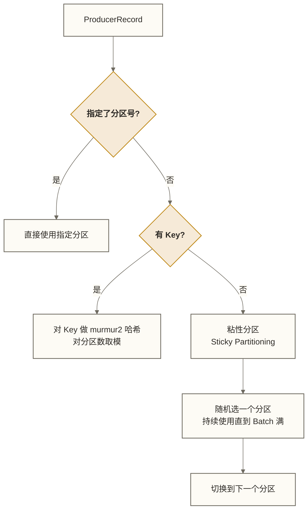
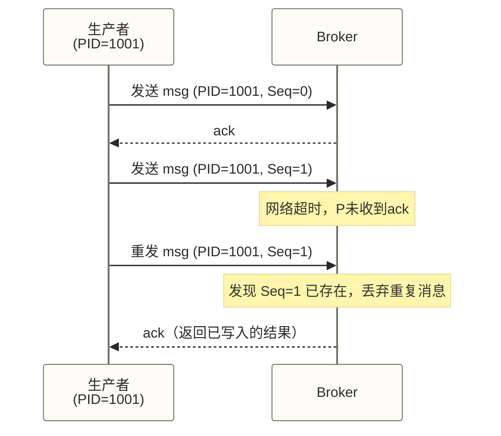

# 生产者深入剖析 - 消息发送的艺术与科学

> [!info] 前置知识
> - [[【技术与工具】/Kafka/06-第一个Kafka程序|第一个 Kafka 程序]] - 基础 API 使用
> - [[【技术与工具】/Kafka/03-Kafka核心术语|Kafka 核心术语]] - Topic、Partition、Broker 概念
> - [[【技术与工具】/Kafka/02-Kafka架构概述|Kafka 架构概述]] - 整体架构理解

## 双11零点的惊魂一刻

以下为假设的双11排障场景，并非已提供来源的真实事故：假设电商公司的消息队列在零点报警，**吞吐量从10万/秒掉到1万/秒**。本节的排查过程和恢复结果仅用于说明配置可能影响吞吐量。

用户下单、支付、库存扣减全部排队等待。运维排查了10分钟，Kafka集群CPU和内存都正常，网络没有瓶颈——**问题出在Producer配置上**。

开发同学为了"万无一失"，把 `acks=all`、`retries=Integer.MAX_VALUE`、`batch.size=1`……每条消息单独发送、等待所有副本确认。在这一假设场景中，调整批处理参数后吞吐量恢复；真实环境的改善幅度和恢复时间需要结合负载与监控结果判断。

这就是为什么要深入理解生产者内部机制——表面的 API 调用人人都会，但知道**为什么**这样配置才是真正的工程能力。

---

## 消息发送全流程

### 从 send() 到 Broker 的七道关卡

```mermaid
%%{init: {"theme":"base","themeVariables":{"fontFamily":"PingFang SC, -apple-system, Source Han Serif SC, serif","fontSize":"16px","background":"#FDFBF5","primaryColor":"#FDFBF5","primaryTextColor":"#2D2A26","primaryBorderColor":"#6E6A60","secondaryColor":"#E8EFE8","secondaryBorderColor":"#8FA890","secondaryTextColor":"#2D2A26","tertiaryColor":"#FDFBF5","tertiaryBorderColor":"#9A9488","tertiaryTextColor":"#6E6A60","lineColor":"#6E6A60","textColor":"#2D2A26","mainBkg":"#FDFBF5","nodeBorder":"#2D5A3D","clusterBkg":"#F3EEDF","clusterBorder":"#9A9488","edgeLabelBackground":"#FDFBF5"},"flowchart":{"htmlLabels":true,"curve":"basis","padding":20,"nodeSpacing":60,"rankSpacing":70,"useMaxWidth":false},"themeCSS":".node rect, .node polygon, .node circle { stroke-width: 1.5px; } .edgePath .path { stroke-width: 1.5px; } .cluster-label .nodeLabel, .cluster-label foreignObject { color: #2D2A26 !important; } .edgeLabel, .edgeLabel foreignObject { color: #2D2A26 !important; background-color: #FDFBF5; } .edgeLabel rect { fill: #FDFBF5; }"}}%%
flowchart LR
    classDef default fill:#FDFBF5,stroke:#6E6A60,color:#2D2A26,stroke-width:1.5px
    classDef startend fill:#2D2A26,stroke:#2D2A26,color:#FDFBF5,font-weight:bold
    classDef decision fill:#F6EAD8,stroke:#C08A1A,color:#2D2A26,font-weight:bold
    classDef hub fill:#3B5A80,stroke:#3B5A80,color:#FDFBF5,font-weight:bold
    classDef io fill:#E5EAF0,stroke:#3B5A80,color:#2D2A26
    classDef accent fill:#A6432C,stroke:#A6432C,color:#FDFBF5,font-weight:bold
    classDef storage fill:#F3EEDF,stroke:#9A9488,color:#2D2A26
    A[应用线程\nproducer.send] --> B[序列化\nSerializer]
    B --> C[分区器\nPartitioner]
    C --> D[消息累加器\nRecordAccumulator]
    D --> E{batch满?\nlinger到期?}
    E -->|是| F[Sender线程\n唤醒]
    E -->|否| D
    F --> G[InFlightRequests\n队列]
    G --> H[Kafka Broker]
    H -->|acks响应| G
    G -->|回调| A
    class E decision
    class A,B,C,D,F,G,H default
```



整个发送路径分为两个线程：

- **应用线程**：负责序列化、分区、写入 RecordAccumulator；send() 通常异步返回，但等待元数据或缓冲区空间时仍可能阻塞。
- **Sender 线程**：后台独立线程，负责从缓冲区取出批次、建立网络连接、发送给 Broker

这种设计将主要网络发送工作交给 Sender 线程，是 Kafka 高吞吐的原因之一，但不保证应用线程调用 send() 时永不阻塞。

---

## RecordAccumulator：批量的艺术

### 内部数据结构

RecordAccumulator 本质上是一个按分区组织的双端队列集合：

```java
// 核心数据结构（源码简化）
ConcurrentMap<TopicPartition, Deque<ProducerBatch>> batches;
```

每个 TopicPartition 对应一个 `Deque<ProducerBatch>`。新消息追加到队尾的 ProducerBatch，当 Batch 写满时创建新的 Batch 入队。

### batch.size 和 linger.ms 的协同机制

> [!note] 两个参数的触发关系
> ProducerBatch 满足以下**任意一个**条件就会被 Sender 取走发送：
> 1. Batch 大小达到 `batch.size`（默认 16384 字节，即 16KB）
> 2. 距离第一条消息写入的等待时间达到 `linger.ms`（Kafka Java客户端4.0之前默认0毫秒，4.0起默认5毫秒；实际发送还可能受请求并发和Broker背压等条件影响）

这两个参数是互补关系：

| 场景 | 推荐配置 | 效果 |
|------|----------|------|
| 高吞吐（日志、埋点） | `batch.size=65536`，`linger.ms=20` | 攒够64KB或等20ms再发，减少网络次数 |
| 低延迟（交易、告警） | `batch.size=16384`，`linger.ms=0` | 不为凑批额外等待，但仍可能批量发送 |
| 均衡场景 | `batch.size=32768`，`linger.ms=5` | 5ms内攒批，兼顾延迟和吞吐 |

**内存管理**：RecordAccumulator 从 `buffer.memory`（默认32MB）的内存池中分配 Batch 所需空间。当内存池耗尽时，`send()` 调用会阻塞，阻塞时间超过 `max.block.ms`（默认60秒）则抛出异常。

---

## Sender 线程与 InFlightRequests

### Sender 线程的工作循环

Sender 线程每轮循环做三件事：

1. 从 RecordAccumulator 拿出所有"就绪" Batch（按目标 Broker 分组）
2. 为每个目标 Broker 封装成一个 `ProduceRequest`，放入 InFlightRequests 队列
3. 轮询 NetworkClient，发送请求、处理响应、触发回调

### InFlightRequests：飞行中的请求

InFlightRequests 保存着**已发送但尚未收到响应**的请求。关键参数：

```properties
# 单个连接上最多有多少请求同时在飞行中（默认5）
max.in.flight.requests.per.connection=5
```

> [!warning] 顺序性与并发的取舍
> `max.in.flight.requests.per.connection > 1` 时，如果请求1失败重试、请求2已经成功，可能导致消息乱序。
>
> **启用幂等性（`enable.idempotence=true`）后**，Kafka 允许最多5个飞行请求同时存在，并通过 SequenceNumber 校验、重复检测及客户端重试机制维护分区内顺序，兼顾性能与顺序性；这不是 Broker 对乱序消息进行自动重排。
>
> 若未启用幂等性且需要严格顺序，则必须设置为 `1`。

---

## 分区器策略

### DefaultPartitioner 的决策逻辑



**粘性分区（Sticky Partitioning）**是 Kafka 2.4 之后无 Key 时的默认策略。旧版本是纯轮询，导致每条消息都在不同 Batch，批量效果很差。粘性分区会坚持用同一个分区直到 Batch 填满，大幅提升批处理效率。

### 自定义分区器实现

```java
/**
 * 自定义分区器：VIP 用户消息优先发往低编号分区
 */
public class VipUserPartitioner implements Partitioner {

    @Override
    public int partition(String topic, Object key, byte[] keyBytes,
                         Object value, byte[] valueBytes, Cluster cluster) {
        int numPartitions = cluster.partitionCountForTopic(topic);

        if (keyBytes == null) {
            // 无 Key：按时间值分散选择，不是严格轮询
            return (int) Math.floorMod(System.nanoTime(), (long) numPartitions);
        }

        String keyStr = new String(keyBytes, StandardCharsets.UTF_8);
        // VIP 用户固定分配到前半区分区（消费者可专门部署高配机器处理）
        if (keyStr.startsWith("vip-")) {
            return Math.floorMod(keyStr.hashCode(), Math.max(1, numPartitions / 2));
        }

        // 普通用户：全分区哈希
        return Math.floorMod(keyStr.hashCode(), numPartitions);
    }

    @Override
    public void close() {}

    @Override
    public void configure(Map<String, ?> configs) {}
}
```

```java
// 注册自定义分区器
props.put(ProducerConfig.PARTITIONER_CLASS_CONFIG, VipUserPartitioner.class.getName());
```

---

## 拦截器链：横切关注点的优雅处理

### ProducerInterceptor 接口

```java
public interface ProducerInterceptor<K, V> extends Configurable {
    // 消息发送前调用（应用线程，序列化之前）
    ProducerRecord<K, V> onSend(ProducerRecord<K, V> record);

    // 消息收到 ack 或发送失败后调用（Sender 线程）
    void onAcknowledgement(RecordMetadata metadata, Exception exception);

    void close();
}
```

拦截器支持配置多个，按列表顺序形成**拦截器链**，`onSend` 正向执行，`onAcknowledgement` 也正向执行。

### 实际应用场景

```java
/**
 * 拦截器示例：自动注入 traceId，并统计发送成功/失败数
 */
public class TraceInterceptor implements ProducerInterceptor<String, String> {

    private final AtomicLong successCount = new AtomicLong(0);
    private final AtomicLong failCount = new AtomicLong(0);

    @Override
    public ProducerRecord<String, String> onSend(ProducerRecord<String, String> record) {
        // 在 Header 中注入链路追踪 ID
        String traceId = MDC.get("traceId");
        if (traceId != null) {
            record.headers().add("X-Trace-Id", traceId.getBytes(StandardCharsets.UTF_8));
        }
        // 注入发送时间戳，方便计算端到端延迟
        record.headers().add("send-time",
            String.valueOf(System.currentTimeMillis()).getBytes(StandardCharsets.UTF_8));
        return record;
    }

    @Override
    public void onAcknowledgement(RecordMetadata metadata, Exception exception) {
        if (exception == null) {
            successCount.incrementAndGet();
        } else {
            failCount.incrementAndGet();
            // 发送失败时打印 traceId 方便排查
        }
    }

    @Override
    public void close() {
        System.out.printf("最终统计 - 成功: %d, 失败: %d%n",
            successCount.get(), failCount.get());
    }

    @Override
    public void configure(Map<String, ?> configs) {}
}
```

```java
// 配置拦截器链（多个用逗号分隔）
props.put(ProducerConfig.INTERCEPTOR_CLASSES_CONFIG,
    "com.example.TraceInterceptor,com.example.MetricsInterceptor");
```

> [!tip] 拦截器的常见用途
> - 链路追踪（注入 traceId 到 Header）
> - 消息加密/脱敏（onSend 中替换敏感字段）
> - 发送指标统计（onAcknowledgement 累计成功/失败数）
> - 幂等性前置校验（onSend 中生成业务级唯一 ID）

---

## acks 参数：可靠性的三档变速箱

| acks 值 | 等待对象 | 数据安全性 | 吞吐量 | 适用场景 |
|---------|---------|-----------|--------|---------|
| `0` | 不等待任何确认 | 最低（网络故障即丢失） | 最高 | 日志采集、允许少量丢失的监控数据 |
| `1` | 仅等待 Leader 写入确认 | 中等（Leader 崩溃可能丢失） | 中等 | 普通业务日志、非核心消息 |
| `-1` 或 `all` | 等待所有 ISR 副本写入确认 | 最高（ISR 全部写入才确认） | 最低 | 订单、支付、核心交易数据 |

> [!warning] acks=all 的前置条件
> `acks=all` 的实际可靠性取决于 `min.insync.replicas` 参数（Broker/Topic 级别配置）。
>
> 若 `min.insync.replicas=1`，则允许在 ISR 只剩 Leader 时确认写入；此时副本保护不足。但当 ISR 中仍有多个副本时，acks=all 仍需等待 ISR 副本确认，并不一概等同于 acks=1。
>
> 生产推荐：`acks=all` + `min.insync.replicas=2`（3副本集群）。

---

## 消息压缩：带宽与 CPU 的权衡

消息通常在生产者端按批压缩、在消费者端解压；Broker 还可能因消息校验、格式转换或 Topic 压缩配置而执行解压或重压缩，并非始终只存储和转发压缩数据。

下表中的百分比仅保留为假设示意值，不是实测结果；未给出压缩率定义、数据集及压缩级别，不能用于容量估算或算法性能排序。速度与CPU开销也会随消息内容、实现和配置变化。

| 算法 | 压缩率（假设示意，非实测） | 压缩速度 | 解压速度 | CPU 开销 | 推荐场景 |
|------|--------|---------|---------|---------|---------|
| `none` | 无 | — | — | 极低 | 内网高速、消息体很小 |
| `gzip` | 高（约70%） | 慢 | 中等 | 高 | 带宽严重受限、磁盘空间紧张 |
| `snappy` | 中（约50%） | 快 | 快 | 中等 | 通用场景 |
| `lz4` | 较低（约40%） | 极快 | 极快 | 低 | 可作为偏重压缩与解压速度时的候选，需按实际负载比较 |
| `zstd` | 高（约65%） | 快 | 快 | 中等 | Kafka 2.1+ 的新版推荐 |

```java
// 配置压缩
props.put(ProducerConfig.COMPRESSION_TYPE_CONFIG, "lz4");
```

---

## 幂等性生产者：精确一次的第一步

### 三种消息语义

Kafka 生产者发送消息时，网络重传可能导致三种情况：
- **At Most Once**（最多一次）：不重试，可能丢消息
- **At Least Once**（至少一次）：重试，可能重复消息
- **Exactly Once**（精确一次）：在明确的处理边界内，通过幂等性、事务及消费位点与输出的原子提交等机制实现；不能仅凭启用幂等性和事务保证任意业务端到端不丢不重。

### PID + SequenceNumber 原理

启用幂等性后（`enable.idempotence=true`），Kafka 为每个生产者实例分配一个 **PID（Producer ID）**，并为每个 `<PID, TopicPartition>` 组合维护一个单调递增的 **SequenceNumber**。



Broker 端对每个 `<PID, Partition>` 维护最新的 SequenceNumber，收到重复消息时直接丢弃并返回成功。

**幂等性的作用与边界**：
1. 在生产者会话内，避免同一发送批次因网络重传而重复写入
2. 生产者重启后重新提交业务消息不属于普通幂等性去重范围；事务可处理未完成事务和旧实例隔离，但不会自动去重已经提交后再次提交的业务
3. 在兼容的飞行请求配置下，通过序列号校验及客户端重试机制维护分区内顺序

```java
Properties props = new Properties();
// 启用幂等性（自动隐式设置：acks=all, retries=MAX, max.in.flight=5）
props.put(ProducerConfig.ENABLE_IDEMPOTENCE_CONFIG, true);
```

> [!warning] 幂等性的边界
> 幂等性只保证**单个会话内、单个分区**的精确一次。
> 跨分区原子写入需要使用**事务生产者**；跨会话恢复还需稳定的事务身份及正确的恢复流程。事务本身不自动去重应用重新提交的已完成业务，端到端精确一次仍取决于消费位点、输出和外部副作用的一致性设计。

---

## 事务生产者：跨分区的精确一次

### 五步 API 模板

```java
Properties props = new Properties();
props.put(ProducerConfig.BOOTSTRAP_SERVERS_CONFIG, "localhost:9092");
props.put(ProducerConfig.KEY_SERIALIZER_CLASS_CONFIG, StringSerializer.class.getName());
props.put(ProducerConfig.VALUE_SERIALIZER_CLASS_CONFIG, StringSerializer.class.getName());
// 事务 ID：跨会话标识同一个生产者逻辑实例（必须唯一且稳定）
props.put(ProducerConfig.TRANSACTIONAL_ID_CONFIG, "order-service-producer-001");
// 幂等性是事务的基础
props.put(ProducerConfig.ENABLE_IDEMPOTENCE_CONFIG, true);

KafkaProducer<String, String> producer = new KafkaProducer<>(props);

// 第1步：初始化事务（向 Broker 注册事务协调者）
producer.initTransactions();

try {
    // 第2步：开始事务
    producer.beginTransaction();

    // 第3步：发送消息（可以跨多个 Topic/Partition）
    producer.send(new ProducerRecord<>("orders", "order-001", "{\"amount\":100}"));
    producer.send(new ProducerRecord<>("inventory", "item-001", "{\"delta\":-1}"));

    // 业务逻辑（若此处抛异常，事务回滚）
    validateOrderAndInventory();

    // 第4步：提交事务（使事务消息对 read_committed 消费者可见）
    producer.commitTransaction();

} catch (Exception e) {
    // 第5步：中止事务（事务消息不会交付给 read_committed 消费者）
    producer.abortTransaction();
    throw e;
} finally {
    producer.close();
}
```

### Exactly-Once 的完整实现条件

事务生产者提供事务内消息写入的原子提交；消费者设置 read_committed 后只读取已提交的事务消息，但这不足以单独保证端到端 Exactly-Once。Kafka 消费—处理—生产流程还需将消费位点与输出纳入同一事务；涉及数据库、库存服务等外部副作用时，需要额外的一致性或幂等设计：

```java
// 消费者端必须设置：只读取已提交的事务消息
props.put(ConsumerConfig.ISOLATION_LEVEL_CONFIG, "read_committed");
```

> [!tip] transactional.id 的命名建议
> `transactional.id` 应该包含业务语义，如 `order-service-producer-{instanceId}`。
> 同一个 `transactional.id` 在不同实例中启动时，Kafka 会自动终止旧实例的未完成事务（Fencing 机制），防止僵尸写入。

---

## 生产者重要参数速查表

| 参数 | 默认值 | 推荐值（高吞吐） | 推荐值（高可靠） | 说明 |
|------|--------|----------------|----------------|------|
| `buffer.memory` | 33554432 (32MB) | 134217728 (128MB) | 67108864 (64MB) | 生产者内存缓冲区总大小 |
| `batch.size` | 16384 (16KB) | 65536 (64KB) | 16384 (16KB) | 单个 Batch 最大字节数 |
| `linger.ms` | 4.0之前为0；4.0起为5 | 20 | 0 | 为凑批增加的等待时间，单位毫秒；不等于消息发送延迟上限 |
| `max.block.ms` | 60000 | 60000 | 120000 | send() 阻塞的最大时间 |
| `acks` | `all` | `all`（与本列显式启用幂等性保持兼容） | `all` | 确认级别；若改为 `1`，需显式关闭幂等性并接受相应可靠性变化 |
| `retries` | 2147483647 | 3 | MAX_INT | 失败重试次数 |
| `retry.backoff.ms` | 100 | 100 | 200 | 重试间隔 |
| `request.timeout.ms` | 30000 | 15000 | 60000 | 等待 Broker 响应超时 |
| `max.in.flight.requests.per.connection` | 5 | 5 | 1（无幂等时） | 单连接最大飞行请求数 |
| `compression.type` | `none` | `lz4` | `lz4` | 压缩算法 |
| `enable.idempotence` | `true` (3.0+) | `true` | `true` | 启用幂等性 |

---

## 完整生产配置示例

```java
/**
 * 生产环境推荐配置（均衡场景：高可靠 + 合理吞吐）
 */
public static Properties buildProductionConfig(String bootstrapServers, String transactionalId) {
    Properties props = new Properties();

    // 连接配置
    props.put(ProducerConfig.BOOTSTRAP_SERVERS_CONFIG, bootstrapServers);
    props.put(ProducerConfig.KEY_SERIALIZER_CLASS_CONFIG, StringSerializer.class.getName());
    props.put(ProducerConfig.VALUE_SERIALIZER_CLASS_CONFIG, StringSerializer.class.getName());

    // 批量与缓冲
    props.put(ProducerConfig.BUFFER_MEMORY_CONFIG, 67108864);   // 64MB
    props.put(ProducerConfig.BATCH_SIZE_CONFIG, 32768);          // 32KB
    props.put(ProducerConfig.LINGER_MS_CONFIG, 5);               // 5ms
    props.put(ProducerConfig.MAX_BLOCK_MS_CONFIG, 60000);        // 阻塞最多60s

    // 可靠性
    props.put(ProducerConfig.ACKS_CONFIG, "all");
    props.put(ProducerConfig.ENABLE_IDEMPOTENCE_CONFIG, true);
    props.put(ProducerConfig.RETRIES_CONFIG, Integer.MAX_VALUE);
    props.put(ProducerConfig.RETRY_BACKOFF_MS_CONFIG, 200);

    // 压缩
    props.put(ProducerConfig.COMPRESSION_TYPE_CONFIG, "lz4");

    // 事务（按需启用）
    if (transactionalId != null) {
        props.put(ProducerConfig.TRANSACTIONAL_ID_CONFIG, transactionalId);
    }

    return props;
}
```

---

## 掌握检查

- [ ] 能够描述消息从 `producer.send()` 到 Broker 收到的完整路径（序列化 → 分区 → RecordAccumulator → Sender → InFlightRequests → Broker）
- [ ] 理解 `batch.size` 和 `linger.ms` 的协同触发关系，能根据场景选择合理配置
- [ ] 能解释 `acks=0/1/-1` 三种模式的数据安全性差异及适用场景
- [ ] 理解幂等性的 PID+SequenceNumber 原理，知道其边界（单会话、单分区）
- [ ] 能写出事务生产者的五步 API 骨架，并说明 `transactional.id` 的作用

## 练习题

**基础题**：有一个日志采集场景，需要把每台服务器的日志发送到 Kafka，要求极高吞吐（百万条/秒），允许偶尔丢失少量日志。请给出推荐的 `acks`、`batch.size`、`linger.ms`、`compression.type` 配置值，并说明理由。

**进阶题**：在一个电商下单场景中，下单成功后需要同时向 `orders` Topic 写入订单消息，向 `inventory` Topic 写入库存扣减消息，要求两者要么同时成功要么同时失败。请设计生产者代码框架，指出消费者读取已提交事务消息所需的参数，并说明为何仅有该参数不能保证端到端 Exactly-Once；若包含消费—处理—生产流程或外部库存更新，还需补充哪些一致性条件？

---

## 相关文档

**前置知识**: [[【技术与工具】/Kafka/06-第一个Kafka程序|第一个 Kafka 程序]] - Kafka 基础编程入门
**下一步学习**: [[【技术与工具】/Kafka/08-消费者深入剖析|消费者深入剖析]] - 深入理解消费侧机制
**关联概念**: [[【技术与工具】/Kafka/10-副本机制与一致性|副本机制与一致性]] - ISR 与 acks 的配合
**参数调优**: [[【技术与工具】/Kafka/12-性能调优实战|性能调优实战]] - 端到端性能优化实践

---

> [!tip] 生产者调优的核心思维
> 生产者的所有参数本质上都是在**延迟、吞吐量、可靠性**三者之间做取舍。
>
> 调优前先明确目标：这条消息丢了会怎样？重复了会怎样？慢了会怎样？
> 有了答案，参数选择就是水到渠成的事。
