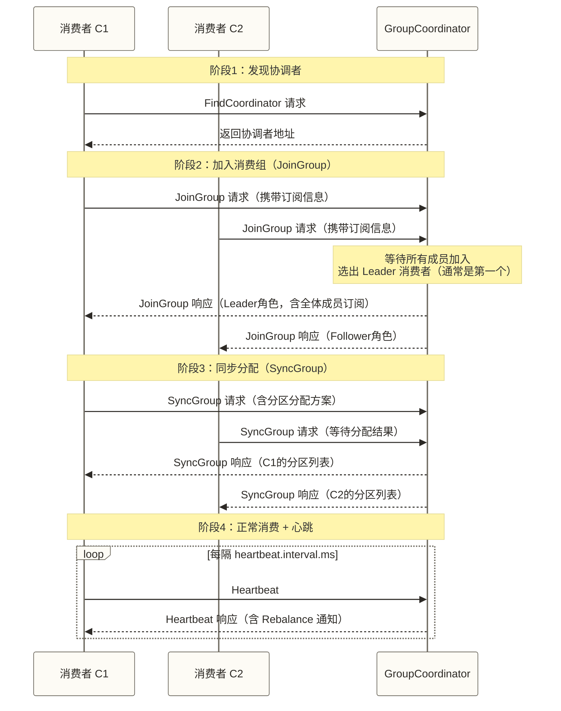
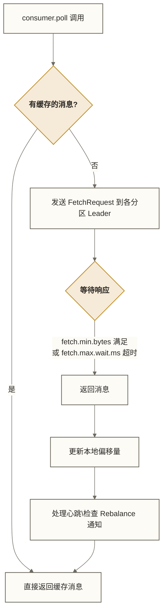

# 消费者深入剖析 - 高效消息消费策略

> [!info] 前置知识
> - [[【技术与工具】/Kafka/07-生产者深入剖析|生产者深入剖析]] - 生产侧机制理解
> - [[【技术与工具】/Kafka/03-Kafka核心术语|Kafka 核心术语]] - 消费者组、分区、偏移量概念
> - [[【技术与工具】/Kafka/11-偏移量管理|偏移量管理]] - 偏移量存储与提交策略

## 凌晨三点的消费积压告警

运维电话把你吵醒：Kafka 消费者 Lag 从 0 涨到了 500 万，消息积压！

登上机器一看——消费者进程都活着，CPU 也正常。但每隔几分钟就有一次 Rebalance，每次 Rebalance 期间消费者全部暂停……

**这是一个典型的 Rebalance 风暴**：消费者因处理超时被踢出消费组，触发 Rebalance，Rebalance 期间无法消费，消息继续堆积，新一轮超时又触发 Rebalance……

要解决这类问题，必须深入理解消费者组的协调机制。

---

## 消费者组协调流程

### GroupCoordinator 在哪里？

消费者组的元数据（成员信息、分区分配、偏移量）存储在 Kafka 内部 Topic `__consumer_offsets` 中。该 Topic 的分区数由创建配置决定，默认配置通常为 50 个分区，**管理某个消费组的 GroupCoordinator 就是 `__consumer_offsets` 对应分区的 Leader Broker**：

```text
分区编号 = Math.abs(groupId.hashCode()) % __consumer_offsets分区数
```

消费者启动时，先找到这个 Broker，后续的加入、心跳、提交偏移量都与它交互。

### 入组四步走：Join → Sync → Heartbeat → Fetch



> [!note] Leader 消费者的职责
> JoinGroup 阶段，GroupCoordinator 选出一个 Leader 消费者（Follower 成员都不知道彼此的存在）。**Leader 消费者**负责运行分区分配算法，把结果上报给 Coordinator，再由 Coordinator 分发给所有成员。这样设计减轻了 Broker 端的计算压力。

---

## 分区分配策略深度对比

三种内置策略在 SyncGroup 阶段由 Leader 消费者计算：

| 策略 | 分配方式 | 均衡性 | Rebalance 代价 | 适用场景 |
|------|---------|--------|----------------|---------|
| **RangeAssignor** | 按分区编号范围连续分配 | 差（多 Topic 时头部消费者承担更多分区） | 高（每次全量重分配） | 单 Topic，消费者数量稳定 |
| **RoundRobinAssignor** | 按所有分区轮询分配 | 好（各消费者分区数差值 ≤ 1） | 高（每次全量重分配） | 多 Topic，消费者订阅相同的 Topic |
| **StickyAssignor** | 尽量保留原有分配，仅移动必要分区 | 好（且尽量稳定） | eager 重平衡，保留分配不等于避免全组撤销 | 需要提高分配稳定性的场景；若需协作式增量重平衡，应另行评估 CooperativeStickyAssignor |

### RangeAssignor 的不均衡问题

假设有 Topic A（3分区）、Topic B（3分区），消费者 C1、C2：

```text
RangeAssignor 结果：
C1: A-0, A-1, B-0, B-1  （4个分区）
C2: A-2, B-2            （2个分区）
```

C1 的分区数是 C2 的两倍；只有各分区流量和处理成本相近时，才能近似推断负载也是两倍。多个 Topic 的分区余数分配可能使这种偏斜累积。

### StickyAssignor 的分配稳定性示例

```text
初始分配（C1、C2、C3）：
C1: [0, 1]   C2: [2, 3]   C3: [4, 5]

C2 离开触发 Rebalance 后：
StickyAssignor：C1: [0, 1, 2]   C3: [4, 5, 3]  ← 仅移动分区2和3
RoundRobin：    C1: [0, 2, 4]   C3: [1, 3, 5]  ← 全部重新分配
```

```java
// 配置分配策略
props.put(ConsumerConfig.PARTITION_ASSIGNMENT_STRATEGY_CONFIG,
    StickyAssignor.class.getName());
```

---

## Rebalance：消费者组的"停世界"事件

### 五种触发条件

> [!warning] Rebalance 的代价
> 在本文讨论的经典组协议及 eager 重平衡模式下，重平衡会要求全组撤销原有分区分配，正常消费需等待新的分配方案同步完成。在大规模部署中，一次重平衡可能导致数十秒的消费暂停；协作式重平衡不能直接套用这一全组暂停描述。

1. **消费者成员变更**：新消费者加入组、动态成员正常退出；静态成员调用 `close()` 通常不会立即通知协调者移除成员，重新分配时机还取决于会话超时及其他组变化
2. **消费者心跳超时**：`session.timeout.ms` 内没收到心跳，Coordinator 认为该消费者已死
3. **消费者处理超时**：两次 `poll()` 之间的间隔超过 `max.poll.interval.ms`，客户端失去继续持有分区的资格；动态成员通常主动离组，静态成员的分区重新分配通常还需等待会话超时
4. **订阅的 Topic 分区数变化**：手动增加了分区
5. **订阅的 Topic 数量变化**：新增了匹配正则的 Topic

### Generation 机制防止僵尸消费者

每次 Rebalance 后，消费者组的 Generation（世代）ID 加1。旧成员携带过期 Generation ID 提交偏移量时，Coordinator 会拒绝。这防止了"僵尸消费者"（网络隔离后又恢复的旧成员）污染偏移量。

---

## 静态成员：给 Rebalance 踩一脚刹车

### 为什么需要静态成员？

默认情况下，消费者重启（发布、故障恢复）都会触发 Rebalance。对于有状态的消费者（如本地缓存、窗口状态），频繁 Rebalance 代价极高。

**静态成员**（Static Membership）通过 `group.instance.id` 参数给消费者一个稳定的身份：

```java
// 每个消费者实例配置唯一且稳定的 instance.id
props.put(ConsumerConfig.GROUP_INSTANCE_ID_CONFIG, "consumer-host1-instance-0");
```

配置后的行为变化：
- 消费者**正常退出**时，不立即触发 Rebalance，而是等待 `session.timeout.ms` 超时
- 如果消费者以同一稳定身份在超时前**重新加入**，且订阅及组状态没有其他相关变化，可恢复原来的分区分配，避免因这次短暂重启触发 Rebalance
- 超时后仍未重新加入会导致成员移除及重新分配；其他成员或订阅变化也可能触发 Rebalance

> [!tip] 静态成员的最佳实践
> 将 `group.instance.id` 设为 `{服务名}-{主机名}-{进程序号}` 格式，例如 `order-consumer-host1-0`。
> 发版时可采用滚动重启；若每个实例保持唯一且稳定的身份，并在自身会话超时前重新加入，且订阅和组成员条件未发生其他变化，可减少由短暂重启引起的 Rebalance，但不能保证完全避免。

---

## 心跳机制：消费者与 Coordinator 的保活

### 两个关键参数的关系

| 参数 | 默认值 | 作用 | 关系约束 |
|------|--------|------|---------|
| `heartbeat.interval.ms` | 3000ms | 消费者发送心跳的频率 | 必须 < `session.timeout.ms`，建议为其 1/3 |
| `session.timeout.ms` | 45000ms | Coordinator 判定消费者死亡的超时 | 建议 30000~60000ms |
| `max.poll.interval.ms` | 300000ms (5分钟) | 两次 poll() 之间的最大间隔 | 必须 > 单批消息的最大处理时间 |

在这里讨论的经典 Java 消费者中，心跳由后台线程发送，但客户端仍会监测 poll() 间隔。超过 `max.poll.interval.ms` 会使成员失去继续持有分区的资格；动态成员与静态成员的退出和重新分配时机不同，不能统一解释为 Coordinator 立即踢出。

### 推荐配置组合（针对凌晨三点那个问题）

```properties
# 心跳间隔：3秒（session.timeout 的 1/3）
heartbeat.interval.ms=3000

# 会话超时：9秒（快速检测死亡）
session.timeout.ms=9000

# poll 间隔：根据实际处理时间设置，留足余量
# 若单批100条消息处理需要最多30秒，则设置为60秒
max.poll.interval.ms=60000

# 每次 poll 拉取的最大条数：适当减小，让每批处理更快完成
max.poll.records=50
```

---

## poll 循环内部机制

### poll() 做了什么



`poll()` 不仅拉取消息，还是消费者与 Coordinator 保活的触发点。心跳线程在后台独立发送，但 Rebalance 的检测和响应在 `poll()` 内处理。

### max.poll.records 与 Rebalance 的关系

`max.poll.records` 越大，单批消息越多，处理时间越长，越容易触发 `max.poll.interval.ms` 超时进而 Rebalance。在开头的假设故障场景中，`max.poll.records=500` 可能导致单批处理耗时过长；只有实际两次 poll() 的间隔超过配置的 `max.poll.interval.ms`，并有日志等证据支持时，才能将处理超时作为 Rebalance 的原因。“几分钟”本身不足以证明超过默认的5分钟。

---

## ConsumerRebalanceListener：Rebalance 的优雅应对

当 Rebalance 不可避免时，用 `ConsumerRebalanceListener` 在分区变更前后做好清理和准备：

```java
consumer.subscribe(Collections.singletonList("orders"), new ConsumerRebalanceListener() {

    /**
     * 在新分区分配生效前调用（此时还持有旧分区）
     * 关键：在这里提交当前偏移量，避免 Rebalance 后重复消费
     */
    @Override
    public void onPartitionsRevoked(Collection<TopicPartition> partitions) {
        System.out.println("即将失去分区：" + partitions);
        // 同步提交当前分区的偏移量
        consumer.commitSync(currentOffsets);
        // 若消费者持有外部状态（如数据库连接、本地缓存），在此释放
        currentOffsets.clear();
    }

    /**
     * 在新分区分配完成后调用（此时已持有新分区）
     * 可以在这里从外部存储恢复偏移量（实现精确的偏移量管理）
     */
    @Override
    public void onPartitionsAssigned(Collection<TopicPartition> partitions) {
        System.out.println("新分配到的分区：" + partitions);
        // 从数据库恢复已处理到的精确偏移量（绕过 Kafka 内置偏移量）
        for (TopicPartition partition : partitions) {
            Long savedOffset = offsetDao.getOffset(partition);
            if (savedOffset != null) {
                consumer.seek(partition, savedOffset);
            }
        }
    }
});
```

> [!warning] onPartitionsRevoked 中不要做耗时操作
> Rebalance 期间整个消费者组暂停，`onPartitionsRevoked` 执行时间越长，全组暂停时间越长。
> 只做必要的偏移量提交，不要在此处做数据库批量写入等耗时操作。

---

## 消费者的优雅关闭

### 为什么不能直接 kill

直接 `kill -9` 会导致消费者不正常退出，Coordinator 要等 `session.timeout.ms` 才能感知，期间该消费者负责的分区无人消费。

### wakeup() 的线程安全停止

`KafkaConsumer` 是线程不安全的，但 `wakeup()` 是唯一线程安全的方法。正确的优雅停止模式：

```java
public class GracefulConsumer {

    private final KafkaConsumer<String, String> consumer;
    private volatile boolean running = true;

    public GracefulConsumer(Properties props) {
        this.consumer = new KafkaConsumer<>(props);
    }

    public void start() {
        // 注册 JVM 关闭钩子（捕获 kill -15 / SIGTERM 信号）
        Runtime.getRuntime().addShutdownHook(new Thread(() -> {
            System.out.println("收到关闭信号，准备优雅退出...");
            running = false;
            // wakeup() 会使 poll() 抛出 WakeupException
            consumer.wakeup();
        }));

        consumer.subscribe(Collections.singletonList("orders"));

        try {
            while (running) {
                ConsumerRecords<String, String> records =
                    consumer.poll(Duration.ofMillis(1000));
                for (ConsumerRecord<String, String> record : records) {
                    processRecord(record);
                }
                consumer.commitSync();
            }
        } catch (WakeupException e) {
            // 预期中的异常，由 wakeup() 触发，不需要处理
            if (running) throw e; // 只有意外的 WakeupException 才重新抛出
        } finally {
            // 此处无参数提交存在提交未处理记录的风险，提交异常还可能跳过 close()；动态与静态成员关闭后的重平衡时机不同
            consumer.commitSync();
            consumer.close();
            System.out.println("消费者已优雅关闭");
        }
    }

    private void processRecord(ConsumerRecord<String, String> record) {
        // 业务处理逻辑
    }
}
```

经典组协议下，动态成员调用 `consumer.close()` 通常会发送 LeaveGroup，使组能及时重新分配；静态成员的关闭行为不同，不能据此承诺立即重平衡。滚动发布应结合成员类型、会话超时和清理完成时间设计。

---

## 独立消费者：不需要消费者组时

有些场景不需要消费者组的动态分配，例如：
- 数据迁移脚本，需要精确控制每个分区的读取位置
- 流处理框架内部，已有自己的分区分配机制
- 历史数据回放，需要从指定 offset 开始消费

```java
KafkaConsumer<String, String> consumer = new KafkaConsumer<>(props);
// 注意：不调用 subscribe()，而是使用 assign() 手动分配

// 获取 topic 的所有分区信息
List<PartitionInfo> partitionInfos = consumer.partitionsFor("orders");

List<TopicPartition> partitions = new ArrayList<>();
for (PartitionInfo info : partitionInfos) {
    partitions.add(new TopicPartition(info.topic(), info.partition()));
}

// 手动分配分区（不加入消费者组，不参与 Rebalance）
consumer.assign(partitions);

// 可以精确控制起始消费位置
consumer.seekToBeginning(partitions);   // 从头开始
consumer.seekToEnd(partitions);          // 从最新位置开始
consumer.seek(new TopicPartition("orders", 0), 1000L);  // 从指定 offset 开始

while (true) {
    ConsumerRecords<String, String> records = consumer.poll(Duration.ofMillis(1000));
    for (ConsumerRecord<String, String> record : records) {
        System.out.printf("partition=%d, offset=%d, value=%s%n",
            record.partition(), record.offset(), record.value());
    }
}
```

> [!note] assign() 与 subscribe() 的区别
> | 特性 | subscribe() | assign() |
> |------|-------------|---------|
> | 消费者组 | 参与动态组管理，有 GroupCoordinator | 不参与动态组管理；提交 Kafka 偏移量时仍使用 group.id 并与 Coordinator 交互 |
> | 分区分配 | 自动（Rebalance 机制） | 手动指定 |
> | Rebalance | 参与 | 不参与 |
> | offset 提交 | 可提交到 Kafka | 可提交到 Kafka，但仍需配置 group.id |

---

## 消费者重要参数速查表

| 参数 | 默认值 | 推荐值 | 说明 |
|------|--------|--------|------|
| `fetch.min.bytes` | 1 | 1024 (1KB) | Broker 端最少积攒多少字节才返回数据（减少空轮询） |
| `fetch.max.wait.ms` | 500 | 500 | fetch.min.bytes 不满足时最多等待多少毫秒 |
| `fetch.max.bytes` | 52428800 (50MB) | 52428800 | 单次 fetch 响应的最大字节数（全局） |
| `max.partition.fetch.bytes` | 1048576 (1MB) | 1048576 | 单个分区单次 fetch 的最大字节数 |
| `max.poll.records` | 500 | 按处理能力设置 | 单次 poll() 返回的最大消息条数 |
| `max.poll.interval.ms` | 300000 (5分钟) | 根据最大处理时间设置 | 两次 poll() 之间的最大允许间隔 |
| `session.timeout.ms` | 45000 | 30000~60000 | Coordinator 判定消费者死亡的超时 |
| `heartbeat.interval.ms` | 3000 | session.timeout 的 1/3 | 心跳发送频率 |
| `auto.offset.reset` | `latest` | `earliest`（通常） | 无提交偏移量时从哪里开始消费 |
| `enable.auto.commit` | `true` | `false`（生产推荐） | 是否自动提交偏移量 |
| `isolation.level` | `read_uncommitted` | `read_committed`（事务消费时） | 是否只读取已提交的事务消息 |
| `group.instance.id` | 无 | 设置唯一稳定值 | 开启静态成员特性 |

---

## 完整消费者骨架（生产参考）

```java
public class ProductionConsumer {

    private static final Logger log = LoggerFactory.getLogger(ProductionConsumer.class);

    public static void main(String[] args) {
        Properties props = new Properties();
        props.put(ConsumerConfig.BOOTSTRAP_SERVERS_CONFIG, "broker1:9092,broker2:9092");
        props.put(ConsumerConfig.GROUP_ID_CONFIG, "order-processing-group");
        props.put(ConsumerConfig.KEY_DESERIALIZER_CLASS_CONFIG, StringDeserializer.class.getName());
        props.put(ConsumerConfig.VALUE_DESERIALIZER_CLASS_CONFIG, StringDeserializer.class.getName());

        // 禁用自动提交，改为手动精确控制
        props.put(ConsumerConfig.ENABLE_AUTO_COMMIT_CONFIG, false);
        // 每批最多拉取100条，让单批处理时间可控
        props.put(ConsumerConfig.MAX_POLL_RECORDS_CONFIG, 100);
        // 单批最大处理时间预留60秒（实际处理10~20秒，留足余量）
        props.put(ConsumerConfig.MAX_POLL_INTERVAL_MS_CONFIG, 60000);
        // 静态成员：身份唯一稳定、及时重返且无其他触发条件时，可减少发版重启引起的 Rebalance
        props.put(ConsumerConfig.GROUP_INSTANCE_ID_CONFIG, buildInstanceId());
        // 心跳参数
        props.put(ConsumerConfig.SESSION_TIMEOUT_MS_CONFIG, 30000);
        props.put(ConsumerConfig.HEARTBEAT_INTERVAL_MS_CONFIG, 10000);
        // 最小 fetch 字节：减少空轮询
        props.put(ConsumerConfig.FETCH_MIN_BYTES_CONFIG, 1024);

        KafkaConsumer<String, String> consumer = new KafkaConsumer<>(props);

        // 用于 Rebalance 时提交当前进度
        Map<TopicPartition, OffsetAndMetadata> currentOffsets = new HashMap<>();

        Runtime.getRuntime().addShutdownHook(new Thread(consumer::wakeup));

        try {
            consumer.subscribe(Collections.singletonList("orders"), new ConsumerRebalanceListener() {
                @Override
                public void onPartitionsRevoked(Collection<TopicPartition> partitions) {
                    consumer.commitSync(currentOffsets);
                    currentOffsets.clear();
                }

                @Override
                public void onPartitionsAssigned(Collection<TopicPartition> partitions) {
                    log.info("分配到分区：{}", partitions);
                }
            });

            while (true) {
                ConsumerRecords<String, String> records = consumer.poll(Duration.ofMillis(500));
                for (ConsumerRecord<String, String> record : records) {
                    processOrder(record.value());
                    // 记录每条消息的偏移量（+1 表示下次从下一条开始）
                    currentOffsets.put(
                        new TopicPartition(record.topic(), record.partition()),
                        new OffsetAndMetadata(record.offset() + 1)
                    );
                }
                // 每批处理完后异步提交（高吞吐）或同步提交（高可靠）
                if (!currentOffsets.isEmpty()) {
                    consumer.commitAsync(currentOffsets, (offsets, exception) -> {
                        if (exception != null) {
                            log.error("偏移量提交失败：{}", offsets, exception);
                        }
                    });
                    currentOffsets.clear();
                }
            }

        } catch (WakeupException e) {
            log.info("消费者收到关闭信号");
        } finally {
            try {
                consumer.commitSync(currentOffsets);
            } finally {
                consumer.close();
                log.info("消费者已关闭");
            }
        }
    }

    private static String buildInstanceId() {
        String hostname = System.getenv().getOrDefault("HOSTNAME", "unknown");
        return "order-consumer-" + hostname;
    }

    private static void processOrder(String orderJson) {
        // 业务逻辑
    }
}
```

---

## 掌握检查

- [ ] 能描述消费者组 JoinGroup → SyncGroup → Heartbeat 的完整流程，说明 Leader 消费者的职责
- [ ] 能对比 RangeAssignor、RoundRobinAssignor、StickyAssignor 三种策略的均衡性差异，知道生产环境推荐哪种
- [ ] 理解 Rebalance 的5种触发条件，能解释为什么消费处理超时会触发 Rebalance
- [ ] 知道 `group.instance.id` 的作用，能描述静态成员在身份稳定、及时重返且无其他触发条件时如何减少滚动重启引起的 Rebalance
- [ ] 能写出使用 `wakeup()` 的优雅关闭模式，说明为什么不能从其他线程调用 `consumer.close()`

## 练习题

**基础题**：有一个消费者组，订阅了 `orders` Topic（6个分区），部署了3个消费者实例。现在需要扩容到5个消费者实例。请画出使用 RangeAssignor 和 RoundRobinAssignor 时的分配结果，并说明该单 Topic 场景下的均衡性；若要展示正文中的多 Topic 余数累积偏斜，请另设两个各有3个分区的 Topic 和2个消费者，假设两个消费者订阅相同 Topic，并比较分配结果。

**进阶题**：你有一个消费者在处理每条消息时需要调用外部 API，平均耗时2秒，每次 poll 拉取100条消息，即单批处理时间约200秒。假设当前出现频繁 Rebalance，但尚未确定触发原因。请先说明为何约200秒的平均批处理时间不足以证明超过默认300秒的 poll 间隔限制，再结合实际配置、最坏处理时间和日志给出至少3种条件化解决方案，并说明各自的取舍。

---

## 相关文档

**前置知识**: [[【技术与工具】/Kafka/07-生产者深入剖析|生产者深入剖析]] - 理解消息从发送到入队的全过程
**下一步学习**: [[【技术与工具】/Kafka/09-主题与分区设计|主题与分区设计]] - 分区数量与消费者数量的合理规划
**关联概念**: [[【技术与工具】/Kafka/11-偏移量管理|偏移量管理]] - __consumer_offsets 存储机制与手动管理
**故障排查**: [[【技术与工具】/Kafka/22-故障处理与恢复|故障处理与恢复]] - 消费积压与 Rebalance 风暴的排查处理

---

> [!tip] 消费者稳定性的核心原则
> 消费者最常见的生产问题几乎都指向同一个方向：**处理速度跟不上 Rebalance 的代价**。
>
> 让每批消息处理时间可预测（结合实际耗时设置 `max.poll.records` 和 `max.poll.interval.ms`），并按需求评估分配稳定性、重平衡协议和静态成员配置，有助于构建稳定的消费流水线。StickyAssignor 可减少不必要的分区迁移，但仍采用 eager 重平衡；如需协作式增量重平衡，应另行评估 CooperativeStickyAssignor。静态成员只能在适用条件满足时减少部分重平衡。
