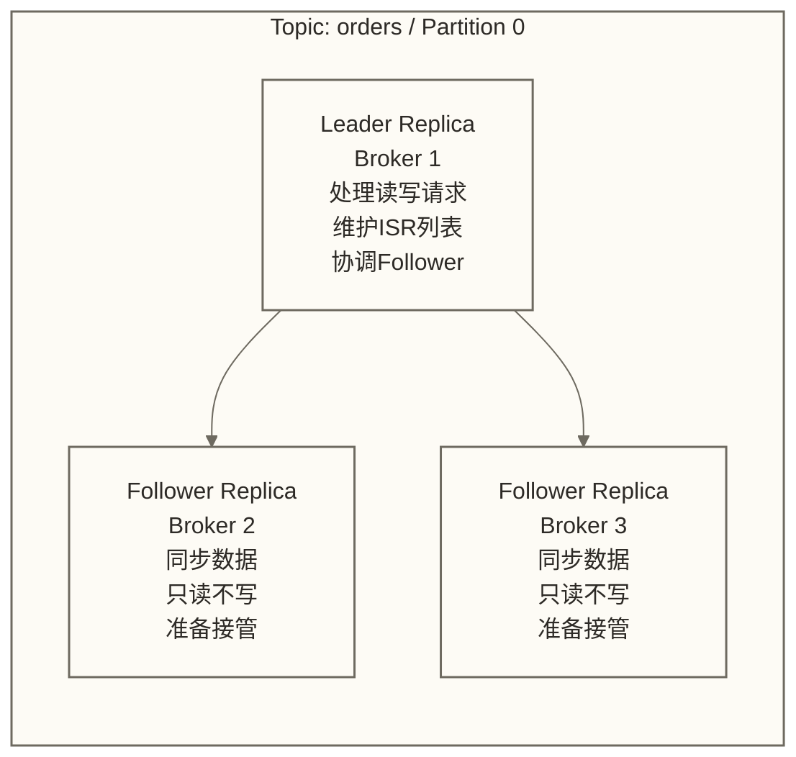

# 副本机制与一致性 - 数据安全的守护者

> [!abstract] 📋 本节概览
> - 🎯 学习目标：深入理解Kafka副本机制和数据一致性保证
> - 📚 前置知识：[[【技术与工具】/Kafka/09-主题与分区设计|主题与分区]]
> - ⏱️ 预计用时：30分钟
> - 🔗 后续学习：[[【技术与工具】/Kafka/11-偏移量管理|偏移量]]

假设凌晨2点，某电商平台的数据库主机突然宕机，用户的订单数据面临丢失风险。若订单事件此前已成功写入Kafka，Kafka副本机制可在其自身Broker发生故障时，通过符合条件的Follower接任Leader来支持服务恢复，但不能直接恢复数据库主机或保证数据库订单完整。毫秒级恢复和用户无感可作为该假设场景的目标，实际结果取决于故障类型、集群配置及应用恢复流程，而非副本机制的无条件保证。
## 🏗️ 副本架构设计

### 📊 副本角色和关系

**生活类比：** 像公司的主管和副手关系

## 🔄 Leader选举机制

### 👑 Leader选举过程

**生活类比：** 像公司部门经理的选举过程

Leader选举的核心原则：
- 正常Leader选举从ISR中选择符合条件的在线副本
- 候选选择需结合具体选举类型和副本顺序，不能统一表述为“ISR中第一个在线的副本”
- 如果没有可用的ISR候选，根据配置及选举条件决定是否允许不干净选举；选择ISR之外的副本可能导致数据丢失

## 📊 ISR机制详解

### 🔄 ISR动态管理

**ISR（In-Sync Replicas）：** 与Leader保持同步的副本集合

ISR管理规则：
- 副本必须在规定时间内与Leader保持同步
- 超时或滞后过多的副本会被移出ISR
- 追上Leader的副本可以重新加入ISR

## 🔒 一致性保证机制

### 📐 一致性级别

Kafka提供不同级别的一致性保证：

1. **acks=0**: 不等待Broker确认，可能降低确认等待开销，但无法据此保证最高性能，也无法通过确认判断消息是否成功写入
2. **acks=1**: Leader写入后确认，不等待Follower确认；Leader故障时，已确认但尚未复制的消息仍可能丢失
3. **acks=all**: 等待当前ISR中的副本确认；需结合min.insync.replicas和实际ISR状态评估可靠性，不代表端到端数据零丢失

### 🛡️ 数据安全保证

降低已成功确认消息丢失风险的常见配置组合如下；这些配置不是任意故障下的数据零丢失保证，实际效果取决于ISR状态、故障范围及应用端处理：
- `replication.factor >= 3`
- `min.insync.replicas >= 2`
- `acks=all`
- `unclean.leader.election.enable=false`

## ✅ 掌握检查

完成以下检查，确保你已经掌握了Kafka副本机制：

- [ ] 理解副本的角色分工和状态转换
- [ ] 能说明Leader正常选举与不干净选举的原则；触发条件及实际故障切换需进一步学习和验证
- [ ] 理解ISR机制和动态管理原理
- [ ] 掌握不同一致性级别的配置和权衡
- [ ] 能解释副本健康监控的目的；实际配置、监控指标与步骤需进一步学习和验证

## 🔗 学习连接

**前置知识**: [[【技术与工具】/Kafka/09-主题与分区设计|主题与分区]] - Topic和分区设计原则
**下一步学习**: [[【技术与工具】/Kafka/11-偏移量管理|偏移量]] - 深入学习消息偏移量管理
**相关概念**: 
- 分布式一致性理论
- CAP定理
- 拜占庭将军问题

---

> [!tip] 💡 副本设计建议
> 
> 副本机制配置的关键原则：
> - 🎯 **明确目标**：可用性优先还是一致性优先
> - 📊 **量化指标**：基于RTO、RPO等指标设计
> - ⚖️ **成本平衡**：副本数量与存储成本的权衡
> - 🔍 **持续监控**：建立完善的监控和告警体系
> 
> 记住：副本不是越多越好，要在安全性、性能和成本间找到最佳平衡点！ 