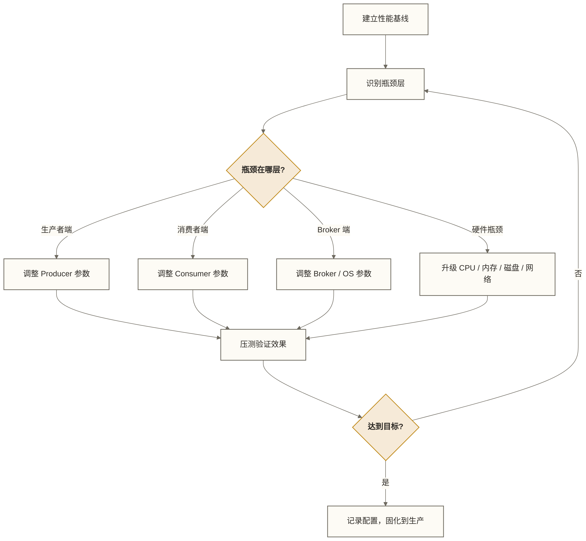

# Kafka 性能调优实战 - 从参数到硬件的系统性优化

> [!abstract] 本节概览
> - 学习目标：掌握 Kafka 生产者、消费者、Broker 以及系统层面的调优参数与实战技巧
> - 前置知识：[[【技术与工具】/Kafka/11-偏移量管理|偏移量管理]]、Kafka 架构
> - 预计用时：40 分钟
> - 后续学习：集群管理与运维

## 目录

- [[#性能调优方法论]]
- [[#生产者调优参数]]
- [[#消费者调优参数]]
- [[#Broker 调优参数]]
- [[#JVM 调优]]
- [[#磁盘与文件系统调优]]
- [[#网络调优]]
- [[#性能基准测试]]
- [[#常见性能瓶颈诊断]]
- [[#掌握检查与练习题]]

---

## 性能调优方法论

性能调优的核心原则是**先测量、再优化、再验证**。没有基线数据的调优是盲目的。



> [!tip] 调优三要素
> 1. **吞吐量（Throughput）**：单位时间内处理的消息数量或字节数，通过增大批次、开启压缩来提升
> 2. **延迟（Latency）**：消息从发送到可消费的时间，与吞吐量通常存在权衡
> 3. **可靠性（Reliability）**：通过 `acks`、副本数、ISR 保证，调优时不可随意降低

---

## 生产者调优参数

### 核心参数对照表

| 参数名 | 默认值 | 推荐值（高吞吐） | 说明 |
|---|---|---|---|
| `batch.size` | 16384 (16 KB) | 65536～131072 (64～128 KB) | 攒批大小上限。增大可提升吞吐，但增加内存消耗和延迟 |
| `linger.ms` | 随客户端版本而异 | 5～20 ms（压测起点） | 批次等待时间。设为 0 表示不额外等待攒批，但不保证消息立即完成发送；5～20 ms 可作为增加攒批机会的实验范围 |
| `compression.type` | none | lz4 | 推荐 lz4（压缩比与 CPU 开销均衡）；日志类数据可用 zstd |
| `buffer.memory` | 33554432 (32 MB) | 67108864 (64 MB) | 生产者缓冲区总内存。若发送速度 > 网络速度会触发阻塞 |
| `max.in.flight.requests.per.connection` | 5 | 5 | 单连接未确认请求数。开启幂等性时需保持 ≤5，并满足其他幂等性配置条件；关闭幂等性且允许重试时，设为 1 可避免多请求在途导致的重排，开启幂等性时不必仅为分区内顺序而降为 1 |
| `acks` | 随客户端版本而异 | 按可靠性要求选择 | `1`=Leader 确认，`all`=所有 ISR 确认。显式开启幂等性时需使用 all；可靠性还需结合副本数、min.insync.replicas 等配置评估 |
| `retries` | 2147483647 | 保持默认 | 与 `delivery.timeout.ms` 配合，不建议设 0 |
| `enable.idempotence` | true（Kafka 3.x） | true | 开启幂等性，防止生产者重试导致同一消息在分区日志中重复写入；吞吐影响需结合负载及配套配置实测，不保证业务端到端恰好一次 |

### 高吞吐场景配置（日志采集类）

```properties
# producer-high-throughput.properties
bootstrap.servers=kafka-01:9092,kafka-02:9092,kafka-03:9092

# 攒批与延迟
batch.size=131072
linger.ms=20
buffer.memory=67108864

# 压缩（lz4 压缩比约 2:1，CPU 开销低）
compression.type=lz4

# 可靠性（允许少量丢失，换取最大吞吐）
acks=1
enable.idempotence=false
max.in.flight.requests.per.connection=5
```

### 低延迟场景配置（金融交易类）

```properties
# producer-low-latency.properties
bootstrap.servers=kafka-01:9092,kafka-02:9092,kafka-03:9092

# 不额外等待攒批；实际发送仍受线程调度、连接状态和背压影响
batch.size=1
linger.ms=0

# 不压缩，避免 CPU 耗时
compression.type=none

# 等 ISR 全部确认；需结合 min.insync.replicas 等配置评估可靠性，不等同于业务强一致
acks=all
enable.idempotence=true
max.in.flight.requests.per.connection=1
```

> [!warning] linger.ms 与 batch.size 的关系
> 以下任意一条满足时，batch 可具备发送条件，但实际发送仍受线程调度、连接状态和背压等因素影响：
> 1. batch 内消息大小达到 `batch.size`
> 2. 等待时间超过 `linger.ms`
>
> 两个参数需要配合使用。单独调大 `batch.size` 而将 `linger.ms` 保持为 0 时，不会额外等待攒批；消息少时攒批效果可能有限，但不保证立即发送。

---

## 消费者调优参数

### 核心参数对照表

| 参数名 | 默认值 | 推荐值（高吞吐） | 说明 |
|---|---|---|---|
| `fetch.min.bytes` | 1 | 1048576 (1 MB) | Broker 返回 Fetch 响应前要等待的最少字节数，减少空轮询 |
| `fetch.max.wait.ms` | 500 ms | 500 ms | 与 `fetch.min.bytes` 配合的最长等待时间 |
| `max.poll.records` | 500 | 1000～2000 | 单次 poll 返回的最大消息数。增大可提升吞吐，但处理超时风险上升 |
| `max.partition.fetch.bytes` | 1048576 (1 MB) | 4194304 (4 MB) | 单分区单次 Fetch 的字节限制，并非绝对上限；应结合允许的最大消息批次、整体抓取限制与客户端内存评估，不要求小于或等于 Broker 的 `message.max.bytes` |
| `max.poll.interval.ms` | 300000 (5 分钟) | 根据业务处理时间调整 | 两次 poll 之间的最大间隔。超时则触发再均衡，导致消费中断 |
| `session.timeout.ms` | 45000 ms | 45000 ms | Consumer 心跳超时时间，超时触发再均衡 |
| `enable.auto.commit` | true | false | 生产环境强烈建议关闭，改为业务处理完成后手动提交 |

### 消费者配置示例

```properties
# consumer-high-throughput.properties
bootstrap.servers=kafka-01:9092,kafka-02:9092,kafka-03:9092
group.id=my-consumer-group

# 批量拉取
fetch.min.bytes=1048576
fetch.max.wait.ms=500
max.poll.records=2000
max.partition.fetch.bytes=4194304

# 会话管理（处理时间较长时适当放大 max.poll.interval.ms）
max.poll.interval.ms=600000
session.timeout.ms=45000
heartbeat.interval.ms=15000

# 手动提交偏移量
enable.auto.commit=false
auto.offset.reset=earliest
```

> [!note] max.poll.records 调优注意事项
> 增大 `max.poll.records` 意味着每批处理更多消息，处理时间可能超过 `max.poll.interval.ms`，触发 Consumer 被踢出 Group 并引发再均衡。调整前先估算：单条消息处理耗时 × max.poll.records < max.poll.interval.ms。

---

## Broker 调优参数

### 网络与 I/O 线程参数

| 参数名 | 默认值 | 推荐值 | 说明 |
|---|---|---|---|
| `num.network.threads` | 3 | CPU 核数 | 处理网络读写的线程数。Broker 是网络密集型，建议等于物理 CPU 核数 |
| `num.io.threads` | 8 | CPU 核数 × 2 | 处理磁盘 I/O 的线程数。I/O 密集，可设为核数的 2 倍 |
| `socket.send.buffer.bytes` | 102400 (100 KB) | 1048576 (1 MB) | Broker 发送 Socket 缓冲区 |
| `socket.receive.buffer.bytes` | 102400 (100 KB) | 1048576 (1 MB) | Broker 接收 Socket 缓冲区 |
| `socket.request.max.bytes` | 104857600 (100 MB) | 104857600 | 单请求最大字节，一般不需要修改 |
| `queued.max.requests` | 500 | 500～1000 | 等待处理的请求队列长度，过大会增加内存压力 |

### 日志存储参数

| 参数名 | 默认值 | 推荐值 | 说明 |
|---|---|---|---|
| `log.dirs` | /tmp/kafka-logs | 多磁盘路径 | 多目录分散 I/O，例如 `/data1/kafka,/data2/kafka` |
| `log.flush.interval.messages` | Long.MAX | Long.MAX | 刷盘消息条数阈值。**建议保持默认，依赖 OS 页缓存**，Kafka 高性能的核心 |
| `log.flush.interval.ms` | Long.MAX | Long.MAX | 刷盘时间间隔。同上，依赖 OS 页缓存而非强制刷盘 |
| `log.segment.bytes` | 1073741824 (1 GB) | 1073741824 | 单 Segment 文件大小，过小会增加文件数量，影响性能 |
| `log.retention.hours` | 168 (7天) | 按业务需求 | 消息保留时长 |

### 副本同步参数

| 参数名 | 默认值 | 推荐值 | 说明 |
|---|---|---|---|
| `num.replica.fetchers` | 1 | 4 | 副本同步线程数。增大可加快 Follower 追赶 Leader 的速度 |
| `replica.fetch.max.bytes` | 1048576 (1 MB) | 4194304 (4 MB) | 单次副本 Fetch 的最大字节数 |
| `replica.lag.time.max.ms` | 30000 ms | 30000 ms | Follower 超过此时间未追上 Leader，则被踢出 ISR |

```properties
# server.properties - 生产环境关键调优配置
num.network.threads=8
num.io.threads=16
socket.send.buffer.bytes=1048576
socket.receive.buffer.bytes=1048576

log.dirs=/data1/kafka,/data2/kafka,/data3/kafka
log.flush.interval.messages=9223372036854775807
log.flush.interval.ms=9223372036854775807
log.segment.bytes=1073741824

num.replica.fetchers=4
replica.fetch.max.bytes=4194304
```

---

## JVM 调优

### 堆内存设置

```bash
# /kafka/bin/kafka-server-start.sh 或通过 KAFKA_HEAP_OPTS 环境变量设置

# 示例起点：6 GB 堆；根据负载、GC 日志与 Page Cache 需求调整，8 GB 不是通用上限
# Kafka 大量依赖 OS Page Cache，过大的堆会挤压 Page Cache 空间
export KAFKA_HEAP_OPTS="-Xmx6g -Xms6g"
```

> [!warning] 为什么 Kafka 不推荐超大堆内存
> Kafka 的高性能基于操作系统的**页缓存（Page Cache）**机制，消息的顺序写入和零拷贝读取都依赖 Page Cache。
> 如果 JVM 堆设置过大（如 32 GB），会严重压缩 OS 可用的 Page Cache 空间，反而降低 I/O 性能。
> **可将物理内存的 25%～30% 作为待验证的容量分配假设，而非通用推荐；应结合堆占用、GC 表现及其他进程和操作系统内存需求，为 Page Cache 留出空间。**

### G1GC 参数配置

```bash
export KAFKA_JVM_PERFORMANCE_OPTS="
  -server
  -XX:+UseG1GC
  -XX:MaxGCPauseMillis=20
  -XX:InitiatingHeapOccupancyPercent=35
  -XX:+ExplicitGCInvokesConcurrent
  -XX:G1HeapRegionSize=16m
  -XX:MinMetaspaceFreeRatio=50
  -XX:MaxMetaspaceFreeRatio=80
  -Djava.awt.headless=true
"
```

| G1GC 参数 | 说明 |
|---|---|
| `-XX:MaxGCPauseMillis=20` | GC 停顿目标时间 20 ms，G1 会据此调整回收策略，但该值不是停顿时间的硬性保证 |
| `-XX:InitiatingHeapOccupancyPercent=35` | 示例将并发标记启动的占用阈值设为 35%；实际触发行为还受 JDK 版本及自适应 IHOP 配置影响，此处不将其视为已获出处支持的 Kafka 官方通用推荐 |
| `-XX:G1HeapRegionSize=16m` | 示例将每个 Region 显式设为 16 MB；6 GB / 2048 约为 3 MB，不能据此推出 16 MB。是否覆盖 G1 的自动 Region 大小选择应结合 GC 日志评估 |

### GC 日志收集

```bash
# 开启 GC 日志（用于分析 GC 频率和停顿时间）
export KAFKA_GC_LOG_OPTS="
  -Xlog:gc*:file=/kafka/logs/kafka-gc.log:time,tags:filecount=10,filesize=100m
"
```

使用 `jstat` 实时观察 GC 情况：

```bash
# 每 5 秒输出一次 GC 统计（pid 替换为 Kafka 进程 ID）
jstat -gcutil $(jps | grep Kafka | awk '{print $1}') 5000
```

---

## 磁盘与文件系统调优

### RAID vs JBOD 选择

| 方案 | 吞吐量 | 可靠性 | Kafka 推荐度 | 说明 |
|---|---|---|---|---|
| RAID 0 | 最高 | 无冗余 | 不推荐 | 单盘故障丢所有数据 |
| RAID 10 | 高 | 好 | 可选 | 成本高，容量利用率 50% |
| JBOD（多 log.dirs） | 高 | 依赖副本 | **推荐** | Kafka 副本机制提供数据冗余，JBOD 最大化利用磁盘并行 I/O |

> [!tip] 为什么 Kafka 推荐 JBOD
> Kafka 的数据可靠性由**副本机制**保证，而不是 RAID。使用 JBOD 配合 `log.dirs` 多目录可以：
> 1. 让每块磁盘独立工作；在分区负载均衡且其他资源不成为瓶颈的假设下，N 块磁盘可增加并行 I/O 能力，但不保证获得 N 倍吞吐
> 2. 某块磁盘故障时，只影响该磁盘上的分区，其他分区继续服务

### 多磁盘 log.dirs 配置

```properties
# 假设服务器有 6 块数据盘，分别挂载在 /data1 ~ /data6
log.dirs=/data1/kafka,/data2/kafka,/data3/kafka,/data4/kafka,/data5/kafka,/data6/kafka
```

Kafka 会将不同分区的日志文件分散到这 6 个目录，实现 I/O 并行。

### 文件系统选择与挂载参数

```bash
# XFS 是 Kafka 的首选文件系统（ext4 也可以）
# /etc/fstab 挂载参数
/dev/sdb1  /data1  xfs  defaults,noatime,nodiratime,inode64  0 0
/dev/sdc1  /data2  xfs  defaults,noatime,nodiratime,inode64  0 0
```

| 挂载选项 | 说明 |
|---|---|
| `noatime` | 不更新文件访问时间，减少写操作 |
| `nodiratime` | 不更新目录访问时间 |
| `inode64` | XFS 使用 64 位 inode，支持超大文件系统 |

### I/O 调度器

```bash
# 先查看目标设备实际支持的调度器；方括号标记当前选择
cat /sys/block/sdb/queue/scheduler
cat /sys/block/nvme0n1/queue/scheduler

# 仅从各设备列出的支持项中选择候选调度器并压测比较。
# 不要直接假定目标内核提供 deadline、noop 或 mq-deadline。
# 如需持久化，应在确认支持项和压测结果后，为明确的目标设备配置 udev 规则，
# 不应未经检查对所有 HDD 强制指定 deadline。
```

---

## 网络调优

### TCP 内核参数

```bash
# /etc/sysctl.conf
# TCP 读写缓冲区
net.core.rmem_default = 131072
net.core.wmem_default = 131072
net.core.rmem_max = 16777216
net.core.wmem_max = 16777216
net.ipv4.tcp_rmem = 4096 131072 16777216
net.ipv4.tcp_wmem = 4096 131072 16777216

# 连接队列
net.core.netdev_max_backlog = 5000
net.ipv4.tcp_max_syn_backlog = 8096

# TIME_WAIT 优化
net.ipv4.tcp_tw_reuse = 1
net.ipv4.tcp_fin_timeout = 15
```

保存配置后，在 shell 中执行：

```bash
sysctl -p
```

### 网卡多队列（Multi-Queue）

对于万兆及以上网卡，开启多队列绑定可以充分利用多核 CPU 处理网络中断：

```bash
# 查看网卡队列数
ethtool -l eth0

# 设置接收和发送队列数（建议等于 CPU 核数）
ethtool -L eth0 combined 16

# 设置 IRQ 亲和性（将不同队列的中断绑定到不同 CPU 核）
# 通常使用 irqbalance 自动完成
systemctl enable irqbalance && systemctl start irqbalance
```

---

## 性能基准测试

### 生产者基准测试

```bash
# 测试高吞吐生产者性能
# 发送 100 万条消息，每条 1 KB，不限速（--throughput -1）
kafka-producer-perf-test.sh \
    --topic perf-test-topic \
    --num-records 1000000 \
    --record-size 1024 \
    --throughput -1 \
    --producer-props \
        bootstrap.servers=kafka-01:9092,kafka-02:9092,kafka-03:9092 \
        acks=1 \
        batch.size=65536 \
        linger.ms=10 \
        compression.type=lz4
```

**输出示例及解读：**

```text
999993 records sent, 189321.9 records/sec (184.88 MB/sec), 4.2 ms avg latency, 182.0 ms max latency, 2 ms 50th, 9 ms 95th, 27 ms 99th, 103 ms 99.9th.
```

| 指标 | 含义 | 优化目标 |
|---|---|---|
| `records/sec` | 每秒发送消息数 | 越大越好 |
| `MB/sec` | 每秒发送字节数 | 越大越好 |
| `avg latency` | 平均延迟 | 越小越好 |
| `max latency` | 最大延迟 | 关注 99th、99.9th 分位 |
| `50th / 95th / 99th` | 延迟百分位数 | 生产场景关注 P99 |

### 消费者基准测试

```bash
# 测试消费者吞吐
kafka-consumer-perf-test.sh \
    --bootstrap-server kafka-01:9092,kafka-02:9092,kafka-03:9092 \
    --topic perf-test-topic \
    --messages 1000000 \
    --threads 1
```

**输出示例及解读：**

```text
start.time, end.time, data.consumed.in.MB, MB.sec, data.consumed.in.nMsg, nMsg.sec, rebalance.time.ms, fetch.time.ms, fetch.MB.sec, fetch.nMsg.sec
2024-03-01 10:00:00, 2024-03-01 10:00:08, 976.56, 121.07, 1000000, 123918.2, 327, 7745, 126.09, 129112.4
```

| 指标 | 含义 |
|---|---|
| `MB.sec` | 整体消费吞吐（含再均衡时间） |
| `fetch.MB.sec` | 纯数据拉取吞吐（排除再均衡时间） |
| `rebalance.time.ms` | 消费者组再均衡耗时 |

---

## 常见性能瓶颈诊断

```mermaid
%%{init: {"theme":"base","themeVariables":{"fontFamily":"PingFang SC, -apple-system, Source Han Serif SC, serif","fontSize":"16px","background":"#FDFBF5","primaryColor":"#FDFBF5","primaryTextColor":"#2D2A26","primaryBorderColor":"#6E6A60","secondaryColor":"#E8EFE8","secondaryBorderColor":"#8FA890","secondaryTextColor":"#2D2A26","tertiaryColor":"#FDFBF5","tertiaryBorderColor":"#9A9488","tertiaryTextColor":"#6E6A60","lineColor":"#6E6A60","textColor":"#2D2A26","mainBkg":"#FDFBF5","nodeBorder":"#2D5A3D","clusterBkg":"#F3EEDF","clusterBorder":"#9A9488","edgeLabelBackground":"#FDFBF5"},"flowchart":{"htmlLabels":true,"curve":"basis","padding":20,"nodeSpacing":60,"rankSpacing":70,"useMaxWidth":false},"themeCSS":".node rect, .node polygon, .node circle { stroke-width: 1.5px; } .edgePath .path { stroke-width: 1.5px; } .cluster-label .nodeLabel, .cluster-label foreignObject { color: #2D2A26 !important; } .edgeLabel, .edgeLabel foreignObject { color: #2D2A26 !important; background-color: #FDFBF5; } .edgeLabel rect { fill: #FDFBF5; }"}}%%
flowchart TD
    classDef default fill:#FDFBF5,stroke:#6E6A60,color:#2D2A26,stroke-width:1.5px
    classDef startend fill:#2D2A26,stroke:#2D2A26,color:#FDFBF5,font-weight:bold
    classDef decision fill:#F6EAD8,stroke:#C08A1A,color:#2D2A26,font-weight:bold
    classDef hub fill:#3B5A80,stroke:#3B5A80,color:#FDFBF5,font-weight:bold
    classDef io fill:#E5EAF0,stroke:#3B5A80,color:#2D2A26
    classDef accent fill:#A6432C,stroke:#A6432C,color:#FDFBF5,font-weight:bold
    classDef storage fill:#F3EEDF,stroke:#9A9488,color:#2D2A26
    A[吞吐量不达预期] --> B{检查 Producer 端}
    B -->|batch.size 小 / linger.ms=0| C[调大 batch.size 和 linger.ms]
    B -->|未开启压缩| D[开启 lz4/zstd 压缩]
    B -->|buffer.memory 不足| E[调大 buffer.memory]
    A --> F{检查 Broker 端}
    F -->|num.io.threads 不足| G[增大 num.io.threads]
    F -->|log.dirs 只有一个目录| H[配置多磁盘多目录]
    F -->|GC 停顿过长| I[调整 G1GC 参数或缩小堆]
    A --> J{检查 Consumer 端}
    J -->|max.poll.records 过小| K[调大 max.poll.records]
    J -->|消费逻辑单线程| L[增加消费线程 / 分区数]
    J -->|频繁再均衡| M[检查 max.poll.interval.ms 是否过小]
    A --> N{检查硬件}
    N -->|磁盘 I/O 打满| O[使用 JBOD 多磁盘 / 换 SSD]
    N -->|网络带宽打满| P[升级网卡 / 开启压缩]
    N -->|CPU 打满| Q[检查是否因压缩类型不当 / GC 问题]
    class B,F,J,N decision
    class A,C,D,E,G,H,I,K,L,M,O,P,Q default
```



| 瓶颈现象 | 诊断命令 | 解决方向 |
|---|---|---|
| Broker CPU 高 | `top` / `jstack` 查线程 | 压缩类型改为 lz4，降低 CPU 开销；检查 GC 频率 |
| 磁盘 I/O 打满 | `iostat -x 1` | 增加 `log.dirs` 磁盘数量，或换 SSD |
| 网络带宽打满 | `sar -n DEV 1` | 开启 Broker 端压缩或 Producer 端压缩 |
| Consumer Lag 持续增长 | `kafka-consumer-groups.sh --describe` | 增加分区数量，横向扩展消费者实例 |
| Under-Replicated 分区增多 | `kafka-topics.sh --describe --under-replicated-partitions` | 增大 `num.replica.fetchers`，检查网络和磁盘 I/O |
| GC 停顿超 200 ms | `jstat -gcutil` 或 GC 日志 | 减小堆大小（释放 Page Cache），调整 G1GC 参数 |

---

## 掌握检查与练习题

### 掌握检查

- [ ] 能够解释 `batch.size` 和 `linger.ms` 之间的协同关系，以及如何配合调优
- [ ] 能够结合堆占用、GC 表现及 Page Cache 需求评估 JVM 堆大小，知道 8 GB 不是通用上限
- [ ] 能够解释 JBOD 相比 RAID 在 Kafka 场景下的优势
- [ ] 会使用 `kafka-producer-perf-test.sh` 跑基准测试并解读关键指标
- [ ] 能够根据 `iostat`、`jstat`、`kafka-consumer-groups.sh` 输出定位性能瓶颈

### 练习题

1. **参数计算题**：一台服务器有 32 核 CPU、128 GB 内存、6 块 HDD，请给出 `num.network.threads`、`num.io.threads`、`KAFKA_HEAP_OPTS`、`log.dirs` 的推荐配置，并说明原因。

2. **场景设计题**：一个实时风控系统要求 P99 端到端延迟 < 10 ms，日均消息量 5 亿条，请设计 Producer 的调优配置，说明各参数选择原因。

3. **问题诊断题**：监控显示 Kafka 集群吞吐量正常，但消费者 Lag 从 0 持续增长到 50 万，且消费者 CPU 使用率只有 20%，请分析可能的原因和排查步骤。

---

**相关文档**：[[【技术与工具】/Kafka/11-偏移量管理|偏移量管理]] | 集群管理与运维 | [[【技术与工具】/Kafka/14-监控与故障排查|监控与故障排查]]
