# Kafka 监控与故障排查 - 核心指标与运维手册

> [!abstract] 本节概览
> - 学习目标：建立 Kafka 完整监控体系，掌握核心指标含义与故障排查方法论
> - 前置知识：集群管理与运维
> - 预计用时：40 分钟
> - 后续学习：[[【技术与工具】/Kafka/12-性能调优实战|性能调优回顾]] | Kafka 知识体系

## 目录

- [[#必须监控的 10 个核心指标]]
- #JMX 指标采集：Prometheus + jmx_exporter
- [[#监控工具对比]]
- [[#消费者 Lag 监控]]
- [[#常见故障排查手册]]
- [[#Log Compaction 原理与配置]]
- [[#掌握检查与练习题]]

---

## 必须监控的 10 个核心指标

以下 10 个指标是 Kafka 运维的最低监控集，任何一个异常都可能预示着集群问题。

| 序号 | 指标名称 | JMX MBean | 告警阈值 | 说明 |
|---|---|---|---|---|
| 1 | **Under-Replicated Partitions** | `kafka.server:type=ReplicaManager,name=UnderReplicatedPartitions` | > 0 持续 1 分钟 | 欠复制分区数。大于 0 说明有 Follower 未跟上 Leader，数据可靠性降低 |
| 2 | **ISR Shrink Rate** | `kafka.server:type=ReplicaManager,name=IsrShrinksPerSec` | > 0.1/sec 持续 2 分钟 | ISR 收缩频率。频繁收缩说明副本同步异常，需排查网络或磁盘 |
| 3 | **Active Controller Count** | `kafka.controller:type=KafkaController,name=ActiveControllerCount` | != 1 超过 30 秒 | 集群活跃 Controller 数。必须且只能为 1，为 0 表示集群无法选举 Leader |
| 4 | **Offline Partitions Count** | `kafka.controller:type=KafkaController,name=OfflinePartitionsCount` | > 0 | 不可用分区数。不为 0 则有分区无法提供服务，直接影响业务 |
| 5 | **Request Queue Size** | `kafka.network:type=RequestChannel,name=RequestQueueSize` | > 50 持续 3 分钟 | 请求队列积压。持续增长说明 Broker 处理能力不足 |
| 6 | **Request Handler Idle Ratio** | `kafka.server:type=KafkaRequestHandlerPool,name=RequestHandlerAvgIdlePercent` | < 0.2（20%）| I/O 线程空闲率。低于 20% 说明 Broker 过载 |
| 7 | **Network Processor Avg Idle Percent** | `kafka.network:type=SocketServer,name=NetworkProcessorAvgIdlePercent` | < 0.3（30%）| 网络线程空闲率。低于 30% 说明网络压力过大 |
| 8 | **Log Flush Rate** | `kafka.log:type=LogFlushStats,name=LogFlushRateAndTimeMs` | 高于基线 2 倍 | 日志刷盘频率与耗时。异常飙升说明磁盘 I/O 存在问题 |
| 9 | **Consumer Lag** | 通过 `kafka-consumer-groups.sh` 或 Burrow 获取 | 按业务定义 | 消费者积压量。持续增长说明消费速度跟不上生产速度 |
| 10 | **Bytes In / Bytes Out Per Sec** | `kafka.server:type=BrokerTopicMetrics,name=BytesInPerSec` | 超过网卡带宽 80% | 每秒流入/流出字节数。逼近硬件上限时需扩容或限流 |

> [!tip] 分级告警建议
> - **P0（立即处理）**：Offline Partitions > 0、Active Controller != 1、Broker 进程宕机
> - **P1（30 分钟内处理）**：Under-Replicated Partitions > 0 持续 5 分钟、Consumer Lag 超阈值
> - **P2（当天处理）**：ISR Shrink 偶发、磁盘使用率 > 70%、Request Handler 空闲率偏低

---

## JMX 指标采集：Prometheus + jmx_exporter

### jmx_exporter 部署方式

jmx_exporter 以 Java Agent 方式挂载到 Kafka 进程，将 JMX 指标转换为 Prometheus 格式，通过 HTTP 接口暴露。

**步骤 1：下载 jmx_exporter**

```bash
wget https://repo1.maven.org/maven2/io/prometheus/jmx/jmx_prometheus_javaagent/0.20.0/jmx_prometheus_javaagent-0.20.0.jar \
    -O /opt/kafka/jmx_prometheus_javaagent.jar
```

**步骤 2：创建指标采集规则文件**

```yaml
# /opt/kafka/jmx_exporter_kafka.yml
# 采集 Kafka 关键 JMX 指标的规则配置

rules:
  # 欠复制分区（最重要的指标）
  - pattern: "kafka.server<type=ReplicaManager, name=UnderReplicatedPartitions><>Value"
    name: kafka_server_replicamanager_underreplicatedpartitions
    help: "Number of under-replicated partitions"
    type: GAUGE

  # ISR 收缩/扩展速率
  - pattern: "kafka.server<type=ReplicaManager, name=(.+)PerSec><>(.+)"
    name: kafka_server_replicamanager_$1_$2
    type: GAUGE

  # 活跃 Controller 数
  - pattern: "kafka.controller<type=KafkaController, name=(.+)><>Value"
    name: kafka_controller_$1
    type: GAUGE

  # 请求指标（生产/消费延迟）
  - pattern: "kafka.network<type=RequestMetrics, name=TotalTimeMs, request=(.+)><>(.+)"
    name: kafka_network_requestmetrics_totaltimems
    labels:
      request: "$1"
      quantile: "$2"
    type: GAUGE

  # Broker 吞吐量
  - pattern: "kafka.server<type=BrokerTopicMetrics, name=(BytesIn|BytesOut|MessagesIn)PerSec><>OneMinuteRate"
    name: kafka_server_brokertopicmetrics_$1_1min_rate
    type: GAUGE

  # 网络线程空闲率
  - pattern: "kafka.network<type=SocketServer, name=NetworkProcessorAvgIdlePercent><>Value"
    name: kafka_network_socketserver_networkprocessoravgidlepercent
    type: GAUGE

  # JVM GC 指标
  - pattern: "java.lang<type=GarbageCollector, name=(.+)><>CollectionCount"
    name: jvm_gc_collection_count_total
    labels:
      gc: "$1"
    type: COUNTER

  - pattern: "java.lang<type=GarbageCollector, name=(.+)><>CollectionTime"
    name: jvm_gc_collection_time_ms_total
    labels:
      gc: "$1"
    type: COUNTER

  # JVM 堆内存
  - pattern: "java.lang<type=Memory><HeapMemoryUsage>(.+)"
    name: jvm_memory_heap_$1_bytes
    type: GAUGE
```

**步骤 3：在 Kafka 启动脚本中加载 Java Agent**

```bash
# 在 /opt/kafka/bin/kafka-server-start.sh 中添加
export KAFKA_OPTS="$KAFKA_OPTS \
  -javaagent:/opt/kafka/jmx_prometheus_javaagent.jar=9090:/opt/kafka/jmx_exporter_kafka.yml"
```

重启 Kafka 后，访问 `http://kafka-01:9090/metrics` 可看到 Prometheus 格式的指标输出。

### Prometheus 采集配置

```yaml
# prometheus.yml 的 scrape_configs 部分
scrape_configs:
  - job_name: 'kafka'
    static_configs:
      - targets:
          - 'kafka-01:9090'
          - 'kafka-02:9090'
          - 'kafka-03:9090'
    scrape_interval: 15s
    metrics_path: /metrics
    relabel_configs:
      - source_labels: [__address__]
        target_label: instance
        regex: '([^:]+)(?::\d+)?'
        replacement: '$1'

  - job_name: 'node'
    static_configs:
      - targets:
          - 'kafka-01:9100'
          - 'kafka-02:9100'
          - 'kafka-03:9100'
    scrape_interval: 15s
```

### Prometheus 告警规则示例（YAML 格式，可结合 Grafana 展示）

```yaml
# alerting-rules.yml
groups:
  - name: kafka_alerts
    rules:
      # P0：Kafka 指标端点采集失败（需进一步确认 Broker 状态）
      - alert: KafkaBrokerDown
        expr: up{job="kafka"} == 0
        for: 1m
        labels:
          severity: critical
        annotations:
          summary: "Kafka 指标端点 {{ $labels.instance }} 采集失败"
          description: "指标端点采集失败已持续超过 1 分钟；需进一步检查网络、Exporter 和 Broker 进程状态"

      # P0：存在不可用分区
      - alert: KafkaOfflinePartitions
        expr: kafka_controller_offlinepartitionscount > 0
        for: 1m
        labels:
          severity: critical
        annotations:
          summary: "存在 {{ $value }} 个离线分区"
          description: "离线分区直接影响消息可读写，需立即处理"

      # P1：欠复制分区
      - alert: KafkaUnderReplicatedPartitions
        expr: kafka_server_replicamanager_underreplicatedpartitions > 0
        for: 5m
        labels:
          severity: warning
        annotations:
          summary: "Broker {{ $labels.instance }} 有 {{ $value }} 个欠复制分区"
          description: "数据可靠性降低，需检查 Follower 同步状态"

      # P1：ISR 频繁收缩
      - alert: KafkaISRShrinkRateHigh
        expr: rate(kafka_server_replicamanager_IsrShrinks_total[5m]) > 0.1
        for: 2m
        labels:
          severity: warning
        annotations:
          summary: "Broker {{ $labels.instance }} ISR 收缩频率过高"

      # P1：Consumer Lag 超阈值（需配合 Lag 指标采集）
      - alert: KafkaConsumerLagHigh
        expr: kafka_consumer_group_lag_sum > 100000
        for: 10m
        labels:
          severity: warning
        annotations:
          summary: "消费者组 {{ $labels.group }} 积压 {{ $value }} 条消息"
```

---

## 监控工具对比

| 工具 | 类型 | 主要功能 | 适用场景 | 维护状态 |
|---|---|---|---|---|
| **Kafka Manager (CMAK)** | Web UI | Topic 管理、Broker 状态、分区重分配 | 开发/测试环境，日常运维操作 | 雅虎开源，更名为 CMAK，社区维护 |
| **Cruise Control** | 智能运维平台 | 自动负载均衡、异常检测、容量规划 | 大规模生产集群，自动化运维 | LinkedIn 开源，活跃维护 |
| **Burrow** | Lag 监控专用 | Consumer Lag 多维度监控、告警推送 | Consumer Lag 精细化监控 | LinkedIn 开源，推荐在生产使用 |
| **Confluent Control Center** | 商业 Web UI | 全面监控、数据血缘、Schema 管理 | Confluent 平台用户 | 商业产品 |
| **Prometheus + Grafana** | 通用监控栈 | 指标采集、可视化、告警 | 已有 Prometheus 体系的团队 | 开源，最流行 |

> [!note] 工具选择建议
> - **小型团队（< 10 个 Broker）**：CMAK + Prometheus/Grafana 组合即可满足需求
> - **中大型团队（> 10 个 Broker）**：增加 Burrow 做专业 Lag 监控，考虑 Cruise Control 实现自动化运维
> - **超大规模（100+ 个 Broker）**：可将 Cruise Control 作为自动化运维候选，用于分区重分配和 Leader 平衡；是否采用应结合部署兼容性、运维能力和其他调度方案评估

---

## 消费者 Lag 监控

### 使用 kafka-consumer-groups.sh 手动检查

```bash
# 查看所有消费者组的 Lag 汇总
bin/kafka-consumer-groups.sh \
    --bootstrap-server kafka-01:9092 \
    --describe \
    --all-groups

# 查看指定消费者组详细 Lag（每个分区）
bin/kafka-consumer-groups.sh \
    --bootstrap-server kafka-01:9092 \
    --group my-consumer-group \
    --describe
```

输出中，`LAG` 列为 0 表示该分区的已提交消费位点与日志末端位点没有差距，不单独证明业务处理正常；Lag 持续增长时，应结合生产速率、位点提交方式和下游处理情况排查。

### Burrow：专业的 Lag 监控工具

Burrow 是 LinkedIn 开源的 Kafka Consumer Lag 监控系统，相比简单查看当前 Lag 值，Burrow 会分析 Lag 的**变化趋势**，判断消费是否健康。

**Burrow 的健康评估逻辑：**
- `OK`：消费正常，Lag 稳定或减少
- `WARNING`：消费有延迟但仍在消费
- `ERR`：消费停止或 Lag 持续增长

```yaml
# burrow.toml - Burrow 配置文件示例
[general]
  pidfile = "/var/run/burrow.pid"
  stdout-logfile = "/var/log/burrow/burrow.log"

[zookeeper]
  servers = [ "zk-01:2181", "zk-02:2181", "zk-03:2181" ]
  timeout = 6
  root-path = "/burrow"

[kafka "production"]
  servers = [ "kafka-01:9092", "kafka-02:9092", "kafka-03:9092" ]
  client-id = "burrow-monitor"
  offset-refresh = 10
  group-denylist = "^(console-consumer-|python-kafka-consumer-|test-consumer-)"

[httpserver "default"]
  address = ":8000"
```

**Burrow HTTP API 使用：**

```bash
# 查看所有消费者组状态
curl http://burrow:8000/v3/kafka/production/consumer

# 查看指定消费者组的健康状态
curl http://burrow:8000/v3/kafka/production/consumer/my-consumer-group/status

# 返回示例
{
  "status": {
    "cluster": "production",
    "group": "my-consumer-group",
    "status": "OK",
    "complete": true,
    "partitions": [...]
  }
}
```

---

## 常见故障排查手册

| 故障现象 | 可能原因 | 排查步骤 | 解决方案 |
|---|---|---|---|
| **Under-Replicated Partitions 高** | Broker 负载过重；磁盘 I/O 满；网络异常；Follower GC 停顿 | 1. `kafka-topics.sh --under-replicated-partitions` 定位分区<br>2. `iostat -x 1` 检查磁盘 I/O<br>3. 检查 Broker GC 日志<br>4. `ping` 测试节点间网络延迟 | 增大 `num.replica.fetchers`；检查并修复磁盘问题；增加 Broker 节点 |
| **Consumer Lag 持续增长** | 消费速度不足；分区数过少；消费者频繁再均衡；消费逻辑有阻塞 | 1. 检查消费者 CPU/内存使用率<br>2. 比较分区数与消费者数的关系<br>3. 查看 Rebalance 日志<br>4. 检查下游系统（DB、API）是否有瓶颈 | 增加分区数和消费者实例数；优化消费逻辑；调大 `max.poll.interval.ms` |
| **Leader 选举频繁或 ISR 频繁收缩（两者需分别确认）** | 网络抖动；ZooKeeper 会话超时；Broker GC 停顿导致心跳超时 | 1. 检查 ZooKeeper 日志<br>2. 检查 `zookeeper.session.timeout.ms` 配置<br>3. 检查 Broker GC 停顿时间 | 调大 ZooKeeper 会话超时；优化 JVM GC；检查网络稳定性 |
| **消息堆积（Topic 积压）** | Producer 突发流量；Broker 磁盘写入慢；Consumer 下线 | 1. 检查 `BytesInPerSec` 是否异常飙升<br>2. 检查 `iostat` 磁盘写入速率<br>3. 检查 Consumer 实例是否在线 | 临时限制 Producer 发送速率（Quota）；扩容 Broker；拉起 Consumer |
| **Broker 内存 OOM** | JVM 堆设置过大挤压 Page Cache；直接内存泄漏；Page Cache 被其他进程占用 | 1. `jmap -heap <pid>` 分析堆使用<br>2. `free -m` 查看 Page Cache<br>3. 检查是否有其他进程占用内存 | 先区分 Java 堆耗尽、直接内存异常与系统内存不足：堆耗尽时分析对象占用并按容量调整堆；仅在堆过大挤压系统可用内存且堆使用有余量时考虑调小堆；直接内存异常需检查缓冲区使用与泄漏；系统内存不足时评估扩容或关闭不必要的进程 |
| **磁盘空间不足** | 日志保留时间过长；Compaction 未及时触发；日志目录磁盘容量不足 | 1. `df -h` 检查各数据目录磁盘使用<br>2. 检查 `log.retention.hours` 配置<br>3. 检查 Compaction 状态 | 缩短保留时间；增加磁盘；迁移部分 Topic 到其他目录 |
| **客户端连接失败** | `advertised.listeners` 配置错误；防火墙拦截；Broker 进程异常 | 1. 检查 `advertised.listeners` 是否与客户端网络可达<br>2. `telnet kafka-01 9092` 测试端口<br>3. `jps` 确认 Kafka 进程在运行 | 修正 `advertised.listeners`；开放防火墙端口；重启 Broker |

### 快速健康检查脚本

```bash
#!/bin/bash
# kafka-health-check.sh - Kafka 集群快速健康检查

BOOTSTRAP="kafka-01:9092"
KAFKA_HOME="/opt/kafka"

echo "======= Kafka 集群健康检查 ======="
echo "时间: $(date)"
echo ""

# 1. Under-Replicated Partitions
echo "[1] 欠复制分区检查："
UNDER_REP=$($KAFKA_HOME/bin/kafka-topics.sh \
    --bootstrap-server $BOOTSTRAP \
    --describe --under-replicated-partitions 2>/dev/null)
if [ -z "$UNDER_REP" ]; then
    echo "  [OK] 无欠复制分区"
else
    echo "  [WARN] 存在欠复制分区:"
    echo "$UNDER_REP"
fi

# 2. Offline Partitions
echo ""
echo "[2] 离线分区检查："
OFFLINE=$($KAFKA_HOME/bin/kafka-topics.sh \
    --bootstrap-server $BOOTSTRAP \
    --describe --unavailable-partitions 2>/dev/null)
if [ -z "$OFFLINE" ]; then
    echo "  [OK] 无离线分区"
else
    echo "  [CRITICAL] 存在离线分区:"
    echo "$OFFLINE"
fi

# 3. Consumer Lag 概览（列出 Lag > 10000 的消费者组）
echo ""
echo "[3] 消费者 Lag 检查（Lag > 10000 的组）："
$KAFKA_HOME/bin/kafka-consumer-groups.sh \
    --bootstrap-server $BOOTSTRAP \
    --all-groups --describe 2>/dev/null | \
    awk 'NR>1 && $6 > 10000 {print "  [WARN] Group=" $1, "Topic=" $2, "Partition=" $3, "Lag=" $6}'

echo ""
echo "======= 检查完成 ======="
```

---

## Log Compaction 原理与配置

Log Compaction 是 Kafka 的一种特殊日志清理策略，与按时间/大小删除（`delete`）不同，Compaction 通过异步清理保留每个 Key 的**最新值**，适用于最新状态重建或数据快照场景；需要完整事件历史的事件溯源不能仅依赖压缩日志。

### 工作原理

```mermaid
%%{init: {"theme":"base","themeVariables":{"fontFamily":"PingFang SC, -apple-system, Source Han Serif SC, serif","fontSize":"16px","background":"#FDFBF5","primaryColor":"#FDFBF5","primaryTextColor":"#2D2A26","primaryBorderColor":"#6E6A60","secondaryColor":"#E8EFE8","secondaryBorderColor":"#8FA890","secondaryTextColor":"#2D2A26","tertiaryColor":"#FDFBF5","tertiaryBorderColor":"#9A9488","tertiaryTextColor":"#6E6A60","lineColor":"#6E6A60","textColor":"#2D2A26","mainBkg":"#FDFBF5","nodeBorder":"#2D5A3D","clusterBkg":"#F3EEDF","clusterBorder":"#9A9488","edgeLabelBackground":"#FDFBF5"},"flowchart":{"htmlLabels":true,"curve":"basis","padding":20,"nodeSpacing":60,"rankSpacing":70,"useMaxWidth":false},"themeCSS":".node rect, .node polygon, .node circle { stroke-width: 1.5px; } .edgePath .path { stroke-width: 1.5px; } .cluster-label .nodeLabel, .cluster-label foreignObject { color: #2D2A26 !important; } .edgeLabel, .edgeLabel foreignObject { color: #2D2A26 !important; background-color: #FDFBF5; } .edgeLabel rect { fill: #FDFBF5; }"}}%%
flowchart LR
    classDef default fill:#FDFBF5,stroke:#6E6A60,color:#2D2A26,stroke-width:1.5px
    classDef startend fill:#2D2A26,stroke:#2D2A26,color:#FDFBF5,font-weight:bold
    classDef decision fill:#F6EAD8,stroke:#C08A1A,color:#2D2A26,font-weight:bold
    classDef hub fill:#3B5A80,stroke:#3B5A80,color:#FDFBF5,font-weight:bold
    classDef io fill:#E5EAF0,stroke:#3B5A80,color:#2D2A26
    classDef accent fill:#A6432C,stroke:#A6432C,color:#FDFBF5,font-weight:bold
    classDef storage fill:#F3EEDF,stroke:#9A9488,color:#2D2A26
    subgraph before["压缩前（日志文件）"]
        direction TB
        A["offset=0: key=user1, val=Alice"]
        B["offset=1: key=user2, val=Bob"]
        C["offset=2: key=user1, val=Alice2"]
        D["offset=3: key=user3, val=Charlie"]
        E["offset=4: key=user2, val=null（墓碑）"]
        F["offset=5: key=user1, val=Alice3"]
    end
    subgraph after["压缩后（保留最新值）"]
        direction TB
        G["offset=3: key=user3, val=Charlie"]
        H["offset=5: key=user1, val=Alice3"]
    end
    before -->|Log Cleaner 执行压缩| after
    class before,A,B,C,D,E,F,after,G,H default
```



- **保留规则**：符合清理条件的旧版本会被异步删除；清理完成前，同一个 Key 的多个版本仍可能存在，不能假定任意时刻都只保留最新消息
- **墓碑消息（Tombstone）**：Value 为 null 的消息用于标记删除，Compaction 后也会被最终清除

### 配置 Compaction Topic

```bash
# 创建使用 compact 策略的 Topic
bin/kafka-topics.sh \
    --bootstrap-server kafka-01:9092 \
    --create \
    --topic user-profiles \
    --partitions 6 \
    --replication-factor 3 \
    --config cleanup.policy=compact \
    --config min.cleanable.dirty.ratio=0.1 \
    --config segment.ms=3600000
```

### Compaction 关键配置参数

| 参数 | 默认值 | 说明 |
|---|---|---|
| `cleanup.policy` | `delete` | `compact`=异步清理同一 Key 的旧版本，用于保留最新状态；`delete,compact`=同时启用两种策略 |
| `min.cleanable.dirty.ratio` | 0.5 | Dirty 消息比例超过此值时触发 Compaction。调小（如 0.1）可更频繁压缩，减少空间占用 |
| `segment.ms` | 7天 | Segment 文件被关闭的时间，只有关闭的 Segment 才能被压缩 |
| `delete.retention.ms` | 86400000 (1天) | 墓碑消息的保留时间，超过后才会被彻底清除 |
| `log.cleaner.threads` | 1 | 执行 Compaction 的后台线程数，大集群可调大 |

```bash
# 为已有 Topic 开启 compact 策略
bin/kafka-configs.sh \
    --bootstrap-server kafka-01:9092 \
    --entity-type topics \
    --entity-name user-profiles \
    --alter \
    --add-config cleanup.policy=compact,min.cleanable.dirty.ratio=0.1
```

> [!note] Compaction 的典型应用场景
> 1. **用户状态表**：存储每个用户的最新属性，Key 为 user_id，更新用户信息时直接写入新消息
> 2. **数据库 CDC（Change Data Capture）**：结合 Debezium，每张表的最终状态以 Compaction Topic 形式保存
> 3. **Kafka Streams 的 Changelog**：有状态流处理应用的状态存储默认使用 Compaction Topic

---

## 掌握检查与练习题

### 掌握检查

- [ ] 能够背出或查出 10 个核心监控指标及其告警阈值
- [ ] 会部署 jmx_exporter 并配置 Prometheus 采集 Kafka JMX 指标
- [ ] 能够解释 Burrow 相比直接查 Consumer Lag 的优势
- [ ] 对照故障排查手册，给定故障现象能列出对应的排查步骤
- [ ] 理解 Log Compaction 的工作原理，能正确配置 compact 策略的 Topic

### 练习题

1. **指标分析题**：某 Kafka 集群监控显示：`Under-Replicated Partitions = 15`，`ISR Shrinks Rate = 0.5/sec`，所有 Broker 进程均存活，请按优先级列出排查步骤，以及最可能的 3 种根因。

2. **告警规则题**：为一个电商订单 Topic（日均 1 亿消息，消费者组 `order-processor` 正常 Lag < 1000）编写 Prometheus 告警规则：当 Lag > 10 万且持续 5 分钟时触发 Warning，当 Lag > 100 万时立即触发 Critical。

3. **Compaction 设计题**：设计一个基于 Kafka Compaction 的用户最新登录时间存储方案：Key 为 user_id，Value 为最后登录时间 JSON，需要支持查询任意用户的最新登录时间，说明 Topic 配置参数、数据写入方式，以及消费该 Topic 后建立按 user_id 查询的状态存储或查询服务；compact Topic 本身不提供按 Key 的随机查询接口。

---

**相关文档**：集群管理与运维 | [[【技术与工具】/Kafka/12-性能调优实战|性能调优实战]] | Kafka 架构
