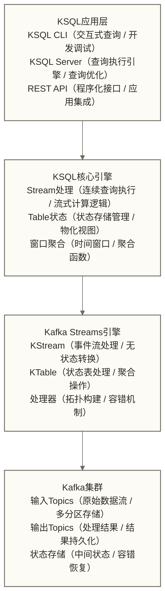

# KSQL流式SQL - 用SQL处理实时数据流

> [!abstract] 📋 本节概览
> - 🎯 学习目标：掌握KSQL的语法和流式数据查询技巧
> - 📚 前置知识：[[【技术与工具】/Kafka/19-Schema Registry|Schema Registry]]
> - ⏱️ 预计用时：35分钟
> - 🔗 后续学习：[[【技术与工具】/Kafka/21-多集群架构设计|多集群架构]]

假设业务分析师小王提出需求：实时计算每个用户最近1小时的购买金额，超过1万元时推送VIP服务通知，希望不编写Java代码。可以用流式SQL构建消费聚合与阈值筛选，再由下游服务消费结果并发送通知；能否满足需求取决于窗口定义、事件时间、迟到数据处理及通知去重等条件。以下以流式SQL学习示例展开，不代表已完成该通知系统。
## 🏗️ KSQL架构概述

### 📊 核心组件



### 🔧 安装和配置

```bash
# !/bin/bash

echo "=== KSQL安装配置 ==="

# 1. 下载KSQL
download_ksql() {
    echo "下载KSQL..."
    
    CONFLUENT_VERSION="7.0.0"
    wget https://packages.confluent.io/archive/7.0/confluent-community-${CONFLUENT_VERSION}.tar.gz
    tar -xzf confluent-community-${CONFLUENT_VERSION}.tar.gz
    cd confluent-${CONFLUENT_VERSION}
    
    echo "KSQL下载完成"
}

# 2. 配置KSQL Server
configure_ksql_server() {
    echo "配置KSQL Server..."
    
    cat > config/ksql-server.properties << 'EOF'
# KSQL Server配置

# 服务监听地址
listeners=http://0.0.0.0:8088

# Kafka集群连接
bootstrap.servers=localhost:9092

# KSQL服务ID（集群中唯一）
ksql.service.id=default_

# 状态存储目录
ksql.streams.state.dir=/tmp/kafka-streams

# Schema Registry连接（可选）
ksql.schema.registry.url=http://localhost:8081

# 查询文件存储位置
ksql.queries.file=/tmp/ksql-queries.sql

# 无有效消费位点时，从最早可用位点开始读取
ksql.streams.auto.offset.reset=earliest

# 性能配置
ksql.streams.num.stream.threads=4
ksql.streams.cache.max.bytes.buffering=50000000

# Kafka Streams处理保证配置；不用于启用交互式查询
ksql.streams.processing.guarantee=exactly_once
EOF
    
    echo "KSQL Server配置完成"
}

# 3. 启动KSQL
start_ksql() {
    echo "启动KSQL..."
    
 # 确保Kafka和Schema Registry已启动
 # bin/kafka-server-start.sh config/server.properties &
 # bin/schema-registry-start config/schema-registry.properties &
    
 # 启动KSQL Server
    bin/ksql-server-start config/ksql-server.properties &
    
    sleep 15
    
 # 检查服务状态
    curl -s http://localhost:8088/info
    
    echo -e "\nKSQL Server启动完成"
}

# 4. 启动KSQL CLI
start_ksql_cli() {
    echo "连接KSQL CLI..."
    
 # 启动交互式CLI
    bin/ksql http://localhost:8088
}

# 5. 健康检查
health_check() {
    echo "执行健康检查..."
    
 # 检查服务状态
    echo "=== 服务状态 ==="
    curl -s http://localhost:8088/info | jq .
    
 # 检查集群信息
    echo -e "\n=== 集群信息 ==="
    curl -s http://localhost:8088/clusterStatus | jq .
    
    echo -e "\nKSQL健康检查完成"
}

# 执行安装配置
download_ksql
configure_ksql_server
start_ksql
health_check

echo "=== 现在可以使用KSQL CLI ==="
echo "运行命令：bin/ksql http://localhost:8088"
```

## 📝 KSQL基础语法

### 🌊 创建Stream和Table

```sql
-- ===== KSQL基础操作示例 =====

-- 1. 显示现有Topics
SHOW TOPICS;

-- 2. 创建Stream（事件流）
CREATE STREAM user_events (
    event_id VARCHAR,
    user_id VARCHAR,
    event_type VARCHAR,
    timestamp BIGINT,
    properties MAP<VARCHAR, VARCHAR>,
    device_info STRUCT<
        device_type VARCHAR,
        os VARCHAR,
        ip_address VARCHAR
    >
) WITH (
    KAFKA_TOPIC = 'user-events',
    VALUE_FORMAT = 'JSON',
    TIMESTAMP = 'timestamp'
);

-- 3. 创建Table（状态表）
CREATE TABLE user_profiles (
    user_id VARCHAR PRIMARY KEY,
    username VARCHAR,
    email VARCHAR,
    age INT,
    registration_date BIGINT,
    status VARCHAR
) WITH (
    KAFKA_TOPIC = 'user-profiles',
    VALUE_FORMAT = 'JSON'
);

-- 4. 查看创建的Streams和Tables
SHOW STREAMS;
SHOW TABLES;

-- 5. 描述Stream结构
DESCRIBE user_events;
DESCRIBE EXTENDED user_events;
```

### 🔍 基础查询操作

```sql
-- ===== 基础查询操作 =====

-- 1. 简单查询（持续查询）
SELECT 
    user_id,
    event_type,
    timestamp
FROM user_events
EMIT CHANGES;

-- 2. 条件过滤
SELECT 
    user_id,
    event_type,
    properties
FROM user_events
WHERE event_type = 'LOGIN'
EMIT CHANGES;

-- 3. 数据转换
SELECT 
    user_id,
    event_type,
    TIMESTAMPTOSTRING(timestamp, 'yyyy-MM-dd HH:mm:ss') AS event_time,
    UCASE(event_type) AS event_type_upper,
    device_info->device_type AS device_type
FROM user_events
EMIT CHANGES;

-- 4. 聚合查询
SELECT 
    user_id,
    COUNT(*) AS event_count,
    LATEST_BY_OFFSET(event_type) AS latest_event
FROM user_events
GROUP BY user_id
EMIT CHANGES;

-- 5. 窗口聚合
SELECT 
    user_id,
    WINDOWSTART AS window_start,
    WINDOWEND AS window_end,
    COUNT(*) AS events_per_minute
FROM user_events
WINDOW TUMBLING (SIZE 1 MINUTE)
GROUP BY user_id
EMIT CHANGES;
```

## 🔄 高级查询操作

### 🔗 Stream连接操作

```sql
-- ===== Stream和Table连接 =====

-- 1. Stream-Table连接（用户事件关联用户信息）
CREATE STREAM enriched_user_events AS
SELECT 
    e.event_id,
    e.user_id,
    e.event_type,
    e.timestamp,
    u.username,
    u.email,
    u.age,
    e.device_info
FROM user_events e
LEFT JOIN user_profiles u ON e.user_id = u.user_id
EMIT CHANGES;

-- 2. Stream-Stream连接（需要窗口）
CREATE STREAM user_sessions AS
SELECT 
    l.user_id,
    l.timestamp AS login_time,
    o.timestamp AS logout_time,
    (o.timestamp - l.timestamp) AS session_duration
FROM user_events l
INNER JOIN user_events o 
    WITHIN 4 HOURS
    ON l.user_id = o.user_id
WHERE l.event_type = 'LOGIN' 
    AND o.event_type = 'LOGOUT'
EMIT CHANGES;

-- 3. 创建用户行为汇总表
CREATE TABLE user_behavior_summary AS
SELECT 
    user_id,
    COUNT(*) AS total_events,
    COUNT_DISTINCT(event_type) AS unique_event_types,
    EARLIEST_BY_OFFSET(timestamp) AS first_event_time,
    LATEST_BY_OFFSET(timestamp) AS last_event_time,
    COLLECT_LIST(event_type) AS event_history
FROM user_events
GROUP BY user_id
EMIT CHANGES;
```

### ⏰ 窗口和时间处理

```sql
-- ===== 窗口聚合查询 =====

-- 1. 滚动窗口（不重叠）
CREATE TABLE hourly_user_activity AS
SELECT 
    user_id,
    WINDOWSTART AS hour_start,
    COUNT(*) AS events_per_hour,
    COUNT_DISTINCT(event_type) AS unique_events,
    SUM(CASE WHEN event_type = 'PURCHASE' THEN 1 ELSE 0 END) AS purchases
FROM user_events
WINDOW TUMBLING (SIZE 1 HOUR)
GROUP BY user_id
EMIT CHANGES;

-- 2. 跳跃窗口（重叠）
CREATE TABLE sliding_user_activity AS
SELECT 
    user_id,
    WINDOWSTART AS window_start,
    WINDOWEND AS window_end,
    COUNT(*) AS events_count,
    AVG(CASE WHEN event_type = 'PAGE_VIEW' THEN 1.0 ELSE 0.0 END) AS page_view_rate
FROM user_events
WINDOW HOPPING (SIZE 10 MINUTES, ADVANCE BY 5 MINUTES)
GROUP BY user_id
EMIT CHANGES;

-- 3. 会话窗口
CREATE TABLE user_sessions_summary AS
SELECT 
    user_id,
    WINDOWSTART AS session_start,
    WINDOWEND AS session_end,
    (WINDOWEND - WINDOWSTART) AS session_duration,
    COUNT(*) AS events_in_session,
    COLLECT_LIST(event_type) AS session_events
FROM user_events
WINDOW SESSION (30 MINUTES)
GROUP BY user_id
EMIT CHANGES;

-- 4. 实时活跃用户统计
CREATE TABLE active_users_per_minute AS
SELECT 
    WINDOWSTART AS minute_start,
    COUNT_DISTINCT(user_id) AS active_users,
    COUNT(*) AS total_events
FROM user_events
WINDOW TUMBLING (SIZE 1 MINUTE)
GROUP BY 1
EMIT CHANGES;
```

## 🔧 内置函数和表达式

### 📊 数据处理函数

```sql
-- ===== KSQL内置函数示例 =====

-- 1. 字符串函数
SELECT 
    user_id,
    UCASE(username) AS username_upper,
    LCASE(email) AS email_lower,
    SUBSTRING(email, 1, INSTR(email, '@') - 1) AS email_prefix,
    CONCAT('User: ', username) AS user_label,
    SPLIT(email, '@')[2] AS email_domain
FROM user_profiles
EMIT CHANGES;

-- 2. 数学函数
SELECT 
    user_id,
    age,
    ROUND(age / 10.0) * 10 AS age_group,
    ABS(age - 30) AS age_distance_from_30,
    CASE 
        WHEN age < 18 THEN 'Minor'
        WHEN age < 65 THEN 'Adult'
        ELSE 'Senior'
    END AS age_category
FROM user_profiles
EMIT CHANGES;

-- 3. 时间函数
SELECT 
    user_id,
    timestamp,
    TIMESTAMPTOSTRING(timestamp, 'yyyy-MM-dd') AS event_date,
    TIMESTAMPTOSTRING(timestamp, 'HH:mm:ss') AS event_time,
    DATETOSTRING(UNIX_DATE(timestamp), 'EEEE') AS day_of_week,
    HOUR(STRINGTOTIMESTAMP(TIMESTAMPTOSTRING(timestamp, 'yyyy-MM-dd HH:mm:ss'), 'yyyy-MM-dd HH:mm:ss')) AS hour_of_day
FROM user_events
EMIT CHANGES;

-- 4. JSON处理函数
SELECT 
    user_id,
    properties,
    properties['browser'] AS browser,
    properties['referrer'] AS referrer,
    JSON_ARRAY_LENGTH(EXTRACTJSONFIELD(properties, '$.tags')) AS tags_count
FROM user_events
WHERE properties IS NOT NULL
EMIT CHANGES;

-- 5. 数组和Map操作
SELECT 
    user_id,
    properties['browser'] AS browser,
    properties['platform'] AS platform,
    ARRAY_CONTAINS(SPLIT(properties['tags'], ','), 'premium') AS is_premium_user
FROM user_events
WHERE properties IS NOT NULL
EMIT CHANGES;
```

### 🎯 复杂数据分析

```sql
-- ===== 复杂分析查询 =====

-- 1. 用户漏斗分析
CREATE TABLE user_funnel AS
SELECT 
    user_id,
    SUM(CASE WHEN event_type = 'PAGE_VIEW' THEN 1 ELSE 0 END) AS page_views,
    SUM(CASE WHEN event_type = 'ADD_TO_CART' THEN 1 ELSE 0 END) AS add_to_carts,
    SUM(CASE WHEN event_type = 'PURCHASE' THEN 1 ELSE 0 END) AS purchases,
    CASE 
        WHEN SUM(CASE WHEN event_type = 'PURCHASE' THEN 1 ELSE 0 END) > 0 THEN 'Converted'
        WHEN SUM(CASE WHEN event_type = 'ADD_TO_CART' THEN 1 ELSE 0 END) > 0 THEN 'Interested'
        WHEN SUM(CASE WHEN event_type = 'PAGE_VIEW' THEN 1 ELSE 0 END) > 0 THEN 'Visitor'
        ELSE 'Unknown'
    END AS funnel_stage
FROM user_events
GROUP BY user_id
EMIT CHANGES;

-- 2. 实时异常检测
CREATE STREAM suspicious_activity AS
SELECT 
    user_id,
    event_type,
    timestamp,
    'High frequency activity' AS alert_reason
FROM user_events
WHERE user_id IN (
    SELECT user_id 
    FROM user_events
    WINDOW TUMBLING (SIZE 1 MINUTE)
    GROUP BY user_id
    HAVING COUNT(*) > 100
)
EMIT CHANGES;

-- 3. 用户留存分析
CREATE TABLE user_retention AS
SELECT 
    registration_date,
    COUNT(*) AS total_users,
    COUNT(CASE WHEN last_activity_days <= 1 THEN 1 END) AS day_1_retained,
    COUNT(CASE WHEN last_activity_days <= 7 THEN 1 END) AS day_7_retained,
    COUNT(CASE WHEN last_activity_days <= 30 THEN 1 END) AS day_30_retained
FROM (
    SELECT 
        u.user_id,
        u.registration_date,
        (UNIX_DATE(LATEST_BY_OFFSET(e.timestamp)) - UNIX_DATE(u.registration_date)) AS last_activity_days
    FROM user_profiles u
    LEFT JOIN user_events e ON u.user_id = e.user_id
    GROUP BY u.user_id, u.registration_date
)
GROUP BY registration_date
EMIT CHANGES;

-- 4. 实时推荐候选
CREATE STREAM recommendation_candidates AS
SELECT 
    e.user_id,
    e.event_type,
    e.timestamp,
    u.age,
    CASE 
        WHEN u.age < 25 AND e.event_type = 'PAGE_VIEW' THEN 'youth_products'
        WHEN u.age >= 25 AND u.age < 45 AND e.event_type = 'PURCHASE' THEN 'family_products'
        WHEN u.age >= 45 AND e.event_type = 'PAGE_VIEW' THEN 'premium_products'
        ELSE 'general_products'
    END AS recommendation_category
FROM user_events e
LEFT JOIN user_profiles u ON e.user_id = u.user_id
WHERE e.event_type IN ('PAGE_VIEW', 'PURCHASE', 'ADD_TO_CART')
EMIT CHANGES;
```

## 🚀 实际应用场景

### 📊 实时监控仪表板

```sql
-- ===== 实时监控仪表板数据 =====

-- 1. 系统实时指标
CREATE TABLE system_metrics AS
SELECT 
    TIMESTAMPTOSTRING(WINDOWSTART, 'yyyy-MM-dd HH:mm:ss') AS time_window,
    COUNT(*) AS total_events,
    COUNT_DISTINCT(user_id) AS active_users,
    COUNT_DISTINCT(device_info->device_type) AS device_types,
    SUM(CASE WHEN event_type = 'ERROR' THEN 1 ELSE 0 END) AS error_count,
    AVG(CASE WHEN event_type = 'PAGE_LOAD' 
        THEN CAST(properties['load_time'] AS DOUBLE) 
        ELSE NULL END) AS avg_page_load_time
FROM user_events
WINDOW TUMBLING (SIZE 5 MINUTES)
GROUP BY 1
EMIT CHANGES;

-- 2. 业务核心指标
CREATE TABLE business_kpis AS
SELECT 
    TIMESTAMPTOSTRING(WINDOWSTART, 'yyyy-MM-dd HH:mm:ss') AS time_window,
    COUNT_DISTINCT(CASE WHEN event_type = 'REGISTER' THEN user_id END) AS new_registrations,
    COUNT(CASE WHEN event_type = 'LOGIN' THEN 1 END) AS total_logins,
    COUNT(CASE WHEN event_type = 'PURCHASE' THEN 1 END) AS total_purchases,
    SUM(CASE WHEN event_type = 'PURCHASE' 
        THEN CAST(properties['amount'] AS DOUBLE) 
        ELSE 0 END) AS total_revenue
FROM user_events
WINDOW TUMBLING (SIZE 1 HOUR)
GROUP BY 1
EMIT CHANGES;

-- 3. 用户行为热点
CREATE TABLE user_behavior_heatmap AS
SELECT 
    device_info->device_type AS device_type,
    event_type,
    TIMESTAMPTOSTRING(WINDOWSTART, 'HH') AS hour_of_day,
    COUNT(*) AS event_count,
    COUNT_DISTINCT(user_id) AS unique_users
FROM user_events
WINDOW TUMBLING (SIZE 1 HOUR)
GROUP BY device_info->device_type, event_type, TIMESTAMPTOSTRING(WINDOWSTART, 'HH')
EMIT CHANGES;
```

### 🔔 实时告警系统

```sql
-- ===== 实时告警规则 =====

-- 1. 错误率告警
CREATE STREAM error_rate_alerts AS
SELECT 
    'ERROR_RATE_HIGH' AS alert_type,
    TIMESTAMPTOSTRING(WINDOWSTART, 'yyyy-MM-dd HH:mm:ss') AS alert_time,
    total_events,
    error_events,
    error_rate,
    'Error rate exceeded 5%' AS alert_message
FROM (
    SELECT 
        WINDOWSTART,
        COUNT(*) AS total_events,
        SUM(CASE WHEN event_type = 'ERROR' THEN 1 ELSE 0 END) AS error_events,
        CAST(SUM(CASE WHEN event_type = 'ERROR' THEN 1 ELSE 0 END) AS DOUBLE) / COUNT(*) AS error_rate
    FROM user_events
    WINDOW TUMBLING (SIZE 5 MINUTES)
    GROUP BY WINDOWSTART
)
WHERE error_rate > 0.05
EMIT CHANGES;

-- 2. 异常用户行为告警
CREATE STREAM suspicious_user_alerts AS
SELECT 
    'SUSPICIOUS_USER_ACTIVITY' AS alert_type,
    user_id,
    TIMESTAMPTOSTRING(WINDOWSTART, 'yyyy-MM-dd HH:mm:ss') AS alert_time,
    event_count,
    unique_event_types,
    'User with abnormally high activity' AS alert_message
FROM (
    SELECT 
        user_id,
        WINDOWSTART,
        COUNT(*) AS event_count,
        COUNT_DISTINCT(event_type) AS unique_event_types
    FROM user_events
    WINDOW TUMBLING (SIZE 1 MINUTE)
    GROUP BY user_id, WINDOWSTART
)
WHERE event_count > 50 OR unique_event_types > 10
EMIT CHANGES;

-- 3. 收入下降告警
CREATE STREAM revenue_drop_alerts AS
SELECT 
    'REVENUE_DROP' AS alert_type,
    TIMESTAMPTOSTRING(current_window, 'yyyy-MM-dd HH:mm:ss') AS alert_time,
    current_revenue,
    previous_revenue,
    revenue_change_percent,
    'Revenue dropped significantly' AS alert_message
FROM (
    SELECT 
        current_window,
        current_revenue,
        LAG(current_revenue) OVER (ORDER BY current_window) AS previous_revenue,
        ((current_revenue - LAG(current_revenue) OVER (ORDER BY current_window)) / 
         LAG(current_revenue) OVER (ORDER BY current_window)) * 100 AS revenue_change_percent
    FROM (
        SELECT 
            WINDOWSTART AS current_window,
            SUM(CAST(properties['amount'] AS DOUBLE)) AS current_revenue
        FROM user_events
        WHERE event_type = 'PURCHASE'
        WINDOW TUMBLING (SIZE 1 HOUR)
        GROUP BY WINDOWSTART
    )
)
WHERE revenue_change_percent < -20
EMIT CHANGES;
```

## 🔧 KSQL管理和优化

### ⚙️ 查询管理

```bash
# !/bin/bash

# KSQL管理脚本

# 1. 查询管理操作
manage_queries() {
    echo "=== KSQL查询管理 ==="
    
 # 显示所有持续查询
    curl -X POST http://localhost:8088/ksql \
         -H "Content-Type: application/json" \
         -d '{"ksql": "SHOW QUERIES;"}' | jq .
    
 # 显示查询详情
    curl -X POST http://localhost:8088/ksql \
         -H "Content-Type: application/json" \
         -d '{"ksql": "EXPLAIN query_id;"}' | jq .
    
 # 终止查询
 # curl -X POST http://localhost:8088/ksql \
 #      -H "Content-Type: application/json" \
 #      -d '{"ksql": "TERMINATE query_id;"}' | jq .
}

# 2. 性能监控
monitor_performance() {
    echo "=== KSQL性能监控 ==="
    
 # 查看服务器状态
    curl -s http://localhost:8088/status | jq .
    
 # 查看集群状态
    curl -s http://localhost:8088/clusterStatus | jq .
    
 # 查看查询统计
    curl -X POST http://localhost:8088/ksql \
         -H "Content-Type: application/json" \
         -d '{"ksql": "SHOW QUERIES EXTENDED;"}' | jq .
}

# 3. 数据质量检查
check_data_quality() {
    echo "=== 数据质量检查 ==="
    
 # 检查空值比例
    curl -X POST http://localhost:8088/ksql \
         -H "Content-Type: application/json" \
         -d '{
             "ksql": "SELECT COUNT(*) as total, COUNT(user_id) as non_null_users, (COUNT(*) - COUNT(user_id)) as null_users FROM user_events EMIT CHANGES LIMIT 1;"
         }' | jq .
    
 # 检查数据分布
    curl -X POST http://localhost:8088/ksql \
         -H "Content-Type: application/json" \
         -d '{
             "ksql": "SELECT event_type, COUNT(*) as count FROM user_events GROUP BY event_type EMIT CHANGES LIMIT 10;"
         }' | jq .
}

# 执行管理操作
manage_queries
monitor_performance
check_data_quality
```

### 🚀 性能优化策略

```sql
-- ===== KSQL性能优化示例 =====

-- 1. 合理的分区策略
CREATE STREAM optimized_user_events 
WITH (PARTITIONS = 12, REPLICAS = 3) AS
SELECT 
    user_id,
    event_type,
    timestamp,
    device_info
FROM user_events
PARTITION BY user_id
EMIT CHANGES;

-- 2. 使用合适的窗口大小
-- 避免过小的窗口导致频繁计算
CREATE TABLE optimized_user_activity AS
SELECT 
    user_id,
    WINDOWSTART AS window_start,
    COUNT(*) AS event_count
FROM user_events
WINDOW TUMBLING (SIZE 5 MINUTES)  -- 合理的窗口大小
GROUP BY user_id
EMIT CHANGES;

-- 3. 减少不必要的JOIN操作
-- 只JOIN必要的字段
CREATE STREAM efficient_enriched_events AS
SELECT 
    e.user_id,
    e.event_type,
    e.timestamp,
    u.username  -- 只选择需要的字段
FROM user_events e
LEFT JOIN user_profiles u ON e.user_id = u.user_id
EMIT CHANGES;

-- 4. 使用LIMIT减少测试查询的数据量
SELECT user_id, event_type, timestamp
FROM user_events
EMIT CHANGES
LIMIT 100;

-- 5. 合理使用过滤条件
-- 早期过滤减少处理数据量
CREATE STREAM filtered_events AS
SELECT *
FROM user_events
WHERE event_type IN ('LOGIN', 'PURCHASE', 'LOGOUT')  -- 过滤不需要的事件
    AND timestamp > UNIX_TIMESTAMP() - 86400000  -- 只处理最近24小时的数据
EMIT CHANGES;
```

## 🔍 调试和故障排查

```sql
-- ===== KSQL调试查询 =====

-- 1. 检查数据格式
SELECT 
    user_id,
    event_type,
    timestamp,
    TYPEOF(timestamp) AS timestamp_type,
    TYPEOF(properties) AS properties_type
FROM user_events
EMIT CHANGES
LIMIT 10;

-- 2. 验证JOIN结果
SELECT 
    e.user_id,
    e.event_type,
    u.username,
    CASE WHEN u.username IS NULL THEN 'NO_MATCH' ELSE 'MATCHED' END AS join_status
FROM user_events e
LEFT JOIN user_profiles u ON e.user_id = u.user_id
EMIT CHANGES
LIMIT 20;

-- 3. 检查窗口聚合
SELECT 
    WINDOWSTART AS window_start,
    WINDOWEND AS window_end,
    COUNT(*) AS event_count,
    COUNT_DISTINCT(user_id) AS unique_users
FROM user_events
WINDOW TUMBLING (SIZE 1 MINUTE)
GROUP BY WINDOWSTART, WINDOWEND
EMIT CHANGES;

-- 4. 数据采样检查
SELECT 
    user_id,
    event_type,
    properties,
    ROWKEY AS kafka_key,
    ROWTIME AS kafka_timestamp
FROM user_events
WHERE ROWTIME > UNIX_TIMESTAMP() - 300000  -- 最近5分钟的数据
EMIT CHANGES
LIMIT 5;
```

## ✅ 掌握检查

完成以下检查，确保你已经掌握了KSQL：

- [ ] 理解KSQL的核心概念和架构
- [ ] 掌握Stream和Table的创建和查询
- [ ] 能够使用窗口函数进行时间聚合
- [ ] 熟悉连接操作和复杂查询
- [ ] 了解性能优化和故障排查方法

## 🔗 学习连接

**前置知识**: [[【技术与工具】/Kafka/19-Schema Registry|Schema Registry]] - 数据模式管理
**下一步学习**: [[【技术与工具】/Kafka/21-多集群架构设计|多集群架构]] - 企业级架构
**相关概念**: 
- 流式数据处理
- 实时分析系统
- SQL查询优化

---

> [!tip] 💡 KSQL最佳实践
> 
> 使用KSQL的关键建议：
> - 🎯 **合理设计分区**：按照查询模式选择分区键
> - ⏰ **优化窗口大小**：平衡实时性和性能
> - 🔄 **控制查询复杂度**：避免过于复杂的JOIN和聚合
> - 📊 **监控查询性能**：定期检查查询的延迟和吞吐量
> 
> 记住：KSQL让流处理变得简单，但仍需要理解底层的流处理概念！ 