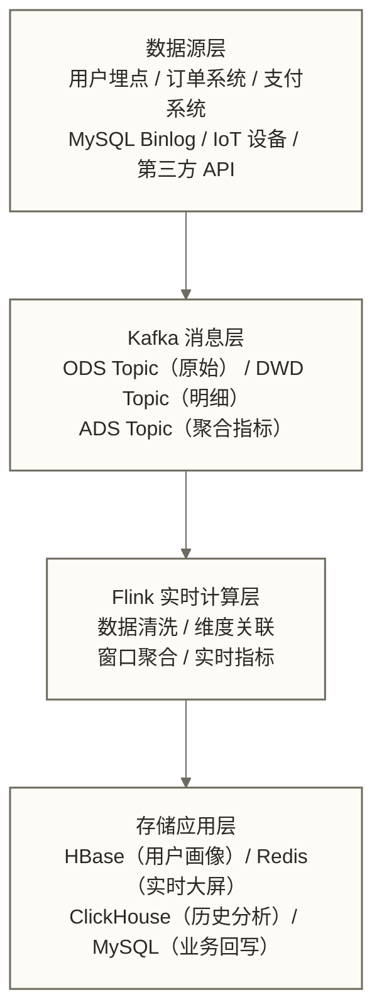
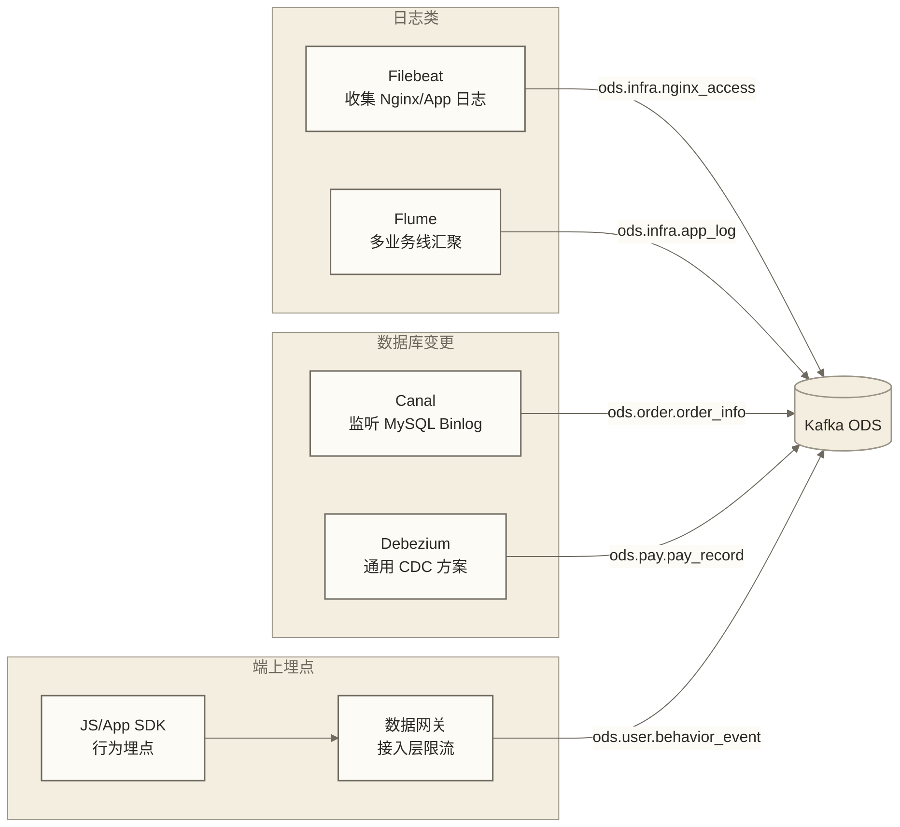
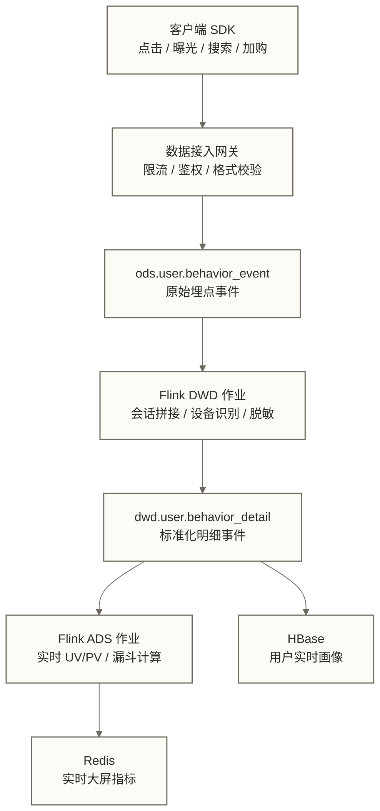
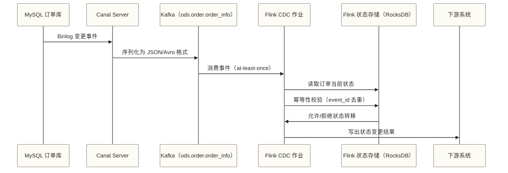
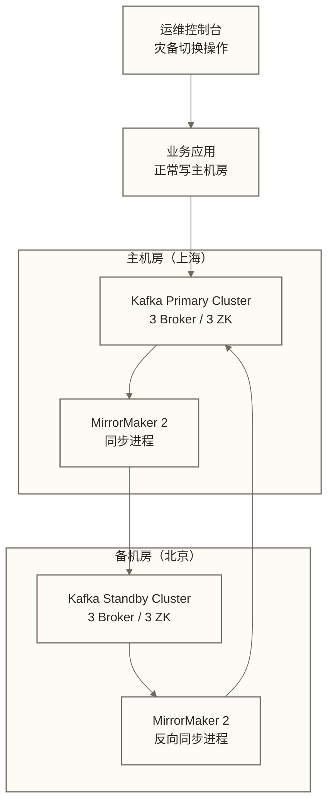
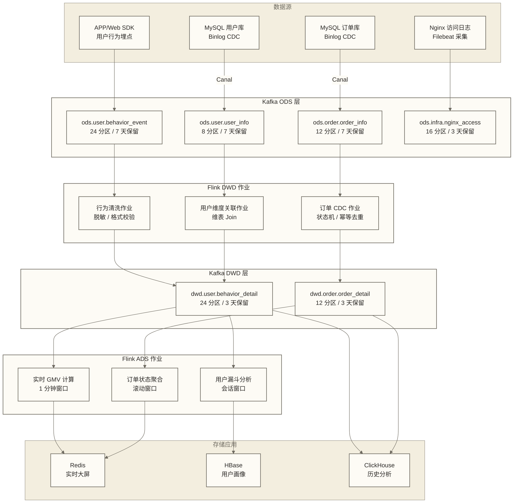

# 企业级项目实战 - Kafka综合应用案例

> [!abstract] 本节概览
> - 学习目标：通过企业级项目掌握 Kafka 综合应用，建立从架构设计到生产运维的完整视角
> - 前置知识：[[【技术与工具】/Kafka/23-Kafka最佳实践|Kafka 最佳实践]]
> - 预计用时：60 分钟
> - 后续学习：[[【技术与工具】/Flink/00-Flink学习路线图|Flink]] 流处理与 Kafka 深度联动

## 项目背景：电商实时数据平台

### 业务需求分析

本项目采用假设性电商平台场景：日活跃用户 5000 万，峰值每秒产生 120 万条事件，涉及用户行为、订单支付、库存变更等十几个业务系统；这些数值是设计输入，不代表已验证的企业实际数据。核心诉求：**实时感知业务状态，分钟级驱动运营决策**。



## 实时数仓全链路架构

### 数据分层与 Topic 命名规范

实时数仓复用离线数仓的分层理念，每一层对应独立的 Kafka Topic，层间由 Flink 作业驱动流转。

| 层次 | 职责 | Topic 命名规范 | 分区数 | 保留时长 |
|------|------|----------------|--------|----------|
| ODS（原始层） | 存储原始事件，不做任何加工 | `ods.{业务域}.{表名}` | 与上游并发对齐 | 7 天 |
| DWD（明细层） | 清洗、脱敏、维度关联后的明细事件 | `dwd.{业务域}.{主题}` | 与 Flink 并发对齐 | 3 天 |
| DWS（汇总层） | 按业务维度的轻度聚合结果 | `dws.{业务域}.{粒度}` | 较少，通常 4-8 | 1 天 |
| ADS（应用层） | 面向大屏、接口的指标推送 | `ads.{应用}.{指标}` | 1-4（低并发消费） | 1 小时 |

```bash
# ODS 层 Topic 创建示例（原始用户事件）
kafka-topics.sh --bootstrap-server kafka-01:9092,kafka-02:9092,kafka-03:9092 \
    --create --topic ods.user.behavior_event \
    --partitions 24 --replication-factor 3 \
    --config retention.ms=604800000 \
    --config compression.type=lz4 \
    --config min.insync.replicas=2

# DWD 层 Topic（清洗后的用户行为明细）
kafka-topics.sh --bootstrap-server kafka-01:9092,kafka-02:9092,kafka-03:9092 \
    --create --topic dwd.user.behavior_detail \
    --partitions 24 --replication-factor 3 \
    --config retention.ms=259200000 \
    --config compression.type=lz4 \
    --config min.insync.replicas=2

# ADS 层 Topic（实时 GMV 指标）
kafka-topics.sh --bootstrap-server kafka-01:9092,kafka-02:9092,kafka-03:9092 \
    --create --topic ads.dashboard.realtime_gmv \
    --partitions 4 --replication-factor 3 \
    --config retention.ms=3600000 \
    --config compression.type=lz4
```

### 数据源到 ODS 的接入方式



## 日志收集系统：多业务线隔离

### Filebeat 到 Kafka 的接入配置片段

日志收集场景的核心挑战：**多业务线 Topic 隔离**（避免互相干扰）+ **日志格式标准化**（方便下游统一处理）。

```yaml
# filebeat.yml - 接入配置示例，非完整生产配置；使用前需确认 Filebeat 版本及 log input 兼容性
filebeat.inputs:
  # 业务线 A：电商订单服务
  - type: log
    paths:
      - /var/log/order-service/*.log
    fields:
      biz_line: order
      env: production
    fields_under_root: true
    multiline:
      pattern: '^\d{4}-\d{2}-\d{2}'
      negate: true
      match: after

  # 业务线 B：用户行为服务
  - type: log
    paths:
      - /var/log/user-service/*.log
    fields:
      biz_line: user
      env: production
    fields_under_root: true

processors:
  # 标准化日志格式：统一添加采集元数据
  - add_fields:
      target: ''
      fields:
        collector_host: "${HOSTNAME}"
        # ${timestamp} 是环境变量替换，不会逐条生成采集时间；动态采集时间需另行处理
        collect_ts: "${timestamp}"
  # 丢弃空行
  - drop_event:
      when:
        equals:
          message: ""

output.kafka:
  hosts: ["kafka-01:9092", "kafka-02:9092", "kafka-03:9092"]
  # 按业务线路由到不同 Topic
  topic: 'ods.%{[biz_line]}.application_log'
  partition.round_robin:
    reachable_only: true
  required_acks: 1
  compression: lz4
  max_message_bytes: 1048576
  # 批量发送提升吞吐
  bulk_max_size: 2048
  flush_timeout: 1s
```

### 日志格式标准化规范

所有接入 ODS 的日志事件必须携带以下标准字段，下游 Flink 作业依赖这些字段进行路由和时间对齐：

```json
{
  "event_id": "uuid-v4",
  "biz_line": "order",
  "env": "production",
  "host": "app-server-01",
  "log_level": "INFO",
  "timestamp": 1700000000000,
  "message": "原始日志内容",
  "collector_host": "filebeat-node-03",
  "collect_ts": 1700000000123
}
```

> [!warning] 时间字段陷阱
> `timestamp` 应使用**业务时间**（事件发生时间），而非采集时间。Flink 的事件时间窗口依赖此字段，若用采集时间会导致窗口计算结果偏差。

## 用户行为分析：埋点事件实时链路

### 端到端架构



### Flink 实时计算核心逻辑

```java
// 用户行为实时分析 Flink 作业（核心片段）
StreamExecutionEnvironment env = StreamExecutionEnvironment.getExecutionEnvironment();
env.setParallelism(24);

// 从 Kafka DWD 层读取
KafkaSource<UserBehaviorEvent> source = KafkaSource.<UserBehaviorEvent>builder()
    .setBootstrapServers("kafka-01:9092,kafka-02:9092,kafka-03:9092")
    .setTopics("dwd.user.behavior_detail")
    .setGroupId("flink-ads-user-behavior")
    .setStartingOffsets(OffsetsInitializer.committedOffsets(OffsetResetStrategy.LATEST))
    .setValueOnlyDeserializer(new UserBehaviorEventDeserializer())
    .build();

DataStream<UserBehaviorEvent> events = env
    .fromSource(source, WatermarkStrategy
        .<UserBehaviorEvent>forBoundedOutOfOrderness(Duration.ofSeconds(10))
        .withTimestampAssigner((e, ts) -> e.getEventTimestamp()), "behavior-source");

// 1 分钟滚动窗口实时 PV/UV
DataStream<PageMetric> pageMetrics = events
    .filter(e -> "PAGE_VIEW".equals(e.getEventType()))
    .keyBy(UserBehaviorEvent::getPageId)
    .window(TumblingEventTimeWindows.of(Time.minutes(1)))
    .aggregate(new PageMetricAggregator(), new PageMetricWindowFunction());

// 写入 Redis 供大屏消费
pageMetrics.addSink(new RedisSink<>(jedisPoolConfig, new PageMetricMapper()));

// 同时写回 ADS Kafka Topic（供其他系统订阅）
pageMetrics.sinkTo(KafkaSink.<PageMetric>builder()
    .setBootstrapServers("kafka-01:9092,kafka-02:9092,kafka-03:9092")
    .setRecordSerializer(KafkaRecordSerializationSchema.builder()
        .setTopic("ads.dashboard.page_metrics")
        .setValueSerializationSchema(new PageMetricSerializer())
        .build())
    .setDeliveryGuarantee(DeliveryGuarantee.AT_LEAST_ONCE)
    .build());
```

## 订单状态机：Canal Binlog 实时同步

### Canal + Kafka + Flink CDC 架构

订单系统的状态变更通过 MySQL Binlog 捕获，经 Canal 转成结构化事件写入 Kafka，再由 Flink 驱动状态机处理。



### Canal 配置要点

```properties
# canal.properties - 核心配置项
canal.instance.mysql.slaveId=1234
canal.instance.master.address=mysql-primary:3306
canal.instance.dbUsername=canal
canal.instance.dbPassword=canal_password

# 输出到 Kafka
canal.mq.servers=kafka-01:9092,kafka-02:9092,kafka-03:9092
canal.mq.topic=ods.order.order_info
# 按 order_id 路由，保证同一订单事件有序
canal.mq.partitionsNum=12
canal.mq.partitionHash=.*\\.order_info:order_id
```

### Flink 状态机幂等性保障

```java
// 订单状态机处理（关键：幂等性校验）
public class OrderStateMachineFunction extends KeyedProcessFunction<String, OrderBinlogEvent, OrderStateChange> {

    // 存储订单当前状态
    private ValueState<OrderState> currentState;
    // 已处理事件 ID；本片段未实现 TTL，24 小时去重窗口需在状态描述符或清理逻辑中另行配置
    private MapState<String, Long> processedEventIds;

    @Override
    public void processElement(OrderBinlogEvent event, Context ctx, Collector<OrderStateChange> out) throws Exception {
        // 1. 幂等性校验
        if (processedEventIds.contains(event.getEventId())) {
            return; // 重复事件，直接跳过
        }

        OrderState state = currentState.value();
        String fromStatus = state != null ? state.getStatus() : "INIT";
        String toStatus = event.getNewStatus();

        // 2. 状态机合法性校验
        if (!isValidTransition(fromStatus, toStatus)) {
            // 记录异常，不抛出（避免消费阻塞）
            log.warn("非法状态转移: orderId={}, from={}, to={}", event.getOrderId(), fromStatus, toStatus);
            return;
        }

        // 3. 更新状态
        currentState.update(new OrderState(toStatus, event.getTimestamp()));
        processedEventIds.put(event.getEventId(), event.getTimestamp());

        // 4. 输出状态变更事件
        out.collect(new OrderStateChange(event.getOrderId(), fromStatus, toStatus, event.getTimestamp()));
    }

    private boolean isValidTransition(String from, String to) {
        // 合法的订单状态流转矩阵
        Map<String, Set<String>> transitions = Map.of(
            "INIT",      Set.of("CREATED"),
            "CREATED",   Set.of("PAID", "CANCELLED"),
            "PAID",      Set.of("SHIPPED", "REFUNDING"),
            "SHIPPED",   Set.of("DELIVERED"),
            "DELIVERED", Set.of("COMPLETED", "REFUNDING"),
            "REFUNDING", Set.of("REFUNDED")
        );
        return transitions.getOrDefault(from, Set.of()).contains(to);
    }
}
```

## 大规模集群运维

### Topic 分区规划原则

分区数是 Kafka 集群最重要的规划决策之一，确定后调整成本极高。

| 规划维度 | 建议 | 说明 |
|----------|------|------|
| 分区数规划起点 | 结合目标消费并行度与实测吞吐确定 | 同一消费组内的分区消费并行度受分区数限制，生产者数量不构成分区数的硬性下限 |
| 分区数上限 | Broker 数量 × 100（经验值） | 过多分区增加 Controller 和 ZooKeeper 负担 |
| 消息量参考 | `单分区 10-50 MB/s` | 超过此吞吐需增加分区 |
| 分区键选择 | 高基数、分布均匀的业务 ID | 避免数据倾斜，`user_id` 好于 `category_id` |
| 扩容时机 | 消费 Lag 持续增长且无法通过参数调优解决 | 分区扩容可能改变按 key 的分区路由；需设计迁移与消费衔接，不能默认保证同一业务键跨扩容的顺序 |

```bash
# 查询集群所有 Topic 的分区分布情况
kafka-topics.sh --bootstrap-server kafka-01:9092 --describe | \
  awk '/Topic:/{topic=$2} /PartitionCount:/{print topic, $0}' | \
  sort -k3 -n -r | head -20

# 检查分区 Leader 分布是否均匀
kafka-topics.sh --bootstrap-server kafka-01:9092 --describe | \
  awk '/Leader:/{print $6}' | sort | uniq -c | sort -rn
```

### Consumer Group 管理规范

```bash
# 查看所有 Consumer Group 的消费 Lag
kafka-consumer-groups.sh --bootstrap-server kafka-01:9092 \
    --describe --all-groups 2>/dev/null | \
    awk 'NR>1 && $6 ~ /^[0-9]+$/ && $6 > 0 {print $1, $2, $3, "LAG="$6}' | \
    sort -t= -k2,2nr | head -20

# 重置指定 Consumer Group 的 Offset（谨慎操作）
# 场景：Flink 作业重启后需要从指定时间点重新消费
kafka-consumer-groups.sh --bootstrap-server kafka-01:9092 \
    --group flink-ads-user-behavior \
    --topic dwd.user.behavior_detail \
    --reset-offsets --to-datetime 2024-01-15T00:00:00.000 \
    --execute
```

### Lag 告警体系

生产环境必须对 Consumer Lag 建立分级告警，防止消息积压影响业务实时性。

```bash
#!/bin/bash
# lag_monitor.sh - Consumer Lag 监控脚本，配合 Prometheus AlertManager 使用

BOOTSTRAP_SERVERS="kafka-01:9092,kafka-02:9092,kafka-03:9092"
LAG_WARN_THRESHOLD=10000      # 告警阈值：积压超过 1 万条
LAG_CRITICAL_THRESHOLD=100000 # 严重阈值：积压超过 10 万条

kafka-consumer-groups.sh --bootstrap-server $BOOTSTRAP_SERVERS \
    --describe --all-groups 2>/dev/null | \
    awk -v warn=$LAG_WARN_THRESHOLD -v critical=$LAG_CRITICAL_THRESHOLD \
    'NR>1 && $6 ~ /^[0-9]+$/ {
        lag = $6 + 0
        if (lag >= critical) {
            printf "CRITICAL: group=%s topic=%s partition=%s lag=%s\n", $1, $2, $3, $6
        } else if (lag >= warn) {
            printf "WARNING: group=%s topic=%s partition=%s lag=%s\n", $1, $2, $3, $6
        }
    }'
```

## 灾备方案：MirrorMaker 2 跨机房同步

### 整体灾备架构



### MirrorMaker 2 配置

```properties
# mm2.properties - 双向同步配置
clusters = primary, standby
primary.bootstrap.servers = kafka-sh-01:9092,kafka-sh-02:9092,kafka-sh-03:9092
standby.bootstrap.servers = kafka-bj-01:9092,kafka-bj-02:9092,kafka-bj-03:9092

# 正向同步：主 -> 备
primary->standby.enabled = true
primary->standby.topics = ods\..*, dwd\..*, dws\..*
# 排除内部 Topic 和已同步的 Topic（避免循环同步）
primary->standby.topics.blacklist = .*\.internal, .*\.replica

# 反向同步：备 -> 主（用于备机房写入场景）
standby->primary.enabled = true
standby->primary.topics = ads\..*

# Offset 同步：用于恢复消费位点；是否可连续恢复还取决于位点转换、目标消费组状态和实际同步结果
primary->standby.sync.group.offsets.enabled = true
primary->standby.sync.group.offsets.interval.seconds = 60

# 性能配置
replication.factor = 3
tasks.max = 8
```

### RPO / RTO 目标与切换演练 Checklist

| 指标 | 目标值 | 实现机制 |
|------|--------|----------|
| RPO（恢复点目标） | < 1 分钟（设计目标，需实测） | 以实际数据复制延迟及故障时未复制的数据量评估；60s 消费位点同步间隔不等于 RPO |
| RTO（恢复时间目标） | < 5 分钟（设计目标，需演练验证） | 完成接入切换、目标 Topic 确认和有效消费位点恢复；auto.offset.reset=latest 在无有效位点时可能跳过已有消息，不能作为连续恢复保障 |

**灾备切换演练 Checklist（每季度执行一次）：**

```bash
# Step 1：确认备机房数据同步状态（Lag 应为 0 或极小值）
kafka-consumer-groups.sh --bootstrap-server kafka-bj-01:9092 \
    --group mirrormaker2-primary-to-standby --describe

# Step 2：停止主机房生产者写入（模拟主机房故障）
# [手动操作：通知各业务方暂停写入或修改配置指向备机房]

# Step 3：在源端核对实际复制消费组的进度；此检查不替代目标数据和消费位点验证
# 必须根据实际部署设置源端地址和复制消费组，不能假定示例组名存在
: "${MM2_SOURCE_BOOTSTRAP:?请设置实际源端 bootstrap.servers}"
: "${MM2_REPLICATION_GROUP:?请设置已确认的实际复制消费组}"
while true; do
    if ! output=$(kafka-consumer-groups.sh \
        --bootstrap-server "$MM2_SOURCE_BOOTSTRAP" \
        --group "$MM2_REPLICATION_GROUP" --describe); then
        echo "复制消费组查询失败，停止追平判断" >&2
        exit 1
    fi
    if ! lag=$(printf '%s\n' "$output" | awk '
        $4 ~ /^[0-9]+$/ && $5 ~ /^[0-9]+$/ && $6 ~ /^[0-9]+$/ {
            sum += $6; records++; next
        }
        $3 ~ /^[0-9]+$/ {invalid = 1}
        END {
            if (records == 0 || invalid) exit 1
            printf "%.0f\n", sum
        }'); then
        echo "无有效分区记录或位点不可用，不能判断追平" >&2
        exit 1
    fi
    echo "源端复制消费组 Lag: $lag"
    [ "$lag" -eq 0 ] && break
    sleep 10
done

# Step 4：修改业务应用的 bootstrap.servers 指向备机房
# [手动操作：更新配置中心或重启各业务应用]

# Step 5：验证备机房消费正常
kafka-consumer-groups.sh --bootstrap-server kafka-bj-01:9092 \
    --describe --all-groups | grep -v "^$" | head -30

# Step 6：记录切换完成时间，计算实际 RTO
echo "灾备切换完成，RTO = $(date)"
```

## 容量规划

### 消息量估算模型

容量规划的输入来自业务估算，输出是 Broker 数量、磁盘大小和网络带宽需求。

```text
输入参数（示例：某电商平台）：
  - 每日消息总量：D = 100 亿条
  - 平均消息体大小：S = 500 字节
  - 峰值/均值流量比：P = 3 倍
  - 数据保留天数：R = 3 天
  - 副本数：RF = 3

计算过程：
  日均总数据量 = D × S = 100亿 × 500B = 5 TB/天
  日均写入速率 = 5TB / 86400s ≈ 60 MB/s
  峰值写入速率 = 60 MB/s × 3 = 180 MB/s（生产者侧）

存储容量：
  原始存储 = D × S × R = 5TB × 3 = 15 TB
  含副本存储 = 15TB × RF = 45 TB
  预留 20% 余量 = 45TB × 1.2 = 54 TB
```

### 扩容时间点判断

| 监控指标 | 扩容阈值 | 处理方式 |
|----------|----------|----------|
| Broker 磁盘使用率 | > 70% | 增加磁盘或迁移分区 |
| 网络带宽使用率 | > 60%（峰值） | 增加 Broker 节点 |
| Consumer Lag 持续增长 | Lag 增长速率 > 0 且无法追平 | 增加分区数或消费者实例 |
| Broker CPU | > 70%（持续 15 分钟） | 减少 Broker 上分区数或升配 |
| ZooKeeper 请求延迟 | > 100ms（p99） | 优化 ZK 集群或迁移至 KRaft 模式 |

```bash
# 存储容量实时监控
kafka-log-dirs.sh --bootstrap-server kafka-01:9092 \
    --topic-list ods.user.behavior_event,dwd.user.behavior_detail \
    --describe 2>/dev/null | \
    python3 -c "
import sys, json
data = json.load(sys.stdin)
for broker in data['brokers']:
    total = sum(log['size'] for log_dir in broker['logDirs'] for log in log_dir['partitions'])
    print(f'Broker {broker[\"broker\"]}: {total/1024/1024/1024:.2f} GB')
"
```

## 完整全链路架构图



## 系统架构设计

### 数据采集实现（核心生产者配置）

```java
// 高性能、高可靠生产者配置
private KafkaProducer<String, GenericRecord> createOptimizedProducer() {
    Properties props = new Properties();
    props.put(ProducerConfig.BOOTSTRAP_SERVERS_CONFIG,
            "kafka-01:9092,kafka-02:9092,kafka-03:9092");
    props.put(ProducerConfig.KEY_SERIALIZER_CLASS_CONFIG, StringSerializer.class);
    props.put(ProducerConfig.VALUE_SERIALIZER_CLASS_CONFIG, KafkaAvroSerializer.class);
    props.put(AbstractKafkaSchemaSerDeConfig.SCHEMA_REGISTRY_URL_CONFIG,
            "http://schema-registry:8081");

    // 可靠性配置：ODS 层要求不丢消息
    props.put(ProducerConfig.ACKS_CONFIG, "all");
    props.put(ProducerConfig.ENABLE_IDEMPOTENCE_CONFIG, true);
    props.put(ProducerConfig.RETRIES_CONFIG, Integer.MAX_VALUE);
    props.put(ProducerConfig.MAX_IN_FLIGHT_REQUESTS_PER_CONNECTION, 5);

    // 性能配置：批量发送降低请求次数
    props.put(ProducerConfig.BATCH_SIZE_CONFIG, 65536);        // 64KB
    props.put(ProducerConfig.LINGER_MS_CONFIG, 5);             // 最多等待 5ms 凑批
    props.put(ProducerConfig.COMPRESSION_TYPE_CONFIG, "lz4");
    props.put(ProducerConfig.BUFFER_MEMORY_CONFIG, 67108864);  // 64MB 发送缓冲区

    return new KafkaProducer<>(props);
}
```

## 掌握检查

完成以下检查，确保已掌握企业级 Kafka 应用：

- [ ] 能描述实时数仓 ODS/DWD/ADS 三层的职责，并说明 Topic 命名规范
- [ ] 理解 Canal Binlog 同步到 Kafka 的配置要点和幂等性保障方式
- [ ] 能设计 Consumer Lag 告警体系，说明分级阈值的设置依据
- [ ] 掌握 MirrorMaker 2 的 RPO/RTO 目标及灾备切换步骤
- [ ] 能独立完成容量规划：从业务量估算出 Broker 数量和磁盘需求

## 练习题

1. 某业务的 Kafka Topic 每天消息量 50 亿条，平均消息大小 1KB，保留 7 天，副本数 3，计算所需总存储容量。
2. Flink 作业消费 Kafka 时发现 Consumer Lag 持续增长，列举至少 5 种可能的原因和对应的排查方法。
3. 如果订单状态机收到了乱序的 Binlog 事件（如先收到 DELIVERED 再收到 SHIPPED），如何处理？
4. 设计一个支持多机房容灾的 Kafka 架构，要求 RPO < 30 秒，RTO < 3 分钟，画出架构图并说明关键配置。

## 相关文档

**前置知识**：[[【技术与工具】/Kafka/23-Kafka最佳实践|Kafka 最佳实践]] - 生产环境经验总结

**完整知识体系**：[[【技术与工具】/Kafka/00-Kafka学习路线图|Kafka 学习路线图]] - 回到起点，温故知新

**生态联动**：Flink 与 Kafka 集成 - 流处理作业开发实战

**存储层**：ClickHouse - 实时分析数仓存储选型

---

> [!tip] 项目成功要素
>
> 企业级 Kafka 项目成功的关键：
> - **需求理解**：深入理解业务 SLA（实时性要求、数据可靠性要求）
> - **架构设计**：分层清晰（ODS/DWD/ADS），Topic 命名规范统一
> - **容量规划**：提前估算，留足 30% 余量，避免突发流量压垮集群
> - **监控运维**：Consumer Lag 告警 + 灾备演练 + 容量预警是三大核心
>
> 好的实时数仓架构，既要能撑住今天的业务量，也要让明天的扩容足够简单。
