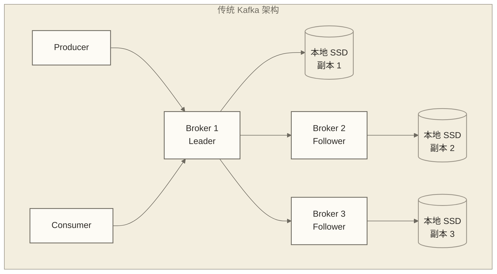
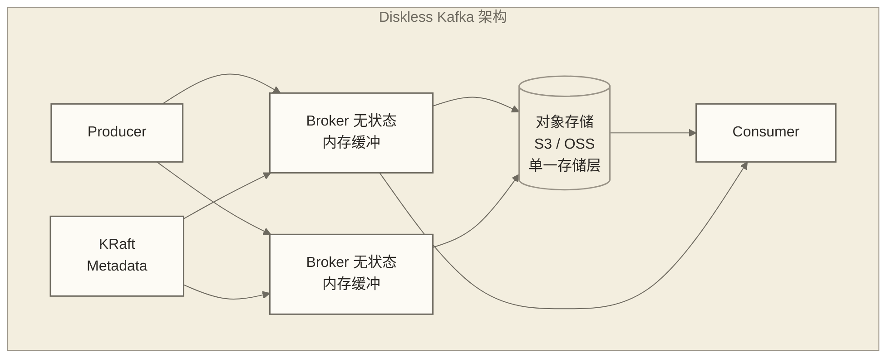
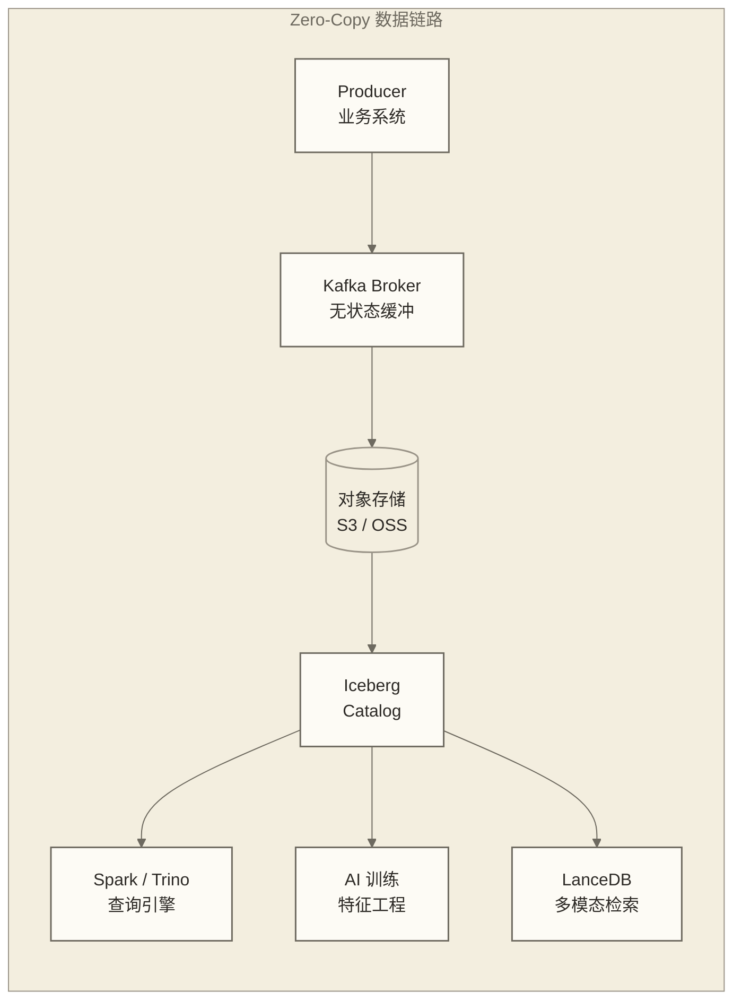

# Diskless Kafka 与对象存储新范式

> [!info] 前置知识
> 阅读本文前，建议先掌握以下内容：
> - [[【技术与工具】/Kafka/02-Kafka架构概述|Kafka 架构基础]]：理解 Broker、副本、分区的概念
> - [[【技术与工具】/Kafka/21-多集群架构设计|多集群架构设计]]：了解跨 AZ 部署与 MirrorMaker
> - [[【技术与工具】/Kafka/12-性能调优实战|Kafka 性能调优实战]]：熟悉本地磁盘调优的上限与瓶颈

---

设想一个用于成本讨论的电商日志平台示例：200 台 Kafka Broker，每台配 25TB SSD，三副本，跨三个可用区。这些数字是示例假设，不代表作者亲历或已证实的企业案例；成本分析还需计入机房空间、运维人力和扩容时的 Rebalance 开销。

进一步假设：其中 70% 以上的数据是七天前的日志，且已无消费需求；这一假设需要与后文七天 Retention 的案例口径区分，不能视为同一集群的已知事实。

但你没办法把它删掉——Kafka 的本地盘模型逼着你必须把所有数据都留在那里，直到 Retention 到期。这就是"本地磁盘时代"的 Kafka：能干，但笨重，而且贵。

2025-2026 年，这件事开始变了。

---

## 一、传统 Kafka 的三个结构性痛点

### 痛点 1：磁盘成本居高不下

Kafka 的高可靠依赖本地 SSD + 多副本。生产环境标配是三副本，意味着每 1TB 数据实际占用 3TB 磁盘。再加上跨 AZ 部署要求，同一份数据在三个机房各存一份。对象存储（S3/OSS）的价格大约是本地 NVMe SSD 的 1/10 到 1/30——这个价差，随着数据量增长，会变成一个无法忽视的窟窿。

### 痛点 2：扩缩容是一场手术，不是一个开关

Kafka 水平扩容不是加机器就行的。新 Broker 加入后，你需要手动执行分区再均衡（Partition Reassignment），Kafka 会在 Broker 之间搬运数据——网络带宽被占满，延迟飙升，运维团队在紧张的业务高峰期如履薄冰。一次扩容往往要提前规划、选择低峰窗口，执行时间从几小时到几天不等。

这是个本质问题：**计算和存储耦合在同一台机器上**，动存储就必须动计算，动计算就必须迁数据。

### 痛点 3：跨云跨区容灾是噩梦

MirrorMaker 2 确实能做跨集群镜像，但它本质上是"再消费一遍"——延迟高、成本翻倍、一致性难保证。地域级故障发生时，切换流程复杂，RPO/RTO 的承诺往往只是 PPT 上的数字。

---

## 二、Diskless Kafka 的核心设计

Diskless Kafka 的思路非常直白：**把"持久化"这件事彻底外包给对象存储**。

Broker 变成无状态的计算节点，本地内存和少量临时磁盘只做写入缓冲——数据落地的那一刻，目的地是 S3 或 OSS，而不是本地 SSD。读取时，热数据从 Broker 内存命中，冷数据直接从对象存储拉取。

副本数量从"3 个 Broker 本地副本"变成"1 份对象存储数据 + 对象存储自身的高可用保证"。即使以文中所述 S3 标准存储的持久性指标为前提，也不能直接推出整条 Kafka 服务链路无需冗余设计；是否减少 Broker 数据副本，取决于具体实现的写入确认、缓冲保护、元数据共识及故障恢复机制。

元数据层同样要去状态化。早期方案用 ZooKeeper，现代实现普遍使用 KRaft（Kafka 原生的 Raft 实现）或外部 metadata store，与数据层彻底解耦。





> [!note] 关键认知转变
> 传统 Kafka 通常通过多个 Broker 保存数据副本；Diskless 方案可将持久化数据的冗余交给对象存储层，但整体高可用仍依赖写入确认前的缓冲保护、元数据共识、计算节点冗余和故障恢复机制。这里转移的是部分数据持久化责任，而不是取消服务链路的可靠性设计。

---

## 三、三大方案横向对比

截至 2026 年 Q1，市场上成熟度最高的三个 Diskless Kafka 方案分别是 AutoMQ、Confluent Freight Cluster 和 Warpstream（已于 2024 年底被 Confluent 收购并整合）。

| 维度 | AutoMQ | Confluent Freight Cluster | Warpstream（已并入 Confluent） |
|------|--------|--------------------------|-------------------------------|
| **Kafka 兼容性** | 100% 兼容 Kafka API | 100% 兼容，基于 Confluent Platform | 100% 兼容 Kafka API |
| **开源情况** | 开源 + 商业版 | 仅商业版 | 已整合进 Confluent Cloud |
| **存储后端** | S3、OSS、MinIO 等 | AWS S3（深度集成） | S3 兼容存储 |
| **写入延迟（P99）** | 50-200ms | 100-300ms | 100-500ms |
| **最低延迟场景** | 适合日志/分析 | 适合批量分析 | 适合吞吐优先场景 |
| **扩缩容速度** | 分钟级，无数据迁移 | 分钟级 | 秒级弹性 |
| **部署形态** | 自托管 / 云托管 | 仅 Confluent Cloud | 仅 Confluent Cloud |
| **成熟度** | 生产可用，社区活跃 | 生产可用，企业级支持 | 已并入主产品，功能持续整合 |
| **适合场景** | 希望控制基础设施的团队 | 已重度使用 Confluent 的企业 | 无运维偏好的云原生场景 |

> [!tip] 选型建议
> - 有本地部署需求或希望保持技术独立性：选 **AutoMQ**，开源社区活跃，文档完善
> - 已在使用 Confluent Platform 且不排斥托管：**Confluent Freight Cluster** 是最小阻力路径
> - 纯云原生、极致弹性优先：Confluent Cloud 上的 Warpstream 整合版是选项

---

## 四、成本与性能的新权衡

这里要诚实地说清楚：Diskless 不是免费午餐，它是一次**明确的 tradeoff**。

### 成本侧：降幅惊人

对象存储（S3 标准层）的价格约为 $0.023/GB/月，而云厂商的 NVMe SSD 约为 $0.17-0.25/GB/月。如果算上三副本放大效应，实际比价是 **5-10 倍以上的差距**。对于存储密集型的 Kafka 集群（数十 TB 以上的 Retention），这个差距会直接体现在月度账单上。

另一个隐性收益是**运维成本**。Broker 无状态化后，机器故障的恢复从"等待数据同步完成"变成"拉起一个新 Broker 实例，从对象存储恢复元数据"——分钟级 vs 小时级。

### 性能侧：延迟是真实代价

对象存储的 PUT 延迟（P99）普遍在 50-200ms 区间，远高于本地 NVMe SSD 的个位数毫秒。这意味着 Diskless Kafka 的端到端 P99 延迟通常在 100-500ms 范围，而传统 Kafka 可以做到 10-50ms。

**这个 tradeoff 在哪些场景下划算：**

| 场景类型 | 延迟要求 | 适合 Diskless？ | 说明 |
|---------|---------|----------------|------|
| 应用日志收集 | 秒级可接受 | 非常适合 | 延迟完全可忍受，存储量大 |
| 业务监控指标 | 10 秒级 | 适合 | 同上 |
| 数据湖 ETL | 分钟级 | 非常适合 | 批量写入效率更高 |
| 用户行为埋点 | 秒级 | 适合 | |
| 实时推荐系统 | 100ms 以内 | 谨慎评估 | 取决于消费侧架构 |
| 金融交易确认 | 10ms 以内 | 不适合 | 延迟要求超出 Diskless 能力 |
| 高频小消息（IoT） | 低延迟 + 高频 | 需测试评估 | 取决于聚合后的对象大小、上传频率、请求费用与延迟预算 |

> [!warning] 大批量优于小频次
> Diskless Kafka 在写入侧会做批量聚合再上传对象存储。如果你的场景是极高频的微小消息（比如每条几十字节、每秒百万条），对象存储请求费用取决于聚合后的对象大小和上传频率，不能按每条消息一次 PUT 推算。应结合批量聚合带来的延迟、请求费用和吞吐测试，再与传统架构比较。

---

## 五、和 Iceberg、LanceDB 的协同：Zero-Copy 数据链路

这是 Diskless Kafka 最令人兴奋的地方，也是它在 2025-2026 年被数据工程师频繁讨论的真正原因——**它和 Iceberg 共用同一个对象存储底座**。

传统的数据链路长这样：

```text
Kafka（本地盘） → Flink/Spark 消费 → 写入 Iceberg（对象存储）
```

中间有一次跨系统的数据搬运。数据从 Kafka 的本地磁盘被读出来，经过计算引擎的内存，再写入对象存储。

Diskless Kafka + Iceberg 的链路变成：



在这个架构设想下，Kafka 与 Iceberg 共用对象存储底座，但这不代表 Kafka 日志天然就是可供 Iceberg 使用的 Parquet/Avro 数据文件。只有具体实现提供兼容的数据文件、表元数据提交及读取机制时，才可能减少重复搬运；否则仍需转换或 ETL。这里的“Zero-Copy”是有条件的协同目标，而非所有 Diskless Kafka 实现自动具备的能力。

结合 [[【技术与工具】/Iceberg/01-Iceberg-V3深度解析|Iceberg V3]] 可进一步讨论流式更新与批量查询的协同，但是否能够减少 Lambda 架构的双写，还取决于数据格式转换、更新语义、表提交机制和查询时效要求，不能仅由 Row Lineage 或并发控制特性推出。

进一步的，[[【技术与工具】/向量数据库/LanceDB多模态Lakehouse实战|LanceDB 的多模态 Lakehouse]] 架构同样可以依托对象存储，但共用存储底座并不保证 Iceberg（结构化查询）、LanceDB（向量检索）、Kafka（实时消费）能直接访问同一份文件；还需明确各自的数据格式、索引、元数据及更新路径。

**对数据工程师意味着什么：** 可以将减少重复存储和搬运作为架构目标，但“一份数据，多个系统共享读写”需要具体实现支持。维护成本与一致性是否改善，应结合转换、索引维护、提交协议及故障恢复成本评估。

这也和 [[【数据开发与数据架构】/09-实时数据架构/01-实时数据架构概述|实时数据架构]] 的演进方向高度吻合——计算无状态化、存储统一化、接口标准化，是这一代架构的三个核心命题。

---

## 六、假设案例：某电商日志平台改造

以下数字与结果按假设示例展示，用于讨论架构权衡和迁移路径，不代表已证实的企业改造成绩；配置容量、利用率、三副本与逻辑数据量的口径尚未统一，不宜据此复算实际收益。

**改造前的状态：**

- 200 台 Kafka Broker，单台 25TB NVMe SSD
- 三副本部署，跨三个 AZ
- 实际存储利用率约 60%，大量空间是"为了扩容预留"
- 每次扩容需要提前 2 周规划，执行窗口 4-8 小时，期间 P99 延迟从 20ms 飙到 200ms 以上
- 日志 Retention 7 天，总数据量约 5PB

**改造目标：** 降低存储成本，解决扩缩容慢的问题。

**改造方案：** 替换为 AutoMQ，存储后端迁移至阿里云 OSS。

**假设的改造后指标：**

| 指标 | 改造前 | 改造后 | 变化 |
|------|--------|--------|------|
| Broker 数量 | 200 台 | 50 台 | -75% |
| 本地存储 | 5PB NVMe SSD | 约 100TB 缓冲 | -98% |
| 存储总成本 | 基准 100% | 约 30% | -70% |
| 扩容耗时 | 4-8 小时 | 3-5 分钟 | -95% |
| 写入 P50 延迟 | 5ms | 30ms | +500% |
| 写入 P99 延迟 | 20ms | 150ms | +650% |

**示例结论：** 若业务允许 P99 150ms，表中的假设延迟可用于日志和监控场景评估。70% 成本降幅与 6 个月回本仅作为情景假设，实际回本周期取决于迁移投入及包含请求、网络、计算和运维的完整成本账单。

代价是真实存在的——P99 延迟从 20ms 涨到 150ms。在本示例中，假设业务侧允许这一日志采集延迟；实时推荐或风控是否可接受，则应依据具体链路的延迟预算判断。

---

## 七、什么场景不该用 Diskless

说清楚"不适用"和说清楚"适用"同样重要。

**低延迟金融交易场景**

对于端到端延迟预算在 10ms 以内、甚至更低的期货、高频外汇或实时风控链路，应特别谨慎评估对象存储写入的延迟。如果确认路径需要等待远端对象上传，可能无法满足该预算；是否可用仍需依据具体实现的确认语义与目标负载下的测试，不能将本文延迟区间视为所有实现的能力下限。

**极高频小消息场景**

IoT 设备上报、游戏实时状态同步可能出现每条消息几十字节、每秒百万条的负载。若延迟约束迫使系统频繁上传小对象，请求费用与元数据开销可能较高；若能有效批量聚合，则不能仅凭消息频率排除 Diskless。应按聚合后的对象大小、上传频率、吞吐与延迟测试结果，与传统 Kafka 或支持分层存储的方案比较。

**本地数据中心无对象存储**

Diskless Kafka 的成本优势完全依赖公有云或私有化对象存储（MinIO 等）的价格差。如果你的数据中心只有本地存储，对象存储的引入本身就是一笔额外的基础设施投入，tradeoff 模型会发生根本性变化。

**对数据主权有严格要求的场景**

某些金融监管要求数据不能出境，或必须存储在特定硬件上。对象存储的多 AZ 分散存储机制可能与这类合规要求产生冲突，需要仔细评估。

---

## 八、落地建议

**新集群：可以直接上 Diskless**

如果是新建集群，且场景属于日志、监控、ETL 这类延迟不敏感的应用，直接选择 Diskless 方案是最简单的决策。迁移前应确认目标 AutoMQ 版本对现有客户端、事务、管理接口和业务依赖功能的兼容范围；业务代码能否保持不变，应通过实际兼容性测试判断。

**老集群：考虑混合模式**

把集群按 Topic 分层：
- 延迟敏感的 Topic（实时推荐、风控）保留在传统 Kafka
- 延迟不敏感的 Topic（日志、监控、CDC 增量）迁移到 Diskless

这种混合模式可以在不影响核心业务的情况下，先把存储大户的成本降下来。

**先在边缘场景试水**

不要从最核心的业务链路开始。选一个流量大但延迟容忍度高的场景（比如应用日志收集），完整跑一个季度，看清楚成本账单、延迟曲线、运维复杂度，再决定是否扩大范围。

```text
迁移优先级建议：
第一批：应用日志、系统监控 → 成本降幅最大，风险最低
第二批：用户行为埋点、CDC 数据 → 数据量大，延迟要求中等
第三批：业务事件流（下单、支付通知）→ 需要充分评估
优先保留传统：严格低延迟的金融交易、实时风控 → 达标验证前不迁；高频 IoT → 按聚合策略、请求费用和延迟测试单独评估
```

关于 [[【技术与工具】/Kafka/12-性能调优实战|性能调优]] 的策略在迁移时同样适用：批量大小、linger.ms、压缩算法的调优在 Diskless 架构下依然有意义，甚至更重要——因为对象存储的上传效率对批次大小更敏感。

---

## 九、和 Kafka 官方路线图的衔接

Diskless Kafka 目前主要是 AutoMQ、Confluent 等商业公司在推动，Apache Kafka 社区的官方态度如何？

**KIP-1150**（Kafka Improvement Proposal）是 Kafka 官方的 Diskless 方案提案，截至 2026 年初仍在讨论和设计阶段。社区已经形成共识：Tiered Storage（分层存储，KIP-405）是过渡方案，Diskless 是终态目标。

KIP-405 分层存储已在 Kafka 3.x 中提供实验性支持——热数据留在本地盘，冷数据自动 offload 到对象存储。这是一个渐进的过渡路径：你不需要一步跳到完全 Diskless，可以先用分层存储把 Retention 成本降下来，等 KIP-1150 成熟后再完整迁移。

**对数据工程师的实践建议：**

1. 关注 AutoMQ 的 GitHub 和版本发布，它是目前最活跃的生产级开源实现
2. 如果你在用 Confluent Platform，Freight Cluster 的 GA 公告值得持续跟进
3. Kafka 官方的 KIP-1150 进展可以通过 Apache Kafka 的 JIRA 和邮件列表追踪
4. 从现在开始，新集群的选型决策应该把 Diskless 方案纳入评估范围

这和 [[【数据开发与数据架构】/09-实时数据架构/03-实时数据处理|实时数据处理]] 架构的演进是同频的：无状态化、存算分离、云原生弹性，不是某一个工具的特性，而是整个实时数据基础设施的演进方向。

---

## 十、掌握检查

- [ ] 能够清晰解释传统 Kafka 的三个结构性痛点，以及 Diskless 如何针对性解决
- [ ] 理解 Broker 无状态化后，副本机制发生了哪些本质变化
- [ ] 能够根据场景特征（延迟要求、消息频率、存储规模）判断是否适合 Diskless
- [ ] 了解 AutoMQ、Confluent Freight Cluster、Warpstream 三者的定位差异
- [ ] 理解 Diskless Kafka + Iceberg Zero-Copy 架构的链路逻辑

---

## 实践练习

**基础题**

1. 你的团队有一个 Kafka 集群，存储了 7 天的 Nginx 访问日志，数据量约 500TB，三副本部署。计算迁移到 Diskless 架构后的预期成本节省比例（假设云厂商 SSD 价格 $0.20/GB/月，S3 标准层 $0.023/GB/月）。

2. 列举 3 个不适合迁移到 Diskless Kafka 的具体业务场景，并解释原因。

**进阶题**

3. 设计一个"混合 Kafka 架构"：同一个 Kafka 集群服务两类 Topic——实时风控消息（P99 要求 < 20ms）和用户行为日志（P99 容忍 500ms）。在 Diskless 架构约束下，你会如何规划这两类 Topic 的存储策略？是否可以在同一个 AutoMQ 集群中实现分级 SLA？

---

## 下一步

掌握 Diskless Kafka 后，建议深入了解与之协同的存储层技术：

- [[【技术与工具】/Iceberg/01-Iceberg-V3深度解析|Iceberg V3 深度解析]]：理解 Table Format 如何承接 Kafka 的数据写入
- [[【技术与工具】/向量数据库/LanceDB多模态Lakehouse实战|LanceDB 多模态 Lakehouse 实战]]：Zero-Copy 链路的 AI 应用侧实现
- [[【数据开发与数据架构】/09-实时数据架构/01-实时数据架构概述|实时数据架构概述]]：在更宏观的架构视角下理解 Diskless Kafka 的位置
- [[【数据开发与数据架构】/09-实时数据架构/04-实时数据存储|实时数据存储]]：对象存储在实时链路中的完整角色
