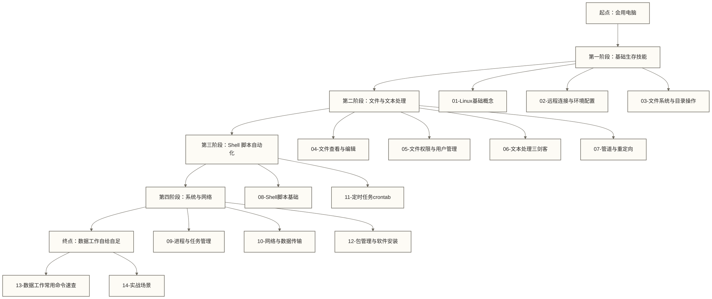

# Linux学习路线图 - 数据从业者实用指南

> [!abstract] 路线图核心信息
> - **学习目标**：掌握数据工作中真正需要的 Linux 和 Shell 技能
> - **适用人群**：数据分析师、数据开发工程师（不是运维工程师）
> - **学习周期**：2-4 周入门，持续在项目中积累
> - **核心理念**：实用主义，只学数据工作真正会用到的
> - **学习结果**：能独立登录服务器、处理数据文件、编写自动化脚本

---

## 为什么数据从业者必须会 Linux

你可能会问：我是做数据分析的，为什么要学 Linux？

现实是这样的：
- 本路线以数据库和大数据组件（Hadoop、Spark、Kafka）部署在 Linux 服务器上的工作环境为学习场景；不提供运行占比统计，实际部署需以所在组织的环境为准
- 数据开发日常工作：登录跳板机 → 连接集群 → 提交作业 → 查看日志
- 数据分析师处理大文件：以 10GB 日志文件为例，简单筛选、提取和统计可尝试用少量 Shell 命令完成；是否适合 Excel、Python 或 Shell，取决于文件结构、处理任务、实现方式和机器资源
- 在本路线设定的 Linux 工作环境中，需学习运行 ETL 脚本和配置定时任务；这类任务也可在其他操作系统或托管平台上运行

> [!tip] 一个示例场景
> 凌晨数据管道报警，你需要：SSH 登录服务器 → 查看错误日志 → 定位问题文件 → 手动修复并重跑任务。
> 这一套流程，不懂 Linux 寸步难行。

---

## 学习路线总览



---

## 各阶段详解

### 第一阶段：基础生存技能（第 1 周）

**目标**：能登录服务器，在 Linux 系统上找到文件、看文件、不迷路。

| 文档 | 核心内容 | 优先级 |
|------|----------|--------|
| [[【技术与工具】/Linux/01-Linux基础概念]] | Linux 是什么、发行版选择、命令行思维 | ⭐⭐⭐ 必学 |
| [[【技术与工具】/Linux/02-远程连接与环境配置]] | SSH 连接、终端工具、环境变量配置 | ⭐⭐⭐ 必学 |
| [[【技术与工具】/Linux/03-文件系统与目录操作]] | 目录结构、增删改查文件和目录 | ⭐⭐⭐ 必学 |

**完成标准**：能 SSH 登录服务器，在目录间导航，找到并操作指定文件。

---

### 第二阶段：文件与文本处理（第 2 周）

**目标**：处理数据文件是数据从业者的核心需求。这一阶段让你用命令行搞定各种文件处理任务。

| 文档 | 核心内容 | 优先级 |
|------|----------|--------|
| [[【技术与工具】/Linux/04-文件查看与编辑]] | 查看大文件、vim 基础、快速编辑 | ⭐⭐⭐ 必学 |
| [[【技术与工具】/Linux/05-文件权限与用户管理]] | 权限概念、chmod、sudo 提权 | ⭐⭐ 重要 |
| [[【技术与工具】/Linux/06-文本处理三剑客]] | grep/sed/awk，数据处理核武器 | ⭐⭐⭐ 必学 |
| [[【技术与工具】/Linux/07-管道与重定向]] | 组合命令、输入输出重定向 | ⭐⭐⭐ 必学 |

**完成标准**：能用命令行处理日志文件，提取关键信息，统计数据。

---

### 第三阶段：Shell 脚本自动化（第 3 周）

**目标**：把重复的手动操作变成自动化脚本，是数据工程师的核心能力。

| 文档 | 核心内容 | 优先级 |
|------|----------|--------|
| [[【技术与工具】/Linux/08-Shell脚本基础]] | 变量、条件、循环、函数，写脚本 | ⭐⭐⭐ 必学 |
| [[【技术与工具】/Linux/11-定时任务crontab]] | 定时执行脚本、日志轮转 | ⭐⭐⭐ 必学 |

**完成标准**：能写一个能实际运行的数据处理 Shell 脚本，并设置定时执行。

---

### 第四阶段：系统与网络（第 4 周）

**目标**：任务管理、软件安装、数据传输，工作中的系统级操作。

| 文档 | 核心内容 | 优先级 |
|------|----------|--------|
| [[【技术与工具】/Linux/09-进程与任务管理]] | 查看进程、后台运行、tmux/screen | ⭐⭐ 重要 |
| [[【技术与工具】/Linux/10-网络与数据传输]] | curl/wget、scp/rsync、端口检查 | ⭐⭐ 重要 |
| [[【技术与工具】/Linux/12-包管理与软件安装]] | yum/apt、pip/conda、编译安装 | ⭐⭐ 重要 |

**完成标准**：能在服务器上安装软件、传输文件、管理后台任务。

---

### 速查与实战

学完基础后，这两篇是日常工作中反复翻看的参考资料：

| 文档 | 用途 |
|------|------|
| [[【技术与工具】/Linux/13-数据工作常用命令速查]] | 按场景分类的命令速查表，忘了就翻 |
| [[【技术与工具】/Linux/14-实战场景]] | 完整实战案例，从日志分析到自动化脚本 |

---

## 数据工作中的 Linux 使用频率

> [!info] 使用频率示例（假设经常通过 Linux 服务器开展数据工作；实际频率因岗位和环境而异）

**每天都用**：
- `ssh` 登录服务器
- `cd / ls / cat` 基础导航
- `grep` 搜索日志
- `tail -f` 实时查看日志
- 管道 `|` 组合命令

**每周用几次**：
- `vim` 编辑配置文件
- `scp / rsync` 传文件
- `ps / top` 排查进程问题
- `chmod` 改文件权限

**偶尔用到**：
- Shell 脚本（写完一次，跑很久）
- `crontab` 设置定时任务
- `yum / apt` 安装软件

---

## 学习建议

> [!tip] 最有效的学习方式

**1. 立刻动手**：每个命令都要自己敲一遍，看文档不如敲命令。

**2. 在真实环境练习**：
   - 有公司服务器权限的，仅在明确获准的测试环境或隔离练习目录中操作；生产环境的文件删除、配置修改、软件安装和任务重跑须遵循所在组织的授权与变更流程
   - 没有的，可用 Mac 自带终端练习部分 Unix 命令行基础；macOS 与 Linux 的命令实现、参数和包管理存在差异，Linux 专属操作应在 Linux 环境中练习
   - 或者在本地装 VirtualBox + Ubuntu

**3. 遇到不懂的命令**：
   ```bash
   # 方法一：man 命令（Manual）
   man grep

   # 方法二：--help 参数
   grep --help

   # 方法三：tldr（简洁版说明，比 man 好用）
   tldr grep
   ```

**4. 建立自己的命令笔记**：工作中遇到的好用命令，随手记下来。

> [!warning] 新手常犯的错误
> - **rm -rf 误删文件**：命令行 rm 通常不经过回收站，误删后能否恢复取决于备份及存储条件，不能保证恢复。删文件前应确认路径、范围和备份。
> - **在 root 账号下操作**：能用普通账号就不用 root，一个手滑毁所有。
> - **修改配置文件不备份**：改之前先 `cp file file.bak`。

---

## 配套知识链接

Linux 命令行只是工具，真正的数据工作还需要：

- [[【数据分析与数据运营】/98-专业术语词典/08-技能方法类/Python]] - 数据处理脚本，和 Shell 互补
- Hadoop - 大数据集群，运行在 Linux 之上
- [[【技术与工具】/Spark/00-Spark学习路线图|Spark]] - 分布式计算，通过 Shell 提交作业
- Kafka - 消息队列，用 Shell 脚本管理 Topic
- MySQL - 数据库，Shell 脚本中调用 mysql 命令
- Hive - 数仓，通过 Shell 提交 HQL 任务

---

## 本系列文档索引

| 序号 | 文档 | 核心主题 |
|------|------|----------|
| 00 | [[【技术与工具】/Linux/00-Linux学习路线图]] | 本文，学习导航 |
| 01 | [[【技术与工具】/Linux/01-Linux基础概念]] | Linux 入门概念 |
| 02 | [[【技术与工具】/Linux/02-远程连接与环境配置]] | SSH、终端工具 |
| 03 | [[【技术与工具】/Linux/03-文件系统与目录操作]] | 文件操作基础 |
| 04 | [[【技术与工具】/Linux/04-文件查看与编辑]] | 查看和编辑文件 |
| 05 | [[【技术与工具】/Linux/05-文件权限与用户管理]] | 权限与用户 |
| 06 | [[【技术与工具】/Linux/06-文本处理三剑客]] | grep/sed/awk |
| 07 | [[【技术与工具】/Linux/07-管道与重定向]] | 管道组合命令 |
| 08 | [[【技术与工具】/Linux/08-Shell脚本基础]] | 编写 Shell 脚本 |
| 09 | [[【技术与工具】/Linux/09-进程与任务管理]] | 进程管理 |
| 10 | [[【技术与工具】/Linux/10-网络与数据传输]] | 网络与文件传输 |
| 11 | [[【技术与工具】/Linux/11-定时任务crontab]] | 定时自动化 |
| 12 | [[【技术与工具】/Linux/12-包管理与软件安装]] | 软件安装 |
| 13 | [[【技术与工具】/Linux/13-数据工作常用命令速查]] | 速查手册 |
| 14 | [[【技术与工具】/Linux/14-实战场景]] | 综合实战案例 |

#Linux #Shell #数据工程 #学习路线
