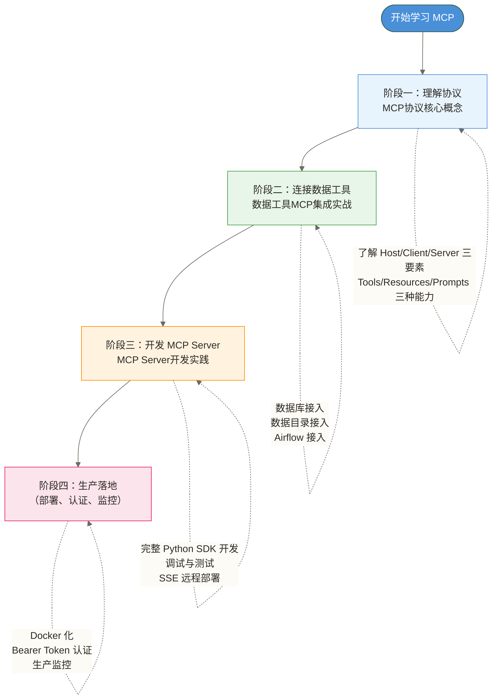

# MCP 学习路线图

> [!quote] 一句话定位
> MCP 是 AI 的 USB-C 接口。在它出现之前，每个 AI 应用都得自己造一套插头，和每个外部工具单独谈判；有了它之后，接口统一了，世界清净了。

## 为什么需要这个系列

2024 年底，Anthropic 发布了 Model Context Protocol（MCP）。这件事的意义不亚于当年 USB-C 统一充电标准——之前你的笔记本、手机、相机各有一套接口，充电线一抽屉；现在一根线走天下。

MCP 干的是同一件事，只不过连接的不是设备，而是 AI 与外部世界。

在 MCP 之前，数据工程师想让 AI 查数据库，可以自行编写 Function Calling 集成代码，也可以通过 LangChain 等框架组织工具；更换模型时是否需要调整集成，取决于模型接口、工具定义格式和框架适配能力，并非必然全部重写。MCP 之后，你写一个 Server，Claude、Cursor、任何支持 MCP 的 AI 工具都能用。

这个系列分4篇，从协议理解到生产落地，给数据工程师用的。

---

## 整体学习路径



---

## 两类读者，两条路线

### 路线 A：数据工程师（重点看 02）

你已经有数据仓库、数据平台、Airflow，想让 AI 能直接操作这些系统。

```text
01（了解概念 30 分钟）→ 02（重点，实战配置）→ 03（可选，如果要自研）
```

**最快上手方式**：直接去 [[【技术与工具】/MCP/02-数据工具MCP集成实战|数据工具MCP集成实战]]，按场景一尝试接入 PostgreSQL；若数据库、访问权限及支持 MCP 的 Claude 客户端配置均已准备好，可将 10 分钟作为快速接入的示例目标，实际耗时取决于环境。

### 路线 B：AI 应用工程师（重点看 03）

你要开发一个 AI 应用，需要暴露内部服务给 AI 调用。

```text
01（理解协议设计） → 03（重点，从零开发 Server） → 02（参考实现）
```

**最快上手方式**：直接去 [[【技术与工具】/MCP/03-MCP-Server开发实践|MCP Server开发实践]]，跟着"数据分析助手"项目实战做一遍。

---

## MCP 与其他集成方式的对比

理解 MCP 的定位，最好的方式是搞清楚它和其他方案的区别。

| 维度 | MCP | OpenAI Function Calling | LangChain Tool | REST API |
|------|-----|------------------------|----------------|----------|
| **标准层级** | 协议层（开放标准） | 模型 API 的工具调用接口机制 | 框架层工具抽象（Python 与 JavaScript/TypeScript 生态） | 基于 REST 架构风格的 API，通常使用 HTTP |
| **跨模型支持** | 可供支持 MCP 的客户端复用（如 Claude、Cursor、Windsurf，具体能力取决于实现） | OpenAI 接口面向其支持的模型；迁移到其他模型需检查兼容性 | 取决于模型集成与工具适配 | 可供不同应用调用，但 AI 工具调用适配需另行实现 |
| **语言无关** | 协议层是（JSON-RPC），具体开发取决于 SDK | 接口调用不限定宿主编程语言 | 有 Python 与 JavaScript/TypeScript 生态，具体能力取决于实现 | 接口调用不限定宿主编程语言 |
| **上下文感知** | 是（Resources 机制） | 否 | 部分 | 否 |
| **流式支持** | 是（SSE 传输） | 是 | 部分 | 需自行实现 |
| **本地进程** | 是（stdio 传输） | 否 | 否 | 否 |
| **学习成本** | 中 | 低（仅限 OpenAI） | 中 | 低 |
| **生产成熟度** | 快速成熟（2024 年底发布，已广泛采用） | 高 | 高 | 高 |

> [!tip] 怎么选
> - 只用 OpenAI，且不想维护 Server？用 Function Calling
> - 快速原型，Python 生态，不考虑跨模型？用 LangChain Tool
> - 需要跨模型、跨语言、长期维护、给多个 AI 工具复用？用 MCP
> - 已有 REST API 想暴露给 AI？在 REST API 外面包一层 MCP Server

---

## 系列文档索引

| 文档 | 定位 | 难度 | 预计时间 |
|------|------|------|---------|
| [[01-MCP协议核心概念\|MCP协议核心概念]] | 协议设计、三要素、通信机制 | 入门 | 60 分钟 |
| [[02-数据工具MCP集成实战\|数据工具MCP集成实战]] | 数据库、数据目录、Airflow 接入 | 中级 | 90 分钟 |
| [[03-MCP-Server开发实践\|MCP Server开发实践]] | 从零开发生产级 MCP Server | 进阶 | 120 分钟 |

---

## 前置知识检查

在正式学习之前，确认自己具备以下基础：

**必须有**：
- Python 基础（能看懂 `async/await`，能用 `pip` 装包）
- 对 JSON 格式不陌生
- 用过至少一个 AI 编程工具（Claude、Cursor、Copilot 都算）

**有更好**：
- 了解 HTTP 和 REST API 的基本概念
- 用过 PostgreSQL 或任意关系型数据库
- 知道 Airflow 是干什么的

**不需要**：
- 不需要了解 LLM 模型原理
- 不需要懂 Transformer 架构
- 不需要有 ML 背景

---

## 相关知识网络

- AI Agent框架选型指南 - MCP 是 Agent 工具调用层的基础设施
- [[【AI 与大数据】/04-AI工程化/02-LLMOps体系全景|LLMOps体系全景]] - MCP Server 是 LLMOps 工具链的重要组成部分
- [[【技术与工具】/MCP/01-MCP协议核心概念|MCP协议核心概念]] - 从这里开始

#MCP #AI工程 #协议 #数据集成 #AI-Native
