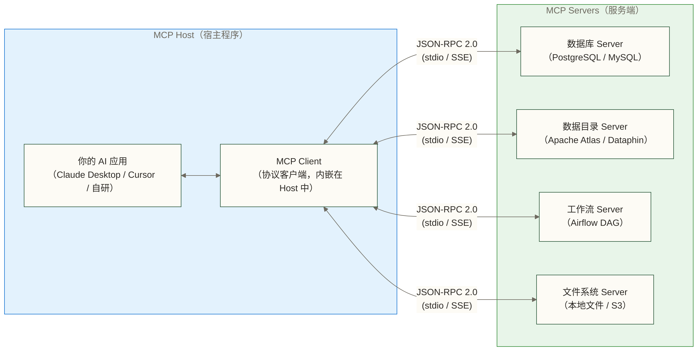
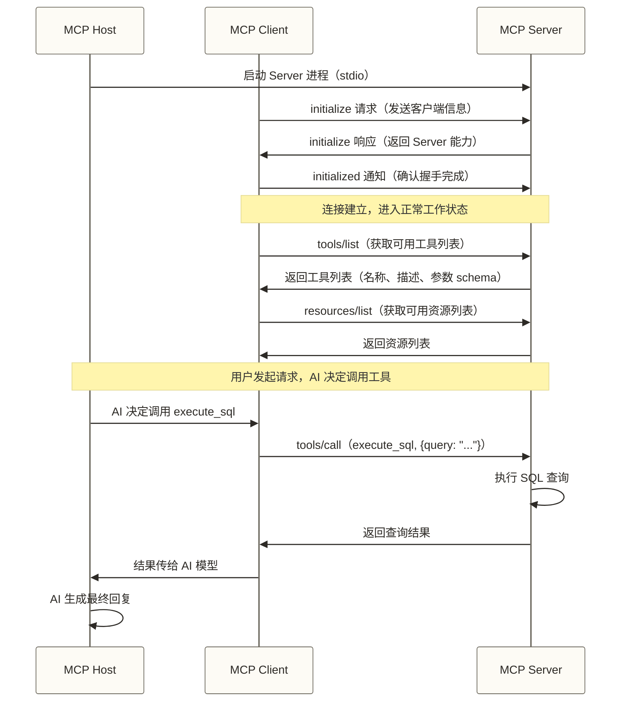

# MCP 协议核心概念

> [!quote] 核心问题
> AI 模型再强，也只是一个孤岛。它在训练截止日期之前的世界里所向披靡，对你今天下午入库的那批数据一无所知。MCP 解决的就是这个问题：让 AI 能够主动伸手，拿到它需要的东西。

> [!important] 当前版本基线
> 本文已按 **MCP 2026-07-28** 复核。新实现的本地传输使用 stdio，远程传输使用 Streamable HTTP；旧版 HTTP+SSE 自 2025-03-26 起已被替代，在 2026-07-28 规范中被明确列为 Deprecated。文中保留的 2025 时代握手图和低层 Python 示例仅用于理解历史实现，不能直接作为新项目的生产基线。

## 目录

- [[#为什么 AI 需要 MCP|为什么 AI 需要 MCP]]
- [[#截至 2026-08-12 的协议基线|截至 2026-08-12 的协议基线]]
- [[#MCP 架构三要素|MCP 架构三要素]]
- [[#MCP 提供的三种能力|MCP 提供的三种能力]]
- [[#通信机制详解|通信机制详解]]
- [[#与其他集成方式的对比|与其他集成方式的对比]]
- [[#数据工程师视角|数据工程师视角]]
- [[#当前 SDK 最小实现|当前 SDK 最小实现]]
- [[#Legacy：低层数据库查询示例|Legacy：低层数据库查询示例]]

---

## 截至 2026-08-12 的协议基线

| 主题 | 当前规范 | 实施含义 |
|---|---|---|
| 协议版本 | 2026-07-28 | 协议版本与客户端能力随请求携带，不再依赖连接级初始化状态 |
| 本地传输 | stdio | 适合由 Host 启动的本地子进程；凭据从环境获取 |
| 远程传输 | Streamable HTTP | 单一 MCP 端点接收 HTTP POST，响应可以是 JSON，也可以是仅属于该请求的 SSE 流 |
| 旧远程传输 | HTTP+SSE | 已弃用；只为明确存在的旧客户端保留，并制定下线日期 |
| 会话 | 协议层无会话 | 需要跨调用状态时，由业务层签发显式句柄并作为普通参数传递 |
| 兼容策略 | 显式协商与双栈适配 | 先列出必须支持的客户端版本，再决定是否承担旧协议兼容成本 |

> [!note] 一个容易混淆的细节
> Streamable HTTP 的某次响应仍然可以使用 SSE 流式返回，但这不等于旧版“HTTP+SSE 传输”。前者只有一个 MCP POST 端点，SSE 流仅服务于当前请求；后者依赖独立 SSE 连接和消息端点，已经进入弃用生命周期。

---

## 为什么 AI 需要 MCP

### 上下文窗口是个孤岛

语言模型的工作方式是这样的：你塞给它一段文本（上下文窗口），它生成回复。仅此而已。

它无法主动去读你的数据库，无法调用你的 API，无法感知昨天发生了什么。它的"世界"就是你塞进去的那些 token。

这导致了一个尴尬局面：你有一个强大的 AI，你有一个装满数据的数据仓库，但它们之间没有桥梁。

### 以前的解法有什么问题

**解法一：手动复制粘贴**

把 SQL 查询结果贴到对话框里。可以用，但累死人，且无法自动化。

**解法二：OpenAI Function Calling**

让模型生成结构化的工具调用指令，由应用执行后再把结果交还模型。工具业务逻辑可以跨模型复用，但请求格式、调度循环和错误处理仍需适配具体模型 API。

**解法三：LangChain Tools**

应用库层面的工具抽象，Python 和 JavaScript/TypeScript 生态都有实现。它解决框架内编排问题，但不是跨进程线协议；跨语言、跨框架复用时仍需要适配层。

### MCP 的思路

MCP 不在应用层解决，而是在协议层解决。

它定义了一套标准的通信协议：AI 宿主中的 Client 和外部 Server 之间，用这套协议对话。当双方的协议版本、客户端能力、传输、授权和所需扩展兼容时，同一个 Server 才能被不同 Host 复用。

它与 HTTP 的相似之处是“约定线上交互”；不同之处是 MCP 还需要为模型和应用暴露 Tools、Resources 与 Prompts 等语义。“遵守协议”是互操作的必要条件，不是无条件兼容保证。

---

## MCP 架构三要素

MCP 的架构很干净，三个角色，职责清晰。

> [!warning] 图中传输标签为历史简写
> 下图保留了早期版本的 stdio / SSE 标注，角色关系仍然有效；远程传输请以本文前面的 Streamable HTTP 基线为准。



### MCP Host

运行 AI 的宿主程序。Host 负责把用户的请求传给 AI 模型，并管理 MCP 连接。

典型的 Host：
- **Claude Desktop**：Anthropic 的桌面应用，内置 MCP Client
- **Cursor**：AI 代码编辑器，支持 MCP
- **Windsurf**：另一个 AI 编辑器
- **你自己写的应用**：用 MCP Python SDK 或 TypeScript SDK 构建

### MCP Client

Host 内部的协议客户端。通常不需要你直接操心它——它是 Host 应用自带的组件，负责和 MCP Server 建立连接、发送请求、处理响应。

一个 Host 可以同时连接多个 MCP Server（一对多关系）。

### MCP Server

暴露工具和资源的服务端。这是数据工程师最需要关注的部分——你要做的事就是开发 MCP Server，把你的数据系统暴露出来。

MCP Server 可以是：
- 一个本地运行的 Python 进程（通过 stdio 通信）
- 一个远程 HTTP 服务（通过 Streamable HTTP 通信）
- SDK 或社区提供的现成实现；早期资料中的 `mcp-server-postgres`、`mcp-server-filesystem` 仅作为名称示例，采用前应核验项目是否仍受维护、权限边界和所支持的协议版本

> [!important] 关键认知
> 作为数据工程师，你的主要工作是**开发和维护 MCP Server**。Host 和 Client 通常由 AI 工具厂商提供，你不需要自己实现。

---

## MCP 提供的三种能力

MCP Server 可以向 AI 暴露三种类型的能力，它们的定位各不相同。

### Tools（工具）：AI 能调用的函数

Tools 是最核心的能力。AI 可以主动调用 Tool 来执行操作，获取结果。

本质上就是一个函数：有输入参数，有返回值，执行某个具体操作。

```text
Tool 示例：
- execute_sql(query: str) → 执行 SQL，返回结果集
- trigger_dag(dag_id: str, date: str) → 触发 Airflow DAG
- search_metadata(keyword: str) → 搜索数据资产
- get_table_stats(table_name: str) → 获取表统计信息
```

**AI 使用 Tool 的流程**：
1. AI 分析用户请求，决定调用哪个 Tool
2. AI 生成调用参数
3. Host 通过 MCP Client 向 Server 发送调用请求
4. Server 执行操作，返回结果
5. AI 根据结果生成最终回复

### Resources（资源）：AI 能读取的上下文

Resources 是静态的或准静态的信息，AI 可以读取作为背景知识。

与 Tools 的区别在于：Resources 是"读取信息"，Tools 是"执行操作"。

```text
Resource 示例：
- schema://all → 所有数据库的表结构
- docs://api/v1 → API 文档
- config://system → 系统配置信息
- catalog://tables → 数据目录中的表列表
```

Resources 用 URI 格式寻址，类似文件路径或 URL。

### Prompts（提示模板）：标准化的任务流程

Prompts 是预定义的提示模板，帮助 AI 以标准化方式完成特定任务。

```text
Prompt 示例：
- analyze_table → 标准的表分析流程（输入表名，AI 自动查统计、看样本、给洞察）
- debug_slow_query → 标准的慢查询诊断流程
- generate_etl → 基于源表和目标表生成 ETL 代码
```

> [!tip] 三种能力的使用场景
> - **Tools**：需要实时执行操作的场景（查数据、触发任务）
> - **Resources**：需要提供背景知识的场景（表结构、文档）
> - **Prompts**：需要标准化工作流程的场景（分析模板、诊断流程）

---

## 通信机制详解

### 传输层：两种标准方式

**stdio 传输（本地进程）**

Host 启动一个子进程运行 MCP Server，通过标准输入/输出通信。

适合：本地工具、开发环境、数据库连接工具

```text
Host Process
    ↓ stdin  (JSON-RPC 请求)
MCP Server Process
    ↓ stdout (JSON-RPC 响应)
Host Process
```

**Streamable HTTP 传输（远程服务）**

MCP Server 暴露一个 MCP 端点，每条消息通过独立 HTTP POST 发送。服务端可以返回一个 JSON 对象，也可以返回仅与本次请求相关的 SSE 流。2026-07-28 修订不包含 GET 长连接、协议级会话、流恢复或消息重投递。

适合：团队共享的工具、云端部署、需要认证的场景

> [!warning] 下面是概念简图
> 图里的 HTTP/SSE 表示“HTTP 响应可以流式返回”，不是已经弃用的旧版 HTTP+SSE 双端点传输。

```text
MCP Host  ←→  HTTP/SSE  ←→  MCP Server (远程服务)
```

### 消息格式：JSON-RPC 2.0

MCP 使用 JSON-RPC 2.0 作为消息格式。这不是 MCP 发明的新格式，是已有的成熟标准。

> [!danger] Legacy Wire 审计样本
> 下面两段 JSON 没有 MCP 2026-07-28 必需的每请求元数据，响应也没有当前的结果类型字段。它们只用来识别旧版抓包，不是当前请求模板。

旧版工具调用请求：

```json
{
  "jsonrpc": "2.0",
  "id": 1,
  "method": "tools/call",
  "params": {
    "name": "execute_sql",
    "arguments": {
      "query": "SELECT COUNT(*) FROM orders WHERE date = '2026-03-11'"
    }
  }
}
```

对应的响应：

```json
{
  "jsonrpc": "2.0",
  "id": 1,
  "result": {
    "content": [
      {
        "type": "text",
        "text": "查询结果：COUNT(*) = 15234"
      }
    ]
  }
}
```

当前 Streamable HTTP 的完整请求如下。对于 stdio，HTTP 头不适用，但请求体中的两个必填元数据字段仍不能省略；客户端信息不是必填项，但规范建议每次携带。

```http
POST /mcp HTTP/1.1
Content-Type: application/json
Accept: application/json, text/event-stream
MCP-Protocol-Version: 2026-07-28
Mcp-Method: tools/call
Mcp-Name: execute_sql

{
  "jsonrpc": "2.0",
  "id": 1,
  "method": "tools/call",
  "params": {
    "name": "execute_sql",
    "arguments": {
      "query": "SELECT COUNT(*) FROM orders WHERE order_date = '2026-03-11'"
    },
    "_meta": {
      "io.modelcontextprotocol/protocolVersion": "2026-07-28",
      "io.modelcontextprotocol/clientInfo": {
        "name": "data-workbench",
        "version": "1.0.0"
      },
      "io.modelcontextprotocol/clientCapabilities": {}
    }
  }
}
```

对应的最小完成响应应显式标识结果类型：

```json
{
  "jsonrpc": "2.0",
  "id": 1,
  "result": {
    "resultType": "complete",
    "content": [
      {
        "type": "text",
        "text": "查询结果：COUNT(*) = 15234"
      }
    ],
    "_meta": {
      "io.modelcontextprotocol/serverInfo": {
        "name": "data-query-server",
        "version": "1.0.0"
      }
    }
  }
}
```

> [!important] HTTP 头与正文必须一致
> 每个 POST 请求都要有 `MCP-Protocol-Version` 和 `Mcp-Method`；调用 Tool 时还必须有 `Mcp-Name`。版本头要与 `_meta` 中的协议版本一致，方法和名称头也要与 JSON-RPC 正文一致；服务端必须拒绝头体不一致的请求。

### 生命周期：旧版握手与当前调用

> [!warning] 以下时序图属于 2025 时代协议
> 图中的 initialize / initialized 握手已从 MCP 2026-07-28 移除，保留它是为了帮助维护旧客户端。新客户端的每次请求都携带协议版本和客户端能力；遇到版本不匹配时按规范协商或明确失败，不应默默套用旧语义。



当前协议的最小调用思路是：客户端随请求声明协议版本与能力，服务端校验后处理 list 或 call 请求并直接响应。若要兼容旧客户端，应把双栈兼容视为单独的工程决策，并为旧握手与旧 HTTP+SSE 传输设置退出计划。

---

## 与其他集成方式的对比

### MCP vs OpenAI Function Calling

Function Calling 是模型 API 提供的结构化工具调用能力，OpenAI 是其中一个提供者。

核心区别：**Function Calling 规定模型 API 如何表达工具意图，MCP 规定 Host/Client 如何与独立 Server 交互**。两者可以在同一个系统里串联，不是非此即彼。

| 维度 | MCP | OpenAI Function Calling |
|------|-----|------------------------|
| 标准层级 | 开放线协议 | 具体模型 API 的工具意图接口 |
| 跨模型复用 | Server 可被多个兼容 Host 复用 | 业务函数可复用，API 请求和编排层需适配 |
| 执行边界 | 独立 Server，通过标准传输调用 | 应用解析模型输出并执行函数 |
| 状态语义 | 2026-07-28 协议无会话 | 由应用自行管理 |
| 本地工具 | stdio 是标准传输 | 可由应用本地执行，但不定义跨应用 stdio 协议 |

举个例子：你写了一个“查数据仓库”的 MCP Server，不同 Host 在通过版本、能力和授权验收后可以复用它。模型 API 的 Function Calling 仍可以在 Host 内部用来做工具选择，无需二选一。

### MCP vs LangChain Tool

LangChain Tool 是框架库层面的抽象，不是跨进程线协议。

| 维度 | MCP | LangChain Tool |
|------|-----|----------------|
| 抽象层级 | 协议层（与实现语言解耦） | 库层（Python 与 JavaScript/TypeScript 等实现） |
| 跨语言 | Server 可用任意已实现协议的语言 | 需通过各语言库或适配层复用 |
| 进程隔离 | 传输边界明确 | 取决于应用架构，可同进程也可远程 |
| 版本依赖 | 需显式验收协议版本与扩展 | 需锁定库版本并跟随框架 API |
| 复用边界 | 兼容 Host 之间复用 | LangChain 生态内复用，跨框架需适配 |

MCP 解决的是更底层的问题：如何让 AI 系统和外部工具通信。LangChain Tool 是在某个具体框架内解决工具调用问题。

### MCP vs 直接调用 REST API

让 AI 直接调用 REST API 不是不行，但 MCP 做了专门的优化：

| 维度 | MCP | 直接 REST API |
|------|-----|---------------|
| AI 友好的描述 | Tools 内置参数 schema 和自然语言描述 | 可通过 OpenAPI 或自定义 schema 提供，但非 MCP 原语 |
| 上下文资源 | 有统一的 Resources 语义 | 由业务 API 自定义 |
| 错误处理 | JSON-RPC 与 MCP 定义协议错误和 Tool 结果错误 | 可用 HTTP 状态码和业务错误体，语义由 API 契约定义 |
| 流式返回 | Streamable HTTP 规范约定 JSON 或请求级 SSE | REST 可自行选用 SSE/分块传输 |
| 本地进程 | stdio 是标准传输 | REST 以 HTTP 边界为主，本地调用需另行设计 |

---

## 数据工程师视角

有了 MCP，你能做什么？

### 让 AI 直接查数据库

```text
用户："帮我看一下昨天的订单总量，和上周同期比是涨还是跌？"

AI 调用 execute_sql：
SELECT
    DATE(created_at) as date,
    COUNT(*) as order_count
FROM orders
WHERE created_at >= DATE_SUB(NOW(), INTERVAL 14 DAY)
GROUP BY DATE(created_at)
ORDER BY date;

AI 分析结果，给出趋势判断。
```

不需要你手动查，不需要你复制数据，AI 自己去查，自己分析，给你答案。

### 让 AI 读取数据目录

```text
用户："我们有没有用户行为相关的表？质量怎么样？"

AI 调用 search_metadata("用户行为")
AI 调用 get_table_stats("user_behavior_log")
AI 综合元数据和统计信息，告诉你有哪些表、数据完整性如何。
```

### 让 AI 操作数据管道

```text
用户："用户画像的 DAG 跑失败了，帮我看看什么问题，然后重新触发一下。"

AI 调用 get_dag_status("user_profile_dag")
AI 分析失败原因
AI 调用 trigger_dag("user_profile_dag", "2026-03-11")
```

这类自动化在协议层面可实现，但是否允许查询、重试或重新触发，必须由数据库权限、Tool 输入契约、审计和人工确认共同决定。

---

## 当前 SDK 最小实现

下面的实现锁定官方 Python SDK 2.0.0，并通过 SDK 处理协议元数据、schema 和 stdio 帧。它只用无副作用的加法验证协议链路，不把数据库安全问题混入最小样本。

`pyproject.toml`：

```toml
[project]
name = "mcp-minimal-demo"
version = "0.1.0"
requires-python = ">=3.10"
dependencies = ["mcp[cli]==2.0.0"]
```

`server.py`：

```python
from mcp.server import MCPServer

mcp = MCPServer("minimal-demo")


@mcp.tool()
def add(a: int, b: int) -> int:
    """Return the sum of two integers."""
    return a + b


if __name__ == "__main__":
    mcp.run()
```

安装、生成锁文件并启动：

```bash
uv sync
uv run python server.py
```

服务启动后会等待 Host 通过 stdio 发起请求，终端不会出现 HTTP 端口。调试时不要用人工输入代替 Host，而应使用官方 Inspector 或 SDK Client。

### 最小验收

至少确认以下四项：

1. `uv.lock` 已生成并纳入版本库。
2. Inspector 的 Tools 列表中只出现 `add`，其两个入参都是必填整数。
3. 调用 `add` 并传入 `a=1`、`b=2` 时，结构化结果为 `{"result": 3}`。
4. 连接协议版本是 `2026-07-28`；不是仅仅“进程没报错”。

> [!note] 完整的 stdio 和 Streamable HTTP 项目
> 本节用于建立最小心智模型。带项目配置、内存测试、HTTP 运行器与 Inspector 命令的可复现工程见 [[【技术与工具】/MCP/03-MCP-Server开发实践#当前可运行最小工程：Python SDK 2.0.0|当前可运行最小工程]]。

---

## Legacy：低层数据库查询示例

下面保留的是 2025 时代低层 API 和数据库查询样本，用于识别历史实现和制定迁移清单。

> [!danger] Legacy 示例，不要直接用于新项目
> 下方代码使用 2025 时代 Python SDK 的低层 Server API 和初始化握手。官方 Python SDK 2.0.0 已支持 MCP 2026-07-28，且默认安装的主版本会影响 API 形态。新项目应锁定 SDK 的具体版本与锁文件，先运行本文当前示例与协议兼容测试，再迁移业务工具；不要把这段代码与当前 SDK 依赖直接拼装后上线。

```python
# 安装：pip install mcp
import asyncio
import sqlite3
from mcp.server import Server
from mcp.server.models import InitializationOptions
from mcp.server.stdio import stdio_server
from mcp import types

# 初始化 Server
server = Server("data-query-server")

# 注册 Tools 列表
@server.list_tools()
async def handle_list_tools() -> list[types.Tool]:
    return [
        types.Tool(
            name="execute_sql",
            description="执行 SQL 查询，返回结果。只支持 SELECT 语句（只读）。",
            inputSchema={
                "type": "object",
                "properties": {
                    "query": {
                        "type": "string",
                        "description": "要执行的 SQL SELECT 语句"
                    },
                    "db_path": {
                        "type": "string",
                        "description": "SQLite 数据库文件路径",
                        "default": "./data.db"
                    }
                },
                "required": ["query"]
            }
        )
    ]

# 处理 Tool 调用
@server.call_tool()
async def handle_call_tool(
    name: str,
    arguments: dict
) -> list[types.TextContent]:

    if name == "execute_sql":
        query = arguments["query"]
        db_path = arguments.get("db_path", "./data.db")

        # 安全检查：只允许 SELECT
        if not query.strip().upper().startswith("SELECT"):
            return [types.TextContent(
                type="text",
                text="错误：只允许 SELECT 查询，拒绝执行写操作。"
            )]

        try:
            conn = sqlite3.connect(db_path)
            cursor = conn.cursor()
            cursor.execute(query)

            columns = [desc[0] for desc in cursor.description]
            rows = cursor.fetchall()
            conn.close()

            # 格式化结果
            result_lines = [" | ".join(columns)]
            result_lines.append("-" * 50)
            for row in rows[:100]:  # 最多返回 100 行
                result_lines.append(" | ".join(str(v) for v in row))

            if len(rows) > 100:
                result_lines.append(f"（结果已截断，共 {len(rows)} 行，只显示前 100 行）")

            return [types.TextContent(
                type="text",
                text="\n".join(result_lines)
            )]

        except Exception as e:
            return [types.TextContent(
                type="text",
                text=f"查询执行失败：{str(e)}"
            )]

    raise ValueError(f"未知的 Tool：{name}")


# 启动 Server（stdio 传输）
async def main():
    async with stdio_server() as (read_stream, write_stream):
        await server.run(
            read_stream,
            write_stream,
            InitializationOptions(
                server_name="data-query-server",
                server_version="0.1.0",
                capabilities=server.get_capabilities(
                    notification_options=None,
                    experimental_capabilities={}
                )
            )
        )

if __name__ == "__main__":
    asyncio.run(main())
```

这 80 行代码展示了旧版 MCP Server 的主要组成，但它是**不可运行的审计样本**：除了 SDK 主版本不匹配，只检查查询前缀也不能构成可靠的数据库只读边界。不应为它寻找一个“恰好能跑”的旧依赖组合，应迁移业务需求到当前 SDK，并由数据库权限、只读事务、SQL 解析或允许列表共同实现防线。

> [!note] 下一步
> 这只是最基础的示例。更完整的数据库接入方案（PostgreSQL、权限控制、多数据库支持），以及数据目录和 Airflow 的接入，在 [[【技术与工具】/MCP/02-数据工具MCP集成实战|数据工具MCP集成实战]] 里有详细实战代码。
>
> 如果你想从零开发一个生产级别的 MCP Server，去看 [[【技术与工具】/MCP/03-MCP-Server开发实践|MCP Server开发实践]]。

---

## 本章小结

- MCP 解决的核心问题：AI 上下文窗口是孤岛，需要标准协议桥接外部工具
- 三个角色：Host（宿主）/ Client（客户端）/ Server（服务端）
- 三种能力：Tools（执行操作）/ Resources（读取信息）/ Prompts（任务模板）
- 两种标准传输：stdio（本地）/ Streamable HTTP（远程）
- 消息格式：JSON-RPC 2.0
- 与其他方案的核心差异：MCP 是协议层标准，语言无关，跨模型复用

---

## 官方资料与复核范围

- [MCP 2026-07-28 关键变更](https://modelcontextprotocol.io/specification/2026-07-28/changelog)
- [基础协议与每请求元数据](https://modelcontextprotocol.io/specification/2026-07-28/basic)
- [标准传输总览](https://modelcontextprotocol.io/specification/2026-07-28/basic/transports)
- [Streamable HTTP 规范](https://modelcontextprotocol.io/specification/2026-07-28/basic/transports/streamable-http)
- [版本与兼容性](https://modelcontextprotocol.io/specification/2026-07-28/basic/versioning)
- [Tools 协议规范](https://modelcontextprotocol.io/specification/2026-07-28/server/tools)
- [HTTP 授权规范](https://modelcontextprotocol.io/specification/2026-07-28/basic/authorization)
- [官方 Python SDK 2.0.0](https://github.com/modelcontextprotocol/python-sdk/releases/tag/v2.0.0)

本次复核确认的是协议角色、标准传输、生命周期和兼容边界。具体 Host 的配置格式、SDK 小版本 API 与第三方 Server 的维护状态仍需在实施当天复核。

---

## 系列导航

- 上一篇：[[【技术与工具】/MCP/00-MCP学习路线图|MCP学习路线图]]
- 下一篇：[[【技术与工具】/MCP/02-数据工具MCP集成实战|数据工具MCP集成实战]]
- 进阶：[[【技术与工具】/MCP/03-MCP-Server开发实践|MCP Server开发实践]]
- 生产控制面：[[【技术与工具】/MCP/04-MCP-Gateway与生产部署|MCP Gateway 与生产部署]]
- 数据访问架构：[[【数据开发与数据架构】/07-数据服务架构/10-Agent-to-Data访问架构|Agent-to-Data 访问架构]]

#MCP #AI工程 #协议 #JSON-RPC #数据集成
