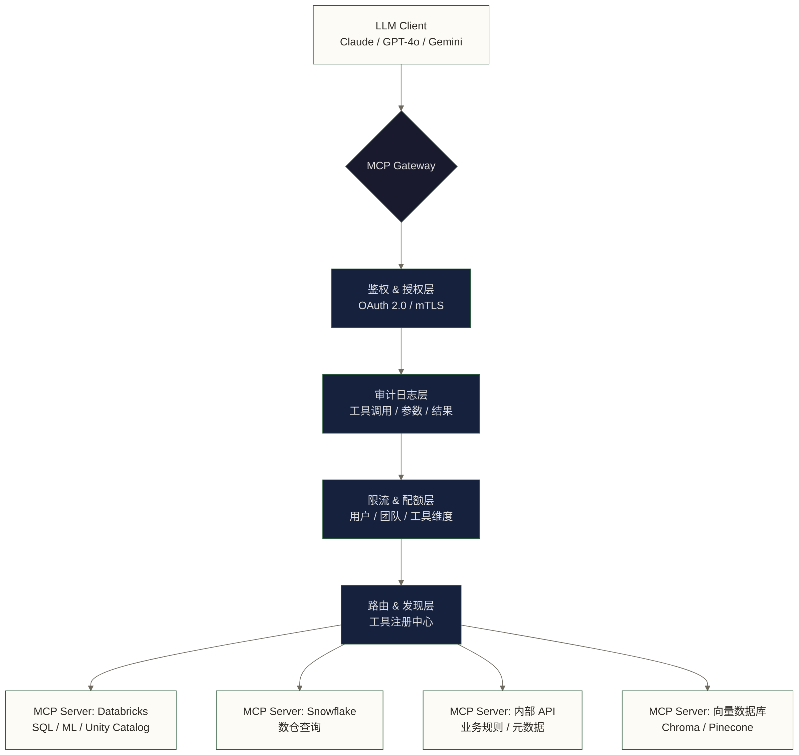
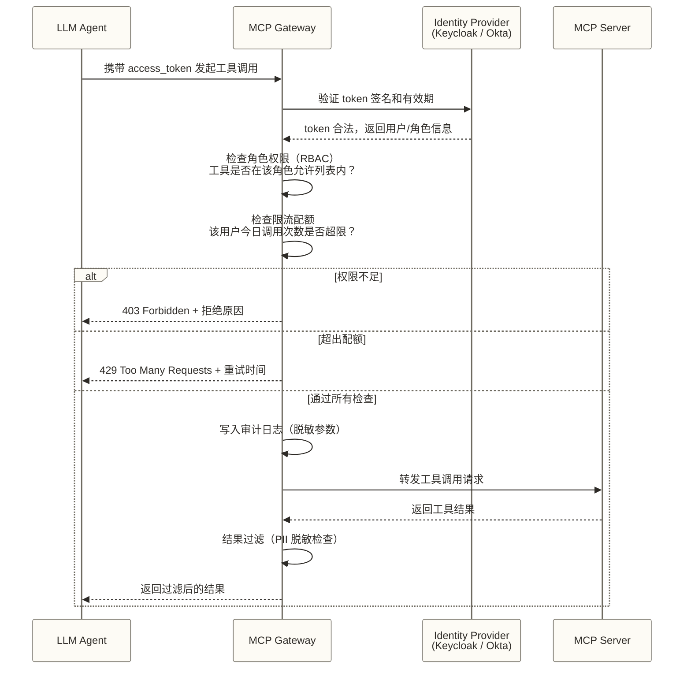

# MCP Gateway 与生产部署

> [!info] 前置知识
> 阅读本文前，建议先掌握以下内容：
> - [[【技术与工具】/MCP/01-MCP协议核心概念|MCP 协议核心概念]]：理解 Tool/Resource/Prompt 三层模型
> - [[【技术与工具】/MCP/03-MCP-Server开发实践|MCP Server 开发实践]]：知道一个 MCP Server 长什么样、怎么跑起来
> - [[【技术与工具】/AI-Native数据平台/00-AI-Native数据平台全景|AI-Native 数据平台全景]]：了解 2026 年的企业 AI 数据栈背景

---

## 从单 Server 到 Gateway：一个必然发生的痛苦

你搭好了第一个 MCP Server，让 Agent 能查 Snowflake 里的销售数据。效果不错，PM 很高兴，然后事情开始失控。

数据分析团队想接 Databricks。BI 团队想接 Tableau 的元数据。风控团队想接内部规则引擎。数据中台想让所有 Agent 都走他们的 Hive Metastore。

两个月后，你有了 11 个 MCP Server，散落在 3 个 Kubernetes namespace 里。每个 Server 自己管密钥，自己配 CORS，没有统一日志，没有限流。某天有个实习生把带有数据库 root 密码的 MCP Server 暴露在公网上，你在凌晨两点接到电话。

这就是"单 Server 直连"模式的终点。**Gateway 不是锦上添花，是你在企业里活下去的必需品。**

---

## MCP Gateway 是什么

MCP Gateway 是站在 LLM 客户端和多个 MCP Server 之间的接入层。它统一处理所有进入数据工具的流量，承担的工作包括：身份认证、权限校验、审计记录、限流、路由和版本管理。

用一句话说：**Gateway 是 Agent 访问数据世界的海关。**

### 核心架构



---

## Gateway 的六项核心能力

### 1. 身份认证：你是谁

不是让 Agent 随便进来，而是让**可证明身份的 Agent** 进来。

2026 年的主流方案：

- **OAuth 2.0 / OIDC**：Agent 持有 access token，Gateway 验证签名，不接触原始密钥。适合 SaaS 场景。
- **mTLS（双向 TLS）**：客户端和 Gateway 互相验证证书。适合企业内网，安全强度高，但运维成本也高。
- **API Key + IP 白名单**：最简单，适合早期内部工具，不推荐在生产环境独立使用。

> [!tip] 实践建议
> 生产环境应根据身份委托、客户端类型和信任边界选择 OAuth 2.0、mTLS 等机制。token 的撤销生效方式取决于验证和授权服务实现，证书需要续期管理；API Key 泄露后应及时撤销或轮换，并排查泄露期间的访问影响。

### 2. 细粒度授权：你能干什么

认证解决"你是谁"，授权解决"你能用哪些工具、访问哪些数据"。

Gateway 需要支持三层授权粒度：

| 授权维度 | 示例 |
|---------|------|
| 基于角色（RBAC） | data_analyst 角色只能调用 read_* 系列工具 |
| 基于工具 | marketing_agent 只能调用 `query_campaign_data`，不能调用 `list_all_tables` |
| 基于资源 | finance_agent 只能查 `schema=finance` 的表，不能跨 schema |

这三层组合起来，才能真正做到"最小权限原则"。

### 3. 审计日志：发生了什么

这是合规的命根子，也是事故追溯的依据。

每次工具调用，Gateway 必须记录：

- 调用方身份（Agent ID / 用户 ID）
- 调用的工具名称和参数（注意：**参数要脱敏**，不能把查询条件里的 PII 原样写进日志）
- 调用时间、耗时
- 响应状态码和摘要（不记录完整返回值，防止数据泄露二次发生）
- 上游 MCP Server 标识

### 4. 限流与配额：别让一个 Agent 榨干系统

没有限流的 Gateway 不是 Gateway，是传声筒。

限流策略应该在多个维度叠加：

- **用户级**：单个用户每分钟最多 100 次工具调用
- **团队级**：数据科学团队每天最多消耗 10,000 次查询配额
- **工具级**：`run_spark_job` 这类重型操作每小时最多 20 次
- **成本级**：某些工具调用会产生云费用，需要设置预算上限

> [!warning] 别忽视成本配额
> 2026 年主流 MCP Server 已经能调用 Databricks Jobs、BigQuery 查询这类按量计费的服务。没有成本配额，一个写错了循环的 Agent 能在几小时内让你的云账单翻倍。

### 5. 工具发现与路由：把流量送到正确的 Server

Gateway 维护一个工具注册中心，LLM 客户端通过 `tools/list` 接口获取当前可用的工具列表，Gateway 负责把调用路由到对应的 MCP Server。

好的路由层应该支持：

- **工具聚合**：把多个 Server 的工具合并成统一目录，Client 不感知后端拓扑
- **健康检查**：某个 MCP Server 挂了，自动从工具列表中摘除，避免 Agent 拿到错误结果
- **智能路由**：同一个工具的多个实例（比如主备 Snowflake），按延迟或负载路由

### 6. 版本与灰度：工具也需要发布管理

MCP Server 升级时，不能直接停掉旧版本。原因和 API 版本管理一样：已有的 Agent 工作流可能依赖旧版工具的参数结构。

Gateway 需要支持：

- 工具的版本标识（`query_data@v1` vs `query_data@v2`）
- 灰度发布：5% 流量打到新版，观察 3 天，无异常再全量
- 旧版本保留窗口期（建议至少 30 天）

---

## 鉴权完整流程图



---

## 2026 年主流 MCP Gateway 选型

| 方案 | 目标场景 | 鉴权能力 | 可观测性 | 部署形态 | 适用规模 |
|------|---------|---------|---------|---------|---------|
| **Databricks MCP Gateway** | Databricks 生态内，深度集成 Unity Catalog | Unity Catalog 权限继承，支持列级权限 | 内置 Lakehouse Monitoring | 托管 SaaS（Databricks 内） | 中大型，已使用 Databricks |
| **Kong AI Gateway** | 异构多 Server 场景，已有 Kong 基础设施 | OAuth 2.0 / API Key / mTLS，插件丰富 | Kong Manager + Prometheus | 自托管 / Kong Cloud | 大型企业 |
| **Cloudflare AI Gateway** | 边缘接入，全球低延迟 | API Key 管理，Worker 级别隔离 | 实时日志流，Workers Analytics | Cloudflare 托管 | 中型，重视全球分发 |
| **开源 mcp-gateway** | 快速自建，完全控制 | 可插拔，需自行集成 IDP | 基础日志，需自行对接 ELK | 自托管 K8s | 小型团队，技术强 |

> [!note] 选型判断树
> - 已重度使用 Databricks + Unity Catalog？→ 选 **Databricks MCP Gateway**，权限直接继承，省去大量集成工作
> - 已有 Kong 基础设施？→ 选 **Kong AI Gateway**，复用现有运维体系
> - 预算有限、团队强？→ 先用 **开源 mcp-gateway** 跑通，再评估商业方案
> - 需要全球 CDN + 边缘接入？→ **Cloudflare AI Gateway** 是稀有的边缘 MCP 方案

---

## 生产部署清单（Checklist）

> [!warning] 这不是建议，是底线
> 下面是一组生产部署风险检查项，本文未提供逐项对应的真实事故来源。应根据网络边界、工具能力、数据敏感性与合规要求确定控制措施，不能把这份清单视为完整的安全保证。

### 网络隔离

- [ ] MCP Server 不暴露公网，只接受来自 Gateway 的内网流量
- [ ] Gateway 和 MCP Server 之间走 mTLS，不信任明文 HTTP
- [ ] 每个 MCP Server 单独的 Network Policy，禁止 Server 间横向访问
- [ ] Gateway 出口 IP 固定，MCP Server 做 IP 白名单

### 密钥管理

- [ ] 所有数据库凭据、API Key 存入 Vault（HashiCorp Vault / AWS Secrets Manager），MCP Server 启动时动态注入，不硬编码在镜像或配置文件里
- [ ] Vault 凭据租约设置上限（如 8 小时），过期自动轮换
- [ ] MCP Server 只持有只读凭据，写操作需要单独申请短效凭据

### 日志与审计

- [ ] Gateway 层记录所有工具调用的完整元数据（不含敏感字段值）
- [ ] 参数脱敏规则配置：手机号、身份证号、邮箱、密码字段自动 mask
- [ ] 审计日志采用符合保留要求的 WORM 存储，或配置相应保留模式与期限的 S3 Object Lock，并限制删除和覆盖权限；仅设置只追加写入策略不能保证不可篡改
- [ ] 日志保留周期按适用司法辖区、记录类型及法规要求设置；若设计练习假设保留 5-7 年，应明确这只是示例条件，不代表金融行业的通用法定期限
- [ ] 异常调用告警：单用户 1 分钟内调用超过阈值，立即触发告警

### 安全防护

- [ ] Prompt 注入防护：Gateway 层可辅助检测工具参数中的指令注入特征（如 `ignore previous instructions`），但关键词检测不能保证防护效果，仍需结合最小权限、工具调用策略和高风险操作审批
- [ ] Tool 结果过滤：返回值经过 PII 扫描，检测到敏感信息自动打码或拦截
- [ ] 工具参数 Schema 严格校验，拒绝任何不符合定义的请求
- [ ] 按业务需要限制危险工具及其组合；`drop_table` 等破坏性操作应独立授权并设置审批，不能仅以是否同时拥有 `list_tables` 判断风险

### 成本与配额

- [ ] 每个 Agent / 团队设置月度预算上限，超限后阻断或限制继续产生费用的调用；只读查询也可能计费，不能仅靠降级为只读模式控制成本
- [ ] 重型工具（Spark Job、大查询）设置并发上限和排队机制
- [ ] 成本归因标签：每次调用打上 `team=`, `project=`, `agent=` 标签，对接云账单分析

### 可观测性

- [ ] Gateway 暴露 Prometheus 指标：调用量、延迟 P99、错误率、限流触发率
- [ ] 分布式追踪：Gateway → MCP Server 的调用链路接入 Jaeger / OpenTelemetry
- [ ] 工具调用大盘：每日 Top 10 工具、Top 10 用户、异常调用趋势

---

## 反模式（Anti-patterns）

这些是你一定会在某处见到的操作。见到就跑。

**反模式 1：把数据库 root 账号塞给 MCP Server**

直接后果：Agent 可以执行 `DROP TABLE`、`TRUNCATE`，甚至通过 SQL 注入删除整个 schema。修复方案：为每个 MCP Server 创建最小权限数据库账号，只授权必要的 schema 和操作类型。

**反模式 2：让 Agent 直连生产库**

没有 Gateway，没有限流，没有审计，Agent 的每次分析查询都可能触发全表扫描。风险情景示例：某个 AI 自动执行的分析任务可能在业务高峰期以高并发或重查询拖垮生产数据库；本文未提供可定位的 2025 年事故来源，不将此情景作为已证实事件。修复方案：Agent 只能访问只读副本或专用分析集群。

**反模式 3：Tool 返回未脱敏的 PII**

用户问"最近注册的 100 个用户"，MCP Server 把姓名、手机号、身份证号全部返回给 Agent，Agent 再把这些信息输出到聊天界面。你刚刚完成了一次合规事故。修复方案：Gateway 层做结果过滤，MCP Server 设计时就对敏感字段进行 mask 或脱敏。

**反模式 4：所有 Agent 共用同一套 MCP 凭据**

一旦凭据泄露，所有 Agent 全部失陷。更糟的是你无法区分是哪个 Agent 的问题。修复方案：每个 Agent 独立 Identity，独立 token，Gateway 按 Agent ID 记录行为。

**反模式 5：MCP Server 版本原地替换**

旧的 Agent 工作流突然开始报错，因为工具的参数结构变了。没有版本管理，你只能全量回滚。修复方案：工具版本化，Gateway 支持新旧版本并行运行。

---

## MCP Gateway 与数据治理的结合

这是最容易被跳过、也最值得认真对待的部分。

**MCP Gateway 是 Agent 时代数据治理最自然的切入点。**

### Unity Catalog 思路的延伸

Databricks 的 Unity Catalog 提供了表级、列级、行级的权限管控。当 MCP Server 接入 Gateway 时，可将复用 Unity Catalog 的权限体系作为集成设计目标。以下仅为条件性示例：在 token 的目标受众、授权范围、下游接受条件和身份委托机制均满足具体实现要求时，Agent 可通过受支持的用户身份委托方式访问 Databricks MCP Server，再由 Databricks 按 Unity Catalog 的规则判断数据访问权限；不能默认任意用户 OAuth token 都可由 Gateway 直接透传。

这一设计的目标是减少数据权限规则的重复维护：**数据访问权限由 Unity Catalog 管理，Gateway 仍负责自身的认证、工具级授权和调用策略，Databricks 负责其接受身份对应的数据访问授权。** 是否能够实现该分工，取决于具体产品和身份委托机制。

Snowflake + Horizon Catalog、Google BigQuery + Data Catalog 可作为集中治理思路的讨论对象，但不能据此假定它们具有相同的 token 透传、身份委托或权限继承机制；本文未提供这两组产品的具体集成方案。

参考文档：[[【数据治理与数据管理】/02-深度研究/05-AI数据治理/01-AI治理技术落地实践|AI 治理技术落地实践]]、[[【数据治理与数据管理】/02-深度研究/05-AI数据治理/00-AI数据治理概述与导航|AI 数据治理概述]]。

### Gateway 作为 Agent 行为的数据产品

Gateway 的审计日志本身就是一个数据产品。你可以把它接入数据仓库，分析：

- 哪些 Agent 在使用哪些数据，使用频率如何（数据资产热度）
- Agent 访问了哪些表，这些表的血缘关系是什么（Agent 驱动的血缘发现）
- 哪些工具调用耗时最长，成为 Agent 工作流的瓶颈（性能优化依据）
- 哪些用户的 Agent 访问了敏感数据，是否符合审批记录（合规审计）

**把 Gateway 日志当成数据资产来运营，是 2026 年数据治理团队获得存在感的新方式之一。**

> [!tip] 与数据安全团队协作
> MCP Gateway 的 PII 脱敏规则和审计策略，建议由数据安全团队而不是数据工程团队主导定义。数据安全团队知道哪些字段是敏感的，数据工程团队负责技术实现。两者分工，权责清晰。
> 
> 延伸阅读：[[【数据治理与数据管理】/02-深度研究/05-AI数据治理/06-AI数据安全与隐私/03-模型数据泄露防护|模型数据泄露防护]]

---

## 从零搭建 MCP Gateway 的最小路径

如果你是小团队，暂时没法上商业方案，下面是一条可以快速走通的路径：

**第一阶段：Nginx 代理 + 基础认证（1 周）**

在所有 MCP Server 前面加一层 Nginx，配置 API Key 认证和访问日志。这不是完整的 Gateway，但能解决"裸奔"问题。

```nginx
# 示例：Nginx MCP 代理基础配置
upstream mcp_databricks {
    server mcp-databricks:8080;
}

server {
    listen 443 ssl;

    # API Key 验证
    if ($http_x_api_key != "your-api-key") {
        return 403;
    }

    # 访问日志（注意：不要记录 Authorization header）
    access_log /var/log/nginx/mcp_access.log combined;

    location /mcp/databricks/ {
        proxy_pass http://mcp_databricks/;
        proxy_set_header X-Forwarded-For $remote_addr;
    }
}
```

**第二阶段：接入开源 mcp-gateway（2-4 周）**

部署 mcp-gateway，配置工具注册中心，接入 Keycloak 做 OAuth 2.0 认证，建立基础的限流规则。

**第三阶段：完整治理闭环（持续迭代）**

接入 Vault 做密钥管理，对接 Prometheus + Grafana 做监控，审计日志写入数据仓库，PII 脱敏规则上线。

---

## 掌握检查

完成本文后，检查你是否能回答以下问题：

- [ ] 能说清楚"单 Server 直连"在企业场景下的 4 个具体痛点
- [ ] 理解 OAuth 2.0 和 mTLS 在 MCP 鉴权场景下的适用差异
- [ ] 知道 Gateway 审计日志需要脱敏哪些字段，以及为什么不能记录完整返回值
- [ ] 能根据团队规模和技术栈，从 4 个主流方案中做出合理选型
- [ ] 理解 Unity Catalog 权限体系如何与 MCP Gateway 集成

---

## 实践练习

**基础练习**：设计一个最小 MCP Gateway 配置方案。场景：你有 2 个 MCP Server（Snowflake 只读、内部 API），需要支持 3 个 Agent（分析 Agent、报告 Agent、监控 Agent）。画出架构图，列出每个 Agent 的权限矩阵。

**进阶练习**：审计日志设计题。设计一套 MCP 工具调用审计日志的 Schema，要求：能支持合规审查（谁在什么时间访问了什么数据）、能支持成本归因（每次调用的 team/project 标签）、参数字段完成 PII 脱敏。用 JSON 格式给出一条示例日志。

**思考题**：如果你是数据治理团队，你会如何向管理层论证"MCP Gateway 审计日志是新的数据资产"？试着用 3 个具体的数据治理场景来支撑这个论点。

---

## 下一步

本文是 MCP 系列的最后一块生产级拼图。如果你已经完整读完这个系列：

- 下一步推荐进入 [[【技术与工具】/AI-Native数据平台/01-Databricks平台实战|Databricks 平台实战]]，看 Unity Catalog + MCP 在真实 Databricks 环境中的集成细节
- 如果你关注数据安全合规，延伸阅读 [[【数据治理与数据管理】/02-深度研究/05-AI数据治理/06-AI数据安全与隐私/04-AI合规与法规遵循|AI 合规与法规遵循]]
- 如果你在做整体数据架构规划，回顾 [[【技术与工具】/AI-Native数据平台/00-AI-Native数据平台全景|AI-Native 数据平台全景]]，把 MCP Gateway 放到整体架构地图里定位

---

#MCP #AI-Agent #数据架构 #生产部署 #数据安全 #数据治理
