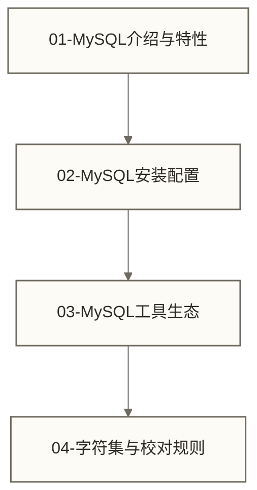
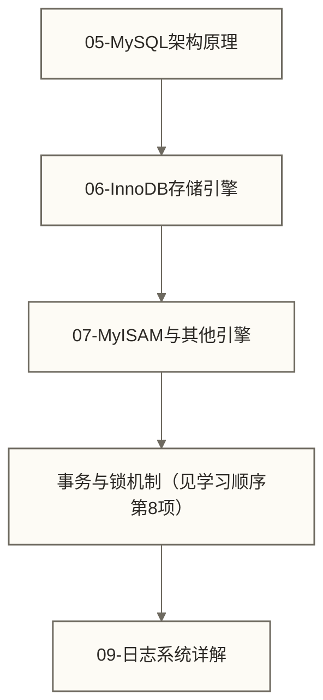
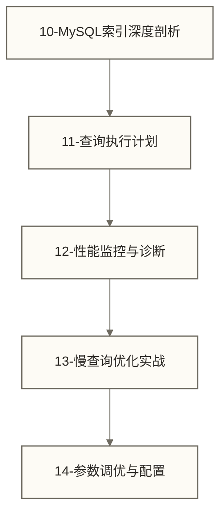
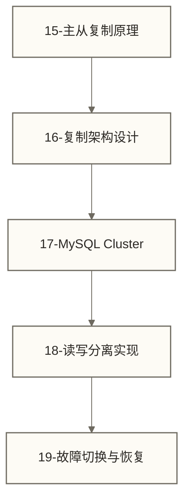
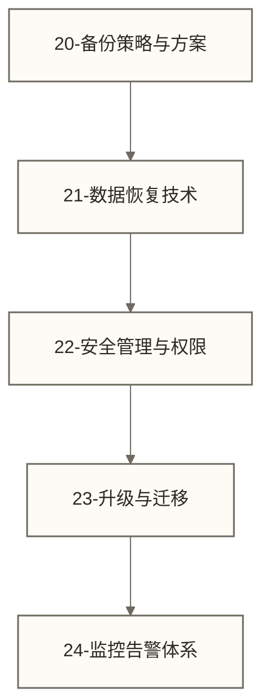
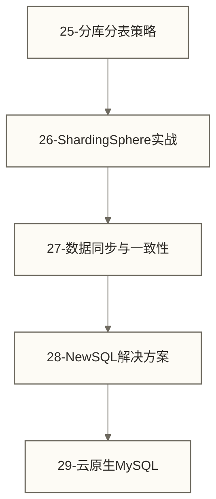
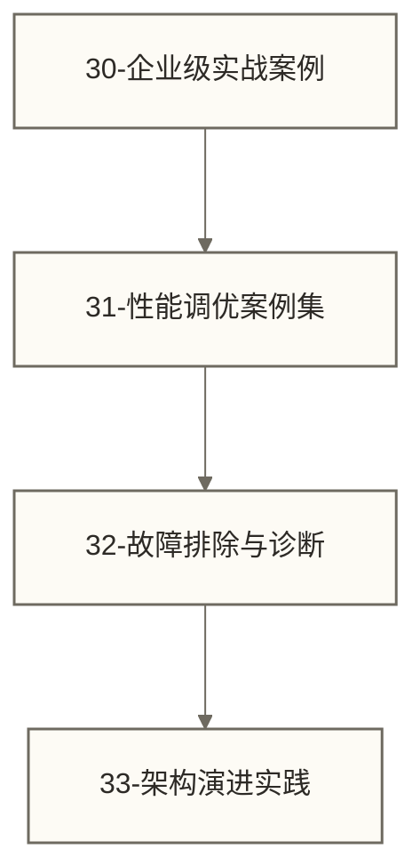

# 🐬 MySQL学习路线图 - 从入门到精通的完整指南

> [!abstract] 📋 学习路线概览
> - 🎯 **学习目标**：系统掌握MySQL数据库的安装、配置、开发和运维
> - 📚 **适用人群**：后端开发者、数据分析师、DBA、运维工程师
> - ⏱️ **总体用时**：建议4-8个月系统学习
> - 🎓 **预期能力目标**：通过配套课程、项目实践及部署、调优和故障恢复验证，逐步培养MySQL生产环境部署和性能调优能力；完成本路线浏览不等于达到该目标

> [!tip] 💡 与SQL通用知识的关系
> 本路线图专注于MySQL特有功能和最佳实践，基础SQL语法请参考 [[【技术与工具】/PostgreSQL/00-PostgreSQL学习路线图|PostgreSQL/PostgreSQL]]

## 🎯 学习阶段划分

### 🟢 第一阶段：MySQL基础入门（1-2周）
**目标**：掌握MySQL安装配置，了解MySQL特有功能



**学习文件顺序**：
1. [[【技术与工具】/MySQL/01-MySQL介绍与特性|MySQL介绍与特性]] - MySQL发展历史、版本特性、应用场景
2. [[【技术与工具】/MySQL/02-MySQL安装配置|MySQL安装配置]] - 各平台安装、基础配置、连接管理
3. MySQL工具生态（本页未提供独立课程入口） - 命令行工具、图形化工具、管理工具
4. 字符集与校对规则 - 中文编码、排序规则、最佳实践

> [!tip] 💡 第一阶段重点
> - 掌握MySQL 8.0的新特性和优势
> - 熟练使用mysql命令行和MySQL Workbench
> - 理解utf8mb4和字符集配置的重要性
> 
> **假设性学习与职业发展示例（非真人经历）** 🎆
> 👨‍💻 假设一位Java开发工程师起初只会写简单的SELECT，经过系统学习和项目实践，逐步尝试设计电商网站数据库架构并优化慢查询。“跳槽到大厂、薪资翻倍”仅是原示例设定的假设结果，不代表已发生的事实，也不是学习本路线的收益承诺。

---

### 🟡 第二阶段：存储引擎与架构（2-3周）
**目标**：深入理解MySQL内部架构，掌握不同存储引擎特性



**学习文件顺序**：
5. [[【技术与工具】/MySQL/05-MySQL架构原理|MySQL架构]] - 连接层、SQL层、存储引擎层
6. [[【技术与工具】/MySQL/06-InnoDB存储引擎|InnoDB存储引擎]] - 表空间、页结构、行格式、MVCC
7. **MyISAM与其他引擎** - 引擎对比、选择策略、迁移方案
8. [[【技术与工具】/MySQL/14-MySQL事务与锁机制|MySQL事务与锁]] - ACID特性、隔离级别、死锁处理
9. **日志系统详解** - 错误日志、慢查询日志、二进制日志

> [!tip] 💡 第二阶段重点
> - 深入理解InnoDB的MVCC机制
> - 掌握事务隔离级别的实际应用
> - 学会分析和解决死锁问题

---

### 🟠 第三阶段：索引与性能优化（3-4周）
**目标**：精通MySQL索引设计和查询优化



**学习文件顺序**：
10. [[【技术与工具】/MySQL/10-MySQL索引深度剖析|MySQL索引深度剖析]] - B+树原理、索引类型、设计策略
11. [[【技术与工具】/MySQL/11-查询执行计划|查询执行计划]] - EXPLAIN详解、执行计划优化
12. MySQL性能监控与诊断（本页未提供专项课程入口） - Performance Schema、监控指标；可另参考[[【技术与工具】/Oracle/16-Oracle性能监控与诊断|Oracle/Oracle性能监控与诊断]]，该文为Oracle主题，不等同于本项MySQL专项课程
13. [[【技术与工具】/MySQL/13-慢查询优化实战|慢查询优化]] - 慢查询分析、优化案例、工具使用
14. **参数调优与配置** - 关键参数、内存配置、连接优化

> [!tip] 💡 第三阶段重点
> - 掌握MySQL特有的索引优化技巧
> - 熟练使用EXPLAIN分析查询性能
> - 学会系统性的性能调优方法

---

### 🔴 第四阶段：高可用与复制（4-5周）
**目标**：掌握MySQL生产环境部署和高可用架构



**学习文件顺序**：
15. 主从复制原理 - 复制原理、binlog格式、GTID
16. 复制架构设计 - 一主多从、双主、级联复制
17. MySQL集群方案（本页未提供对应课程入口） - NDB Cluster、MGR、Galera
18. 读写分离实现 - ProxySQL、中间件选择、负载均衡
19. 故障切换与恢复 - MHA、Orchestrator、自动故障转移

> [!tip] 💡 第四阶段重点
> - 理解MySQL复制的工作原理和延迟问题
> - 掌握生产环境的高可用架构设计
> - 学会故障诊断和快速恢复技能

---

### 🟣 第五阶段：备份恢复与运维（3-4周）
**目标**：掌握数据安全和日常运维技能



**学习文件顺序**：
20. 备份策略与方案 - 逻辑备份、物理备份、增量备份
21. 数据恢复技术 - 时间点恢复、表空间恢复、误操作恢复
22. 安全管理与权限 - 用户管理、SSL配置、审计日志
23. 升级与迁移 - 版本升级、数据迁移、平滑迁移
24. 监控告警体系 - Prometheus、Grafana、Zabbix

> [!tip] 💡 第五阶段重点
> - 建立完善的备份和恢复策略
> - 掌握MySQL安全配置和权限管理
> - 学会构建生产级监控告警系统

---

### 🔵 第六阶段：分库分表与扩展（4-5周）
**目标**：应对大数据量和高并发场景的扩展方案



**学习文件顺序**：
25. 分库分表策略 - 垂直拆分、水平拆分、分片键设计
26. ShardingSphere实战（本页未提供专项课程入口） - Sharding-JDBC、Sharding-Proxy；可另参考[[【数据分析与数据运营】/05-场景实战案例/00-目录导览|场景实战案例目录导览]]，该目录不等同于本项专项课程
27. 数据同步与一致性 - 分布式事务、数据一致性、同步方案
28. NewSQL解决方案 - TiDB、OceanBase、分布式数据库
29. 云原生MySQL（本页未提供对应课程入口） - Kubernetes部署、容器化数据应用、微服务架构

> [!tip] 💡 第六阶段重点
> - 理解分库分表的设计原则和实施策略
> - 掌握分布式数据库的一致性解决方案
> - 了解云原生时代的MySQL部署模式

---

### 🎓 第七阶段：企业实战与案例（持续学习）
**目标**：通过实际项目案例提升综合解决问题的能力



**学习文件顺序**：
30. 企业级实战案例 - 电商、金融、互联网公司MySQL架构
31. 性能调优案例集 - 真实性能优化案例、调优思路
32. 故障排除与诊断 - 常见故障、排查方法、应急处理
33. 架构演进实践 - 从单机到集群的架构演进之路

---

## 📅 建议学习计划

### 🗓️ 后端开发者学习计划（4个月）
```text
第1-2周：MySQL基础入门 + 存储引擎
第3-6周：索引与性能优化（重点）
第7-10周：高可用与复制
第11-16周：备份恢复 + 分库分表
```

### 🗓️ DBA专业学习计划（8个月）
```text
第1-4周：基础入门 + 架构原理（深度学习）
第5-12周：性能优化 + 监控诊断（核心技能）
第13-20周：高可用架构 + 运维体系
第21-32周：扩展方案 + 企业实战
```

### 🗓️ 数据分析师学习计划（2个月）
```text
第1-2周：基础入门 + 工具使用
第3-4周：索引优化 + 查询性能
第5-6周：备份安全 + 常见问题
第7-8周：实战案例 + 最佳实践
```

## 🎯 学习检查点

### ✅ 基础阶段检查点
- [ ] 成功安装并配置MySQL 8.0
- [ ] 熟练使用mysql命令行和图形化工具
- [ ] 理解InnoDB和MyISAM的区别
- [ ] 掌握字符集和校对规则配置

### ✅ 进阶阶段检查点
- [ ] 能够分析EXPLAIN执行计划
- [ ] 掌握常见的SQL查询优化技巧
- [ ] 理解事务隔离级别和锁机制
- [ ] 会配置主从复制

### ✅ 高级阶段检查点
- [ ] 能够设计高可用MySQL架构
- [ ] 掌握性能监控和故障诊断
- [ ] 理解分库分表的设计原则
- [ ] 具备生产环境运维能力

## 📚 推荐学习资源

### 📖 官方文档
- [MySQL 8.0 Reference Manual](https://dev.mysql.com/doc/refman/8.0/en/) - 官方权威文档
- [MySQL Performance Blog](https://www.percona.com/blog/) - Percona性能优化博客

### 🎥 视频教程
- MySQL官方YouTube频道
- 极客时间MySQL实战45讲
- 慕课网MySQL高级教程

### 📱 实践环境
- MySQL官方Docker镜像
- 阿里云RDS MySQL
- 腾讯云MySQL实例

### 🔧 推荐工具
- **开发工具**：MySQL Workbench、Navicat、DBeaver
- **监控工具**：Prometheus + Grafana、Zabbix
- **性能分析**：pt-query-digest、MySQLTuner
- **高可用**：MHA、Orchestrator、ProxySQL

## 🎓 学习建议

> [!tip] 💡 高效学习策略
> 1. **理论与实践并重**：每学一个概念都要在环境中验证
> 2. **关注版本差异**：重点学习MySQL 8.0的新特性
> 3. **生产导向**：学习过程中要思考生产环境应用
> 4. **持续跟进**：MySQL技术更新较快，要保持学习习惯
> 5. **案例驱动**：通过实际业务场景来理解技术原理
> 6. **系统思维**：将MySQL作为整体系统来学习，而非孤立的知识点

> [!warning] ⚠️ 常见学习陷阱
> - 忽视MySQL特有功能，过度依赖SQL通用知识
> - 理论学习过多，缺乏实际环境操作
> - 只关注功能使用，不了解底层原理
> - 忽视运维和监控，只专注开发应用

---

## 🔗 相关资源链接

- [[【技术与工具】/PostgreSQL/00-PostgreSQL学习路线图|PostgreSQL/PostgreSQL]] - SQL通用语法基础
- [[【技术与工具】/Python/00-Python学习路线图|Python/Python]] - 编程语言集成
- [[【技术与工具】/Hadoop/00-Hadoop学习路线图|Hadoop/Hadoop]] - 大数据生态集成

---

*最后更新：2024-06-29* 