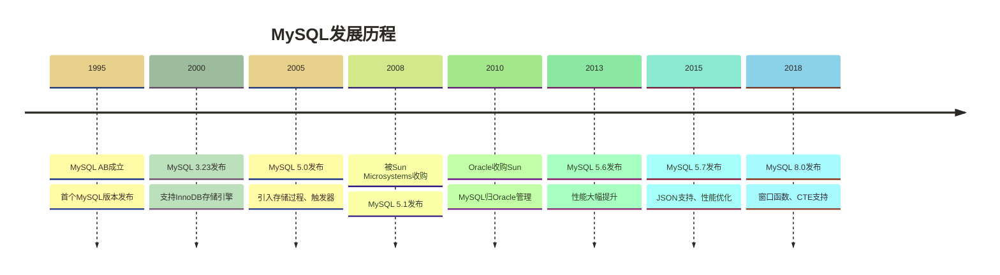
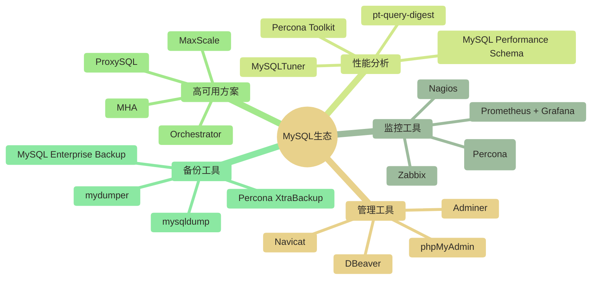

# 🐬 MySQL介绍与特性 - 从开源数据库到企业级解决方案

> [!tip] 💝 给初学者的话
> 
> 🤗 **欢迎来到数据库的世界！**
> 
> 如果你现在对MySQL感到陌生，甚至有点紧张 —— 完全正常！每个数据库专家都是从这里开始的。
> 
> 🏠 想象一下：你要为全世界最受欢迎的网站（如Facebook、Twitter、YouTube）管理数据...
> 
> 🎯 **这些巨头都选择MySQL，因为它就像数据世界的"万能钥匙"**：
> - 免费使用，功能强大
> - 学习曲线友好，新手也能快速上手  
> - 全球数百万开发者的共同选择
> - 从个人网站到企业应用，可用于多种关系型数据场景，仍需按工作负载与可靠性要求选型
> 
> **掌握MySQL可为相关岗位的求职准备加分，但录用仍取决于项目能力、其他技能和岗位要求。** ✨

> [!abstract] 📋 本节概览
> - 🎯 **学习目标**：了解MySQL的发展历程、核心特性和应用场景  
> - 💰 **学会后价值**：MySQL技能可为相关岗位求职加分；10-20k仅作为薪资讨论的假设区间，不代表可预期收入
> - 📚 **前置知识**：[[【技术与工具】/PostgreSQL/00-PostgreSQL学习路线图|PostgreSQL/PostgreSQL]]
> - ⏱️ **预计用时**：45分钟（一集电视剧的时间，就能掌握全球最流行的数据库！）
> - 🔧 **技术重点**：MySQL版本差异、存储引擎、生态系统
> - 🎁 **本节收获**：从"MySQL小白"变成"有技术自信的数据库入门者"
> - 🚀 **职业前景**：MySQL可用于相关开发和数据岗位，具体招聘需求取决于地区、时间与岗位要求

## 💰 学会MySQL，你的职业前景如何？

### 🚀 薪资与学习时长的假设性示例（下表保留原区间用于讨论，不代表真实招聘统计或收益承诺）

| 技能水平 | 薪资范围 | 典型岗位 | 学习时长 |
|---|---|---|---|
| **MySQL基础** | 8K-12K | 初级开发、数据录入 | 1-2个月 |
| **MySQL开发** | 10K-18K | 后端开发、数据分析师 | 3-6个月 |
| **MySQL优化** | 15K-30K | 数据库工程师、架构师 | 6-12个月 |
| **MySQL专家** | 25K-50K | 数据库专家、技术负责人 | 1-2年 |

### 🏢 哪些公司急需MySQL人才？

**以下列举可能涉及MySQL技能的行业和业务场景，不表示所列公司当前均有招聘需求。**

- 🌐 **互联网巨头**：阿里巴巴、腾讯、字节跳动 - 大规模MySQL集群管理
- 🏦 **金融科技**：蚂蚁金服、微众银行 - 高并发交易系统
- 🛒 **电商平台**：京东、美团、拼多多 - 商品和订单数据管理
- 🎮 **游戏公司**：网易、完美世界 - 玩家数据和游戏状态存储
- 🚗 **出行服务**：滴滴、高德 - 实时位置和订单数据
- 🏠 **生活服务**：58同城、链家 - 海量用户和房源数据

> [!tip] 💡 假设性案例：小李的MySQL转型故事（以下学习过程、15K offer和对话仅作情境示例，不作为真人经历或收益证据）
> 
> 🧑‍💼 **小李，计算机专业应届生**
> 
> **学习前**：只会基础编程，投简历石沉大海
> **学习过程**：用3个月深入学习MySQL，做了电商项目
> **学习后**：拿到某互联网公司后端开发offer，月薪15K
> 
> 小李说："MySQL让我在面试中脱颖而出，面试官看到我能优化数据库查询，立刻对我刮目相看！"

## 🏛️ MySQL发展历程 - 从车库创业到全球标准

### 📚 一个改变世界的故事

> [!note] 💡 你知道吗？
> MySQL的成功故事就像现代版的"美国梦" - 从几个芬兰程序员的小项目，成长为支撑全球互联网的基础设施！

### 历史里程碑



### 💡 一个选择改变命运的故事

这里需要区分MySQL与MariaDB的发展背景：MySQL在1995年已发布，2008年被Sun收购，随后随Sun归入Oracle；Michael "Monty" Widenius后来推动的是MariaDB分支，并非在2009年通过这一选择创建MySQL。

原文以“全球超过70%的网站”、Facebook、Twitter、Uber、Airbnb及“每天承载着万亿次查询”描述MySQL的使用规模，但未提供统计来源；这些信息不应作为已确认的市场占比、企业当前架构或查询量依据。

**从一个人的开源项目，到支撑全球互联网的基石——这就是MySQL的传奇。**

> [!quote] 💬 关于MySQL愿景的表述（下列引语未提供出处，不作为Michael Widenius本人原话引用）
> "我们的愿景是让MySQL成为世界上最好用的数据库，不仅仅是功能强大，更要让每个人都用得起。" 
> 
> 今天，这个愿景已经实现——MySQL不仅免费开源，还成为了互联网时代最重要的基础设施之一。
---

## 🔧 MySQL核心特性 - 为什么它能征服全世界？

> [!tip] 💡 用汽车来理解MySQL
> 如果数据库是汽车，那么MySQL就像"丰田凯美瑞" - **可靠、实用、经济、适合大多数人**：
> - 🔧 **多种"引擎"可选**：像汽车有汽油版、混动版、运动版
> - ⚡ **性能优秀**：既能日常代步，也能高速飞驰  
> - 💰 **维护成本低**：配件便宜，修理店遍地都是
> - 👨‍🔧 **易于操作**：新手友好，老司机也喜欢

### 多存储引擎架构

**MySQL的"超能力"**：一个数据库，多种"个性" - 就像变形金刚一样，根据任务需要变换形态！

| 存储引擎 | 事务支持 | 锁粒度 | 适用场景 | 优势 | 劣势 |
|---|---|---|---|---|---|
| **InnoDB** | ✅ | 行级锁 | OLTP、高并发 | ACID事务、外键约束 | 内存占用大 |
| **MyISAM** | ❌ | 表级锁 | 只读、数据仓库 | 查询速度快 | 不支持事务 |
| **Memory** | ❌ | 表级锁 | 临时数据、缓存 | 内存存储、极快 | 数据易丢失 |
| **Archive** | ❌ | 表级锁 | 数据归档 | 高压缩比 | 只支持INSERT/SELECT |
| **CSV** | ❌ | 表级锁 | 数据交换 | 与Excel兼容 | 功能有限 |

```sql title="存储引擎使用示例"
-- 查看当前可用的存储引擎
SHOW ENGINES;

-- 创建不同存储引擎的表
CREATE TABLE user_transactions (
    id BIGINT AUTO_INCREMENT PRIMARY KEY,
    user_id INT NOT NULL,
    amount DECIMAL(10,2),
    transaction_time TIMESTAMP DEFAULT CURRENT_TIMESTAMP
) ENGINE=InnoDB;  -- 交易表使用InnoDB

CREATE TABLE user_stats_cache (
    user_id INT PRIMARY KEY,
    login_count INT,
    last_login TIMESTAMP
) ENGINE=Memory;  -- 缓存表使用Memory

CREATE TABLE access_logs_archive (
    id BIGINT AUTO_INCREMENT PRIMARY KEY,
    user_id INT,
    access_time TIMESTAMP,
    page_url VARCHAR(500)
) ENGINE=Archive;  -- 归档日志使用Archive
```

### 高性能特性

#### 1. 查询缓存（MySQL 5.7及以前）
```sql title="查询缓存配置"
-- 查看查询缓存状态
SHOW VARIABLES LIKE 'query_cache%';

-- 查询缓存统计信息
SHOW STATUS LIKE 'Qcache%';

-- 在查询中使用缓存提示
SELECT SQL_CACHE user_id, username FROM users WHERE status = 'active';
SELECT SQL_NO_CACHE * FROM products WHERE category_id = 1;
```

#### 2. 分区表支持
```sql title="分区表示例"
-- 按日期范围分区
CREATE TABLE sales_data (
    id BIGINT AUTO_INCREMENT,
    sale_date DATE NOT NULL,
    amount DECIMAL(10,2),
    product_id INT,
    PRIMARY KEY (id, sale_date)
) PARTITION BY RANGE (YEAR(sale_date)) (
    PARTITION p2023 VALUES LESS THAN (2024),
    PARTITION p2024 VALUES LESS THAN (2025),
    PARTITION p2025 VALUES LESS THAN (2026),
    PARTITION p_future VALUES LESS THAN MAXVALUE
);

-- 按哈希分区
CREATE TABLE user_sessions (
    session_id VARCHAR(64) NOT NULL,
    user_id INT NOT NULL,
    created_at TIMESTAMP,
    PRIMARY KEY (session_id, user_id)
) PARTITION BY HASH(user_id) PARTITIONS 8;
```

### 高可用特性

#### 1. 主从复制
```sql title="复制配置示例"
-- 主库配置
-- 在my.cnf中配置
[mysqld]
server-id = 1
log-bin = mysql-bin
binlog-format = ROW

-- 创建复制用户
CREATE USER 'repl'@'%' IDENTIFIED BY 'password';
GRANT REPLICATION SLAVE ON *.* TO 'repl'@'%';

-- 从库配置
CHANGE MASTER TO
    MASTER_HOST='192.168.1.100',
    MASTER_USER='repl',
    MASTER_PASSWORD='password',
    MASTER_LOG_FILE='mysql-bin.000001',
    MASTER_LOG_POS=4;

START SLAVE;
```

#### 2. 集群解决方案
- **MySQL Group Replication (MGR)**：MySQL官方的组复制方案，支持单主和多主模式；事务排序与认证不等于所有成员同时完成事务应用
- **Galera Cluster**：第三方的多主同步复制
- **MySQL NDB Cluster**：分布式内存数据库集群

---

## 📊 MySQL版本特性对比

### MySQL 5.7 vs MySQL 8.0 重要差异

| 特性类别 | MySQL 5.7 | MySQL 8.0 | 改进说明 |
|---|---|---|---|---|---|
| **SQL特性** | 基础JSON支持 | 完整JSON功能 | 新增JSON函数、索引优化 |
| **窗口函数** | ❌ | ✅ | 支持ROW_NUMBER、RANK等 |
| **CTE** | ❌ | ✅ | 支持递归和非递归CTE |
| **性能** | InnoDB改进 | 包含进一步优化 | “读写性能提升2倍”仅可作为待验证的测试假设，实际差异取决于工作负载、硬件和配置 |
| **安全性** | 传统权限 | 角色管理 | 引入角色概念 |
| **字符集** | utf8(3字节) | utf8mb4默认 | 完整Unicode支持 |

```sql title="MySQL 8.0新特性示例"
-- 1. 窗口函数
SELECT 
    user_id,
    total_amount,
    ROW_NUMBER() OVER (PARTITION BY user_id ORDER BY created_at, order_id) as order_rank,
    SUM(total_amount) OVER (PARTITION BY user_id) as user_total_amount
FROM orders;

-- 2. CTE（公用表表达式）
WITH RECURSIVE category_tree AS (
    -- 锚点：顶级分类
    SELECT id, name, parent_id, 0 as level
    FROM categories 
    WHERE parent_id IS NULL
    
    UNION ALL
    
    -- 递归：子分类
    SELECT c.id, c.name, c.parent_id, ct.level + 1
    FROM categories c
    INNER JOIN category_tree ct ON c.parent_id = ct.id
)
SELECT * FROM category_tree ORDER BY level, id;

-- 3. JSON增强功能
CREATE TABLE user_profiles (
    user_id INT PRIMARY KEY,
    profile JSON,
    -- 在JSON字段上创建函数索引
    INDEX idx_city ((CAST(JSON_UNQUOTE(JSON_EXTRACT(profile, '$.address.city')) AS CHAR(100))))
);

-- JSON查询优化
SELECT user_id, JSON_EXTRACT(profile, '$.name') as name
FROM user_profiles
WHERE JSON_EXTRACT(profile, '$.address.city') = 'Beijing';

-- 4. 角色管理
CREATE ROLE 'app_developer', 'app_read_only';
GRANT SELECT, INSERT, UPDATE ON app_db.* TO 'app_developer';
GRANT SELECT ON app_db.* TO 'app_read_only';

CREATE USER 'dev_user'@'%' IDENTIFIED BY 'password';
GRANT 'app_developer' TO 'dev_user'@'%';
SET DEFAULT ROLE 'app_developer' TO 'dev_user'@'%';
```

---

## 🌐 应用场景与行业实践

### Web应用开发
```yaml title="经典LAMP/LNMP架构"
架构组成:
  - Linux: 操作系统
  - Apache/Nginx: Web服务器
  - MySQL: 数据库
  - PHP/Python: 编程语言

优势:
  - 成本低廉（全开源）
  - 社区支持完善
  - 学习资源丰富
  - 部署简单
```

### 电商平台数据库设计
```sql title="电商平台核心表结构"
-- 用户表
CREATE TABLE users (
    user_id BIGINT AUTO_INCREMENT PRIMARY KEY,
    username VARCHAR(50) UNIQUE NOT NULL,
    email VARCHAR(100) UNIQUE NOT NULL,
    password_hash VARCHAR(255) NOT NULL,
    status ENUM('active', 'inactive', 'banned') DEFAULT 'active',
    created_at TIMESTAMP DEFAULT CURRENT_TIMESTAMP,
    updated_at TIMESTAMP DEFAULT CURRENT_TIMESTAMP ON UPDATE CURRENT_TIMESTAMP,
    
    INDEX idx_email (email),
    INDEX idx_status (status),
    INDEX idx_created (created_at)
) ENGINE=InnoDB;

-- 商品表
CREATE TABLE products (
    product_id BIGINT AUTO_INCREMENT PRIMARY KEY,
    category_id INT NOT NULL,
    name VARCHAR(200) NOT NULL,
    description TEXT,
    price DECIMAL(10,2) NOT NULL,
    stock_quantity INT NOT NULL DEFAULT 0,
    status ENUM('active', 'inactive', 'discontinued') DEFAULT 'active',
    
    INDEX idx_category (category_id),
    INDEX idx_price (price),
    INDEX idx_status (status),
    FULLTEXT idx_search (name, description)
) ENGINE=InnoDB;

-- 订单表
CREATE TABLE orders (
    order_id BIGINT AUTO_INCREMENT PRIMARY KEY,
    user_id BIGINT NOT NULL,
    order_status ENUM('pending', 'paid', 'shipped', 'delivered', 'cancelled'),
    total_amount DECIMAL(12,2) NOT NULL,
    created_at TIMESTAMP DEFAULT CURRENT_TIMESTAMP,
    
    FOREIGN KEY (user_id) REFERENCES users(user_id),
    INDEX idx_user_status (user_id, order_status),
    INDEX idx_created (created_at)
) ENGINE=InnoDB;
```

### 内容管理系统
```sql title="CMS系统设计模式"
-- 文章表（演示MySQL全文搜索）
CREATE TABLE articles (
    article_id INT AUTO_INCREMENT PRIMARY KEY,
    title VARCHAR(200) NOT NULL,
    content LONGTEXT NOT NULL,
    author_id INT NOT NULL,
    category_id INT,
    tags JSON,
    status ENUM('draft', 'published', 'archived'),
    publish_date TIMESTAMP,
    created_at TIMESTAMP DEFAULT CURRENT_TIMESTAMP,
    
    -- 全文索引用于内容搜索
    FULLTEXT idx_fulltext_search (title, content),
    INDEX idx_author (author_id),
    INDEX idx_category (category_id),
    INDEX idx_status_publish (status, publish_date)
) ENGINE=InnoDB;

-- 全文搜索查询
SELECT article_id, title,
       MATCH(title, content) AGAINST('MySQL 数据库 优化' IN NATURAL LANGUAGE MODE) as relevance
FROM articles 
WHERE MATCH(title, content) AGAINST('MySQL 数据库 优化' IN NATURAL LANGUAGE MODE)
    AND status = 'published'
ORDER BY relevance DESC;
```

---

## 🎯 MySQL vs 其他数据库 - 为什么选择MySQL？

> [!note] 🤔 新手最关心的问题
> "市面上这么多数据库，为什么我要学MySQL？学了会不会过时？"
> 
> **答案是：MySQL是最值得学的"第一个数据库"！**

### 关系型数据库对比

| 特性 | MySQL | PostgreSQL | SQL Server | Oracle |
|---|---|---|---|---|---|---|
| **开源性** | ✅ | ✅ | ❌ | ❌ |
| **成本** | 免费/低成本 | 免费 | 高成本 | 高成本 |
| **性能** | ⭐⭐⭐⭐ | ⭐⭐⭐⭐ | ⭐⭐⭐⭐⭐ | ⭐⭐⭐⭐⭐ |
| **ACID** | ✅（InnoDB） | ✅ | ✅ | ✅ |
| **JSON支持** | ⭐⭐⭐ | ⭐⭐⭐⭐⭐ | ⭐⭐⭐⭐ | ⭐⭐⭐ |
| **复制** | ⭐⭐⭐⭐ | ⭐⭐⭐ | ⭐⭐⭐⭐⭐ | ⭐⭐⭐⭐⭐ |
| **生态系统** | ⭐⭐⭐⭐⭐ | ⭐⭐⭐⭐ | ⭐⭐⭐⭐ | ⭐⭐⭐⭐⭐ |

### 🎯 为什么MySQL是初学者的最佳选择？

> [!success] ✅ MySQL的"新手友好"特质
> 
> **1. 🎓 学习曲线超友好**
> - 语法简单直观，像说话一样自然
> - 文档资料丰富，中英文教程遍地都是
> - 出错提示清晰，新手也能快速定位问题
> 
> **2. 💼 可用于相关岗位准备**  
> - 原文“90%的互联网公司都在用MySQL”未给出调查来源，不作为企业使用比例依据
> - 从小公司到大厂，技能通用性极强
> - 相关岗位面试可能考查MySQL，能否体现简历价值取决于岗位要求和实际项目能力
> 
> **3. 🌍 全球最大的"朋友圈"**
> - 遇到问题？Stack Overflow上有无数解答
> - 想学新技巧？YouTube、B站教程应有尽有
> - 可利用社区资源学习，但社区排名与技术生命周期不能作永久保证
> 
> **4. 💰 学习投入与职业应用**
> - 学习成本低，但市场价值高
> - 一技在手，从初级开发到架构师都能用
> - 云时代更吃香，各大云厂商都提供MySQL服务

> [!info] 📋 诚实告诉你MySQL的不足
> 
> **没有完美的数据库，MySQL也有短板：**
> - 某些复杂查询不如PostgreSQL优雅
> - 存储过程功能相对简单
> - 大数据分析场景可能需要配合其他工具
> 
> **但这不影响它是最佳入门选择！**
> - 学会MySQL后，掌握其他数据库会很容易
> - MySQL可用于多种业务场景；原文“90%的场景”没有明确统计口径，实际适用性需结合查询、规模与一致性要求判断
> - 它的"不足"对初学者来说反而是"优势"（功能不会太复杂）

---

## 🔗 MySQL生态系统

### 官方工具

| 工具名称 | 用途 | 特点 |
|---|---|---|
| **MySQL Workbench** | 图形化管理工具 | 官方GUI，功能全面 |
| **MySQL Shell** | 新一代命令行工具 | 支持SQL、Python、JavaScript |
| **MySQL Router** | 数据库代理 | 连接路由、负载均衡 |
| **MySQL Utilities** | 管理工具集 | 备份、复制、维护工具 |

### 第三方工具生态



### 编程语言连接器

```python title="Python连接MySQL示例"
# 使用PyMySQL
import pymysql

connection = pymysql.connect(
    host='localhost',
    user='username',
    password='password',
    database='mydb',
    charset='utf8mb4',
    cursorclass=pymysql.cursors.DictCursor
)

try:
    with connection.cursor() as cursor:
        sql = "SELECT user_id, username FROM users WHERE status = %s"
        cursor.execute(sql, ('active',))
        results = cursor.fetchall()
        for row in results:
            print(f"用户ID: {row['user_id']}, 用户名: {row['username']}")
finally:
    connection.close()
```

```java title="Java连接MySQL示例"
// 使用JDBC
import java.sql.*;

public class MySQLConnection {
    private static final String URL = "jdbc:mysql://localhost:3306/mydb?useSSL=false&serverTimezone=UTC";
    private static final String USERNAME = "username";
    private static final String PASSWORD = "password";
    
    public static void main(String[] args) {
        try (Connection conn = DriverManager.getConnection(URL, USERNAME, PASSWORD)) {
            String sql = "SELECT user_id, username FROM users WHERE status = ?";
            try (PreparedStatement stmt = conn.prepareStatement(sql)) {
                stmt.setString(1, "active");
                ResultSet rs = stmt.executeQuery();
                
                while (rs.next()) {
                    System.out.println("用户ID: " + rs.getInt("user_id") + 
                                     ", 用户名: " + rs.getString("username"));
                }
            }
        } catch (SQLException e) {
            e.printStackTrace();
        }
    }
}
```

---

## 🎓 学习建议 - 让你的MySQL学习之路更轻松

> [!tip] 💡 初学者专用学习路径
> 
> **第一阶段：建立信心（1-2周）**
> 1. **从SQL基础开始**：先掌握 SQL - 就像学英语先学字母
> 2. **安装成功就是胜利**：能连接上MySQL就已经超越50%的人了！
> 3. **跑通第一个查询**：看到数据返回的那一刻，你会爱上这种感觉
> 
> **第二阶段：实用技能（2-4周）**
> 4. **重点学习InnoDB**：这是MySQL的"主引擎"，学会它就掌握了80%
> 5. **做一个小项目**：比如个人博客、待办事项管理 - 边做边学最有效
> 6. **学会看错误信息**：MySQL的错误提示很友好，不要怕出错
> 
> **第三阶段：进阶提升（1-2个月）**
> 7. **关注MySQL 8.0新特性**：理解本文介绍的8.0特性，实际学习与部署版本应结合支持周期和项目环境选择
> 8. **性能优化入门**：学会用EXPLAIN分析查询，面试官会很惊喜
> 9. **参与开源项目**：GitHub上有很多MySQL相关项目，贡献代码提升简历

> [!success] 🎯 学习心理支持
> 
> **遇到困难时记住：**
> - 😰 **"SQL太难了"** → 每个专家都这样开始，坚持1周就会有突破
> - 😵 **"总是出错"** → 出错是最好的老师，每个错误都让你更强
> - 😱 **"概念太抽象"** → 多做项目，抽象概念会慢慢变具体
> - 😤 **"学了就忘"** → 正常现象，多练习就会形成肌肉记忆
> 
> **成功标志：**
> - ✅ 能独立创建数据库和表
> - ✅ 能写出复杂的查询语句  
> - ✅ 知道如何优化慢查询
> - ✅ 能设计电商网站的数据库结构
> 
> **达到这个水平，你就可以自信地说："我懂MySQL了！"**

> [!example] 📋 实战建议
> 
> **环境准备（别被技术细节吓到）：**
> - 💻 **选择最简单的安装方式**：推荐使用XAMPP或Docker，一键安装
> - 🎨 **工具推荐**：MySQL Workbench（官方图形界面）+ 命令行
> - 📱 **移动学习**：下载MySQL相关的手机App，碎片时间也能学
> 
> **项目实战（从简单到复杂）：**
> - 📝 **第一个项目**：个人日记数据库（练习增删改查）
> - 🛒 **第二个项目**：小型网店系统（练习表设计和关联查询）
> - 📊 **第三个项目**：数据分析案例（练习聚合查询和性能优化）
> 
> **学习资源（质量保证）：**
> - 📚 **官方文档**：MySQL官网文档（英文，最权威）
> - 🎥 **视频教程**：B站搜"MySQL入门"，选播放量高的
> - 📖 **推荐书籍**：《MySQL必知必会》- 薄薄一本，通俗易懂
> - 🏟️ **练习平台**：LeetCode数据库题目，面试必备

---

## 🔗 下一步学习

学习完MySQL的基本概念后，建议继续学习：

- [[【技术与工具】/MySQL/02-MySQL安装配置|MySQL安装配置]] - 环境搭建和基础配置
- [[【技术与工具】/MySQL/05-MySQL架构原理|MySQL架构]] - 深入理解内部架构
- [[【技术与工具】/MySQL/06-InnoDB存储引擎|InnoDB存储引擎]] - 掌握默认存储引擎特性

---

*最后更新：2024-06-29* 