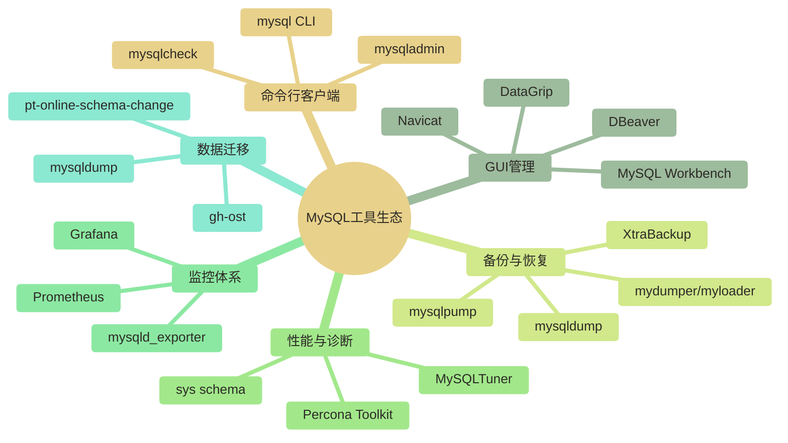
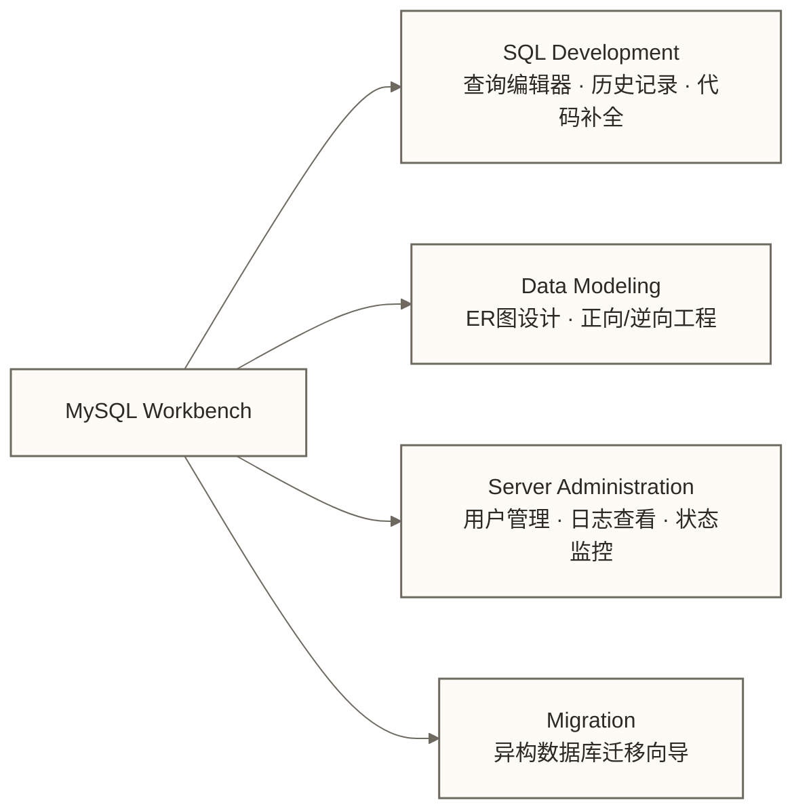

# MySQL工具生态 - 从命令行到可视化的完整工具链

> [!abstract] 本节概览
> - **学习目标**：掌握 MySQL 生态中的主流工具，建立高效的数据库管理工作流
> - **前置知识**：[[【技术与工具】/MySQL/01-MySQL介绍与特性|MySQL介绍与特性]] | [[【技术与工具】/MySQL/02-MySQL安装配置|MySQL安装配置]]
> - **预计用时**：60分钟
> - **技术重点**：GUI工具、命令行客户端、备份工具、监控工具、Percona Toolkit

## 工具全景图



---

## 一、mysql 命令行客户端

命令行是 DBA 的基本功，也是所有工具的底层基础。

### 连接与认证

```bash
# 基础连接（交互模式）
mysql -h 127.0.0.1 -P 3306 -u root -p

# 指定数据库直接连入
mysql -u app_user -p my_database

# 非交互模式：直接执行一条 SQL
mysql -u root -p -e "SHOW PROCESSLIST;"

# 执行 SQL 文件
mysql -u root -p my_database < /tmp/backup.sql

# 连接远程并输出无格式结果（用于脚本解析）
mysql -u root -p -s -N -e "SELECT COUNT(*) FROM orders;"
```

### 常用元命令速查

| 命令 | 说明 |
|------|------|
| `\h` 或 `help` | 显示帮助 |
| `\s` 或 `status` | 显示服务器状态 |
| `\u dbname` | 切换数据库 |
| `\G` | 垂直格式输出（长行友好） |
| `\q` 或 `quit` | 退出 |
| `source /path/file.sql` | 执行外部 SQL 文件 |
| `\! cmd` | 执行 Shell 命令 |
| `pager less -S` | 设置分页器（结果宽表时很有用） |

### 日常操作 SQL 速查

```sql
-- 查看所有数据库
SHOW DATABASES;

-- 查看当前数据库的所有表
SHOW TABLES;

-- 查看表结构
DESCRIBE orders;
SHOW CREATE TABLE orders\G

-- 查看进程列表
SHOW PROCESSLIST;

-- 查看服务器变量
SHOW VARIABLES LIKE 'innodb_buffer_pool_size';
SHOW VARIABLES LIKE '%timeout%';

-- 查看服务器状态
SHOW STATUS LIKE 'Threads_connected';
SHOW STATUS LIKE 'Innodb_buffer_pool_read_requests';

-- 查看 binlog 文件列表
SHOW BINARY LOGS;

-- 查看当前正在执行的事务
SELECT * FROM information_schema.INNODB_TRX\G

-- 杀死阻塞进程
KILL QUERY 1234;
KILL CONNECTION 1234;
```

> [!tip] 实用技巧
> 输出结果列很多时，在语句末尾加 `\G` 替换分号，会以键值对竖排展示，可读性大幅提升。
> 例如：`SHOW ENGINE INNODB STATUS\G`

---

## 二、MySQL Workbench

MySQL 官方出品的 GUI 工具，免费、跨平台，功能覆盖开发与运维全场景。

### 核心功能模块



### 主要使用场景

- **SQL 编辑器**：语法高亮、自动补全、执行计划可视化（EXPLAIN 图形化）
- **ER 图设计**：支持从数据库逆向生成 ER 图，也可正向设计后同步到数据库
- **用户权限管理**：图形化管理用户和 GRANT 权限
- **服务器监控面板**：查看连接数、QPS、慢查询等实时指标

> [!note] 版本说明
> MySQL Workbench 8.0 及以上版本原生支持 MySQL 8.0 的新特性（窗口函数、JSON 函数可视化等）。建议与 MySQL Server 版本保持一致。

---

## 三、DataGrip 与 DBeaver

### DataGrip（JetBrains）

JetBrains 旗下的数据库 IDE，适合重度 SQL 开发者。

**核心优势**：
- 智能 SQL 补全，感知表结构和 JOIN 关系
- 强大的重构能力（重命名列自动同步所有引用）
- 本地查询历史和版本控制集成
- 支持几乎所有主流数据库（MySQL、PostgreSQL、Oracle、MongoDB 等）

**适用人群**：后端开发工程师、数据工程师

### DBeaver（社区版免费）

开源跨平台 GUI，支持 100+ 数据库，社区版完全免费。

**核心优势**：
- 免费且功能丰富，满足日常 DBA 工作需求
- 插件生态活跃，支持 NoSQL、大数据组件
- ER 图生成、数据导出多格式支持

**适用人群**：预算有限的团队、需要多数据源管理的工程师

### 工具对比

| 维度 | MySQL Workbench | DataGrip | DBeaver |
|------|----------------|----------|---------|
| 价格 | 免费 | 付费（有试用） | 社区版免费 |
| MySQL 深度支持 | 最佳（官方） | 优秀 | 良好 |
| 多数据库支持 | 仅 MySQL | 全面 | 全面 |
| ER 图 | 支持 | 基础支持 | 支持 |
| 学习曲线 | 中等 | 中等 | 低 |
| 性能 | 中等 | 较重 | 轻量 |
| 适合场景 | MySQL 专项 DBA | 开发工程师 | 多数据源运维 |

---

## 四、备份工具

### mysqldump - 逻辑备份标准工具

mysqldump 将数据库导出为 SQL 文件，是最通用的逻辑备份方案。

```bash
# 备份单个数据库
mysqldump -u root -p my_database > /backup/my_database_$(date +%Y%m%d).sql

# 备份所有数据库
mysqldump -u root -p --all-databases > /backup/all_$(date +%Y%m%d).sql

# 备份时包含存储过程和触发器
mysqldump -u root -p --routines --triggers my_database > /backup/full.sql

# 备份单张表
mysqldump -u root -p my_database orders > /backup/orders.sql

# 单事务备份示例（InnoDB）+ 压缩；组合参数可能涉及短暂锁获取，生产使用前需评估
mysqldump -u root -p \
  --single-transaction \
  --master-data=2 \
  --flush-logs \
  my_database | gzip > /backup/my_database_$(date +%Y%m%d_%H%M%S).sql.gz

# 恢复
mysql -u root -p my_database < /backup/my_database_20260320.sql
# 压缩版恢复
gunzip < /backup/my_database_20260320.sql.gz | mysql -u root -p my_database
```

> [!warning] 注意事项
> `--single-transaction` 可为 InnoDB 表提供一致性快照，但不保证整个备份过程完全无锁，并发 DDL 也可能影响备份。对于 MyISAM 等非事务表，可采用锁表备份，例如使用 `--lock-all-tables`；不要将其与 `--single-transaction` 同时使用。

### mysqlpump - mysqldump 的升级版

MySQL 5.7.8+ 引入，支持并行导出，速度更快。

```bash
# 并行备份（4个线程）
mysqlpump -u root -p \
  --parallel-schemas=4 \
  --add-drop-database \
  my_database > /backup/pump_backup.sql

# 排除特定表
mysqlpump -u root -p \
  --exclude-tables=logs,audit_trail \
  my_database > /backup/no_logs.sql
```

### mydumper / myloader - 高性能并行备份

mydumper 是并行逻辑备份工具。本文未提供其开发归属的依据；“比 mysqldump 快 10 倍以上”仅可作为待测试的性能假设，实际结果取决于数据规模、表结构、并发配置、存储和网络条件。

```bash
# 安装（macOS）
brew install mydumper

# 多线程备份（8线程）
mydumper \
  -u root -p password \
  -B my_database \
  -t 8 \
  -c \
  -o /backup/mydumper_$(date +%Y%m%d)/

# 恢复
myloader \
  -u root -p password \
  -B my_database \
  -d /backup/mydumper_20260320/ \
  -t 8
```

**mydumper 输出目录结构**：

```text
/backup/mydumper_20260320/
├── metadata                     # 备份元信息（一致性位点）
├── my_database.orders.sql.gz       # 压缩表数据，实际分片文件名以输出为准
├── my_database.orders-schema.sql.gz  # 压缩表结构
├── my_database-schema.sql.gz       # 压缩数据库DDL
└── my_database.users.sql.gz
```

### 备份工具对比

| 工具 | 类型 | 速度 | 压缩 | 并行 | 适用场景 |
|------|------|------|------|------|---------|
| mysqldump | 逻辑备份 | 慢 | 需管道 | 不支持 | 小库、通用性要求高 |
| mysqlpump | 逻辑备份 | 中 | 内置 | 支持 | 中等规模库 |
| mydumper | 逻辑备份 | 快 | 内置 | 支持 | 大库、速度敏感 |
| XtraBackup | 物理备份 | 需按环境实测 | 支持 | 支持 | 生产大库候选方案，RTO需通过恢复演练评估 |

> [!tip] 选型建议
> - 数据量 < 10GB：mysqldump 完全够用，简单可靠
> - 数据量 10GB ~ 1TB：优先考虑 mydumper，速度提升明显
> - 数据量 > 1TB 或要求备份窗口极短：使用 Percona XtraBackup（物理热备）

---

## 五、Percona Toolkit

Percona Toolkit（简称 PT）是 DBA 必备工具箱，包含 30+ 个命令行工具，解决 MySQL 运维中最棘手的问题。

### pt-query-digest - 慢查询分析利器

```bash
# 分析慢查询日志（最常用）
pt-query-digest /var/log/mysql/slow.log

# 分析最近1小时的慢查询，按总耗时排序
pt-query-digest \
  --since="1h" \
  --order-by Query_time:sum \
  /var/log/mysql/slow.log

# 分析 tcpdump 抓包（无需慢查询日志）
tcpdump -i eth0 -s 65535 -x -nn -q -tttt \
  'port 3306' > /tmp/mysql.tcp
pt-query-digest --type=tcpdump /tmp/mysql.tcp

# 输出报告到文件
pt-query-digest /var/log/mysql/slow.log > /tmp/digest_report.txt
```

pt-query-digest 输出报告结构：

```markdown
# Profile
# Rank Query ID           Response time  Calls R/Call  V/M   Item
# ==== ================== ============= ====== ======= ===== ====
#    1 0xABC123...        10.2345 45.2%    234 0.0437  0.05  SELECT orders
#    2 0xDEF456...         5.1234 22.6%     89 0.0576  0.12  UPDATE users
```

### pt-online-schema-change - 在线 DDL 变更

对大表执行 DDL（加列、加索引）时，锁行为取决于 MySQL 版本、操作类型和执行算法。pt-osc 通过影子表和触发器降低变更对业务的影响，但仍可能获取元数据锁或发生锁等待，并非完全无锁。

```bash
# 给大表添加索引的在线变更示例；仍需评估元数据锁、触发器及复制环境
pt-online-schema-change \
  --host=127.0.0.1 \
  --user=root \
  --password=secret \
  --alter="ADD INDEX idx_created_at (created_at)" \
  D=my_database,t=orders \
  --execute

# 添加列
pt-online-schema-change \
  --alter="ADD COLUMN remark VARCHAR(255) DEFAULT NULL" \
  D=my_database,t=orders \
  --execute
```

> [!warning] 重要提示
> pt-osc 通过触发器同步变更期间的写操作，对写入频繁的表有额外性能开销。MySQL 8.0 的原生 Online DDL（`ALGORITHM=INPLACE`）在很多场景下已可替代 pt-osc，建议先评估原生 DDL 能否满足需求。

### 其他常用 PT 工具

```bash
# pt-table-checksum：校验主从数据一致性
pt-table-checksum \
  --host=master_host \
  --databases=my_database

# pt-table-sync：修复主从数据不一致
pt-table-sync \
  --execute \
  h=master_host,D=my_database,t=orders \
  h=slave_host

# pt-kill：自动终止超时或匹配特定模式的查询
pt-kill \
  --host=127.0.0.1 \
  --busy-time=60 \
  --kill \
  --print

# pt-deadlock-logger：持续监控并记录死锁事件
pt-deadlock-logger \
  --host=127.0.0.1 \
  --user=root \
  --password=secret

# pt-mysql-summary：快速生成 MySQL 实例全面诊断报告
pt-mysql-summary --host=127.0.0.1 --user=root --password=secret

# pt-stalk：在出现问题时自动收集诊断数据
pt-stalk \
  --function=status \
  --variable=Threads_running \
  --threshold=100 \
  -- --host=127.0.0.1
```

---

## 六、监控工具体系

### Prometheus + mysqld_exporter + Grafana

这是可用于 MySQL 生产监控的一种常见组合，是否适用取决于现有监控平台、采集需求和运维条件。

```mermaid
%%{init: {"theme":"base","themeVariables":{"fontFamily":"PingFang SC, -apple-system, Source Han Serif SC, serif","fontSize":"16px","background":"#FDFBF5","primaryColor":"#FDFBF5","primaryTextColor":"#2D2A26","primaryBorderColor":"#6E6A60","secondaryColor":"#E8EFE8","secondaryBorderColor":"#8FA890","secondaryTextColor":"#2D2A26","tertiaryColor":"#FDFBF5","tertiaryBorderColor":"#9A9488","tertiaryTextColor":"#6E6A60","lineColor":"#6E6A60","textColor":"#2D2A26","mainBkg":"#FDFBF5","nodeBorder":"#2D5A3D","clusterBkg":"#F3EEDF","clusterBorder":"#9A9488","edgeLabelBackground":"#FDFBF5"},"flowchart":{"htmlLabels":true,"curve":"basis","padding":20,"nodeSpacing":60,"rankSpacing":70,"useMaxWidth":false},"themeCSS":".node rect, .node polygon, .node circle { stroke-width: 1.5px; } .edgePath .path { stroke-width: 1.5px; } .cluster-label .nodeLabel, .cluster-label foreignObject { color: #2D2A26 !important; } .edgeLabel, .edgeLabel foreignObject { color: #2D2A26 !important; background-color: #FDFBF5; } .edgeLabel rect { fill: #FDFBF5; }"}}%%
flowchart LR
    classDef default fill:#FDFBF5,stroke:#6E6A60,color:#2D2A26,stroke-width:1.5px
    classDef startend fill:#2D2A26,stroke:#2D2A26,color:#FDFBF5,font-weight:bold
    classDef decision fill:#F6EAD8,stroke:#C08A1A,color:#2D2A26,font-weight:bold
    classDef hub fill:#3B5A80,stroke:#3B5A80,color:#FDFBF5,font-weight:bold
    classDef io fill:#E5EAF0,stroke:#3B5A80,color:#2D2A26
    classDef accent fill:#A6432C,stroke:#A6432C,color:#FDFBF5,font-weight:bold
    classDef storage fill:#F3EEDF,stroke:#9A9488,color:#2D2A26
    MySQL[(MySQL\nServer)] -->|采集指标| Exporter[mysqld_exporter\n:9104/metrics]
    Exporter -->|抓取| Prometheus[Prometheus\n时序数据库]
    Prometheus -->|数据源| Grafana[Grafana\n可视化面板]
    Prometheus -->|告警规则| AM[Alertmanager\n告警路由]
    AM -->|通知| DingTalk[钉钉/飞书\n邮件/PagerDuty]
    class MySQL storage
    class Exporter,Prometheus,Grafana,AM,DingTalk default
```



**部署 mysqld_exporter**：

```bash
# 以下SQL需在MySQL客户端中执行；权限应按启用的采集器评估，不代表最小权限配置
CREATE USER 'exporter'@'localhost'
  IDENTIFIED BY 'exporter_password'
  WITH MAX_USER_CONNECTIONS 3;

GRANT PROCESS, REPLICATION CLIENT, SELECT ON *.* TO 'exporter'@'localhost';

# 下载并运行 exporter
wget https://github.com/prometheus/mysqld_exporter/releases/download/v0.15.1/mysqld_exporter-0.15.1.linux-amd64.tar.gz
tar -xzf mysqld_exporter-0.15.1.linux-amd64.tar.gz
cd mysqld_exporter-0.15.1.linux-amd64

# 配置 .my.cnf 凭据
cat > /etc/mysql/exporter.cnf << EOF
[client]
user=exporter
password=exporter_password
host=127.0.0.1
EOF

# 启动
./mysqld_exporter --config.my-cnf=/etc/mysql/exporter.cnf
```

**核心监控指标**：

| 指标名 | 说明 | 告警阈值参考 |
|--------|------|------------|
| `mysql_global_status_threads_connected` | 当前连接数 | > max_connections * 0.8 |
| `mysql_global_status_questions` | 累计语句计数；需用 rate() 等计算每秒速率 | 速率超过基线 3x 可作为示例阈值，需按业务调整 |
| `mysql_global_status_slow_queries` | 累计慢查询数 | 增长速率异常告警 |
| `mysql_global_status_innodb_buffer_pool_reads` | 磁盘读次数 | 缓冲池命中率 < 99% |
| `mysql_slave_status_seconds_behind_master` | 主从延迟秒数 | > 30 秒告警 |
| `mysql_global_status_aborted_connects` | 连接失败数 | 持续增长告警 |

**推荐 Grafana 仪表盘**：
- Dashboard ID `7362`：MySQL Overview（Percona 出品）
- Dashboard ID `14057`：MySQL Exporter Quickstart

---

## 七、工具选型总结

```mermaid
%%{init: {"theme":"base","themeVariables":{"fontFamily":"PingFang SC, -apple-system, Source Han Serif SC, serif","fontSize":"16px","background":"#FDFBF5","primaryColor":"#FDFBF5","primaryTextColor":"#2D2A26","primaryBorderColor":"#6E6A60","secondaryColor":"#E8EFE8","secondaryBorderColor":"#8FA890","secondaryTextColor":"#2D2A26","tertiaryColor":"#FDFBF5","tertiaryBorderColor":"#9A9488","tertiaryTextColor":"#6E6A60","lineColor":"#6E6A60","textColor":"#2D2A26","mainBkg":"#FDFBF5","nodeBorder":"#2D5A3D","clusterBkg":"#F3EEDF","clusterBorder":"#9A9488","edgeLabelBackground":"#FDFBF5"},"flowchart":{"htmlLabels":true,"curve":"basis","padding":20,"nodeSpacing":60,"rankSpacing":70,"useMaxWidth":false},"themeCSS":".node rect, .node polygon, .node circle { stroke-width: 1.5px; } .edgePath .path { stroke-width: 1.5px; } .cluster-label .nodeLabel, .cluster-label foreignObject { color: #2D2A26 !important; } .edgeLabel, .edgeLabel foreignObject { color: #2D2A26 !important; background-color: #FDFBF5; } .edgeLabel rect { fill: #FDFBF5; }"}}%%
flowchart TD
    classDef default fill:#FDFBF5,stroke:#6E6A60,color:#2D2A26,stroke-width:1.5px
    classDef startend fill:#2D2A26,stroke:#2D2A26,color:#FDFBF5,font-weight:bold
    classDef decision fill:#F6EAD8,stroke:#C08A1A,color:#2D2A26,font-weight:bold
    classDef hub fill:#3B5A80,stroke:#3B5A80,color:#FDFBF5,font-weight:bold
    classDef io fill:#E5EAF0,stroke:#3B5A80,color:#2D2A26
    classDef accent fill:#A6432C,stroke:#A6432C,color:#FDFBF5,font-weight:bold
    classDef storage fill:#F3EEDF,stroke:#9A9488,color:#2D2A26
    Need{使用场景}
    Need -->|日常 SQL 开发| Dev[DataGrip / DBeaver]
    Need -->|MySQL 专项管理| WB[MySQL Workbench]
    Need -->|命令行快速操作| CLI[mysql CLI]
    Need -->|逻辑备份 小库| MD[mysqldump]
    Need -->|逻辑备份 大库| MYD[mydumper]
    Need -->|物理热备候选方案| XB[Percona XtraBackup]
    Need -->|分析慢查询| PQD[pt-query-digest]
    Need -->|大表在线加索引（仍有锁风险）| POSC[pt-online-schema-change]
    Need -->|生产监控告警| PM[Prometheus + Grafana]
    class Need decision
    class Dev,WB,CLI,MD,MYD,XB,PQD,POSC,PM default
```



| 场景 | 推荐工具 | 备注 |
|------|---------|------|
| 新人入门 | MySQL Workbench | 官方免费，功能全面 |
| 开发日常 | DataGrip / DBeaver | SQL 智能提示强 |
| 命令行运维 | mysql CLI | 必须掌握的基本功 |
| 逻辑备份 | mysqldump / mydumper | 按数据量选择 |
| 物理备份 | XtraBackup | 大库首选 |
| 慢查询分析 | pt-query-digest | PT 工具箱核心 |
| 在线 DDL | pt-osc 或原生 Online DDL | 8.0 优先用原生 |
| 生产监控 | Prometheus + mysqld_exporter | 常见组合，需匹配采集需求与运维条件 |

---

## 延伸阅读

- [[【技术与工具】/MySQL/05-MySQL架构原理|MySQL架构原理]] - 了解工具背后的服务器架构
- [[【技术与工具】/MySQL/12-性能监控与诊断|性能监控与诊断]] - 系统性能分析方法论
- [[【技术与工具】/MySQL/13-慢查询优化实战|慢查询优化实战]] - pt-query-digest 实战案例
- [[【技术与工具】/MySQL/09-日志系统详解|日志系统详解]] - 理解 binlog、slow log 等日志体系

> [!tip] 学习建议
> 工具的掌握贵在"会用"而非"知道"。建议在隔离的本地 MySQL 测试环境中练习本文命令；涉及恢复、结构变更、数据同步或终止查询的命令，只能在可丢弃数据上确认目标和影响后执行。备份和恢复工具尤其要反复练习，等到生产事故时再学就来不及了。
