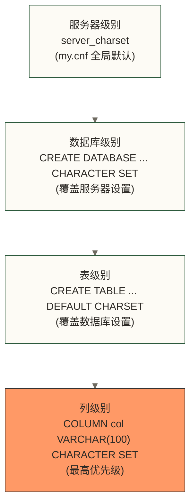
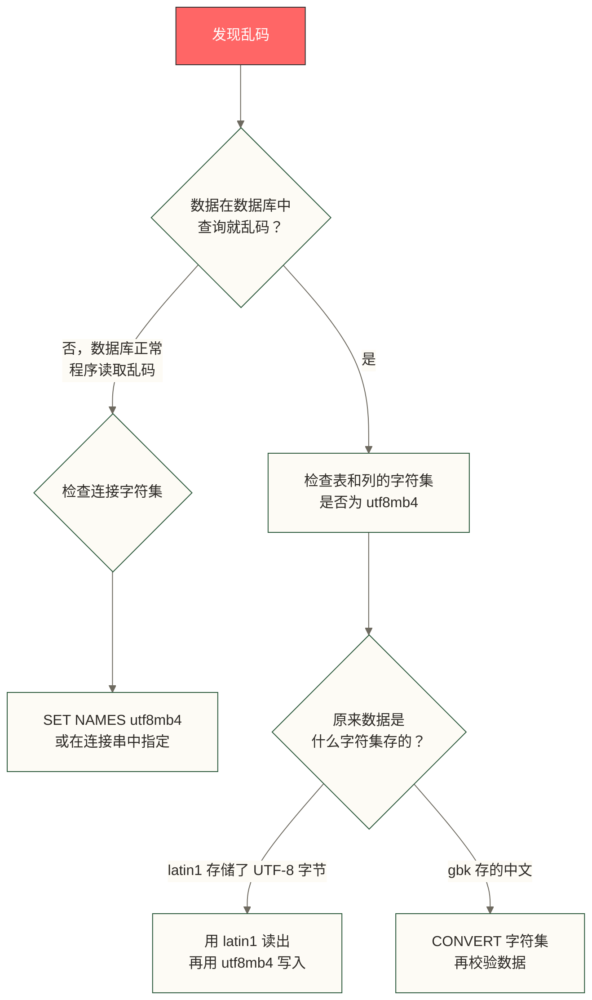

# 字符集与校对规则 - 彻底搞懂 MySQL 编码问题

> [!abstract] 本节概览
> - **学习目标**：理解 MySQL 字符集与校对规则，学习排查常见中文乱码和排序异常问题
> - **前置知识**：[[【技术与工具】/MySQL/01-MySQL介绍与特性|MySQL介绍与特性]] | [[【技术与工具】/MySQL/02-MySQL安装配置|MySQL安装配置]]
> - **预计用时**：45分钟
> - **技术重点**：utf8mb4、校对规则层级、乱码排查、生产最佳实践

## 核心概念速览


> [!note] 用一句话区分两者
> **字符集**解决"怎么存"的问题——把字符映射成字节序列。
> **校对规则**解决"怎么比"的问题——两个字符串是否相等、谁大谁小。
> 字符集确定后，校对规则必须从属于该字符集（不能给 utf8mb4 设置 gbk 的校对规则）。

---

## 一、字符集基础

### 常见字符集

| 字符集 | 最大字节/字符 | 支持范围 | 适用场景 |
|--------|-------------|---------|---------|
| `latin1` | 1 字节 | 西欧语言 | 纯英文老系统，不推荐新项目 |
| `gbk` | 2 字节 | 简体中文 + ASCII | 国内老系统，不推荐 |
| `utf8`（MySQL 中） | 3 字节 | BMP 多语言平面 | **不推荐**，有严重缺陷 |
| `utf8mb4` | 4 字节 | 完整 Unicode（含 emoji） | **生产环境推荐** |
| `binary` | 1 字节 | 原始字节，不做任何转换 | BLOB、二进制数据 |

### utf8 vs utf8mb4 —— 这是 MySQL 最大的历史遗留陷阱

> [!warning] 必须了解的陷阱
> MySQL 中的 `utf8` **不是真正的 UTF-8**。
>
> 标准 UTF-8 最多用 4 字节表示一个字符，但 MySQL 的 `utf8` 实现只支持最多 3 字节，导致它无法存储：
> - Emoji 表情（如 😄，需要 4 字节）
> - 部分生僻汉字
> - 数学符号等 Unicode 增补字符
>
> 插入 emoji 时会报错：`Incorrect string value: '\xF0\x9F\x98\x84' for column 'content'`
>
> **结论：新项目一律使用 `utf8mb4`，它才是真正的 UTF-8。**

```sql
-- 验证 utf8 与 utf8mb4 的区别
-- 使用 utf8 字符集的列插入 emoji 会失败
CREATE TABLE test_utf8 (content VARCHAR(100) CHARACTER SET utf8);
INSERT INTO test_utf8 VALUES ('Hello 😄');  -- ERROR!

-- 使用 utf8mb4 则正常
CREATE TABLE test_utf8mb4 (content VARCHAR(100) CHARACTER SET utf8mb4);
INSERT INTO test_utf8mb4 VALUES ('Hello 😄');  -- OK

-- 查看每个字符集的最大字节数
SELECT CHARACTER_SET_NAME, MAXLEN
FROM information_schema.CHARACTER_SETS
WHERE CHARACTER_SET_NAME IN ('utf8', 'utf8mb4', 'latin1', 'gbk');
```

---

## 二、校对规则（Collation）详解

### 命名规范解读

校对规则名称由三部分组成：`字符集名_语言/地区_特性`

```text
utf8mb4_general_ci
│        │       │
│        │       └── ci = case insensitive（大小写不敏感）
│        │           cs = case sensitive（大小写敏感）
│        │           bin = binary（非二进制字符集的 _bin 校对规则按字符编码值比较，不等同于二进制字符串的逐字节比较）
│        └── general = 通用（简化算法）
│            unicode = Unicode 规范算法
│            0900    = Unicode 9.0 标准
└── 所属字符集
```

### 主要校对规则对比

| 校对规则 | 大小写 | 重音符 | 算法 | 性能 | MySQL 版本 |
|---------|--------|--------|------|------|-----------|
| `utf8mb4_general_ci` | 不敏感 | 不敏感 | 简化 | 需结合工作负载测试 | 5.5+ |
| `utf8mb4_unicode_ci` | 不敏感 | 不敏感 | 完整 Unicode | 需结合工作负载测试 | 5.5+ |
| `utf8mb4_0900_ai_ci` | 不敏感 | 不敏感 | Unicode 9.0 | 需结合工作负载测试 | 8.0+ |
| `utf8mb4_0900_as_cs` | 敏感 | 敏感 | Unicode 9.0 | 需结合工作负载测试 | 8.0+ |
| `utf8mb4_bin` | 敏感 | 敏感 | 按字符编码值 | 需结合工作负载测试 | 5.5+ |

### 三种主流校对规则的实际差异

```sql
-- 准备测试数据
CREATE TABLE collation_test (
    id INT AUTO_INCREMENT PRIMARY KEY,
    name VARCHAR(50)
) ENGINE=InnoDB DEFAULT CHARSET=utf8mb4 COLLATE=utf8mb4_general_ci;

INSERT INTO collation_test (name) VALUES ('apple'), ('Apple'), ('APPLE'), ('café'), ('cafe');

-- 大小写不敏感：'apple' = 'Apple' = 'APPLE'
SELECT * FROM collation_test WHERE name = 'apple';
-- 返回：apple, Apple, APPLE（三行）

-- 排序差异示例（重音字符）
-- general_ci：café 和 cafe 视为相等
SELECT name FROM collation_test ORDER BY name COLLATE utf8mb4_general_ci;

-- unicode_ci：按 Unicode 标准，更符合语言学习惯
SELECT name FROM collation_test ORDER BY name COLLATE utf8mb4_unicode_ci;

-- utf8mb4_bin：按字符编码值比较；本例中的 ASCII 大写字母排在小写字母之前
SELECT name FROM collation_test ORDER BY name COLLATE utf8mb4_bin;
```

> [!tip] 如何选择校对规则？
>
> **新项目推荐 `utf8mb4_0900_ai_ci`（MySQL 8.0+）**：
> - 基于 Unicode 9.0 标准
> - 性能需结合实际数据、查询和 MySQL 版本与 unicode_ci 对比测试
> - ai = accent insensitive（重音不敏感）
> - ci = case insensitive（大小写不敏感）
>
> **仍在用 5.7 推荐 `utf8mb4_unicode_ci`**：
> - 比 general_ci 准确（更符合多语言排序习惯）
> - 性能差异是否可接受，应结合实际数据规模、查询负载和硬件测试
>
> **什么时候用 `utf8mb4_bin`**：
> - 需要大小写敏感比较的普通文本字段；密码应存储专用密码哈希，不能以校对规则代替安全存储
> - 代码存储、文件路径等需要精确匹配的字段

---

## 三、字符集设置的四个层级

MySQL 的字符集配置分四个层级，内层设置优先于外层。



### 查看各层级字符集设置

```sql
-- 查看服务器级别
SHOW VARIABLES LIKE 'character_set_server';
SHOW VARIABLES LIKE 'collation_server';

-- 查看数据库级别
SELECT SCHEMA_NAME, DEFAULT_CHARACTER_SET_NAME, DEFAULT_COLLATION_NAME
FROM information_schema.SCHEMATA
WHERE SCHEMA_NAME = 'my_database';

-- 查看表级别
SHOW CREATE TABLE orders\G
-- 或
SELECT TABLE_NAME, TABLE_COLLATION
FROM information_schema.TABLES
WHERE TABLE_SCHEMA = 'my_database';

-- 查看列级别
SELECT COLUMN_NAME, CHARACTER_SET_NAME, COLLATION_NAME
FROM information_schema.COLUMNS
WHERE TABLE_SCHEMA = 'my_database' AND TABLE_NAME = 'orders';

-- 查看当前连接的字符集变量（完整列表）
SHOW VARIABLES LIKE 'character%';
SHOW VARIABLES LIKE 'collation%';
```

### 连接相关的字符集变量

```text
character_set_client    → 客户端发送给服务器的字符集
character_set_connection → 服务器用于处理查询的字符集
character_set_results   → 服务器返回给客户端的字符集
```

> [!note] 为什么要关注连接字符集？
> 即使数据库和表设置了 utf8mb4，如果连接字符集是 latin1，中文字符在传输过程中会被截断或乱码。这是乱码问题最常见的根源之一。

---

## 四、修改字符集的 SQL 命令

### 设置服务器默认字符集（my.cnf）

```ini
[mysqld]
character-set-server = utf8mb4
collation-server     = utf8mb4_0900_ai_ci

[client]
default-character-set = utf8mb4
```

### 运行时修改（不重启）

```sql
-- 修改当前会话的连接字符集（临时）
SET NAMES 'utf8mb4';
-- 等价于同时执行：
SET character_set_client    = utf8mb4;
SET character_set_connection = utf8mb4;
SET character_set_results   = utf8mb4;

-- 修改数据库字符集（不影响已有表）
ALTER DATABASE my_database
  CHARACTER SET utf8mb4
  COLLATE utf8mb4_0900_ai_ci;

-- 转换表内字符列的字符集及已有数据
ALTER TABLE orders
  CONVERT TO CHARACTER SET utf8mb4
  COLLATE utf8mb4_0900_ai_ci;
-- 注意：CONVERT TO 会同时转换列数据，这是正确用法
-- 如果只改表头而不转换数据，则用 DEFAULT CHARACTER SET

-- 修改单列字符集
ALTER TABLE users
  MODIFY COLUMN username VARCHAR(100)
  CHARACTER SET utf8mb4 COLLATE utf8mb4_0900_ai_ci NOT NULL;
```

> [!warning] ALTER TABLE CONVERT TO 的注意事项
> 对大表执行 `CONVERT TO CHARACTER SET` 会重建整张表，耗时较长且会锁表（MyISAM）或消耗大量 IO（InnoDB）。生产环境可评估 [[【技术与工具】/MySQL/03-MySQL工具生态|pt-online-schema-change]]；若考虑 MySQL 8.0 的 Online DDL，需先确认该版本和具体字符集转换支持的算法与锁级别，不能默认转换可在线或无阻塞完成。

---

## 五、乱码问题排查与修复

乱码的本质是：**存储时用的字符集** 和 **读取时用的字符集** 不一致。

### 乱码排查流程



### 常见乱码场景与修复

**场景 1：连接字符集未设置**

```sql
-- 问题：插入中文乱码
-- 原因：客户端是 utf8mb4，但连接未声明，服务器以 latin1 处理

-- 修复：每次连接后执行
SET NAMES 'utf8mb4';

-- 更好的方式：JDBC 连接串中指定
-- jdbc:mysql://host:3306/db?useUnicode=true&characterEncoding=UTF-8
```

**场景 2：列字符集是 utf8 导致 emoji 插入失败**

```sql
-- 问题现象
INSERT INTO posts (content) VALUES ('今天天气真好 😄');
-- ERROR 1366: Incorrect string value: '\xF0\x9F\x98\x84'

-- 修复：转换列字符集
ALTER TABLE posts
  MODIFY COLUMN content TEXT
  CHARACTER SET utf8mb4 COLLATE utf8mb4_0900_ai_ci;
```

**场景 3：latin1 表中实际存了 UTF-8 字节（常见历史遗留问题）**

```sql
-- 这种情况最棘手：字符集声明是 latin1，但字节流实际是 UTF-8
-- 直接 ALTER TABLE CONVERT TO utf8mb4 会二次转义，造成更严重乱码

-- 正确方法：先改成 binary（阻止字符集转换），再改回 utf8mb4
ALTER TABLE legacy_table
  MODIFY COLUMN name VARCHAR(100) CHARACTER SET binary;

ALTER TABLE legacy_table
  MODIFY COLUMN name VARCHAR(100)
  CHARACTER SET utf8mb4 COLLATE utf8mb4_0900_ai_ci;
```

### 乱码检测 SQL

```sql
-- 检查数据库中是否存在非 utf8mb4 的表
SELECT
  TABLE_SCHEMA,
  TABLE_NAME,
  TABLE_COLLATION
FROM information_schema.TABLES
WHERE TABLE_SCHEMA NOT IN ('information_schema', 'mysql', 'performance_schema', 'sys')
  AND TABLE_COLLATION NOT LIKE 'utf8mb4%'
ORDER BY TABLE_SCHEMA, TABLE_NAME;

-- 检查数据库中是否存在非 utf8mb4 的列
SELECT
  TABLE_SCHEMA,
  TABLE_NAME,
  COLUMN_NAME,
  CHARACTER_SET_NAME,
  COLLATION_NAME
FROM information_schema.COLUMNS
WHERE TABLE_SCHEMA NOT IN ('information_schema', 'mysql', 'performance_schema', 'sys')
  AND CHARACTER_SET_NAME IS NOT NULL
  AND CHARACTER_SET_NAME != 'utf8mb4'
ORDER BY TABLE_SCHEMA, TABLE_NAME;
```

---

## 六、生产环境最佳实践

### 统一配置清单

```ini
# /etc/mysql/mysql.conf.d/mysqld.cnf

[mysqld]
# 服务器字符集（MySQL 8.0 默认已经是 utf8mb4，仍建议显式声明）
character-set-server  = utf8mb4
collation-server      = utf8mb4_0900_ai_ci

# 关闭旧的宽松字符集行为
skip-character-set-client-handshake  # 强制所有连接使用服务器字符集

[client]
default-character-set = utf8mb4

[mysql]
default-character-set = utf8mb4
```

### 建库建表模板

```sql
-- 标准建库语句
CREATE DATABASE my_database
  CHARACTER SET utf8mb4
  COLLATE utf8mb4_0900_ai_ci;

-- 标准建表语句（列级别通常不需要单独指定，继承表级别即可）
CREATE TABLE users (
    id         BIGINT UNSIGNED AUTO_INCREMENT PRIMARY KEY,
    username   VARCHAR(50)  NOT NULL COMMENT '用户名',
    email      VARCHAR(100) NOT NULL COMMENT '邮箱',
    bio        TEXT         COMMENT '个人简介（可含 emoji）',
    created_at DATETIME     DEFAULT CURRENT_TIMESTAMP
) ENGINE=InnoDB
  DEFAULT CHARSET=utf8mb4
  COLLATE=utf8mb4_0900_ai_ci
  COMMENT='用户表';
```

### JDBC / 连接池配置

```yaml
# Spring Boot application.yml
spring:
  datasource:
    url: jdbc:mysql://localhost:3306/my_database?useUnicode=true&characterEncoding=UTF-8&serverTimezone=Asia/Shanghai
    driver-class-name: com.mysql.cj.jdbc.Driver
```

```python
# Python pymysql
import pymysql

conn = pymysql.connect(
    host='localhost',
    user='root',
    password='secret',
    db='my_database',
    charset='utf8mb4',          # 必须指定
    use_unicode=True
)
```

### 字符集升级检查清单

- [ ] 确认 MySQL 版本 >= 5.5.3（utf8mb4 支持的最低版本）
- [ ] 修改 my.cnf 服务器配置
- [ ] 逐库执行 `ALTER DATABASE 数据库名 CHARACTER SET utf8mb4`（仅修改数据库默认字符集，不转换已有表）
- [ ] 逐表评估并执行 `ALTER TABLE ... CONVERT TO CHARACTER SET utf8mb4`（可评估使用 pt-osc，但仍需检查适用条件、元数据锁及切表影响）
- [ ] 更新所有应用连接字符串
- [ ] 更新数据库连接池配置
- [ ] 功能测试：验证中文、emoji、特殊符号的存取
- [ ] 性能测试：utf8mb4 相比 utf8 索引略宽（VARCHAR 索引长度计算会变化）

> [!warning] VARCHAR 索引长度限制变化
> 从 utf8 迁移到 utf8mb4 时，字符的最大字节数从 3 变为 4。
> InnoDB 索引键长度上限取决于行格式、页大小及版本配置：REDUNDANT/COMPACT 行格式通常为 767 字节；DYNAMIC/COMPRESSED 在满足相应条件且使用 16KB 页时可达 3072 字节。MySQL 5.7 还需考虑 innodb_large_prefix 配置，MySQL 8.0 已移除该参数。
>
> 如果有 `VARCHAR(255) + utf8` 的完整列索引（255 × 3 = 765 字节），转换为 utf8mb4 后最大字符字节数为 1020 字节；在索引键上限为 767 字节的配置下会超限，在支持 3072 字节上限的适当配置下则不一定超限。迁移前应检查实际行格式、页大小及索引定义，再选择调整配置、行格式或索引方案。

---

## 延伸阅读

- [[【技术与工具】/MySQL/02-MySQL安装配置|MySQL安装配置]] - my.cnf 字符集配置章节
- [[【技术与工具】/MySQL/05-MySQL架构原理|MySQL架构原理]] - 服务器变量的生效机制
- [[【技术与工具】/MySQL/06-InnoDB存储引擎|InnoDB存储引擎]] - 列存储格式与字符集的关系
- [[【技术与工具】/MySQL/10-MySQL索引深度剖析|MySQL索引深度剖析]] - 字符集对索引长度的影响
