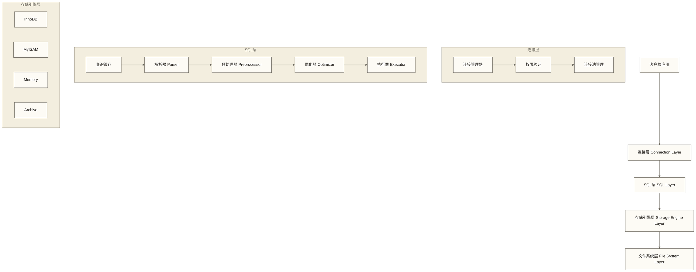
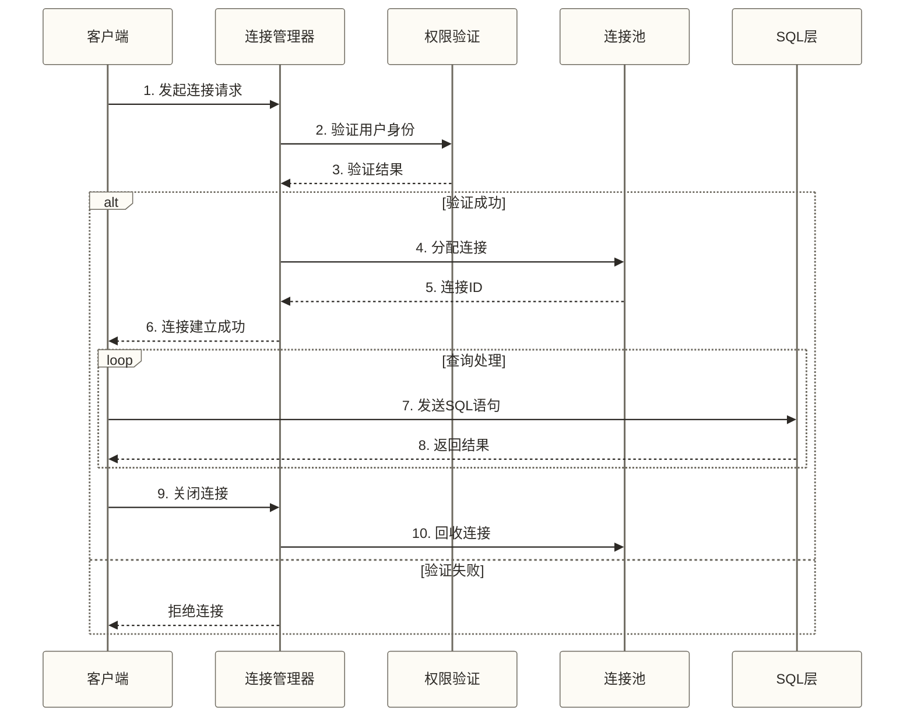
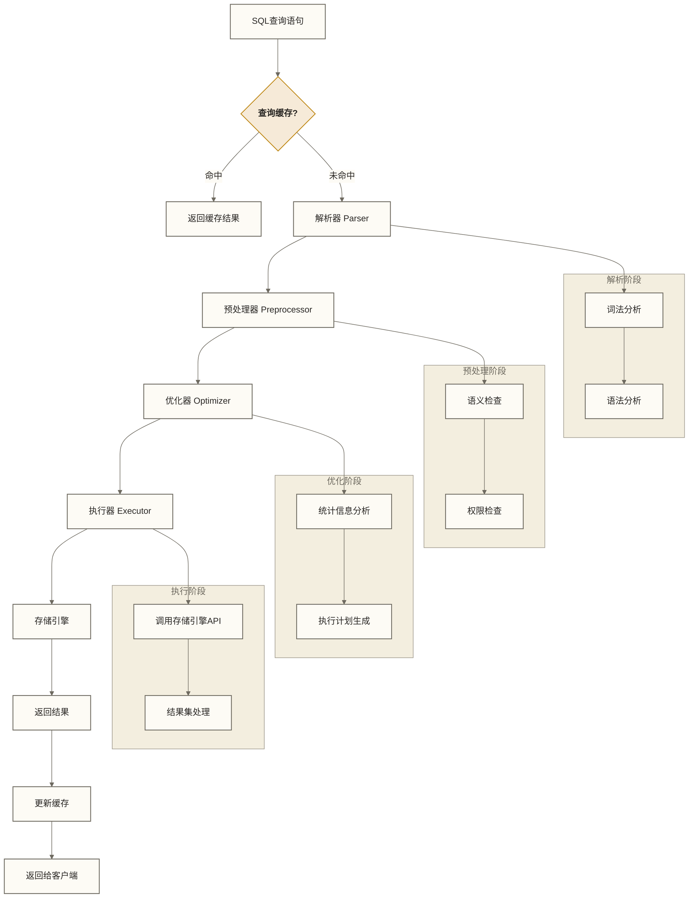
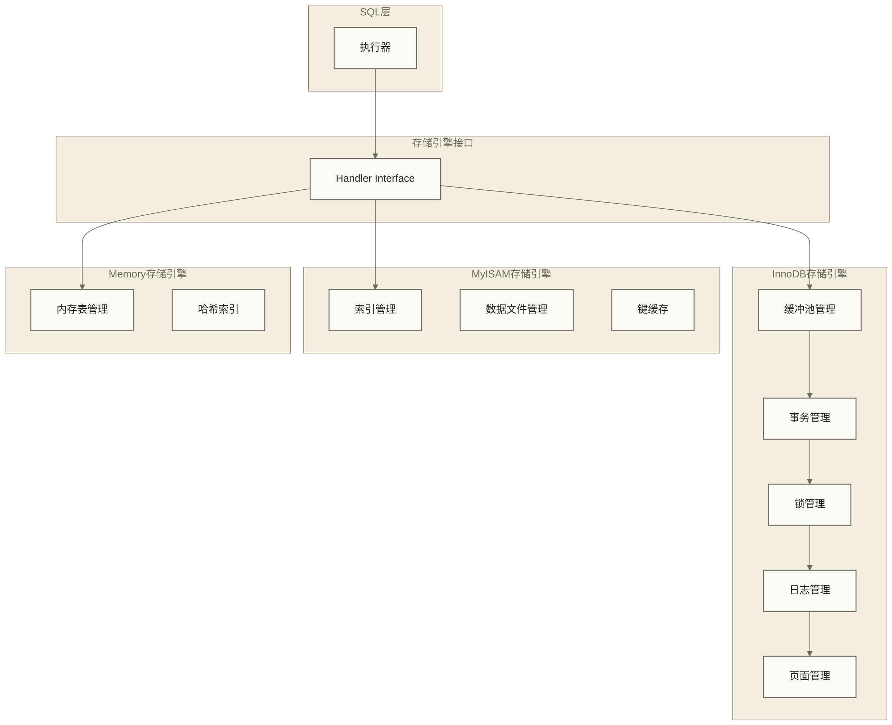
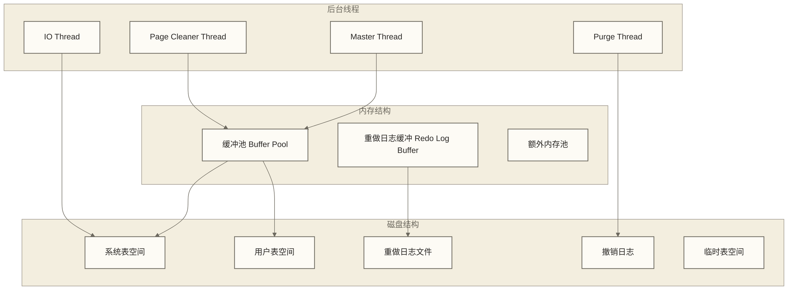

# 🏗️ MySQL架构原理深度解析 - 理解数据库内部工作机制

> [!abstract] 📋 本节概览
> - 🎯 **学习目标**：深入理解MySQL的整体架构和各组件工作原理
> - 📚 **前置知识**：[[【技术与工具】/MySQL/01-MySQL介绍与特性|MySQL介绍与特性]] | [[【技术与工具】/MySQL/02-MySQL安装配置|MySQL安装配置]] | [[【技术与工具】/PostgreSQL/00-PostgreSQL学习路线图|PostgreSQL/PostgreSQL]]
> - ⏱️ **预计用时**：90分钟
> - 🔧 **技术重点**：连接管理、查询解析、存储引擎、缓存机制

## 🎯 MySQL整体架构

### 分层架构概览



### 各层职责详解

| 层次 | 主要组件 | 核心职责 | 特点 |
|---|---|---|---|
| **连接层** | 连接管理器、权限验证 | 客户端连接管理、用户认证 | 与存储引擎无关 |
| **SQL层** | 解析器、优化器、执行器 | SQL解析、查询优化、执行协调 | MySQL核心逻辑 |
| **存储引擎层** | InnoDB、MyISAM等 | 数据存储和检索 | 可插拔设计 |
| **文件系统层** | 操作系统文件系统 | 物理数据存储 | 与MySQL实现无关 |

---

## 🔌 连接层详解

### 连接管理流程



### 连接管理相关配置

```sql title="连接管理查询和配置"
-- 查看当前连接数
SHOW STATUS LIKE 'Threads_connected';

-- 查看历史最大连接数
SHOW STATUS LIKE 'Max_used_connections';

-- 查看连接相关配置
SHOW VARIABLES LIKE '%connect%';

-- 查看当前所有连接
SHOW PROCESSLIST;

-- 或使用更详细的查询
SELECT 
    ID,
    USER,
    HOST,
    DB,
    COMMAND,
    TIME,
    STATE,
    INFO
FROM INFORMATION_SCHEMA.PROCESSLIST
WHERE COMMAND != 'Sleep'
ORDER BY TIME DESC;

-- 终止指定连接
KILL CONNECTION 123;  -- 123是连接ID

-- 终止指定查询
KILL QUERY 123;
```

```ini title="my.cnf 连接配置"
[mysqld]
# 最大连接数
max_connections = 1000

# 每个用户的最大连接数
max_user_connections = 50

# 连接超时设置
wait_timeout = 28800          # 非交互连接超时（8小时）
interactive_timeout = 28800   # 交互连接超时

# 连接错误处理
max_connect_errors = 100000   # 单个主机连接错误上限

# 连接建立超时
connect_timeout = 10

# 线程缓存
thread_cache_size = 50        # 线程缓存大小
```

---

## 🧠 SQL层详解

### 查询执行流程



### 1. 查询缓存（MySQL 5.7及以前）

```sql title="查询缓存机制"
-- 查看查询缓存状态
SHOW VARIABLES LIKE 'query_cache%';

-- 查询缓存统计信息
SHOW STATUS LIKE 'Qcache%';

-- 缓存配置说明
/*
query_cache_type = 1      # 0=关闭, 1=开启, 2=按需
query_cache_size = 32M    # 缓存大小
query_cache_limit = 2M    # 单个查询结果最大缓存大小
*/

-- 强制使用缓存
SELECT SQL_CACHE user_id, username FROM users WHERE id = 1;

-- 强制不使用缓存
SELECT SQL_NO_CACHE * FROM orders WHERE created_at > NOW() - INTERVAL 1 DAY;
```

> [!warning] ⚠️ 查询缓存注意事项
> - **MySQL 8.0已移除查询缓存功能** - 因为维护成本高，缓存命中率低
> - **缓存失效条件严格** - 任何表数据变化都会导致整个表的缓存失效
> - **高并发写入瓶颈** - 写操作需要清理缓存，影响性能
> - **现代替代方案** - Redis、Memcached等外部缓存更灵活高效

### 2. 解析器（Parser）

```sql title="解析器工作过程"
-- 词法分析：将SQL语句分解为token
/*
原始SQL: SELECT user_id, name FROM users WHERE age > 18
Token序列:
- SELECT (关键字)
- user_id (标识符)
- , (分隔符)
- name (标识符)
- FROM (关键字)
- users (标识符)
- WHERE (关键字)
- age (标识符)
- > (操作符)
- 18 (数字)
*/

-- 语法分析：构建抽象语法树(AST)
-- 检查SQL语法是否正确，如括号匹配、关键字顺序等

-- 查看解析错误示例
SELECT user_id name FROM users;  -- 合法写法：name是user_id的隐式列别名；若要查询两列，应写SELECT user_id, name FROM users;
SELECT * users WHERE age > 18;   -- 缺少FROM，语法错误
```

### 3. 预处理器（Preprocessor）

```sql title="预处理器功能"
-- 语义检查：验证表名、列名是否存在
-- 权限检查：验证用户是否有相应权限

-- 表名检查
SELECT * FROM non_existing_table;  -- 表不存在错误

-- 列名检查  
SELECT non_existing_column FROM users;  -- 列不存在错误

-- 权限检查
-- 用户必须有SELECT权限才能执行查询

-- 表达式解析
-- 将 * 展开为具体列名
-- 解析函数调用和表达式
```

### 4. 优化器（Optimizer）

```sql title="查询优化器详解"
-- 查看执行计划
EXPLAIN SELECT 
    u.user_id, 
    u.username, 
    p.title
FROM users u
JOIN posts p ON u.user_id = p.author_id
WHERE u.status = 'active' 
    AND p.published_at > '2024-01-01';

-- 查看详细执行计划
EXPLAIN FORMAT=JSON SELECT * FROM users WHERE age BETWEEN 20 AND 30;

-- 查看优化器追踪信息（MySQL 5.6+）
SET optimizer_trace = 'enabled=on';
SELECT * FROM users WHERE age > 25 ORDER BY created_at LIMIT 10;
SELECT * FROM INFORMATION_SCHEMA.OPTIMIZER_TRACE;
SET optimizer_trace = 'enabled=off';
```

#### 优化器主要决策

| 优化类型 | 决策内容 | 示例 |
|---|---|---|
| **索引选择** | 选择最优索引 | 单列索引 vs 复合索引 |
| **连接顺序** | 确定表连接顺序 | 小表驱动大表 |
| **连接算法** | 选择连接实现方式 | Nested Loop vs Hash Join |
| **WHERE条件** | 确定条件下推位置 | 提前过滤数据 |
| **排序优化** | 选择排序实现方式 | 索引排序 vs 文件排序 |

### 5. 执行器（Executor）

```sql title="执行器工作机制"
-- 执行器调用存储引擎API示例流程：

-- 1. 打开表
-- executor -> storage_engine: ha_open()

-- 2. 定位第一行
-- executor -> storage_engine: ha_index_first() 或 ha_rnd_next()

-- 3. 循环读取数据
-- LOOP:
--   executor -> storage_engine: ha_index_next() 或 ha_rnd_next()
--   executor: 应用WHERE条件过滤
--   executor: 如果符合条件，加入结果集

-- 4. 关闭表
-- executor -> storage_engine: ha_close()

-- 查看执行统计信息
SHOW SESSION STATUS LIKE 'Handler%';

-- 常见Handler统计项
/*
Handler_read_first: 读取索引第一行的次数
Handler_read_key: 根据key读取行的次数  
Handler_read_next: 按索引顺序读取下一行的次数
Handler_read_rnd: 按位置读取行的次数
Handler_read_rnd_next: 按位置读取下一行的次数
*/
```

---

## 💾 存储引擎层详解

### 存储引擎架构



### InnoDB存储引擎架构



#### InnoDB关键特性

```sql title="InnoDB特性演示"
-- 1. 事务支持（ACID）
START TRANSACTION;
INSERT INTO accounts (user_id, balance) VALUES (1, 1000);
UPDATE accounts SET balance = balance - 100 WHERE user_id = 1;
INSERT INTO transactions (from_user, amount) VALUES (1, 100);
COMMIT;

-- 2. 行级锁
-- 会话1
BEGIN;
SELECT * FROM users WHERE id = 1 FOR UPDATE;  -- 锁定id=1的行

-- 会话2（将等待）
UPDATE users SET name = 'New Name' WHERE id = 1;  -- 等待锁释放

-- 3. 外键约束
CREATE TABLE orders (
    order_id INT PRIMARY KEY,
    user_id INT,
    FOREIGN KEY (user_id) REFERENCES users(user_id)
        ON DELETE CASCADE 
        ON UPDATE CASCADE
);

-- 4. 崩溃恢复
-- 正常情况下，InnoDB在启动时自动进行崩溃恢复；若存在数据文件或日志损坏等异常，可能需要人工诊断和恢复，不能保证无需手动干预

-- 5. MVCC（多版本并发控制）查看
-- 查看InnoDB状态
SHOW ENGINE INNODB STATUS\G

-- 查看当前事务
SELECT * FROM INFORMATION_SCHEMA.INNODB_TRX;
```

### MyISAM存储引擎特点

```sql title="MyISAM特性"
-- 1. 表级锁定
LOCK TABLES users READ;    -- 读锁
LOCK TABLES users WRITE;   -- 写锁
UNLOCK TABLES;

-- 2. 不支持事务
-- 以下操作在MyISAM中不会回滚
START TRANSACTION;  -- 对MyISAM表无效
INSERT INTO myisam_table VALUES (1, 'test');
ROLLBACK;  -- 不会回滚MyISAM表的更改

-- 3. 表损坏检查和修复
CHECK TABLE myisam_table;
REPAIR TABLE myisam_table;

-- 4. 压缩表（只读）
-- 使用myisampack工具压缩表
-- myisampack /path/to/table_name
```

### Memory存储引擎

```sql title="Memory引擎使用"
-- 创建Memory表
CREATE TABLE session_cache (
    session_id VARCHAR(64) PRIMARY KEY,
    user_id INT,
    data VARCHAR(1024),
    expire_time TIMESTAMP
) ENGINE=Memory;

-- Memory引擎特点：
-- 1. 数据存储在内存中
-- 2. 服务器重启后数据丢失
-- 3. 支持哈希索引（默认）和B-tree索引
-- 4. 不支持TEXT、BLOB类型；支持VARCHAR，但采用固定长度行存储格式

-- 创建B-tree索引
CREATE INDEX idx_user_id USING BTREE ON session_cache(user_id);

-- 查看表引擎
SHOW CREATE TABLE session_cache;
```

---

## 📊 缓存机制详解

### Buffer Pool（缓冲池）

```sql title="InnoDB缓冲池管理"
-- 查看缓冲池状态
SHOW STATUS LIKE 'Innodb_buffer_pool%';

-- 关键指标解释：
/*
Innodb_buffer_pool_pages_total: 缓冲池总页数
Innodb_buffer_pool_pages_free: 空闲页数
Innodb_buffer_pool_pages_data: 包含数据的页数
Innodb_buffer_pool_pages_dirty: 脏页数量
Innodb_buffer_pool_read_requests: 逻辑读请求
Innodb_buffer_pool_reads: 物理读次数
*/

-- 计算缓冲池命中率
SELECT 
    ROUND(
        (1 - (Innodb_buffer_pool_reads / Innodb_buffer_pool_read_requests)) * 100, 
        2
    ) AS buffer_pool_hit_rate_percent
FROM (
    SELECT 
        VARIABLE_VALUE AS Innodb_buffer_pool_reads 
    FROM performance_schema.global_status 
    WHERE VARIABLE_NAME = 'Innodb_buffer_pool_reads'
) AS reads
CROSS JOIN (
    SELECT 
        VARIABLE_VALUE AS Innodb_buffer_pool_read_requests 
    FROM performance_schema.global_status 
    WHERE VARIABLE_NAME = 'Innodb_buffer_pool_read_requests'
) AS requests;
```

### 表缓存和定义缓存

```sql title="表缓存管理"
-- 查看表缓存状态
SHOW STATUS LIKE 'Open%';
SHOW VARIABLES LIKE 'table_open_cache%';

-- 表缓存相关变量
/*
table_open_cache: 表缓存大小
table_definition_cache: 表定义缓存大小
table_open_cache_instances: 表缓存实例数
*/

-- 监控表缓存效率
SHOW STATUS LIKE 'Opened_tables';  -- 累计打开表的次数
SHOW STATUS LIKE 'Open_tables';    -- 当前打开的表数量

-- 如果Opened_tables增长很快，可能需要增加table_open_cache
```

---

## 🔍 性能监控与诊断

### Performance Schema

```sql title="Performance Schema监控"
-- 启用Performance Schema（需要重启）
-- 在my.cnf中配置：
-- [mysqld]
-- performance_schema = ON

-- 查看最耗时的SQL语句
SELECT 
    SCHEMA_NAME,
    digest_text,
    count_star,
    avg_timer_wait/1000000000000 as avg_time_sec,
    sum_timer_wait/1000000000000 as total_time_sec
FROM performance_schema.events_statements_summary_by_digest 
ORDER BY avg_timer_wait DESC 
LIMIT 10;

-- 查看文件I/O统计
SELECT 
    file_name,
    event_name,
    count_read,
    count_write,
    sum_number_of_bytes_read,
    sum_number_of_bytes_write
FROM performance_schema.file_summary_by_instance
WHERE event_name IN ('wait/io/file/sql/binlog', 'wait/io/file/innodb/innodb_data_file')
ORDER BY sum_number_of_bytes_read + sum_number_of_bytes_write DESC;

-- 查看表锁等待
SELECT 
    object_schema,
    object_name,
    lock_type,
    lock_duration,
    lock_status
FROM performance_schema.metadata_locks
WHERE lock_status = 'PENDING';
```

### 慢查询日志分析

```sql title="慢查询监控"
-- 启用慢查询日志
SET GLOBAL slow_query_log = ON;
SET GLOBAL long_query_time = 2;  -- 2秒以上的查询记录为慢查询
SET GLOBAL log_queries_not_using_indexes = ON;

-- 查看慢查询状态
SHOW VARIABLES LIKE 'slow%';
SHOW STATUS LIKE 'Slow_queries';

-- 查看当前运行的查询
SELECT 
    ID,
    USER,
    HOST,
    DB,
    COMMAND,
    TIME,
    STATE,
    LEFT(INFO, 100) AS QUERY_START
FROM INFORMATION_SCHEMA.PROCESSLIST
WHERE COMMAND = 'Query'
    AND TIME > 5  -- 运行超过5秒的查询
ORDER BY TIME DESC;
```

---

## 🎓 架构优化建议

### 连接层优化

```ini title="连接优化配置"
[mysqld]
# 根据业务需求调整最大连接数
max_connections = 500

# 启用连接压缩（客户端支持时）
# MySQL 8.0.18及以后，客户端需支持所选压缩算法
protocol_compression_algorithms = zstd,zlib

# 优化连接建立时间
back_log = 200

# 线程缓存优化
thread_cache_size = 100
```

### SQL层优化

```sql title="SQL层优化策略"
-- 1. 合理使用索引
-- 避免在WHERE子句中使用函数
-- ❌ 错误示例
SELECT * FROM orders WHERE YEAR(created_at) = 2024;

-- ✅ 正确示例  
SELECT * FROM orders WHERE created_at >= '2024-01-01' AND created_at < '2025-01-01';

-- 2. 优化JOIN查询
-- 使用EXPLAIN分析JOIN性能
EXPLAIN SELECT u.username, COUNT(o.order_id)
FROM users u
LEFT JOIN orders o ON u.user_id = o.user_id
WHERE u.status = 'active'
GROUP BY u.user_id;

-- 3. 避免SELECT *
-- ❌ 避免
SELECT * FROM large_table WHERE id = 1;

-- ✅ 推荐
SELECT id, name, email FROM large_table WHERE id = 1;
```

### 存储引擎优化

```ini title="InnoDB优化配置"
[mysqld]
# 缓冲池配置示例（专用数据库主机可将内存的70-80%作为评估起点，须为连接、其他组件及操作系统预留内存）
innodb_buffer_pool_size = 8G
innodb_buffer_pool_instances = 8

# 日志配置
innodb_log_file_size = 1G
innodb_log_files_in_group = 2
innodb_log_buffer_size = 64M

# I/O配置
innodb_io_capacity = 2000
innodb_io_capacity_max = 4000
innodb_flush_method = O_DIRECT

# 并发配置
innodb_thread_concurrency = 0
innodb_read_io_threads = 8
innodb_write_io_threads = 8
```

---

## 🔗 下一步学习

理解MySQL架构原理后，建议深入学习：

> [!tip] 💡 架构理解的实用价值
> 深入理解MySQL架构帮助你：
> 1. **性能诊断** - 能够快速定位性能瓶颈在哪一层
> 2. **优化策略** - 知道从哪个角度进行优化效果最好
> 3. **问题排查** - 遇到问题时能更加精准地定位原因
> 4. **架构设计** - 在设计数据库方案时做出更合理的决策

- [[【技术与工具】/MySQL/06-InnoDB存储引擎|InnoDB存储引擎]]
- [[【技术与工具】/MySQL/10-MySQL索引深度剖析|MySQL索引深度剖析]]
- [[【技术与工具】/MySQL/11-查询执行计划|查询执行计划]]

---

*最后更新：2024-06-29* 