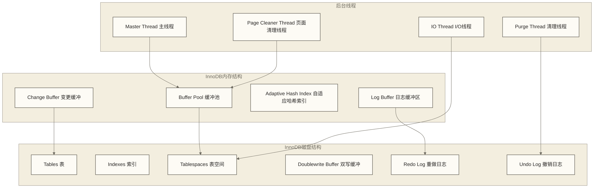
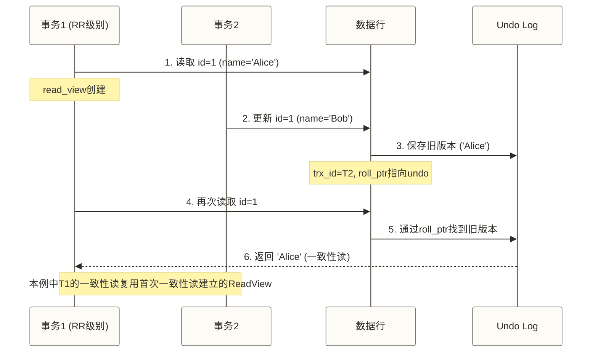
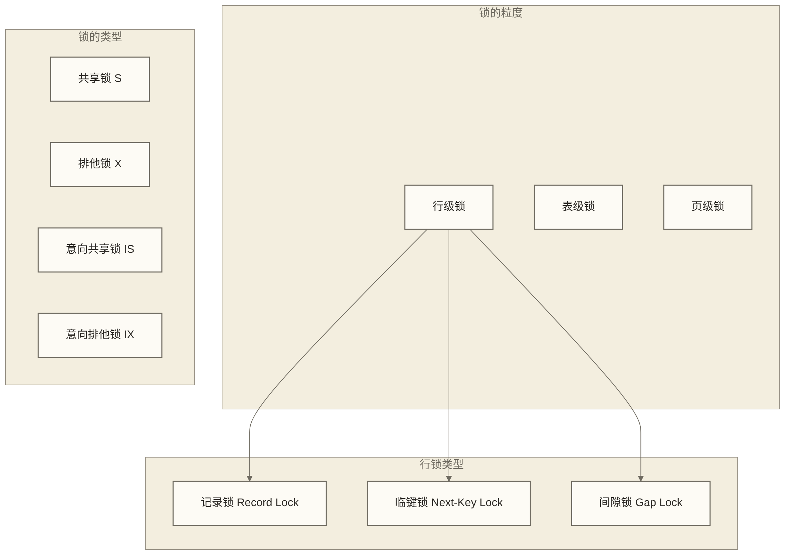

# ⚡ InnoDB存储引擎深度解析 - MySQL的核心引擎

> [!abstract] 📋 本节概览
> - 🎯 **学习目标**：深入理解InnoDB的工作原理、特性和优化策略
> - 📚 **前置知识**：[[【技术与工具】/MySQL/05-MySQL架构原理|MySQL架构]] | [[【技术与工具】/PostgreSQL/00-PostgreSQL学习路线图|PostgreSQL/PostgreSQL]]
> - ⏱️ **预计用时**：120分钟
> - 🔧 **技术重点**：MVCC、事务隔离、行级锁、缓冲池、日志系统

## 🏗️ InnoDB架构概览

### 内存与磁盘结构



### 核心特性对比

| 特性 | InnoDB | MyISAM | 说明 |
|---|---|---|---|
| **事务支持** | ✅ | ❌ | 完整ACID支持 |
| **锁粒度** | 行级锁 | 表级锁 | 支持更高并发 |
| **外键约束** | ✅ | ❌ | 保证数据完整性 |
| **崩溃恢复** | ✅ | ❌ | 自动恢复机制 |
| **MVCC** | ✅ | ❌ | 多版本并发控制 |
| **压缩存储** | ✅ | ✅ | InnoDB支持表压缩及特定条件下的页面压缩；MyISAM压缩表机制不同，不能统称页面压缩 |
| **全文索引** | ✅(5.6+) | ✅ | 支持全文搜索 |

---

## 💾 表空间与文件结构

### 表空间类型

```sql title="InnoDB表空间管理"
-- 查看表空间信息
SELECT 
    SPACE,
    NAME,
    FLAG,
    FILE_FORMAT,
    ROW_FORMAT
FROM INFORMATION_SCHEMA.INNODB_SYS_TABLESPACES
LIMIT 10;

-- 系统表空间配置
SHOW VARIABLES LIKE 'innodb_data_file_path';

-- 独立表空间配置
SHOW VARIABLES LIKE 'innodb_file_per_table';

-- 创建独立表空间的表
CREATE TABLE user_data (
    id INT AUTO_INCREMENT PRIMARY KEY,
    name VARCHAR(100),
    email VARCHAR(100)
) ENGINE=InnoDB;

-- 查看表的表空间信息
SELECT 
    TABLE_SCHEMA,
    TABLE_NAME,
    ENGINE,
    CREATE_OPTIONS
FROM INFORMATION_SCHEMA.TABLES 
WHERE TABLE_NAME = 'user_data';
```

### 页面结构详解


```sql title="页面结构分析"
-- 查看页面大小
SHOW VARIABLES LIKE 'innodb_page_size';

-- 查看表的页面使用情况
SELECT 
    TABLE_SCHEMA,
    TABLE_NAME,
    ROUND(DATA_LENGTH/1024/1024, 2) AS DATA_SIZE_MB,
    ROUND(INDEX_LENGTH/1024/1024, 2) AS INDEX_SIZE_MB,
    ROUND((DATA_LENGTH + INDEX_LENGTH)/1024/1024, 2) AS TOTAL_SIZE_MB
FROM INFORMATION_SCHEMA.TABLES 
WHERE ENGINE = 'InnoDB'
ORDER BY (DATA_LENGTH + INDEX_LENGTH) DESC
LIMIT 10;

-- 查看页面统计信息
SHOW STATUS LIKE 'Innodb_pages%';
```

---

## 🔄 MVCC多版本并发控制

> [!note] 💡 什么是MVCC？
> MVCC(Multi-Version Concurrency Control)多版本并发控制，就像图书馆的版本管理：
> - 📚 **多个版本**：同一行数据可以同时存在多个版本
> - 🔄 **并发访问**：不同事务可以看到不同版本的数据
> - 🚫 **一致性非锁定读**：通常不通过行锁阻塞并发写入；锁定读（如FOR UPDATE）和写操作仍可能发生锁等待
> - ⏰ **时间戳控制**：通过事务ID和回滚指针确定数据版本

### MVCC工作原理



### MVCC实战演示

```sql title="MVCC并发控制演示"
-- 创建测试表
CREATE TABLE mvcc_demo (
    id INT PRIMARY KEY,
    name VARCHAR(50),
    version INT DEFAULT 1
) ENGINE=InnoDB;

INSERT INTO mvcc_demo VALUES (1, 'Alice', 1);

-- 会话1：开始事务（可重复读隔离级别）
-- Session 1
SET TRANSACTION ISOLATION LEVEL REPEATABLE READ;
START TRANSACTION;
SELECT * FROM mvcc_demo WHERE id = 1;
-- 结果：id=1, name='Alice', version=1

-- 会话2：修改数据
-- Session 2  
START TRANSACTION;
UPDATE mvcc_demo SET name = 'Bob', version = 2 WHERE id = 1;
COMMIT;

-- 会话1：再次查询（仍然看到旧版本）
-- Session 1
SELECT * FROM mvcc_demo WHERE id = 1;
-- 结果：id=1, name='Alice', version=1 (一致性读)

-- 当前读：使用锁定读取最新版本
SELECT * FROM mvcc_demo WHERE id = 1 FOR UPDATE;
-- 结果：id=1, name='Bob', version=2

COMMIT;

-- 查看事务信息
SELECT 
    trx_id,
    trx_state,
    trx_started,
    trx_isolation_level
FROM INFORMATION_SCHEMA.INNODB_TRX;
```

### ReadView机制

```sql title="ReadView工作机制"
-- 不同隔离级别的ReadView行为

-- 1. 读已提交（READ COMMITTED）
-- 每次一致性非锁定读都创建新的ReadView
SET TRANSACTION ISOLATION LEVEL READ COMMITTED;
START TRANSACTION;
SELECT * FROM mvcc_demo WHERE id = 1;  -- ReadView_1
-- ... 其他事务提交修改 ...
SELECT * FROM mvcc_demo WHERE id = 1;  -- ReadView_2 (可能看到新数据)
COMMIT;

-- 2. 可重复读（REPEATABLE READ）  
-- 通常在首次一致性非锁定读时创建ReadView，后续一致性读复用；START TRANSACTION WITH CONSISTENT SNAPSHOT可在开始事务时建立快照
SET TRANSACTION ISOLATION LEVEL REPEATABLE READ;
START TRANSACTION;
SELECT * FROM mvcc_demo WHERE id = 1;  -- ReadView创建
-- ... 其他事务提交修改 ...
SELECT * FROM mvcc_demo WHERE id = 1;  -- 复用ReadView (看到一致数据)
COMMIT;

-- 查看当前隔离级别
SELECT @@transaction_isolation;
SHOW VARIABLES LIKE 'transaction_isolation';
```

---

## 🔒 锁机制详解

### 锁的分类与层次



### 行级锁详解

```sql title="InnoDB行级锁演示"
-- 创建测试表
CREATE TABLE lock_demo (
    id INT PRIMARY KEY,
    name VARCHAR(50),
    age INT,
    INDEX idx_age (age)
) ENGINE=InnoDB;

INSERT INTO lock_demo VALUES 
(1, 'Alice', 25),
(3, 'Bob', 30),
(5, 'Charlie', 35),
(7, 'David', 40);

-- 1. 记录锁 (Record Lock) - 锁定具体行
-- Session 1
BEGIN;
SELECT * FROM lock_demo WHERE id = 3 FOR UPDATE;  -- 锁定id=3的行

-- Session 2 (会阻塞)
UPDATE lock_demo SET name = 'Bob_Updated' WHERE id = 3;

-- 2. 范围锁演示：在REPEATABLE READ下，范围锁定读可涉及记录锁和间隙锁，并非纯间隙锁
-- Session 1  
BEGIN;
SELECT * FROM lock_demo WHERE id > 3 AND id < 7 FOR UPDATE;  -- 在REPEATABLE READ下演示范围锁定；该范围包含id=5的记录，实际锁定边界需结合索引扫描分析

-- Session 2 (会阻塞)
INSERT INTO lock_demo VALUES (4, 'Eve', 28);  -- 尝试在间隙中插入

-- 3. Next-Key Lock - 记录锁 + 间隙锁
-- Session 1
BEGIN;
SELECT * FROM lock_demo WHERE age >= 30 FOR UPDATE;  -- 锁定age>=30的记录和间隙

-- 查看当前锁信息
SELECT 
    r.trx_id,
    r.trx_mysql_thread_id,
    r.trx_query,
    b.requesting_trx_id,
    b.blocking_trx_id
FROM INFORMATION_SCHEMA.INNODB_TRX r
LEFT JOIN INFORMATION_SCHEMA.INNODB_LOCK_WAITS b ON r.trx_id = b.requesting_trx_id;

-- 查看锁等待
SELECT 
    waiting_trx_id,
    waiting_pid,
    waiting_query,
    blocking_trx_id,
    blocking_pid,
    blocking_query
FROM sys.innodb_lock_waits;
```

### 死锁检测与处理

```sql title="死锁演示与处理"
-- 死锁场景演示
-- Session 1
BEGIN;
UPDATE lock_demo SET name = 'Alice_1' WHERE id = 1;

-- Session 2  
BEGIN;
UPDATE lock_demo SET name = 'Bob_2' WHERE id = 3;

-- Session 1 (继续)
UPDATE lock_demo SET name = 'Bob_1' WHERE id = 3;  -- 等待Session 2释放锁

-- Session 2 (继续，触发死锁)
UPDATE lock_demo SET name = 'Alice_2' WHERE id = 1;  -- 死锁！其中一个事务会被回滚

-- 查看死锁信息
SHOW ENGINE INNODB STATUS\G

-- 死锁相关配置
SHOW VARIABLES LIKE '%deadlock%';
SHOW VARIABLES LIKE '%innodb_lock_wait_timeout%';

-- 避免死锁的策略：
-- 1. 按相同顺序访问表和行
-- 2. 缩短事务持续时间
-- 3. 降低事务隔离级别
-- 4. 为表添加合理索引
```

---

## 📊 缓冲池管理

### Buffer Pool详解

```sql title="缓冲池监控与配置"
-- 查看缓冲池基本信息
SHOW VARIABLES LIKE 'innodb_buffer_pool%';

-- 缓冲池状态监控
SHOW STATUS LIKE 'Innodb_buffer_pool%';

-- 计算缓冲池命中率
SELECT 
    VARIABLE_NAME,
    VARIABLE_VALUE,
    CASE VARIABLE_NAME
        WHEN 'Innodb_buffer_pool_read_requests' THEN 'LogicalReads'
        WHEN 'Innodb_buffer_pool_reads' THEN 'PhysicalReads'
    END AS ReadType
FROM performance_schema.global_status 
WHERE VARIABLE_NAME IN ('Innodb_buffer_pool_read_requests', 'Innodb_buffer_pool_reads');

-- 详细缓冲池分析
SELECT 
    ROUND(
        (1 - (
            (SELECT VARIABLE_VALUE FROM performance_schema.global_status WHERE VARIABLE_NAME = 'Innodb_buffer_pool_reads') /
            (SELECT VARIABLE_VALUE FROM performance_schema.global_status WHERE VARIABLE_NAME = 'Innodb_buffer_pool_read_requests')
        )) * 100, 2
    ) AS buffer_pool_hit_ratio_percent;

-- 缓冲池页面类型分布
-- INNODB_BUFFER_PAGE全量扫描可能产生显著开销；大型缓冲池或繁忙生产实例不宜高频执行
SELECT 
    PAGE_TYPE,
    COUNT(*) AS page_count,
    ROUND(COUNT(*) * 100.0 / (SELECT COUNT(*) FROM INFORMATION_SCHEMA.INNODB_BUFFER_PAGE), 2) AS percentage
FROM INFORMATION_SCHEMA.INNODB_BUFFER_PAGE
GROUP BY PAGE_TYPE
ORDER BY page_count DESC;
```

### LRU算法优化

```sql title="LRU链表管理"
-- InnoDB使用改进的LRU算法
-- 新页面插入到LRU链表的5/8位置，而不是头部
-- 这避免了全表扫描影响热数据

-- 查看LRU相关统计
SHOW STATUS LIKE 'Innodb_buffer_pool_pages%';

-- 配置优化
/*
innodb_old_blocks_pct = 37        # 旧块区域百分比
innodb_old_blocks_time = 1000     # 旧块停留时间(毫秒)
*/

-- 预热缓冲池（避免重启后性能下降）
-- MySQL 5.6+支持缓冲池转储和加载
SET GLOBAL innodb_buffer_pool_dump_now = ON;   -- 转储
SET GLOBAL innodb_buffer_pool_load_now = ON;   -- 加载

-- 查看转储/加载状态
SHOW STATUS LIKE 'Innodb_buffer_pool_dump_status';
SHOW STATUS LIKE 'Innodb_buffer_pool_load_status';
```

---

## 📝 日志系统

### Redo Log重做日志

```sql title="重做日志管理"
-- 查看重做日志配置
SHOW VARIABLES LIKE 'innodb_log%';

-- 重做日志状态监控
SHOW STATUS LIKE 'Innodb_log%';

-- 重做日志关键指标
/*
innodb_log_file_size: 单个日志文件大小
innodb_log_files_in_group: 日志文件组中的文件数
innodb_log_buffer_size: 日志缓冲区大小
innodb_flush_log_at_trx_commit: 日志刷新策略
*/

-- 日志刷新策略说明：
-- 0: 通常按周期写入并刷盘；崩溃时可能丢失未持久化事务，调度等因素使损失窗口不保证恰好为1秒
-- 1: 每次事务提交时写入并刷盘，提供较强持久性；实际性能取决于存储、并发和组提交等条件
-- 2: 每次提交写入OS缓存，通常按innodb_flush_log_at_timeout指定的周期刷盘（默认1秒）；实际时点受调度影响，操作系统崩溃或断电时的数据损失窗口不保证固定为1秒

-- 查看LSN（日志序列号）信息
SHOW ENGINE INNODB STATUS\G
```

### Undo Log撤销日志

```sql title="撤销日志管理"
-- 查看撤销表空间
SELECT 
    TABLESPACE_NAME,
    FILE_NAME,
    FILE_TYPE,
    ROUND(TOTAL_EXTENTS * EXTENT_SIZE / 1024 / 1024, 2) AS SIZE_MB
FROM INFORMATION_SCHEMA.FILES
WHERE FILE_NAME LIKE '%undo%';

-- 撤销日志相关配置
SHOW VARIABLES LIKE '%undo%';

-- 原撤销日志段查询引用了标准MySQL不存在的系统表，保留为错误示例，不可执行：
/*
SELECT 
    COUNT(*) AS undo_segments,
    MAX(size) AS max_segment_size,
    SUM(size) AS total_undo_size
FROM INFORMATION_SCHEMA.INNODB_TRX_ROLLBACK_SEGMENT;
*/
-- 可查看InnoDB状态中的事务和清理相关信息；这不等价于上述段数、最大段大小或总大小统计
SHOW ENGINE INNODB STATUS\G

-- 长事务监控（可能产生大量undo）
SELECT 
    trx_id,
    trx_state,
    trx_started,
    TIMESTAMPDIFF(SECOND, trx_started, NOW()) AS duration_seconds,
    trx_rows_locked,
    trx_rows_modified
FROM INFORMATION_SCHEMA.INNODB_TRX
WHERE TIMESTAMPDIFF(SECOND, trx_started, NOW()) > 300  -- 超过5分钟的事务
ORDER BY duration_seconds DESC;
```

---

## ⚡ 性能优化策略

### 配置优化

```ini title="InnoDB性能优化配置"
[mysqld]
# 缓冲池配置（70-80%仅作为专用数据库实例的评估起点；须为连接、其他缓存、操作系统及同机服务预留内存）
innodb_buffer_pool_size = 8G
innodb_buffer_pool_instances = 8  # 示例值；适用版本中应结合缓冲池大小及并发评估，并非必须等于CPU核心数

# 日志配置
innodb_log_file_size = 2G         # 大事务需要更大日志
innodb_log_buffer_size = 64M
innodb_flush_log_at_trx_commit = 1  # 生产环境推荐

# I/O配置
innodb_io_capacity = 2000         # 根据存储性能调整
innodb_io_capacity_max = 4000
innodb_flush_method = O_DIRECT    # 在支持此选项的操作系统和文件系统上评估，可减少数据文件的双重缓存；并非跨平台通用配置

# 并发配置
innodb_thread_concurrency = 0     # 0表示无限制
innodb_read_io_threads = 8
innodb_write_io_threads = 8

# 锁配置
innodb_lock_wait_timeout = 120    # 锁等待超时时间
innodb_deadlock_detect = ON       # 启用死锁检测

# 页面压缩（适用于读多写少场景）
innodb_compression_level = 6
# innodb_compression_algorithm = lz4  # 非Oracle MySQL通用参数，仅在确认目标发行版支持后考虑使用
```

### 监控与诊断

```sql title="InnoDB性能监控"
-- 1. 综合性能视图
SELECT 
    'Buffer Pool Hit Ratio' as Metric,
    CONCAT(
        ROUND(
            (1 - (
                (SELECT VARIABLE_VALUE FROM performance_schema.global_status WHERE VARIABLE_NAME = 'Innodb_buffer_pool_reads') /
                (SELECT VARIABLE_VALUE FROM performance_schema.global_status WHERE VARIABLE_NAME = 'Innodb_buffer_pool_read_requests')
            )) * 100, 2
        ), '%'
    ) as Value
UNION ALL
SELECT 
    'InnoDB Pages Created (Cumulative)',
    (SELECT VARIABLE_VALUE FROM performance_schema.global_status WHERE VARIABLE_NAME = 'Innodb_pages_created')
UNION ALL
SELECT 
    'InnoDB Pages Read (Cumulative)',
    (SELECT VARIABLE_VALUE FROM performance_schema.global_status WHERE VARIABLE_NAME = 'Innodb_pages_read')
UNION ALL
SELECT 
    'InnoDB Pages Written (Cumulative)',
    (SELECT VARIABLE_VALUE FROM performance_schema.global_status WHERE VARIABLE_NAME = 'Innodb_pages_written');

-- 2. 锁等待分析
SELECT 
    r.trx_id AS waiting_trx_id,
    r.trx_mysql_thread_id AS waiting_thread,
    TIMESTAMPDIFF(SECOND, r.trx_wait_started, NOW()) AS wait_time,
    r.trx_query AS waiting_query,
    b.trx_id AS blocking_trx_id,
    b.trx_mysql_thread_id AS blocking_thread,
    b.trx_query AS blocking_query
FROM INFORMATION_SCHEMA.INNODB_TRX r
JOIN INFORMATION_SCHEMA.INNODB_LOCK_WAITS w ON r.trx_id = w.requesting_trx_id
JOIN INFORMATION_SCHEMA.INNODB_TRX b ON w.blocking_trx_id = b.trx_id;

-- 3. 热点表分析
SELECT 
    OBJECT_SCHEMA,
    OBJECT_NAME,
    COUNT_READ,
    COUNT_WRITE,
    COUNT_FETCH,
    COUNT_INSERT,
    COUNT_UPDATE,
    COUNT_DELETE
FROM performance_schema.table_io_waits_summary_by_table
WHERE OBJECT_SCHEMA NOT IN ('mysql', 'information_schema', 'performance_schema')
ORDER BY COUNT_READ + COUNT_WRITE DESC
LIMIT 10;
```

---

## 🎓 最佳实践总结

> [!tip] 💡 InnoDB使用最佳实践
> 
> **设计阶段**
> - 总是使用InnoDB作为默认存储引擎
> - 为每个表定义主键（避免hidden primary key）
> - 合理设计索引，避免过多二级索引
> - 使用适当的数据类型，避免过度设计
> 
> **开发阶段**
> - 保持事务简短，避免长事务
> - 按相同顺序访问表，避免死锁
> - 使用批量操作替代逐行操作
> - 合理使用事务隔离级别
> 
> **运维阶段**
> - 监控缓冲池命中率（>99%可作为部分负载的参考，不是通用合格线；应结合采样区间、物理读取量、I/O延迟和业务响应时间判断）
> - 定期检查死锁和锁等待
> - 监控磁盘I/O和日志写入
> - 规划表空间和日志文件大小

> [!warning] ⚠️ 常见陷阱
> - 缓冲池配置过小，导致频繁磁盘I/O
> - 事务过长，产生大量undo日志
> - 不当的索引设计，造成锁争用
> - 忽视死锁监控，影响业务稳定性

---

## 🔗 相关学习资源

继续深入学习推荐：

- [[【技术与工具】/MySQL/10-MySQL索引深度剖析|MySQL索引深度剖析]]
- 事务与锁机制 - 深入理解事务和锁
- [[【技术与工具】/Oracle/16-Oracle性能监控与诊断|Oracle/Oracle性能监控与诊断]]

---

*最后更新：2024-06-29* 