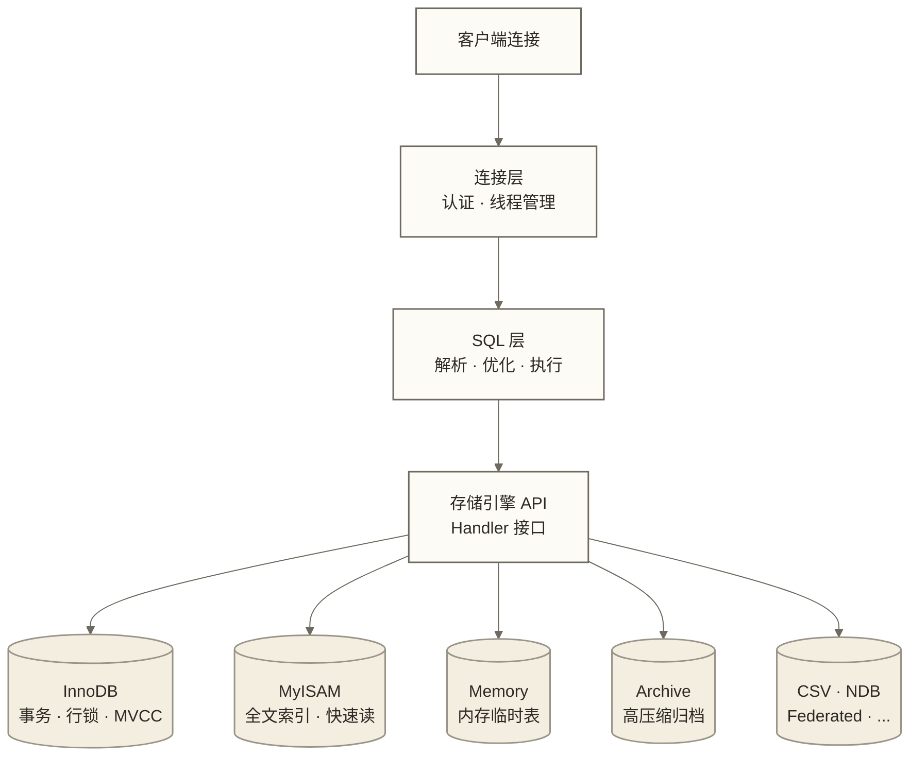
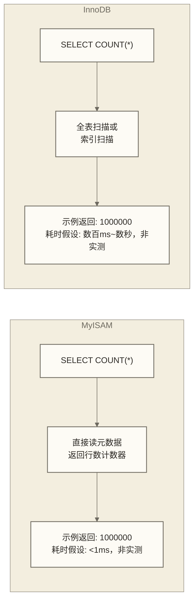
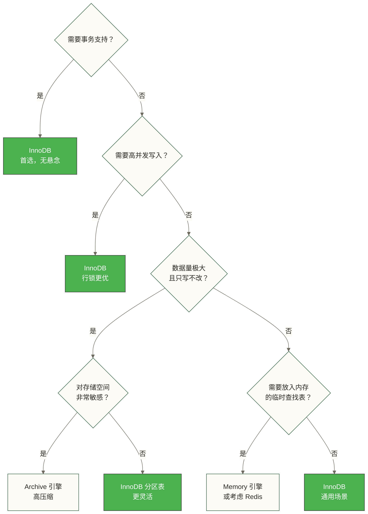

# MyISAM与其他存储引擎 - MySQL存储引擎选型指南

> [!abstract] 本节概览
> - **学习目标**：掌握 MySQL 各存储引擎的特性与适用场景，做出正确的引擎选型决策
> - **前置知识**：[[【技术与工具】/MySQL/05-MySQL架构原理|MySQL架构原理]] | [[【技术与工具】/MySQL/06-InnoDB存储引擎|InnoDB存储引擎]]
> - **预计用时**：50分钟
> - **技术重点**：InnoDB vs MyISAM 核心差异、引擎特性对比、选型建议

## 存储引擎架构概述

MySQL 最独特的设计之一是**可插拔存储引擎架构**（Pluggable Storage Engine Architecture）。存储引擎负责数据的实际存取，而 SQL 层（查询解析、优化、执行）与存储引擎解耦——这意味着你可以为不同的表选用不同的引擎。



> [!note] 实际生产中怎么选？
> 一般业务表优先考虑 **InnoDB**；此处不提供业务场景占比统计，这是 MySQL 5.5 起的默认引擎，也是 Oracle 重点维护的引擎。其他引擎各有特定用途，了解它们是为了在少数特殊场景做出更优选择。

---

## 一、InnoDB 与 MyISAM 核心对比

### 综合对比表

| 特性 | InnoDB | MyISAM |
|------|--------|--------|
| **事务支持** | 完整 ACID 支持 | 不支持 |
| **锁粒度** | 行级锁 | 表级锁 |
| **外键约束** | 支持 | 不支持 |
| **崩溃恢复** | 自动（redo log） | 需手动修复（myisamchk） |
| **全文索引** | 支持（5.6+） | 支持（更早支持） |
| **空间索引** | 支持 | 支持 |
| **MVCC** | 支持（读不加锁） | 不支持 |
| **压缩表** | 支持（压缩行格式） | 支持（myisampack，只读） |
| **COUNT(\*) 性能** | 通常需扫描可见记录或索引（无精确总行数缓存） | 无过滤条件等符合优化条件的查询可直接使用缓存行数；并非所有 COUNT(*) 查询都可直接返回 |
| **INSERT 性能** | 中（维护事务日志） | 快（无事务开销） |
| **并发读写** | 好（行锁） | 差（写锁升级为表锁） |
| **磁盘空间** | 较多（日志、undo 空间） | 较少 |
| **数据文件** | .ibd（表空间） | .MYD（数据）+ .MYI（索引）|
| **主要维护方** | Oracle（积极） | MySQL 社区（缓慢） |

### 为什么 MyISAM 的 COUNT(*) 更快？



InnoDB 因为 MVCC 机制，不同事务看到的行数可能不同，所以无法像 MyISAM 一样缓存总行数。这是 InnoDB 的设计取舍，通常用独立的计数表来优化此类查询。

### 锁机制差异的实际影响

```sql
-- MyISAM：并发写入会互相阻塞
-- 场景：高并发写入日志表
-- Session 1
LOCK TABLE access_log WRITE;  -- 获得写锁
INSERT INTO access_log VALUES (...);
-- Session 2 的任何操作（包括 SELECT）都被阻塞！

-- InnoDB：行级锁允许高并发
-- Session 1 更新 id=1 的行
UPDATE orders SET status='shipped' WHERE id = 1;
-- Session 2 可同时更新 id=2 的行，互不影响
UPDATE orders SET status='shipped' WHERE id = 2;
```

---

## 二、MyISAM 的适用场景

虽然 MyISAM 已经逐渐退出历史舞台，但在以下特定场景下它仍有价值：

### 适合 MyISAM 的场景

**1. 以读为主的静态数据表**

```sql
-- 参考数据表：省市县行政区划、行业分类码、货币汇率历史
CREATE TABLE region_code (
    code    CHAR(6)      PRIMARY KEY,
    name    VARCHAR(50)  NOT NULL,
    parent  CHAR(6)
) ENGINE=MyISAM DEFAULT CHARSET=utf8mb4;
-- 理由：数据一次写入，几乎只读，无需事务，COUNT(*) 极快
```

**2. 全文搜索（MySQL 5.6 之前）**

```sql
-- MySQL 5.6 之前，全文索引只有 MyISAM 支持
CREATE TABLE articles (
    id      INT AUTO_INCREMENT PRIMARY KEY,
    title   VARCHAR(200),
    content TEXT,
    FULLTEXT KEY ft_content (title, content)
) ENGINE=MyISAM DEFAULT CHARSET=utf8mb4;

SELECT * FROM articles
WHERE MATCH(title, content) AGAINST('MySQL 存储引擎' IN BOOLEAN MODE);
```

> [!note] 现在应该用什么？
> MySQL 5.6+ 的 InnoDB 也支持 FULLTEXT 全文索引，对于中文全文搜索，推荐使用 Elasticsearch 或 Meilisearch 等专用搜索引擎，而非 MySQL 内置全文索引。

**3. 数据仓库中的维度表（极少更新）**

在 ETL 批量加载完成后锁定的维度表，MyISAM 的批量 INSERT 性能略优。但这个优势在现代 InnoDB 调优后已不明显。

### 不适合 MyISAM 的场景（明确禁用）

- 任何需要事务的业务（订单、支付、库存）
- 高并发写入场景（日志、消息、监控数据）
- 需要外键约束的数据完整性保障
- 任何对数据安全性有要求的场景（崩溃后可能数据损坏）

---

## 三、Memory 引擎

Memory 引擎（历史上也叫 HEAP）将所有数据存储在内存中，重启后数据丢失。

### 核心特性

| 特性 | 说明 |
|------|------|
| **存储位置** | 完全在内存 |
| **持久性** | 无（重启丢失） |
| **锁粒度** | 表级锁 |
| **事务** | 不支持 |
| **索引类型** | Hash（默认） + B-Tree |
| **变长列** | VARCHAR 实际以定长存储 |
| **单表内存容量** | 受 `max_heap_table_size` 限制，可容纳的行数取决于行与索引占用 |

### 使用场景

```sql
-- 场景1：临时查找表（热点数据缓存）
CREATE TABLE ip_blacklist (
    ip   VARCHAR(15) PRIMARY KEY,
    reason VARCHAR(100)
) ENGINE=Memory;

-- Hash 索引对等值查找极快
SELECT reason FROM ip_blacklist WHERE ip = '192.168.1.100';
-- 示例耗时假设：Memory < 0.1ms，InnoDB 1~5ms；未提供实测结果，不能据此判断实际性能

-- 场景2：中间结果集
-- MySQL 内部在执行复杂 GROUP BY / DISTINCT 时会自动创建内部临时表
-- 内部临时表需区分内存引擎与落盘引擎，具体选择取决于 MySQL 版本、配置和查询特征
-- MySQL 8.0 可使用 TempTable 或 MEMORY 作为内存内部临时表引擎；TempTable 并非磁盘临时表引擎
-- 磁盘内部临时表通常使用 InnoDB；早期版本及部分旧配置可能使用 MyISAM，不能统一概括为超限后转 MyISAM

-- 场景3：用于读取频率极高但允许重建的映射表
-- 如会话 Token 缓存（虽然 Redis 更合适）
```

> [!warning] Memory 引擎的限制
> - **不支持 BLOB/TEXT 列**
> - VARCHAR 列按最大长度分配空间（内存浪费）
> - 数据库重启后数据清空（表结构保留，但数据为空）
> - 服务器级别的 `max_heap_table_size` 变量限制单表大小，默认 16MB
>
> 大多数 Memory 引擎的场景，Redis / Memcached 是更好的选择。

---

## 四、Archive 引擎

Archive 引擎专门为大量历史数据的高压缩存储设计，只支持 INSERT 和 SELECT，不支持 UPDATE/DELETE。

### 核心特性

| 特性 | 说明 |
|------|------|
| **压缩比** | 使用 zlib 压缩；若假设压缩后体积为 MyISAM 的 10%~20%，该比例仅用于示例，未提供测试依据，实际结果取决于数据特征与比较口径 |
| **支持操作** | INSERT + SELECT（不支持 UPDATE/DELETE/REPLACE） |
| **事务** | 不支持 |
| **索引** | 仅支持 AUTO_INCREMENT 列上的索引 |
| **行锁** | 对插入使用行锁，并发写入性能好 |

### 使用场景与示例

```sql
-- 场景：操作日志归档表（只写入，永不修改，定期查询统计）
CREATE TABLE audit_log_2023 (
    id          BIGINT AUTO_INCREMENT PRIMARY KEY,
    user_id     INT NOT NULL,
    action      VARCHAR(50) NOT NULL,
    detail      TEXT,
    ip_address  VARCHAR(45),
    created_at  DATETIME NOT NULL
) ENGINE=Archive DEFAULT CHARSET=utf8mb4;

-- 归档脚本（将 InnoDB 表中的老数据迁移到 Archive 表）
INSERT INTO audit_log_2023
SELECT * FROM audit_log
WHERE created_at < '2024-01-01';

DELETE FROM audit_log WHERE created_at < '2024-01-01';
```

> [!tip] Archive 与分区表的选择
> 对于日志归档，现代更常见的方案是：
> - InnoDB 分区表（按时间分区，可以直接 DROP PARTITION 删除旧数据）
> - 独立 Archive 表 + 定期迁移脚本
> - 将数据同步到 HDFS / S3 等对象存储做冷存储
>
> Archive 引擎适合读写比极低、存储空间敏感的场景。

---

## 五、CSV 引擎

CSV 引擎将数据存储为标准 CSV 文本文件，每张 CSV 表对应一个 `.CSV` 文件。

### 特点与场景

```sql
-- 创建 CSV 表
CREATE TABLE csv_data (
    id   INT NOT NULL,
    name VARCHAR(50) NOT NULL,
    val  DECIMAL(10,2) NOT NULL
) ENGINE=CSV;

-- 对应磁盘文件：
-- csv_data.CSV   → 实际数据（纯文本 CSV）
-- csv_data.CSM   → 元数据
-- csv_data.frm   → 表结构（8.0 前）
```

**适用场景**：
- 与外部 CSV 文件直接交互（数据导入/导出）
- 数据交换场景（直接用文本编辑器编辑表数据）

**限制**：
- 不支持索引
- 所有列必须声明为 NOT NULL
- 性能差，仅适合数据交换，不适合业务使用

---

## 六、查看与修改存储引擎

### 查看引擎信息

```sql
-- 查看当前 MySQL 实例支持的所有引擎
SHOW ENGINES\G

-- 查看某张表当前使用的引擎
SHOW CREATE TABLE orders\G
-- 或
SELECT ENGINE
FROM information_schema.TABLES
WHERE TABLE_SCHEMA = 'my_database' AND TABLE_NAME = 'orders';

-- 批量查看数据库中各表的引擎
SELECT
    TABLE_NAME,
    ENGINE,
    TABLE_ROWS,
    ROUND(DATA_LENGTH / 1024 / 1024, 2) AS 'Data(MB)',
    ROUND(INDEX_LENGTH / 1024 / 1024, 2) AS 'Index(MB)'
FROM information_schema.TABLES
WHERE TABLE_SCHEMA = 'my_database'
ORDER BY DATA_LENGTH DESC;
```

### 修改表的存储引擎

```sql
-- 将 MyISAM 表转换为 InnoDB
ALTER TABLE legacy_table ENGINE = InnoDB;

-- 注意：ALTER TABLE 会重建整张表，对大表耗时较长
-- 生产环境需评估在线迁移方案；pt-online-schema-change 需满足其使用条件，gh-ost 不适用于直接迁移 MyISAM 源表
```

### 批量找出并转换 MyISAM 表

```sql
-- 生成批量转换语句
SELECT
    CONCAT('ALTER TABLE `', TABLE_SCHEMA, '`.`', TABLE_NAME, '` ENGINE=InnoDB;') AS sql_stmt
FROM information_schema.TABLES
WHERE ENGINE = 'MyISAM'
  AND TABLE_SCHEMA NOT IN ('information_schema', 'mysql', 'performance_schema', 'sys');
```

```bash
# 一键执行（谨慎操作，确认备份后再执行）
mysql -u root -p -e "
SELECT CONCAT('ALTER TABLE \`', TABLE_SCHEMA, '\`.\`', TABLE_NAME, '\` ENGINE=InnoDB;')
FROM information_schema.TABLES
WHERE ENGINE='MyISAM'
  AND TABLE_SCHEMA NOT IN ('information_schema','mysql','performance_schema','sys');
" | grep ALTER | mysql -u root -p
```

---

## 七、引擎选型建议



### 一句话总结

> **默认用 InnoDB，特殊情况考虑特殊引擎，不要因为历史习惯继续用 MyISAM。**

---

## 延伸阅读

- [[【技术与工具】/MySQL/06-InnoDB存储引擎|InnoDB存储引擎]] - InnoDB 架构原理深度解析
- [[【技术与工具】/MySQL/08-事务与锁机制|事务与锁机制]] - 事务与锁的基础概念
- [[【技术与工具】/MySQL/05-MySQL架构原理|MySQL架构原理]] - 存储引擎 API 的工作原理
- [[【技术与工具】/MySQL/10-MySQL索引深度剖析|MySQL索引深度剖析]] - 不同引擎的索引实现差异
