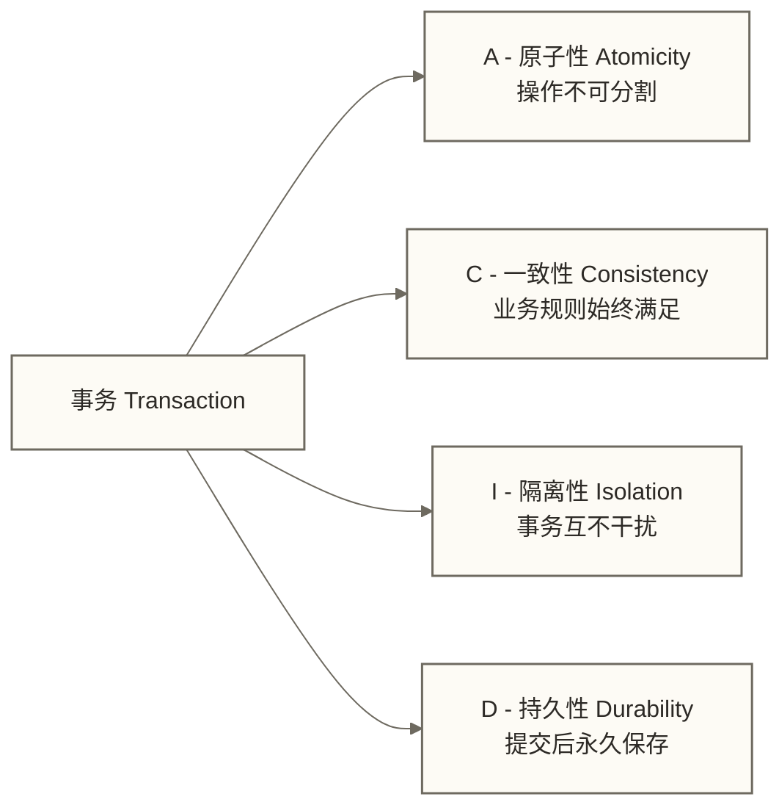

# 事务与锁机制基础 - ACID、隔离级别与并发控制入门

> [!abstract] 本节概览
> - **学习目标**：理解事务 ACID 特性、四种隔离级别及其解决的并发问题，掌握锁的基础概念
> - **前置知识**：[[【技术与工具】/MySQL/06-InnoDB存储引擎|InnoDB存储引擎]] | [[【技术与工具】/MySQL/07-MyISAM与其他存储引擎|存储引擎概述]]
> - **预计用时**：60分钟
> - **技术重点**：ACID 详解、四大隔离级别、乐观锁 vs 悲观锁、死锁处理
> - **进阶阅读**：[[【技术与工具】/MySQL/14-MySQL事务与锁机制|事务与锁深度解析]] | [[【技术与工具】/MySQL/16-事务与锁机制深度解析|事务与锁进阶]]

## 为什么需要事务？

想象一个银行转账场景：Alice 向 Bob 转账 500 元，需要两步操作：

1. Alice 账户减少 500 元
2. Bob 账户增加 500 元

如果两步之间系统崩溃了，或者两个操作只成功了一个，会发生什么？钱会凭空消失或凭空产生——这在现实业务中是不可接受的。**事务**就是解决这类问题的机制：它保证多个操作要么全部成功，要么全部撤销。

---

## 一、ACID 四大特性



### 原子性（Atomicity）

> 事务中的所有操作是一个不可分割的整体：要么全部成功提交，要么全部失败回滚。

**生活比喻**：可将 ATM 取款的理想业务目标理解为扣款与吐钱保持一致；但物理吐钞不属于数据库事务，实际系统仍需处理设备故障、对账与补偿，数据库原子性本身不能保证两者绝不部分失败。

**实现机制**：InnoDB 通过 **undo log（回滚日志）** 实现原子性。执行每个写操作时，都会记录"如何撤销这个操作"的反向日志，一旦回滚，按反向日志恢复数据。

### 一致性（Consistency）

> 事务执行前后，数据库必须处于一致状态，满足所有业务规则和约束。

**生活比喻**：转账前后，Alice 和 Bob 的账户总金额之和不变。一致性是事务的最终目标，原子性、隔离性、持久性都是为了保障一致性而存在的手段。

**实现机制**：约束（NOT NULL、UNIQUE、外键）、应用层业务规则、以及其他三个特性共同保障。

### 隔离性（Isolation）

> 多个并发事务之间互相隔离，一个事务的中间状态对其他事务不可见。

**生活比喻**：两个人同时在 ATM 转账时互不影响，每人看到的账户余额都是正确的，不会互相看到对方操作的中间状态。

**实现机制**：InnoDB 通过**锁机制**和 **MVCC（多版本并发控制）** 实现隔离性。

### 持久性（Durability）

> 事务一旦提交，即使系统崩溃，其结果也永久保存在数据库中。

**生活比喻**：银行转账收到"转账成功"通知后，即使银行系统随即断电，你的钱也已经到账，重启后账单依然正确。

**实现机制**：InnoDB 通过 **redo log（重做日志）** 实现持久性。InnoDB 使用 redo log 支持崩溃恢复，并遵循先写日志再写数据页的 WAL 机制；提交时是否将 redo log 刷入持久存储取决于 innodb_flush_log_at_trx_commit 等配置，不能脱离配置承诺故障后已提交数据一定不丢失。

---

## 二、事务操作语法

```sql
-- 基础事务语法
START TRANSACTION;  -- 或 BEGIN;
    -- 你的 SQL 操作
    UPDATE accounts SET balance = balance - 500 WHERE id = 1;
    UPDATE accounts SET balance = balance + 500 WHERE id = 2;
COMMIT;             -- 提交：使所有更改永久生效

-- 回滚：撤销自 START TRANSACTION 以来的所有更改
START TRANSACTION;
    UPDATE accounts SET balance = balance - 500 WHERE id = 1;
    -- 发现 id=2 不存在，需要撤销
ROLLBACK;

-- 保存点（Savepoint）：部分回滚
START TRANSACTION;
    INSERT INTO orders VALUES (1001, 'Alice', 200.00);
    SAVEPOINT sp1;
    INSERT INTO order_items VALUES (1, 1001, 'Book', 150.00);
    SAVEPOINT sp2;
    INSERT INTO order_items VALUES (2, 1001, 'Pen', 50.00);
    -- 只回滚到 sp2（撤销最后一个 INSERT）
    ROLLBACK TO SAVEPOINT sp2;
COMMIT;  -- 提交前两个 INSERT

-- 自动提交模式（默认开启）
SHOW VARIABLES LIKE 'autocommit';  -- 默认 ON
-- 关闭自动提交（每条 DML 需手动 COMMIT）
SET autocommit = 0;
```

> [!warning] autocommit 的陷阱
> MySQL 默认 `autocommit=ON`，每条语句自动作为一个事务提交。
> 如果你执行了 `SET autocommit=0`，记得在每次操作后显式 `COMMIT` 或 `ROLLBACK`，
> 否则连接关闭时会自动回滚，导致数据"消失"。

---

## 三、四种隔离级别

不同的隔离级别在"数据一致性"和"并发性能"之间做出不同的权衡取舍。

### 三类并发问题

| 问题 | 说明 | 举例 |
|------|------|------|
| **脏读** | 读到其他未提交事务的修改 | 看到了别人还没付款的订单 |
| **不可重复读** | 同一事务中，前后两次读取同一行，结果不同 | 查余额两次，中间别人转账了 |
| **幻读** | 同一事务中，前后两次查询，结果集的行数不同 | 统计订单数，中间新增了订单 |

### 四种隔离级别及其解决的问题


| 隔离级别 | 脏读 | 不可重复读 | 幻读 | 并发性 |
|---------|------|-----------|------|--------|
| READ UNCOMMITTED | 可能 | 可能 | 可能 | 最高 |
| READ COMMITTED | 解决 | 可能 | 可能 | 较高 |
| REPEATABLE READ | 解决 | 解决 | 部分解决* | 中等 |
| SERIALIZABLE | 解决 | 解决 | 解决 | 最低 |

> *InnoDB 在 REPEATABLE READ 级别下，通过 MVCC + 间隙锁（Gap Lock）在很大程度上防止了幻读，但在某些特定场景下仍可能出现。详见 [[【技术与工具】/MySQL/14-MySQL事务与锁机制|事务与锁深度解析]]。

### 隔离级别操作命令

```sql
-- 查看当前隔离级别
SHOW VARIABLES LIKE 'transaction_isolation';
-- 或（MySQL 8.0+）
SELECT @@transaction_isolation;

-- 修改会话级别隔离级别（仅影响当前连接）
SET SESSION TRANSACTION ISOLATION LEVEL READ COMMITTED;

-- 修改全局隔离级别（影响后续新建连接；已有连接如需修改，应显式设置会话隔离级别）
SET GLOBAL TRANSACTION ISOLATION LEVEL REPEATABLE READ;

-- 设置下一个事务的隔离级别（仅影响下一个事务）
SET TRANSACTION ISOLATION LEVEL SERIALIZABLE;
START TRANSACTION;
-- 此事务以 SERIALIZABLE 运行
COMMIT;
```

### 四种级别的场景选择

```sql
-- READ UNCOMMITTED：几乎不用，仅适合对数据精度要求极低的场景
-- 例如：粗略统计某些状态数量，允许有微小误差

-- READ COMMITTED：许多互联网公司的选择（Oracle 默认也是此级别）
-- 例如：电商平台 - 允许看到刚提交的价格变动，避免读历史旧价
SET SESSION TRANSACTION ISOLATION LEVEL READ COMMITTED;

-- REPEATABLE READ：MySQL 默认，大多数场景的最佳平衡点
-- 例如：财务报表 - 一次查询过程中看到的数据保持一致

-- SERIALIZABLE：极少使用，用于强一致性要求的金融核心场景
-- 代价：读操作也会加锁，并发性大幅下降
```

---

## 四、乐观锁与悲观锁

乐观锁和悲观锁不是 MySQL 的底层实现，而是两种**并发控制的思维模式**。

### 悲观锁（Pessimistic Locking）

**思路**：对数据持悲观态度，假设并发冲突经常发生，所以在操作数据前先加锁。

```sql
-- 悲观锁实现：SELECT ... FOR UPDATE
-- 场景：抢购商品库存，防止超卖

START TRANSACTION;

-- 加锁读取库存（其他事务无法同时修改此行）
SELECT stock FROM products WHERE id = 100 FOR UPDATE;
-- 此时其他事务的 SELECT ... FOR UPDATE 会阻塞等待

-- 检查库存并扣减
UPDATE products SET stock = stock - 1 WHERE id = 100 AND stock > 0;

COMMIT;
```

**适用场景**：
- 写多读少的场景
- 并发冲突概率高时
- 对数据一致性要求极高（金融核心交易）

**缺点**：性能开销大，容易死锁，在高并发下成为瓶颈。

### 乐观锁（Optimistic Locking）

**思路**：对数据持乐观态度，假设并发冲突很少发生，读取时不加锁，提交时验证数据是否被修改。

```sql
-- 乐观锁实现：version 版本号（或 updated_at 时间戳）

-- 建表时添加 version 字段
ALTER TABLE products ADD COLUMN version INT NOT NULL DEFAULT 0;

-- 读取时记录 version
SELECT id, stock, version FROM products WHERE id = 100;
-- 假设返回：id=100, stock=10, version=5

-- 更新时带上版本号作为条件
UPDATE products
SET stock = stock - 1, version = version + 1
WHERE id = 100 AND version = 5 AND stock > 0;  -- 版本号匹配且库存充足才扣减

-- 检查影响行数
-- affected_rows = 1：更新成功（无并发冲突）
-- affected_rows = 0：未更新；可能是版本冲突、记录不存在或库存不足，应区分原因后决定是否重试
```

**适用场景**：
- 读多写少的场景
- 并发冲突概率低时
- 需要高吞吐量的查询密集型业务

**缺点**：冲突后需要重试（应用层逻辑更复杂），高冲突场景下重试次数多。

### 乐观锁 vs 悲观锁对比

| 维度 | 乐观锁 | 悲观锁 |
|------|--------|--------|
| 实现层 | 应用层（version 字段） | 数据库层（FOR UPDATE） |
| 加锁时机 | 提交时检查 | 读取时加锁 |
| 冲突处理 | 失败后重试 | 阻塞等待 |
| 适合场景 | 读多写少 | 写多读少 |
| 并发性能 | 高（无长时间锁持有） | 低（持锁时间长） |
| 死锁风险 | 仍可能发生，版本号更新也会获取数据库写锁 | 有 |

---

## 五、行锁与表锁

### 表锁（Table Lock）

整张表被锁住，粒度最粗，并发性最差。

```sql
-- 手动加表锁（一般不需要手动操作）
LOCK TABLE orders READ;   -- 读锁：其他事务可读，不可写
LOCK TABLE orders WRITE;  -- 写锁：其他事务不可读也不可写
UNLOCK TABLES;

-- 查看当前表锁情况
SHOW OPEN TABLES WHERE In_use > 0;
```

**何时会发生表锁**：
- DDL 操作（ALTER TABLE，不使用 Online DDL 时）
- MyISAM 引擎的 DML 操作
- InnoDB 不会因扫描或锁定的行数较多而自动将行锁升级为表锁；无合适索引可能扩大记录锁范围

### 行锁（Row Lock）

只锁住特定的行，InnoDB 的默认锁粒度，允许高并发。

```sql
-- InnoDB 行锁类型：

-- 1. 共享锁（S Lock / 读锁）：允许其他事务读，阻止其他事务写
SELECT * FROM orders WHERE id = 1 LOCK IN SHARE MODE;

-- 2. 排他锁（X Lock / 写锁）：阻止其他事务对同一记录获取冲突锁或修改；普通一致性读通常仍可通过 MVCC 读取
SELECT * FROM orders WHERE id = 1 FOR UPDATE;

-- 3. UPDATE/DELETE/INSERT 自动获取排他锁
UPDATE orders SET status = 'paid' WHERE id = 1;
```

> [!note] 行锁的前提是走索引
> InnoDB 的行锁是通过**索引记录**实现的。如果 WHERE 条件缺少合适索引，执行计划可能需要扫描并锁定大量记录，显著降低并发性，但这不等于升级为**表锁**。
>
> 例如：`UPDATE orders SET status='paid' WHERE remark='test'`
> 如果 `remark` 列没有可用索引，此语句可能扫描大量记录；实际锁范围还取决于执行计划与隔离级别。

---

## 六、死锁的产生与处理

### 死锁产生的条件

死锁发生在两个（或多个）事务互相持有对方需要的锁时。

```text
事务 A 持有锁1，等待锁2
事务 B 持有锁2，等待锁1
→ 永久等待，形成死锁
```

```sql
-- 死锁示例
-- Session 1
START TRANSACTION;
UPDATE accounts SET balance = balance - 100 WHERE id = 1;  -- 锁住 id=1
-- 等待...
UPDATE accounts SET balance = balance + 100 WHERE id = 2;  -- 等待 id=2 的锁

-- Session 2（同时执行）
START TRANSACTION;
UPDATE accounts SET balance = balance - 50 WHERE id = 2;   -- 锁住 id=2
UPDATE accounts SET balance = balance + 50 WHERE id = 1;   -- 等待 id=1 的锁
-- 死锁！MySQL 检测到后会选择代价小的事务回滚
```

### 死锁检测与处理

```sql
-- 查看最近一次死锁信息
SHOW ENGINE INNODB STATUS\G
-- 在输出中查找 "LATEST DETECTED DEADLOCK" 部分

-- 查看当前等待的锁
SELECT * FROM performance_schema.data_lock_waits\G

-- 查看当前持有的锁
SELECT * FROM performance_schema.data_locks
WHERE LOCK_STATUS = 'GRANTED'\G
```

MySQL InnoDB 有自动死锁检测机制（`innodb_deadlock_detect=ON`，默认开启）：
- 检测到死锁时，自动选择**回滚代价最小**的事务（通常是最近修改行数少的）
- 被回滚的事务会收到错误：`ERROR 1213: Deadlock found when trying to get lock`

### 死锁预防的最佳实践

```sql
-- 最佳实践1：按固定顺序访问资源
-- 无论哪个事务，都先锁 id 较小的行，再锁 id 较大的行
-- 事务 A 和 事务 B 都按 id 升序更新
START TRANSACTION;
UPDATE accounts SET balance = balance - 100 WHERE id = 1;  -- 先锁1
UPDATE accounts SET balance = balance + 100 WHERE id = 2;  -- 再锁2
COMMIT;

-- 最佳实践2：缩小事务范围，减少锁持有时间
-- 不好的写法：事务内包含大量耗时逻辑
START TRANSACTION;
-- 调用外部接口（示例耗时500ms；此前未示出锁定操作，不能据此认定已持有目标行锁；事务仍被延长）
SELECT stock FROM products WHERE id = 1 FOR UPDATE;
-- ... 大量业务逻辑 ...
UPDATE products SET stock = stock - 1 WHERE id = 1;
COMMIT;

-- 好的写法：先完成业务逻辑，再开事务执行数据库操作
-- 先在业务层计算好需要的结果
-- 再开一个短事务快速执行 SQL
START TRANSACTION;
UPDATE products SET stock = stock - 1 WHERE id = 1 AND stock > 0;
COMMIT;

-- 最佳实践3：对可能发生死锁的场景，捕获异常并重试
-- （应用层代码处理 1213 错误，重试若干次）
```

---

## 七、实际业务中的事务使用建议

### 事务设计原则

> [!tip] 黄金法则：事务要短、要小
> 1. **短**：事务持续时间要短，避免长事务占用锁
> 2. **小**：一个事务只做一件事，不要把不相关的操作塞进同一个事务
> 3. **本地**：尽量避免跨数据库的分布式事务
> 4. **明确**：不要依赖自动提交，显式控制事务边界

### 常见反模式

```sql
-- 长事务示例：普通一致性COUNT查询可能增加快照与版本保留成本，不会仅因处于事务中就持有阻塞写入的记录锁；UPDATE阶段另需考虑锁持有与等待
START TRANSACTION;
SELECT COUNT(*) FROM orders;  -- 全表扫描，耗时数秒
UPDATE inventory SET stock = 10 WHERE id = 1;
COMMIT;
-- 改进：将统计查询移到事务外，或使用近似值

-- 反模式2：在循环中逐行插入
START TRANSACTION;
WHILE i < 10000 DO
    INSERT INTO logs VALUES (i, NOW(), 'info');
END WHILE;
COMMIT;
-- 改进：使用批量插入
INSERT INTO logs VALUES (1, NOW(), 'info'), (2, NOW(), 'info'), ...;

-- 反模式3：事务中调用外部服务
START TRANSACTION;
SELECT * FROM orders WHERE id = 1 FOR UPDATE;
-- 调用短信 API（可能超时！持锁等待！）
CALL_SMS_API();
UPDATE orders SET sms_sent = 1 WHERE id = 1;
COMMIT;
-- 改进：先提交数据库事务，再异步发送短信
```

### 隔离级别在实际业务中的选择

```text
电商订单、支付：可从 REPEATABLE READ（MySQL 默认）评估起，但正确性仍取决于业务约束、事务边界、锁定方式和冲突处理
报表统计查询：READ COMMITTED（避免长时间持有一致性快照）
库存扣减（高并发）：REPEATABLE READ + 乐观锁/行锁
金融核心账务：REPEATABLE READ + 悲观锁
```

---

## 学习路径

本篇介绍了事务与锁的基础概念，进一步学习请参考：

- [[【技术与工具】/MySQL/14-MySQL事务与锁机制|MySQL事务与锁机制]] - 深入的 InnoDB 锁类型（间隙锁、临键锁、意向锁）
- [[【技术与工具】/MySQL/16-事务与锁机制深度解析|事务与锁机制深度解析]] - MVCC 原理、锁等待分析、生产案例
- [[【技术与工具】/MySQL/06-InnoDB存储引擎|InnoDB存储引擎]] - undo log 与 redo log 的底层实现
- [[【技术与工具】/MySQL/09-日志系统详解|日志系统详解]] - redo log、undo log 的详细解析
