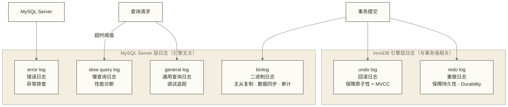
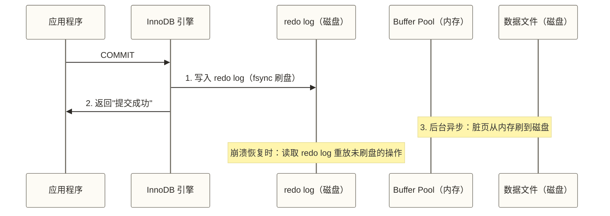
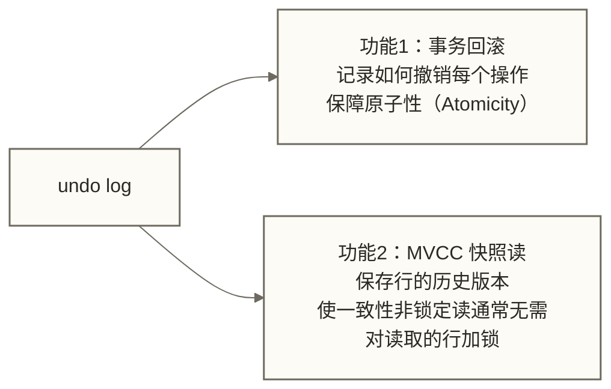
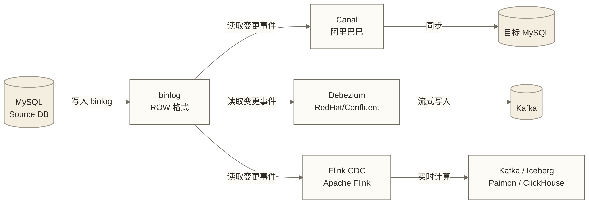
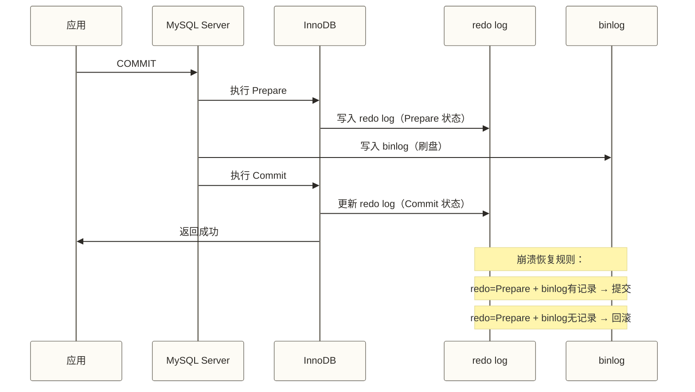

# MySQL日志系统详解 - 五大日志体系全面解析

> [!abstract] 本节概览
> - **学习目标**：掌握 MySQL 五大日志的用途、格式与配置，理解日志在数据安全和数据同步中的核心作用
> - **前置知识**：[[【技术与工具】/MySQL/06-InnoDB存储引擎|InnoDB存储引擎]] | [[【技术与工具】/MySQL/08-事务与锁机制|事务与锁机制]]
> - **预计用时**：75分钟
> - **技术重点**：binlog 格式、WAL 机制、MVCC 基础、慢查询分析、CDC 数据同步原理

## MySQL 日志体系全景



### 五大日志对比速览

| 日志类型 | 所属层级 | 主要用途 | 文件位置 | 是否默认开启 |
|---------|---------|---------|---------|------------|
| **redo log** | InnoDB 引擎 | 崩溃恢复（crash-safe） | 数据目录 | 是 |
| **undo log** | InnoDB 引擎 | 事务回滚 + MVCC | ibdata / undo 表空间 | 是 |
| **binlog** | Server 层 | 复制 + 数据同步 + 审计 | log_bin 指定目录 | 8.0+ 默认开启 |
| **slow query log** | Server 层 | 慢查询性能分析 | 配置指定 | 否（需开启） |
| **error log** | Server 层 | 启动/运行错误排查 | 配置指定 | 是 |
| **general log** | Server 层 | 调试（记录所有 SQL） | 配置指定 | 否（性能影响大） |

---

## 一、redo log（重做日志）

### WAL 机制：先写日志，再写数据

redo log 是 InnoDB 实现**持久性（Durability）** 的核心机制，采用 WAL（Write-Ahead Logging，预写日志）设计。



**为什么不直接把数据页写到磁盘？**

数据页的大小是 16KB，而一次事务修改可能只涉及几十字节。如果每次提交都要随机 IO 写 16KB 的数据页，性能极差。redo log 是**顺序追加写**，IO 效率远高于随机写数据页。

### redo log 配置

```ini
# my.cnf
[mysqld]
# redo log 文件数量（默认2个，循环使用）
innodb_log_files_in_group = 2
# 每个 redo log 文件大小（生产环境通常设置 1G~4G）
innodb_log_file_size = 1G
# redo log 刷盘策略（最重要的参数）
# 0：后台周期写出并刷盘；可能降低提交开销，故障丢失窗口不保证最多1秒
# 1：每次提交都刷盘（最安全，默认值，推荐生产使用）
# 2：每次提交写 OS 缓存，后台周期刷盘；实际间隔与故障丢失窗口不保证为1秒
innodb_flush_log_at_trx_commit = 1
```

> [!tip] innodb_flush_log_at_trx_commit 的权衡
> - `=1`：每次事务提交要求 redo log 刷盘，是强调事务持久性的常用配置；实际持久性还依赖存储正确执行刷盘，并需结合 binlog 等配置评估，不能据此保证任何故障下都不丢数据。
> - `=2`：每次提交将 redo log 写入操作系统缓存，再由后台周期刷盘；仅 MySQL 进程崩溃与操作系统或断电故障的风险不同，尚未持久化的日志可能丢失，不能将丢失窗口严格限定为 1 秒。
> - `=0`：后台周期写出并刷盘 redo log，可能降低提交时的日志开销；故障时尚未持久化的数据可能丢失，窗口不保证最多 1 秒，是否采用需按持久性要求和实测性能评估。

### redo log 的循环写特性

redo log 是固定大小的循环日志，由 `write pos`（当前写入位置）和 `checkpoint`（已刷盘数据对应的位置）两个指针维护。当 write pos 追上 checkpoint 时，必须先等待刷盘腾出空间——这时 MySQL 会出现"抖动"（性能短暂下降）。这也是为什么生产环境要适当增大 `innodb_log_file_size`。

---

## 二、undo log（回滚日志）

### 两大核心功能



### 事务回滚原理

undo log 记录每个写操作的逆操作：

| 执行操作 | undo log 记录 |
|---------|-------------|
| INSERT 一行 | DELETE 该行的逻辑 |
| DELETE 一行 | INSERT 该行的逻辑（保存原始数据） |
| UPDATE 一行 | 将该行更新回原始值的逻辑 |

```sql
-- 当 ROLLBACK 执行时，InnoDB 按照 undo log 的逆序逐步撤销操作
START TRANSACTION;
UPDATE users SET name = 'Bob' WHERE id = 1;  -- undo log: 记录 name='Alice'
INSERT INTO logs VALUES (1, 'update user');   -- undo log: 记录 DELETE id=1
ROLLBACK;
-- InnoDB 读取 undo log：
-- 1. 撤销 INSERT logs：执行 DELETE logs WHERE id=1
-- 2. 撤销 UPDATE users：执行 UPDATE users SET name='Alice' WHERE id=1
```

### MVCC（多版本并发控制）基础

MVCC 是 InnoDB 实现**快照读**（非锁定读）的机制，核心思路：每个读操作看到的是某个历史时刻的快照，而不是最新数据，从而避免读写互相阻塞。

每行数据隐藏两个隐式列：
- `DB_TRX_ID`：最后一次修改该行的事务 ID
- `DB_ROLL_PTR`：指向 undo log 中该行上一个版本的指针

```text
行的版本链（通过 DB_ROLL_PTR 链接）：
当前版本 → 上一版本 → 更早的版本 → ...
  trx=100    trx=80      trx=50
  name=Bob   name=Alice  name=初始值
```

当事务执行一致性非锁定读时，InnoDB 根据**一致性视图（Read View）**判断版本可见性。READ COMMITTED 通常为每次一致性读建立新视图；REPEATABLE READ 通常在首次一致性读时建立视图，并在后续一致性读中复用。非锁定读通常不对读取的行加锁，但不意味着不存在元数据锁等其他锁。

> [!note] 当前读 vs 快照读
> - **快照读**（READ COMMITTED、REPEATABLE READ 下的普通非锁定 SELECT）：按 Read View 判断版本可见性，通常不对读取的行加锁，利用 MVCC 实现；仍可能涉及元数据锁
> - **当前读**（SELECT...FOR UPDATE、INSERT、UPDATE、DELETE）：读取最新版本，需要加锁

---

## 三、binlog（二进制日志）

binlog 是 MySQL **Server 层**（与存储引擎无关）的日志，记录所有对数据造成变更的 SQL 操作。

### 三种 binlog 格式

```ini
# my.cnf 配置
[mysqld]
log_bin = /var/log/mysql/mysql-bin
binlog_format = ROW   # 生产环境推荐
```

#### STATEMENT 格式

记录执行的原始 SQL 语句。

```markdown
# binlog 内容示例（STATEMENT 格式）
# at 154
#260320 10:00:01 server id 1  end_log_pos 280
SET TIMESTAMP=1742400001;
UPDATE orders SET status='shipped' WHERE created_at < '2026-01-01';
```

**优点**：日志体积小，人类可读
**缺点**：包含 `NOW()`、`RAND()`、`UUID()` 等函数的语句在主从复制时可能产生不一致

#### ROW 格式（生产推荐）

记录每行数据的实际变化（变更前后的值）。

```markdown
# binlog 内容示例（ROW 格式，需用 mysqlbinlog --base64-output=DECODE-ROWS -v 解码）
### UPDATE `my_database`.`orders`
### WHERE
###   @1=1001 /* id */
###   @2='pending' /* status */
### SET
###   @1=1001
###   @2='shipped'
```

**优点**：记录行级变更，可减少语句重放引起的不确定性，并支持 CDC 数据捕获；主从是否一致仍取决于复制配置、事件应用、错误处理等条件，ROW 格式本身不保证绝对一致。
**缺点**：大批量 UPDATE/DELETE 时日志体积大

#### MIXED 格式

默认使用 STATEMENT，在 MySQL 判断 STATEMENT 可能引起主从不一致时自动切换为 ROW。

**实际使用**：生产环境一律推荐 ROW 格式，日志量换数据安全。

### binlog 常用操作命令

```sql
-- 查看 binlog 是否开启及文件列表
SHOW VARIABLES LIKE 'log_bin';
SHOW BINARY LOGS;

-- 查看当前正在写的 binlog 文件和位置
SHOW MASTER STATUS\G

-- 查看 binlog 内容（在 MySQL 命令行内）
SHOW BINLOG EVENTS IN 'mysql-bin.000003' LIMIT 20;

-- 查看从特定位置开始的事件
SHOW BINLOG EVENTS IN 'mysql-bin.000003' FROM 154 LIMIT 10;
```

```bash
# 在 Shell 中用 mysqlbinlog 工具解析 binlog
# 解析指定文件
mysqlbinlog /var/log/mysql/mysql-bin.000003

# 按时间过滤（数据恢复常用）
mysqlbinlog \
  --start-datetime="2026-03-20 09:00:00" \
  --stop-datetime="2026-03-20 10:00:00" \
  /var/log/mysql/mysql-bin.000003

# ROW 格式解码为可读 SQL
mysqlbinlog --base64-output=DECODE-ROWS -v /var/log/mysql/mysql-bin.000003

# 利用 binlog 做时间点恢复（PITR）
# 先恢复全量备份，再重放 binlog 到指定时间点
mysqlbinlog \
  --start-datetime="2026-03-20 00:00:00" \
  --stop-datetime="2026-03-20 11:30:00" \
  mysql-bin.000001 mysql-bin.000002 | \
  mysql -u root -p
```

### binlog 在数据同步中的角色

binlog 是 MySQL 数据变更捕获（CDC, Change Data Capture）的基础，Flink CDC、Canal、Debezium 等工具都依赖它。



**工作原理**：这些工具将自己伪装成 MySQL 的**从库**，向主库注册，接收 binlog 事件流。当主库有数据变更时，变更以 binlog 事件的形式推送到这些工具，工具解析后转换为目标系统可消费的格式。

> [!tip] 开启 binlog 的必要配置
> 对于基于 binlog 的 CDC 数据采集，下面给出 ROW 格式与 FULL 行镜像的配置示例；具体行镜像、权限及 server_id 条件应以所用连接器的适用要求为准，不应将此示例视为所有工具的统一必要条件：
> ```ini
> [mysqld]
> log_bin = mysql-bin
> binlog_format = ROW
> binlog_row_image = FULL   # 记录完整行数据（含变更前的值）
> server_id = 1             # 必须唯一（Canal/Debezium 需要）
> ```

---

## 四、slow query log（慢查询日志）

慢查询日志记录执行时间超过阈值的 SQL，是性能优化的第一入口。

### 开启与配置

```ini
# my.cnf
[mysqld]
slow_query_log = ON
slow_query_log_file = /var/log/mysql/slow.log
long_query_time = 1          # 超过 1 秒记录（生产建议 0.1~1 秒）
log_queries_not_using_indexes = ON   # 未使用索引的查询也记录
min_examined_row_limit = 1000        # 检查行数超过 1000 才记录
```

```sql
-- 运行时动态开启（无需重启）
SET GLOBAL slow_query_log = 'ON';
SET GLOBAL long_query_time = 0.5;   -- 超过 0.5 秒记录

-- 查看配置
SHOW VARIABLES LIKE 'slow_query%';
SHOW VARIABLES LIKE 'long_query_time';
```

### 慢查询日志格式

```markdown
# Time: 2026-03-20T10:15:30.123456Z
# User@Host: app_user[app_user] @ localhost []  Id: 42
# Query_time: 3.141592  Lock_time: 0.000123  Rows_sent: 1  Rows_examined: 1000000
SET timestamp=1742478930;
SELECT * FROM orders WHERE customer_name = 'Alice' ORDER BY created_at DESC LIMIT 10;
```

关键字段说明：
- `Query_time`：查询实际执行时间（秒）
- `Lock_time`：等待锁的时间（秒）
- `Rows_sent`：返回给客户端的行数
- `Rows_examined`：扫描的行数（与 Rows_sent 差距越大，说明扫描效率越低）

### 使用 pt-query-digest 分析

```bash
# 生成慢查询分析报告（最常用的操作）
pt-query-digest /var/log/mysql/slow.log | head -100

# 报告输出示例：
# Profile
# Rank Query ID     Response time   Calls  R/Call  V/M   Item
# ==== =========== =============== ====== ======= ===== ====
#    1 0xABC123...  120.5000 42.3%    856  0.1408  0.21  SELECT orders
#    2 0xDEF456...   88.2000 31.0%   1243  0.0710  0.15  UPDATE users

# 只看最慢的前5个查询
pt-query-digest --limit=5 /var/log/mysql/slow.log

# 按总耗时排序（找出对系统影响最大的查询）
pt-query-digest --order-by Query_time:sum /var/log/mysql/slow.log
```

参考 [[【技术与工具】/MySQL/03-MySQL工具生态|MySQL工具生态]] 中 pt-query-digest 的详细用法。

---

## 五、error log（错误日志）

error log 记录 MySQL 启动/停止事件、严重错误和警告信息，是排查服务器问题的首选日志。

### 配置与查看

```ini
[mysqld]
log_error = /var/log/mysql/error.log
log_error_verbosity = 2   # 1=ERROR only, 2=ERROR+WARNING, 3=ERROR+WARNING+NOTE
```

```bash
# 查看最近的错误日志
tail -100 /var/log/mysql/error.log

# 常见错误日志内容
# 2026-03-20T09:00:01.123456Z 0 [System] [MY-010116] [Server] /usr/sbin/mysqld (mysqld 8.0.36) starting as process 1234
# 2026-03-20T09:00:01.500000Z 0 [Warning] [MY-010068] [Server] CA certificate ca.pem is self signed.
# 2026-03-20T09:00:05.123456Z 0 [ERROR] [MY-013129] [Server] A message was received by another member with a higher version
```

```sql
-- 在 MySQL 内部查看错误日志位置
SHOW VARIABLES LIKE 'log_error';

-- MySQL 8.0：通过 performance_schema 查看最近日志
SELECT * FROM performance_schema.error_log
ORDER BY LOGGED DESC LIMIT 20;
```

**常见需要关注的错误类型**：
- `InnoDB: Corruption` - 数据文件损坏，需立即处理
- `Too many connections` - 连接数超限，需扩容或优化连接池
- `Out of memory` - 内存不足
- `Disk full` - 磁盘空间耗尽
- `Slave SQL thread stopped` - 从库复制中断

---

## 六、general log（通用查询日志）

general log 记录所有到达 MySQL 的请求（包括连接、断开、所有 SQL 语句），主要用于**调试**。

```sql
-- 查看是否开启
SHOW VARIABLES LIKE 'general_log%';

-- 动态开启（仅用于临时调试，不要长期开启！）
SET GLOBAL general_log = 'ON';
SET GLOBAL general_log_file = '/tmp/mysql_general.log';

-- 调试完毕后立即关闭
SET GLOBAL general_log = 'OFF';
```

> [!warning] 生产环境禁止长期开启 general log
> general log 记录所有 SQL，在高 QPS 场景下可能产生大量日志并增加磁盘 IO 和执行开销。若以“性能下降 50% 以上”作为风险演练假设，须明确这不是本文有测试依据的实测结论，实际影响取决于负载、输出方式和存储条件。建议仅在短时间调试时临时开启。
>
> 如果需要 SQL 审计功能，请使用 MySQL Enterprise Audit 插件或第三方审计工具（如 Percona Audit Plugin），它们支持更精细的过滤规则。

---

## 七、redo log 与 binlog 的协同：两阶段提交

redo log 和 binlog 分别属于不同层，为了保证两者的一致性，InnoDB 采用**两阶段提交（2PC）** 协议。



**为什么需要两阶段提交**：
- 如果先写 redo log 后写 binlog，redo log 已提交但 binlog 未写入 → 主从数据不一致
- 如果先写 binlog 后写 redo log，binlog 已写入但 redo log 未提交 → 从库有数据但主库没有

两阶段提交通过协调 redo log 的事务状态与 binlog 中的完整事务记录，使崩溃恢复能够决定提交或回滚；实际持久性仍取决于刷盘配置与存储条件，不能据此保证任何故障下都不丢数据。

---

## 八、日志相关配置最佳实践

```ini
[mysqld]
# === binlog 配置 ===
log_bin = /data/mysql/binlog/mysql-bin
binlog_format = ROW
binlog_row_image = FULL
# expire_logs_days = 7            # 旧版本保留天数配置示例；按版本与下方秒数参数择一使用，不同时启用
binlog_expire_logs_seconds = 604800  # 7天 = 7*24*3600
max_binlog_size = 512M            # 单个 binlog 文件最大大小
sync_binlog = 1                   # 每次提交都刷盘（1=最安全）

# === redo log 配置 ===
innodb_log_files_in_group = 2
innodb_log_file_size = 2G
innodb_flush_log_at_trx_commit = 1

# === 慢查询日志配置 ===
slow_query_log = ON
slow_query_log_file = /data/mysql/logs/slow.log
long_query_time = 0.5
log_queries_not_using_indexes = ON
min_examined_row_limit = 100

# === 错误日志配置 ===
log_error = /data/mysql/logs/error.log
log_error_verbosity = 2
```

---

## 延伸阅读

- [[【技术与工具】/MySQL/06-InnoDB存储引擎|InnoDB存储引擎]] - Buffer Pool、双写缓冲等与日志配合的组件
- [[【技术与工具】/MySQL/08-事务与锁机制|事务与锁机制]] - undo log 与 MVCC 的事务应用
- [[【技术与工具】/MySQL/14-MySQL事务与锁机制|MySQL事务与锁机制]] - 事务与日志的深度解析
- [[【技术与工具】/MySQL/13-慢查询优化实战|慢查询优化实战]] - 基于慢查询日志的系统性优化方法
- [[【技术与工具】/MySQL/03-MySQL工具生态|MySQL工具生态]] - pt-query-digest、mysqlbinlog 等工具的实战用法
- [[【技术与工具】/MySQL/17-主从复制与高可用架构|主从复制与高可用架构]] - binlog 在主从复制中的详细机制
