# 🌲 MySQL索引深度剖析 - B+树原理与优化实战

> [!abstract] 📋 本节概览
> - 🎯 **学习目标**：深入理解MySQL索引的实现原理和优化策略
> - 📚 **前置知识**：[[【技术与工具】/PostgreSQL/00-PostgreSQL学习路线图|PostgreSQL/PostgreSQL]] | [[【技术与工具】/MySQL/06-InnoDB存储引擎|InnoDB存储引擎]] | [[【技术与工具】/MySQL/05-MySQL架构原理|MySQL架构]]
> - ⏱️ **预计用时**：100分钟
> - 🔧 **技术重点**：B+树结构、索引类型、查询优化、覆盖索引

## 🏗️ MySQL索引架构

### B+树索引结构

> [!note] 💡 什么是B+树？
> B+树是一种多路平衡查找树，特别适合磁盘存储。想象一下图书馆的目录系统：
> - **根节点**：就像总目录，指向各个分类
> - **内部节点**：就像各层级的小目录，帮助快速定位
> - **叶子节点**：存放实际的数据，就像书架上的真实书籍
> - **链表连接**：叶子节点之间用链表连接，方便范围查询

```mermaid
%%{init: {"theme":"base","themeVariables":{"fontFamily":"PingFang SC, -apple-system, Source Han Serif SC, serif","fontSize":"16px","background":"#FDFBF5","primaryColor":"#FDFBF5","primaryTextColor":"#2D2A26","primaryBorderColor":"#6E6A60","secondaryColor":"#E8EFE8","secondaryBorderColor":"#8FA890","secondaryTextColor":"#2D2A26","tertiaryColor":"#FDFBF5","tertiaryBorderColor":"#9A9488","tertiaryTextColor":"#6E6A60","lineColor":"#6E6A60","textColor":"#2D2A26","mainBkg":"#FDFBF5","nodeBorder":"#2D5A3D","clusterBkg":"#F3EEDF","clusterBorder":"#9A9488","edgeLabelBackground":"#FDFBF5"},"flowchart":{"htmlLabels":true,"curve":"basis","padding":20,"nodeSpacing":60,"rankSpacing":70,"useMaxWidth":false},"themeCSS":".node rect, .node polygon, .node circle { stroke-width: 1.5px; } .edgePath .path { stroke-width: 1.5px; } .cluster-label .nodeLabel, .cluster-label foreignObject { color: #2D2A26 !important; } .edgeLabel, .edgeLabel foreignObject { color: #2D2A26 !important; background-color: #FDFBF5; } .edgeLabel rect { fill: #FDFBF5; }"}}%%
flowchart TD
    classDef default fill:#FDFBF5,stroke:#6E6A60,color:#2D2A26,stroke-width:1.5px
    classDef startend fill:#2D2A26,stroke:#2D2A26,color:#FDFBF5,font-weight:bold
    classDef decision fill:#F6EAD8,stroke:#C08A1A,color:#2D2A26,font-weight:bold
    classDef hub fill:#3B5A80,stroke:#3B5A80,color:#FDFBF5,font-weight:bold
    classDef io fill:#E5EAF0,stroke:#3B5A80,color:#2D2A26
    classDef accent fill:#A6432C,stroke:#A6432C,color:#FDFBF5,font-weight:bold
    classDef storage fill:#F3EEDF,stroke:#9A9488,color:#2D2A26
    subgraph "B+树索引结构"
        A["根节点<br/>存储索引键的范围信息"]
        B["内部节点<br/>存储索引键和子节点指针"]
        C["内部节点<br/>存储索引键和子节点指针"]
        D["叶子节点<br/>存储实际数据或指针"]
        E["叶子节点<br/>存储实际数据或指针"]
        F["叶子节点<br/>存储实际数据或指针"]
        G["叶子节点<br/>存储实际数据或指针"]
    end
    A --> B
    A --> C
    B --> D
    B --> E
    C --> F
    C --> G
    D <--> E <--> F <--> G
    subgraph "叶子节点详细结构"
        H["索引键值<br/>(如：user_id = 1001)"]
        I["主键值/行指针<br/>(指向完整数据行)"]
        J["下一页指针<br/>(支持范围查询)"]
    end
    class A,B,C,D,E,F,G,H,I,J default
```



### 聚簇索引 vs 非聚簇索引

> [!note] 💡 聚簇索引和二级索引的区别
> **聚簇索引**就像一本按页码排序的书：
> - 聚簇索引中的记录按聚簇键逻辑有序组织，不保证数据页在磁盘上按主键连续排列
> - 叶子节点直接存储完整的数据行
> - 每个表只能有一个聚簇索引（通常是主键）
> 
> **二级索引**就像书后面的主题索引：
> - 叶子节点存储索引键值 + 主键值
> - 查找数据需要"回表"（先找到主键，再去聚簇索引查找完整数据）
> - 一个表可以有多个二级索引

```sql title="聚簇索引与二级索引对比"
-- 创建演示表
CREATE TABLE index_demo (
    id INT AUTO_INCREMENT PRIMARY KEY,  -- 聚簇索引
    user_id INT NOT NULL,
    name VARCHAR(50),
    email VARCHAR(100),
    age INT,
    created_at TIMESTAMP DEFAULT CURRENT_TIMESTAMP,
    
    INDEX idx_user_id (user_id),        -- 二级索引
    INDEX idx_name_age (name, age),     -- 复合索引
    UNIQUE INDEX uk_email (email)       -- 唯一索引
) ENGINE=InnoDB;

-- 查看表的索引信息
SHOW INDEX FROM index_demo;

-- 查看索引使用情况
SELECT 
    TABLE_NAME,
    INDEX_NAME,
    SEQ_IN_INDEX,
    COLUMN_NAME,
    CARDINALITY,
    INDEX_TYPE
FROM INFORMATION_SCHEMA.STATISTICS 
WHERE TABLE_SCHEMA = DATABASE() 
    AND TABLE_NAME = 'index_demo'
ORDER BY INDEX_NAME, SEQ_IN_INDEX;
```

## 🔍 索引类型详解

### 1. 主键索引（聚簇索引）

```sql title="主键索引特性"
-- InnoDB中主键索引的特点：
-- 1. 聚簇索引中的记录按聚簇键逻辑有序组织，不保证数据页在磁盘上按主键连续排列
-- 2. 叶子节点直接存储完整行数据
-- 3. 每个表只能有一个聚簇索引

-- 主键选择策略
-- ✅ 推荐：自增整型主键
CREATE TABLE orders_good (
    order_id BIGINT AUTO_INCREMENT PRIMARY KEY,
    user_id INT,
    total_amount DECIMAL(10,2),
    created_at TIMESTAMP
);

-- ❌ 避免：UUID作为主键
CREATE TABLE orders_bad (
    order_id CHAR(36) PRIMARY KEY,  -- UUID，导致页分裂
    user_id INT,
    total_amount DECIMAL(10,2),
    created_at TIMESTAMP
);

-- 查看主键索引统计
SELECT
    s.TABLE_NAME,
    s.INDEX_NAME,
    s.CARDINALITY,
    t.INDEX_LENGTH AS table_secondary_index_length
FROM INFORMATION_SCHEMA.STATISTICS s
JOIN INFORMATION_SCHEMA.TABLES t
    ON s.TABLE_SCHEMA = t.TABLE_SCHEMA
    AND s.TABLE_NAME = t.TABLE_NAME
WHERE s.INDEX_NAME = 'PRIMARY'
    AND s.TABLE_SCHEMA = DATABASE();
-- InnoDB的TABLES.INDEX_LENGTH反映表级二级索引空间，不是主键索引大小。
```

### 2. 二级索引（非聚簇索引）

```sql title="二级索引工作原理"
-- 二级索引特点：
-- 1. 叶子节点存储索引键值 + 主键值（不是完整数据行）
-- 2. 查询时可能需要"回表"（先通过二级索引找到主键，再通过主键索引查找完整数据）
-- 3. 一个表可以有多个二级索引（如：按姓名、按邮箱、按年龄等）

-- 演示回表过程
INSERT INTO index_demo (user_id, name, email, age) VALUES
(1001, 'Alice', 'alice@email.com', 25),
(1002, 'Bob', 'bob@email.com', 30),
(1003, 'Charlie', 'charlie@email.com', 35);

-- 使用二级索引查询（需要回表）
EXPLAIN SELECT id, name, email FROM index_demo WHERE user_id = 1001;

-- 使用覆盖索引（无需回表）
EXPLAIN SELECT user_id FROM index_demo WHERE user_id = 1001;

-- 查看二级索引统计
SHOW STATUS LIKE 'Handler_read_key';    -- 索引查找
SHOW STATUS LIKE 'Handler_read_next';   -- 索引扫描
SHOW STATUS LIKE 'Handler_read_rnd';    -- 按固定位置读取行的请求次数，不是专门的回表计数
```

### 3. 复合索引（多列索引）

```sql title="复合索引最左前缀原则"
-- 创建复合索引
-- 前文index_demo尚无total_amount列，先补充演示字段
ALTER TABLE index_demo ADD COLUMN total_amount DECIMAL(10,2);
CREATE INDEX idx_user_created_amount ON index_demo (user_id, created_at, total_amount);

-- ✅ 能使用索引的查询
EXPLAIN SELECT * FROM index_demo WHERE user_id = 1001;
EXPLAIN SELECT * FROM index_demo WHERE user_id = 1001 AND created_at > '2024-01-01';
EXPLAIN SELECT * FROM index_demo WHERE user_id = 1001 AND created_at > '2024-01-01' AND total_amount > 100;

-- 以下查询缺少最左列条件，通常不能直接按该复合索引的最左前缀定位；是否采用索引扫描或跳跃扫描等路径需查看执行计划
EXPLAIN SELECT * FROM index_demo WHERE created_at > '2024-01-01';
EXPLAIN SELECT * FROM index_demo WHERE total_amount > 100;
EXPLAIN SELECT * FROM index_demo WHERE created_at > '2024-01-01' AND total_amount > 100;

-- 索引字段顺序优化策略
/*
1. 区分度高的字段放前面
2. 经常用于WHERE条件的字段放前面  
3. 经常用于ORDER BY的字段放后面
4. 考虑查询的频率和重要性
*/

-- 查看复合索引选择性
SELECT 
    COUNT(DISTINCT user_id) / COUNT(*) AS user_id_selectivity,
    COUNT(DISTINCT created_at) / COUNT(*) AS created_at_selectivity,
    COUNT(DISTINCT user_id, created_at) / COUNT(*) AS combined_selectivity
FROM index_demo;
```

### 4. 唯一索引

```sql title="唯一索引特性"
-- 唯一索引保证数据唯一性
CREATE UNIQUE INDEX uk_email_user ON index_demo (email, user_id);

-- 唯一索引 vs 主键索引
/*
相同点：
- 都保证唯一性
- 都会自动创建索引

不同点：
- 主键不允许NULL；MySQL唯一索引允许多个NULL，复合唯一索引中含NULL的键值也可能重复
- 一个表只能有一个主键，可以有多个唯一索引
- 主键会成为聚簇索引，唯一索引是二级索引
*/

-- 唯一索引冲突处理
INSERT IGNORE INTO index_demo (user_id, name, email, age) 
VALUES (1001, 'Alice2', 'alice@email.com', 26);  -- 忽略重复

-- 或使用ON DUPLICATE KEY UPDATE
INSERT INTO index_demo (user_id, name, email, age) 
VALUES (1001, 'Alice3', 'alice@email.com', 27)
ON DUPLICATE KEY UPDATE name = VALUES(name), age = VALUES(age);
```

## 📊 索引优化策略

### 覆盖索引优化

```sql title="覆盖索引设计"
-- 覆盖索引：索引包含查询所需的所有列，无需回表
-- 📖 详细原理可参考 SQL

-- 创建覆盖索引
CREATE INDEX idx_covering_user_info ON index_demo (user_id, name, age);

-- ✅ 使用覆盖索引（Using index）
EXPLAIN SELECT user_id, name, age FROM index_demo WHERE user_id = 1001;

-- ❌ 需要回表（没有Using index）
EXPLAIN SELECT user_id, name, age, email FROM index_demo WHERE user_id = 1001;

-- 覆盖索引设计原则
/*
1. 分析高频查询的SELECT列
2. 将WHERE条件列放在索引前面
3. 将SELECT列添加到索引中
4. 平衡索引大小和查询性能
*/

-- 实际案例：用户订单查询优化
CREATE TABLE user_orders (
    order_id BIGINT AUTO_INCREMENT PRIMARY KEY,
    user_id INT NOT NULL,
    order_status TINYINT NOT NULL,
    order_amount DECIMAL(10,2),
    created_at TIMESTAMP DEFAULT CURRENT_TIMESTAMP,
    
    -- 为高频查询创建覆盖索引
    INDEX idx_user_status_covering (user_id, order_status, order_amount, created_at)
);

-- 优化后的查询（完全使用覆盖索引）
EXPLAIN SELECT order_status, order_amount, created_at 
FROM user_orders 
WHERE user_id = 1001 AND order_status = 1;
```

### 前缀索引优化

```sql title="前缀索引设计"
-- 对于长字符串字段，使用前缀索引节省空间

-- 分析前缀选择性
SELECT 
    COUNT(DISTINCT LEFT(email, 5)) / COUNT(*) AS prefix_5,
    COUNT(DISTINCT LEFT(email, 10)) / COUNT(*) AS prefix_10,
    COUNT(DISTINCT LEFT(email, 15)) / COUNT(*) AS prefix_15,
    COUNT(DISTINCT email) / COUNT(*) AS full_column
FROM index_demo;

-- 创建前缀索引
CREATE INDEX idx_email_prefix ON index_demo (email(10));

-- 前缀索引的限制
/*
1. 不能用于ORDER BY
2. 不能用于覆盖索引
3. 不能用于GROUP BY
*/

-- 前缀索引 vs 全列索引性能对比
-- 查看索引大小
SELECT 
    INDEX_NAME,
    ROUND(STAT_VALUE * @@innodb_page_size / 1024 / 1024, 2) AS index_size_mb
FROM mysql.innodb_index_stats 
WHERE database_name = DATABASE() 
    AND table_name = 'index_demo'
    AND stat_name = 'n_leaf_pages';
```

### 函数索引优化（MySQL 8.0.13+）

```sql title="函数索引应用"
-- MySQL 8.0.13起支持函数索引；表达式须满足返回类型及确定性等限制
-- 创建函数索引
ALTER TABLE index_demo ADD INDEX idx_upper_name ((UPPER(name)));

-- 使用函数索引
EXPLAIN SELECT * FROM index_demo WHERE UPPER(name) = 'ALICE';

-- 常见函数索引场景
-- 1. 大小写不敏感查询
CREATE INDEX idx_lower_email ON index_demo ((LOWER(email)));

-- 2. JSON字段索引
ALTER TABLE index_demo ADD COLUMN profile JSON;
-- 示例假设city值不超过100个字符；返回类型、字符集及排序规则应与实际查询匹配
CREATE INDEX idx_json_city ON index_demo ((CAST(JSON_UNQUOTE(JSON_EXTRACT(profile, '$.city')) AS CHAR(100))));

-- 3. 计算字段索引
ALTER TABLE index_demo ADD COLUMN birth_date DATE;
-- CURDATE()是非确定性函数，不能用于该函数索引。
-- 可索引出生年份；原年龄表达式仅表示年份差，并非精确周岁。
CREATE INDEX idx_birth_year ON index_demo ((YEAR(birth_date)));
SELECT YEAR(CURDATE()) - YEAR(birth_date) AS age_year_difference FROM index_demo;
```

## 🚀 查询优化实战

### 索引选择优化

```sql title="MySQL索引选择机制"
-- 创建测试数据
CREATE TABLE query_optimization (
    id INT AUTO_INCREMENT PRIMARY KEY,
    user_id INT,
    category_id INT,
    status TINYINT,
    created_at TIMESTAMP DEFAULT CURRENT_TIMESTAMP,
    
    INDEX idx_user (user_id),
    INDEX idx_category (category_id),
    INDEX idx_status (status),
    INDEX idx_user_category (user_id, category_id),
    INDEX idx_category_status (category_id, status),
    INDEX idx_created (created_at)
);

-- 限制优化器可考虑的索引候选；USE INDEX不保证最终使用该索引
EXPLAIN SELECT * FROM query_optimization 
USE INDEX (idx_user_category)
WHERE user_id = 1001 AND category_id = 5;

-- 忽略特定索引
EXPLAIN SELECT * FROM query_optimization 
IGNORE INDEX (idx_user)
WHERE user_id = 1001 AND category_id = 5;

-- 查看索引使用统计
SELECT 
    OBJECT_SCHEMA,
    OBJECT_NAME,
    INDEX_NAME,
    COUNT_FETCH,
    COUNT_INSERT,
    COUNT_UPDATE,
    COUNT_DELETE
FROM performance_schema.table_io_waits_summary_by_index_usage
WHERE OBJECT_SCHEMA = DATABASE()
ORDER BY COUNT_FETCH DESC;
```

### 范围查询优化

```sql title="范围查询索引优化"
-- 范围查询会影响复合索引的使用

-- 创建时间范围查询的复合索引
CREATE INDEX idx_user_time_status ON query_optimization (user_id, created_at, status);

-- 示例查询（精确匹配 + 范围查询 + 精确匹配）；范围列后的status通常不能继续缩小同一连续索引扫描区间，仍可能用于索引条件过滤
EXPLAIN SELECT * FROM query_optimization 
WHERE user_id = 1001 
    AND created_at BETWEEN '2024-01-01' AND '2024-12-31'
    AND status = 1;

-- 查询优化技巧
-- 1. 将范围查询的列放在复合索引的最后
-- 2. 考虑使用多个单列索引的并集
-- 3. 使用覆盖索引减少回表

-- 分页查询优化
-- ❌ 传统分页（OFFSET很大时性能差）
EXPLAIN SELECT * FROM query_optimization 
ORDER BY created_at 
LIMIT 10000, 20;

-- 基于时间与唯一键的游标分页；1001假设为上一页最后一行的id
-- 续页时必须同时传入上一页最后一行的created_at和id
EXPLAIN SELECT * FROM query_optimization 
WHERE created_at > '2024-06-01 12:00:00'
   OR (created_at = '2024-06-01 12:00:00' AND id > 1001)
ORDER BY created_at, id
LIMIT 20;
-- 是否使用合适的索引及性能收益，需结合实际数据和执行计划判断
```

## 📈 索引监控与维护

### 索引使用分析

```sql title="索引性能监控"
-- 1. 查看没有匹配监控记录的索引；不能据此认定索引未使用或直接删除
SELECT 
    s.TABLE_SCHEMA,
    s.TABLE_NAME,
    s.INDEX_NAME,
    s.COLUMN_NAME
FROM information_schema.STATISTICS s
LEFT JOIN performance_schema.table_io_waits_summary_by_index_usage p
    ON s.TABLE_SCHEMA = p.OBJECT_SCHEMA
    AND s.TABLE_NAME = p.OBJECT_NAME
    AND s.INDEX_NAME = p.INDEX_NAME
WHERE s.TABLE_SCHEMA = DATABASE()
    AND s.INDEX_NAME != 'PRIMARY'
    AND p.INDEX_NAME IS NULL;

-- 2. 重复索引检测
SELECT 
    TABLE_SCHEMA,
    TABLE_NAME,
    GROUP_CONCAT(INDEX_NAME) AS duplicate_indexes,
    GROUP_CONCAT(COLUMN_NAME ORDER BY SEQ_IN_INDEX) AS columns
FROM information_schema.STATISTICS
WHERE TABLE_SCHEMA = DATABASE()
GROUP BY TABLE_SCHEMA, TABLE_NAME, 
         GROUP_CONCAT(COLUMN_NAME ORDER BY SEQ_IN_INDEX)
HAVING COUNT(*) > 1;

-- 3. 查看表级索引空间与数据空间的比值；该比值不能用于判定索引碎片程度
SELECT 
    TABLE_SCHEMA,
    TABLE_NAME,
    ROUND(DATA_LENGTH / 1024 / 1024, 2) AS data_size_mb,
    ROUND(INDEX_LENGTH / 1024 / 1024, 2) AS index_size_mb,
    ROUND(INDEX_LENGTH / DATA_LENGTH, 2) AS index_ratio
FROM information_schema.TABLES
WHERE TABLE_SCHEMA = DATABASE()
    AND ENGINE = 'InnoDB'
    AND DATA_LENGTH > 0
ORDER BY index_ratio DESC;
```

### 索引维护操作

```sql title="索引维护与优化"
-- 1. 重建索引（减少碎片）
ALTER TABLE index_demo FORCE;

-- 2. 分析表统计信息
ANALYZE TABLE index_demo;

-- 3. 检查表完整性
CHECK TABLE index_demo;

-- 4. 优化表（重建 + 分析）
OPTIMIZE TABLE index_demo;

-- 5. 在线DDL操作（MySQL 5.6+）
-- 在支持该在线DDL的条件下允许并发DML，但仍可能等待或短暂持有元数据锁
ALTER TABLE index_demo ADD INDEX idx_age (age), ALGORITHM=INPLACE, LOCK=NONE;

-- 删除索引
ALTER TABLE index_demo DROP INDEX idx_age;

-- 查看DDL进度
SELECT 
    sql_text,
    stage,
    progress
FROM performance_schema.events_stages_current
WHERE thread_id = CONNECTION_ID();
```

## 🎓 索引设计最佳实践

### 索引设计原则

```sql title="索引设计指导"
-- 1. 选择性分析
SELECT 
    'user_id' as column_name,
    COUNT(DISTINCT user_id) as distinct_values,
    COUNT(*) as total_rows,
    COUNT(DISTINCT user_id) / COUNT(*) as selectivity
FROM index_demo
UNION ALL
SELECT 
    'age',
    COUNT(DISTINCT age),
    COUNT(*),
    COUNT(DISTINCT age) / COUNT(*)
FROM index_demo;

-- 2. 查询模式分析
-- 基于慢查询日志分析常见查询模式
-- pt-query-digest /var/log/mysql/slow.log

-- 3. 索引维护成本评估
SHOW STATUS LIKE 'Handler_update';
SHOW STATUS LIKE 'Handler_write';
```

> [!tip] 💡 索引设计最佳实践
> 
> **设计原则**
> - 为WHERE、ORDER BY、GROUP BY中的列创建索引
> - 选择性高的列适合做索引
> - 复合索引遵循最左前缀原则
> - 避免过多索引影响写入性能
> 
> **性能优化**
> - 使用覆盖索引减少回表
> - 合理使用前缀索引节省空间
> - 定期清理未使用的索引
> - 监控索引使用情况

> [!warning] ⚠️ 索引使用陷阱
> - 在普通索引列上使用函数通常不利于直接范围定位；匹配的函数索引等情况需结合执行计划判断
> - LIKE '%keyword%' 通常无法通过普通B+树索引进行前缀范围定位，但仍可能采用索引扫描
> - 数据类型不匹配可能导致索引失效
> - 过多索引会影响INSERT/UPDATE/DELETE性能

## 🔗 下一步学习

掌握索引原理后，建议继续学习：

- [[【技术与工具】/MySQL/11-查询执行计划|查询执行计划]]
- [[【技术与工具】/MySQL/13-慢查询优化实战|慢查询优化]]
- SQL - 查询优化策略

---

*最后更新：2024-06-29* 