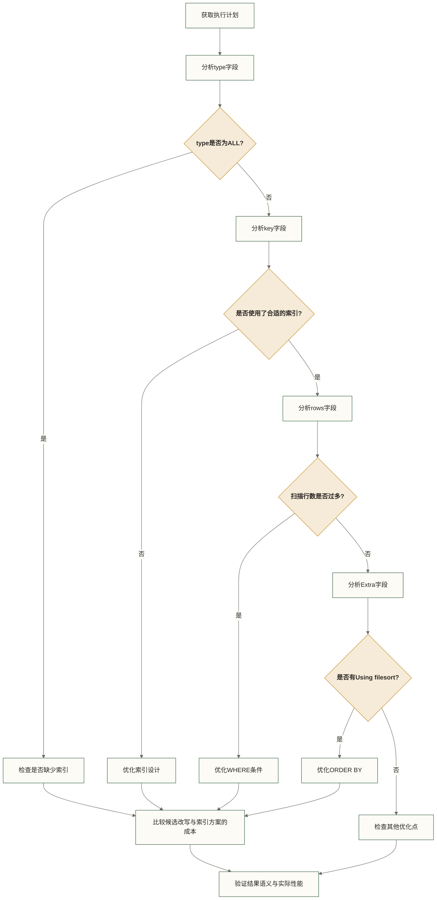

# 🔍 MySQL查询执行计划详解 - EXPLAIN深度分析与优化

> [!abstract] 📋 本节概览
> - 🎯 **学习目标**：掌握EXPLAIN的使用方法和查询优化技巧
> - 📚 **前置知识**：[[【技术与工具】/MySQL/10-MySQL索引深度剖析|MySQL索引深度剖析]] | [[【技术与工具】/PostgreSQL/00-PostgreSQL学习路线图|PostgreSQL/PostgreSQL]] | [[【技术与工具】/MySQL/05-MySQL架构原理|MySQL架构]]
> - ⏱️ **预计用时**：80分钟
> - 🔧 **技术重点**：EXPLAIN输出解读、执行计划优化、查询性能分析

## 🎯 EXPLAIN基础语法

### EXPLAIN输出格式

```sql title="EXPLAIN基本用法"
-- 创建测试表
CREATE TABLE users (
    id INT AUTO_INCREMENT PRIMARY KEY,
    username VARCHAR(50) NOT NULL,
    email VARCHAR(100),
    age INT,
    city VARCHAR(50),
    created_at TIMESTAMP DEFAULT CURRENT_TIMESTAMP,
    
    INDEX idx_username (username),
    INDEX idx_age_city (age, city),
    INDEX idx_created (created_at)
) ENGINE=InnoDB;

-- 插入测试数据
INSERT INTO users (username, email, age, city) VALUES
('alice', 'alice@email.com', 25, 'Beijing'),
('bob', 'bob@email.com', 30, 'Shanghai'),
('charlie', 'charlie@email.com', 35, 'Guangzhou');

-- 基本EXPLAIN
EXPLAIN SELECT * FROM users WHERE username = 'alice';

-- 详细格式的EXPLAIN
EXPLAIN FORMAT=JSON SELECT * FROM users WHERE age > 25;

-- 查看实际执行统计（MySQL 8.0.18及以上；会实际执行查询）
EXPLAIN ANALYZE SELECT * FROM users WHERE age > 25 ORDER BY created_at;
```

### EXPLAIN输出列详解

> [!note] 💡 如何读懂EXPLAIN结果？
> 把EXPLAIN想象成MySQL的"执行计划书"，告诉你MySQL打算如何执行你的查询：

| 列名 | 通俗解释 | 关键值解读 |
|---|---|---|
| **id** | SELECT查询块标识 | 🔢 标识SELECT查询块；不能仅凭id大小确定实际执行顺序，应结合完整计划及优化器改写分析 |
| **select_type** | 查询类型 | 📝 SIMPLE(简单查询)、SUBQUERY(子查询)、UNION(联合查询) |
| **table** | 当前访问的表 | 📊 显示表名或别名 |
| **type** | 访问方式(★重要) | 🚦 常见访问方式包括const、ref、range和ALL；实际性能还取决于扫描行数、回表、数据分布及查询需求，不能据此作固定排名 |
| **possible_keys** | 可选的索引 | 🗝️ MySQL考虑使用的索引清单 |
| **key** | 实际使用的索引 | ✅ 真正用到的索引，NULL表示没用索引 |
| **key_len** | 索引使用长度 | 📏 访问时使用的索引键长度，可辅助判断使用了哪些索引列；不能据其长短直接判断效率 |
| **rows** | 预估扫描行数 | 📈 MySQL估计要检查多少行数据，越少越好 |
| **Extra** | 额外执行信息 | 💡 重要提示信息，如"Using index"表示覆盖索引，"Using filesort"表示额外排序；是否需要优化应结合成本和查询需求判断 |

## 📊 关键字段深度解析

### 1. type字段 - 访问类型

以下访问类型及后续Extra、排序和分组注释用于说明候选计划特征，不是实际输出记录。小样本、空表、已有索引和优化器选择都可能使结果不同；勾叉标记不表示固定的性能优劣，应以目标实例的EXPLAIN和执行统计为准。

```sql title="不同访问类型演示"
-- system表示表仅有一行的特殊访问情形；以下系统表查询不保证出现system
EXPLAIN SELECT * FROM mysql.proxies_priv WHERE host = '';

-- const: 主键或唯一索引的等值查询
EXPLAIN SELECT * FROM users WHERE id = 1;

-- eq_ref: 唯一索引扫描（通常出现在连接查询）
CREATE TABLE orders (
    id INT AUTO_INCREMENT PRIMARY KEY,
    user_id INT,
    amount DECIMAL(10,2),
    FOREIGN KEY (user_id) REFERENCES users(id)
);

EXPLAIN SELECT u.username, o.amount 
FROM users u 
JOIN orders o ON u.id = o.user_id;

-- ref: 非唯一索引的等值查询
EXPLAIN SELECT * FROM users WHERE username = 'alice';

-- range: 索引范围扫描
EXPLAIN SELECT * FROM users WHERE age BETWEEN 25 AND 35;
EXPLAIN SELECT * FROM users WHERE id IN (1, 2, 3);

-- index: 索引全扫描
EXPLAIN SELECT username FROM users;

-- ALL: 全表扫描；是否需要优化取决于表大小、过滤比例及访问成本
EXPLAIN SELECT * FROM users WHERE email LIKE '%gmail%';
```

### 2. Extra字段 - 执行信息

```sql title="Extra字段含义解析"
-- Using index: 覆盖索引
EXPLAIN SELECT username FROM users WHERE username = 'alice';

-- Using where: 使用WHERE过滤
EXPLAIN SELECT * FROM users WHERE age > 25;

-- Using index condition: 索引条件下推
EXPLAIN SELECT * FROM users WHERE age > 25 AND city = 'Beijing';

-- Using temporary: 使用临时表
EXPLAIN SELECT DISTINCT age FROM users;

-- Using filesort: 文件排序
EXPLAIN SELECT * FROM users ORDER BY email;

-- Using sort_union/Using union/Using intersect: 索引合并
CREATE INDEX idx_email ON users (email);
EXPLAIN SELECT * FROM users WHERE username = 'alice' OR email = 'alice@email.com';

-- Impossible WHERE: 条件永远为假
EXPLAIN SELECT * FROM users WHERE 1 = 0;

-- No matching min/max row: 没有符合条件的行
EXPLAIN SELECT MIN(id) FROM users WHERE age > 100;
```

## 🔧 查询优化实战

### 子查询优化

```sql title="子查询执行计划分析"
-- 相关子查询 vs JOIN
-- 相关EXISTS子查询示例：性能需结合优化器改写、索引和数据分布判断
EXPLAIN SELECT * FROM users u 
WHERE EXISTS (
    SELECT 1 FROM orders o 
    WHERE o.user_id = u.id AND o.amount > 100
);

-- 等价的JOIN与DISTINCT候选写法：是否更快需比较实际执行计划与耗时
EXPLAIN SELECT DISTINCT u.* FROM users u 
JOIN orders o ON u.id = o.user_id 
WHERE o.amount > 100;

-- 子查询类型分析
-- DEPENDENT SUBQUERY: 依赖外层查询的子查询；性能取决于执行次数、访问方式及数据分布
EXPLAIN SELECT * FROM users 
WHERE age > (SELECT AVG(age) FROM users u2 WHERE u2.city = users.city);

-- SUBQUERY: 独立子查询
EXPLAIN SELECT * FROM users 
WHERE age > (SELECT AVG(age) FROM users);

-- DERIVED: 派生表
EXPLAIN SELECT * FROM (
    SELECT city, AVG(age) as avg_age 
    FROM users 
    GROUP BY city
) t WHERE avg_age > 30;
```

### 连接查询优化

> [!note] 💡 JOIN优化要点
> JOIN查询的性能关键在于连接顺序和索引使用，详细的JOIN语法可参考 SQL

```sql title="JOIN执行计划优化"
-- 创建更多测试表
CREATE TABLE profiles (
    user_id INT PRIMARY KEY,
    bio TEXT,
    avatar_url VARCHAR(200)
);

CREATE TABLE user_stats (
    user_id INT PRIMARY KEY,
    login_count INT DEFAULT 0,
    last_login TIMESTAMP
);

-- 多表连接分析
EXPLAIN SELECT 
    u.username,
    p.bio,
    s.login_count
FROM users u
LEFT JOIN profiles p ON u.id = p.user_id
LEFT JOIN user_stats s ON u.id = s.user_id
WHERE u.age > 25;

-- 连接顺序优化
-- MySQL按成本估算选择连接顺序，但不保证实际最优；可在支持该提示的版本中尝试控制顺序并比较效果
EXPLAIN SELECT /*+ JOIN_ORDER(u, p, s) */
    u.username,
    p.bio,
    s.login_count
FROM users u
JOIN profiles p ON u.id = p.user_id
JOIN user_stats s ON u.id = s.user_id;

-- 驱动表选择原则
-- 1. 小表驱动大表
-- 2. 有索引的表作为被驱动表
-- 3. WHERE条件过滤性好的表作为驱动表
```

### 排序和分组优化

```sql title="ORDER BY和GROUP BY优化"
-- 利用索引排序 vs 文件排序
-- ✅ 使用索引排序（无Using filesort）
EXPLAIN SELECT * FROM users ORDER BY id;
EXPLAIN SELECT * FROM users WHERE age > 25 ORDER BY age, city;

-- ❌ 文件排序（有Using filesort）
EXPLAIN SELECT * FROM users ORDER BY email;
EXPLAIN SELECT * FROM users ORDER BY age DESC, city ASC;  -- 排序方向不一致

-- GROUP BY优化
-- ✅ 利用索引分组
EXPLAIN SELECT age, COUNT(*) FROM users GROUP BY age;

-- ❌ 临时表分组
EXPLAIN SELECT city, COUNT(*) FROM users GROUP BY city;

-- 创建适合的索引
CREATE INDEX idx_city_age ON users (city, age);
EXPLAIN SELECT city, AVG(age) FROM users GROUP BY city;
```

## 📈 高级分析技巧

### JSON格式执行计划

```sql title="JSON格式深度分析"
-- JSON格式提供更详细的信息
EXPLAIN FORMAT=JSON 
SELECT u.username, COUNT(o.id) as order_count
FROM users u
LEFT JOIN orders o ON u.id = o.user_id
WHERE u.age > 25
GROUP BY u.id, u.username
HAVING COUNT(o.id) > 0
ORDER BY order_count DESC
LIMIT 10;

-- JSON格式关键字段：
/*
{
  "query_block": {
    "select_id": 1,
    "cost_info": {
      "query_cost": "2.40"  -- 查询成本
    },
    "nested_loop": [
      {
        "table": {
          "table_name": "u",
          "access_type": "range",
          "possible_keys": ["idx_age_city"],
          "key": "idx_age_city",
          "key_length": "5",
          "rows_examined_per_scan": 2,
          "rows_produced_per_join": 2,
          "filtered": "100.00",
          "cost_info": {
            "read_cost": "1.20",
            "eval_cost": "0.20",
            "prefix_cost": "1.40",
            "data_read_per_join": "368"
          }
        }
      }
    ]
  }
}
*/
```

### 预处理语句执行与重新准备统计

```sql title="预处理语句执行与重新准备统计"
-- 查看SQL级PREPARE与EXECUTE的调用计数；这些计数不代表计划缓存状态
SHOW STATUS LIKE 'Com_prepare';
SHOW STATUS LIKE 'Com_execute';

-- 将EXPLAIN查询本身准备为参数化语句
PREPARE stmt FROM 'EXPLAIN SELECT * FROM users WHERE age > ?';
SET @age = 25;
EXECUTE stmt USING @age;
DEALLOCATE PREPARE stmt;

-- 单独准备并执行待观察的查询；在释放语句前读取统计
-- 需要Performance Schema已启用相应预处理语句监控，否则可能无记录
PREPARE stats_stmt FROM 'SELECT * FROM users WHERE age > ?';
EXECUTE stats_stmt USING @age;

-- 查看本连接中该语句的执行与重新准备次数；以下比值不是计划缓存命中率
SELECT
    COUNT_EXECUTE,
    COUNT_REPREPARE,
    COUNT_REPREPARE / NULLIF(COUNT_EXECUTE, 0) as reprepares_per_execution
FROM performance_schema.prepared_statements_instances
WHERE STATEMENT_NAME = 'stats_stmt'
  AND OWNER_THREAD_ID = (
      SELECT THREAD_ID
      FROM performance_schema.threads
      WHERE PROCESSLIST_ID = CONNECTION_ID()
  );

DEALLOCATE PREPARE stats_stmt;
```

## 🚀 性能监控与诊断

### 实时查询分析

```sql title="查询性能实时监控"
-- 查看当前运行的查询
SELECT 
    ID,
    USER,
    HOST,
    DB,
    COMMAND,
    TIME,
    STATE,
    LEFT(INFO, 100) as QUERY_START
FROM INFORMATION_SCHEMA.PROCESSLIST
WHERE COMMAND = 'Query' AND TIME > 1
ORDER BY TIME DESC;

-- 使用Performance Schema分析
-- 启用语句监控
UPDATE performance_schema.setup_consumers 
SET ENABLED = 'YES' 
WHERE NAME LIKE 'events_statements%';

-- 查看最耗时的语句
SELECT 
    DIGEST_TEXT,
    COUNT_STAR as exec_count,
    ROUND(AVG_TIMER_WAIT/1000000000000, 3) as avg_time_sec,
    ROUND(MAX_TIMER_WAIT/1000000000000, 3) as max_time_sec,
    ROUND(SUM_TIMER_WAIT/1000000000000, 3) as total_time_sec
FROM performance_schema.events_statements_summary_by_digest
WHERE SCHEMA_NAME = DATABASE()
ORDER BY SUM_TIMER_WAIT DESC
LIMIT 10;
```

### 执行计划变化监控

```sql title="执行计划稳定性监控"
-- 创建监控视图
CREATE VIEW v_query_plans AS
SELECT 
    DIGEST,
    DIGEST_TEXT,
    COUNT_STAR,
    ROUND(AVG_TIMER_WAIT/1000000000000, 3) as avg_time,
    FIRST_SEEN,
    LAST_SEEN
FROM performance_schema.events_statements_summary_by_digest
WHERE SCHEMA_NAME = DATABASE();

-- 定期检查执行计划变化
-- 可以通过脚本定期保存EXPLAIN结果，对比变化

-- 查看索引使用统计
SELECT 
    OBJECT_NAME as table_name,
    INDEX_NAME,
    COUNT_FETCH,
    COUNT_INSERT,
    COUNT_UPDATE,
    COUNT_DELETE,
    ROUND(COUNT_FETCH / (COUNT_FETCH + COUNT_INSERT + COUNT_UPDATE + COUNT_DELETE) * 100, 2) as read_ratio
FROM performance_schema.table_io_waits_summary_by_index_usage
WHERE OBJECT_SCHEMA = DATABASE()
    AND COUNT_FETCH + COUNT_INSERT + COUNT_UPDATE + COUNT_DELETE > 0
ORDER BY COUNT_FETCH DESC;
```

## 🎓 优化最佳实践

### 执行计划分析流程



### 常见优化技巧

```sql title="执行计划优化技巧总结"
-- 1. 避免全表扫描
-- ❌ 没有合适索引
SELECT * FROM users WHERE UPPER(username) = 'ALICE';

-- 候选改写：仅在排序规则和业务要求下与原大小写比较等价时使用；此SQL未创建函数索引
SELECT * FROM users WHERE username = 'alice';

-- 2. 优化JOIN查询
-- 连接查询示例：前文users.id已有主键索引，orders.user_id有外键所需索引，不能据此认定缺少连接索引
SELECT * FROM users u, orders o WHERE u.id = o.user_id;

-- ✅ 确保连接字段有索引
-- 已有 users.id(PRIMARY) 和 orders.user_id(INDEX)

-- 3. 避免不必要的排序
-- ❌ 无法利用索引排序
SELECT * FROM users ORDER BY RAND();

-- 若业务要求按id排序，可利用主键顺序；这不是随机排序的等价替代
SELECT * FROM users ORDER BY id;

-- 4. 优化LIMIT查询
-- ❌ 大偏移量分页
SELECT * FROM users ORDER BY created_at LIMIT 10000, 20;

-- 按id游标分页的独立示例：假设上一页末尾id为10000；不等价于前文按created_at的偏移分页
SELECT * FROM users WHERE id > 10000 ORDER BY id LIMIT 20;
```

> [!tip] 💡 执行计划分析要点
> 
> **关键指标**
> - type为ALL时检查扫描成本；小表或高返回比例查询可能适合全表扫描
> - rows是估算值，应结合过滤比例、实际扫描量与总耗时判断
> - Extra中的Using index可提示覆盖索引，但仍需评估整体成本
> - Using temporary和Using filesort是诊断线索，不是必须消除的错误
> 
> **优化策略**
> - 为WHERE条件创建合适索引
> - 使用覆盖索引减少回表
> - 优化JOIN顺序和条件
> - 避免在索引列上使用函数

> [!warning] ⚠️ 常见分析误区
> - 仅关注单个查询，忽视整体性能
> - 过度优化低频查询
> - 忽视统计信息的准确性
> - 不考虑数据量变化对计划的影响

## 🔗 相关工具推荐

### 可视化工具
- **MySQL Workbench**: 图形化执行计划展示
- **phpMyAdmin**: Web界面的EXPLAIN工具
- **Navicat**: 商业数据库管理工具

### 命令行工具
- **pt-query-digest**: Percona Toolkit查询分析
- **mysqldumpslow**: MySQL自带慢查询分析
- **mysqlslap**: 负载测试工具

## 🔗 下一步学习

掌握执行计划分析后，建议继续学习：

- [[【技术与工具】/MySQL/13-慢查询优化实战|慢查询优化]]
- [[【技术与工具】/Oracle/16-Oracle性能监控与诊断|Oracle/Oracle性能监控与诊断]]
- SQL - 查询优化进阶

---

*最后更新：2024-06-29* 