# 📊 MySQL性能监控与诊断 - Performance Schema与工具实战

> [!abstract] 📋 本节概览
> - 🎯 **学习目标**：掌握MySQL性能监控方法和诊断技巧
> - 📚 **前置知识**：[[【技术与工具】/MySQL/11-查询执行计划|查询执行计划]] | [[【技术与工具】/MySQL/05-MySQL架构原理|MySQL架构]] | [[【技术与工具】/MySQL/10-MySQL索引深度剖析|MySQL索引深度剖析]] | [[【技术与工具】/PostgreSQL/00-PostgreSQL学习路线图|PostgreSQL/PostgreSQL]]
> - ⏱️ **预计用时**：90分钟
> - 🔧 **技术重点**：Performance Schema、慢查询分析、系统监控、性能调优

## 🔍 MySQL监控体系概览

### 监控层次结构

```mermaid
%%{init: {"theme":"base","themeVariables":{"fontFamily":"PingFang SC, -apple-system, Source Han Serif SC, serif","fontSize":"16px","background":"#FDFBF5","primaryColor":"#FDFBF5","primaryTextColor":"#2D2A26","primaryBorderColor":"#6E6A60","secondaryColor":"#E8EFE8","secondaryBorderColor":"#8FA890","secondaryTextColor":"#2D2A26","tertiaryColor":"#FDFBF5","tertiaryBorderColor":"#9A9488","tertiaryTextColor":"#6E6A60","lineColor":"#6E6A60","textColor":"#2D2A26","mainBkg":"#FDFBF5","nodeBorder":"#2D5A3D","clusterBkg":"#F3EEDF","clusterBorder":"#9A9488","edgeLabelBackground":"#FDFBF5"},"flowchart":{"htmlLabels":true,"curve":"basis","padding":20,"nodeSpacing":60,"rankSpacing":70,"useMaxWidth":false},"themeCSS":".node rect, .node polygon, .node circle { stroke-width: 1.5px; } .edgePath .path { stroke-width: 1.5px; } .cluster-label .nodeLabel, .cluster-label foreignObject { color: #2D2A26 !important; } .edgeLabel, .edgeLabel foreignObject { color: #2D2A26 !important; background-color: #FDFBF5; } .edgeLabel rect { fill: #FDFBF5; }"}}%%
flowchart TD
    classDef default fill:#FDFBF5,stroke:#6E6A60,color:#2D2A26,stroke-width:1.5px
    classDef startend fill:#2D2A26,stroke:#2D2A26,color:#FDFBF5,font-weight:bold
    classDef decision fill:#F6EAD8,stroke:#C08A1A,color:#2D2A26,font-weight:bold
    classDef hub fill:#3B5A80,stroke:#3B5A80,color:#FDFBF5,font-weight:bold
    classDef io fill:#E5EAF0,stroke:#3B5A80,color:#2D2A26
    classDef accent fill:#A6432C,stroke:#A6432C,color:#FDFBF5,font-weight:bold
    classDef storage fill:#F3EEDF,stroke:#9A9488,color:#2D2A26
    A[MySQL性能监控]
    A --> B[系统层监控]
    A --> C[数据库层监控]
    A --> D[应用层监控]
    B --> B1[CPU/内存/磁盘IO]
    B --> B2[网络延迟]
    B --> B3[操作系统指标]
    C --> C1[Performance Schema]
    C --> C2[慢查询日志]
    C --> C3[状态变量]
    C --> C4[InnoDB监控]
    D --> D1[连接池监控]
    D --> D2[查询响应时间]
    D --> D3[事务监控]
```



## ⚡ Performance Schema深度应用

> [!note] 💡 什么是Performance Schema？
> Performance Schema是MySQL的性能监控工具，就像汽车的仪表盘：
> - 📊 **监控所有操作**：SQL执行、锁等待、文件IO等
> - 📈 **收集性能数据**：执行时间、资源消耗、瓶颈分析
> - 🔍 **实时诊断**：找出性能问题的根本原因
> - 💡 **监控开销需评估**：Performance Schema无需改写业务SQL即可采集已启用的事件，但性能开销取决于监控器、消费者配置和工作负载，不能保证无显著影响

### 启用和配置Performance Schema

```sql title="Performance Schema配置"
-- 查看Performance Schema状态
SHOW VARIABLES LIKE 'performance_schema';

-- 查看所有监控器状态
SELECT NAME, ENABLED, TIMED 
FROM performance_schema.setup_instruments
WHERE NAME LIKE '%statement%' OR NAME LIKE '%stage%'
ORDER BY NAME;

-- 启用语句监控
UPDATE performance_schema.setup_consumers 
SET ENABLED = 'YES' 
WHERE NAME IN (
    'events_statements_current',
    'events_statements_history',
    'events_statements_history_long',
    'statements_digest'
);

-- 启用等待事件监控
UPDATE performance_schema.setup_instruments 
SET ENABLED = 'YES', TIMED = 'YES'
WHERE NAME LIKE 'wait/io/file/%'
   OR NAME LIKE 'wait/io/table/%'
   OR NAME LIKE 'wait/lock/%';

-- 查看内存使用情况
SELECT EVENT_NAME, COUNT_ALLOC, COUNT_FREE, 
       SUM_NUMBER_OF_BYTES_ALLOC, SUM_NUMBER_OF_BYTES_FREE,
       LOW_COUNT_USED, HIGH_COUNT_USED, CURRENT_COUNT_USED
FROM performance_schema.memory_summary_global_by_event_name
WHERE CURRENT_COUNT_USED > 0
ORDER BY CURRENT_COUNT_USED DESC
LIMIT 10;
```

### 语句性能分析

```sql title="查询性能深度分析"
-- 1. 最耗时的SQL语句
SELECT 
    DIGEST_TEXT as query_sample,
    COUNT_STAR as exec_count,
    ROUND(AVG_TIMER_WAIT/1000000000000, 3) as avg_time_sec,
    ROUND(MAX_TIMER_WAIT/1000000000000, 3) as max_time_sec,
    ROUND(SUM_TIMER_WAIT/1000000000000, 3) as total_time_sec,
    ROUND(SUM_ROWS_EXAMINED / NULLIF(COUNT_STAR, 0), 0) as avg_rows_examined,
    ROUND(SUM_ROWS_SENT / NULLIF(COUNT_STAR, 0), 0) as avg_rows_sent,
    FIRST_SEEN,
    LAST_SEEN
FROM performance_schema.events_statements_summary_by_digest
WHERE SCHEMA_NAME = DATABASE()
ORDER BY SUM_TIMER_WAIT DESC
LIMIT 10;

-- 2. 扫描行数最多的查询
SELECT 
    DIGEST_TEXT,
    COUNT_STAR,
    SUM_ROWS_EXAMINED,
    ROUND(SUM_ROWS_EXAMINED / COUNT_STAR, 0) as avg_rows_examined,
    ROUND(SUM_TIMER_WAIT/1000000000000, 3) as total_time_sec
FROM performance_schema.events_statements_summary_by_digest
WHERE SCHEMA_NAME = DATABASE()
ORDER BY SUM_ROWS_EXAMINED DESC
LIMIT 10;

-- 3. 临时表使用分析
SELECT 
    DIGEST_TEXT,
    COUNT_STAR,
    SUM_CREATED_TMP_TABLES,
    SUM_CREATED_TMP_DISK_TABLES,
    ROUND(SUM_CREATED_TMP_DISK_TABLES / SUM_CREATED_TMP_TABLES * 100, 2) as disk_tmp_table_ratio
FROM performance_schema.events_statements_summary_by_digest
WHERE SUM_CREATED_TMP_TABLES > 0
ORDER BY SUM_CREATED_TMP_DISK_TABLES DESC
LIMIT 10;

-- 4. 全表扫描分析
SELECT 
    DIGEST_TEXT,
    COUNT_STAR,
    SUM_SELECT_FULL_JOIN,
    SUM_SELECT_FULL_RANGE_JOIN,
    SUM_SELECT_RANGE,
    SUM_SELECT_SCAN
FROM performance_schema.events_statements_summary_by_digest
WHERE SUM_SELECT_SCAN > 0
ORDER BY SUM_SELECT_SCAN DESC
LIMIT 10;
```

### 等待事件分析

```sql title="锁和IO等待分析"
-- 1. 表级锁等待
SELECT 
    OBJECT_SCHEMA,
    OBJECT_NAME,
    COUNT_STAR as lock_count,
    ROUND(SUM_TIMER_WAIT/1000000000000, 3) as total_wait_sec,
    ROUND(AVG_TIMER_WAIT/1000000000000, 6) as avg_wait_sec,
    ROUND(MAX_TIMER_WAIT/1000000000000, 6) as max_wait_sec
FROM performance_schema.table_lock_waits_summary_by_table
WHERE COUNT_STAR > 0
ORDER BY SUM_TIMER_WAIT DESC;

-- 2. 文件IO等待分析
SELECT 
    FILE_NAME,
    EVENT_NAME,
    COUNT_STAR as io_count,
    ROUND(SUM_TIMER_WAIT/1000000000000, 3) as total_wait_sec,
    ROUND(AVG_TIMER_READ/1000000000000, 6) as avg_read_sec,
    ROUND(AVG_TIMER_WRITE/1000000000000, 6) as avg_write_sec,
    SUM_NUMBER_OF_BYTES_READ / 1024 / 1024 as read_mb,
    SUM_NUMBER_OF_BYTES_WRITE / 1024 / 1024 as write_mb
FROM performance_schema.file_summary_by_instance
WHERE COUNT_STAR > 0
ORDER BY SUM_TIMER_WAIT DESC
LIMIT 10;

-- 3. 索引使用统计
SELECT 
    OBJECT_SCHEMA,
    OBJECT_NAME,
    INDEX_NAME,
    COUNT_FETCH,
    COUNT_INSERT,
    COUNT_UPDATE,
    COUNT_DELETE,
    ROUND(COUNT_FETCH / (COUNT_FETCH + COUNT_INSERT + COUNT_UPDATE + COUNT_DELETE) * 100, 2) as read_ratio
FROM performance_schema.table_io_waits_summary_by_index_usage
WHERE COUNT_FETCH + COUNT_INSERT + COUNT_UPDATE + COUNT_DELETE > 0
ORDER BY COUNT_FETCH DESC
LIMIT 15;
```

## 📝 慢查询日志分析

### 慢查询日志配置

```sql title="慢查询日志配置与分析"
-- 1. 启用慢查询日志
SET GLOBAL slow_query_log = ON;
SET GLOBAL slow_query_log_file = '/var/log/mysql/slow.log';
SET GLOBAL long_query_time = 1.0;  -- 1秒以上的查询
SET GLOBAL log_queries_not_using_indexes = ON;  -- 记录未使用索引的查询

-- 查看慢查询相关配置
SHOW VARIABLES LIKE '%slow%';
SHOW VARIABLES LIKE '%long_query_time%';

-- 查看慢查询统计
SHOW STATUS LIKE '%Slow_queries%';
SHOW STATUS LIKE '%Queries%';

-- 实时查看慢查询
SELECT 
    ID,
    USER,
    HOST,
    DB,
    COMMAND,
    TIME,
    STATE,
    LEFT(INFO, 100) as QUERY_INFO
FROM INFORMATION_SCHEMA.PROCESSLIST
WHERE TIME > 5  -- 运行超过5秒的查询
ORDER BY TIME DESC;
```

### 慢查询日志分析工具

```bash title="慢查询分析工具使用"
# 1. 使用mysqldumpslow分析
# 按查询时间排序，显示前10条
mysqldumpslow -s t -t 10 /var/log/mysql/slow.log

# 按查询次数排序
mysqldumpslow -s c -t 10 /var/log/mysql/slow.log

# 按锁定时间排序
mysqldumpslow -s l -t 10 /var/log/mysql/slow.log

# 2. 使用pt-query-digest分析（Percona Toolkit）
# 安装：apt-get install percona-toolkit
pt-query-digest /var/log/mysql/slow.log > slow_analysis.txt

# 分析指定时间段的日志
pt-query-digest --since '2024-06-01 00:00:00' \
                --until '2024-06-01 23:59:59' \
                /var/log/mysql/slow.log

# 3. 实时监控慢查询
pt-query-digest --processlist h=localhost,u=root,p=password \
                --run-time 60 \
                --interval 5
```

## 📈 系统级性能监控

### 关键性能指标

```sql title="MySQL状态变量监控"
-- 1. 连接相关指标
SHOW STATUS LIKE 'Connections';          -- 总连接数
SHOW STATUS LIKE 'Max_used_connections'; -- 最大并发连接数
SHOW STATUS LIKE 'Threads_connected';    -- 当前连接数
SHOW STATUS LIKE 'Threads_running';      -- 当前活跃连接数
SHOW STATUS LIKE 'Aborted_connects';     -- 失败连接数

-- 2. 查询相关指标
SHOW STATUS LIKE 'Questions';            -- 总查询数
SHOW STATUS LIKE 'Queries';              -- 总语句数
SHOW STATUS LIKE 'Com_select';           -- SELECT语句数
SHOW STATUS LIKE 'Com_insert';           -- INSERT语句数
SHOW STATUS LIKE 'Com_update';           -- UPDATE语句数
SHOW STATUS LIKE 'Com_delete';           -- DELETE语句数

-- 3. InnoDB相关指标
SHOW STATUS LIKE 'Innodb_buffer_pool_read_requests';  -- Buffer Pool读请求
SHOW STATUS LIKE 'Innodb_buffer_pool_reads';          -- 物理读次数
SHOW STATUS LIKE 'Innodb_buffer_pool_pages_total';    -- Buffer Pool总页数
SHOW STATUS LIKE 'Innodb_buffer_pool_pages_free';     -- Buffer Pool空闲页数
SHOW STATUS LIKE 'Innodb_rows_read';                  -- 读取行数
SHOW STATUS LIKE 'Innodb_rows_inserted';              -- 插入行数
SHOW STATUS LIKE 'Innodb_rows_updated';               -- 更新行数
SHOW STATUS LIKE 'Innodb_rows_deleted';               -- 删除行数

-- 4. 锁相关指标
SHOW STATUS LIKE 'Table_locks_immediate';  -- 立即获得的表锁
SHOW STATUS LIKE 'Table_locks_waited';     -- 需要等待的表锁
SHOW STATUS LIKE 'Innodb_row_lock_waits';  -- 行锁等待次数
SHOW STATUS LIKE 'Innodb_row_lock_time';   -- 行锁等待时间
```

### 性能监控脚本

```sql title="综合性能监控查询"
-- 创建性能监控视图
CREATE OR REPLACE VIEW v_mysql_performance AS
SELECT 
    'Buffer Pool Hit Ratio' as metric,
    ROUND((1 - (SELECT VARIABLE_VALUE FROM performance_schema.global_status WHERE VARIABLE_NAME = 'Innodb_buffer_pool_reads') / 
         (SELECT VARIABLE_VALUE FROM performance_schema.global_status WHERE VARIABLE_NAME = 'Innodb_buffer_pool_read_requests')) * 100, 2) as value,
    '%' as unit
UNION ALL
SELECT 
    'Query Cache Hit Ratio',
    CASE 
        WHEN (SELECT VARIABLE_VALUE FROM performance_schema.global_status WHERE VARIABLE_NAME = 'Qcache_hits') + 
             (SELECT VARIABLE_VALUE FROM performance_schema.global_status WHERE VARIABLE_NAME = 'Qcache_inserts') = 0 
        THEN 0
        ELSE ROUND((SELECT VARIABLE_VALUE FROM performance_schema.global_status WHERE VARIABLE_NAME = 'Qcache_hits') / 
                   ((SELECT VARIABLE_VALUE FROM performance_schema.global_status WHERE VARIABLE_NAME = 'Qcache_hits') + 
                    (SELECT VARIABLE_VALUE FROM performance_schema.global_status WHERE VARIABLE_NAME = 'Qcache_inserts')) * 100, 2)
    END,
    '%'
UNION ALL
SELECT 
    'Thread Cache Hit Ratio',
    ROUND((1 - (SELECT VARIABLE_VALUE FROM performance_schema.global_status WHERE VARIABLE_NAME = 'Threads_created') / 
         (SELECT VARIABLE_VALUE FROM performance_schema.global_status WHERE VARIABLE_NAME = 'Connections')) * 100, 2),
    '%'
UNION ALL
SELECT 
    'Table Lock Wait Ratio',
    ROUND((SELECT VARIABLE_VALUE FROM performance_schema.global_status WHERE VARIABLE_NAME = 'Table_locks_waited') / 
          ((SELECT VARIABLE_VALUE FROM performance_schema.global_status WHERE VARIABLE_NAME = 'Table_locks_immediate') + 
           (SELECT VARIABLE_VALUE FROM performance_schema.global_status WHERE VARIABLE_NAME = 'Table_locks_waited')) * 100, 2),
    '%'
UNION ALL
SELECT 
    'Current Connections',
    (SELECT VARIABLE_VALUE FROM performance_schema.global_status WHERE VARIABLE_NAME = 'Threads_connected'),
    'count'
UNION ALL
SELECT 
    'Max Connections Used',
    (SELECT VARIABLE_VALUE FROM performance_schema.global_status WHERE VARIABLE_NAME = 'Max_used_connections'),
    'count'
UNION ALL
SELECT 
    'InnoDB Buffer Pool Usage',
    ROUND(((SELECT VARIABLE_VALUE FROM performance_schema.global_status WHERE VARIABLE_NAME = 'Innodb_buffer_pool_pages_total') - 
           (SELECT VARIABLE_VALUE FROM performance_schema.global_status WHERE VARIABLE_NAME = 'Innodb_buffer_pool_pages_free')) / 
          (SELECT VARIABLE_VALUE FROM performance_schema.global_status WHERE VARIABLE_NAME = 'Innodb_buffer_pool_pages_total') * 100, 2),
    '%';

-- 查看性能概览
SELECT * FROM v_mysql_performance;
```

## 🔧 InnoDB性能监控

### InnoDB引擎状态

```sql title="InnoDB监控详解"
-- 1. 查看InnoDB状态
SHOW ENGINE INNODB STATUS\G

-- 2. InnoDB Buffer Pool详细信息
SELECT 
    POOL_ID,
    POOL_SIZE,
    FREE_BUFFERS,
    DATABASE_PAGES,
    OLD_DATABASE_PAGES,
    MODIFIED_DATABASE_PAGES,
    PENDING_DECOMPRESS,
    PENDING_READS,
    PENDING_FLUSH_LRU,
    PENDING_FLUSH_LIST
FROM INFORMATION_SCHEMA.INNODB_BUFFER_POOL_STATS;

-- 3. InnoDB事务信息
SELECT 
    trx_id,
    trx_state,
    trx_started,
    trx_requested_lock_id,
    trx_wait_started,
    trx_weight,
    trx_mysql_thread_id,
    trx_query,
    trx_operation_state,
    trx_tables_in_use,
    trx_tables_locked,
    trx_lock_structs,
    trx_lock_memory_bytes,
    trx_rows_locked,
    trx_rows_modified
FROM INFORMATION_SCHEMA.INNODB_TRX
ORDER BY trx_started;

-- 4. 锁等待信息
SELECT 
    r.trx_id waiting_trx_id,
    r.trx_mysql_thread_id waiting_thread,
    r.trx_query waiting_query,
    b.trx_id blocking_trx_id,
    b.trx_mysql_thread_id blocking_thread,
    b.trx_query blocking_query
FROM INFORMATION_SCHEMA.INNODB_LOCK_WAITS w
INNER JOIN INFORMATION_SCHEMA.INNODB_TRX b ON b.trx_id = w.blocking_trx_id
INNER JOIN INFORMATION_SCHEMA.INNODB_TRX r ON r.trx_id = w.requesting_trx_id;

-- 5. 死锁检测
SELECT
    NAME,
    SUBSYSTEM,
    COUNT,
    TYPE
FROM INFORMATION_SCHEMA.INNODB_METRICS
WHERE NAME IN ('lock_deadlocks', 'lock_timeouts', 'lock_row_lock_waits');
```

## 🚨 实时性能诊断

### 实时性能问题检测

```sql title="实时问题诊断工具"
-- 1. 长时间运行的查询
SELECT 
    p.ID,
    p.USER,
    p.HOST,
    p.DB,
    p.COMMAND,
    p.TIME,
    p.STATE,
    LEFT(p.INFO, 200) as QUERY_TEXT,
    t.trx_started,
    t.trx_tables_locked,
    t.trx_rows_locked
FROM INFORMATION_SCHEMA.PROCESSLIST p
LEFT JOIN INFORMATION_SCHEMA.INNODB_TRX t ON p.ID = t.trx_mysql_thread_id
WHERE p.TIME > 10  -- 运行超过10秒
   OR t.trx_started < NOW() - INTERVAL 30 SECOND  -- 事务超过30秒
ORDER BY p.TIME DESC;

-- 2. 检测锁争用
SELECT 
    'Row Lock Waits' as metric,
    VARIABLE_VALUE as current_value
FROM performance_schema.global_status 
WHERE VARIABLE_NAME = 'Innodb_row_lock_current_waits'
UNION ALL
SELECT 
    'Row Lock Time',
    VARIABLE_VALUE
FROM performance_schema.global_status 
WHERE VARIABLE_NAME = 'Innodb_row_lock_time'
UNION ALL
SELECT
    'Deadlocks',
    COUNT
FROM INFORMATION_SCHEMA.INNODB_METRICS
WHERE NAME = 'lock_deadlocks';

-- 3. 内存使用监控
SELECT 
    EVENT_NAME,
    CURRENT_COUNT_USED,
    HIGH_COUNT_USED,
    ROUND(CURRENT_NUMBER_OF_BYTES_USED / 1024 / 1024, 2) as current_mb,
    ROUND(HIGH_NUMBER_OF_BYTES_USED / 1024 / 1024, 2) as high_mb
FROM performance_schema.memory_summary_global_by_event_name
WHERE CURRENT_NUMBER_OF_BYTES_USED > 0
ORDER BY CURRENT_NUMBER_OF_BYTES_USED DESC
LIMIT 10;

-- 4. 内部临时表累计创建计数，不代表当前存量
-- 结合采样间隔内的计数增量分析，并按目标MySQL版本解释磁盘临时表统计口径
SELECT VARIABLE_NAME, VARIABLE_VALUE
FROM performance_schema.global_status
WHERE VARIABLE_NAME IN ('Created_tmp_tables', 'Created_tmp_disk_tables');
```

## 🛠️ 监控工具推荐

### 命令行工具

```bash title="MySQL监控工具使用"
# 1. mysqladmin - MySQL管理工具
# 查看服务器状态
mysqladmin -u root -p status

# 显示所有进程
mysqladmin -u root -p processlist

# 持续监控状态
mysqladmin -u root -p -i 5 status

# 2. mytop - 类似top的MySQL监控工具
# 安装：apt-get install mytop
# 安装后另行运行mytop，并按工具帮助配置连接参数

# 3. innotop - InnoDB监控工具
# 安装：apt-get install innotop
# 安装后另行运行innotop，并按工具帮助配置连接参数

# 4. pt-mysql-summary - 系统概览
pt-mysql-summary --user=root --password=password

# 5. pt-stalk - 性能问题诊断
pt-stalk --user=root --password=password \
         --function=processlist \
         --variable=Threads_running \
         --threshold=25
```

### 图形化监控工具

| 工具名称 | 类型 | 特点 | 适用场景 |
|---|---|---|---|
| **MySQL Workbench** | 官方工具 | 可视化监控面板 | 开发测试环境 |
| **phpMyAdmin** | Web界面 | 简单易用 | 小型项目 |
| **Grafana + Prometheus** | 开源监控 | 强大的可视化 | 生产环境 |
| **Zabbix** | 企业监控 | 完整监控方案 | 大型企业 |
| **Datadog** | 云监控 | SaaS服务 | 云环境 |

## 🎓 性能调优最佳实践

### 监控指标建议

```sql title="关键监控指标阈值"
-- 示例监控阈值：需结合工作负载、采样窗口和历史基线校准，不是通用健康标准
/*
核心指标阈值建议：

1. 连接数监控
   - 当前连接数 / 最大连接数 > 80% (警告)
   - 当前连接数 / 最大连接数 > 90% (严重)

2. Buffer Pool命中率
   - Buffer Pool命中率 < 95% (警告)
   - Buffer Pool命中率 < 90% (严重)

3. 慢查询监控
   - 慢查询比例 > 5% (警告)
   - 慢查询比例 > 10% (严重)

4. 锁等待
   - 平均锁等待时间 > 1秒 (警告)
   - 平均锁等待时间 > 5秒 (严重)

5. 临时表
   - 磁盘临时表比例 > 10% (警告)
   - 磁盘临时表比例 > 25% (严重)
*/

-- 创建监控告警规则
DELIMITER $$
CREATE PROCEDURE CheckPerformanceAlerts()
BEGIN
    DECLARE done INT DEFAULT FALSE;
    DECLARE alert_message TEXT DEFAULT '';
    
    -- 检查Buffer Pool命中率
    SET @bp_hit_ratio = (SELECT ROUND((1 - 
        (SELECT VARIABLE_VALUE FROM performance_schema.global_status WHERE VARIABLE_NAME = 'Innodb_buffer_pool_reads') / 
        (SELECT VARIABLE_VALUE FROM performance_schema.global_status WHERE VARIABLE_NAME = 'Innodb_buffer_pool_read_requests')) * 100, 2));
    
    IF @bp_hit_ratio < 95 THEN
        SET alert_message = CONCAT(alert_message, 'WARNING: Buffer Pool hit ratio is ', @bp_hit_ratio, '%\n');
    END IF;
    
    -- 检查连接数
    SET @conn_ratio = (SELECT ROUND(
        (SELECT VARIABLE_VALUE FROM performance_schema.global_status WHERE VARIABLE_NAME = 'Threads_connected') /
        (SELECT VARIABLE_VALUE FROM performance_schema.global_variables WHERE VARIABLE_NAME = 'max_connections') * 100, 2));
    
    IF @conn_ratio > 80 THEN
        SET alert_message = CONCAT(alert_message, 'WARNING: Connection usage is ', @conn_ratio, '%\n');
    END IF;
    
    -- 输出告警信息
    IF alert_message != '' THEN
        SELECT alert_message AS performance_alerts;
    ELSE
        SELECT 'No alert was generated for the two configured checks; NULL values and other metrics require separate assessment' AS status;
    END IF;
END$$
DELIMITER ;

-- 执行性能检查
CALL CheckPerformanceAlerts();
```

> [!tip] 💡 监控最佳实践
> 
> **监控策略**
> - 建立分层监控体系（系统→数据库→应用）
> - 设置合理的告警阈值和升级机制
> - 定期回顾和调整监控指标
> - 保留历史数据用于趋势分析
> 
> **关键指标**
> - Buffer Pool命中率 > 95%
> - 慢查询比例 < 5%
> - 连接数使用率 < 80%
> - 磁盘临时表比例 < 10%

> [!warning] ⚠️ 监控常见陷阱
> - 过度监控导致性能开销
> - 告警阈值设置不合理
> - 只关注单一指标忽视整体
> - 缺乏历史趋势分析

## 🔗 下一步学习

掌握性能监控后，建议继续学习：

- [[【技术与工具】/MySQL/13-慢查询优化实战|慢查询优化]]
- [[【技术与工具】/Hadoop/19-高可用架构设计|Hadoop/高可用]]
- SQL - 查询层面优化

---

*最后更新：2024-06-29* 