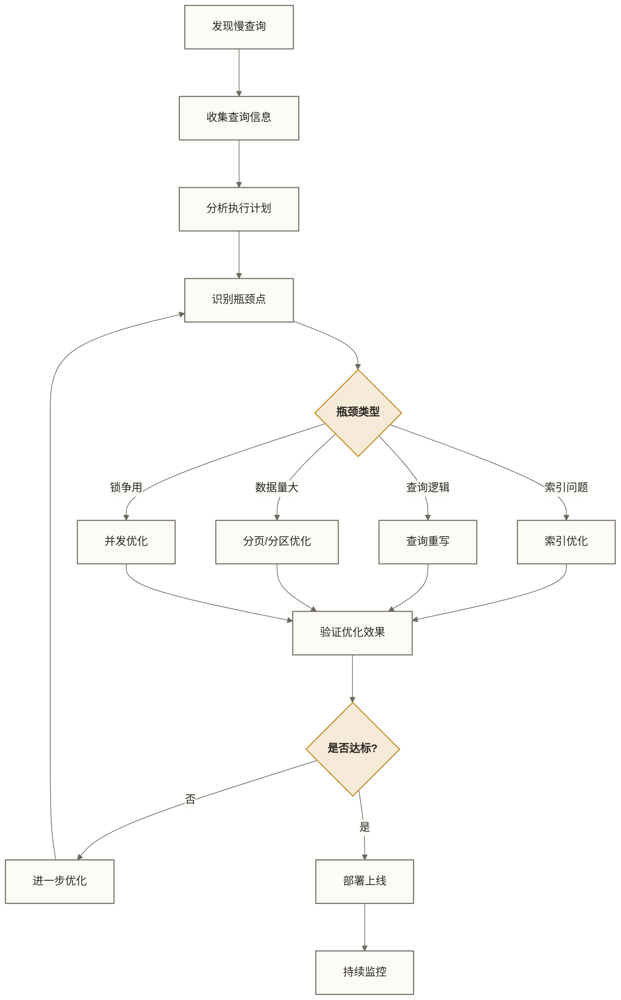
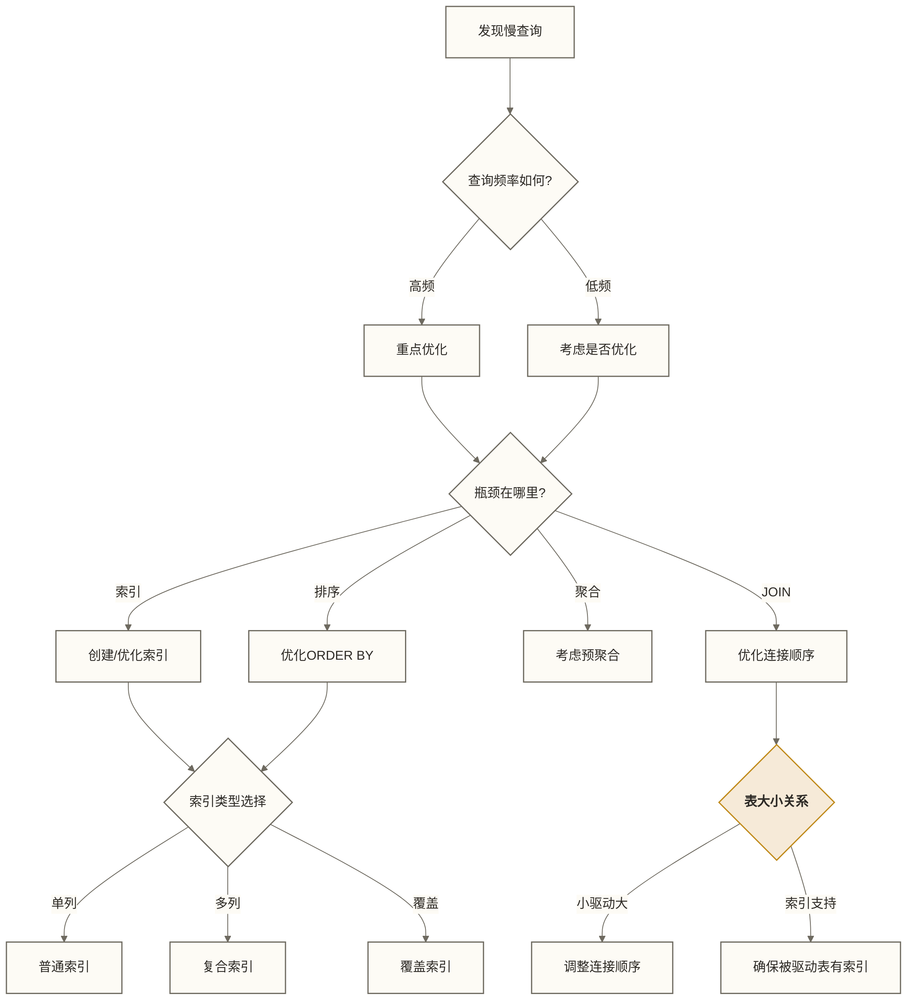

# 🚀 MySQL慢查询优化实战 - 从发现到解决的完整流程

> [!abstract] 📋 本节概览
> - 🎯 **学习目标**：掌握慢查询识别、分析和优化的完整方法论
> - 📚 **前置知识**：[[【技术与工具】/MySQL/11-查询执行计划|查询执行计划]] | [[【技术与工具】/Oracle/16-Oracle性能监控与诊断|Oracle/Oracle性能监控与诊断]] | [[【技术与工具】/MySQL/10-MySQL索引深度剖析|MySQL索引深度剖析]] | [[【技术与工具】/PostgreSQL/00-PostgreSQL学习路线图|PostgreSQL/PostgreSQL]]
> - ⏱️ **预计用时**：120分钟
> - 🔧 **技术重点**：慢查询分析、索引优化、查询重写、实战案例

## 🔍 慢查询优化方法论

### 优化流程图



## 📊 慢查询发现与收集

### 慢查询识别工具

```sql title="多维度慢查询发现"
-- 1. 实时运行的慢查询
SELECT 
    p.ID,
    p.USER,
    p.HOST,
    p.DB,
    p.TIME as duration_seconds,
    p.STATE,
    LEFT(p.INFO, 200) as query_text,
    t.trx_started,
    t.trx_rows_locked,
    t.trx_tables_locked
FROM INFORMATION_SCHEMA.PROCESSLIST p
LEFT JOIN INFORMATION_SCHEMA.INNODB_TRX t ON p.ID = t.trx_mysql_thread_id
WHERE p.TIME > 5  -- 运行超过5秒
  AND p.COMMAND = 'Query'
ORDER BY p.TIME DESC;

-- 2. Performance Schema中的慢查询
SELECT 
    DIGEST_TEXT,
    COUNT_STAR as exec_count,
    ROUND(AVG_TIMER_WAIT/1000000000000, 3) as avg_time_sec,
    ROUND(MAX_TIMER_WAIT/1000000000000, 3) as max_time_sec,
    ROUND(SUM_TIMER_WAIT/1000000000000, 3) as total_time_sec,
    ROUND(SUM_ROWS_EXAMINED / NULLIF(COUNT_STAR, 0), 0) as avg_rows_examined,
    ROUND(SUM_ROWS_SENT / NULLIF(COUNT_STAR, 0), 0) as avg_rows_sent,
    ROUND(SUM_ROWS_EXAMINED / NULLIF(SUM_ROWS_SENT, 0), 2) as examine_ratio
FROM performance_schema.events_statements_summary_by_digest
WHERE SCHEMA_NAME = DATABASE()
  AND AVG_TIMER_WAIT > 1000000000000  -- 平均执行时间 > 1秒
ORDER BY SUM_TIMER_WAIT DESC
LIMIT 20;

-- 3. 特定类型的问题查询
-- 全表扫描查询
SELECT 
    DIGEST_TEXT,
    COUNT_STAR,
    SUM_SELECT_SCAN,
    ROUND(SUM_SELECT_SCAN / COUNT_STAR, 2) as avg_full_scans,
    ROUND(SUM_TIMER_WAIT/1000000000000, 3) as total_time_sec
FROM performance_schema.events_statements_summary_by_digest
WHERE SUM_SELECT_SCAN > 0
ORDER BY SUM_SELECT_SCAN DESC;

-- 临时表使用过多的查询
SELECT 
    DIGEST_TEXT,
    COUNT_STAR,
    SUM_CREATED_TMP_TABLES,
    SUM_CREATED_TMP_DISK_TABLES,
    ROUND(SUM_CREATED_TMP_DISK_TABLES / NULLIF(SUM_CREATED_TMP_TABLES, 0) * 100, 2) as disk_tmp_ratio
FROM performance_schema.events_statements_summary_by_digest
WHERE SUM_CREATED_TMP_TABLES > 0
ORDER BY SUM_CREATED_TMP_DISK_TABLES DESC;
```

## 🔧 实战案例一：JOIN查询优化

### 问题场景

```sql title="案例：复杂JOIN查询优化"
-- 创建测试表结构
CREATE TABLE users (
    id INT AUTO_INCREMENT PRIMARY KEY,
    username VARCHAR(50) NOT NULL,
    email VARCHAR(100),
    created_at TIMESTAMP DEFAULT CURRENT_TIMESTAMP,
    status TINYINT DEFAULT 1,
    
    INDEX idx_username (username),
    INDEX idx_created (created_at),
    INDEX idx_status (status)
) ENGINE=InnoDB;

CREATE TABLE orders (
    id INT AUTO_INCREMENT PRIMARY KEY,
    user_id INT NOT NULL,
    product_id INT NOT NULL,
    amount DECIMAL(10,2),
    order_date DATE,
    status VARCHAR(20),
    
    INDEX idx_user_id (user_id),
    INDEX idx_product_id (product_id),
    INDEX idx_order_date (order_date),
    INDEX idx_status (status)
) ENGINE=InnoDB;

CREATE TABLE products (
    id INT AUTO_INCREMENT PRIMARY KEY,
    name VARCHAR(100),
    category_id INT,
    price DECIMAL(10,2),
    
    INDEX idx_category (category_id)
) ENGINE=InnoDB;

-- 插入测试数据
INSERT INTO users (username, email, status) 
SELECT 
    CONCAT('user_', n),
    CONCAT('user_', n, '@email.com'),
    CASE WHEN n % 10 = 0 THEN 0 ELSE 1 END
FROM (
    SELECT a.N + b.N * 10 + c.N * 100 + 1 n
    FROM (SELECT 0 N UNION SELECT 1 UNION SELECT 2 UNION SELECT 3 UNION SELECT 4 
          UNION SELECT 5 UNION SELECT 6 UNION SELECT 7 UNION SELECT 8 UNION SELECT 9) a,
         (SELECT 0 N UNION SELECT 1 UNION SELECT 2 UNION SELECT 3 UNION SELECT 4 
          UNION SELECT 5 UNION SELECT 6 UNION SELECT 7 UNION SELECT 8 UNION SELECT 9) b,
         (SELECT 0 N UNION SELECT 1 UNION SELECT 2 UNION SELECT 3 UNION SELECT 4 
          UNION SELECT 5 UNION SELECT 6 UNION SELECT 7 UNION SELECT 8 UNION SELECT 9) c
    ORDER BY n LIMIT 1000
) nums;

-- 问题查询：获取用户订单统计
-- ❌ 优化前的慢查询
SELECT 
    u.username,
    u.email,
    COUNT(o.id) as order_count,
    SUM(o.amount) as total_amount,
    AVG(p.price) as avg_product_price,
    MAX(o.order_date) as last_order_date
FROM users u
LEFT JOIN orders o ON u.id = o.user_id AND o.status = 'completed'
LEFT JOIN products p ON o.product_id = p.id
WHERE u.created_at >= '2024-01-01'
  AND u.status = 1
GROUP BY u.id, u.username, u.email
HAVING COUNT(o.id) > 5
ORDER BY total_amount DESC
LIMIT 100;

-- 分析执行计划
EXPLAIN FORMAT=JSON 
SELECT 
    u.username,
    u.email,
    COUNT(o.id) as order_count,
    SUM(o.amount) as total_amount,
    AVG(p.price) as avg_product_price,
    MAX(o.order_date) as last_order_date
FROM users u
LEFT JOIN orders o ON u.id = o.user_id AND o.status = 'completed'
LEFT JOIN products p ON o.product_id = p.id
WHERE u.created_at >= '2024-01-01'
  AND u.status = 1
GROUP BY u.id, u.username, u.email
HAVING COUNT(o.id) > 5
ORDER BY total_amount DESC
LIMIT 100;
```

### 优化过程

```sql title="JOIN查询优化步骤"
-- 步骤1：创建复合索引优化WHERE条件
CREATE INDEX idx_user_status_created ON users (status, created_at);
CREATE INDEX idx_order_user_status ON orders (user_id, status);

-- 步骤2：查询重写 - 先过滤再关联
-- ✅ 优化后的查询
WITH active_users AS (
    SELECT id, username, email
    FROM users
    WHERE status = 1 
      AND created_at >= '2024-01-01'
),
user_orders AS (
    SELECT 
        o.user_id,
        COUNT(*) as order_count,
        SUM(o.amount) as total_amount,
        MAX(o.order_date) as last_order_date,
        AVG(p.price) as avg_product_price
    FROM orders o
    LEFT JOIN products p ON o.product_id = p.id
    WHERE o.status = 'completed'
      AND o.user_id IN (SELECT id FROM active_users)
    GROUP BY o.user_id
    HAVING COUNT(*) > 5
)
SELECT 
    u.username,
    u.email,
    uo.order_count,
    uo.total_amount,
    uo.avg_product_price,
    uo.last_order_date
FROM active_users u
INNER JOIN user_orders uo ON u.id = uo.user_id
ORDER BY uo.total_amount DESC
LIMIT 100;

-- 步骤3：创建覆盖索引减少回表
CREATE INDEX idx_order_covering ON orders (user_id, status, product_id, amount, order_date);

-- 步骤4：比较优化效果
-- 使用EXPLAIN ANALYZE比较执行时间
EXPLAIN ANALYZE [原查询];
EXPLAIN ANALYZE [优化后查询];
```

## 🚀 实战案例二：分页查询优化

### 深度分页问题

```sql title="案例：大偏移量分页优化"
-- 问题：传统分页在大偏移量时性能急剧下降
-- ❌ 性能差的深度分页
SELECT id, username, email, created_at
FROM users
ORDER BY created_at DESC
LIMIT 100000, 20;  -- 第5001页，每页20条（页码从1开始）

-- 分析问题
EXPLAIN SELECT id, username, email, created_at
FROM users
ORDER BY created_at DESC
LIMIT 100000, 20;

-- 优化方案1：基于游标的分页（推荐用于大数据量分页）
-- 💡 原理：记住上一页最后一条记录的位置，从那里继续查询
-- 在匹配索引与数据分布适当时，可减少随偏移量增长的扫描开销；不保证固定耗时，重复时间戳还需加入唯一键作为游标
SELECT id, username, email, created_at
FROM users
WHERE created_at < '2024-05-15 10:30:00'  -- 上次查询的最小时间作为游标
ORDER BY created_at DESC
LIMIT 20;

-- 优化方案2：延迟关联（覆盖索引 + 回表）
-- 💡 原理：先通过索引快速定位主键ID，再通过主键获取完整数据
-- 可减少大偏移量分页的回表开销，但仍需扫描并跳过偏移记录；外层应明确ORDER BY
SELECT u.id, u.username, u.email, u.created_at
FROM users u
INNER JOIN (
    SELECT id              -- 子查询使用覆盖索引，速度很快
    FROM users
    ORDER BY created_at DESC
    LIMIT 100000, 20      -- 在子查询中处理大偏移量
) t ON u.id = t.id;

-- 优化方案3：记录总数缓存
-- 避免每次都COUNT(*)计算总数
-- 可以使用Redis缓存或定期更新统计表

-- 创建分页辅助函数
DELIMITER $$
CREATE FUNCTION GetNextPageToken(last_created_at TIMESTAMP, page_size INT)
RETURNS TEXT
READS SQL DATA
DETERMINISTIC
BEGIN
    DECLARE next_token TEXT DEFAULT '';
    
    SELECT MIN(created_at) INTO next_token
    FROM (
        SELECT created_at
        FROM users
        WHERE created_at < last_created_at
        ORDER BY created_at DESC
        LIMIT page_size
    ) t;
    
    RETURN IFNULL(next_token, '');
END$$
DELIMITER ;
```

## 📈 实战案例三：聚合查询优化

### 复杂聚合统计优化

> [!note] 💡 聚合查询优化思路
> 聚合查询的基础语法可参考 SQL 和 SQL，这里重点讲解MySQL特有的优化策略

```sql title="案例：实时统计查询优化"
-- 场景：用户行为统计报表
-- ❌ 性能差的实时聚合查询
SELECT 
    DATE(o.order_date) as date,
    p.category_id,
    COUNT(*) as order_count,
    COUNT(DISTINCT o.user_id) as unique_users,
    SUM(o.amount) as total_amount,
    AVG(o.amount) as avg_amount,
    MIN(o.amount) as min_amount,
    MAX(o.amount) as max_amount
FROM orders o
JOIN products p ON o.product_id = p.id
WHERE o.order_date >= DATE_SUB(CURDATE(), INTERVAL 30 DAY)
  AND o.status = 'completed'
GROUP BY DATE(o.order_date), p.category_id
ORDER BY date DESC, total_amount DESC;

-- 问题分析：
-- 1. WHERE直接比较order_date，不能据此认定日期索引失效；需结合执行计划分析分组、排序及扫描成本
-- 2. 大量数据的实时聚合计算
-- 3. 复杂的多维度分组

-- 优化方案1：创建预聚合表（空间换时间策略）
-- 💡 原理：提前计算好统计结果，查询时直接读取，避免实时聚合计算
CREATE TABLE daily_order_stats (
    stat_date DATE NOT NULL,
    category_id INT NOT NULL,
    order_count INT DEFAULT 0,
    unique_users INT DEFAULT 0,
    total_amount DECIMAL(15,2) DEFAULT 0,
    avg_amount DECIMAL(10,2) DEFAULT 0,
    min_amount DECIMAL(10,2) DEFAULT 0,
    max_amount DECIMAL(10,2) DEFAULT 0,
    updated_at TIMESTAMP DEFAULT CURRENT_TIMESTAMP ON UPDATE CURRENT_TIMESTAMP,
    
    PRIMARY KEY (stat_date, category_id),
    INDEX idx_date (stat_date),
    INDEX idx_category (category_id)
) ENGINE=InnoDB;

-- 优化方案2：按日删除后重新计算统计数据（非真正增量更新；删除与插入应在事务中原子完成）
DELIMITER $$
CREATE PROCEDURE UpdateDailyStats(IN target_date DATE)
BEGIN
    -- 删除当天的统计数据
    DELETE FROM daily_order_stats WHERE stat_date = target_date;
    
    -- 重新计算并插入
    INSERT INTO daily_order_stats (
        stat_date, category_id, order_count, unique_users,
        total_amount, avg_amount, min_amount, max_amount
    )
    SELECT 
        target_date,
        p.category_id,
        COUNT(*),
        COUNT(DISTINCT o.user_id),
        SUM(o.amount),
        AVG(o.amount),
        MIN(o.amount),
        MAX(o.amount)
    FROM orders o
    JOIN products p ON o.product_id = p.id
    WHERE DATE(o.order_date) = target_date
      AND o.status = 'completed'
    GROUP BY p.category_id;
END$$
DELIMITER ;

-- 优化方案3：使用物化视图（MySQL 8.0可用存储过程模拟）
-- ✅ 查询优化后的统计数据
SELECT 
    stat_date,
    category_id,
    order_count,
    unique_users,
    total_amount,
    avg_amount
FROM daily_order_stats
WHERE stat_date >= DATE_SUB(CURDATE(), INTERVAL 30 DAY)
ORDER BY stat_date DESC, total_amount DESC;
```

## 🔒 实战案例四：锁争用优化

### 高并发写入优化

```sql title="案例：热点数据更新优化"
-- 场景：商品库存更新的高并发问题
CREATE TABLE products_inventory (
    product_id INT PRIMARY KEY,
    stock_quantity INT NOT NULL DEFAULT 0,
    reserved_quantity INT NOT NULL DEFAULT 0,
    updated_at TIMESTAMP DEFAULT CURRENT_TIMESTAMP ON UPDATE CURRENT_TIMESTAMP,
    version INT NOT NULL DEFAULT 0,  -- 乐观锁版本号
    
    INDEX idx_updated (updated_at)
) ENGINE=InnoDB;

-- ❌ 问题：热点商品的库存更新导致锁争用
-- 传统的库存扣减方式
UPDATE products_inventory 
SET stock_quantity = stock_quantity - 1,
    version = version + 1
WHERE product_id = 12345 
  AND stock_quantity >= 1;

-- 优化方案1：乐观锁控制（适用于并发冲突较少的场景）
-- 💡 原理：假设冲突很少，先读取版本号，更新时检查版本号是否变化
-- ✅ 带版本控制的更新
UPDATE products_inventory 
SET stock_quantity = stock_quantity - 1,
    version = version + 1,
    updated_at = NOW()
WHERE product_id = 12345 
  AND stock_quantity >= 1 
  AND version = @current_version;  -- 乐观锁检查

-- 优化方案2：分段库存策略（化解热点，分散锁争用）
-- 💡 原理：把一个热点库存拆分成多个小库存，降低单点锁竞争
-- 将热点商品库存分成多个段，减少锁争用
CREATE TABLE inventory_segments (
    product_id INT NOT NULL,
    segment_id TINYINT NOT NULL,
    stock_quantity INT NOT NULL DEFAULT 0,
    updated_at TIMESTAMP DEFAULT CURRENT_TIMESTAMP ON UPDATE CURRENT_TIMESTAMP,
    
    PRIMARY KEY (product_id, segment_id),
    INDEX idx_product (product_id)
) ENGINE=InnoDB;

-- 随机选择段进行更新
SET @segment = FLOOR(RAND() * 10);  -- 假设分10个段
UPDATE inventory_segments 
SET stock_quantity = stock_quantity - 1
WHERE product_id = 12345 
  AND segment_id = @segment
  AND stock_quantity >= 1;

-- 优化方案3：预留库存机制
-- 先预留，后确认
START TRANSACTION;

-- 预留库存
UPDATE products_inventory 
SET reserved_quantity = reserved_quantity + 1
WHERE product_id = 12345 
  AND (stock_quantity - reserved_quantity) >= 1;

-- 检查预留是否成功
SELECT stock_quantity, reserved_quantity 
FROM products_inventory 
WHERE product_id = 12345;

-- 根据业务逻辑决定确认或释放预留
-- 以下仅展示确认语句：必须先检查预留UPDATE的受影响行数为1；失败时回滚，不能执行确认
-- 确认购买：
UPDATE products_inventory 
SET stock_quantity = stock_quantity - 1,
    reserved_quantity = reserved_quantity - 1
WHERE product_id = 12345;

COMMIT;
```

## 📊 优化效果验证

### 性能对比测试

```sql title="优化效果测试与验证"
-- 1. 创建性能测试框架
CREATE TABLE query_performance_log (
    id INT AUTO_INCREMENT PRIMARY KEY,
    query_name VARCHAR(100),
    query_type ENUM('before', 'after'),
    execution_time_ms DECIMAL(10,3),
    rows_examined INT,
    rows_sent INT,
    created_tmp_tables INT,
    created_tmp_disk_tables INT,
    test_date TIMESTAMP DEFAULT CURRENT_TIMESTAMP
);

-- 2. 性能测试存储过程骨架：当前未执行query_sql，记录值不能作为目标查询耗时
DELIMITER $$
CREATE PROCEDURE TestQueryPerformance(
    IN query_name VARCHAR(100),
    IN query_sql TEXT,
    IN query_type ENUM('before', 'after')
)
BEGIN
    DECLARE start_time DECIMAL(20,6);
    DECLARE end_time DECIMAL(20,6);
    DECLARE execution_time DECIMAL(10,3);
    
    -- 记录开始时间
    SET start_time = UNIX_TIMESTAMP(NOW(6));
    
    -- 执行查询（这里需要动态SQL，实际使用时需要具体实现）
    -- SET @sql = query_sql;
    -- PREPARE stmt FROM @sql;
    -- EXECUTE stmt;
    -- DEALLOCATE PREPARE stmt;
    
    -- 记录结束时间
    SET end_time = UNIX_TIMESTAMP(NOW(6));
    SET execution_time = (end_time - start_time) * 1000;
    
    -- 记录性能数据
    INSERT INTO query_performance_log (
        query_name, query_type, execution_time_ms
    ) VALUES (
        query_name, query_type, execution_time
    );
END$$
DELIMITER ;

-- 3. 性能对比报告
SELECT 
    query_name,
    AVG(CASE WHEN query_type = 'before' THEN execution_time_ms END) as before_avg_ms,
    AVG(CASE WHEN query_type = 'after' THEN execution_time_ms END) as after_avg_ms,
    ROUND(
        (AVG(CASE WHEN query_type = 'before' THEN execution_time_ms END) - 
         AVG(CASE WHEN query_type = 'after' THEN execution_time_ms END)) /
        AVG(CASE WHEN query_type = 'before' THEN execution_time_ms END) * 100, 2
    ) as improvement_percent
FROM query_performance_log
WHERE test_date >= DATE_SUB(NOW(), INTERVAL 1 DAY)
GROUP BY query_name
ORDER BY improvement_percent DESC;

-- 4. A/B测试框架
CREATE TABLE ab_test_results (
    test_id VARCHAR(50),
    version ENUM('A', 'B'),
    metric_name VARCHAR(100),
    metric_value DECIMAL(10,3),
    sample_size INT,
    test_date DATE,
    
    PRIMARY KEY (test_id, version, metric_name, test_date)
);

-- 插入假设的A/B测试样例数据，仅演示表结构与报告流程，不代表实际测量或优化收益
INSERT INTO ab_test_results VALUES 
('join_optimization', 'A', 'avg_response_time', 2.5, 1000, CURDATE()),
('join_optimization', 'B', 'avg_response_time', 0.8, 1000, CURDATE()),
('join_optimization', 'A', 'cpu_usage', 75.2, 1000, CURDATE()),
('join_optimization', 'B', 'cpu_usage', 45.8, 1000, CURDATE());
```

## 🎓 优化工具与技巧总结

### 常用优化工具

```bash title="MySQL优化工具箱"
# 1. pt-query-digest - 慢查询分析
pt-query-digest --limit 100% /var/log/mysql/slow.log > analysis.txt

# 2. pt-online-schema-change - 在线DDL
pt-online-schema-change --alter "ADD INDEX idx_name (name)" \
  --execute h=localhost,D=database,t=table

# 3. pt-table-checksum - 数据一致性检查
pt-table-checksum --replicate=percona.checksums h=master-host

# 4. pt-index-usage - 索引使用分析
pt-index-usage /var/log/mysql/slow.log

# 5. mysqlslap - 负载测试
mysqlslap --user=root --password=password \
  --host=localhost --concurrency=50 --iterations=10 \
  --query="SELECT * FROM users WHERE id = FLOOR(RAND()*10000)" \
  --create-schema=testdb
```

### 优化决策树



> [!tip] 💡 慢查询优化要点
> 
> **优化优先级**
> 1. 高频慢查询优先优化
> 2. 影响核心业务的查询优先
> 3. 优化成本低的问题优先
> 4. ROI（投入产出比）高的优化优先
> 
> **常见优化策略**
> - 索引优化：若假设某个特定样本中80%的性能问题可通过索引解决，该比例仍需样本与测量支持；本文未提供此证据，不应将其作为通用事实，实际应依据执行计划和负载测试判断
> - 查询重写：改变查询逻辑，避开性能瓶颈
> - 数据架构：分表、分库、缓存等架构级优化
> - 硬件升级：SSD、内存扩容等硬件优化

> [!warning] ⚠️ 优化注意事项
> - 不要过度优化：确保优化带来的收益大于成本
> - 监控副作用：索引优化可能影响写入性能
> - 测试验证：在生产环境前充分测试
> - 回滚准备：准备好快速回滚方案

## 🔗 下一步学习

完成慢查询优化后，建议学习：

- MySQL - 数据安全保障
- [[【技术与工具】/Hadoop/19-高可用架构设计|Hadoop/高可用]]
- SQL - 更多优化技巧

---

*最后更新：2024-06-29* 