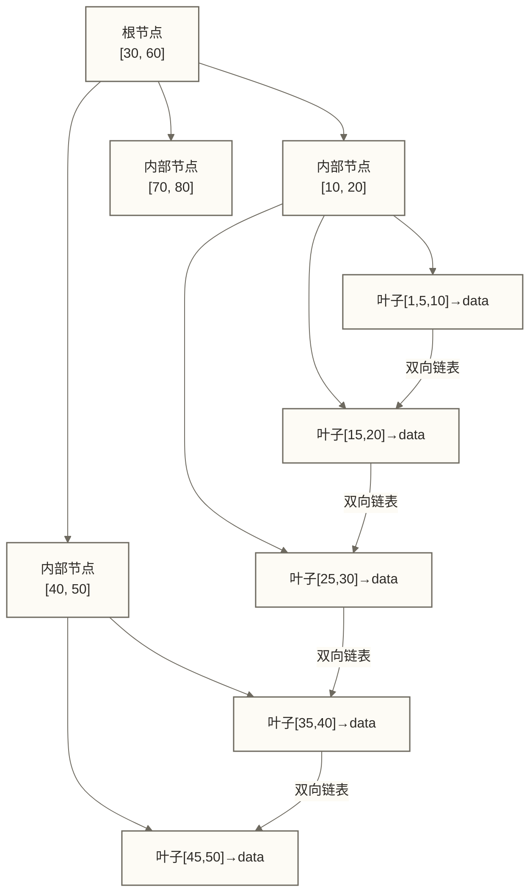

# MySQL索引优化进阶实战 - 从原理到生产落地

> [!abstract] 学习目标
> - 深刻理解B+Tree索引结构及MySQL选择它的底层原因
> - 掌握聚簇索引与非聚簇索引的存储差异及回表代价
> - 熟练运用联合索引最左前缀规则与覆盖索引消除回表
> - 识别并修复12种索引失效场景
> - 读懂EXPLAIN执行计划的每一列含义，准确定位查询瓶颈

> [!quote] 核心洞察
> 索引是MySQL性能优化的核心战场。可将“90%的慢查询问题源于索引设计不合理”作为待检验的排查假设，而非已证实的通用比例；实际慢查询也可能涉及SQL写法、锁等待、数据分布及资源瓶颈。理解索引的物理存储结构有助于提出优化假设，但仍需结合数据分布、执行计划和实际测量判断。

## B+Tree：MySQL的核心数据结构

### 为什么不选B-Tree

B-Tree（多路平衡查找树）的每个节点都存储data数据，导致每个磁盘页能存储的键值更少，树高更大，磁盘I/O次数增多。

B+Tree的核心改进：
- **内部节点只存键值不存data**：每个磁盘页（默认16KB）能容纳更多键值，树高受键宽、行宽、页大小和页填充率影响；三层树的查找涉及约三个树层级，但不保证发生三次物理I/O
- **叶子节点形成有序双向链表**：范围查询直接遍历链表，避免回溯
- **所有data只在叶子节点**：查询路径长度稳定，性能可预测

为什么不选哈希索引？哈希索引只支持等值查询，不支持范围查询、排序和模糊匹配，适用场景极窄。



> [!note] 树高与I/O次数的关系
> InnoDB每个页默认16KB，每个键值+指针约占14字节，单个内部节点可存约1000个键值。若内部节点扇出约为1000，三层树的记录容量还需乘以每个叶页能容纳的记录数，不能据此直接推出约10亿条记录；实际磁盘I/O还受缓存命中和回表等因素影响。这就是为什么大表查询主键依然快速的根本原因。

### 聚簇索引 vs 非聚簇索引

**聚簇索引（Clustered Index）**：索引的叶子节点直接存储完整行数据。InnoDB的主键索引就是聚簇索引。

**非聚簇索引（Secondary Index）**：叶子节点存储的是主键值，而非完整行数据。查询时需要先通过辅助索引找到主键，再回到主键索引找完整数据，这个过程叫**回表**。

```sql
-- 创建测试表
CREATE TABLE orders (
    order_id   BIGINT PRIMARY KEY,        -- 聚簇索引
    user_id    INT NOT NULL,
    amount     DECIMAL(10,2),
    status     TINYINT,
    created_at DATETIME,
    INDEX idx_user_id (user_id),          -- 辅助索引，叶子节点存order_id
    INDEX idx_user_status (user_id, status)
);

-- 以下查询会产生回表：辅助索引找到user_id=100的order_id，再去聚簇索引取amount
EXPLAIN SELECT order_id, amount FROM orders WHERE user_id = 100;

-- 以下查询不回表（覆盖索引）：idx_user_status叶子节点包含user_id+status+order_id
EXPLAIN SELECT order_id FROM orders WHERE user_id = 100 AND status = 1;
```

> [!warning] MyISAM的不同之处
> MyISAM使用非聚簇存储：.MYI文件存索引，.MYD文件存数据，主键索引和辅助索引结构相同，叶子节点都存数据文件指针（行指针），而非行数据本身。这使得MyISAM的辅助索引查询性能与主键查询相近，但代价是不支持事务和崩溃恢复能力弱。

## 联合索引的最左前缀规则

### 存储机制决定查询规则

联合索引 `(a, b, c)` 按照 a→b→c 的顺序排序存储。物理上：先按a排序，a相同则按b排序，a和b相同则按c排序。

这个存储机制决定了常规范围定位的最左前缀规则：**跳过前面的列，通常不能直接依靠后面的列定位连续索引区间**。这不排除覆盖扫描、索引条件过滤或满足适用条件时的跳跃扫描，具体访问方式由优化器按成本选择。

```sql
-- 创建联合索引
CREATE INDEX idx_abc ON t(a, b, c);

-- 能走索引的场景
SELECT * FROM t WHERE a = 1;                          -- 走 a
SELECT * FROM t WHERE a = 1 AND b = 2;                -- 走 a,b
SELECT * FROM t WHERE a = 1 AND b = 2 AND c = 3;      -- 走 a,b,c
SELECT * FROM t WHERE a = 1 AND b > 2;                -- a为等值条件，b为范围条件；本查询未包含c条件
SELECT * FROM t WHERE a BETWEEN 1 AND 3;              -- 走 a

-- 不能充分利用索引的场景
SELECT * FROM t WHERE b = 2;                          -- 跳过a，索引失效
SELECT * FROM t WHERE b = 2 AND c = 3;                -- 跳过a，索引失效
SELECT * FROM t WHERE a = 1 AND c = 3;                -- a可用于常规范围定位；c通常不能继续缩小该区间，但可能用于ICP过滤
```

### 覆盖索引消除回表

当查询所需的所有列都包含在索引中时，无需回表，这就是覆盖索引。`EXPLAIN`中`Extra`列显示`Using index`即表示命中覆盖索引。

```sql
-- 高频查询：按user_id查询订单列表（只需展示order_id和status）
-- 低效方案：idx_user_id只有user_id，每行都需回表取status
SELECT order_id, status FROM orders WHERE user_id = 100 ORDER BY created_at DESC LIMIT 10;

-- 优化：创建覆盖索引，包含查询所需全部字段
-- 注意：将等值查询列放前面，范围/排序列放后面
CREATE INDEX idx_cover ON orders (user_id, status, created_at, order_id);
-- 此时Extra列变为Using index，消除回表
```

> [!tip] 索引下推（ICP，Index Condition Pushdown）
> MySQL 5.6引入ICP优化：在联合索引扫描时，直接在存储引擎层过滤不满足条件的记录，减少回表次数。`EXPLAIN`中`Extra`显示`Using index condition`表示ICP生效。

## 索引失效的12种场景

```sql
-- 准备测试表
CREATE TABLE user_info (
    id         BIGINT PRIMARY KEY AUTO_INCREMENT,
    name       VARCHAR(50),
    age        INT,
    email      VARCHAR(100),
    phone      VARCHAR(20),
    city       VARCHAR(50),
    created_at DATETIME,
    INDEX idx_name (name),
    INDEX idx_age_city (age, city),
    INDEX idx_email (email),
    INDEX idx_phone (phone),
    INDEX idx_created (created_at)
);
```

### 场景1：隐式类型转换

```sql
-- phone字段是VARCHAR，传入数字会触发类型转换，索引失效
-- 失效：MySQL将phone列转为数字进行比较，等价于 CAST(phone AS SIGNED) = 13800138000
SELECT * FROM user_info WHERE phone = 13800138000;

-- 正确：保持类型一致
SELECT * FROM user_info WHERE phone = '13800138000';
```

### 场景2：对索引列使用函数

```sql
-- 失效：对索引列使用函数，破坏了索引的有序性
SELECT * FROM user_info WHERE YEAR(created_at) = 2024;
SELECT * FROM user_info WHERE LEFT(name, 3) = '张三';

-- 正确：改写为范围查询
SELECT * FROM user_info WHERE created_at >= '2024-01-01' AND created_at < '2025-01-01';
```

### 场景3：对索引列进行运算

```sql
-- 失效：对索引列做算术运算
SELECT * FROM user_info WHERE age + 1 = 26;
SELECT * FROM user_info WHERE id * 2 = 100;

-- 正确：将运算移到常量侧
SELECT * FROM user_info WHERE age = 25;
SELECT * FROM user_info WHERE id = 50;
```

### 场景4：LIKE前缀通配符

```sql
-- 失效：前缀模糊匹配，无法利用索引有序性
SELECT * FROM user_info WHERE name LIKE '%张三';
SELECT * FROM user_info WHERE name LIKE '%张%';

-- 可走索引：后缀模糊匹配
SELECT * FROM user_info WHERE name LIKE '张三%';

-- 全模糊需求的替代方案：考虑全文索引或ElasticSearch
```

### 场景5：OR条件的索引选择与等价改写

```sql
-- 本例name有索引，age也是idx_age_city的最左列，并非OR连接非索引列；优化器可能选择index merge或其他访问方式
SELECT * FROM user_info WHERE name = '张三' OR age = 25;

-- 优化方案1：检查各OR分支是否有可用索引；是否采用index merge由优化器按成本决定
-- 优化方案2：改写为UNION ALL
SELECT * FROM user_info WHERE name = '张三'
UNION ALL
SELECT * FROM user_info WHERE age = 25 AND (name != '张三' OR name IS NULL);
```

### 场景6：NOT IN / NOT EXISTS

```sql
-- 高度谨慎：NOT IN在某些情况下无法走索引
SELECT * FROM user_info WHERE age NOT IN (20, 25, 30);

-- 优化：改写为范围查询（视业务语义而定）
SELECT * FROM user_info WHERE age < 20 OR (age > 20 AND age < 25) OR (age > 25 AND age < 30) OR age > 30;
```

### 场景7：<> 和 != 操作符

```sql
-- 通常无法走索引（数据量大时全表扫描更优）
SELECT * FROM user_info WHERE city != '北京';

-- 优化方向：考虑覆盖索引或重构查询逻辑
```

### 场景8：联合索引不满足最左前缀

```sql
-- 失效：跳过age，直接用city
SELECT * FROM user_info WHERE city = '北京';  -- idx_age_city失效
```

### 场景9：联合索引中间列为范围查询

```sql
-- age用于范围定位；city通常不能继续缩小该范围，但可能用于索引条件下推过滤
SELECT * FROM user_info WHERE age > 20 AND city = '北京';
-- 需结合EXPLAIN区分范围定位与索引层过滤
```

### 场景10：字符集不一致的关联

```sql
-- 关联时字符集不同（如utf8 vs utf8mb4）会导致隐式转换，索引失效
-- 解决：统一表和列的字符集为utf8mb4
```

### 场景11：IS NULL / IS NOT NULL

```sql
-- IS NULL可使用索引，并非MySQL 8.0才开始支持；IS NOT NULL是否采用索引取决于数据分布和成本
-- 不要仅为索引优化用哨兵值替代NULL，这会改变数据语义；先检查实际执行计划
```

### 场景12：索引选择性过低

```sql
-- status字段只有0/1两个值，选择性极低，MySQL优化器可能选择全表扫描
-- 通过EXPLAIN验证是否走了索引
EXPLAIN SELECT * FROM orders WHERE status = 0;
-- 若全表扫描，可接受（MySQL优化器判断全表扫描代价更低）
```

## EXPLAIN执行计划完整解读

```sql
EXPLAIN SELECT o.order_id, u.name
FROM orders o
JOIN user_info u ON o.user_id = u.id
WHERE o.status = 1
  AND u.city = '北京'
ORDER BY o.created_at DESC
LIMIT 10;
```

### 关键列详解

| 列名 | 含义 | 关注点 |
|------|------|--------|
| `id` | 查询序号，相同id同级执行 | id越大越先执行 |
| `select_type` | 查询类型 | SIMPLE/PRIMARY/SUBQUERY/DERIVED |
| `table` | 当前行处理的表 | derived表示子查询派生 |
| `type` | 访问类型（重要） | 性能从高到低见下表 |
| `possible_keys` | 可能使用的索引 | 仅供参考 |
| `key` | 实际使用的索引 | NULL表示未选择索引，是否全表扫描需结合type判断 |
| `key_len` | 使用的索引长度（字节） | 可判断联合索引使用了几列 |
| `ref` | 与索引比较的列或常量 | const表示常量比较 |
| `rows` | 预估扫描行数 | 越小越好 |
| `filtered` | 按条件过滤后的行比例 | 100表示无额外过滤 |
| `Extra` | 附加信息（重要） | 见下表 |

**type列的常见访问类型（按通常的定位精确程度排列，并非实际耗时的固定排序）：**

| type值 | 含义 | 场景 |
|--------|------|------|
| `system` | 只有一行，系统表 | 极少见 |
| `const` | 主键或唯一索引等值查询 | WHERE id = 1 |
| `eq_ref` | 关联查询中主键等值匹配 | JOIN ON 主键 |
| `ref` | 非唯一索引等值查询 | WHERE idx_col = val |
| `range` | 索引范围扫描 | WHERE id BETWEEN 1 AND 100 |
| `index` | 全索引扫描，不保证比ALL更快 | 可见于覆盖索引扫描，需结合扫描量和回表代价判断 |
| `ALL` | 全表扫描 | 可能无合适索引，也可能因成本估算而未选择已有索引 |

> [!warning] 出现ALL或index时需结合查询目标评估
> `type = ALL`表示全表扫描，`type = index`表示全索引扫描；对于返回大量数据、低选择性过滤或覆盖索引扫描，它们可能是合理计划，是否优化应结合实际耗时和资源消耗判断。

**Extra列的关键含义：**

| Extra值 | 含义 | 处理建议 |
|---------|------|---------|
| `Using index` | 覆盖索引，无回表 | 最优状态 |
| `Using where` | 在存储引擎层之上过滤 | 检查WHERE条件是否命中索引 |
| `Using index condition` | 索引下推（ICP） | 较好 |
| `Using filesort` | 需要额外排序 | 考虑为ORDER BY列建索引 |
| `Using temporary` | 使用临时表 | 通常出现在GROUP BY、ORDER BY，需优化 |
| `Using join buffer` | 关联查询使用了连接缓冲 | 检查关联条件是否建立索引 |

```sql
-- 分析key_len计算联合索引使用情况
-- 对于 idx_age_city(age INT, city VARCHAR(50))
-- age INT = 4字节（允许NULL则+1 = 5字节）
-- city VARCHAR(50) utf8mb4允许NULL：50*4+2+1 = 203字节
-- 若key_len = 5，说明用于访问的键长度对应age列
-- 若key_len = 208，说明用于访问的键长度对应age+city两列
```

## 索引选择性与基数分析

```sql
-- 查看索引基数（Cardinality）：不同值的估计数量
-- 基数越高，索引选择性越好
SHOW INDEX FROM orders;

-- 精确计算选择性（0~1，越接近1越好）
SELECT
    COUNT(DISTINCT user_id) / COUNT(*) AS user_id_selectivity,
    COUNT(DISTINCT status)  / COUNT(*) AS status_selectivity
FROM orders;

-- 对于低选择性字段（如status只有0/1/2），单列索引意义不大
-- 可以将其放在联合索引的后面，与高选择性字段组合使用
-- orders建表时已定义idx_user_status(user_id, status)，无需重复创建
```

## 高并发场景的索引设计原则

### 原则1：索引数量控制

每个表的索引数量建议不超过5个。索引是有代价的：每次INSERT/UPDATE/DELETE都需要维护索引树，索引越多，写性能损耗越大。

### 原则2：区分读写比例

- 读多写少（如商品目录）：可以多建索引，加速查询
- 写多读少（如日志表、流水表）：减少索引，优先写入性能

### 原则3：前缀索引节省空间

```sql
-- 对于长字符串列（如URL、email），使用前缀索引节省空间
-- 计算合适的前缀长度：找到接近完整选择性的最短前缀
SELECT
    COUNT(DISTINCT LEFT(email, 5))  / COUNT(*) AS sel_5,
    COUNT(DISTINCT LEFT(email, 10)) / COUNT(*) AS sel_10,
    COUNT(DISTINCT LEFT(email, 15)) / COUNT(*) AS sel_15,
    COUNT(DISTINCT email)           / COUNT(*) AS sel_full
FROM user_info;

-- 假设sel_10已接近sel_full，则使用10字符前缀
CREATE INDEX idx_email_prefix ON user_info (email(10));
-- 注意：前缀索引无法使用覆盖索引
```

### 原则4：利用索引优化排序

```sql
-- 若查询经常按 user_id 过滤后按 created_at 排序
-- 建立联合索引消除filesort
CREATE INDEX idx_user_created ON orders (user_id, created_at);

-- 验证：Extra不再出现Using filesort
EXPLAIN SELECT order_id FROM orders
WHERE user_id = 100
ORDER BY created_at DESC
LIMIT 20;
```

### 原则5：在线DDL与pt-online-schema-change

生产环境加索引前，应评估具体版本、存储引擎和DDL操作支持的并发能力。可按条件选择原生Online DDL或pt-online-schema-change；Online DDL并非MySQL 8.0才有，在线操作也仍可能等待元数据锁或短暂阻塞：

```sql
-- InnoDB在线加普通辅助索引示例：需确认当前版本和操作支持该算法及并发级别
-- LOCK=NONE允许主要执行阶段并发读写，但不消除元数据锁；重复执行前检查索引是否已存在
ALTER TABLE orders
ADD INDEX idx_created_at (created_at),
ALGORITHM=INPLACE,
LOCK=NONE;
```

## 常见误区与最佳实践

> [!tip] 实战经验总结
> **误区1**：查询慢就加索引——先用EXPLAIN分析，确认是索引问题再加
>
> **误区2**：索引越多越好——索引是双刃剑，过多索引损伤写性能
>
> **误区3**：联合索引一定要包含WHERE的所有列——先满足高频查询的覆盖索引需求，而非机械地把所有WHERE列都加进去
>
> **最佳实践**：先EXPLAIN，再分析type/key/rows/Extra，最后针对性优化，优化后再次EXPLAIN验证效果

## 关联知识

- [[【技术与工具】/MySQL/10-MySQL索引深度剖析]] - B+Tree基础与索引类型入门
- [[【技术与工具】/MySQL/11-查询执行计划]] - EXPLAIN执行计划详细解读
- [[【技术与工具】/MySQL/13-慢查询优化实战]] - 慢查询日志分析与SQL重写
- [[【技术与工具】/MySQL/14-MySQL事务与锁机制]] - 锁与索引的交互关系
- [[【技术与工具】/MySQL/18-MySQL性能调优实战]] - 系统级性能调优
- [[【技术与工具】/MySQL/12-性能监控与诊断]] - 生产环境性能监控
