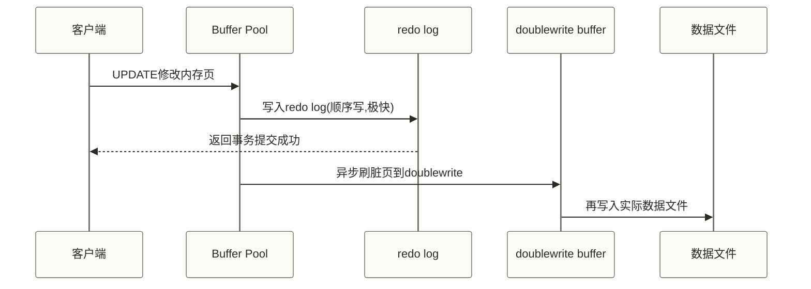
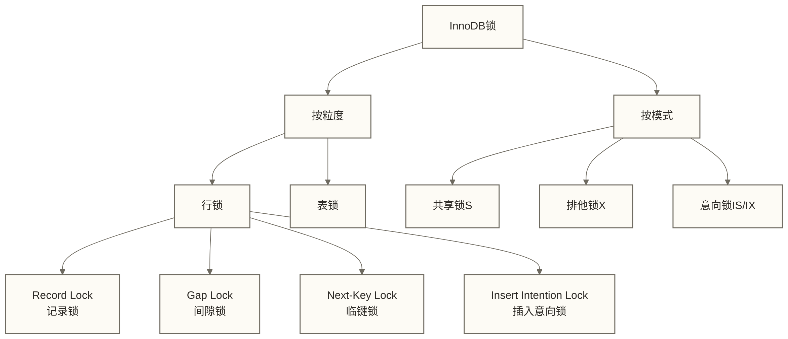

# MySQL事务与锁机制深度解析 - MVCC到死锁全解

> [!abstract] 学习目标
> - 理解ACID四大特性的底层实现机制（redo log/undo log/MVCC）
> - 掌握InnoDB四种隔离级别与幻读的本质区别
> - 深入理解行锁/间隙锁/临键锁的加锁规则
> - 掌握死锁的产生条件、检测机制与预防策略
> - 建立乐观锁/悲观锁在真实业务场景中的选型判断力

> [!quote] 核心洞察
> 事务和锁是同一枚硬币的两面。事务保证数据的正确性，锁保证并发访问的有序性。深入理解MVCC（多版本并发控制），你会发现MySQL在"隔离性"和"并发性"之间找到的精妙平衡——让读操作尽可能不加锁，大幅提升系统吞吐量。

## ACID底层实现机制

### 原子性（Atomicity）—— undo log

undo log（回滚日志）记录了每个数据修改的逆操作。当事务失败或执行ROLLBACK时，MySQL根据undo log将数据恢复到事务开始前的状态。

- INSERT操作对应的undo log是 DELETE
- DELETE操作对应的undo log是 INSERT
- UPDATE操作对应的undo log是反向UPDATE（记录旧值）

### 持久性（Durability）—— redo log

redo log（重做日志）是WAL（Write-Ahead Logging）机制的实现。数据修改先写入redo log（顺序写磁盘，极快），再异步写入数据文件（随机写，较慢）。即使数据库崩溃，重启后也能通过redo log将已提交事务的修改重新应用到数据文件。



> [!note] redo log与binlog的区别
> - **redo log**：InnoDB存储引擎层，物理日志（记录页的修改），循环写，用于崩溃恢复
> - **binlog**：MySQL Server层，逻辑日志（记录SQL或行变更），追加写，用于主从复制和数据归档

### 隔离性（Isolation）—— MVCC

MVCC（Multi-Version Concurrency Control，多版本并发控制）是InnoDB实现隔离性的核心机制，也是MySQL读性能高的根本原因。

**MVCC的核心组件：**

1. **隐藏字段**：每行数据有两个隐藏列
   - `DB_TRX_ID`：最后修改该行的事务ID
   - `DB_ROLL_PTR`：指向undo log链表的指针（版本链）

2. **版本链**：UPDATE修改当前记录，并在undo log中保存恢复旧版本所需的信息；通过DB_ROLL_PTR追溯undo记录，可以重建历史版本。

3. **Read View（读视图）**：事务在某一时刻创建的"快照"，包含：
   - `m_ids`：创建Read View时活跃（未提交）的事务ID列表
   - `min_trx_id`：m_ids中的最小值
   - `max_trx_id`：创建时下一个待分配的事务ID
   - `creator_trx_id`：创建该Read View的事务ID

**可见性判断规则：**

```text
对于版本链中某个版本的 trx_id，先判断是否等于creator_trx_id：当前事务自身的修改可见；其他事务的版本再按以下规则判断：
1. trx_id < min_trx_id      → 该版本在Read View创建前已提交 → 可见
2. trx_id >= max_trx_id     → 该版本在Read View创建后才开启 → 不可见
3. min_trx_id <= trx_id < max_trx_id:
   - trx_id 在 m_ids中       → 活跃事务，未提交               → 不可见
   - trx_id 不在 m_ids中     → 已提交                         → 可见
```

> [!note] Read View的创建时机决定了隔离级别
> - **RC（读已提交）**：每次一致性非锁定读创建新的Read View，读取该读视图创建时可见的已提交版本。
> - **RR（可重复读）**：通常在事务第一次一致性非锁定读时创建Read View，后续一致性读复用；WITH CONSISTENT SNAPSHOT可提前建立快照。锁定读不使用这一快照规则，事务自身修改也会影响查询结果。

## 四种隔离级别与并发问题

```sql
-- 查看当前隔离级别
SELECT @@transaction_isolation;

-- 设置隔离级别（会话级）
SET SESSION TRANSACTION ISOLATION LEVEL REPEATABLE READ;
```

| 隔离级别 | 脏读 | 不可重复读 | 幻读 | 性能与锁开销 |
|---------|------|-----------|------|------|
| READ UNCOMMITTED | 存在 | 存在 | 存在 | 不保证性能最高，取决于工作负载 |
| READ COMMITTED | 解决 | 存在 | 存在 | 通常减少搜索与索引扫描中的间隙锁，性能取决于工作负载 |
| REPEATABLE READ | 解决 | 解决 | 部分解决 | InnoDB默认级别；性能取决于快照读、锁定读及冲突情况 |
| SERIALIZABLE | 解决 | 解决 | 解决 | 可能增加读写阻塞，不构成固定性能排序 |

上述隔离级别没有通用的吞吐量高低排序，应结合读写比例、冲突率和事务长度评估。

### 幻读：RR级别下的细节

**幻读的定义**：同一事务内，前后两次相同范围查询，返回的行数不同（有新行出现）。

InnoDB在RR级别下通过**临键锁（Next-Key Lock）**解决了**当前读**的幻读问题，但**快照读**（普通SELECT）依靠MVCC本身已经解决。

```sql
-- 快照读（MVCC解决幻读）
BEGIN;
SELECT * FROM orders WHERE amount > 1000;  -- 快照读，不加锁
-- 此时其他事务INSERT amount=2000的新行并提交
SELECT * FROM orders WHERE amount > 1000;  -- 仍然看不到新行（RR级别MVCC保证）
COMMIT;

-- 当前读（需要临键锁解决幻读）
BEGIN;
SELECT * FROM orders WHERE amount > 1000 FOR UPDATE;  -- 当前读，加临键锁
-- 其他事务尝试INSERT amount=2000的行 → 被阻塞，无法插入
COMMIT;
```

## 锁机制深度解析

### 锁的分类体系



### 行锁加锁规则（RR级别）

> [!warning] 加锁分析的基础前提
> 以下规则基于InnoDB RR隔离级别、存在普通索引的场景。加锁规则复杂，建议始终通过`EXPLAIN`和`SHOW ENGINE INNODB STATUS`验证。

**规则1：等值查询——唯一索引**
```sql
-- 完整唯一键等值查询且命中已有记录时，可退化为Record Lock
-- 未命中记录或未使用完整唯一键时，不能直接套用此结论
SELECT * FROM orders WHERE order_id = 100 FOR UPDATE;
-- 加锁：order_id=100这一行的Record Lock
```

**规则2：等值查询——普通索引**
```sql
-- 加临键锁，并对相邻间隙加Gap Lock
SELECT * FROM orders WHERE user_id = 5 FOR UPDATE;
-- 假设user_id索引中有：1, 3, 5, 8, 12
-- 加锁：(3,5]的Next-Key Lock + (5,8)的Gap Lock
```

**规则3：范围查询——唯一索引**
```sql
SELECT * FROM orders WHERE order_id >= 10 AND order_id <= 15 FOR UPDATE;
-- 假设索引中有：8, 10, 13, 15, 20
-- 需结合唯一索引的实际扫描路径与范围边界优化分析锁范围
-- 下界命中记录及上界外记录的锁类型可能受优化影响
-- 不能直接断言上述四个区间均加Next-Key Lock
```

**规则4：无索引**
```sql
-- 在RR下若执行计划走全表扫描，可能锁住大量扫描索引记录及相关间隙
-- 阻塞范围可能覆盖全表，但这不等于取得表级锁
SELECT * FROM orders WHERE remark = 'test' FOR UPDATE;
-- 极其危险！生产环境必须避免
```

### 间隙锁（Gap Lock）的意义

间隙锁锁定的是**索引记录之间的空隙**，防止其他事务在间隙中插入新记录，从而防止当前读的幻读。

```sql
-- 事务A
BEGIN;
SELECT * FROM t WHERE id BETWEEN 5 AND 15 FOR UPDATE;
-- 锁范围由实际索引及相邻记录决定，不一定恰好是(5,15)

-- 事务B（在事务A未提交时）
INSERT INTO t (id) VALUES (10);  -- 在所示RR锁定读场景下可能等待事务A释放锁；具体涉及间隙锁还是已有记录上的锁，取决于索引及记录分布
INSERT INTO t (id) VALUES (20);  -- 是否被阻塞取决于实际锁区间，不能仅凭查询上界15判断
```

> [!tip] 间隙锁的副作用
> 间隙锁在高并发INSERT场景下会显著降低并发度，甚至导致死锁。如果业务不需要防止幻读，可以将隔离级别降到RC（READ COMMITTED），RC级别通常不对搜索和索引扫描使用间隙锁，但外键约束检查及重复键检查仍可能使用间隙锁。

### 临键锁（Next-Key Lock）

临键锁 = Record Lock + Gap Lock，锁定一条记录及其前面的间隙。是InnoDB的默认行锁类型。

例如索引记录为 1, 4, 7, 10，临键锁的范围为：
`(-∞,1]` `(1,4]` `(4,7]` `(7,10]` `(10,+∞)`

## 死锁：产生、检测与预防

### 死锁的产生条件

死锁必须同时满足四个条件：互斥、不可剥夺、请求与保持、循环等待。

```sql
-- 经典死锁场景
-- 事务A执行：
BEGIN;
UPDATE accounts SET balance = balance - 100 WHERE id = 1;  -- 锁定id=1
UPDATE accounts SET balance = balance + 100 WHERE id = 2;  -- 等待id=2

-- 同时事务B执行：
BEGIN;
UPDATE accounts SET balance = balance - 50 WHERE id = 2;   -- 锁定id=2
UPDATE accounts SET balance = balance + 50 WHERE id = 1;   -- 等待id=1
-- 循环等待 → 死锁
```

### 死锁检测机制

InnoDB有内置的死锁检测器（wait-for graph），当检测到死锁时，会选择代价最小的事务（通常是修改行数最少的事务）作为死锁牺牲方，回滚该事务并返回错误`ERROR 1213 (40001): Deadlock found`。

```sql
-- 查看最近一次死锁信息
SHOW ENGINE INNODB STATUS\G
-- 关注 LATEST DETECTED DEADLOCK 部分

-- 查看死锁相关统计
SELECT * FROM information_schema.INNODB_METRICS
WHERE NAME LIKE '%deadlock%';
```

### 预防死锁的策略

**策略1：固定访问顺序**

```sql
-- 错误：不同事务用不同顺序访问资源
-- 事务A：先锁user_id=1，再锁user_id=2
-- 事务B：先锁user_id=2，再锁user_id=1

-- 正确：所有事务按照相同顺序（如按user_id升序）访问资源
-- 应用层面排序后再操作：ORDER BY id ASC
```

**策略2：缩小事务范围，减少锁持有时间**

```sql
-- 错误：事务内有耗时操作（如调用外部API）
BEGIN;
UPDATE stock SET quantity = quantity - 1 WHERE product_id = 100;
CALL external_api();  -- 耗时10秒，期间持有锁！
COMMIT;

-- 正确：先完成外部调用，再开事务
CALL external_api();  -- 先调用，不持锁
BEGIN;
UPDATE stock SET quantity = quantity - 1 WHERE product_id = 100;
COMMIT;
```

**策略3：使用低隔离级别**

RC级别通常减少搜索和索引扫描中的间隙锁，但外键约束检查及重复键检查仍可能使用间隙锁；是否降低锁冲突取决于工作负载，选用前需确认业务能接受其一致性语义。

**策略4：合理使用乐观锁**

高并发但冲突概率低的场景，乐观锁优于悲观锁。

## 乐观锁 vs 悲观锁的选型

### 悲观锁（Pessimistic Lock）

```sql
-- 假设冲突必然发生，先加锁再操作
BEGIN;
SELECT * FROM stock WHERE product_id = 100 FOR UPDATE;  -- 加排他锁
-- 业务逻辑检查库存
UPDATE stock SET quantity = quantity - 1 WHERE product_id = 100;
COMMIT;
```

适用场景：
- 写操作频繁，冲突概率高
- 一致性要求极高（如金融扣款）
- 操作短平快（锁持有时间短）

### 乐观锁（Optimistic Lock）

```sql
-- 假设冲突很少发生，提交时验证
-- 方案1：版本号（version字段）
BEGIN;
SELECT id, quantity, version FROM stock WHERE product_id = 100;
-- 假设查到 quantity=100, version=5

-- 提交时检查version是否变化
UPDATE stock
SET quantity = quantity - 1, version = version + 1
WHERE product_id = 100 AND version = 5;
-- 若 affected_rows = 0，说明已被其他事务修改，需要重试
COMMIT;

-- 方案2：时间戳（仅作条件更新示例）
-- 必须确保每次修改都改变版本标记；NOW()及字段时间精度可能导致标记重复
-- 需要可靠冲突检测时，优先使用单调递增的version字段
UPDATE stock
SET quantity = quantity - 1, updated_at = NOW()
WHERE product_id = 100 AND updated_at = '2024-01-01 12:00:00';
```

适用场景：
- 读多写少，冲突概率低
- 重试代价低（如库存预扣）
- 高并发场景，不希望数据库层面大量加锁

| 对比维度 | 悲观锁 | 乐观锁 |
|---------|--------|--------|
| 实现方式 | SELECT...FOR UPDATE | version字段/CAS |
| 冲突处理 | 等待 | 重试 |
| 适用冲突率 | 高冲突 | 低冲突 |
| 吞吐量 | 受锁等待与事务长度影响 | 低冲突时可能较高；UPDATE仍需写锁，高冲突时重试成本可能较高 |
| 复杂度 | 低 | 中（需处理重试） |

## 长事务的危害与监控

### 长事务的三大危害

1. **锁持有时间长**：阻塞其他事务，降低并发度
2. **undo log无法释放**：MVCC需要保留所有活跃事务期间的版本链，长事务导致undo log膨胀，磁盘空间持续增长
3. **主从延迟加剧**：大事务的binlog需要等待全部执行完才能传输，导致主从延迟

### 监控长事务

```sql
-- 查找执行超过60秒的活跃事务
SELECT
    trx_id,
    trx_state,
    trx_started,
    TIMESTAMPDIFF(SECOND, trx_started, NOW()) AS duration_seconds,
    trx_mysql_thread_id,
    trx_query
FROM information_schema.INNODB_TRX
WHERE TIMESTAMPDIFF(SECOND, trx_started, NOW()) > 60
ORDER BY duration_seconds DESC;

-- 查看当前锁等待情况（MySQL 8.0）
SELECT
    r.trx_id              AS waiting_trx_id,
    r.trx_mysql_thread_id AS waiting_thread,
    r.trx_query           AS waiting_query,
    b.trx_id              AS blocking_trx_id,
    b.trx_mysql_thread_id AS blocking_thread,
    b.trx_query           AS blocking_query
FROM performance_schema.data_lock_waits w
JOIN information_schema.INNODB_TRX r ON r.trx_id = w.REQUESTING_ENGINE_TRANSACTION_ID
JOIN information_schema.INNODB_TRX b ON b.trx_id = w.BLOCKING_ENGINE_TRANSACTION_ID
WHERE w.ENGINE = 'INNODB';
```

### 规避长事务的实践

```sql
-- 示例：设置锁等待超时与连接空闲超时，并非事务总时长上限
SET SESSION innodb_lock_wait_timeout = 5;  -- 等待InnoDB行锁超时5秒；默认仅回滚超时语句
SET SESSION wait_timeout = 28800;           -- 非交互连接空闲超时，不限制正在执行的事务时长
-- 如需放弃整个事务，应用应在捕获超时错误后显式ROLLBACK

-- 大批量数据操作分批执行；以下过程没有显式COMMIT
-- 仅在autocommit=1且没有外层显式事务时，各次DELETE才会独立提交
-- 若在显式事务中调用，仍可能形成单个大事务
DELIMITER $$
CREATE PROCEDURE batch_delete_old_logs()
BEGIN
    DECLARE done INT DEFAULT 0;
    REPEAT
        DELETE FROM access_log
        WHERE created_at < DATE_SUB(NOW(), INTERVAL 90 DAY)
        LIMIT 1000;
        SET done = ROW_COUNT();
        DO SLEEP(0.1);  -- 给其他事务让出时间
    UNTIL done = 0 END REPEAT;
END$$
DELIMITER ;
```

## 高并发下的锁优化策略

### 策略1：减小锁粒度

```sql
-- 全表update → 精确行锁
-- 低效：锁定大范围行
UPDATE inventory SET last_check = NOW() WHERE category = '电子产品';

-- 单商品任务：在product_id具有合适索引时缩小扫描与锁定范围
-- 此语句只更新一个商品，不是上方整类商品更新的等价优化
UPDATE inventory SET last_check = NOW() WHERE product_id = 12345;
```

### 策略2：热点行拆分

```sql
-- 高并发场景下的计数器/库存扣减，热点行成为瓶颈
-- 方案：将一行拆为N行，分散写压力
CREATE TABLE stock_shards (
    product_id INT NOT NULL,
    shard_id   TINYINT NOT NULL,  -- 0~9，10个分片
    quantity   INT NOT NULL,
    PRIMARY KEY (product_id, shard_id)
);

-- 先生成一次随机分片号，再按完整主键扣减
SET @selected_shard_id = FLOOR(RAND() * 10);
UPDATE stock_shards
SET quantity = quantity - 1
WHERE product_id = 100 AND shard_id = @selected_shard_id AND quantity > 0;
-- affected_rows=0只表示所选分片未成功扣减，不代表商品总库存耗尽

-- 查询总库存时合并
SELECT SUM(quantity) FROM stock_shards WHERE product_id = 100;
```

### 策略3：合理使用Semi-consistent Read

在RC隔离级别下，InnoDB的Semi-consistent Read可以让UPDATE语句读取已提交的最新版本来判断是否需要加锁，减少不必要的锁等待（不适用于RR级别）。

## 关联知识

- [[【技术与工具】/MySQL/14-MySQL事务与锁机制]] - ACID基础与事务入门
- [[【技术与工具】/MySQL/06-InnoDB存储引擎]] - InnoDB存储结构与undo/redo log详解
- [[【技术与工具】/MySQL/15-索引优化进阶实战]] - 索引对锁范围的影响
- [[【技术与工具】/MySQL/18-MySQL性能调优实战]] - 锁监控与优化工具
- [[【技术与工具】/MySQL/20-MySQL面试题深度解析]] - 事务锁机制的高频面试题
