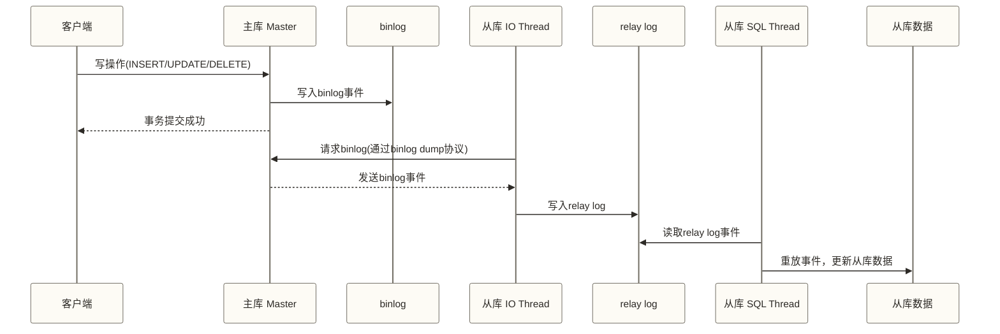
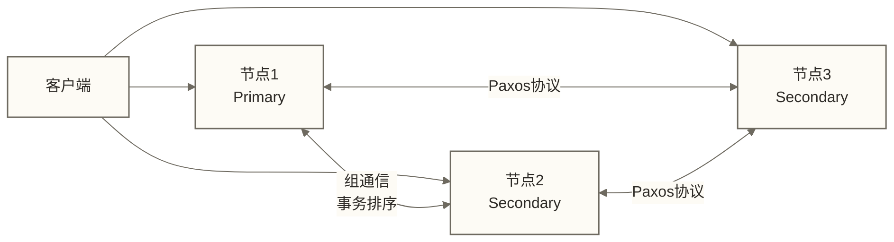
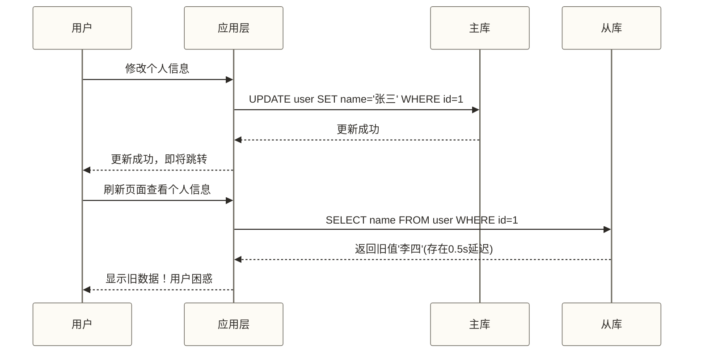

# MySQL主从复制与高可用架构 - 从binlog到MGR

> [!abstract] 学习目标
> - 理解binlog三种格式的差异及生产环境的选型策略
> - 掌握主从复制的完整流程与核心线程职责
> - 学会诊断和解决主从延迟问题
> - 理解MGR（MySQL Group Replication）的工作原理与适用场景
> - 了解MHA/Orchestrator的主从切换机制及互联网公司的高可用架构演进

> [!quote] 核心洞察
> MySQL的高可用本质是在"数据一致性"和"服务可用性"之间做权衡。传统异步主从复制中，从库可能落后于主库；若主库故障后未传出的事务无法恢复，提升落后的从库可能造成数据丢失。风险取决于复制模式、持久化配置、故障类型和切换策略，不能据此推断所有高可用方案都有相同的数据丢失边界。理解这个基本矛盾，你才能做出正确的架构决策。

## binlog：主从复制的基石

### 三种binlog格式对比

**Statement格式（SBR）**

记录原始SQL语句，体积小，但存在不确定性风险。

```sql
-- binlog中记录的是：
UPDATE orders SET updated_at = NOW() WHERE user_id = 100;
-- NOW()并不是此处合适的不一致示例：语句复制会通过事件时间戳处理其执行时间语义。
-- UUID()、USER()等函数可能使语句复制不安全；RAND()等函数需结合语句形式和复制机制判断，不能统一归因于主从执行时间不同。
```

**Row格式（RBR）**

记录行级变更事件；镜像内容取决于事件类型和binlog_row_image。通常比语句日志更大，可避免语句重放中部分非确定性风险，但不构成复制配置、应用进度或故障恢复正确性的绝对保证。

```text
-- binlog中记录的是（伪代码）：
Table: orders, Row_id: 12345
  Before: {updated_at: '2024-01-01 10:00:00', status: 0}
  After:  {updated_at: '2024-01-01 10:00:05', status: 1}
```

**Mixed格式（混合模式）**

默认使用Statement，遇到非确定性语句自动切换为Row格式。

**生产环境选型建议：**

| 格式 | binlog体积 | 数据一致性 | CDC友好度 | 推荐场景 |
|------|-----------|-----------|---------|---------|
| Statement | 小 | 有风险 | 差 | 不推荐（历史遗留） |
| Row | 通常较大，取决于变更行数及镜像配置 | 避免部分语句重放非确定性风险，不保证复制整体正确性 | 通常较好，需确认镜像配置与工具支持 | 推荐（多数行级CDC场景） |
| Mixed | 中等 | 较好 | 中等 | 不推荐（行为复杂难预测） |

> [!note] 为什么Row格式是CDC工具的首选
> Canal、Debezium等CDC工具依赖binlog实现数据变更捕获。Row格式的binlog包含行级变更信息，CDC工具可据此构建INSERT/UPDATE/DELETE事件，无需在应用层重放SQL；是否能获得完整行及更新前后值，取决于事件类型、binlog_row_image配置和工具支持。Statement格式需要重放SQL，存在一致性问题。

### binlog_row_image参数

Row格式下可进一步控制记录的镜像范围：

```sql
-- FULL（默认）：对事件所需的行镜像记录所有列；INSERT记录后镜像，DELETE记录前镜像，UPDATE记录前后镜像
-- MINIMAL：前镜像记录定位行所需的列，后镜像记录语句指定或实际变化的列，具体依事件类型而定（可节省空间，但需确认CDC工具兼容性）
-- NOBLOB：不记录BLOB/TEXT列（如无变化）

SET GLOBAL binlog_row_image = 'FULL';  -- 推荐，CDC兼容性最好
```

## 主从复制完整流程



### 三个核心线程

| 线程 | 位置 | 职责 |
|------|------|------|
| `Binlog Dump Thread` | 主库 | 响应从库IO Thread请求，发送binlog事件 |
| `IO Thread` | 从库 | 连接主库，接收binlog并写入relay log |
| `SQL Thread` | 从库 | 读取relay log，重放事件到从库数据 |

```sql
-- 查看主库的复制状态
SHOW MASTER STATUS\G
-- 查看从库复制状态（最重要的诊断命令）
SHOW SLAVE STATUS\G
-- 关注：
-- Slave_IO_Running: Yes  （IO线程正常）
-- Slave_SQL_Running: Yes （SQL线程正常）
-- Seconds_Behind_Master: 0  （复制延迟，秒）
-- Last_IO_Error / Last_SQL_Error  （错误信息）
```

## 主从延迟：成因与监控

### 延迟的根本原因

主库是**多线程并发写入**，从库传统上是**单线程串行重放**（SQL Thread只有一个）。主库每秒可以处理数百个事务，从库单线程回放可能只有每秒几十个，差距逐渐积累。

### 导致延迟加剧的具体场景

1. **大事务**：主库一个批量DELETE执行10分钟，从库SQL Thread必须串行重放10分钟
2. **DDL操作**：ALTER TABLE锁表，从库重放DDL期间复制停滞
3. **长查询阻塞SQL Thread**：从库上的大查询持有锁，阻塞SQL Thread重放
4. **网络抖动**：IO Thread与主库的网络连接不稳定
5. **从库磁盘性能差**：relay log写入成为瓶颈

### 并行复制：解决延迟的关键

MySQL 5.7引入的增强并行复制（MTS，Multi-Threaded Slave）：

```sql
-- 从库配置并行复制（在从库的my.cnf中）
slave_parallel_type = LOGICAL_CLOCK    -- 基于逻辑时钟的并行度（5.7+推荐）
slave_parallel_workers = 8             -- 并行SQL线程数，建议等于CPU核数
slave_preserve_commit_order = ON       -- 保证从库提交顺序与主库一致（防止数据不一致）
```

### 延迟监控

```sql
-- 方法1：SHOW SLAVE STATUS中的Seconds_Behind_Master
-- 局限：不够精确，网络分区时可能显示0

-- 方法2：pt-heartbeat（更精确）
-- 主库持续写入心跳记录，从库检测心跳延迟
pt-heartbeat --host=master --update --interval=0.5

-- 方法3：MySQL 8.0 Performance Schema
SELECT * FROM performance_schema.replication_applier_status_by_worker;
```

## MGR：MySQL Group Replication

### MGR的核心机制

MGR通过组通信及共识排序协调事务，并以写集认证检测冲突，支持单主或多主模式；各节点应用进度可能不同，读写可见性取决于一致性配置和访问节点。



**认证机制**：写事务通过组通信传播写集及复制事件，利用共识确定顺序，并通过认证检测冲突；各节点应用事务的进度可能不同。事务提交不等于所有节点已经应用完成，读写一致性还取决于一致性配置和访问节点。

### MGR两种模式

**单主模式（Single-Primary，推荐）**
- 只有Primary节点接受写入
- Secondary节点提供只读服务
- Primary故障时，自动从Secondary中选举新Primary（无需人工干预）

**多主模式（Multi-Primary）**
- 所有节点都可写入
- 存在事务冲突检测代价，不适合高并发写入
- 地理分布式部署需评估节点间网络延迟、写入冲突和故障隔离；多主模式本身并不消除这些限制

```sql
-- 查看MGR成员状态
SELECT * FROM performance_schema.replication_group_members;
-- MEMBER_STATE: ONLINE/RECOVERING/ERROR
-- MEMBER_ROLE: PRIMARY/SECONDARY

-- 手动切换Primary（单主模式）
SELECT group_replication_set_as_primary('节点UUID');
```

### MGR的局限性

- 网络延迟敏感：跨机房部署需评估节点间RTT、带宽、故障隔离和多数派可用性；本文不提供统一的5ms门槛，也未定义可消除这些限制的InnoDB Cluster增强方案
- 参与复制的表需满足Group Replication要求：使用InnoDB，并具有主键或等效的非空唯一键；具体限制应按目标版本确认
- 大事务影响整体性能：大事务的ROW格式binlog需要在所有节点广播，代价高

## 读写分离的数据一致性问题

### 经典的"写后读"问题



### 解决方案

**方案1：写后一段时间内强制读主库（时间窗口策略）**
该示例只保证路由标记有效期间读主库；两秒窗口结束不代表从库已经应用相关事务。需要持续保证写后读时，应结合事务位点或GTID等待，并处理超时与回退路由。
```python
# 框架层实现：标记刚写入的请求
# 写操作后的N秒内，同一用户的读操作路由到主库
def after_write(user_id, seconds=2):
    redis.setex(f"route_to_master:{user_id}", seconds, 1)

def route_read(user_id):
    if redis.exists(f"route_to_master:{user_id}"):
        return master_db
    return slave_db
```

**方案2：等待从库追上（适合批量场景）**
```sql
-- 等待从库应用到指定的binlog位点（最多等待5秒）
SELECT MASTER_POS_WAIT('mysql-bin.000001', 154, 5);
-- 返回值：非负整数表示成功等待，数值为等待期间应用的事件数（已到达位点时可为0）；-1表示超时；NULL可能表示复制线程未运行、参数无效或其他无法完成等待的情况。
```

**补充机制：semi-sync复制（半同步，不单独解决写后读）**
半同步确认表示从库已收到并记录相关日志，不表示已应用事务；读从库前仍需确认应用进度。下列片段仅展示旧命名下的主库侧配置，完整部署还需要从库侧配置及状态检查。
```sql
-- 主库配置：至少等1个从库确认收到binlog才返回成功
INSTALL PLUGIN rpl_semi_sync_master SONAME 'semisync_master.so';
SET GLOBAL rpl_semi_sync_master_enabled = 1;
SET GLOBAL rpl_semi_sync_master_timeout = 10000;  -- 10秒超时后降级为异步
```

## 高可用方案对比

### MHA（Master High Availability）

```text
架构：1个MHA Manager + N个MySQL节点
故障切换流程：
1. MHA Manager检测到主库心跳超时
2. 从所有从库中找到binlog最新的节点
3. 将最新从库的binlog差异同步到其他从库
4. 将最新从库提升为新主库
5. 其他从库指向新主库
6. VIP漂移到新主库

切换时间：若以30秒~3分钟作为演练中的假设目标，仍需结合故障检测、日志补齐和路由切换实测确认，不代表工具保证
数据丢失风险：主库宕机时未传输到任何从库的binlog丢失
适用：传统主从，对RTO要求不太严苛的场景
```

### Orchestrator

```text
特点：
- 分布式高可用管理工具（本身可以集群部署）
- 图形化Web界面
- 更智能的故障切换（基于拓扑感知）
- 支持多层主从拓扑
- 与ProxySQL深度集成，切换后自动更新路由

适用：中大规模MySQL集群，需要可视化管理
```

### InnoDB Cluster（官方方案）

```text
组成：
- MySQL Group Replication（数据层）
- MySQL Router（连接路由层；读写分离方式及是否支持自动识别路由取决于版本和配置）
- MySQL Shell（管理工具）

优势：
- 官方支持，组件深度集成
- 支持自动故障转移；若以30秒内作为演练中的假设目标，仍需按故障类型、检测配置及客户端重连行为实测确认，不构成时限保证
- 无需MHA Manager单点

适用：新建项目，希望使用官方全栈方案
```

## 互联网公司MySQL高可用架构演进

### 假设的中型电商架构演进示例
以下订单规模、16库×8表及90天热数据保留期均为示例设定，不代表已证实的企业经历或通用容量阈值；实际架构需结合事务负载、数据量、硬件和可用性目标选择。

**阶段1（初期，日订单<10万）**

```json
[应用服务器] → [MySQL单机]
特点：简单，无高可用
问题：单点故障，宕机就挂
```

**阶段2（成长期，日订单<100万）**

```json
[应用服务器] → [VIP/ProxySQL]
                    ↓         ↘
              [主库 Master]  [从库1 Slave] → 读操作
                    ↓
              [从库2 Slave] → 数据备份

特点：主从复制+读写分离，MHA做故障转移
问题：主库仍是单点，切换有数据丢失风险
```

**阶段3（高速增长期，日订单<1000万）**

```json
[应用服务器] → [ProxySQL集群]
                    ↓
         [InnoDB Cluster / MGR]
         Primary + 2×Secondary

         + 分库分表（ShardingSphere）
           按用户ID/订单ID分16库×8表

特点：无单点，自动故障转移，水平扩展
问题：分布式事务、跨分片查询复杂度增加
```

**阶段4（大规模，日订单>1000万）**

```json
[OLTP层] MySQL集群（只存最近90天热数据）
    ↓ Canal CDC
[消息队列] Kafka
    ↓
[OLAP层] 数据仓库（历史数据归档）

特点：OLTP/OLAP分离，MySQL只做最擅长的事
```

## 关联知识

- [[【技术与工具】/MySQL/06-InnoDB存储引擎]] - redo log/binlog的存储机制
- [[【技术与工具】/MySQL/18-MySQL性能调优实战]] - 主从架构下的参数调优
- [[【技术与工具】/MySQL/19-MySQL在数据工程中的角色]] - CDC方案与数据同步
- [[【技术与工具】/MySQL/20-MySQL面试题深度解析]] - 高可用相关面试题
- Apache Kafka - 主从复制结合Kafka的数据管道
