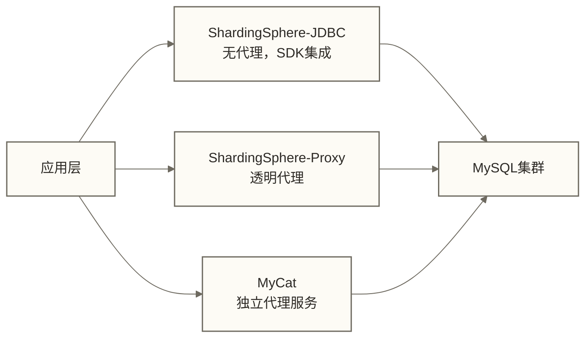

# MySQL性能调优实战 - 从工具到参数到分库分表

> [!abstract] 学习目标
> - 掌握MySQL性能分析工具链（slow query log/performance_schema/pt-query-digest）
> - 理解关键内存参数的调优原理和计算方法
> - 通过10条经典慢SQL案例掌握SQL优化思路
> - 建立分库分表的决策框架与方案选型能力
> - 了解MySQL 8.0的性能新特性

> [!quote] 核心洞察
> 性能调优不是玄学，而是一套方法论：先度量（找到瓶颈在哪里），再分析（为什么慢），最后优化（怎么改）。跳过度量直接优化是最大的反模式——你很可能在优化一个不是瓶颈的地方，而真正的问题被忽视。

## 性能分析工具链

### 工具1：慢查询日志

```sql
-- 开启慢查询日志（生产环境建议始终开启）
SET GLOBAL slow_query_log = ON;
SET GLOBAL slow_query_log_file = '/var/log/mysql/slow.log';
SET GLOBAL long_query_time = 1;       -- 超过1秒的查询记录
SET GLOBAL log_queries_not_using_indexes = ON;  -- 记录全表扫描查询

-- 查看当前配置
SHOW VARIABLES LIKE '%slow%';
SHOW VARIABLES LIKE 'long_query_time';
```

### 工具2：pt-query-digest（慢日志分析神器）

```bash
# 分析最近一小时的慢日志，输出Top 10慢查询
pt-query-digest \
  --since "1h ago" \
  --limit 10 \
  /var/log/mysql/slow.log

# 输出示例解读：
# Count: 1234        → 执行次数
# Exec time: 45s avg → 平均执行时间（这是最重要的指标）
# Rows sent: 1234    → 平均返回行数
# Rows examine: 2M   → 平均扫描行数（examine/sent比值越大，越需要优化索引）
```

### 工具3：performance_schema

```sql
-- 查看最慢的20条SQL（累计执行时间）
SELECT
    DIGEST_TEXT                                            AS sql_pattern,
    COUNT_STAR                                             AS exec_count,
    ROUND(SUM_TIMER_WAIT / 1e12, 2)                        AS total_latency_s,
    ROUND(AVG_TIMER_WAIT / 1e12, 4)                        AS avg_latency_s,
    ROUND(SUM_ROWS_EXAMINED / COUNT_STAR, 0)               AS avg_rows_examined,
    ROUND(SUM_ROWS_SENT / COUNT_STAR, 0)                   AS avg_rows_sent
FROM performance_schema.events_statements_summary_by_digest
ORDER BY SUM_TIMER_WAIT DESC
LIMIT 20;

-- 查看当前正在执行的查询（实时诊断）
SELECT
    id, user, host, db,
    command, time,
    state, info
FROM information_schema.PROCESSLIST
WHERE command != 'Sleep'
ORDER BY time DESC;

-- 查看锁等待（实时诊断）
SELECT * FROM performance_schema.data_lock_waits;
```

### 工具4：SHOW STATUS 关键指标

```sql
-- 查看关键性能指标
SHOW GLOBAL STATUS LIKE 'Innodb_buffer_pool%';  -- 缓冲池命中率
SHOW GLOBAL STATUS LIKE 'Questions';             -- 总查询数
SHOW GLOBAL STATUS LIKE 'Threads_connected';     -- 当前连接数
SHOW GLOBAL STATUS LIKE 'Slow_queries';          -- 慢查询累计数

-- 计算累计缓冲池命中率；低于95%可作为排查信号，但是否增加buffer pool需结合采样区间、物理读延迟、工作负载和可用内存判断
SELECT
    ROUND(
        (1 - Innodb_buffer_pool_reads / Innodb_buffer_pool_read_requests) * 100,
        2
    ) AS buffer_pool_hit_rate
FROM (
    SELECT
        SUM(CASE WHEN VARIABLE_NAME = 'Innodb_buffer_pool_reads'
                 THEN VARIABLE_VALUE END)          AS Innodb_buffer_pool_reads,
        SUM(CASE WHEN VARIABLE_NAME = 'Innodb_buffer_pool_read_requests'
                 THEN VARIABLE_VALUE END)          AS Innodb_buffer_pool_read_requests
    FROM performance_schema.global_status
    WHERE VARIABLE_NAME IN ('Innodb_buffer_pool_reads', 'Innodb_buffer_pool_read_requests')
) t;
```

## 关键内存参数调优

### innodb_buffer_pool_size：最重要的内存参数

Buffer Pool是InnoDB的核心缓存，存储数据页、索引页、undo日志等。命中率越高，磁盘I/O越少，性能越好。

**调优原则：**
- 专用MySQL服务器：设置为物理内存的70%~80%
- 混合部署服务器：留出足够内存给OS和其他进程

```sql
-- 查看当前buffer pool配置和使用情况
SHOW VARIABLES LIKE 'innodb_buffer_pool_size';
SHOW VARIABLES LIKE 'innodb_buffer_pool_instances';

-- 推荐：每个instance大约1GB，总大小按内存70%计算
-- 例如：64GB内存的服务器
-- innodb_buffer_pool_size = 48G
-- innodb_buffer_pool_instances = 48  （每个1GB）

-- MySQL 5.7+支持在线动态修改（不需要重启）
SET GLOBAL innodb_buffer_pool_size = 51539607552;  -- 48GB
```

### 其他关键内存参数

```ini
# my.cnf 关键配置（64GB内存服务器示例）

[mysqld]
# InnoDB核心
innodb_buffer_pool_size     = 48G
innodb_buffer_pool_instances = 48
innodb_log_file_size        = 2G      # redo log文件大小，越大崩溃恢复越慢但I/O更平稳
innodb_log_buffer_size      = 64M     # redo log缓冲，高并发写入场景适当增大
innodb_flush_log_at_trx_commit = 1    # 1=每次提交刷盘（最安全）, 2=每秒刷盘（可能丢1秒数据）

# 查询缓存（MySQL 8.0已移除）
# query_cache_type = 0  # 8.0之前建议关闭，高并发下查询缓存锁竞争严重

# 连接相关
max_connections         = 1000        # 最大连接数（非越大越好，受内存限制）
max_connect_errors      = 100000
wait_timeout            = 28800       # 空闲连接超时（秒）
interactive_timeout     = 28800

# 排序和临时表
sort_buffer_size        = 4M          # 每个排序操作的内存（连接级，不能太大）
join_buffer_size        = 4M          # 关联查询缓冲
tmp_table_size          = 64M         # 内存临时表上限
max_heap_table_size     = 64M         # 用户创建的内存表上限

# binlog
binlog_format           = ROW
sync_binlog             = 1           # 每次提交同步binlog到磁盘（最安全）
expire_logs_days        = 7           # binlog保留天数
```

### 连接池配置建议

```text
问题：MySQL max_connections=1000 ≠ 应用层应该建1000个连接
原因：连接内存包含线程栈及按需分配的缓冲区，实际占用随版本、查询操作和并发变化，不能用固定的每连接1MB估算总内存
     高并发下大量连接等待I/O，CPU反而在线程切换上浪费

最佳实践：
- 应用层使用连接池（HikariCP/Druid/DBCP）
- 连接池大小可将CPU核数 × 2 + 有效磁盘数量作为待压测的初始估计，而非通用最佳值
- 例如：8核CPU + 1块SSD → 连接池大小约为17
- 并发高时宁可让请求在连接池队列等待，也不要大量连接
```

## 10条经典慢SQL优化案例

### 案例1：SELECT * 全表扫描

```sql
-- 问题SQL：SELECT *，且WHERE条件对created_at使用DATE()函数
SELECT * FROM orders WHERE DATE(created_at) = '2024-01-01';
-- 问题：DATE()函数导致索引失效，全表扫描

-- 优化：改写为范围查询
SELECT order_id, user_id, amount, status
FROM orders
WHERE created_at >= '2024-01-01 00:00:00'
  AND created_at <  '2024-01-02 00:00:00';
-- 同时避免SELECT *，只取需要的列
```

### 案例2：分页深度问题（LIMIT offset大）

```sql
-- 问题SQL：每页10条，翻到第99001页
SELECT * FROM orders ORDER BY created_at DESC LIMIT 990000, 10;
-- 原因：需要扫描并丢弃前990000行，极其低效

-- 优化方案1：游标分页（此例使用上一页最后一条的时间；仅在created_at唯一时可直接使用，时间可能重复时需加入唯一键作为排序和游标条件）
SELECT * FROM orders
WHERE created_at < '2024-01-01 08:00:00'   -- 上一页最后一条的时间
ORDER BY created_at DESC
LIMIT 10;

-- 优化方案2：延迟关联
-- 假设order_id是唯一键，以created_at、order_id构成稳定排序
SELECT o.*
FROM orders o
JOIN (
    SELECT order_id FROM orders
    ORDER BY created_at DESC, order_id DESC
    LIMIT 990000, 10
) t ON o.order_id = t.order_id
ORDER BY o.created_at DESC, o.order_id DESC;
-- 若有支持该排序并覆盖order_id的索引，子查询可先扫描索引，再按order_id回表；仍需扫描并跳过offset对应的索引项
```

### 案例3：IN子查询过大

```sql
-- 问题SQL：IN里面有上万个值
SELECT * FROM products WHERE category_id IN (SELECT id FROM categories WHERE level = 3);
-- IN子查询可能转换为相关子查询，逐行执行

-- 优化：改写为JOIN
SELECT p.*
FROM products p
JOIN categories c ON p.category_id = c.id AND c.level = 3;
```

### 案例4：GROUP BY导致Using temporary + filesort

```sql
-- 问题SQL
SELECT user_id, COUNT(*) AS order_count
FROM orders
WHERE status = 1
GROUP BY user_id
ORDER BY order_count DESC
LIMIT 10;
-- EXPLAIN显示：Using temporary; Using filesort

-- 优化：建立复合索引覆盖WHERE和GROUP BY
CREATE INDEX idx_status_user ON orders (status, user_id);
-- 该索引可支持status过滤并提供按user_id排列的索引数据；ORDER BY order_count DESC仍需处理聚合结果，是否使用临时表和排序须查看实际执行计划
```

### 案例5：关联查询无索引

```sql
-- 问题SQL
SELECT o.order_id, u.name
FROM orders o
JOIN users u ON o.user_id = u.id
WHERE o.status = 1;
-- EXPLAIN显示：orders表全表扫描（缺少status索引）

-- 优化：确保关联字段和过滤字段都有索引
CREATE INDEX idx_status ON orders (status);
-- user.id通常是主键，已有索引
```

### 案例6：OR条件破坏索引

```sql
-- 问题SQL
SELECT * FROM users WHERE name = '张三' OR email = 'zhangsan@example.com';
-- 两个条件都需要索引，但OR可能导致index merge失效

-- 优化：改写为UNION ALL（确保name和email各自有索引）
SELECT * FROM users WHERE name = '张三'
UNION ALL
SELECT * FROM users WHERE email = 'zhangsan@example.com' AND (name != '张三' OR name IS NULL);
```

### 案例7：字符串索引隐式转换

```sql
-- 问题SQL（phone字段是VARCHAR，但传入数字）
SELECT * FROM users WHERE phone = 13812345678;  -- 隐式类型转换，索引失效

-- 优化：保持数据类型一致
SELECT * FROM users WHERE phone = '13812345678';
```

### 案例8：UPDATE大范围行

```sql
-- 问题SQL：更新大量行，锁范围太大
UPDATE orders SET flag = 1 WHERE created_at < '2023-01-01';
-- 可能锁定数百万行，影响并发

-- 优化：分批次执行
UPDATE orders SET flag = 1
WHERE created_at < '2023-01-01' AND (flag <> 1 OR flag IS NULL)
LIMIT 1000;
-- 在应用层循环执行，直到affected_rows = 0
```

### 案例9：ORDER BY使用非索引列

```sql
-- 问题SQL：按非索引列排序
SELECT * FROM orders WHERE user_id = 100 ORDER BY amount DESC;
-- EXPLAIN显示：Using filesort

-- 优化：创建覆盖索引（user_id + amount + 查询所需列）
CREATE INDEX idx_user_amount ON orders (user_id, amount);
-- 注意：如果还需要其他列，考虑包含所有查询列的覆盖索引
```

### 案例10：统计查询的COUNT优化

```sql
-- 问题SQL：COUNT(*)全表扫描
SELECT COUNT(*) FROM orders;
-- 数据量大时耗时严重

-- 优化方案1：维护计数器表（精确，实时）
CREATE TABLE table_stats (
    table_name VARCHAR(50) PRIMARY KEY,
    row_count  BIGINT NOT NULL DEFAULT 0
);
-- 在INSERT/DELETE时同步更新计数器（事务内）

-- 优化方案2：近似统计（允许误差）
SELECT TABLE_ROWS FROM information_schema.TABLES
WHERE TABLE_SCHEMA = 'mydb' AND TABLE_NAME = 'orders';

-- 补充示例：带status过滤条件的计数可利用覆盖索引；它不等价于上面的全表计数，COUNT(主键列)本身也不保证比COUNT(*)更快
SELECT COUNT(order_id) FROM orders WHERE status = 1;
-- 若有idx(status, order_id)，则使用覆盖索引，无需回表
```

## 分库分表：时机判断与方案选型

### 何时需要分库分表

分库分表不是银弹，它会引入跨分片查询、分布式事务等复杂性。**优先考虑以下单机优化手段**：

1. 索引优化（首选）
2. 增加Buffer Pool（扩内存）
3. 读写分离（扩读能力）
4. SSD替换HDD（提升I/O）
5. 归档历史数据（减小表体积）

**分库分表的触发条件（同时满足多条时考虑）：**

| 指标 | 建议阈值 |
|------|---------|
| 单表数据量 | > 5000万行 |
| 单库数据量 | > 1TB |
| 写QPS | > 5000/s（持续） |
| 读QPS | > 10000/s（已有读写分离仍不够） |
| 慢查询无法通过索引解决 | - |

### 分片键选择原则

分片键的选择是分库分表最关键的设计决策，一旦上线极难修改：

```text
原则1：高基数（Cardinality）
  - user_id: 上亿，好
  - status: 只有0/1/2，极差

原则2：均匀分布
  - user_id哈希分片：均匀
  - created_at范围分片：可能存在热点（新数据都在最后一个分片）

原则3：业务关联性
  - 同一用户的所有订单分到同一分片，避免跨分片查询
  - 若分库和分表均能由user_id唯一定位，查询"某用户的所有订单"可只访问单分片；下文按user_id分库、order_id分表的示例中，仅有user_id条件通常只能定位库，仍可能访问库内多个表

原则4：避免跨分片操作
  - 尽量让最常见的查询不需要跨分片
```

### ShardingSphere vs MyCat



| 对比维度 | ShardingSphere | MyCat |
|---------|---------------|-------|
| 架构模式 | JDBC/Proxy双模式 | Proxy模式 |
| 维护状态 | Apache顶级项目，活跃 | 社区活跃度下降 |
| 功能完整性 | 分片/读写分离/分布式事务 | 分片/读写分离 |
| 数据库兼容 | MySQL/PostgreSQL等 | 主要MySQL |
| 学习曲线 | 中等 | 较低 |
| 推荐场景 | 新项目首选 | 已有MyCat的存量系统 |

### ShardingSphere分片配置示例

```yaml
# ShardingSphere-JDBC 配置示例
rules:
  - !SHARDING
    tables:
      orders:
        actualDataNodes: ds${0..3}.orders_${0..15}  # 4库×16表
        databaseStrategy:
          standard:
            shardingColumn: user_id
            shardingAlgorithmName: user_id_hash
        tableStrategy:
          standard:
            shardingColumn: order_id
            shardingAlgorithmName: order_id_hash
        keyGenerateStrategy:
          column: order_id
          keyGeneratorName: snowflake   # 雪花算法生成全局唯一ID

    shardingAlgorithms:
      user_id_hash:
        type: HASH_MOD
        props:
          sharding-count: 4    # 4个库
      order_id_hash:
        type: HASH_MOD
        props:
          sharding-count: 16   # 16个表
```

## MySQL 8.0性能新特性

### 1. 隐藏索引（Invisible Index）

```sql
-- 测试删除索引的影响，而不真正删除
ALTER TABLE orders ALTER INDEX idx_user_id INVISIBLE;
-- 优化器不再使用该索引，但索引仍然维护（INSERT/UPDATE时仍更新）
-- 确认无影响后再真正删除
ALTER TABLE orders DROP INDEX idx_user_id;
```

### 2. 降序索引

```sql
-- MySQL 8.0之前索引定义中的DESC不改变存储顺序，但升序索引可反向扫描以满足适用的降序排序
-- 8.0真正支持降序存储
CREATE INDEX idx_created_desc ON orders (created_at DESC);
-- 对于适用的ORDER BY created_at DESC查询，可正向扫描降序索引；升序索引也可能通过反向扫描避免filesort，是否采用该路径需查看执行计划
```

### 3. 函数索引

```sql
-- 支持对表达式建索引（解决函数导致索引失效的问题）
CREATE INDEX idx_year_created ON orders ((YEAR(created_at)));
-- 此时以下查询可以走索引
SELECT * FROM orders WHERE YEAR(created_at) = 2024;
```

### 4. 查询缓存彻底移除

MySQL 8.0移除了查询缓存（query cache），这是正确决策：查询缓存在高并发下的锁竞争是性能杀手，应该通过应用层缓存（Redis）替代。

### 5. Hash Join

MySQL 8.0.18+引入Hash Join；对于部分无法利用关联索引的查询，它可能优于此前的Nested-Loop或Block Nested-Loop执行方式，实际收益取决于数据规模、内存和执行计划。

## 关联知识

- [[【技术与工具】/MySQL/13-慢查询优化实战]] - 慢查询分析的实操案例
- [[【技术与工具】/MySQL/15-索引优化进阶实战]] - 索引设计与优化
- [[【技术与工具】/MySQL/16-事务与锁机制深度解析]] - 锁对性能的影响
- [[【技术与工具】/MySQL/17-主从复制与高可用架构]] - 主从架构下的调优
- [[【技术与工具】/MySQL/19-MySQL在数据工程中的角色]] - 分库分表与数据工程集成
