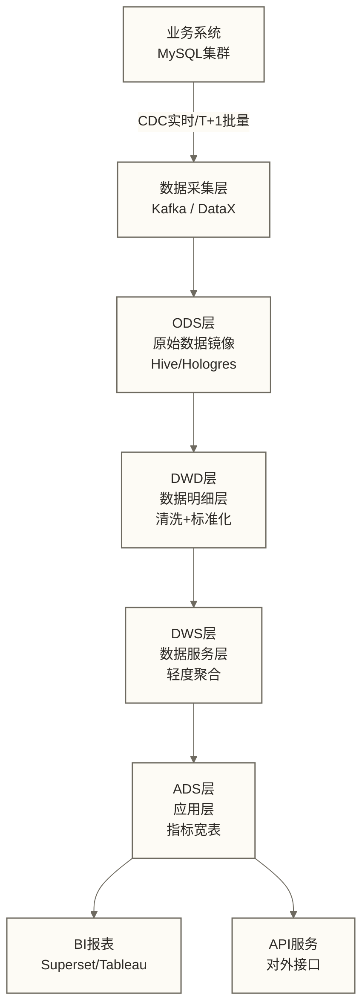
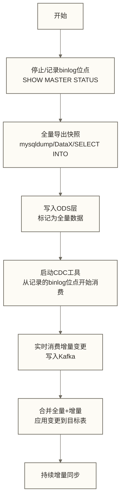
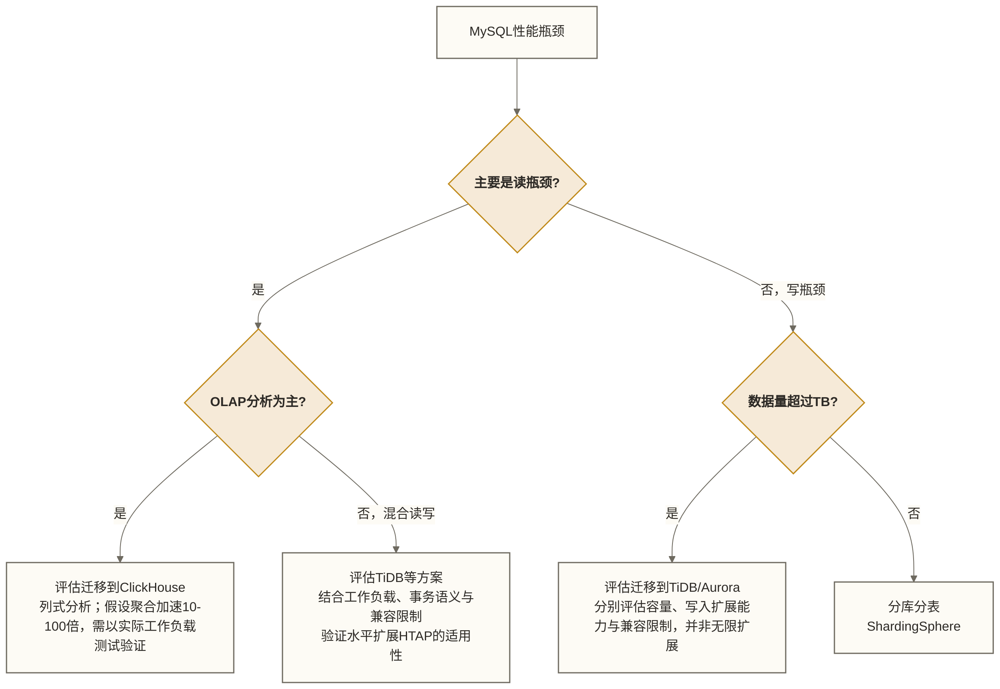

# MySQL在数据工程中的角色 - 从业务库到数据管道

> [!abstract] 学习目标
> - 明确MySQL与数据仓库在整体数据架构中的分工边界
> - 掌握三大CDC工具（Canal/Debezium/Maxwell）的技术原理与选型依据
> - 理解全量+增量同步的流程框架及一致性衔接条件
> - 掌握维度表的拉链表/快照表更新策略
> - 建立MySQL性能瓶颈时的迁移路径判断框架

> [!quote] 核心洞察
> MySQL在数据工程中扮演的角色远不止"存数据"。作为数据工程师，真正的挑战是：如何在不影响业务OLTP性能的前提下，源源不断地将MySQL中的数据变更"推"到下游数仓，并保证低延迟、高一致性、可断点续传。这个问题的解答，就是CDC（变更数据捕获）技术存在的意义。

## MySQL与数据仓库的分工边界

### OLTP vs OLAP的本质差异

| 维度 | MySQL（OLTP） | 数据仓库（OLAP） |
|------|-------------|---------------|
| 核心目标 | 支撑业务事务处理 | 支撑分析决策 |
| 典型操作 | 点查、短事务 | 大范围聚合、复杂JOIN |
| 数据量 | 热数据（通常<1TB） | 全量历史（PB级） |
| 数据模型 | 范式化（3NF）减少冗余 | 反范式（宽表）提升查询效率 |
| 读写比例 | 读写均衡 | 重读轻写 |
| 时效性 | 毫秒级实时 | 分钟到天级 |

**清晰的边界原则：**

> MySQL负责业务实体的当前状态（账户余额=多少，订单状态=什么）；数据仓库负责历史轨迹和聚合分析（过去一年每月的GMV趋势，用户的购买行为漏斗）。让MySQL做OLAP查询、让数据仓库做事务处理，都是架构反模式。

### 典型的数据架构分层



## CDC方案选型：Canal vs Debezium vs Maxwell

### 三者的共同原理

都是基于MySQL binlog的变更捕获，将自己伪装成MySQL从库，接收主库的binlog事件并解析成结构化的变更事件（INSERT/UPDATE/DELETE）。

### Canal（阿里开源）

**架构：**

```text
MySQL binlog → Canal Server（解析binlog）→ Canal Client（消费事件）
                     ↓
               可选：直接推送到Kafka/RocketMQ
```

**特点：**
- Java生态，与阿里内部技术栈深度集成
- 支持HA（ZooKeeper选主），Canal Server集群部署
- 延迟目标示例：< 1秒；是否达成取决于源库负载、部署配置和下游处理能力
- 社区活跃，文档完善（中文文档优秀）
- 数据格式：自定义JSON，需要适配

```java
// Canal Client消费示例
CanalConnector connector = CanalConnectors.newSingleConnector(
    new InetSocketAddress("canal-server", 11111), "example", "", "");
connector.connect();
connector.subscribe("mydb\\.orders");  // 订阅库表
connector.rollback();

while (true) {
    Message message = connector.getWithoutAck(100);
    for (CanalEntry.Entry entry : message.getEntries()) {
        if (entry.getEntryType() == CanalEntry.EntryType.ROWDATA) {
            CanalEntry.RowChange rowChange = CanalEntry.RowChange.parseFrom(entry.getStoreValue());
            for (CanalEntry.RowData rowData : rowChange.getRowDatasList()) {
                // 处理INSERT/UPDATE/DELETE事件
                if (rowChange.getEventType() == CanalEntry.EventType.INSERT) {
                    rowData.getAfterColumnsList().forEach(col ->
                        System.out.println(col.getName() + "=" + col.getValue()));
                }
            }
        }
    }
    connector.ack(message.getId());
}
```

### Debezium（Red Hat开源，Kafka Connector生态）

**架构：**

```text
MySQL binlog → Debezium Connector（运行在Kafka Connect中）→ Kafka Topic
                                                              ↓
                                                    下游消费者（Flink/Spark等）
```

**特点：**
- 天然集成Kafka生态，事件直接写入Kafka
- 支持多种数据库（MySQL/PostgreSQL/MongoDB/Oracle等），统一接口
- 事件格式：标准Kafka Connect JSON + Schema Registry（Avro/Protobuf）
- 生产案例评估线索：原文列举Netflix、Airbnb、Uber，但未提供来源，不能据此认定其实际使用情况
- 支持Schema变更（DDL）的事件捕获

```json
// Debezium事件示例（UPDATE操作）
{
  "before": {
    "order_id": 12345,
    "status": 0,
    "amount": 100.00
  },
  "after": {
    "order_id": 12345,
    "status": 1,
    "amount": 100.00
  },
  "source": {
    "db": "mydb",
    "table": "orders",
    "ts_ms": 1704067200000,
    "gtid": "xxxx"
  },
  "op": "u"
}
```

```json
// Debezium MySQL Connector配置
{
  "name": "mysql-connector",
  "config": {
    "connector.class": "io.debezium.connector.mysql.MySqlConnector",
    "database.hostname": "mysql-host",
    "database.port": "3306",
    "database.user": "debezium",
    "database.password": "password",
    "database.server.id": "184054",
    "database.server.name": "mydb",
    "database.include.list": "mydb",
    "table.include.list": "mydb.orders,mydb.users",
    "database.history.kafka.bootstrap.servers": "kafka:9092",
    "database.history.kafka.topic": "schema-changes.mydb",
    "include.schema.changes": "true",
    "snapshot.mode": "initial"
  }
}
```

### Maxwell（Zendesk开源）

**特点：**
- 轻量级，配置简单，上手门槛最低
- 直接输出标准JSON，不依赖Kafka（也支持Kafka/RabbitMQ/Redis）
- 社区活跃度不如Canal和Debezium
- 适合小团队快速接入

```bash
# Maxwell启动示例
maxwell --user='maxwell' --password='password' --host='mysql-host' \
  --producer=kafka --kafka.bootstrap.servers=kafka:9092 \
  --kafka_topic=maxwell_events \
  --filter='include: mydb.*, exclude: mydb.access_log'
```

### 三者选型矩阵

| 场景 | 推荐方案 | 理由 |
|------|---------|------|
| 已有Kafka生态，新建数据管道 | Debezium | 生态最完整，标准化 |
| 阿里云/Java技术栈团队 | Canal | 中文文档好，阿里云集成 |
| 快速原型，小团队 | Maxwell | 最简单 |
| 需要多种数据库CDC统一接入 | Debezium | 统一接口 |
| 实时数仓（Flink消费） | Debezium + Flink CDC | 官方深度集成 |

## 全量+增量同步实践

### 初始化同步流程框架（快照与位点一致性条件未完整展开）



### 全量同步工具选型

```bash
# 方案1：mysqldump（小表，<100万行）
mysqldump -h mysql-host -u user -p \
  --single-transaction \
  --master-data=2 \
  mydb orders > orders_dump.sql

# 方案2：DataX（中大表，推荐）
# DataX配置：MySQL → HDFS/Hive
{
  "job": {
    "content": [{
      "reader": {
        "name": "mysqlreader",
        "parameter": {
          "jdbcUrl": ["jdbc:mysql://mysql-host:3306/mydb"],
          "table": ["orders"],
          "column": ["*"],
          "where": "created_at >= '2024-01-01'"
        }
      },
      "writer": {
        "name": "hdfswriter",
        "parameter": {
          "path": "/data/ods/orders/",
          "fileType": "parquet",
          "fieldDelimiter": ","
        }
      }
    }]
  }
}

# 方案3：SELECT INTO OUTFILE（超大表，直接导出CSV）
SELECT * FROM orders
INTO OUTFILE '/tmp/orders_export.csv'
FIELDS TERMINATED BY ','
ENCLOSED BY '"'
LINES TERMINATED BY '\n';
```

### Flink CDC：实时增量同步的现代方案

Flink CDC直接集成Debezium，无需Kafka中间层，实现真正的端到端实时同步：

```sql
-- Flink SQL：直接读取MySQL binlog
CREATE TABLE mysql_orders (
    order_id   BIGINT,
    user_id    INT,
    amount     DECIMAL(10,2),
    status     TINYINT,
    created_at TIMESTAMP(3),
    PRIMARY KEY (order_id) NOT ENFORCED
) WITH (
    'connector' = 'mysql-cdc',
    'hostname'  = 'mysql-host',
    'port'      = '3306',
    'username'  = 'flink',
    'password'  = 'password',
    'database-name' = 'mydb',
    'table-name'    = 'orders',
    'server-time-zone' = 'Asia/Shanghai'
);

-- 写入Hudi/Iceberg实时数据湖
CREATE TABLE hudi_orders WITH (
    'connector' = 'hudi',
    'path' = 'hdfs://namenode/data/orders',
    'table.type' = 'MERGE_ON_READ'
) LIKE mysql_orders;

INSERT INTO hudi_orders SELECT * FROM mysql_orders;
```

## 维度表更新策略

### 全量快照（Snapshot）

```sql
-- 每天全量同步维度表到数仓（适合小维度表，<100万行）
-- 优点：简单，每天重跑即可
-- 缺点：按日保留分区可追溯每日快照状态，但无法完整捕获日内变更

-- ODS层每天一个分区
INSERT OVERWRITE TABLE ods_dim_user PARTITION (dt='2024-01-01')
SELECT user_id, name, city, level, updated_at
FROM mysql_users;
```

### 拉链表（Slowly Changing Dimension Type 2）

```sql
-- 拉链表：保存维度的历史变更轨迹
-- 每条记录有有效期（start_date, end_date）
-- end_date = '9999-12-31' 表示当前有效记录

CREATE TABLE dim_user_zip (
    user_id    BIGINT,
    name       VARCHAR(50),
    city       VARCHAR(50),
    level      TINYINT,
    start_date DATE,
    end_date   DATE,          -- 9999-12-31 表示当前有效
    PRIMARY KEY (user_id, start_date)
);

-- 每日更新拉链表的ETL逻辑（以Hive SQL为例）
-- Step1：找到今日变更的用户
CREATE TEMPORARY TABLE changed_users AS
SELECT user_id, name, city, level
FROM ods_dim_user
WHERE dt = '2024-01-01'
  AND user_id IN (
    -- 与昨日快照比较，找出变更的用户
    SELECT a.user_id
    FROM ods_dim_user a
    JOIN ods_dim_user b ON a.user_id = b.user_id
    WHERE a.dt = '2024-01-01' AND b.dt = '2023-12-31'
      AND (a.city != b.city OR a.level != b.level)
  );

-- Step2：关闭旧记录（更新end_date）
UPDATE dim_user_zip
SET end_date = '2023-12-31'
WHERE user_id IN (SELECT user_id FROM changed_users)
  AND end_date = '9999-12-31';

-- Step3：插入新记录
INSERT INTO dim_user_zip
SELECT user_id, name, city, level, '2024-01-01', '9999-12-31'
FROM changed_users;
```

### 使用拉链表查询历史状态

```sql
-- 查询2023年6月1日时，用户12345的城市是哪里
SELECT city
FROM dim_user_zip
WHERE user_id = 12345
  AND start_date <= '2023-06-01'
  AND end_date   >= '2023-06-01';
```

## MySQL性能不足时的迁移路径

### 迁移决策树



### 各迁移方案特点

| 迁移目标 | 适用场景 | 迁移难度 | MySQL兼容性 |
|---------|---------|---------|-----------|
| TiDB | HTAP，需要保持MySQL兼容 | 需评估SQL、事务、驱动兼容及迁移切换；协议兼容不等于低难度 | 需按应用验证 |
| Aurora MySQL | 云原生，AWS生态 | 需评估版本、功能、运维差异及迁移切换；协议兼容不等于低难度 | 需按应用验证 |
| ClickHouse | 纯OLAP，高聚合性能 | 中（SQL方言差异） | 低 |
| MaxCompute | 阿里云离线分析 | 中 | 中 |
| Hologres | 阿里云实时OLAP | 中 | 中 |

## 数据工程师必须掌握的MySQL运维知识

### 1. 权限管理

```sql
-- 为CDC工具创建专用账号（最小权限原则）
CREATE USER 'canal'@'%' IDENTIFIED BY 'strong_password';
GRANT SELECT, REPLICATION SLAVE, REPLICATION CLIENT ON *.* TO 'canal'@'%';
FLUSH PRIVILEGES;

-- 为数据导出账号（只读）
CREATE USER 'dataex'@'10.0.0.%' IDENTIFIED BY 'password';
GRANT SELECT ON mydb.* TO 'dataex'@'10.0.0.%';
```

### 2. 备份与恢复

```bash
# 物理备份示例：使用XtraBackup；锁影响取决于存储引擎、版本及备份配置
xtrabackup --backup \
  --host=mysql-host --user=backup --password=pass \
  --target-dir=/backup/full/

# 增量备份
xtrabackup --backup --incremental-basedir=/backup/full/ \
  --target-dir=/backup/inc1/

# 恢复
xtrabackup --prepare --target-dir=/backup/full/
xtrabackup --copy-back --target-dir=/backup/full/
```

### 3. 监控指标清单

```sql
-- 数据工程师关注的核心监控指标

-- 1. 主从延迟（Seconds_Behind_Master）> 30秒告警
-- 2. 慢查询数量（Slow_queries）增长异常告警
-- 3. 连接数（Threads_connected / max_connections）> 80%告警
-- 4. Buffer Pool命中率 < 95%告警
-- 5. 磁盘空间（binlog + 数据文件）> 80%告警
-- 6. 死锁频率（Innodb_deadlocks）> 10次/分钟告警

-- 一键查看关键指标
SELECT VARIABLE_NAME, VARIABLE_VALUE
FROM performance_schema.global_status
WHERE VARIABLE_NAME IN (
    'Threads_connected',
    'Slow_queries',
    'Innodb_deadlocks',
    'Innodb_buffer_pool_reads',
    'Innodb_buffer_pool_read_requests',
    'Questions'
);
```

## 关联知识

- [[【技术与工具】/MySQL/17-主从复制与高可用架构]] - binlog原理与主从复制
- [[【技术与工具】/MySQL/18-MySQL性能调优实战]] - 分库分表方案
- Apache Kafka - CDC数据的消息队列载体
- Apache Flink - Flink CDC实时数据同步
- 数据仓库分层架构 - ODS/DWD/DWS分层设计
- 数据集成与ETL工具 - DataX等批量同步工具
