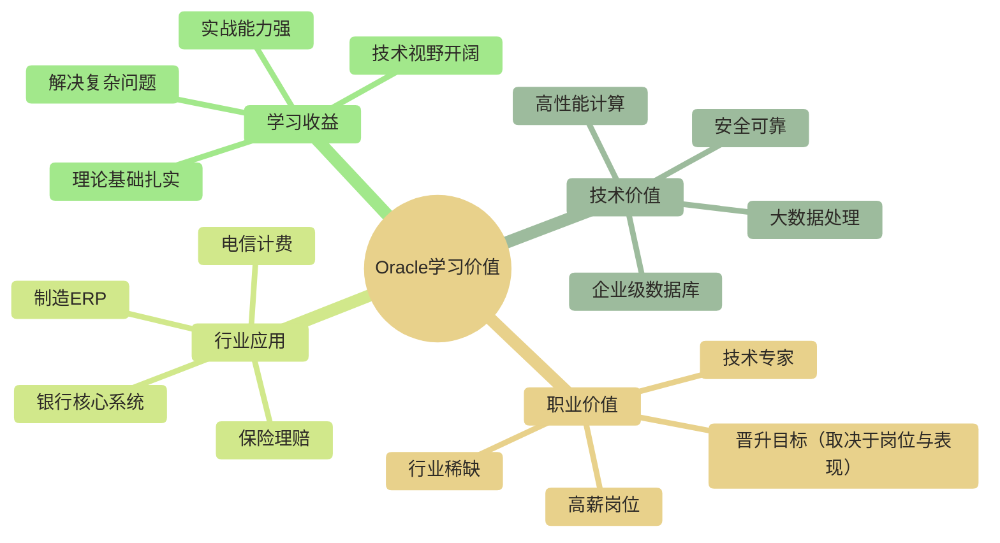
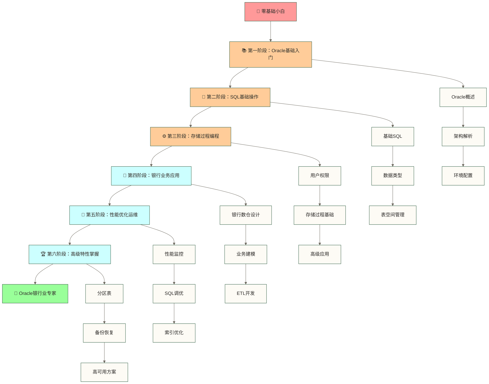

# Oracle学习路线图 - 从零基础到银行业专家

## 🎯 学习概述

> [!NOTE] 📚 为什么选择Oracle？
> 本路线以Oracle这一企业级关系型数据库为学习对象，重点讨论银行、保险、电信等行业的相关应用场景；具体技术选型需结合业务需求、现有系统和成本评估：
> - 🏦 **行业采用情况**：原文提出“全球90%以上的大型银行使用Oracle”，但未提供来源和统计口径，该数字不作为本路线的事实依据
> - 💰 **业务关键性**：处理万亿级资金交易，0容错要求
> - 🛡️ **技术成熟度**：40多年技术积累，久经考验
> - 📈 **职业价值**：Oracle技能可用于金融行业相关数据库岗位；原文提出“薪资溢价显著”，但缺少统计依据，仅保留为待验证假设，不作为收益预测

**Oracle技能对不同角色的价值**：
- 🎯 **数据库管理员(DBA)**：Oracle技能与相关数据库管理岗位直接相关；原文提出“IT行业薪资天花板之一”，但缺少统计依据，不作为薪资排名结论
- 📊 **数据分析师**：掌握Oracle能处理企业级大数据分析
- 🏗️ **数据工程师**：Oracle是构建企业数据仓库的核心技术
- 💼 **银行IT人员**：对于使用Oracle的数据库开发、管理及相关岗位，Oracle技能具有针对性价值；并非所有银行IT岗位都要求该技能

## 🎯 核心学习目标

> [!IMPORTANT] 🚀 学完本路线图你将获得什么？
> 本路线以从数据库基础入门逐步进阶到银行业Oracle相关应用为目标，以下能力需通过练习、项目经验和实际评估逐步建立，不保证完成路线即可成为专家：

**🔧 技术能力目标**：
- 🏗️ **掌握Oracle数据库基础概念和特性**：深入理解Oracle架构原理，能够独立搭建和管理Oracle环境
- 📝 **熟练使用Oracle SQL进行数据操作**：掌握复杂查询、数据建模，能处理银行业务中的复杂数据关系
- ⚙️ **深入理解Oracle存储过程、函数、触发器**：具备Oracle高级编程能力，能实现复杂的银行业务逻辑
- 🏦 **掌握Oracle在银行数仓中的应用场景**：理解银行数据仓库架构，能设计和实施ETL方案
- 🔧 **具备Oracle性能调优和故障排查能力**：逐步建立性能诊断能力；生产问题的处理仍需结合具体环境、权限、经验与变更流程

**💼 职业发展目标**：
- 📈 **薪资发展目标**：可将提升30-50%作为个人规划中的假设目标，而非学习收益预测；本文未提供支持该涨幅或薪资溢价的统计依据
- 🎯 **成为团队技术骨干**：以Oracle专业能力提升团队贡献，实际角色取决于项目表现和团队需求，不保证不可替代
- 🏆 **争取更好的职业机会**：可将银行、保险、大型企业的相关高级岗位作为发展目标，实际机会取决于岗位要求、项目经验和招聘评估
- 📚 **建立技术专家形象**：在Oracle技术领域具备权威性和影响力

## 🗺️ 学习路线安排

> [!TIP] 📅 学习路线设计理念
> 本学习路线采用**渐进式、实战导向**的设计理念：
> - 🎯 **循序渐进**：从基础概念到高级应用，符合认知规律
> - 💼 **银行业务导向**：重点突出Oracle在银行业的实际应用
> - 💻 **理论实践结合**：每个阶段都有对应的实战练习
> - 📈 **能力阶梯式提升**：每完成一个阶段都有明显的能力提升

### 📚 第一阶段：Oracle基础入门（2-3周）

> [!NOTE] 🎯 第一阶段学习目标
> **建立Oracle基础知识体系**，为后续深入学习打下坚实基础。
> 
> **本阶段完成后你将能够**：
> - 🔍 清楚了解Oracle的技术优势和应用场景
> - 🏗️ 理解Oracle数据库的整体架构和工作原理
> - 💻 独立完成Oracle环境的安装和基础配置
> - 🛠️ 熟练使用Oracle的基本管理工具

1. **[[【技术与工具】/Oracle/01-Oracle概述与特性|Oracle概述与特性]]**
   - Oracle发展历史和版本演进
   - Oracle与其他数据库对比
   - Oracle的核心优势和特性

2. **[[【技术与工具】/Oracle/02-Oracle架构深度解析|Oracle架构]]**
   - Oracle实例和数据库的关系
   - 内存结构：SGA、PGA详解
   - 进程结构：后台进程和用户进程
   - 物理存储结构：数据文件、日志文件

3. **[[【技术与工具】/Oracle/03-Oracle环境安装与配置|Oracle环境安装与配置]]**
   - Oracle软件安装步骤
   - 数据库创建和配置
   - 监听器配置和网络设置
   - 基本管理工具使用

### 📝 第二阶段：SQL基础操作（2-3周）

> [!TIP] 🎯 第二阶段学习目标
> **熟练掌握Oracle SQL操作**，这就像学会了Oracle的"语言"，能够与数据库进行流畅对话。

4. **[[【技术与工具】/Oracle/04-Oracle基础SQL操作|Oracle基础SQL操作]]**
   - DDL：表、索引、约束管理
   - DML：数据增删改查操作
   - DCL：用户权限管理
   - Oracle特有的SQL语法

5. **[[【技术与工具】/Oracle/05-Oracle数据类型详解|Oracle数据类型]]**
   - 数值类型：NUMBER、INTEGER等
   - 字符类型：VARCHAR2、CHAR、CLOB
   - 日期时间类型：DATE、TIMESTAMP
   - 其他特殊类型：BLOB、XMLType

6. **[[【技术与工具】/Oracle/06-Oracle表空间管理|Oracle表空间]]**
   - 表空间概念和类型
   - 表空间创建和维护
   - 数据文件管理
   - 空间使用监控

### ⚙️ 第三阶段：用户权限与存储过程（3-4周）

> [!IMPORTANT] 🎯 第三阶段学习目标
> **掌握Oracle高级特性和编程**，这个阶段你将从"会说Oracle语言"提升到"用Oracle编程"的水平。

7. **[[【技术与工具】/Oracle/07-Oracle用户权限管理|Oracle用户权限]]**
   - 用户创建和管理
   - 角色和权限体系
   - 系统权限vs对象权限
   - 安全最佳实践

8. **[[【技术与工具】/Oracle/08-Oracle存储过程基础|Oracle存储过程]]**
   - PL/SQL语言基础
   - 存储过程创建语法
   - 参数传递和返回值
   - 异常处理机制

9. **[[【技术与工具】/Oracle/09-Oracle存储过程高级应用|Oracle存储过程高级]]**
   - 复杂业务逻辑实现
   - 游标使用技巧
   - 动态SQL构建
   - 性能优化要点

10. **[[【技术与工具】/Oracle/10-Oracle函数与包|Oracle函数与包]]**
    - 自定义函数创建
    - 包的概念和使用
    - 系统内置函数
    - 函数调试技巧

### 🏦 第四阶段：触发器与银行应用（3-4周）

> [!SUCCESS] 🎯 第四阶段学习目标
> **掌握Oracle在银行业的实际应用**，这个阶段将把技术知识转化为实际的银行业务解决方案。

11. **[[【技术与工具】/Oracle/11-Oracle触发器应用|Oracle触发器]]**
    - 触发器类型和用途
    - 触发器创建语法
    - 业务规则实现
    - 审计日志记录

12. **[[【技术与工具】/Oracle/12-Oracle银行数仓架构设计|Oracle银行数仓架构]]**
    - 银行数据仓库架构
    - ODS、DW、DM层设计
    - 维度建模在Oracle中的实现
    - 数据分层策略

13. **[[【技术与工具】/Oracle/13-Oracle银行业务建模|Oracle银行业务建模]]**
    - 银行核心业务理解
    - 客户、账户、交易建模
    - 星型模型设计
    - 历史数据处理

14. **[[【技术与工具】/Oracle/14-Oracle银行ETL开发|Oracle银行ETL开发]]**
    - ETL设计模式
    - 存储过程实现ETL
    - 增量数据处理
    - 数据质量控制

### 🚀 第五阶段：性能优化与运维（2-3周）

> [!WARNING] 🎯 第五阶段学习目标
> **具备Oracle调优和运维能力**，这个阶段将让你成为数据库性能"医生"，能够诊断和治疗数据库的各种"疾病"。

15. **[[【技术与工具】/Oracle/15-Oracle银行数据质量管理|Oracle银行数据质量]]**
    - 数据质量评估
    - 数据清洗规则
    - 异常数据处理
    - 质量报告生成

16. **[[【技术与工具】/Oracle/16-Oracle性能监控与诊断|Oracle性能监控与诊断]]**
    - AWR报告分析
    - 等待事件诊断
    - SQL执行计划分析
    - 性能瓶颈识别

17. **[[【技术与工具】/Oracle/17-Oracle SQL调优实战|Oracle SQL调优]]**
    - 索引优化策略
    - SQL重写技巧
    - 统计信息管理
    - Hint使用技巧

18. **[[【技术与工具】/Oracle/18-Oracle索引设计与优化|Oracle索引设计与优化]]**
    - B树索引原理
    - 位图索引应用
    - 函数索引使用
    - 索引监控维护

### 🏆 第六阶段：高级特性与案例（2-3周）

> [!NOTE] 🎯 第六阶段学习目标
> **深入掌握Oracle高级特性**，这个阶段将让你成为Oracle的"武林高手"，掌握高深莫测的高级技能。

19. **[[【技术与工具】/Oracle/19-Oracle分区表应用|Oracle分区表]]**
    - 分区策略选择
    - 分区表创建管理
    - 分区剪枝优化
    - 分区维护操作

20. **[[【技术与工具】/Oracle/20-Oracle备份恢复策略|Oracle备份恢复]]**
    - RMAN备份工具
    - 热备份vs冷备份
    - 恢复场景和策略
    - 备份策略设计

21. **[[【技术与工具】/Oracle/21-Oracle高可用性方案|Oracle高可用性方案]]**
    - Data Guard配置
    - RAC集群方案
    - 故障转移机制
    - 灾难恢复规划

22. **[[【技术与工具】/Oracle/22-Oracle故障排查指南|Oracle故障排查]]**
    - 常见故障类型
    - 排查工具使用
    - 日志分析方法
    - 应急处理流程

## 📚 学习建议与最佳实践

> [!IMPORTANT] 💡 学习成功的关键要素
> 以下为可尝试的学习建议；本文未提供成功学员案例或效果统计，实际学习效果取决于基础、投入和练习质量：

### 🛠️ 实践环境搭建

> [!TIP] 🖥️ 环境选择建议
> **推荐方案（按优先级排序）**：

**🥇 方案一：Oracle XE + Docker（推荐）**
- ✅ **优势**：XE可作为轻量学习环境，容器化有助于部署；软件、镜像及容器运行工具的使用条件需分别确认，不假定整个方案在所有使用场景下都免费
- 📦 **适用场景**：个人学习、概念验证、轻量级开发
- 💻 **系统要求**：8GB内存以上，50GB可用磁盘空间
- 🚀 **部署时间**：可将30分钟作为环境与镜像已准备就绪时的计划参考，实际耗时取决于下载、硬件、配置及排障情况

**🥈 方案二：Oracle Cloud Free Tier（推荐）**
- ✅ **优势**：真实云环境，可使用符合当前条款的免费资源，减少本地数据库资源需求；免费范围与持续可用条件以所选服务条款为准
- 🌐 **适用场景**：远程学习、团队协作、模拟生产环境
- 💰 **成本**：免费额度是否覆盖学习需求取决于所选服务、资源用量和当前条款；超出额度或使用非免费资源可能产生费用
- 📈 **扩展性**：可随时升级到付费版本

**🥉 方案三：VirtualBox + Oracle Enterprise**
- ✅ **优势**：可用于学习企业版相关功能，接近部分生产部署场景；可用功能取决于版本、安装配置及许可，不能默认包含所有高级选件
- 📋 **适用场景**：高级特性学习、认证考试准备
- 💾 **资源要求**：16GB内存以上，100GB可用磁盘空间

**📊 测试数据准备**：
- 🏦 **银行业务数据**：客户信息、账户数据、交易记录
- 📈 **数据规模**：建议准备10万客户、100万账户、1000万交易记录
- 🎯 **数据特点**：包含各种数据质量问题，模拟真实业务场景

### 📖 学习方法与策略

> [!NOTE] 🎯 高效学习法则
> **遵循"721学习法则"**：70%实践操作 + 20%向他人学习 + 10%理论学习

**🔄 学习循环**：
1. **📚 预习理论**（10分钟）：快速浏览知识点概要
2. **💻 动手实践**（40分钟）：完成实际操作练习
3. **🤔 总结反思**（5分钟）：记录学习心得和问题
4. **📝 输出分享**（5分钟）：写笔记或分享给他人

**📋 每周学习计划**：
- **周一三五**：新知识学习（理论+实践）
- **周二四**：复习巩固（练习+总结）
- **周六**：项目实战（综合应用）
- **周日**：查漏补缺（回顾+规划）

**🎯 阶段性评估**：
- **每周测试**：完成实际项目小任务
- **每月复盘**：总结学习成果，调整学习计划
- **阶段项目**：每完成一个阶段做一个小项目

### 🚀 进阶发展方向

> [!IMPORTANT] 🎯 职业发展路径选择
> 根据个人兴趣和职业规划，选择合适的进阶方向：

**🎓 认证路径**：
- **📜 Oracle Database SQL (1Z0-071)**：SQL基础认证，入门首选
- **🏆 Oracle DBA (1Z0-082/083)**：DBA认证方向参考，考试要求以官方当前目录为准；认证不保证高薪
- **🔧 Oracle Developer (1Z0-149)**：开发者认证，编程导向
- **☁️ Oracle Cloud Infrastructure (1Z0-1085)**：云时代必备

**💼 职业发展方向**：
- **🔧 Oracle DBA专家**：技术专家路线；40-80万仅保留为原文提出的年薪参考假设，缺少地区、币种、样本及来源，不能称为平均年薪
- **🏗️ 数据架构师**：架构设计路线；50-100万仅保留为原文提出的年薪参考假设，缺少地区、币种、样本及来源，不能称为平均年薪
- **💼 银行IT技术顾问**：业务技术结合方向；60-120万仅保留为原文提出的年薪参考假设，缺少地区、币种、样本及来源，不能称为平均年薪
- **🚀 Oracle产品经理**：技术转管理方向；80-150万仅保留为原文提出的年薪参考假设，缺少地区、币种、样本及来源，不能称为平均年薪

**🌟 技术发展方向**：
- **☁️ Oracle Cloud数据库**：云原生数据库技术
- **🤖 Oracle机器学习**：数据库内机器学习
- **🔗 Oracle区块链**：分布式账本技术
- **📊 Oracle大数据集成**：大数据生态整合

## 学习资源推荐

### 官方文档
- Oracle Database Documentation
- Oracle Technology Network (OTN)
- Oracle Learning Library

### 社区资源
- Oracle官方论坛
- Stack Overflow Oracle标签
- Oracle ACE社区

### 实战练习
- Oracle Live SQL在线环境
- 银行业务案例练习
- 性能调优实验

## 职业发展路径

掌握Oracle技术后，可以朝以下方向发展：
- Oracle数据库管理员(DBA)
- 银行数据仓库工程师
- 数据架构师
- Oracle技术顾问
- 企业级应用开发工程师

通过系统学习Oracle技术，特别是在银行业务场景中的应用，将为你的数据职业生涯打下坚实基础。