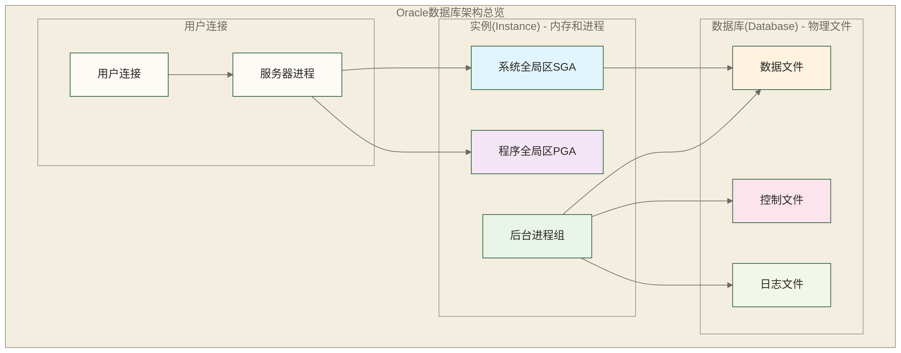

# Oracle架构深度解析

> [!NOTE] 📋 前置知识
> - [[【技术与工具】/Oracle/01-Oracle概述与特性|Oracle概述与特性]] - 了解Oracle基础概念
> - 基础数据库原理知识

## 学习目标

> [!IMPORTANT] 🎯 本章学习目标
> 完成本章学习后，你将能够：
> - 深入理解Oracle实例和数据库的关系
> - 掌握Oracle内存结构(SGA/PGA)的组成和配置
> - 了解Oracle后台进程的作用和工作原理
> - 理解Oracle物理存储结构的组织方式
> - 具备基础的Oracle性能监控和故障诊断能力

## Oracle数据库架构概述

Oracle数据库采用实例(Instance)和数据库(Database)分离的架构设计。理解这种架构对于掌握Oracle的工作原理至关重要。



## 实例与数据库的关系

### 什么是Oracle实例

Oracle实例是内存结构和后台进程的组合，负责管理数据库的运行。

```sql
-- 查看当前实例信息
SELECT instance_name, host_name, version, status
FROM v$instance;
```

### 什么是Oracle数据库

Oracle数据库是存储在磁盘上的物理文件集合，包含用户数据和元数据。

```sql
-- 查看数据库信息
SELECT name, db_unique_name, platform_name
FROM v$database;
```

## Oracle内存结构

### 1. 系统全局区(SGA)

SGA是Oracle实例的核心内存区域，由所有后台进程和用户进程共享。

**Database Buffer Cache**
```sql
-- 查看缓冲区缓存大小
SELECT component, current_size/1024/1024 as size_mb
FROM v$sga_dynamic_components
WHERE component = 'DEFAULT buffer cache';
```

**Shared Pool**
```sql
-- 查看共享池使用情况
SELECT pool, name, bytes/1024/1024 as size_mb
FROM v$sgastat
WHERE pool = 'shared pool'
ORDER BY bytes DESC;
```

**Redo Log Buffer**
```sql
-- 查看重做日志缓冲区
SELECT value/1024/1024 as redo_buffer_mb
FROM v$parameter
WHERE name = 'log_buffer';
```

### 2. 程序全局区(PGA)

PGA是每个服务器进程的私有内存区域。

```sql
-- 查看PGA使用情况
SELECT name, value/1024/1024 as size_mb
FROM v$pgastat
WHERE name IN ('total PGA allocated', 'total PGA used by SQL work area');
```

## Oracle进程结构

### 1. 后台进程

**系统监控器(SMON)**
- 实例恢复
- 清理临时段
- 合并空闲空间

**进程监控器(PMON)**
- 清理异常终止的用户进程
- 释放资源
- 重启失败的服务器进程

**数据库写入器(DBWn)**
```sql
-- 查看数据库写入器进程
SELECT name, description
FROM v$bgprocess
WHERE name LIKE 'DBW%';
```

**日志写入器(LGWR)**
```sql
-- 查看重做日志组状态（不是LGWR进程状态）
SELECT group#, thread#, status
FROM v$log;
```

**检查点进程(CKPT)**
```sql
-- 查看各数据文件的检查点信息
SELECT file#, checkpoint_change#, checkpoint_time
FROM v$datafile;
```

### 2. 服务器进程

**专用服务器模式**
- 每个用户连接对应一个服务器进程
- 适合并发连接数较少的环境

**共享服务器模式**
- 多个用户会话共享少数几个服务器进程
- 适合大量并发连接的环境

```sql
-- 配置共享服务器
ALTER SYSTEM SET shared_servers = 5;
ALTER SYSTEM SET max_shared_servers = 20;
```

## Oracle物理存储结构

### 1. 数据文件

数据文件存储实际的用户数据和元数据。

```sql
-- 查看数据文件信息
SELECT file_name, tablespace_name, bytes/1024/1024 as size_mb, status
FROM dba_data_files
ORDER BY tablespace_name;
```

### 2. 控制文件

控制文件包含数据库的元数据信息。

```sql
-- 查看控制文件位置
SELECT name, status
FROM v$controlfile;
```

### 3. 重做日志文件

重做日志文件记录数据库的所有变更操作。

```sql
-- 查看重做日志文件
SELECT group#, member, status
FROM v$logfile
ORDER BY group#;
```

### 4. 归档日志文件

```sql
-- 启用归档模式
SHUTDOWN IMMEDIATE;
STARTUP MOUNT;
ALTER DATABASE ARCHIVELOG;
ALTER DATABASE OPEN;
```

## Oracle逻辑存储结构

### 1. 表空间

表空间是Oracle数据库的逻辑存储单元。

```sql
-- 创建表空间
CREATE TABLESPACE bank_data
DATAFILE '/u01/oradata/orcl/bank_data01.dbf' SIZE 100M
AUTOEXTEND ON NEXT 10M MAXSIZE 1G;
```

### 2. 段(Segment)

段是分配给特定数据库对象的空间集合。

```sql
-- 查看段信息
SELECT segment_name, segment_type, tablespace_name, bytes/1024/1024 as size_mb
FROM dba_segments
WHERE owner = 'BANK_USER'
ORDER BY bytes DESC;
```

### 3. 区(Extent)

区是由连续数据块组成的存储单元。

```sql
-- 查看区信息
SELECT segment_name, extent_id, bytes/1024 as size_kb
FROM dba_extents
WHERE owner = 'BANK_USER'
AND segment_name = 'CUSTOMER_INFO';
```

### 4. 数据块(Block)

数据块是Oracle的最小I/O单元。

```sql
-- 查看数据块大小
SELECT value as block_size
FROM v$parameter
WHERE name = 'db_block_size';
```

## 银行业务场景中的架构考虑

### 1. 内存配置建议

```sql
-- 银行核心系统内存配置
ALTER SYSTEM SET sga_target = 8G;
ALTER SYSTEM SET pga_aggregate_target = 2G;
ALTER SYSTEM SET shared_pool_size = 2G;
ALTER SYSTEM SET db_cache_size = 4G;
```

### 2. 进程配置优化

```sql
-- 针对高并发的银行系统
-- 示例值；需使用SPFILE，并在实例重启后生效
ALTER SYSTEM SET processes = 500 SCOPE=SPFILE;
-- 示例值；需使用SPFILE，并在实例重启后生效
ALTER SYSTEM SET sessions = 600 SCOPE=SPFILE;
-- 示例值；需使用SPFILE，并在实例重启后生效
ALTER SYSTEM SET db_writer_processes = 4 SCOPE=SPFILE;
```

### 3. 存储架构设计

**数据文件分离**
```sql
-- 核心业务数据
CREATE TABLESPACE core_business
DATAFILE '/u01/data/core_business01.dbf' SIZE 1G;

-- 历史数据
CREATE TABLESPACE history_data
DATAFILE '/u02/data/history_data01.dbf' SIZE 5G;

-- 临时数据
CREATE TEMPORARY TABLESPACE temp_large
TEMPFILE '/u03/temp/temp_large01.dbf' SIZE 2G;
```

## 性能监控视图

### 1. 实例性能监控

```sql
-- 监控等待事件
SELECT event, total_waits, time_waited_micro/1000000 as time_waited_sec
FROM v$system_event
WHERE wait_class != 'Idle'
ORDER BY time_waited_micro DESC;
```

### 2. 内存使用监控

```sql
-- SGA使用情况
SELECT name, value/1024/1024 as size_mb
FROM v$sga
ORDER BY value DESC;
```

### 3. I/O性能监控

```sql
-- 数据文件I/O统计
SELECT df.file_name, fs.phyrds, fs.phywrts, 
       fs.readtim, fs.writetim
FROM v$filestat fs, dba_data_files df
WHERE fs.file# = df.file_id
ORDER BY fs.phyrds + fs.phywrts DESC;
```

## 高可用架构设计

### 1. RAC集群架构

```sql
-- 查看RAC节点信息
SELECT inst_id, instance_name, host_name, status
FROM gv$instance
ORDER BY inst_id;
```

### 2. Data Guard配置

```sql
-- 主库配置
ALTER DATABASE FORCE LOGGING;
ALTER DATABASE ADD SUPPLEMENTAL LOG DATA;

-- 创建备库：以下为RMAN活动数据库复制的命令示意，不是SQL。
-- standby_db仅作为示例备库标识；实际命名、目标库与辅助实例连接及环境准备另行配置。
-- 在完成上述准备后，使用RMAN命令：
-- DUPLICATE TARGET DATABASE FOR STANDBY FROM ACTIVE DATABASE;
```

## 实践建议

### 1. 架构规划

**容量规划**
- 根据业务增长预测内存需求
- 合理规划存储空间
- 考虑备份和归档空间

**性能规划**
- 根据并发用户数配置进程数
- 合理分配SGA各组件大小
- 优化I/O分布

### 2. 监控告警

```sql
-- 性能监控过程骨架：以下仅列出待实现的检查，不执行实际监控
CREATE OR REPLACE PROCEDURE monitor_performance AS
BEGIN
    -- 检查SGA使用率
    -- 检查PGA使用率  
    -- 检查表空间使用率
    -- 检查等待事件
    NULL;
END;
```

### 3. 故障预防

**定期维护**
- 重建索引
- 收集统计信息
- 清理归档日志

**健康检查**
- 监控错误日志
- 检查数据库参数
- 验证备份有效性

## 实践练习

> [!TIP] 💻 动手练习
> 
> ### 练习1：架构组件探索
> 1. 使用动态视图查询SGA各组件大小
> 2. 查看当前数据库的后台进程
> 3. 分析当前系统的内存使用情况
> 
> **参考SQL**：

```sql
-- 查看SGA组件
SELECT component, current_size/1024/1024 AS size_mb
FROM v$sga_dynamic_components;

-- 查看后台进程
SELECT name, description FROM v$bgprocess WHERE paddr <> '00';

-- 查看内存参数
SELECT name, value FROM v$parameter 
WHERE name LIKE '%size%' OR name LIKE '%pool%';
```

> 
> ### 练习2：数据文件管理
> 1. 查看当前数据库的所有数据文件
> 2. 分析表空间的空间使用情况
> 3. 创建一个新的表空间并添加数据文件
> 
> ### 练习3：性能监控实践
> 1. 查询当前系统的等待事件
> 2. 分析SQL语句的执行统计
> 3. 监控系统资源使用情况

## 相关文档

> [!INFO] 📖 深入学习
> - **前置学习**：[[【技术与工具】/Oracle/01-Oracle概述与特性|Oracle概述与特性]] - 了解Oracle基础
> - **下一步**：[[【技术与工具】/Oracle/03-Oracle环境安装与配置|Oracle环境安装与配置]] - 搭建实践环境
> - **进阶内容**：[[【技术与工具】/Oracle/16-Oracle性能监控与诊断|Oracle性能监控与诊断]] - 深入性能优化

## 总结

理解Oracle架构是成为Oracle专家的基础。在银行等关键业务场景中，正确的架构设计和配置对于系统的稳定性和性能至关重要。

**本章重点回顾**：
- Oracle实例与数据库的分离架构设计
- SGA内存结构各组件的作用和配置
- 后台进程的职责和工作机制  
- 物理存储结构的组织方式
- 性能监控和故障诊断的基本方法