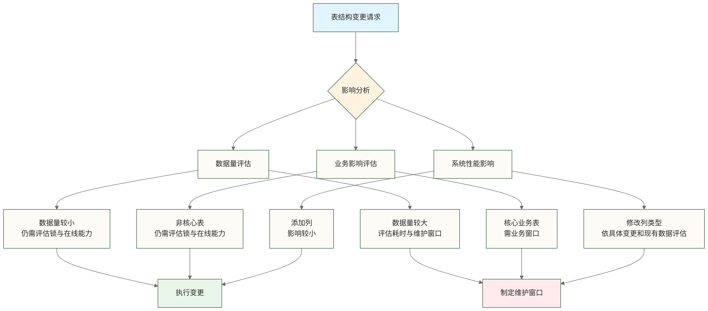
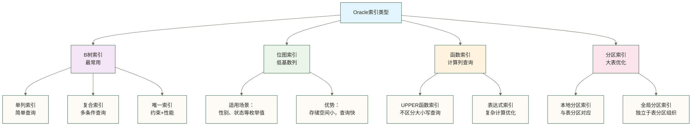

# Oracle基础SQL操作

> [!NOTE] 📋 前置知识
> - [[【技术与工具】/Oracle/01-Oracle概述与特性|Oracle概述与特性]] - 了解Oracle数据库基础
> - [[【技术与工具】/Oracle/02-Oracle架构深度解析|Oracle架构]] - 理解Oracle内部结构
> - [[【技术与工具】/Oracle/03-Oracle环境安装与配置|Oracle环境安装与配置]] - 完成开发环境搭建

## 学习目标

> [!IMPORTANT] 🎯 本章学习目标
> 完成本章学习后，你将能够：
> - 熟练使用Oracle DDL语句创建和管理数据库对象
> - 掌握DML语句进行数据的增删改查操作
> - 理解和应用Oracle特有的SQL特性
> - 在银行业务场景中灵活运用SQL技能

## Oracle SQL概述

Oracle SQL是在标准SQL基础上扩展的数据库查询语言，提供了丰富的数据操作功能。掌握Oracle SQL是进行数据库开发和管理的基础。

## 数据定义语言(DDL)

数据定义语言（Data Definition Language，DDL）用于定义和管理数据库对象的结构，包括表、索引、约束等。DDL语句会自动提交，这意味着它们执行后会立即永久生效，无法回滚。

### 表的创建和管理

#### 理解表创建的核心概念

在Oracle中，表是存储数据的基本单位。一个设计良好的表结构是银行系统稳定运行的基础。创建表时需要考虑数据类型选择、约束设计、存储优化等多个方面。

> [!IMPORTANT] 🎯 表设计关键原则
> 
> **数据类型选择原则**：
> - `NUMBER(10)` - 适用于客户ID等数值型主键，10位数字足够支撑千万级客户
> - `VARCHAR2(100)` - 变长字符串，节省存储空间，适用于姓名等文本字段
> - `CHAR(1)` - 固定长度字符串，适用于性别、状态等枚举值
> - `DATE` - Oracle标准日期类型，自动包含时间信息
> 
> **约束设计原则**：
> - `PRIMARY KEY` - 保证主键值唯一且非空；Oracle可复用适合的已有索引，或在需要时创建索引来支持约束
> - `NOT NULL` - 防止关键业务字段为空
> - `UNIQUE` - 确保身份证号等唯一标识不重复
> - `CHECK` - 通过业务规则验证数据有效性

**创建银行客户信息表的完整示例**

```sql
-- 创建银行客户信息表
-- 这是用于SQL练习的银行客户信息表示例，包含客户的核心信息和系统管理字段，不代表已满足具体银行业务或监管规范
CREATE TABLE customer_info (
    -- 客户ID：使用NUMBER(10)支持10位数字，足够支撑千万级客户规模
    customer_id NUMBER(10) PRIMARY KEY,
    
    -- 客户姓名：VARCHAR2(100)的容量取决于长度语义和字符集；若采用字节语义且每个汉字占3字节，则约可存33个汉字
    customer_name VARCHAR2(100) NOT NULL,
    
    -- 身份证号：18位固定长度，设置UNIQUE约束防重复
    id_card VARCHAR2(18) UNIQUE,
    
    -- 手机号：11位数字，银行业务中的重要联系方式
    phone VARCHAR2(11),
    
    -- 电子邮箱：现代银行服务的重要沟通渠道
    email VARCHAR2(100),
    
    -- 出生日期：用于年龄计算和风险评估
    birth_date DATE,
    
    -- 性别：使用CHECK约束限制只能是'M'或'F'
    gender CHAR(1) CHECK (gender IN ('M', 'F')),
    
    -- 创建时间：系统自动记录，用于审计和分析
    create_time DATE DEFAULT SYSDATE,
    
    -- 客户状态：1-正常，0-停用，用于客户生命周期管理
    status NUMBER(1) DEFAULT 1
);
```

> [!TIP] 💡 银行表设计最佳实践
> 
> 1. **主键设计**：使用数字型主键而非业务主键，提高查询和关联效率
> 2. **字段命名**：使用标准化命名规范，便于团队协作和系统维护
> 3. **默认值设置**：为系统字段设置合理默认值，减少应用层处理复杂度
> 4. **约束完整性**：通过数据库约束确保数据质量，这是银行系统的基本要求

#### 为表和字段添加注释

添加注释是数据库设计的重要实践，特别是在银行这样的复杂业务环境中。好的注释能帮助开发人员和业务人员理解数据含义，减少沟通成本。

> [!NOTE] 📝 注释的重要性
> 
> 在银行系统中，数据字典是监管合规的重要组成部分。通过数据库注释可以：
> - 帮助新团队成员快速理解业务逻辑
> - 为数据标准化和合规文档提供辅助说明；是否满足监管要求需依据适用规范另行评估
> - 为自动化文档生成提供基础数据
> - 在数据治理中发挥重要作用

```sql
-- 为表添加业务含义注释
COMMENT ON TABLE customer_info IS '银行核心客户信息表，存储客户的基本身份和联系信息';

-- 为关键业务字段添加详细注释
COMMENT ON COLUMN customer_info.customer_id IS '客户唯一标识ID，数字主键；本示例插入时显式提供其值';
COMMENT ON COLUMN customer_info.customer_name IS '客户真实姓名，与身份证件保持一致';
COMMENT ON COLUMN customer_info.id_card IS '18位身份证号码，客户身份的法定证明';
COMMENT ON COLUMN customer_info.phone IS '客户主要联系手机号，用于短信通知和身份验证';
COMMENT ON COLUMN customer_info.gender IS '客户性别：M-男性，F-女性，用于风险模型和产品推荐';
COMMENT ON COLUMN customer_info.status IS '客户状态：1-正常，0-停用；本示例未设置状态值范围约束';
```

#### 表结构的动态维护

在银行系统的生命周期中，随着业务发展和监管要求变化，经常需要对表结构进行调整。Oracle提供了ALTER TABLE语句来支持各种表结构变更操作。

> [!WARNING] ⚠️ 生产环境变更注意事项
> 
> **变更前必须考虑的问题**：
> - 数据量大小（影响变更时间）
> - 业务高峰期避免变更
> - 数据备份和回滚方案
> - 应用程序兼容性测试
> - 监管报送系统的影响

```sql
-- 1. 添加新列：随着业务发展需要收集更多客户信息
ALTER TABLE customer_info ADD (
    -- VIP等级：0-普通，1-银卡，2-金卡，3-白金卡，4-钻石卡
    vip_level NUMBER(1) DEFAULT 0,
    -- 最后登录时间：用于客户活跃度分析
    last_login_time DATE,
    -- 风险等级：A-低风险，B-中风险，C-高风险
    risk_level CHAR(1) DEFAULT 'A'
);

-- 2. 修改列定义：业务需求变化，需要支持更长的客户姓名
-- 例如：支持外籍客户的长姓名或企业客户名称
ALTER TABLE customer_info MODIFY customer_name VARCHAR2(200);

-- 3. 删除不需要的列：移除临时添加的测试字段
-- 注意：删除列是不可逆操作，生产环境需谨慎
ALTER TABLE customer_info DROP COLUMN last_login_time;

-- 4. 重命名列：为了更好地反映业务含义
ALTER TABLE customer_info RENAME COLUMN vip_level TO membership_level;
```

**表结构变更的影响分析**：



> [!TIP] 💡 表结构变更最佳实践
> 
> **变更前准备**：
> 1. 在测试环境完整验证变更脚本
> 2. 评估变更对现有应用的影响
> 3. 准备数据备份和回滚方案
> 4. 制定详细的变更执行计划
> 
> **变更执行建议**：
> - 优先选择业务低峰期执行
> - 大表变更考虑分批执行
> - 实时监控系统性能指标
> - 保持与业务部门的及时沟通

### 索引管理 - 提升查询性能的关键

索引是数据库性能优化的核心工具，就像书籍的目录一样，能够快速定位到所需的数据。在银行系统中，合理的索引设计直接影响交易处理速度和用户体验。

#### 理解索引的工作原理

索引是一个独立于表的数据结构，它包含表中一列或多列的值以及指向实际数据行的指针。执行查询时，Oracle优化器会根据查询条件、统计信息等选择访问路径；采用索引访问时，可通过索引定位数据行，部分查询也可能仅访问索引，但并非所有查询都会使用索引。

> [!IMPORTANT] 🎯 索引设计的关键考虑因素
> 
> **何时创建索引**：
> - 频繁出现在WHERE子句中的列
> - 经常用于JOIN操作的列  
> - 经常需要排序(ORDER BY)的列
> - 数据量大且查询选择性高的列
> 
> **何时避免创建索引**：
> - 频繁进行INSERT/UPDATE/DELETE的列
> - 表数据量很小（通常小于1000行）
> - 列的数据分布不均匀（如性别字段）
> - 很少被查询的列

**银行系统中的典型索引策略**：

```sql
-- 1. 创建客户姓名索引 - 支持客户姓名模糊查询
-- 银行柜员经常需要根据客户姓名查找客户信息
CREATE INDEX idx_customer_name ON customer_info(customer_name);

-- 2. 创建复合索引 - 支持联合查询条件
-- 客服系统经常需要同时根据手机号和邮箱验证客户身份
CREATE INDEX idx_customer_phone_email ON customer_info(phone, email);

-- 3. 查看已有唯一约束及其支持索引
-- id_card在建表时已声明UNIQUE，无需再次创建相同列的唯一索引
SELECT constraint_name, index_name
FROM user_constraints
WHERE table_name = 'CUSTOMER_INFO' AND constraint_type = 'U';

-- 4. 创建函数索引 - 支持不区分大小写的查询
-- 处理客户姓名的大小写不一致问题，提高查询准确性
CREATE INDEX idx_upper_customer_name ON customer_info(UPPER(customer_name));

-- 5. 创建日期范围索引 - 支持时间范围查询
-- 支持按客户注册时间进行统计分析
CREATE INDEX idx_customer_create_time ON customer_info(create_time);
```

#### 索引类型详解



> [!WARNING] ⚠️ 索引维护的性能影响
> 
> **索引的双刃剑特性**：
> - **查询优势**：显著提升SELECT查询性能
> - **更新代价**：每次DML操作都需要维护索引结构
> - **存储开销**：索引本身占用额外的存储空间
> - **内存消耗**：频繁使用的索引会占用数据库缓存

**监控和管理索引**：

```sql
-- 查看表的所有索引及其详细信息
SELECT 
    i.index_name,           -- 索引名称
    i.index_type,           -- 索引类型
    i.uniqueness,           -- 是否唯一
    ic.column_name,         -- 索引列名
    ic.column_position,     -- 列在索引中的位置
    i.status,              -- 索引状态
    i.tablespace_name      -- 索引所在表空间
FROM user_indexes i
JOIN user_ind_columns ic ON i.index_name = ic.index_name
WHERE i.table_name = 'CUSTOMER_INFO'
ORDER BY i.index_name, ic.column_position;

-- 查看索引统计信息；此查询不能判断索引是否被查询使用
SELECT 
    index_name,
    table_name,
    num_rows,
    last_analyzed,
    CASE 
        WHEN last_analyzed < SYSDATE - 30 THEN '需要重新分析统计信息'
        ELSE '统计信息较新'
    END as stats_status
FROM user_indexes 
WHERE table_name = 'CUSTOMER_INFO';

-- 查看索引的存储使用情况
SELECT 
    segment_name as index_name,
    bytes/1024/1024 as size_mb,
    blocks,
    extents
FROM user_segments 
WHERE segment_type = 'INDEX' 
AND segment_name LIKE 'IDX_CUSTOMER%'
ORDER BY bytes DESC;
```

> [!TIP] 💡 银行系统索引优化建议
> 
> **性能监控**：
> 1. 定期分析索引使用情况，删除未使用的索引
> 2. 监控索引碎片率，适时进行重建
> 3. 关注索引对DML操作性能的影响
> 4. 使用AWR报告分析索引效率
> 
> **设计原则**：
> - 复合索引中最具选择性的列放在前面
> - 避免在小表上创建过多索引
> - 考虑使用函数索引处理复杂查询条件
> - 定期收集表和索引的统计信息

### 3. 约束管理

**主键约束**
```sql
-- 建表时已经定义主键，此处查看现有主键约束，避免重复添加
SELECT constraint_name
FROM user_constraints
WHERE table_name = 'CUSTOMER_INFO' AND constraint_type = 'P';
```

**外键约束**
```sql
-- 创建账户表
CREATE TABLE account_info (
    account_id VARCHAR2(20) PRIMARY KEY,
    customer_id NUMBER(10),
    account_type VARCHAR2(10),
    balance NUMBER(15,2),
    open_date DATE,
    CONSTRAINT fk_account_customer FOREIGN KEY (customer_id) 
        REFERENCES customer_info(customer_id)
);
```

**检查约束**
```sql
-- 添加检查约束
ALTER TABLE account_info ADD CONSTRAINT chk_balance CHECK (balance >= 0);
ALTER TABLE account_info ADD CONSTRAINT chk_account_type 
    CHECK (account_type IN ('SAVINGS', 'CURRENT', 'FIXED'));
```

## 数据操作语言(DML)

### 1. 数据插入

**基础插入**
```sql
-- 插入单条记录
INSERT INTO customer_info (
    customer_id, customer_name, id_card, phone, email, birth_date, gender
) VALUES (
    1001, '张三', '110101199001011234', '13812345678', 
    'zhangsan@email.com', DATE '1990-01-01', 'M'
);

-- 插入多条记录
INSERT ALL
    INTO customer_info (customer_id, customer_name, id_card, phone, email, birth_date, gender, create_time, status, membership_level) VALUES (1002, '李四', '110101199102021234', '13812345679', 'lisi@email.com', DATE '1991-02-02', 'M', SYSDATE, 1, 0)
    INTO customer_info (customer_id, customer_name, id_card, phone, email, birth_date, gender, create_time, status, membership_level) VALUES (1003, '王五', '110101199203031234', '13812345680', 'wangwu@email.com', DATE '1992-03-03', 'F', SYSDATE, 1, 0)
SELECT * FROM dual;
```

**从查询结果插入**
```sql
-- 创建客户备份表
CREATE TABLE customer_backup AS
SELECT * FROM customer_info WHERE 1=0;

-- 从主表插入备份表
INSERT INTO customer_backup
SELECT * FROM customer_info
WHERE create_time >= DATE '2023-01-01';
```

### 2. 数据更新

**基础更新**
```sql
-- 更新单个字段
UPDATE customer_info 
SET email = 'zhangsan_new@email.com'
WHERE customer_id = 1001;

-- 更新多个字段
UPDATE customer_info 
SET phone = '13987654321',
    membership_level = 1
WHERE customer_name = '张三';
```

**条件更新**
```sql
-- 根据条件批量更新
UPDATE customer_info 
SET membership_level = 
    CASE 
        WHEN customer_id <= 1010 THEN 1
        WHEN customer_id <= 1020 THEN 2
        ELSE 0
    END
WHERE customer_id BETWEEN 1001 AND 1030;
```

### 3. 数据删除

**基础删除**
```sql
-- 删除特定记录
DELETE FROM customer_info 
WHERE status = 0;

-- 条件删除
DELETE FROM customer_info 
WHERE create_time < ADD_MONTHS(SYSDATE, -12)
AND status = 0;
```

**安全删除实践**
```sql
-- 删除前先查询确认
SELECT COUNT(*) FROM customer_info WHERE status = 0;

-- 使用事务确保安全
BEGIN
    DELETE FROM customer_info WHERE status = 0;
    -- 检查删除结果
    IF SQL%ROWCOUNT > 100 THEN
        ROLLBACK;
        DBMS_OUTPUT.PUT_LINE('删除记录过多，已回滚');
    ELSE
        COMMIT;
        DBMS_OUTPUT.PUT_LINE('删除完成：' || SQL%ROWCOUNT || '条记录');
    END IF;
END;
/
```

## 数据查询语言(DQL)

### 1. 基础查询

**简单查询**
```sql
-- 查询所有客户
SELECT * FROM customer_info;

-- 查询特定字段
SELECT customer_id, customer_name, phone 
FROM customer_info;

-- 条件查询
SELECT customer_name, email 
FROM customer_info 
WHERE gender = 'F' 
AND membership_level > 0;
```

**排序和限制**
```sql
-- 排序查询
SELECT customer_name, create_time 
FROM customer_info 
ORDER BY create_time DESC, customer_name ASC;

-- 分页查询（Oracle 12c及以上）
SELECT customer_name, phone 
FROM customer_info 
ORDER BY customer_id
OFFSET 10 ROWS FETCH NEXT 10 ROWS ONLY;

-- 传统分页方法：先按唯一键排序；跨次执行的数据变化仍可能影响分页结果
SELECT * FROM (
    SELECT ROWNUM rn, ordered_customers.customer_name, ordered_customers.phone
    FROM (
        SELECT customer_name, phone
        FROM customer_info
        ORDER BY customer_id
    ) ordered_customers
    WHERE ROWNUM <= 20
) WHERE rn > 10;
```

### 2. 聚合查询

**基础聚合**
```sql
-- 统计客户数量
SELECT COUNT(*) as total_customers,
       COUNT(DISTINCT gender) as gender_types,
       AVG(membership_level) as avg_level
FROM customer_info;

-- 分组统计
SELECT gender, 
       COUNT(*) as customer_count,
       AVG(membership_level) as avg_level
FROM customer_info 
GROUP BY gender;
```

**HAVING子句**
```sql
-- 筛选分组结果
SELECT gender, COUNT(*) as customer_count
FROM customer_info 
GROUP BY gender 
HAVING COUNT(*) > 5;
```

### 3. 连接查询

**内连接**
```sql
-- 查询客户及其账户信息
SELECT c.customer_name, c.phone, a.account_id, a.balance
FROM customer_info c
INNER JOIN account_info a ON c.customer_id = a.customer_id;
```

**外连接**
```sql
-- 查询所有客户，包括没有账户的客户
SELECT c.customer_name, c.phone, a.account_id, a.balance
FROM customer_info c
LEFT JOIN account_info a ON c.customer_id = a.customer_id;

-- 查询所有账户，包括customer_id为空而无法匹配客户的账户；当前外键不允许非空customer_id引用已不存在的客户
SELECT c.customer_name, a.account_id, a.balance
FROM customer_info c
RIGHT JOIN account_info a ON c.customer_id = a.customer_id;

-- 全外连接
SELECT c.customer_name, a.account_id, a.balance
FROM customer_info c
FULL OUTER JOIN account_info a ON c.customer_id = a.customer_id;
```

### 4. 子查询

**标量子查询**
```sql
-- 查询余额高于平均余额的账户
SELECT account_id, balance
FROM account_info
WHERE balance > (SELECT AVG(balance) FROM account_info);
```

**相关子查询**
```sql
-- 查询每个客户的最高余额账户
SELECT customer_id, account_id, balance
FROM account_info a1
WHERE balance = (
    SELECT MAX(balance) 
    FROM account_info a2 
    WHERE a2.customer_id = a1.customer_id
);
```

**EXISTS子查询**
```sql
-- 查询有账户的客户
SELECT customer_name, phone
FROM customer_info c
WHERE EXISTS (
    SELECT 1 FROM account_info a 
    WHERE a.customer_id = c.customer_id
);
```

## Oracle特有SQL特性

### 1. 层次查询

```sql
-- 创建部门表示例
CREATE TABLE departments (
    dept_id NUMBER PRIMARY KEY,
    dept_name VARCHAR2(50),
    parent_dept_id NUMBER
);

-- 层次查询
SELECT LEVEL, 
       LPAD(' ', (LEVEL-1)*2) || dept_name as dept_hierarchy,
       dept_id, parent_dept_id
FROM departments
START WITH parent_dept_id IS NULL
CONNECT BY PRIOR dept_id = parent_dept_id
ORDER SIBLINGS BY dept_name;
```

### 2. 分析函数

**排名函数**
```sql
-- 客户余额排名
SELECT customer_id, 
       SUM(balance) as total_balance,
       RANK() OVER (ORDER BY SUM(balance) DESC) as balance_rank,
       DENSE_RANK() OVER (ORDER BY SUM(balance) DESC) as dense_rank,
       ROW_NUMBER() OVER (ORDER BY SUM(balance) DESC) as row_num
FROM account_info
GROUP BY customer_id;
```

**窗口函数**
```sql
-- 计算移动平均
SELECT account_id, 
       open_date, 
       balance,
       AVG(balance) OVER (
           ORDER BY open_date 
           ROWS BETWEEN 2 PRECEDING AND CURRENT ROW
       ) as moving_avg
FROM account_info
ORDER BY open_date;
```

### 3. MERGE语句

```sql
-- 数据合并操作
MERGE INTO customer_info target
USING (
    SELECT customer_id, phone, email 
    FROM customer_update_temp
) source ON (target.customer_id = source.customer_id)
WHEN MATCHED THEN
    UPDATE SET 
        phone = source.phone,
        email = source.email
WHEN NOT MATCHED THEN
    INSERT (customer_id, phone, email, create_time)
    VALUES (source.customer_id, source.phone, source.email, SYSDATE);
```

## 银行业务SQL示例

### 1. 客户分析查询

```sql
-- 客户价值分析
SELECT customer_id,
       customer_name,
       total_balance,
       account_count,
       CASE 
           WHEN total_balance >= 1000000 THEN 'VIP'
           WHEN total_balance >= 100000 THEN 'Gold'
           WHEN total_balance >= 10000 THEN 'Silver'
           ELSE 'Bronze'
       END as customer_grade
FROM (
    SELECT c.customer_id, 
           c.customer_name,
           NVL(SUM(a.balance), 0) as total_balance,
           COUNT(a.account_id) as account_count
    FROM customer_info c
    LEFT JOIN account_info a ON c.customer_id = a.customer_id
    GROUP BY c.customer_id, c.customer_name
);
```

### 2. 交易统计查询

```sql
-- 创建交易表
CREATE TABLE transactions (
    trans_id NUMBER PRIMARY KEY,
    account_id VARCHAR2(20),
    trans_type VARCHAR2(10), -- DEPOSIT, WITHDRAW, TRANSFER
    amount NUMBER(15,2),
    trans_date DATE,
    description VARCHAR2(200)
);

-- 月度交易统计
SELECT TO_CHAR(trans_date, 'YYYY-MM') as month,
       trans_type,
       COUNT(*) as trans_count,
       SUM(amount) as total_amount,
       AVG(amount) as avg_amount
FROM transactions
WHERE trans_date >= ADD_MONTHS(SYSDATE, -6)
GROUP BY TO_CHAR(trans_date, 'YYYY-MM'), trans_type
ORDER BY month, trans_type;
```

## 性能优化建议

### 1. 查询优化

```sql
-- 使用绑定变量
VARIABLE cust_id NUMBER;
EXEC :cust_id := 1001;

SELECT customer_name, phone 
FROM customer_info 
WHERE customer_id = :cust_id;

-- 按查询语义选择条件，并通过执行计划评估索引访问
-- 不区分大小写匹配：可评估前文UPPER(customer_name)函数索引
SELECT * FROM customer_info WHERE UPPER(customer_name) = 'ZHANG SAN';

-- 按原值匹配：与上一查询不等价
SELECT * FROM customer_info WHERE customer_name = 'Zhang San';
```

### 2. 索引使用

```sql
-- 检查SQL执行计划
EXPLAIN PLAN FOR
SELECT c.customer_name, a.balance
FROM customer_info c, account_info a
WHERE c.customer_id = a.customer_id
AND c.membership_level > 0;

SELECT * FROM TABLE(DBMS_XPLAN.DISPLAY);
```

## 实践练习

> [!TIP] 💻 动手练习
> 
> ### 练习1：创建银行业务表结构
> 1. 创建客户信息表（包含主键、约束）
> 2. 创建账户信息表（包含外键关联）
> 3. 创建交易记录表（包含分区）
> 
> ### 练习2：数据操作实践
> 1. 插入10条客户数据
> 2. 为每个客户创建2-3个账户
> 3. 生成100条交易记录
> 
> ### 练习3：复杂查询练习
> 1. 统计各类型账户的客户数量
> 2. 计算客户的总资产排名
> 3. 分析月度交易趋势

## 相关文档

> [!INFO] 📖 深入学习
> - [[【技术与工具】/Oracle/05-Oracle数据类型详解|Oracle数据类型]] - 详细了解Oracle数据类型
> - [[【技术与工具】/Oracle/06-Oracle表空间管理|Oracle表空间]] - 学习存储管理
> - [[【技术与工具】/Oracle/07-Oracle用户权限管理|Oracle用户权限]] - 掌握权限控制
> - [[【技术与工具】/Oracle/08-Oracle存储过程基础|Oracle存储过程]] - 进阶PL/SQL编程

## 总结

掌握Oracle SQL的基础操作是进行数据库开发和数据分析的基础。在银行等业务场景中，正确使用SQL能够高效地处理复杂的业务数据。

重点掌握：
- DDL语句的表和索引管理
- DML语句的数据操作技巧  
- Oracle特有的分析函数和层次查询
- 银行业务场景的SQL应用模式