# Oracle数据类型详解

> [!NOTE] 📋 前置知识
> - [[【技术与工具】/Oracle/04-Oracle基础SQL操作|Oracle基础SQL操作]] - 掌握基础SQL语法
> - 基础数据库概念理解

## 学习目标

> [!IMPORTANT] 🎯 本章学习目标
> 完成本章学习后，你将能够：
> - 深入理解Oracle各种数据类型的特性和适用场景
> - 在银行业务场景中正确选择合适的数据类型
> - 掌握数据类型转换和函数使用技巧
> - 避免数据类型使用中的常见陷阱

## Oracle数据类型概述

Oracle数据库提供了丰富的数据类型来满足不同的业务需求。理解和正确使用Oracle数据类型是数据库设计和开发的基础，特别在银行业务中，准确的数据类型选择直接关系到数据精度和业务正确性。

## 数值类型详解

数值类型是银行系统的核心数据类型，用于存储金额、利率、汇率等关键业务数据。选择正确的数值类型和精度对于确保财务计算的准确性至关重要。

### NUMBER类型 - Oracle数值类型的基石

NUMBER是Oracle重要且灵活的数值类型，它采用十进制表示，可避免0.1等十进制小数在二进制浮点表示中的误差，适合金融计算。但其精度和范围有限，计算仍需控制中间精度、标度及舍入规则，不能据此保证任意金融运算均无精度误差。

#### NUMBER类型的语法结构

> [!IMPORTANT] 🎯 NUMBER类型语法详解
> 
> **语法格式**：`NUMBER(precision, scale)`
> 
> **参数说明**：
> - **precision（精度）**：总位数，范围1-38，表示数字的最大位数
> - **scale（标度）**：小数位数，范围-84到127，表示小数点后的位数
> - **省略参数**：`NUMBER`不等同于`NUMBER(38,127)`；不指定精度和标度时，可存储Oracle NUMBER类型允许范围内的数值，而不是固定采用127位小数标度
> 
> **特殊情况**：
> - `NUMBER(10,0)` 或 `NUMBER(10)`：只能存储整数
> - `NUMBER(10,2)`：最大8位整数+2位小数
> - `NUMBER(10,-2)`：数字会四舍五入到百位

#### 银行业务中的NUMBER类型应用

```mermaid
%%{init: {"theme":"base","themeVariables":{"fontFamily":"PingFang SC, -apple-system, Source Han Serif SC, serif","fontSize":"16px","background":"#FDFBF5","primaryColor":"#FDFBF5","primaryTextColor":"#2D2A26","primaryBorderColor":"#6E6A60","secondaryColor":"#E8EFE8","secondaryBorderColor":"#8FA890","secondaryTextColor":"#2D2A26","tertiaryColor":"#FDFBF5","tertiaryBorderColor":"#9A9488","tertiaryTextColor":"#6E6A60","lineColor":"#6E6A60","textColor":"#2D2A26","mainBkg":"#FDFBF5","nodeBorder":"#2D5A3D","clusterBkg":"#F3EEDF","clusterBorder":"#9A9488","edgeLabelBackground":"#FDFBF5"},"flowchart":{"htmlLabels":true,"curve":"basis","padding":20,"nodeSpacing":60,"rankSpacing":70,"useMaxWidth":false},"themeCSS":".node rect, .node polygon, .node circle { stroke-width: 1.5px; } .edgePath .path { stroke-width: 1.5px; } .cluster-label .nodeLabel, .cluster-label foreignObject { color: #2D2A26 !important; } .edgeLabel, .edgeLabel foreignObject { color: #2D2A26 !important; background-color: #FDFBF5; } .edgeLabel rect { fill: #FDFBF5; }"}}%%
flowchart TD
    A[银行NUMBER类型应用]
    A --> B["金额类型 NUMBER15,2"]
    A --> C["利率类型 NUMBER8,6"]
    A --> D["汇率类型 NUMBER12,8"]
    A --> E["计数类型 NUMBER10,0"]
    B --> B1[账户余额 支持千万级金额]
    B --> B2[交易金额 精确到分]
    B --> B3[授信额度 大金额支持]
    C --> C1[年利率 3.5% = 0.035000]
    C --> C2[日利率 精确到万分之一]
    D --> D1[主要货币汇率 6-8位小数精度]
    D --> D2[数字货币汇率 更高精度需求]
    E --> E1[交易笔数]
    E --> E2[客户数量]
    E --> E3[产品编号]
    style A fill:#e1f5fe
    style B fill:#e8f5e8
    style C fill:#fff3e0
    style D fill:#f3e5f5
    style E fill:#fce4ec
```



**实际业务场景中的NUMBER类型设计**：

```sql
-- 1. 银行账户余额表 - 核心金融数据
CREATE TABLE account_balance (
    account_id VARCHAR2(20),
    
    -- 账户余额：支持千万级金额，精确到分
    -- 15位总精度 = 13位整数 + 2位小数
    -- 最大支持：9,999,999,999,999.99 (约十万亿)
    balance NUMBER(15,2),
    
    -- 可用余额：扣除冻结金额后的实际可用金额
    available_balance NUMBER(15,2),
    
    -- 冻结金额：司法冻结、风险控制等场景
    frozen_amount NUMBER(15,2) DEFAULT 0,
    
    -- 透支额度：信用卡、透支账户等
    overdraft_limit NUMBER(15,2) DEFAULT 0
);

-- 2. 利率配置表 - 精确的利率存储
CREATE TABLE interest_rate (
    product_id VARCHAR2(20),
    
    -- 年利率：支持到万分之一的精度
    -- 例如：3.5% 存储为 0.035000，4.75% 存储为 0.047500
    annual_rate NUMBER(8,6),
    
    -- 日利率：由年利率计算得出，需要更高精度
    -- 示例按365天计息：annual_rate / 365；实际计息基准需由业务规则确定
    daily_rate NUMBER(12,10),
    
    -- 复利频率：1-按年，4-按季，12-按月，365-按日
    compound_frequency NUMBER(3),
    
    -- 基准利率：用于浮动利率计算
    base_rate NUMBER(8,6) DEFAULT 0
);

-- 3. 汇率表 - 国际业务的精确汇率
CREATE TABLE exchange_rate (
    from_currency VARCHAR2(3), -- 源货币（如USD）
    to_currency VARCHAR2(3),   -- 目标货币（如CNY）
    
    -- 汇率：精确到8位小数支持主要货币对
    -- 例如：USD/CNY = 7.12345678
    rate NUMBER(12,8),
    
    -- 买入价和卖出价（银行报价）
    bid_rate NUMBER(12,8),     -- 买入价
    ask_rate NUMBER(12,8),     -- 卖出价
    
    -- 汇率生效时间和更新时间
    effective_time DATE,
    rate_date DATE DEFAULT SYSDATE
);
```

> [!WARNING] ⚠️ 金融计算的精度陷阱
> 
> **避免浮点数精度问题**：

```sql
-- 金额字段不宜用FLOAT代替明确的十进制精度和标度约束
-- Oracle FLOAT是NUMBER的子类型，不是BINARY_FLOAT或BINARY_DOUBLE
CREATE TABLE wrong_balance (
    amount FLOAT  -- 未明确约束金额的小数位数；不能以100.00变成99.9999999说明其行为
);

-- 金额存储示例：使用NUMBER明确精度和标度，计算时仍需控制中间精度及舍入规则
CREATE TABLE correct_balance (
    amount NUMBER(15,2)  -- 精确存储：100.00
);
```

> 
> **金额计算的最佳实践**：
> - 始终使用NUMBER类型存储金额
> - 根据业务需求设置适当的精度
> - 在计算过程中保持足够的中间精度
> - 最终结果四舍五入到业务要求的精度

#### NUMBER类型的高级应用

```sql
-- 复合利息计算函数 - 展示NUMBER类型的精确计算能力
CREATE OR REPLACE FUNCTION calculate_compound_interest(
    p_principal NUMBER,      -- 本金
    p_annual_rate NUMBER,    -- 年利率
    p_compound_freq NUMBER,  -- 复利频率
    p_years NUMBER          -- 投资年限
) RETURN NUMBER
AS
    v_final_amount NUMBER(20,4);  -- 使用更高精度进行中间计算
    v_period_rate NUMBER(12,10);  -- 每期利率
    v_total_periods NUMBER;        -- 总期数
BEGIN
    -- 计算每期利率：年利率 ÷ 复利频率
    v_period_rate := p_annual_rate / p_compound_freq;
    
    -- 计算总期数：年数 × 复利频率  
    v_total_periods := p_years * p_compound_freq;
    
    -- 复利公式：A = P(1 + r/n)^(nt)
    v_final_amount := p_principal * POWER(1 + v_period_rate, v_total_periods);
    
    -- 返回结果，四舍五入到分
    RETURN ROUND(v_final_amount, 2);
EXCEPTION
    WHEN OTHERS THEN
        -- 向调用方传播计算错误，避免将本金误报为正常计算结果
        RAISE;
END;
/

-- 测试复利计算：本金10万，年利率3.5%，按月复利，投资5年
SELECT 
    100000 as principal,
    calculate_compound_interest(100000, 0.035, 12, 5) as final_amount,
    calculate_compound_interest(100000, 0.035, 12, 5) - 100000 as interest_earned
FROM dual;
```

> [!TIP] 💡 NUMBER类型最佳实践总结
> 
> **设计原则**：
> 1. **金额字段**：使用`NUMBER(15,2)`，支持千万级金额精确到分
> 2. **利率字段**：使用`NUMBER(8,6)`，支持到万分之一的利率精度
> 3. **汇率字段**：使用`NUMBER(12,8)`，满足国际汇率精度要求
> 4. **计数字段**：按计数范围选用`NUMBER(10,0)`或`INTEGER`；`INTEGER`等同于`NUMBER(38,0)`，不能仅凭声明认定其节省存储空间
> 
> **计算建议**：
> - 中间计算使用更高精度，最终结果四舍五入
> - 避免除法运算中的精度丢失
> - 使用ROUND函数控制最终精度
> - 在存储过程中处理异常情况

**NUMBER类型使用示例**
```sql
-- 计算利息的存储过程
CREATE OR REPLACE FUNCTION calculate_interest(
    p_principal NUMBER,
    p_rate NUMBER,
    p_days NUMBER
) RETURN NUMBER
AS
    v_interest NUMBER(15,2);
BEGIN
    -- 简单利息计算
    v_interest := p_principal * p_rate * p_days / 365;
    
    -- 四舍五入到分
    RETURN ROUND(v_interest, 2);
END;
/

-- 测试计算
SELECT calculate_interest(100000, 0.035, 30) as monthly_interest FROM dual;
-- 结果: 287.67
```

### 2. INTEGER类型

```sql
-- INTEGER等同于NUMBER(38,0)
CREATE TABLE transaction_counter (
    counter_id INTEGER,
    daily_count INTEGER DEFAULT 0,
    monthly_count INTEGER DEFAULT 0,
    yearly_count INTEGER DEFAULT 0
);

-- 序号生成
CREATE SEQUENCE trans_id_seq START WITH 1 INCREMENT BY 1;

-- 使用示例
INSERT INTO transaction_log (trans_id, amount) 
VALUES (trans_id_seq.NEXTVAL, 1000.00);
```

### 3. FLOAT类型

```sql
-- FLOAT类型适用于科学计算
CREATE TABLE risk_calculation (
    calculation_id NUMBER,
    risk_factor FLOAT, -- 风险系数
    probability FLOAT, -- 概率值
    confidence_level FLOAT -- 置信度
);
```

## 字符类型详解

### 1. VARCHAR2类型

VARCHAR2是Oracle中最常用的字符类型，支持变长存储。

```sql
-- 客户信息表中的字符类型使用
CREATE TABLE customer_info (
    customer_id VARCHAR2(20) PRIMARY KEY, -- 客户ID，变长字符，最大长度取决于长度语义
    customer_name VARCHAR2(100) NOT NULL, -- 客户姓名；可容纳的中文字符数取决于字符集和BYTE/CHAR长度语义
    english_name VARCHAR2(200), -- 英文姓名
    id_card VARCHAR2(18), -- 身份证号
    phone VARCHAR2(11), -- 手机号
    email VARCHAR2(100), -- 邮箱地址
    address VARCHAR2(500), -- 地址信息
    postal_code VARCHAR2(6), -- 邮政编码
    occupation VARCHAR2(100), -- 职业
    company_name VARCHAR2(200), -- 公司名称
    remarks VARCHAR2(1000), -- 备注信息
    update_time DATE DEFAULT SYSDATE
);

-- 字符集和长度语义
-- 创建表时指定字符长度语义
CREATE TABLE test_char_semantics (
    col_byte VARCHAR2(10 BYTE), -- 按字节计算
    col_char VARCHAR2(10 CHAR)  -- 按字符计算，支持中文
);

-- 插入测试数据
INSERT INTO test_char_semantics VALUES ('1234567890', '1234567890');
INSERT INTO test_char_semantics VALUES ('测试', '测试数据库字符');
```

### 2. CHAR类型

CHAR类型是定长字符类型，适用于长度固定的数据。

```sql
-- 银行代码表
CREATE TABLE bank_code (
    bank_code CHAR(4) NOT NULL, -- 银行代码，固定4位
    bank_name VARCHAR2(100),
    bank_type CHAR(1) CHECK (bank_type IN ('C', 'F', 'P')), -- C:商业银行，F:外资银行，P:政策银行
    status CHAR(1) DEFAULT 'A' CHECK (status IN ('A', 'I')) -- A:激活，I:停用
);

-- 货币代码
CREATE TABLE currency_code (
    currency_code CHAR(3) PRIMARY KEY, -- ISO标准货币代码
    currency_name VARCHAR2(50),
    currency_symbol CHAR(3),
    decimal_places NUMBER(1) DEFAULT 2
);

INSERT INTO currency_code VALUES ('CNY', '人民币', '¥', 2);
INSERT INTO currency_code VALUES ('USD', '美元', '$', 2);
INSERT INTO currency_code VALUES ('EUR', '欧元', '€', 2);
```

### 3. CLOB类型

CLOB用于存储大型字符数据，其容量上限取决于Oracle版本、数据库块大小和LOB存储条件，不能统一表述为4GB。

```sql
-- 合同信息表
CREATE TABLE contract_info (
    contract_id VARCHAR2(30) PRIMARY KEY,
    contract_title VARCHAR2(200),
    contract_content CLOB, -- 合同正文
    terms_conditions CLOB, -- 条款和条件
    create_time DATE DEFAULT SYSDATE
);

-- CLOB操作示例
DECLARE
    v_contract_content CLOB;
    v_additional_clause CLOB := '补充条款：本合同解释权归银行所有。';
BEGIN
    -- 读取CLOB
    SELECT contract_content INTO v_contract_content
    FROM contract_info
    WHERE contract_id = 'CONTRACT001';
    
    -- 追加内容
    DBMS_LOB.APPEND(v_contract_content, v_additional_clause);
    
    -- 更新CLOB
    UPDATE contract_info 
    SET contract_content = v_contract_content
    WHERE contract_id = 'CONTRACT001';
    
    COMMIT;
END;
/
```

## 日期和时间类型

### 1. DATE类型

Oracle的DATE类型包含日期和时间信息，精确到秒。

```sql
-- 交易记录表
CREATE TABLE transaction_log (
    trans_id VARCHAR2(30) PRIMARY KEY,
    account_id VARCHAR2(20),
    amount NUMBER(15,2), -- 示例交易金额
    trans_date DATE DEFAULT SYSDATE, -- 交易日期
    value_date DATE, -- 起息日期
    due_date DATE, -- 到期日期
    create_time DATE DEFAULT SYSDATE,
    update_time DATE DEFAULT SYSDATE
);

-- 日期操作示例
SELECT 
    SYSDATE as current_time,
    SYSDATE + 1 as tomorrow,
    SYSDATE - 30 as thirty_days_ago,
    ADD_MONTHS(SYSDATE, 3) as three_months_later,
    LAST_DAY(SYSDATE) as month_end,
    NEXT_DAY(SYSDATE, 'MONDAY') as next_monday
FROM dual;

-- 银行营业日计算函数
CREATE OR REPLACE FUNCTION get_next_business_day(
    p_date IN DATE
) RETURN DATE
AS
    v_next_date DATE := p_date + 1;
BEGIN
    -- 跳过周末
    WHILE TO_CHAR(v_next_date, 'D') IN ('1', '7') LOOP
        v_next_date := v_next_date + 1;
    END LOOP;
    
    -- 这里可以添加节假日判断逻辑
    -- 检查是否为法定节假日
    WHILE EXISTS (SELECT 1 FROM holiday_calendar WHERE holiday_date = v_next_date) LOOP
        v_next_date := v_next_date + 1;
        -- 再次检查周末
        WHILE TO_CHAR(v_next_date, 'D') IN ('1', '7') LOOP
            v_next_date := v_next_date + 1;
        END LOOP;
    END LOOP;
    
    RETURN v_next_date;
END;
/
```

### 2. TIMESTAMP类型

TIMESTAMP提供更高精度的时间戳，精确到小数秒。

```sql
-- 审计日志表
CREATE TABLE audit_log (
    log_id NUMBER PRIMARY KEY,
    user_id VARCHAR2(50),
    action_type VARCHAR2(50),
    table_name VARCHAR2(100),
    action_time TIMESTAMP(6) DEFAULT SYSTIMESTAMP, -- 精确到微秒
    session_id VARCHAR2(50),
    ip_address VARCHAR2(45)
);

-- 高频交易记录
CREATE TABLE high_frequency_trades (
    trade_id NUMBER PRIMARY KEY,
    symbol VARCHAR2(10),
    price NUMBER(10,4),
    quantity NUMBER(10),
    trade_timestamp TIMESTAMP(9) DEFAULT SYSTIMESTAMP, -- 可保存9位小数秒；实际时钟分辨率取决于运行环境
    execution_time_ms NUMBER(10,3) -- 执行时间（毫秒）
);

-- TIMESTAMP操作示例
SELECT 
    SYSTIMESTAMP as current_timestamp,
    EXTRACT(YEAR FROM SYSTIMESTAMP) as current_year,
    EXTRACT(MONTH FROM SYSTIMESTAMP) as current_month,
    EXTRACT(DAY FROM SYSTIMESTAMP) as current_day,
    EXTRACT(HOUR FROM SYSTIMESTAMP) as current_hour,
    TO_CHAR(SYSTIMESTAMP, 'YYYY-MM-DD HH24:MI:SS.FF6') as formatted_timestamp
FROM dual;
```

### 3. INTERVAL类型

INTERVAL用于表示时间间隔。

```sql
-- 产品期限定义表
CREATE TABLE product_terms (
    product_id VARCHAR2(20),
    product_name VARCHAR2(100),
    min_term INTERVAL YEAR TO MONTH, -- 最短期限
    max_term INTERVAL YEAR TO MONTH, -- 最长期限
    grace_period INTERVAL DAY TO SECOND, -- 宽限期
    settlement_cycle INTERVAL DAY TO SECOND -- 结算周期
);

-- 插入示例数据
INSERT INTO product_terms VALUES (
    'FIXED_DEPOSIT_001',
    '定期存款',
    INTERVAL '3' MONTH, -- 3个月
    INTERVAL '5' YEAR,  -- 5年
    INTERVAL '3' DAY,   -- 3天宽限期
    INTERVAL '1' DAY    -- 1天结算周期
);

-- 计算到期日期
SELECT 
    product_name,
    SYSDATE + max_term as maturity_date,
    SYSDATE + grace_period as grace_deadline
FROM product_terms;
```

## LOB类型详解

### 1. BLOB类型

BLOB用于存储二进制大对象，如图片、文档等。

```sql
-- 客户文档表
CREATE TABLE customer_documents (
    doc_id VARCHAR2(30) PRIMARY KEY,
    customer_id VARCHAR2(20),
    doc_type VARCHAR2(50), -- ID_CARD, PASSPORT, CONTRACT, SIGNATURE
    doc_name VARCHAR2(200),
    doc_content BLOB, -- 文档内容
    doc_size NUMBER,
    mime_type VARCHAR2(100),
    upload_time DATE DEFAULT SYSDATE,
    FOREIGN KEY (customer_id) REFERENCES customer_info(customer_id)
);

-- BLOB操作示例
CREATE OR REPLACE PROCEDURE upload_document(
    p_customer_id IN VARCHAR2,
    p_doc_type IN VARCHAR2,
    p_doc_name IN VARCHAR2,
    p_file_path IN VARCHAR2
)
AS
    v_blob BLOB;
    v_bfile BFILE;
    v_doc_id VARCHAR2(30);
BEGIN
    -- 生成文档ID
    SELECT 'DOC' || TO_CHAR(SYSDATE, 'YYYYMMDDHH24MISS') || '_' || doc_seq.NEXTVAL
    INTO v_doc_id FROM dual;
    
    -- 初始化BLOB
    INSERT INTO customer_documents (
        doc_id, customer_id, doc_type, doc_name, doc_content
    ) VALUES (
        v_doc_id, p_customer_id, p_doc_type, p_doc_name, EMPTY_BLOB()
    ) RETURNING doc_content INTO v_blob;
    
    -- 从文件系统读取文件
    v_bfile := BFILENAME('DOC_DIR', p_doc_name);
    DBMS_LOB.FILEOPEN(v_bfile, DBMS_LOB.FILE_READONLY);
    
    -- 将文件内容复制到BLOB
    DBMS_LOB.LOADFROMFILE(v_blob, v_bfile, DBMS_LOB.GETLENGTH(v_bfile));
    
    DBMS_LOB.FILECLOSE(v_bfile);
    COMMIT;
    
    DBMS_OUTPUT.PUT_LINE('文档上传成功，文档ID：' || v_doc_id);
END;
/
```

## 特殊数据类型

### 1. ROWID类型

ROWID是Oracle内部的行标识符。

```sql
-- 查看ROWID
SELECT ROWID, customer_id, customer_name 
FROM customer_info 
WHERE ROWNUM <= 5;

-- 使用ROWID进行快速定位
CREATE OR REPLACE PROCEDURE update_by_rowid(
    p_rowid IN ROWID,
    p_new_phone IN VARCHAR2
)
AS
BEGIN
    UPDATE customer_info 
    SET phone = p_new_phone,
        update_time = SYSDATE
    WHERE ROWID = p_rowid;
    
    IF SQL%ROWCOUNT = 0 THEN
        RAISE_APPLICATION_ERROR(-20001, '指定的行不存在');
    END IF;
    
    COMMIT;
END;
/
```

### 2. XMLType类型

XMLType用于存储XML格式的数据。

```sql
-- 配置参数表
CREATE TABLE system_config (
    config_id VARCHAR2(50) PRIMARY KEY,
    config_name VARCHAR2(100),
    config_data XMLType,
    create_time DATE DEFAULT SYSDATE
);

-- 插入XML配置
INSERT INTO system_config (config_id, config_name, config_data) VALUES (
    'EMAIL_CONFIG',
    '邮件服务配置',
    XMLType('<email_config>
        <smtp_server>smtp.bank.com</smtp_server>
        <smtp_port>587</smtp_port>
        <username>system@bank.com</username>
        <use_ssl>true</use_ssl>
        <retry_count>3</retry_count>
    </email_config>')
);

-- 查询XML数据
SELECT 
    config_name,
    config_data.extract('/email_config/smtp_server/text()').getStringVal() as smtp_server,
    config_data.extract('/email_config/smtp_port/text()').getNumberVal() as smtp_port
FROM system_config
WHERE config_id = 'EMAIL_CONFIG';
```

## 银行业务中的数据类型最佳实践

### 1. 金额字段设计

```sql
-- 银行金额字段设计示例：精度、币种及上限需按具体业务确定
CREATE TABLE financial_transaction (
    trans_id VARCHAR2(30) PRIMARY KEY,
    -- 金额字段：精确到分，支持千万亿级别
    amount NUMBER(20,2) NOT NULL,
    -- 币种
    currency_code CHAR(3) DEFAULT 'CNY',
    -- 原币种金额（用于外币交易）
    original_amount NUMBER(20,2),
    original_currency CHAR(3),
    -- 汇率
    exchange_rate NUMBER(12,8),
    -- 手续费
    fee_amount NUMBER(10,2) DEFAULT 0,
    -- 税费
    tax_amount NUMBER(10,2) DEFAULT 0,
    -- 实际到账金额
    net_amount NUMBER(20,2)
);

-- 金额校验函数
CREATE OR REPLACE FUNCTION validate_amount(
    p_amount IN NUMBER,
    p_currency IN VARCHAR2 DEFAULT 'CNY'
) RETURN BOOLEAN
AS
BEGIN
    -- 拒绝NULL及非正数金额
    IF p_amount IS NULL OR p_amount <= 0 THEN
        RETURN FALSE;
    END IF;
    
    -- 检查精度（最多2位小数）
    IF MOD(p_amount * 100, 1) != 0 THEN
        RETURN FALSE;
    END IF;
    
    -- 检查金额上限（根据币种）
    CASE p_currency
        WHEN 'CNY' THEN
            IF p_amount > 99999999999999.99 THEN -- 约100万亿
                RETURN FALSE;
            END IF;
        WHEN 'USD' THEN
            IF p_amount > 9999999999999.99 THEN -- 约10万亿美元
                RETURN FALSE;
            END IF;
        ELSE
            -- 本示例仅接受CNY和USD，其他币种不在校验范围内
            RETURN FALSE;
    END CASE;
    
    RETURN TRUE;
END;
/
```

### 2. 时间字段设计

```sql
-- 银行时间字段设计示例：营业日历、时区和截止时间需按具体业务确定
CREATE TABLE banking_event (
    event_id VARCHAR2(30) PRIMARY KEY,
    -- 业务日期（用于对账和报表）
    business_date DATE NOT NULL,
    -- 系统时间戳（精确记录）
    system_timestamp TIMESTAMP(6) DEFAULT SYSTIMESTAMP,
    -- 价值日期（起息日期）
    value_date DATE,
    -- 到期日期
    maturity_date DATE,
    -- 创建时间
    created_at TIMESTAMP(6) DEFAULT SYSTIMESTAMP,
    -- 更新时间
    updated_at TIMESTAMP(6) DEFAULT SYSTIMESTAMP
);

-- 营业日期计算
CREATE OR REPLACE FUNCTION get_business_date RETURN DATE
AS
    v_current_time DATE := SYSDATE;
    v_cutoff_time DATE;
BEGIN
    -- 示例假设：银行营业截止时间为下午5点，并非通用营业规则
    v_cutoff_time := TRUNC(SYSDATE) + 17/24;
    
    -- 如果当前时间超过营业时间，业务日期为下一个营业日
    IF v_current_time > v_cutoff_time THEN
        RETURN get_next_business_day(TRUNC(SYSDATE));
    ELSE
        RETURN TRUNC(SYSDATE);
    END IF;
END;
/
```

### 3. 字符编码和国际化

```sql
-- 多语言支持表设计
CREATE TABLE multilingual_content (
    content_id VARCHAR2(50) PRIMARY KEY,
    content_key VARCHAR2(100) NOT NULL,
    language_code CHAR(2) NOT NULL, -- ISO 639-1语言代码
    content_text NVARCHAR2(1000), -- 支持Unicode
    create_time DATE DEFAULT SYSDATE,
    UNIQUE (content_key, language_code)
);

-- 插入多语言内容
INSERT INTO multilingual_content VALUES ('MSG001', 'welcome_message', 'zh', N'欢迎使用银行系统');
INSERT INTO multilingual_content VALUES ('MSG002', 'welcome_message', 'en', N'Welcome to Banking System');
INSERT INTO multilingual_content VALUES ('MSG003', 'welcome_message', 'ja', N'銀行システムへようこそ');

-- 获取本地化内容的函数
CREATE OR REPLACE FUNCTION get_localized_content(
    p_content_key IN VARCHAR2,
    p_language_code IN CHAR DEFAULT 'zh'
) RETURN NVARCHAR2
AS
    v_content NVARCHAR2(1000);
BEGIN
    SELECT content_text INTO v_content
    FROM multilingual_content
    WHERE content_key = p_content_key
    AND language_code = p_language_code;
    
    RETURN v_content;
EXCEPTION
    WHEN NO_DATA_FOUND THEN
        -- 如果找不到指定语言，返回默认语言（中文）
        SELECT content_text INTO v_content
        FROM multilingual_content
        WHERE content_key = p_content_key
        AND language_code = 'zh';
        
        RETURN v_content;
END;
/
```

## 数据类型转换和函数

### 1. 常用转换函数

```sql
-- 数值转换
SELECT 
    TO_NUMBER('12345.67') as str_to_num,
    TO_CHAR(12345.67, '999,999.99') as num_to_str,
    TO_CHAR(12345.67, 'L999,999.99') as num_with_currency, -- L表示本地货币符号
    ROUND(12345.678, 2) as rounded_num,
    TRUNC(12345.678, 2) as truncated_num
FROM dual;

-- 日期转换
SELECT 
    TO_DATE('2023-12-25', 'YYYY-MM-DD') as str_to_date,
    TO_CHAR(SYSDATE, 'YYYY-MM-DD HH24:MI:SS') as date_to_str,
    TO_CHAR(SYSDATE, 'YYYY"年"MM"月"DD"日"') as chinese_date,
    EXTRACT(YEAR FROM SYSDATE) as current_year
FROM dual;

-- 银行业务常用格式化
SELECT 
    account_id,
    TO_CHAR(balance, 'L999,999,999.00') as formatted_balance,
    TO_CHAR(create_time, 'YYYY-MM-DD') as account_open_date,
    CASE status 
        WHEN 'A' THEN '正常'
        WHEN 'F' THEN '冻结'
        WHEN 'C' THEN '关闭'
        ELSE '未知'
    END as status_desc
FROM account_info;
```

### 2. 数据类型验证

```sql
-- 创建数据验证包
CREATE OR REPLACE PACKAGE pkg_data_validation AS
    
    FUNCTION is_valid_phone(p_phone VARCHAR2) RETURN BOOLEAN;
    FUNCTION is_valid_email(p_email VARCHAR2) RETURN BOOLEAN;
    FUNCTION is_valid_id_card(p_id_card VARCHAR2) RETURN BOOLEAN;
    FUNCTION is_valid_amount(p_amount NUMBER, p_scale NUMBER DEFAULT 2) RETURN BOOLEAN;
    
END pkg_data_validation;
/

CREATE OR REPLACE PACKAGE BODY pkg_data_validation AS

    FUNCTION is_valid_phone(p_phone VARCHAR2) RETURN BOOLEAN AS
    BEGIN
        RETURN REGEXP_LIKE(p_phone, '^1[3-9]\d{9}$');
    END;
    
    FUNCTION is_valid_email(p_email VARCHAR2) RETURN BOOLEAN AS
    BEGIN
        RETURN REGEXP_LIKE(p_email, '^[A-Za-z0-9._%-]+@[A-Za-z0-9.-]+\.[A-Za-z]{2,4}$');
    END;
    
    FUNCTION is_valid_id_card(p_id_card VARCHAR2) RETURN BOOLEAN AS
    BEGIN
        RETURN REGEXP_LIKE(p_id_card, '^\d{17}[\dXx]$');
    END;
    
    FUNCTION is_valid_amount(p_amount NUMBER, p_scale NUMBER DEFAULT 2) RETURN BOOLEAN AS
    BEGIN
        IF p_amount IS NULL OR p_amount < 0 THEN
            RETURN FALSE;
        END IF;
        
        -- 检查小数位数
        IF MOD(p_amount * POWER(10, p_scale), 1) != 0 THEN
            RETURN FALSE;
        END IF;
        
        RETURN TRUE;
    END;
    
END pkg_data_validation;
/
```

理解和正确使用Oracle数据类型是银行系统开发的基础。选择合适的数据类型不仅能确保数据的准确性和完整性，还能提高系统性能和存储效率。