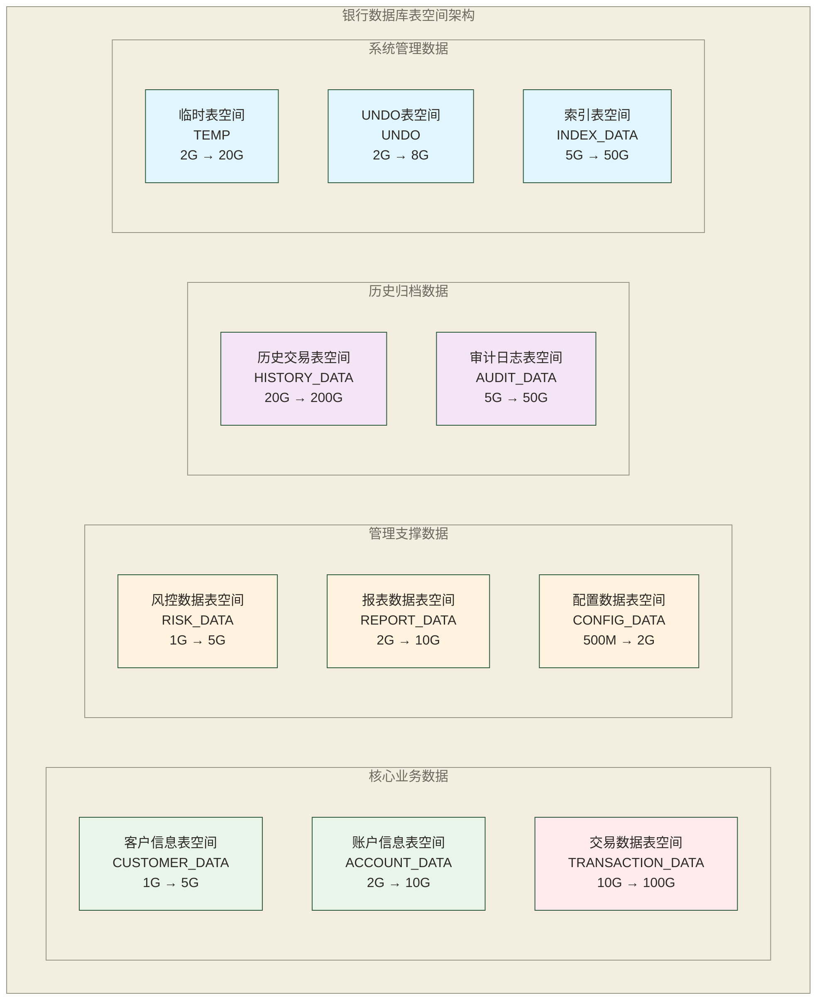

# Oracle表空间管理

## 表空间概念和类型

表空间是Oracle数据库的逻辑存储单元，用于组织和管理数据文件。在银行系统中，合理的表空间设计直接影响数据库性能、维护效率和数据安全性。

### 1. 表空间基本概念

**表空间组成**
- 逻辑结构：段(Segment) → 区(Extent) → 数据块(Block)
- 物理结构：表空间 → 数据文件 → 操作系统文件

**表空间作用**
- 逻辑存储管理
- 性能优化分离
- 备份恢复控制
- 空间配额管理

### 2. 表空间类型

```sql
-- 查看数据库中的表空间类型
SELECT 
    tablespace_name,
    contents, -- PERMANENT, TEMPORARY, UNDO
    status,
    block_size,
    extent_management, -- LOCAL, DICTIONARY
    allocation_type, -- SYSTEM, UNIFORM
    segment_space_management -- AUTO, MANUAL
FROM dba_tablespaces
ORDER BY tablespace_name;
```

## 表空间创建和维护

### 1. 永久表空间创建

```sql
-- 创建银行核心业务表空间
CREATE TABLESPACE bank_core_data
DATAFILE '/u01/oradata/bankdb/bank_core_data01.dbf' SIZE 2G
AUTOEXTEND ON NEXT 256M MAXSIZE 10G
EXTENT MANAGEMENT LOCAL
UNIFORM SIZE 1M
SEGMENT SPACE MANAGEMENT AUTO;

-- 创建银行历史数据表空间
CREATE TABLESPACE bank_history_data
DATAFILE '/u01/oradata/bankdb/bank_history_data01.dbf' SIZE 5G,
         '/u01/oradata/bankdb/bank_history_data02.dbf' SIZE 5G
AUTOEXTEND ON NEXT 500M MAXSIZE 20G
EXTENT MANAGEMENT LOCAL
UNIFORM SIZE 4M
SEGMENT SPACE MANAGEMENT AUTO;

-- 创建银行索引表空间
CREATE TABLESPACE bank_index
DATAFILE '/u01/oradata/bankdb/bank_index01.dbf' SIZE 1G
AUTOEXTEND ON NEXT 128M MAXSIZE 5G
EXTENT MANAGEMENT LOCAL
UNIFORM SIZE 512K
SEGMENT SPACE MANAGEMENT AUTO;

-- 创建银行LOB表空间
CREATE TABLESPACE bank_lob
DATAFILE '/u01/oradata/bankdb/bank_lob01.dbf' SIZE 1G
AUTOEXTEND ON NEXT 256M MAXSIZE UNLIMITED
EXTENT MANAGEMENT LOCAL
UNIFORM SIZE 2M
SEGMENT SPACE MANAGEMENT AUTO;
```

### 2. 临时表空间创建

```sql
-- 创建临时表空间
CREATE TEMPORARY TABLESPACE bank_temp
TEMPFILE '/u01/oradata/bankdb/bank_temp01.dbf' SIZE 1G
AUTOEXTEND ON NEXT 128M MAXSIZE 5G
EXTENT MANAGEMENT LOCAL
UNIFORM SIZE 1M;

-- 创建临时表空间组
CREATE TEMPORARY TABLESPACE bank_temp2
TEMPFILE '/u01/oradata/bankdb/bank_temp02.dbf' SIZE 1G;

-- 将临时表空间加入组
ALTER TABLESPACE bank_temp TABLESPACE GROUP temp_group;
ALTER TABLESPACE bank_temp2 TABLESPACE GROUP temp_group;

-- 设置默认临时表空间
ALTER DATABASE DEFAULT TEMPORARY TABLESPACE temp_group;
```

### 3. UNDO表空间创建

```sql
-- 创建UNDO表空间
CREATE UNDO TABLESPACE bank_undo
DATAFILE '/u01/oradata/bankdb/bank_undo01.dbf' SIZE 2G
AUTOEXTEND ON NEXT 256M MAXSIZE 8G;

-- 切换到新的UNDO表空间
ALTER SYSTEM SET undo_tablespace = bank_undo;

-- 检查UNDO表空间状态
SELECT 
    tablespace_name,
    status,
    bytes/1024/1024 as size_mb
FROM dba_undo_extents
WHERE tablespace_name = 'BANK_UNDO';
```

## 银行业务表空间规划策略

银行数据库的表空间规划是一项重要的架构设计工作，需要根据业务特点、数据增长模式和性能要求进行合理规划。良好的表空间设计能够提高系统性能、简化运维管理，并为业务扩展提供灵活性。

### 银行表空间规划的核心理念

> [!IMPORTANT] 🎯 银行表空间设计原则
> 
> **业务隔离原则**：
> - 不同业务模块的数据存储在独立表空间
> - 避免业务间的相互影响和资源竞争
> - 便于针对不同业务特点进行优化
> 
> **性能优化原则**：
> - 高频访问的数据使用高性能存储
> - 大数据量表空间可采用多数据文件；是否分散I/O取决于底层存储布局和实际访问负载
> - 根据数据访问模式设置合适的区间大小
> 
> **管理便利原则**：
> - 便于备份恢复的粒度控制
> - 支持灵活的空间扩展策略
> - 简化日常运维和监控工作

#### 银行表空间架构图



### 按业务模块的详细规划

基于银行业务特点，我们将数据按照访问频率、数据量大小和业务重要性进行分类存储：

```sql
-- 1. 客户信息表空间 - 核心客户数据
-- 特点：数据量适中，更新频率较低，查询频率高
CREATE TABLESPACE customer_data
DATAFILE '/u01/oradata/bankdb/customer_data01.dbf' SIZE 1G
AUTOEXTEND ON NEXT 128M MAXSIZE 5G
EXTENT MANAGEMENT LOCAL
UNIFORM SIZE 1M          -- 使用1M统一区间，适合中等数据量
SEGMENT SPACE MANAGEMENT AUTO;

-- 2. 账户信息表空间 - 账户基础数据
-- 特点：数据量较大，查询和更新都很频繁，是核心业务数据
CREATE TABLESPACE account_data
DATAFILE '/u01/oradata/bankdb/account_data01.dbf' SIZE 2G
AUTOEXTEND ON NEXT 256M MAXSIZE 10G
EXTENT MANAGEMENT LOCAL
UNIFORM SIZE 1M          -- 1M区间平衡存储效率和管理便利性
SEGMENT SPACE MANAGEMENT AUTO;

-- 3. 交易数据表空间 - 高频大数据量表空间
-- 特点：数据量巨大，增长快速，是系统性能瓶颈
CREATE TABLESPACE transaction_data
DATAFILE '/u01/oradata/bankdb/trans_data01.dbf' SIZE 5G,
         '/u01/oradata/bankdb/trans_data02.dbf' SIZE 5G  -- 多文件是否分散I/O取决于底层存储布局和实际访问负载
AUTOEXTEND ON NEXT 512M MAXSIZE 50G
EXTENT MANAGEMENT LOCAL
UNIFORM SIZE 2M          -- 2M大区间，适合大表存储
SEGMENT SPACE MANAGEMENT AUTO;

-- 4. 风控数据表空间 - 风险管理数据
-- 特点：数据量适中，对查询性能要求高，涉及合规要求
CREATE TABLESPACE risk_data
DATAFILE '/u01/oradata/bankdb/risk_data01.dbf' SIZE 1G
AUTOEXTEND ON NEXT 128M MAXSIZE 5G
EXTENT MANAGEMENT LOCAL
UNIFORM SIZE 1M          -- 中等区间大小
SEGMENT SPACE MANAGEMENT AUTO;

-- 5. 报表数据表空间 - 分析和报表数据
-- 特点：主要用于批量计算和报表生成，对磁盘空间需求较大
CREATE TABLESPACE report_data
DATAFILE '/u01/oradata/bankdb/report_data01.dbf' SIZE 2G
AUTOEXTEND ON NEXT 256M MAXSIZE 10G
EXTENT MANAGEMENT LOCAL
UNIFORM SIZE 1M
SEGMENT SPACE MANAGEMENT AUTO;

-- 6. 历史数据表空间 - 长期存储的归档数据
-- 特点：数据量巨大但访问频率低，主要用于历史查询和合规存储
CREATE TABLESPACE history_data
DATAFILE '/u01/oradata/bankdb/history_data01.dbf' SIZE 10G,
         '/u01/oradata/bankdb/history_data02.dbf' SIZE 10G
AUTOEXTEND ON NEXT 1G MAXSIZE 100G
EXTENT MANAGEMENT LOCAL
UNIFORM SIZE 4M          -- 4M大区间，优化大表存储效率
SEGMENT SPACE MANAGEMENT AUTO;

-- 7. 索引专用表空间 - 分离数据和索引便于管理，性能收益取决于底层存储布局和访问负载
CREATE TABLESPACE index_data
DATAFILE '/u01/oradata/bankdb/index_data01.dbf' SIZE 2G,
         '/u01/oradata/bankdb/index_data02.dbf' SIZE 2G
AUTOEXTEND ON NEXT 256M MAXSIZE 20G
EXTENT MANAGEMENT LOCAL
UNIFORM SIZE 1M          -- 索引通常使用较小的区间
SEGMENT SPACE MANAGEMENT AUTO;
```

> [!NOTE] 📊 表空间设计参数详解
> 
> **UNIFORM SIZE选择策略**：
> - `64K-256K`：小表、系统表、配置表
> - `1M`：中型业务表的标准选择
> - `2M-4M`：大型交易表、历史数据表
> - `8M-64M`：超大型表、数据仓库表
> 
> **AUTOEXTEND策略**：
> - `NEXT`：单次扩展大小，建议为UNIFORM SIZE的倍数
> - `MAXSIZE`：最大限制，预防失控增长
> - 建议设置为预期最大容量的1.2-1.5倍

### 表空间使用情况监控

为确保表空间的健康运行，需要建立完善的监控体系：

```sql
-- 创建表空间使用情况监控视图
CREATE OR REPLACE VIEW v_tablespace_usage AS
SELECT 
    ts.tablespace_name,
    ts.status,
    ts.contents,                              -- 表空间类型
    ROUND(ts.max_size/1024/1024, 2) AS max_size_mb,
    ROUND(ts.allocated_space/1024/1024, 2) AS allocated_mb,
    ROUND(ts.free_space/1024/1024, 2) AS free_mb,
    ROUND((ts.allocated_space - ts.free_space)/1024/1024, 2) AS used_mb,
    ROUND(((ts.allocated_space - ts.free_space) / ts.max_size) * 100, 2) AS usage_pct,
    CASE 
        WHEN ((ts.allocated_space - ts.free_space) / ts.max_size) * 100 > 90 THEN '紧急'
        WHEN ((ts.allocated_space - ts.free_space) / ts.max_size) * 100 > 80 THEN '警告' 
        WHEN ((ts.allocated_space - ts.free_space) / ts.max_size) * 100 > 70 THEN '关注'
        ELSE '正常'
    END AS status_level
FROM (
    -- 子查询计算每个表空间的空间信息
    SELECT 
        ddf.tablespace_name,
        dts.status,
        dts.contents,
        SUM(ddf.bytes) AS allocated_space,
        SUM(CASE WHEN ddf.autoextensible = 'YES' 
                 THEN ddf.maxbytes 
                 ELSE ddf.bytes END) AS max_size,
        NVL(fs.free_space, 0) AS free_space
    FROM dba_data_files ddf
    JOIN dba_tablespaces dts ON ddf.tablespace_name = dts.tablespace_name
    LEFT JOIN (
        SELECT tablespace_name, SUM(bytes) AS free_space
        FROM dba_free_space
        GROUP BY tablespace_name
    ) fs ON ddf.tablespace_name = fs.tablespace_name
    GROUP BY ddf.tablespace_name, dts.status, dts.contents, fs.free_space
) ts
ORDER BY usage_pct DESC;

-- 查看当前表空间使用情况
SELECT * FROM v_tablespace_usage;
```

> [!WARNING] ⚠️ 表空间管理关键注意事项
> 
> **空间规划误区**：
> 1. **过度预分配**：初始空间设置过大，浪费存储资源
> 2. **扩展步长过小**：频繁的自动扩展影响性能
> 3. **缺乏监控**：没有及时发现空间不足的风险
> 4. **混合存储**：将不同特性的数据存储在同一表空间
> 
> **最佳实践建议**：
> - 定期监控表空间使用率，设置自动告警
> - 为高增长的交易数据预留充足的扩展空间
> - 定期分析表空间碎片情况，适时进行整理
> - 建立表空间扩容的标准操作程序

> [!TIP] 💡 银行表空间规划经验总结
> 
> **容量规划示例假设（以下数值未提供测算依据，实际容量需按表结构、索引、LOB、压缩及保留周期估算）**：
> - 客户数据：每万客户约100-200MB
> - 账户数据：每万账户约200-500MB  
> - 交易数据：每万笔交易约50-100MB
> - 索引数据：通常为表数据的20-30%
> 
> **性能优化建议**：
> - 将索引和表数据分离到不同表空间
> - 高频访问的表空间使用SSD存储
> - 历史数据表空间可使用相对便宜的机械硬盘
> - 结合底层存储布局和实际访问负载配置多个数据文件，并通过监测判断是否改善I/O分布

### 2. 创建表时指定表空间

```sql
-- 客户信息表
CREATE TABLE customer_info (
    customer_id VARCHAR2(20) PRIMARY KEY,
    customer_name VARCHAR2(100) NOT NULL,
    id_card VARCHAR2(18) UNIQUE,
    phone VARCHAR2(11),
    email VARCHAR2(100),
    create_time DATE DEFAULT SYSDATE
) TABLESPACE customer_data;

-- 客户信息表的索引
CREATE INDEX idx_customer_name ON customer_info(customer_name) 
TABLESPACE bank_index;

CREATE INDEX idx_customer_phone ON customer_info(phone) 
TABLESPACE bank_index;

-- 交易记录表（分区表）
CREATE TABLE transaction_log (
    trans_id VARCHAR2(30) PRIMARY KEY,
    account_id VARCHAR2(20),
    trans_type VARCHAR2(20),
    amount NUMBER(15,2),
    trans_time DATE,
    status VARCHAR2(10)
)
PARTITION BY RANGE (trans_time) (
    PARTITION p_2023_q1 VALUES LESS THAN (DATE '2023-04-01') TABLESPACE transaction_data,
    PARTITION p_2023_q2 VALUES LESS THAN (DATE '2023-07-01') TABLESPACE transaction_data,
    PARTITION p_2023_q3 VALUES LESS THAN (DATE '2023-10-01') TABLESPACE transaction_data,
    PARTITION p_2023_q4 VALUES LESS THAN (DATE '2024-01-01') TABLESPACE transaction_data
);

-- 大对象表
CREATE TABLE customer_documents (
    doc_id VARCHAR2(30) PRIMARY KEY,
    customer_id VARCHAR2(20),
    doc_type VARCHAR2(50),
    doc_content BLOB
) TABLESPACE customer_data
LOB (doc_content) STORE AS (TABLESPACE bank_lob);
```

## 表空间监控和管理

### 1. 表空间使用情况监控

```sql
-- 创建表空间监控视图
CREATE OR REPLACE VIEW v_tablespace_usage AS
SELECT 
    ts.tablespace_name,
    ts.status,
    NVL(df.total_size_mb, 0) as total_size_mb,
    NVL(df.total_size_mb - NVL(fs.free_size_mb, 0), 0) as used_size_mb,
    NVL(fs.free_size_mb, 0) as free_size_mb,
    ROUND(NVL((df.total_size_mb - NVL(fs.free_size_mb, 0)) / df.total_size_mb * 100, 0), 2) as used_percent,
    df.datafile_count,
    ts.contents,
    ts.extent_management,
    ts.segment_space_management
FROM dba_tablespaces ts
LEFT JOIN (
    SELECT 
        tablespace_name,
        ROUND(SUM(bytes) / 1024 / 1024, 2) as total_size_mb,
        COUNT(*) as datafile_count
    FROM dba_data_files
    GROUP BY tablespace_name
) df ON ts.tablespace_name = df.tablespace_name
LEFT JOIN (
    SELECT 
        tablespace_name,
        ROUND(SUM(bytes) / 1024 / 1024, 2) as free_size_mb
    FROM dba_free_space
    GROUP BY tablespace_name
) fs ON ts.tablespace_name = fs.tablespace_name
WHERE ts.contents = 'PERMANENT'
ORDER BY used_percent DESC;

-- 查看表空间使用情况
SELECT * FROM v_tablespace_usage;
```

### 2. 表空间告警监控

```sql
-- 创建表空间监控存储过程
CREATE OR REPLACE PROCEDURE monitor_tablespace_usage
AS
    CURSOR c_tablespace_usage IS
        SELECT tablespace_name, used_percent, free_size_mb
        FROM v_tablespace_usage
        WHERE used_percent > 80; -- 使用率超过80%告警
    
    v_alert_count NUMBER := 0;
    v_message VARCHAR2(4000);
BEGIN
    FOR ts_rec IN c_tablespace_usage LOOP
        v_alert_count := v_alert_count + 1;
        
        v_message := '表空间告警：' || ts_rec.tablespace_name || 
                    ' 使用率：' || ts_rec.used_percent || '%' ||
                    ' 剩余空间：' || ts_rec.free_size_mb || 'MB';
        
        -- 记录告警日志
        INSERT INTO tablespace_alert_log (
            alert_time, tablespace_name, used_percent, 
            free_size_mb, alert_message
        ) VALUES (
            SYSDATE, ts_rec.tablespace_name, ts_rec.used_percent,
            ts_rec.free_size_mb, v_message
        );
        
        -- 输出告警信息
        DBMS_OUTPUT.PUT_LINE(v_message);
        
        -- 如果使用率超过90%，尝试自动扩展
        IF ts_rec.used_percent > 90 THEN
            auto_extend_tablespace(ts_rec.tablespace_name);
        END IF;
    END LOOP;
    
    IF v_alert_count = 0 THEN
        DBMS_OUTPUT.PUT_LINE('所有表空间使用率正常');
    END IF;
    
    COMMIT;
END monitor_tablespace_usage;
/

-- 创建告警日志表
CREATE TABLE tablespace_alert_log (
    alert_id NUMBER PRIMARY KEY,
    alert_time DATE,
    tablespace_name VARCHAR2(128),
    used_percent NUMBER(5,2),
    free_size_mb NUMBER(10,2),
    alert_message VARCHAR2(1000),
    handled CHAR(1) DEFAULT 'N'
);

CREATE SEQUENCE alert_id_seq START WITH 1;

-- 创建触发器自动生成告警ID
CREATE OR REPLACE TRIGGER trg_alert_id
BEFORE INSERT ON tablespace_alert_log
FOR EACH ROW
BEGIN
    :NEW.alert_id := alert_id_seq.NEXTVAL;
END;
/
```

### 3. 自动扩展管理

```sql
-- 自动扩展表空间存储过程
CREATE OR REPLACE PROCEDURE auto_extend_tablespace(
    p_tablespace_name IN VARCHAR2
)
AS
    v_datafile_path VARCHAR2(512);
    v_next_file_size NUMBER := 1024; -- 1GB
    v_sql VARCHAR2(1000);
    v_file_count NUMBER;
BEGIN
    -- 获取表空间的第一个数据文件路径作为模板
    SELECT file_name, COUNT(*) OVER()
    INTO v_datafile_path, v_file_count
    FROM dba_data_files
    WHERE tablespace_name = p_tablespace_name
    AND ROWNUM = 1;
    
    -- 生成新数据文件名
    v_datafile_path := REGEXP_REPLACE(v_datafile_path, '\d+\.dbf$', 
                                     LPAD(v_file_count + 1, 2, '0') || '.dbf');
    
    -- 添加新数据文件
    v_sql := 'ALTER TABLESPACE ' || p_tablespace_name || 
             ' ADD DATAFILE ''' || v_datafile_path || '''' ||
             ' SIZE ' || v_next_file_size || 'M' ||
             ' AUTOEXTEND ON NEXT 256M MAXSIZE 10G';
    
    EXECUTE IMMEDIATE v_sql;
    
    -- 记录扩展日志
    INSERT INTO tablespace_extend_log (
        extend_time, tablespace_name, action_type, 
        file_name, file_size_mb, status
    ) VALUES (
        SYSDATE, p_tablespace_name, 'ADD_DATAFILE',
        v_datafile_path, v_next_file_size, 'SUCCESS'
    );
    
    COMMIT;
    
    DBMS_OUTPUT.PUT_LINE('表空间 ' || p_tablespace_name || ' 自动扩展完成');
    DBMS_OUTPUT.PUT_LINE('新增数据文件：' || v_datafile_path);
    
EXCEPTION
    WHEN OTHERS THEN
        -- 记录失败日志
        INSERT INTO tablespace_extend_log (
            extend_time, tablespace_name, action_type,
            file_name, file_size_mb, status, error_message
        ) VALUES (
            SYSDATE, p_tablespace_name, 'ADD_DATAFILE',
            v_datafile_path, v_next_file_size, 'FAILED', SQLERRM
        );
        COMMIT;
        RAISE;
END auto_extend_tablespace;
/

-- 创建扩展日志表
CREATE TABLE tablespace_extend_log (
    log_id NUMBER PRIMARY KEY,
    extend_time DATE,
    tablespace_name VARCHAR2(128),
    action_type VARCHAR2(50),
    file_name VARCHAR2(512),
    file_size_mb NUMBER(10),
    status VARCHAR2(20),
    error_message VARCHAR2(1000)
);
```

## 表空间维护操作

### 1. 数据文件管理

```sql
-- 添加数据文件
ALTER TABLESPACE transaction_data 
ADD DATAFILE '/u01/oradata/bankdb/trans_data03.dbf' SIZE 2G
AUTOEXTEND ON NEXT 256M MAXSIZE 10G;

-- 调整数据文件大小
ALTER DATABASE DATAFILE '/u01/oradata/bankdb/trans_data01.dbf' 
RESIZE 6G;

-- 启用自动扩展
ALTER DATABASE DATAFILE '/u01/oradata/bankdb/customer_data01.dbf'
AUTOEXTEND ON NEXT 128M MAXSIZE 3G;

-- 移动数据文件
ALTER TABLESPACE customer_data OFFLINE;

-- 在操作系统级别移动文件
-- mv /u01/oradata/bankdb/customer_data01.dbf /u02/oradata/bankdb/

ALTER TABLESPACE customer_data 
RENAME DATAFILE '/u01/oradata/bankdb/customer_data01.dbf' 
TO '/u02/oradata/bankdb/customer_data01.dbf';

ALTER TABLESPACE customer_data ONLINE;
```

### 2. 表空间碎片整理

```sql
-- 查看表空间碎片情况
SELECT 
    tablespace_name,
    COUNT(*) as free_chunks,
    MAX(bytes)/1024/1024 as max_free_mb,
    AVG(bytes)/1024/1024 as avg_free_mb,
    SUM(bytes)/1024/1024 as total_free_mb
FROM dba_free_space
GROUP BY tablespace_name
ORDER BY free_chunks DESC;

-- 表空间碎片整理存储过程
CREATE OR REPLACE PROCEDURE defragment_tablespace(
    p_tablespace_name IN VARCHAR2
)
AS
    CURSOR c_segments IS
        SELECT owner, segment_name, segment_type
        FROM dba_segments
        WHERE tablespace_name = p_tablespace_name
        AND segment_type IN ('TABLE', 'INDEX')
        ORDER BY bytes DESC;
    
    v_sql VARCHAR2(1000);
    v_processed_count NUMBER := 0;
BEGIN
    DBMS_OUTPUT.PUT_LINE('开始整理表空间：' || p_tablespace_name);
    
    FOR seg_rec IN c_segments LOOP
        BEGIN
            IF seg_rec.segment_type = 'TABLE' THEN
                -- 重建表（在生产环境需要谨慎使用）
                v_sql := 'ALTER TABLE ' || seg_rec.owner || '.' || 
                        seg_rec.segment_name || ' MOVE TABLESPACE ' || p_tablespace_name;
                EXECUTE IMMEDIATE v_sql;
                
                -- 重建表上的索引
                FOR idx_rec IN (
                    SELECT index_name, owner 
                    FROM dba_indexes 
                    WHERE table_owner = seg_rec.owner 
                    AND table_name = seg_rec.segment_name
                ) LOOP
                    v_sql := 'ALTER INDEX ' || idx_rec.owner || '.' || 
                            idx_rec.index_name || ' REBUILD';
                    EXECUTE IMMEDIATE v_sql;
                END LOOP;
                
            ELSIF seg_rec.segment_type = 'INDEX' THEN
                -- 重建索引
                v_sql := 'ALTER INDEX ' || seg_rec.owner || '.' || 
                        seg_rec.segment_name || ' REBUILD';
                EXECUTE IMMEDIATE v_sql;
            END IF;
            
            v_processed_count := v_processed_count + 1;
            
            IF MOD(v_processed_count, 10) = 0 THEN
                DBMS_OUTPUT.PUT_LINE('已处理 ' || v_processed_count || ' 个对象');
            END IF;
            
        EXCEPTION
            WHEN OTHERS THEN
                DBMS_OUTPUT.PUT_LINE('处理对象失败：' || seg_rec.owner || '.' || 
                                   seg_rec.segment_name || ' - ' || SQLERRM);
        END;
    END LOOP;
    
    DBMS_OUTPUT.PUT_LINE('表空间整理完成，共处理 ' || v_processed_count || ' 个对象');
END defragment_tablespace;
/
```

### 3. 表空间备份和恢复

```sql
-- 将表空间设置为只读模式进行备份
ALTER TABLESPACE bank_history_data READ ONLY;

-- 执行备份操作（RMAN脚本示例）
/*
RMAN> BACKUP TABLESPACE bank_history_data;
*/

-- 恢复后设置为读写模式
ALTER TABLESPACE bank_history_data READ WRITE;

-- 创建传输表空间
CREATE TABLESPACE transport_ts
DATAFILE '/u01/oradata/bankdb/transport_ts01.dbf' SIZE 100M;

-- 导出传输表空间元数据
/*
expdp system/password DIRECTORY=DATA_PUMP_DIR 
DUMPFILE=transport_ts.dmp LOGFILE=transport_ts.log 
TRANSPORT_TABLESPACES=transport_ts
*/
```

## 性能优化建议

### 1. I/O优化

```sql
-- 查看I/O统计信息
SELECT 
    df.tablespace_name,
    df.file_name,
    fs.phyrds, -- 物理读次数
    fs.phywrts, -- 物理写次数
    fs.readtim, -- 读取时间
    fs.writetim, -- 写入时间
    ROUND(fs.readtim/GREATEST(fs.phyrds,1), 2) as avg_read_time,
    ROUND(fs.writetim/GREATEST(fs.phywrts,1), 2) as avg_write_time
FROM v$filestat fs, dba_data_files df
WHERE fs.file# = df.file_id
ORDER BY fs.phyrds + fs.phywrts DESC;

-- I/O负载均衡建议
SELECT 
    tablespace_name,
    COUNT(*) as file_count,
    SUM(phyrds + phywrts) as total_io,
    AVG(phyrds + phywrts) as avg_io_per_file,
    STDDEV(phyrds + phywrts) as io_stddev
FROM v$filestat fs, dba_data_files df
WHERE fs.file# = df.file_id
GROUP BY tablespace_name
HAVING COUNT(*) > 1
ORDER BY io_stddev DESC;
```

### 2. 空间管理优化

```sql
-- 段空间使用分析
SELECT 
    owner,
    segment_name,
    segment_type,
    tablespace_name,
    ROUND(bytes/1024/1024, 2) as size_mb,
    blocks,
    extents,
    ROUND(bytes/blocks/1024, 2) as avg_block_size_kb
FROM dba_segments
WHERE tablespace_name IN ('TRANSACTION_DATA', 'CUSTOMER_DATA', 'ACCOUNT_DATA')
ORDER BY bytes DESC;

-- 创建表空间使用优化报告
CREATE OR REPLACE PROCEDURE generate_tablespace_report
AS
    v_report CLOB;
BEGIN
    v_report := 'Oracle表空间使用情况报告' || CHR(10) || 
                '生成时间：' || TO_CHAR(SYSDATE, 'YYYY-MM-DD HH24:MI:SS') || CHR(10) ||
                '=' || RPAD('=', 50, '=') || CHR(10) || CHR(10);
    
    -- 添加表空间使用情况
    FOR ts_rec IN (SELECT * FROM v_tablespace_usage ORDER BY used_percent DESC) LOOP
        v_report := v_report || 
                    '表空间：' || ts_rec.tablespace_name || CHR(10) ||
                    '  总大小：' || ts_rec.total_size_mb || ' MB' || CHR(10) ||
                    '  已使用：' || ts_rec.used_size_mb || ' MB (' || ts_rec.used_percent || '%)' || CHR(10) ||
                    '  剩余：' || ts_rec.free_size_mb || ' MB' || CHR(10) ||
                    '  文件数：' || ts_rec.datafile_count || CHR(10) || CHR(10);
    END LOOP;
    
    -- 输出报告（实际应用中可以发送邮件或保存到文件）
    DBMS_OUTPUT.PUT_LINE(v_report);
END generate_tablespace_report;
/
```

合理的表空间管理是Oracle数据库运维的重要组成部分。在银行等关键业务系统中，良好的表空间设计和管理有助于存储组织和运维管理；性能收益取决于实际存储布局与负载，数据安全还需结合权限控制、备份恢复等措施。