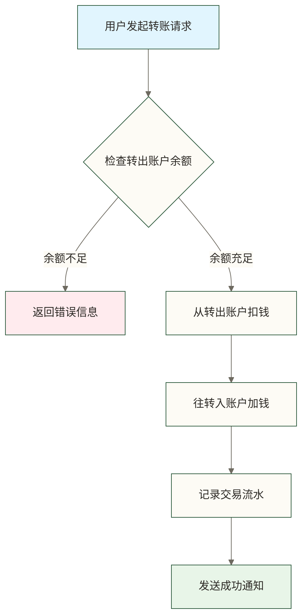
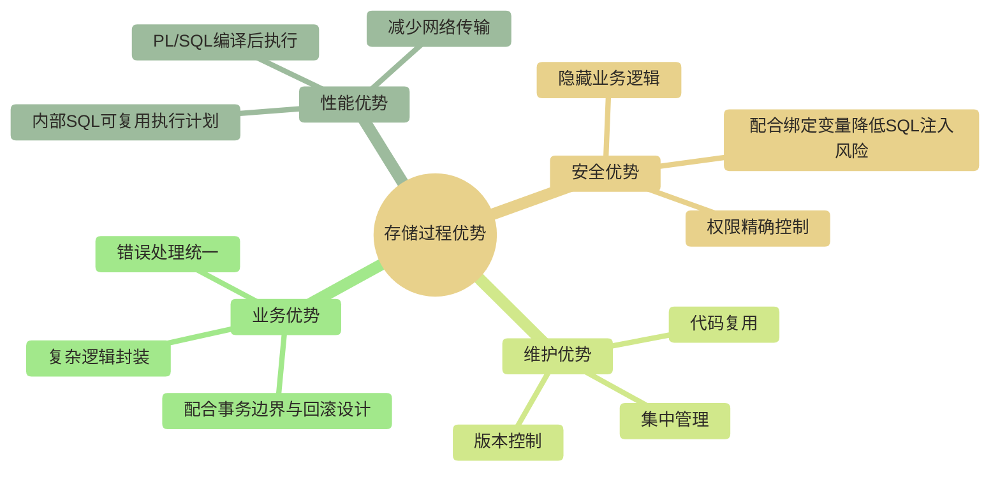
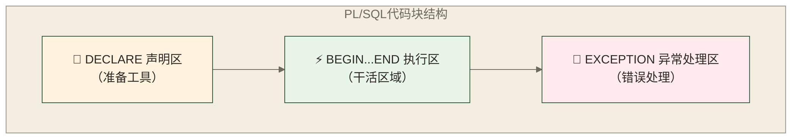
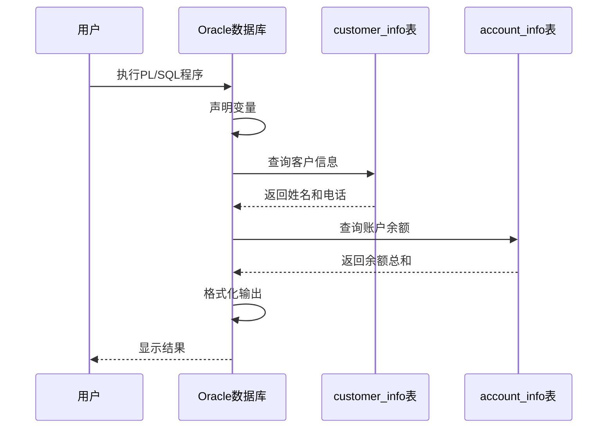
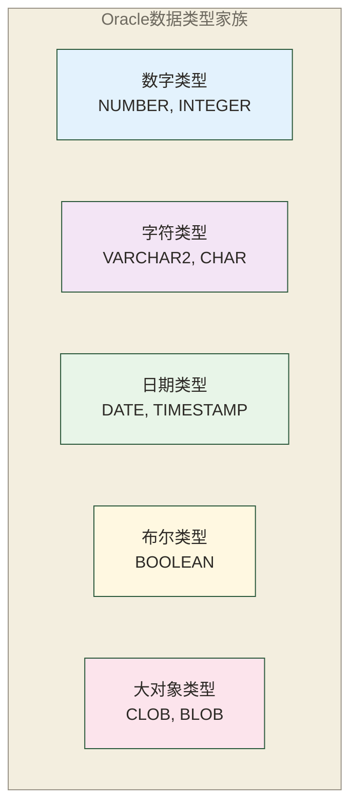
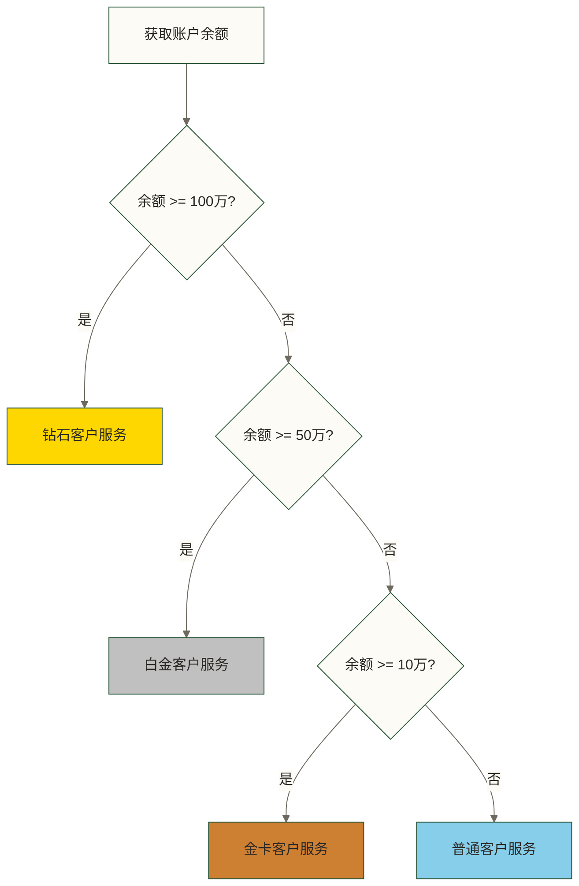
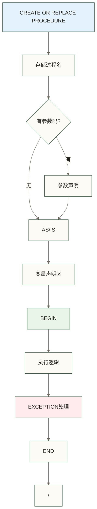
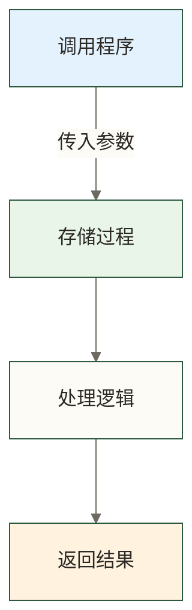
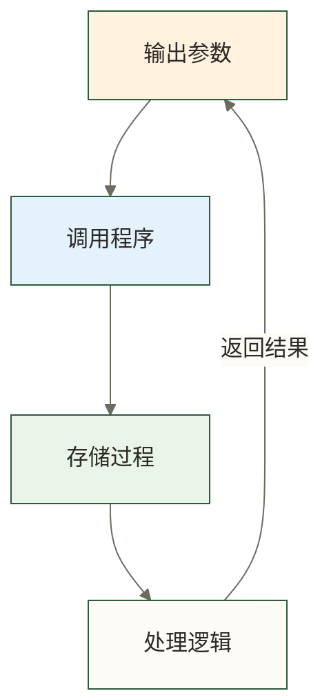

# Oracle存储过程基础 - 零基础入门教程

## 🎯 什么是存储过程（用最简单的话说）

**存储过程就像是一个"程序包"**，把很多SQL语句和逻辑打包在一起，存在数据库里。就像你把常用的操作写成一个脚本，需要的时候直接运行，而不用每次都重复写同样的代码。

> [!TIP] 💡 生活中的类比
> 存储过程就像咖啡机的"一键制作"功能：
> - 普通方式：每次都要量豆子、磨粉、加水、调温度...
> - 存储过程：按一个按钮，咖啡机自动完成所有步骤
> 
> 银行的存储过程也是这样：把复杂的业务流程"一键化"！

### 🏦 银行转账的教学示例场景

让我们用一个具体的银行转账例子来理解存储过程的价值：



**如果没有存储过程**，每次转账都需要：
1. 写SQL检查余额
2. 写SQL扣钱  
3. 写SQL加钱
4. 写SQL记录流水
5. 处理各种错误情况

**有了存储过程**，只需要：
```sql
EXEC transfer_money('账户A', '账户B', 1000);
```

> [!WARNING] ⚠️ 重要提醒
> 银行业务对数据一致性要求极高！转账过程中任何一步出错，都必须回滚所有操作。在正确设计事务边界、异常传播和回滚处理的前提下，转账操作才能实现"要么全成功，要么全失败"，这叫做**事务的原子性**；仅封装为存储过程并不会自动提供这一保证。

### 📈 存储过程的核心优势



> [!INFO] 📊 性能对比
> - **普通SQL**：可复用已解析的游标和执行计划，并非每次都必须重新完成全部解析工作
> - **存储过程**：可封装服务器端逻辑，减少多次调用带来的网络往返，但内部SQL仍需执行
> - **性能提升**：若将20-50%设为示例性的优化目标，需要在明确的工作负载与对照条件下测试；本文未提供测量依据，不能将该区间视为通常可获得的收益

## 📚 第一步：认识PL/SQL语言

PL/SQL是Oracle的专属编程语言，全称是"Procedural Language extension to SQL"（SQL的过程化语言扩展）。

> [!NOTE] 🤔 为什么需要PL/SQL？
> SQL很强大，但它是**声明式**的（告诉数据库你要什么），不能处理复杂的业务逻辑。
> PL/SQL是**过程化**的（告诉数据库怎么做），可以实现条件判断、循环、异常处理等复杂功能。

### 🏗️ PL/SQL的三层结构

PL/SQL代码块就像一栋三层楼的建筑：



**详细说明**：

| 区域 | 作用 | 必需性 | 类比 |
|------|------|--------|------|
| **DECLARE** | 定义变量、常量、游标等 | 可选 | 厨师准备食材和工具 |
| **BEGIN...END** | 实际执行的代码逻辑 | **必需** | 厨师按菜谱做菜 |
| **EXCEPTION** | 处理运行时错误 | 可选 | 厨师处理意外情况 |

### 🎯 第一个PL/SQL程序

让我们通过一个银行查询客户信息的例子来理解PL/SQL：

```sql
-- 🎯 查询客户信息的完整示例
DECLARE
    -- 📝 声明区：准备我们需要的"工具"
    v_customer_name VARCHAR2(100);  -- 客户姓名变量
    v_phone VARCHAR2(20);           -- 电话号码变量
    v_balance NUMBER(15,2);         -- 账户余额变量
    
BEGIN
    -- ⚡ 执行区：开始干活
    DBMS_OUTPUT.PUT_LINE('=== 开始查询客户信息 ===');
    
    -- 查询客户基本信息
    SELECT customer_name, phone 
    INTO v_customer_name, v_phone
    FROM customer_info 
    WHERE customer_id = 1001;
    
    -- 查询客户账户余额
    SELECT SUM(balance) 
    INTO v_balance
    FROM account_info 
    WHERE customer_id = 1001;
    
    -- 显示查询结果
    DBMS_OUTPUT.PUT_LINE('客户姓名：' || v_customer_name);
    DBMS_OUTPUT.PUT_LINE('联系电话：' || NVL(v_phone, '未登记'));
    DBMS_OUTPUT.PUT_LINE('账户余额：' || TO_CHAR(v_balance, '999,999,999.99') || ' 元');
    
    DBMS_OUTPUT.PUT_LINE('=== 查询完成 ===');
    
EXCEPTION
    -- 🚨 异常处理区：出错了怎么办
    WHEN NO_DATA_FOUND THEN
        DBMS_OUTPUT.PUT_LINE('❌ 错误：找不到客户ID为1001的客户');
    WHEN TOO_MANY_ROWS THEN
        DBMS_OUTPUT.PUT_LINE('❌ 错误：找到多个客户记录，数据异常');
    WHEN OTHERS THEN
        DBMS_OUTPUT.PUT_LINE('❌ 系统错误：' || SQLERRM);
END;
/
```

> [!TIP] 💡 代码解读技巧
> 1. **INTO子句**：把查询结果"装进"变量里
> 2. **||操作符**：用来连接字符串，像胶水一样
> 3. **NVL函数**：如果值是NULL，就用默认值替代
> 4. **TO_CHAR函数**：把数字格式化成带千分位的字符串
> 5. **最后的"/"**：在SQL*Plus或SQL Developer脚本运行模式中提交并执行缓冲区中的PL/SQL块；它是客户端命令，不是PL/SQL语法的一部分

**程序执行流程**：



## 🧰 第二步：学会使用变量（数据的容器）

变量就像是各种尺寸的盒子，用来临时存放不同类型的数据。在银行系统中，我们需要处理各种数据：金额、姓名、日期、状态等。

### 📋 Oracle数据类型详解



### 💰 数字类型变量

在银行系统中，金额处理是最重要的！

```sql
DECLARE
    -- 💰 银行金额相关变量
    v_balance NUMBER(15,2) := 1000000.50;    -- 账户余额（15位数，2位小数）
    v_interest_rate NUMBER(5,4) := 0.0325;   -- 利率（5位数，4位小数）
    v_transaction_count INTEGER := 0;         -- 交易笔数（整数）
    v_customer_id NUMBER(10) := 1001;        -- 客户ID
    
    -- 计算利息
    v_interest_amount NUMBER(15,2);           -- 利息金额
    
BEGIN
    -- 计算年利息
    v_interest_amount := v_balance * v_interest_rate;
    
    DBMS_OUTPUT.PUT_LINE('=== 利息计算结果 ===');
    DBMS_OUTPUT.PUT_LINE('本金：' || TO_CHAR(v_balance, '999,999,999.99') || ' 元');
    DBMS_OUTPUT.PUT_LINE('利率：' || TO_CHAR(v_interest_rate * 100, '90.99') || '%');
    DBMS_OUTPUT.PUT_LINE('年利息：' || TO_CHAR(v_interest_amount, '999,999,999.99') || ' 元');
END;
/
```

> [!WARNING] ⚠️ 金额处理的重要提醒
> - **本例使用NUMBER(15,2)**：总精度为15位、小数位数为2，可容纳千万级金额；实际精度、币种小数位和计算中间精度应按业务要求选择
> - **区分数值类型**：Oracle FLOAT是NUMBER的子类型，以二进制位数声明精度，不同于采用二进制浮点表示的BINARY_FLOAT和BINARY_DOUBLE；金额通常使用明确精度和小数位的NUMBER，并按业务要求设计中间计算精度与舍入规则
> - **格式化显示**：使用TO_CHAR函数格式化金额显示

### 📝 字符类型变量

```sql
DECLARE
    -- 📝 客户信息相关变量
    v_customer_name VARCHAR2(100);     -- 客户姓名（可变长度）
    v_id_card CHAR(18);                -- 身份证号（固定18位）
    v_bank_code CHAR(4) := 'ICBC';     -- 银行代码（固定长度）
    v_account_type VARCHAR2(20);       -- 账户类型
    v_description VARCHAR2(500);       -- 备注说明
    
BEGIN
    -- 字符串操作示例
    v_customer_name := '张三';
    v_account_type := '储蓄账户';
    v_description := '这是一个' || v_account_type || '，客户姓名：' || v_customer_name;
    
    DBMS_OUTPUT.PUT_LINE('客户信息：' || v_description);
    DBMS_OUTPUT.PUT_LINE('姓名长度：' || LENGTH(v_customer_name) || ' 个字符');
    DBMS_OUTPUT.PUT_LINE('银行代码：' || v_bank_code);
END;
/
```

> [!INFO] 📚 VARCHAR2 vs CHAR 的区别
> - **VARCHAR2**：可变长度，节省空间，适合存储姓名、地址等
> - **CHAR**：固定长度，会补空格，适合存储编码、状态等
> 
> **银行应用场景**：
> - `VARCHAR2`：客户姓名、地址、备注
> - `CHAR`：银行代码、账户状态、性别标识

### 📅 日期时间类型

银行业务中，时间记录至关重要！

```sql
DECLARE
    -- 📅 时间相关变量
    v_today DATE := SYSDATE;                    -- 当前日期时间
    v_birthday DATE := DATE '1990-05-15';      -- 生日
    v_account_open_date DATE;                   -- 开户日期
    v_last_trans_time TIMESTAMP;               -- 最后交易时间（精确到毫秒）
    
    -- 计算变量
    v_age NUMBER(3);                            -- 年龄
    v_account_years NUMBER(5,2);                -- 开户年数
    
BEGIN
    -- 设置开户日期为3年前
    v_account_open_date := ADD_MONTHS(SYSDATE, -36);
    v_last_trans_time := SYSTIMESTAMP - INTERVAL '5' DAY;  -- 5天前，使用时间间隔运算
    
    -- 计算年龄
    v_age := FLOOR(MONTHS_BETWEEN(SYSDATE, v_birthday) / 12);
    
    -- 计算开户年数
    v_account_years := MONTHS_BETWEEN(SYSDATE, v_account_open_date) / 12;
    
    DBMS_OUTPUT.PUT_LINE('=== 时间信息 ===');
    DBMS_OUTPUT.PUT_LINE('今天：' || TO_CHAR(v_today, 'YYYY-MM-DD HH24:MI:SS'));
    DBMS_OUTPUT.PUT_LINE('生日：' || TO_CHAR(v_birthday, 'YYYY-MM-DD'));
    DBMS_OUTPUT.PUT_LINE('年龄：' || v_age || ' 岁');
    DBMS_OUTPUT.PUT_LINE('开户日期：' || TO_CHAR(v_account_open_date, 'YYYY-MM-DD'));
    DBMS_OUTPUT.PUT_LINE('开户年数：' || ROUND(v_account_years, 1) || ' 年');
    DBMS_OUTPUT.PUT_LINE('最后交易：' || TO_CHAR(v_last_trans_time, 'YYYY-MM-DD HH24:MI:SS.FF3'));
END;
/
```

> [!TIP] 💡 日期处理技巧
> **常用日期函数**：
> - `SYSDATE`：当前日期时间
> - `SYSTIMESTAMP`：当前时间戳（包含毫秒）  
> - `ADD_MONTHS(日期, 月数)`：增加月份
> - `MONTHS_BETWEEN(日期1, 日期2)`：计算月份差
> - `TO_CHAR(日期, 格式)`：格式化日期显示

### 🎯 聪明的变量定义方法

Oracle提供了一个超级实用的功能：让变量自动使用表字段的数据类型！

```sql
DECLARE
    -- 🎯 使用%TYPE自动获取字段类型
    v_customer_id customer_info.customer_id%TYPE;
    v_customer_name customer_info.customer_name%TYPE;
    v_balance account_info.balance%TYPE;
    v_create_time customer_info.create_time%TYPE;
    
    -- 🎯 使用%ROWTYPE获取整行结构
    v_customer_rec customer_info%ROWTYPE;
    
BEGIN
    -- 给单个变量赋值
    v_customer_id := 1001;
    
    -- 查询单个字段
    SELECT customer_name, create_time
    INTO v_customer_name, v_create_time
    FROM customer_info
    WHERE customer_id = v_customer_id;
    
    -- 查询整行数据
    SELECT * INTO v_customer_rec
    FROM customer_info
    WHERE customer_id = v_customer_id;
    
    DBMS_OUTPUT.PUT_LINE('=== 单字段查询结果 ===');
    DBMS_OUTPUT.PUT_LINE('客户姓名：' || v_customer_name);
    DBMS_OUTPUT.PUT_LINE('创建时间：' || TO_CHAR(v_create_time, 'YYYY-MM-DD'));
    
    DBMS_OUTPUT.PUT_LINE('=== 整行查询结果 ===');
    DBMS_OUTPUT.PUT_LINE('客户ID：' || v_customer_rec.customer_id);
    DBMS_OUTPUT.PUT_LINE('客户姓名：' || v_customer_rec.customer_name);
    DBMS_OUTPUT.PUT_LINE('电话：' || NVL(v_customer_rec.phone, '未登记'));
    
EXCEPTION
    WHEN NO_DATA_FOUND THEN
        DBMS_OUTPUT.PUT_LINE('未找到客户信息');
END;
/
```

> [!SUCCESS] ✅ %TYPE和%ROWTYPE的优势
> **%TYPE的好处**：
> - 自动适应表结构变化
> - 避免数据类型不匹配错误
> - 代码更易维护
> 
> **%ROWTYPE的好处**：
> - 一次性获取整行数据
> - 代码更简洁
> - 适合需要多个字段的场景

## 🎮 第三步：程序流程控制

程序需要根据不同条件做不同的事情，这就需要用到流程控制语句。就像银行柜员根据不同情况采取不同操作一样。

### 🤔 条件判断：IF-THEN-ELSE

银行最常见的场景：根据客户余额判断服务等级



**完整的客户等级判断程序**：

```sql
-- 🏆 客户等级判断系统
DECLARE
    v_customer_id NUMBER := 1001;
    v_customer_name customer_info.customer_name%TYPE;
    v_total_balance NUMBER(15,2) := 0;
    v_customer_level VARCHAR2(20);
    v_service_suggestion VARCHAR2(500);
    
BEGIN
    DBMS_OUTPUT.PUT_LINE('=== 客户等级评估系统 ===');
    
    -- 🔍 第1步：获取客户基本信息
    SELECT customer_name INTO v_customer_name
    FROM customer_info
    WHERE customer_id = v_customer_id;
    
    -- 🔍 第2步：计算客户总资产
    SELECT NVL(SUM(balance), 0) INTO v_total_balance
    FROM account_info
    WHERE customer_id = v_customer_id
    AND status = 'ACTIVE';
    
    DBMS_OUTPUT.PUT_LINE('客户姓名：' || v_customer_name);
    DBMS_OUTPUT.PUT_LINE('总资产：' || TO_CHAR(v_total_balance, '999,999,999.99') || ' 元');
    DBMS_OUTPUT.PUT_LINE('');
    
    -- 🏆 第3步：根据资产等级进行分类
    IF v_total_balance >= 1000000 THEN
        -- 钻石客户：100万以上
        v_customer_level := '钻石客户';
        v_service_suggestion := '享受专属理财经理一对一服务，VIP通道优先办理，专属理财产品推荐';
        
    ELSIF v_total_balance >= 500000 THEN
        -- 白金客户：50万-100万
        v_customer_level := '白金客户';
        v_service_suggestion := '享受理财经理服务，优先办理业务，高端理财产品推荐';
        
    ELSIF v_total_balance >= 100000 THEN
        -- 金卡客户：10万-50万
        v_customer_level := '金卡客户';
        v_service_suggestion := '享受专属客服热线，定期理财产品推荐，免部分手续费';
        
    ELSIF v_total_balance >= 10000 THEN
        -- 银卡客户：1万-10万
        v_customer_level := '银卡客户';
        v_service_suggestion := '享受网银优惠服务，基础理财产品推荐';
        
    ELSE
        -- 普通客户：1万以下
        v_customer_level := '普通客户';
        v_service_suggestion := '建议增加资产投入，享受更多银行优质服务';
    END IF;
    
    -- 🎯 第4步：输出评估结果
    DBMS_OUTPUT.PUT_LINE('客户等级：' || v_customer_level);
    DBMS_OUTPUT.PUT_LINE('服务建议：' || v_service_suggestion);
    
    -- 📊 第5步：生成个性化建议
    DBMS_OUTPUT.PUT_LINE('');
    DBMS_OUTPUT.PUT_LINE('=== 个性化服务建议 ===');
    
    IF v_customer_level IN ('钻石客户', '白金客户') THEN
        DBMS_OUTPUT.PUT_LINE('🌟 高端客户专享：');
        DBMS_OUTPUT.PUT_LINE('  • 私人银行服务');
        DBMS_OUTPUT.PUT_LINE('  • 海外投资咨询');
        DBMS_OUTPUT.PUT_LINE('  • 税务筹划建议');
    ELSIF v_customer_level = '金卡客户' THEN
        DBMS_OUTPUT.PUT_LINE('💎 金卡客户推荐：');
        DBMS_OUTPUT.PUT_LINE('  • 定期存款优惠利率');
        DBMS_OUTPUT.PUT_LINE('  • 基金定投服务');
        DBMS_OUTPUT.PUT_LINE('  • 保险理财规划');
    ELSE
        DBMS_OUTPUT.PUT_LINE('📈 成长建议：');
        DBMS_OUTPUT.PUT_LINE('  • 开通定期存款');
        DBMS_OUTPUT.PUT_LINE('  • 考虑基金投资');
        DBMS_OUTPUT.PUT_LINE('  • 关注理财讲座');
    END IF;
    
EXCEPTION
    WHEN NO_DATA_FOUND THEN
        DBMS_OUTPUT.PUT_LINE('❌ 客户不存在或无有效账户');
    WHEN OTHERS THEN
        DBMS_OUTPUT.PUT_LINE('❌ 系统错误：' || SQLERRM);
END;
/
```

> [!INFO] 🎯 条件判断的最佳实践
> **IF语句结构**：
> - `IF 条件 THEN`：如果条件成立
> - `ELSIF 条件 THEN`：否则如果（可以有多个）
> - `ELSE`：其他所有情况
> - `END IF`：结束条件判断
> 
> **注意事项**：
> - 条件从上到下依次检查
> - 一旦匹配就执行，后面的不再检查
> - 条件的顺序很重要！

### 🔄 CASE语句：更优雅的多分支判断

CASE语句是另一种处理多分支的方法，代码更简洁：

```sql
DECLARE
    v_account_type VARCHAR2(20) := 'SAVINGS';
    v_interest_rate NUMBER(5,4);
    v_min_balance NUMBER(10,2);
    v_service_fee NUMBER(8,2);
    
BEGIN
    DBMS_OUTPUT.PUT_LINE('=== 账户类型信息查询 ===');
    
    -- 🎯 使用CASE语句设置利率
    v_interest_rate := CASE v_account_type
        WHEN 'SAVINGS' THEN 0.0250    -- 储蓄账户 2.5%
        WHEN 'CHECKING' THEN 0.0100   -- 支票账户 1.0%
        WHEN 'TIME_DEPOSIT' THEN 0.0350 -- 定期存款 3.5%
        WHEN 'VIP_SAVINGS' THEN 0.0300  -- VIP储蓄 3.0%
        ELSE 0.0200                    -- 默认利率 2.0%
    END;
    
    -- 🎯 使用CASE语句设置最低余额要求
    v_min_balance := CASE 
        WHEN v_account_type = 'SAVINGS' THEN 100
        WHEN v_account_type = 'CHECKING' THEN 500
        WHEN v_account_type = 'TIME_DEPOSIT' THEN 1000
        WHEN v_account_type = 'VIP_SAVINGS' THEN 50000
        ELSE 0
    END;
    
    -- 🎯 使用CASE语句计算服务费
    v_service_fee := CASE
        WHEN v_account_type IN ('VIP_SAVINGS', 'TIME_DEPOSIT') THEN 0  -- 免费
        WHEN v_account_type = 'SAVINGS' THEN 5   -- 储蓄账户 5元/月
        WHEN v_account_type = 'CHECKING' THEN 10 -- 支票账户 10元/月
        ELSE 8  -- 其他类型 8元/月
    END;
    
    -- 显示结果
    DBMS_OUTPUT.PUT_LINE('账户类型：' || v_account_type);
    DBMS_OUTPUT.PUT_LINE('年利率：' || TO_CHAR(v_interest_rate * 100, '90.99') || '%');
    DBMS_OUTPUT.PUT_LINE('最低余额：' || TO_CHAR(v_min_balance, '999,999') || ' 元');
    DBMS_OUTPUT.PUT_LINE('月服务费：' || TO_CHAR(v_service_fee, '999') || ' 元');
    
END;
/
```

### 🔁 循环语句：重复执行任务

银行经常需要批量处理数据，比如计算所有账户的利息：

#### 📍 FOR循环：最简单的循环

```sql
-- 🔄 批量计算多个账户的利息
DECLARE
    v_balance NUMBER(15,2);
    v_interest NUMBER(15,2);
    v_interest_rate CONSTANT NUMBER(5,4) := 0.0325; -- 年利率3.25%
    v_total_interest NUMBER(15,2) := 0;
    
BEGIN
    DBMS_OUTPUT.PUT_LINE('=== 批量利息计算 ===');
    DBMS_OUTPUT.PUT_LINE('年利率：' || TO_CHAR(v_interest_rate * 100, '90.99') || '%');
    DBMS_OUTPUT.PUT_LINE('');
    
    -- 🔄 为客户ID 1001-1010各任取一个活跃账户计算示例利息，不代表全部账户计息
    FOR account_id IN 1001..1010 LOOP
        BEGIN
            -- 查询账户余额
            SELECT balance INTO v_balance
            FROM account_info
            WHERE customer_id = account_id
            AND status = 'ACTIVE'
            AND ROWNUM = 1;  -- 只取第一个账户
            
            -- 计算年利息
            v_interest := v_balance * v_interest_rate;
            v_total_interest := v_total_interest + v_interest;
            
            -- 显示计算结果
            DBMS_OUTPUT.PUT_LINE('账户 ' || account_id || 
                               '：余额 ' || TO_CHAR(v_balance, '999,999,999.99') ||
                               ' 元，利息 ' || TO_CHAR(v_interest, '999,999.99') || ' 元');
            
        EXCEPTION
            WHEN NO_DATA_FOUND THEN
                DBMS_OUTPUT.PUT_LINE('账户 ' || account_id || '：无有效账户');
        END;
    END LOOP;
    
    DBMS_OUTPUT.PUT_LINE('');
    DBMS_OUTPUT.PUT_LINE('利息总计：' || TO_CHAR(v_total_interest, '999,999,999.99') || ' 元');
    
END;
/
```

#### 📍 WHILE循环：条件控制的循环

```sql
-- 🎯 模拟存款增长计算
DECLARE
    v_principal NUMBER(15,2) := 10000;    -- 本金1万元
    v_target_amount NUMBER(15,2) := 20000; -- 目标2万元
    v_annual_rate NUMBER(5,4) := 0.0325;  -- 年利率3.25%
    v_current_amount NUMBER(15,2);
    v_years NUMBER(3) := 0;
    
BEGIN
    v_current_amount := v_principal;
    
    DBMS_OUTPUT.PUT_LINE('=== 存款增长模拟 ===');
    DBMS_OUTPUT.PUT_LINE('初始本金：' || TO_CHAR(v_principal, '999,999.99') || ' 元');
    DBMS_OUTPUT.PUT_LINE('目标金额：' || TO_CHAR(v_target_amount, '999,999.99') || ' 元');
    DBMS_OUTPUT.PUT_LINE('年利率：' || TO_CHAR(v_annual_rate * 100, '90.99') || '%');
    DBMS_OUTPUT.PUT_LINE('');
    
    -- 🔄 循环计算，直到达到目标金额
    WHILE v_current_amount < v_target_amount LOOP
        v_years := v_years + 1;
        v_current_amount := v_current_amount * (1 + v_annual_rate);
        
        DBMS_OUTPUT.PUT_LINE('第 ' || v_years || ' 年：' || 
                           TO_CHAR(v_current_amount, '999,999.99') || ' 元');
        
        -- 安全机制：避免无限循环
        IF v_years > 50 THEN
            DBMS_OUTPUT.PUT_LINE('超过50年，停止计算');
            EXIT;
        END IF;
    END LOOP;
    
    DBMS_OUTPUT.PUT_LINE('');
    IF v_current_amount >= v_target_amount THEN
        DBMS_OUTPUT.PUT_LINE('🎉 达成目标！需要 ' || v_years || ' 年时间');
    ELSE
        DBMS_OUTPUT.PUT_LINE('⚠️ 未能在合理时间内达成目标');
    END IF;
    
END;
/
```

> [!TIP] 💡 循环使用技巧
> **循环类型选择**：
> - **FOR循环**：已知循环次数时使用
> - **WHILE循环**：根据条件决定是否继续
> - **LOOP...EXIT WHEN**：更灵活的循环控制
> 
> **注意事项**：
> - 始终确保有退出条件，避免无限循环
> - 在数据库循环中处理大量数据时要小心性能
> - 考虑使用批量操作替代单条记录循环

## 🏗️ 第四步：创建你的第一个存储过程

现在我们要把前面学的知识组合起来，创建真正的存储过程！

### 🎯 存储过程的基本语法



### 🏦 银行客户统计存储过程

让我们创建一个查询银行客户统计信息的存储过程：

```sql
-- 🎯 银行客户统计存储过程
CREATE OR REPLACE PROCEDURE show_customer_statistics
AS
    -- 📊 统计变量
    v_total_customers NUMBER(10);        -- 总客户数
    v_active_customers NUMBER(10);       -- 活跃客户数  
    v_vip_customers NUMBER(10);          -- VIP客户数
    v_total_balance NUMBER(18,2);        -- 总资产
    v_avg_balance NUMBER(15,2);          -- 活跃账户平均余额
    v_largest_balance NUMBER(15,2);      -- 最大余额
    v_smallest_balance NUMBER(15,2);     -- 最小余额
    
BEGIN
    DBMS_OUTPUT.PUT_LINE('=====================================');
    DBMS_OUTPUT.PUT_LINE('        银行客户统计报表');
    DBMS_OUTPUT.PUT_LINE('=====================================');
    DBMS_OUTPUT.PUT_LINE('生成时间: ' || TO_CHAR(SYSDATE, 'YYYY-MM-DD HH24:MI:SS'));
    DBMS_OUTPUT.PUT_LINE('');
    
    -- 📊 第1部分：客户数量统计
    SELECT COUNT(*) INTO v_total_customers
    FROM customer_info;
    
    SELECT COUNT(*) INTO v_active_customers  
    FROM customer_info
    WHERE status = 'ACTIVE';
    
    -- 🏆 VIP客户定义：总资产超过50万
    SELECT COUNT(*) INTO v_vip_customers
    FROM (
        SELECT c.customer_id
        FROM customer_info c
        INNER JOIN account_info a ON c.customer_id = a.customer_id
        WHERE c.status = 'ACTIVE'
        AND a.status = 'ACTIVE'
        GROUP BY c.customer_id
        HAVING SUM(a.balance) >= 500000
    );
    
    DBMS_OUTPUT.PUT_LINE('📊 客户数量统计：');
    DBMS_OUTPUT.PUT_LINE('  总客户数：     ' || TO_CHAR(v_total_customers, '999,999') || ' 人');
    DBMS_OUTPUT.PUT_LINE('  活跃客户数：   ' || TO_CHAR(v_active_customers, '999,999') || ' 人');
    DBMS_OUTPUT.PUT_LINE('  VIP客户数：    ' || TO_CHAR(v_vip_customers, '999,999') || ' 人');
    DBMS_OUTPUT.PUT_LINE('  VIP占比：      ' || 
                        TO_CHAR(ROUND(CASE WHEN v_active_customers = 0 THEN 0 ELSE v_vip_customers/v_active_customers*100 END, 2), '990.99') || '%');
    DBMS_OUTPUT.PUT_LINE('');
    
    -- 💰 第2部分：资产统计
    SELECT 
        NVL(SUM(balance), 0),
        NVL(AVG(balance), 0),
        NVL(MAX(balance), 0),
        NVL(MIN(balance), 0)
    INTO v_total_balance, v_avg_balance, v_largest_balance, v_smallest_balance
    FROM account_info
    WHERE status = 'ACTIVE';
    
    DBMS_OUTPUT.PUT_LINE('💰 资产统计：');
    DBMS_OUTPUT.PUT_LINE('  总资产：       ' || TO_CHAR(v_total_balance, '999,999,999,999.99') || ' 元');
    DBMS_OUTPUT.PUT_LINE('  活跃账户平均余额：' || TO_CHAR(v_avg_balance, '999,999,999.99') || ' 元');
    DBMS_OUTPUT.PUT_LINE('  最大余额：     ' || TO_CHAR(v_largest_balance, '999,999,999.99') || ' 元');
    DBMS_OUTPUT.PUT_LINE('  最小余额：     ' || TO_CHAR(v_smallest_balance, '999,999,999.99') || ' 元');
    DBMS_OUTPUT.PUT_LINE('');
    
    -- 📈 第3部分：客户等级分布
    DBMS_OUTPUT.PUT_LINE('🏆 客户等级分布：');
    
    FOR level_rec IN (
        SELECT 
            CASE 
                WHEN total_balance >= 1000000 THEN '钻石客户'
                WHEN total_balance >= 500000 THEN '白金客户' 
                WHEN total_balance >= 100000 THEN '金卡客户'
                WHEN total_balance >= 10000 THEN '银卡客户'
                ELSE '普通客户'
            END as customer_level,
            COUNT(*) as customer_count
        FROM (
            SELECT c.customer_id, NVL(SUM(a.balance), 0) as total_balance
            FROM customer_info c
            LEFT JOIN account_info a ON c.customer_id = a.customer_id AND a.status = 'ACTIVE'
            WHERE c.status = 'ACTIVE'
            GROUP BY c.customer_id
        )
        GROUP BY 
            CASE 
                WHEN total_balance >= 1000000 THEN '钻石客户'
                WHEN total_balance >= 500000 THEN '白金客户'
                WHEN total_balance >= 100000 THEN '金卡客户'
                WHEN total_balance >= 10000 THEN '银卡客户'
                ELSE '普通客户'
            END
        ORDER BY MIN(total_balance) DESC
    ) LOOP
        DBMS_OUTPUT.PUT_LINE('  ' || RPAD(level_rec.customer_level, 10) || 
                           TO_CHAR(level_rec.customer_count, '999,999') || ' 人 (' ||
                           TO_CHAR(ROUND(CASE WHEN v_active_customers = 0 THEN 0 ELSE level_rec.customer_count/v_active_customers*100 END, 1), '990.9') || '%)');
    END LOOP;
    
    DBMS_OUTPUT.PUT_LINE('');
    DBMS_OUTPUT.PUT_LINE('=====================================');
    DBMS_OUTPUT.PUT_LINE('           报表生成完成');
    DBMS_OUTPUT.PUT_LINE('=====================================');
    
EXCEPTION
    WHEN OTHERS THEN
        DBMS_OUTPUT.PUT_LINE('❌ 统计过程中发生错误：' || SQLERRM);
        DBMS_OUTPUT.PUT_LINE('请联系系统管理员');
        
END show_customer_statistics;
/
```

**如何调用这个存储过程**：

```sql
-- 📞 调用方法1：在PL/SQL块中调用
BEGIN
    show_customer_statistics;
END;
/

-- 📞 调用方法2：直接执行（在SQL*Plus或SQL Developer中）
EXEC show_customer_statistics;
```

> [!SUCCESS] ✅ 存储过程创建成功！
> 恭喜你创建了第一个完整的存储过程！这个过程展示了：
> - 📊 数据统计和分析
> - 🔄 游标循环处理
> - 📋 格式化输出
> - 🚨 异常处理
> - 🎯 复杂的业务逻辑

## 🎁 第五步：存储过程参数详解

参数让存储过程更加灵活，就像函数的输入和输出一样。

### 📥 输入参数(IN)：传递信息给存储过程



**示例：根据客户ID查询详细信息**

```sql
-- 🔍 客户信息查询存储过程
CREATE OR REPLACE PROCEDURE get_customer_details(
    p_customer_id IN NUMBER  -- 📥 输入参数：客户ID
)
AS
    -- 📋 客户信息变量
    v_customer_name VARCHAR2(100);
    v_phone VARCHAR2(20);
    v_email VARCHAR2(100);
    v_create_time DATE;
    v_status VARCHAR2(20);
    
    -- 📊 账户信息变量
    v_account_count NUMBER(5);
    v_total_balance NUMBER(15,2);
    v_avg_balance NUMBER(15,2);
    
    -- 🏆 客户等级
    v_customer_level VARCHAR2(20);
    
BEGIN
    DBMS_OUTPUT.PUT_LINE('🔍 正在查询客户ID: ' || p_customer_id);
    DBMS_OUTPUT.PUT_LINE('=====================================');
    
    -- 📋 第1步：查询客户基本信息
    SELECT customer_name, phone, email, create_time, status
    INTO v_customer_name, v_phone, v_email, v_create_time, v_status
    FROM customer_info
    WHERE customer_id = p_customer_id;
    
    -- 📊 第2步：统计账户信息
    SELECT 
        COUNT(*),
        NVL(SUM(balance), 0),
        NVL(AVG(balance), 0)
    INTO v_account_count, v_total_balance, v_avg_balance
    FROM account_info
    WHERE customer_id = p_customer_id
    AND status = 'ACTIVE';
    
    -- 🏆 第3步：确定客户等级
    IF v_total_balance >= 1000000 THEN
        v_customer_level := '钻石客户';
    ELSIF v_total_balance >= 500000 THEN
        v_customer_level := '白金客户';
    ELSIF v_total_balance >= 100000 THEN
        v_customer_level := '金卡客户';
    ELSIF v_total_balance >= 10000 THEN
        v_customer_level := '银卡客户';
    ELSE
        v_customer_level := '普通客户';
    END IF;
    
    -- 🎯 第4步：输出详细信息
    DBMS_OUTPUT.PUT_LINE('👤 客户基本信息：');
    DBMS_OUTPUT.PUT_LINE('  姓名：         ' || v_customer_name);
    DBMS_OUTPUT.PUT_LINE('  电话：         ' || NVL(v_phone, '未登记'));
    DBMS_OUTPUT.PUT_LINE('  邮箱：         ' || NVL(v_email, '未登记'));
    DBMS_OUTPUT.PUT_LINE('  开户时间：     ' || TO_CHAR(v_create_time, 'YYYY-MM-DD'));
    DBMS_OUTPUT.PUT_LINE('  账户状态：     ' || CASE v_status 
                                                WHEN 'ACTIVE' THEN '正常'
                                                WHEN 'FROZEN' THEN '冻结'
                                                WHEN 'CLOSED' THEN '关闭'
                                                ELSE v_status END);
    DBMS_OUTPUT.PUT_LINE('');
    DBMS_OUTPUT.PUT_LINE('💰 资产信息：');
    DBMS_OUTPUT.PUT_LINE('  账户数量：     ' || v_account_count || ' 个');
    DBMS_OUTPUT.PUT_LINE('  总资产：       ' || TO_CHAR(v_total_balance, '999,999,999.99') || ' 元');
    DBMS_OUTPUT.PUT_LINE('  平均余额：     ' || TO_CHAR(v_avg_balance, '999,999,999.99') || ' 元');
    DBMS_OUTPUT.PUT_LINE('  客户等级：     🏆 ' || v_customer_level);
    
    -- 🎯 第5步：提供个性化建议
    DBMS_OUTPUT.PUT_LINE('');
    DBMS_OUTPUT.PUT_LINE('💡 服务建议：');
    CASE v_customer_level
        WHEN '钻石客户' THEN
            DBMS_OUTPUT.PUT_LINE('  ⭐ 专属理财经理服务');
            DBMS_OUTPUT.PUT_LINE('  ⭐ VIP通道优先办理');
            DBMS_OUTPUT.PUT_LINE('  ⭐ 高端投资产品推荐');
        WHEN '白金客户' THEN
            DBMS_OUTPUT.PUT_LINE('  💎 理财经理定期服务');
            DBMS_OUTPUT.PUT_LINE('  💎 优质理财产品推荐');
        WHEN '金卡客户' THEN
            DBMS_OUTPUT.PUT_LINE('  🥇 专属客服热线');
            DBMS_OUTPUT.PUT_LINE('  🥇 定期理财产品推荐');
        ELSE
            DBMS_OUTPUT.PUT_LINE('  📈 建议增加资产投入');
            DBMS_OUTPUT.PUT_LINE('  📈 关注基础理财产品');
    END CASE;
    
    DBMS_OUTPUT.PUT_LINE('=====================================');
    
EXCEPTION
    WHEN NO_DATA_FOUND THEN
        DBMS_OUTPUT.PUT_LINE('❌ 错误：客户ID ' || p_customer_id || ' 不存在');
    WHEN TOO_MANY_ROWS THEN
        DBMS_OUTPUT.PUT_LINE('❌ 错误：找到多个客户记录，数据异常');
    WHEN OTHERS THEN
        DBMS_OUTPUT.PUT_LINE('❌ 查询过程中发生错误：' || SQLERRM);
        
END get_customer_details;
/
```

**调用示例**：

```sql
-- 查询不同客户的信息
BEGIN
    get_customer_details(1001);  -- 查询客户1001
    DBMS_OUTPUT.PUT_LINE('');
    get_customer_details(1002);  -- 查询客户1002
END;
/
```

### 📤 输出参数(OUT)：从存储过程返回信息



**示例：账户余额查询，返回多个结果**

```sql
-- 💰 账户余额查询存储过程（带输出参数）
CREATE OR REPLACE PROCEDURE get_account_summary(
    p_customer_id IN NUMBER,          -- 📥 输入：客户ID
    p_total_balance OUT NUMBER,       -- 📤 输出：总余额  
    p_account_count OUT NUMBER,       -- 📤 输出：账户数量
    p_avg_balance OUT NUMBER,         -- 📤 输出：平均余额
    p_customer_level OUT VARCHAR2,    -- 📤 输出：客户等级
    p_status OUT VARCHAR2             -- 📤 输出：操作状态
)
AS
    v_customer_exists NUMBER;
    
BEGIN
    -- 🔍 第1步：检查客户是否存在
    SELECT COUNT(*) INTO v_customer_exists
    FROM customer_info
    WHERE customer_id = p_customer_id
    AND status = 'ACTIVE';
    
    IF v_customer_exists = 0 THEN
        -- 客户不存在
        p_total_balance := 0;
        p_account_count := 0;
        p_avg_balance := 0;
        p_customer_level := 'NONE';
        p_status := 'CUSTOMER_NOT_FOUND';
        RETURN;  -- 提前退出
    END IF;
    
    -- 📊 第2步：统计账户信息
    SELECT 
        NVL(SUM(balance), 0),
        COUNT(*),
        NVL(AVG(balance), 0)
    INTO p_total_balance, p_account_count, p_avg_balance
    FROM account_info
    WHERE customer_id = p_customer_id
    AND status = 'ACTIVE';
    
    -- 🏆 第3步：确定客户等级
    IF p_total_balance >= 1000000 THEN
        p_customer_level := 'DIAMOND';
    ELSIF p_total_balance >= 500000 THEN
        p_customer_level := 'PLATINUM';
    ELSIF p_total_balance >= 100000 THEN
        p_customer_level := 'GOLD';
    ELSIF p_total_balance >= 10000 THEN
        p_customer_level := 'SILVER';
    ELSE
        p_customer_level := 'BRONZE';
    END IF;
    
    -- ✅ 操作成功
    p_status := 'SUCCESS';
    
EXCEPTION
    WHEN OTHERS THEN
        -- 出错时设置输出参数
        p_total_balance := 0;
        p_account_count := 0;
        p_avg_balance := 0;
        p_customer_level := 'ERROR';
        p_status := 'ERROR: ' || SQLERRM;
        
END get_account_summary;
/
```

**如何使用输出参数**：

```sql
-- 📱 使用输出参数的示例
DECLARE
    -- 📋 声明变量接收输出参数
    v_total_balance NUMBER;
    v_account_count NUMBER;
    v_avg_balance NUMBER;
    v_customer_level VARCHAR2(20);
    v_status VARCHAR2(100);
    
BEGIN
    DBMS_OUTPUT.PUT_LINE('=== 账户摘要查询测试 ===');
    
    -- 🚀 调用存储过程
    get_account_summary(
        p_customer_id => 1001,           -- 输入参数
        p_total_balance => v_total_balance,   -- 输出参数
        p_account_count => v_account_count,   -- 输出参数
        p_avg_balance => v_avg_balance,       -- 输出参数  
        p_customer_level => v_customer_level, -- 输出参数
        p_status => v_status                  -- 输出参数
    );
    
    -- 📊 根据状态显示结果
    IF v_status = 'SUCCESS' THEN
        DBMS_OUTPUT.PUT_LINE('✅ 查询成功！');
        DBMS_OUTPUT.PUT_LINE('总余额：     ' || TO_CHAR(v_total_balance, '999,999,999.99') || ' 元');
        DBMS_OUTPUT.PUT_LINE('账户数量：   ' || v_account_count || ' 个');
        DBMS_OUTPUT.PUT_LINE('平均余额：   ' || TO_CHAR(v_avg_balance, '999,999,999.99') || ' 元');
        DBMS_OUTPUT.PUT_LINE('客户等级：   ' || v_customer_level);
    ELSIF v_status = 'CUSTOMER_NOT_FOUND' THEN
        DBMS_OUTPUT.PUT_LINE('❌ 客户不存在或已注销');
    ELSE
        DBMS_OUTPUT.PUT_LINE('❌ 查询失败：' || v_status);
    END IF;
    
END;
/
```

> [!INFO] 💡 输出参数的优势
> **为什么使用输出参数？**
> - 📤 一次调用返回多个结果
> - 📊 便于错误状态传递
> - 🎯 提高程序效率
> - 🔧 便于调试和测试
> 
> **注意事项**：
> - 必须用变量接收输出参数
> - 输出参数在存储过程内部必须被赋值
> - 可以在异常处理中设置输出参数的值

