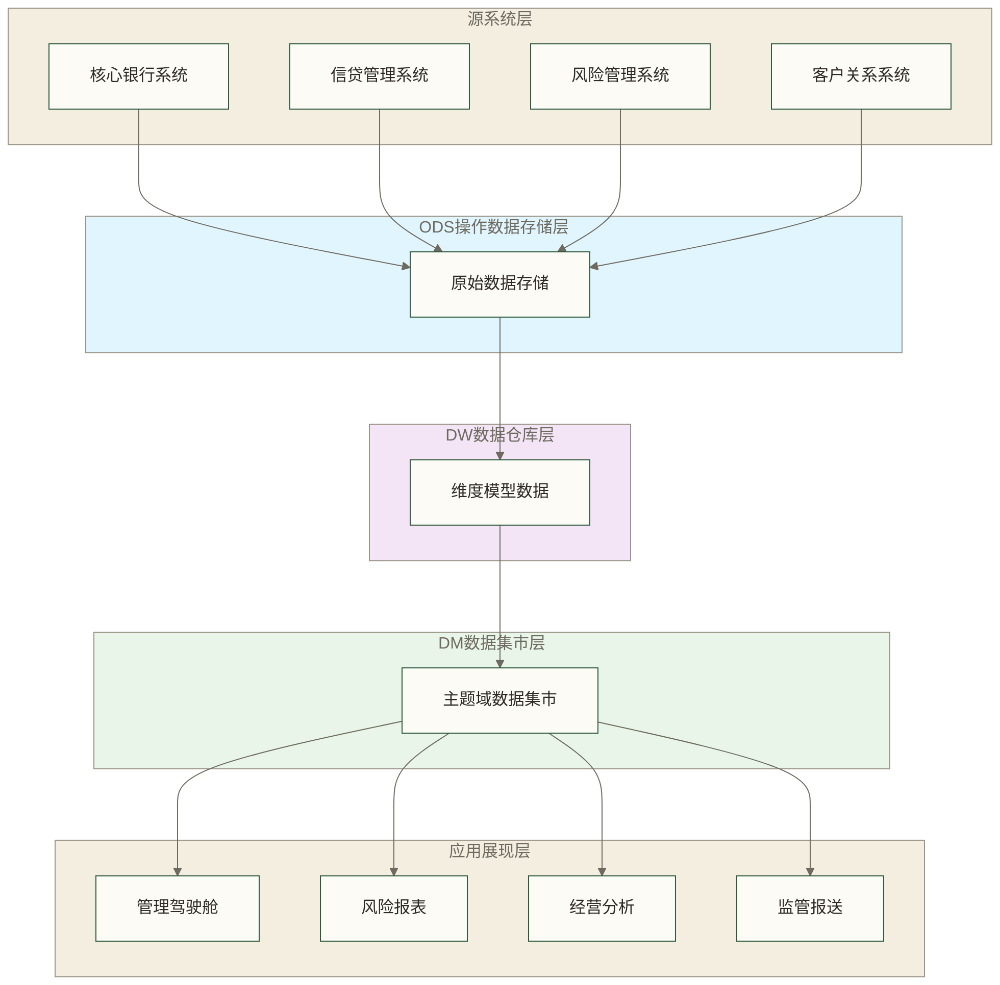
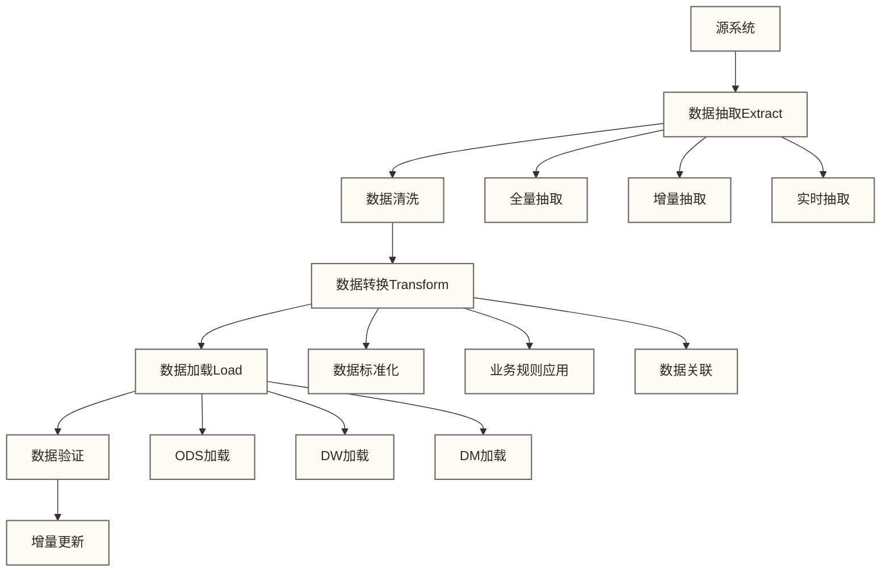

# Oracle银行数仓整体架构

> [!NOTE] 📋 前置知识
> - [[【技术与工具】/Oracle/06-Oracle表空间管理|Oracle表空间]] - 了解存储管理基础
> - [[【技术与工具】/Oracle/19-Oracle分区表应用|Oracle分区表]] - 掌握分区技术
> - 银行业务基础知识

## 学习目标

> [!IMPORTANT] 🎯 本章学习目标
> 完成本章学习后，你将能够：
> - 理解银行数据仓库的分层架构设计理念
> - 掌握Oracle数据仓库的技术架构选型
> - 学会设计合理的表空间和存储策略
> - 理解各层次的职责和数据流转关系

## 银行数仓分层架构设计

### 三层架构概述



### ODS层 (Operational Data Store)

**设计原则**：
- **最小化转换**：保持源系统数据结构，仅做必要的数据类型转换
- **完整性保证**：确保数据的完整性和一致性
- **历史记录**：记录数据变更历史和ETL处理过程

**技术特点**：
```sql
-- ODS层表空间配置
CREATE TABLESPACE ODS_DATA
DATAFILE '/u01/oradata/bankdw/ods_data01.dbf' SIZE 10G
AUTOEXTEND ON NEXT 1G MAXSIZE 50G
EXTENT MANAGEMENT LOCAL UNIFORM SIZE 1M
SEGMENT SPACE MANAGEMENT AUTO;

-- ODS层典型表结构
CREATE TABLE ods_customer_info (
    customer_id VARCHAR2(20) NOT NULL,
    customer_name VARCHAR2(100),
    id_card VARCHAR2(18),
    phone VARCHAR2(11),
    email VARCHAR2(100),
    birth_date DATE,
    gender CHAR(1),
    address VARCHAR2(200),
    -- ETL控制字段
    source_system VARCHAR2(20) DEFAULT 'CORE_BANK',
    etl_batch_id VARCHAR2(20),
    etl_time DATE DEFAULT SYSDATE,
    record_status CHAR(1) DEFAULT 'A' -- A:Active, D:Deleted
) TABLESPACE ODS_DATA;
```

### DW层 (Data Warehouse)

**设计原则**：
- **维度建模**：采用星型或雪花模型
- **历史数据**：完整保存业务数据历史
- **数据集成**：整合多个源系统数据
- **业务规则**：应用统一的业务规则和数据标准

**技术特点**：
```sql
-- DW层表空间配置
CREATE TABLESPACE DW_DATA
DATAFILE '/u01/oradata/bankdw/dw_data01.dbf' SIZE 20G
AUTOEXTEND ON NEXT 2G MAXSIZE 100G
EXTENT MANAGEMENT LOCAL UNIFORM SIZE 2M
SEGMENT SPACE MANAGEMENT AUTO;

-- 维度表示例：客户维度
CREATE TABLE dim_customer (
    customer_key NUMBER(10) NOT NULL,      -- 代理键
    customer_id VARCHAR2(20) NOT NULL,     -- 业务键
    customer_name VARCHAR2(100),
    id_card VARCHAR2(18),
    -- 扩展属性
    age NUMBER(3),
    age_group VARCHAR2(20),
    income_level VARCHAR2(20),
    -- SCD支持字段
    effective_date DATE,
    expiry_date DATE,
    current_flag CHAR(1),
    version_number NUMBER(5),
    CONSTRAINT pk_dim_customer PRIMARY KEY (customer_key)
) TABLESPACE DW_DATA;

-- 事实表示例：交易事实
CREATE TABLE fact_transaction (
    trans_key NUMBER(15) NOT NULL,
    customer_key NUMBER(10),
    account_key NUMBER(10),
    product_key NUMBER(10),
    date_key NUMBER(8),
    time_key NUMBER(6),
    -- 度量值
    trans_amount NUMBER(15,2),
    balance_before NUMBER(15,2),
    balance_after NUMBER(15,2),
    fee_amount NUMBER(10,2),
    trans_count NUMBER DEFAULT 1,
    CONSTRAINT pk_fact_transaction PRIMARY KEY (trans_key)
) 
PARTITION BY RANGE (date_key) (
    PARTITION p_202301 VALUES LESS THAN (20230201),
    PARTITION p_202302 VALUES LESS THAN (20230301),
    PARTITION p_202303 VALUES LESS THAN (20230401)
) TABLESPACE DW_DATA;
```

### DM层 (Data Mart)

**设计原则**：
- **主题导向**：按业务主题组织数据
- **汇总数据**：提供预计算的汇总指标
- **快速响应**：优化查询性能
- **业务友好**：贴近业务人员理解

**技术特点**：
```sql
-- DM层表空间配置
CREATE TABLESPACE DM_DATA
DATAFILE '/u01/oradata/bankdw/dm_data01.dbf' SIZE 5G
AUTOEXTEND ON NEXT 500M MAXSIZE 20G
EXTENT MANAGEMENT LOCAL UNIFORM SIZE 512K
SEGMENT SPACE MANAGEMENT AUTO;

-- 客户价值分析集市
CREATE TABLE dm_customer_value_monthly (
    customer_id VARCHAR2(20),
    analysis_month VARCHAR2(7),
    total_assets NUMBER(15,2),
    monthly_income NUMBER(15,2),
    transaction_count NUMBER(8),
    product_count NUMBER(3),
    risk_score NUMBER(5,2),
    customer_grade VARCHAR2(20),
    create_time DATE
) TABLESPACE DM_DATA;
```

## Oracle技术架构选型

### 存储架构设计

**分级存储策略**：
```sql
-- 高频访问数据：SSD存储
CREATE TABLESPACE DW_HOT_DATA
DATAFILE '/u01/ssd/bankdw/hot_data01.dbf' SIZE 50G;

-- 中频访问数据：混合存储
CREATE TABLESPACE DW_WARM_DATA  
DATAFILE '/u01/hdd/bankdw/warm_data01.dbf' SIZE 100G;

-- 低频访问数据：大容量HDD
CREATE TABLESPACE DW_COLD_DATA
DATAFILE '/u01/archive/bankdw/cold_data01.dbf' SIZE 500G;
```

### 并行处理配置

**并行度设置**：
```sql
-- 设置表的并行度
ALTER TABLE fact_transaction PARALLEL 8;
ALTER TABLE dim_customer PARALLEL 4;

-- 设置会话并行度
ALTER SESSION ENABLE PARALLEL DML;
ALTER SESSION FORCE PARALLEL QUERY PARALLEL 4;

-- 创建并行索引
CREATE INDEX idx_fact_trans_date 
ON fact_transaction(date_key) PARALLEL 4;
```

### 内存优化配置

**SGA参数优化**：
```sql
-- 查看当前SGA配置
SELECT component, current_size/1024/1024 AS size_mb
FROM v$sga_dynamic_components;

-- SGA/PGA配置示例（假设32GB物理内存）：非通用推荐值，需结合现有内存管理设置、并发负载和操作系统资源余量测试后使用。
ALTER SYSTEM SET sga_target=20G SCOPE=SPFILE;
ALTER SYSTEM SET pga_aggregate_target=8G SCOPE=SPFILE;
ALTER SYSTEM SET db_cache_size=12G SCOPE=SPFILE;
ALTER SYSTEM SET shared_pool_size=4G SCOPE=SPFILE;
```

## 数据流转架构

### ETL流程设计



### 数据更新策略

**ODS层更新**：
```sql
-- 创建数据更新控制表
CREATE TABLE etl_control (
    table_name VARCHAR2(50),
    last_update_time DATE,
    update_type VARCHAR2(20), -- FULL/INCREMENTAL
    batch_size NUMBER(10),
    status VARCHAR2(10)
);

-- 增量更新框架示例：实际抽取和加载逻辑尚未实现；补齐并确认成功后，才能推进水位并标记SUCCESS。
CREATE OR REPLACE PROCEDURE update_ods_incremental(
    p_table_name VARCHAR2,
    p_update_time DATE DEFAULT SYSDATE
) AS
    v_last_update DATE;
BEGIN
    SELECT last_update_time INTO v_last_update
    FROM etl_control 
    WHERE table_name = p_table_name;
    
    -- 执行增量更新逻辑
    -- ...
    
    -- 更新控制信息
    UPDATE etl_control 
    SET last_update_time = p_update_time,
        status = 'SUCCESS'
    WHERE table_name = p_table_name;
    
    COMMIT;
END;
/
```

## 架构监控与运维

### 性能监控

**关键监控指标**：
```sql
-- 监控表空间使用率
SELECT 
    tablespace_name,
    total_space/1024/1024 AS total_mb,
    used_space/1024/1024 AS used_mb,
    ROUND(used_space/total_space*100, 2) AS usage_pct
FROM (
    SELECT
        df.tablespace_name,
        df.total_space,
        df.total_space - NVL(fs.free_bytes, 0) AS used_space
    FROM (
        SELECT tablespace_name, SUM(bytes) AS total_space
        FROM dba_data_files
        GROUP BY tablespace_name
    ) df
    LEFT JOIN (
        SELECT tablespace_name, SUM(bytes) AS free_bytes
        FROM dba_free_space
        GROUP BY tablespace_name
    ) fs ON df.tablespace_name = fs.tablespace_name
);

-- 监控ETL作业执行情况
SELECT 
    batch_id,
    table_name,
    start_time,
    end_time,
    ROUND((end_time - start_time) * 24 * 60, 2) AS duration_minutes,
    record_count,
    status
FROM etl_log
WHERE start_time >= SYSDATE - 7
ORDER BY start_time DESC;
```

### 备份恢复策略

**分层备份策略**：
```sql
-- ODS层：每日备份
RMAN> BACKUP TABLESPACE ods_data FORMAT '/backup/ods_%U';

-- DW层：每周全备，每日增量
RMAN> BACKUP INCREMENTAL LEVEL 0 TABLESPACE dw_data;
RMAN> BACKUP INCREMENTAL LEVEL 1 TABLESPACE dw_data;

-- DM层：每月备份（可重建）
RMAN> BACKUP TABLESPACE dm_data FORMAT '/archive/dm_%U';
```

## 实践练习

> [!TIP] 💻 动手练习
> 
> ### 练习1：架构环境搭建
> 1. 创建三层表空间结构
> 2. 配置不同层级的存储参数
> 3. 设置基础的并行处理参数
> 
> ### 练习2：控制表设计
> 1. 设计ETL控制表结构
> 2. 创建数据质量监控表
> 3. 实现简单的ETL监控功能
> 
> ### 练习3：性能基准测试
> 1. 创建测试数据集
> 2. 测试不同分区策略的性能差异
> 3. 分析并行度对查询性能的影响

## 相关文档

> [!INFO] 📖 深入学习
> - [[【技术与工具】/Oracle/12-02-Oracle银行数仓ODS层设计|Oracle银行数仓ODS层]] - ODS层详细实现
> - [[【技术与工具】/Oracle/12-03-Oracle银行数仓DW层建模|Oracle银行数仓DW层建模]] - 维度建模深入
> - [[【技术与工具】/Oracle/12-05-Oracle银行数仓性能优化|Oracle银行数仓性能优化]] - 性能调优技巧

## 总结

银行数据仓库的整体架构设计需要综合考虑业务需求、技术能力、性能要求和运维管理等多个方面。Oracle提供了强大的技术平台来支撑大规模数据仓库的建设，通过合理的架构设计可以构建高效、稳定、可扩展的银行数据仓库系统。

**关键要点**：
- 分层架构设计确保数据处理的清晰性和可维护性
- 合理的表空间规划提升存储效率和管理便利性
- 并行处理和内存优化提升系统整体性能
- 完善的监控体系保障系统稳定运行