# Oracle银行ETL开发 - 零基础入门教程

## 🎯 什么是ETL（用最简单的话说）

> [!NOTE] 💡 什么是ETL？
> **ETL就像是数据的"搬运工+翻译官+整理师"**：
> - **E**xtract（抽取）= 搬运工：从各个系统把数据"搬"出来
> - **T**ransform（转换）= 翻译官：把不同格式的数据"翻译"成统一格式  
> - **L**oad（加载）= 整理师：把处理好的数据"整理"到数据仓库里

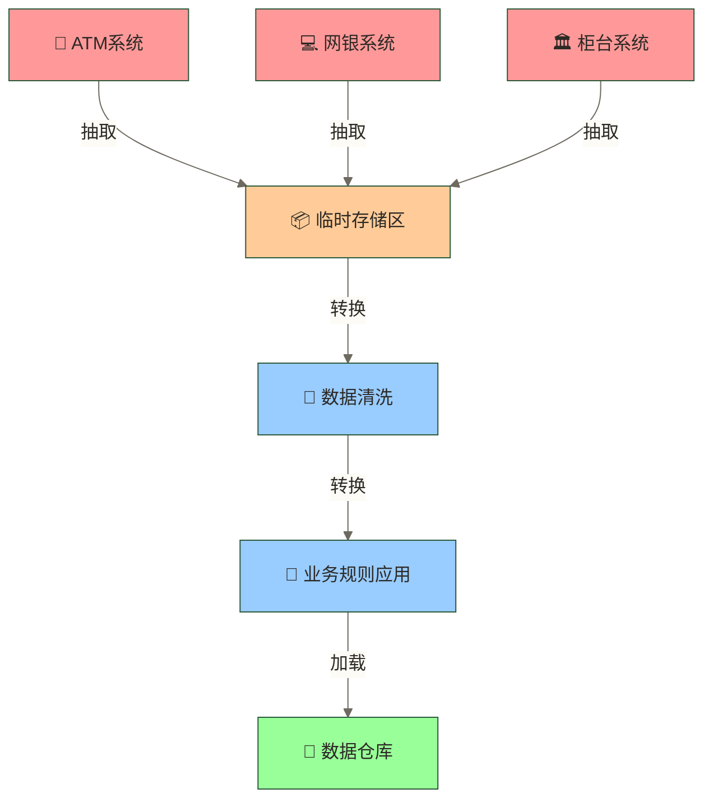

### 🏦 银行ETL的假设示例场景

想象一下银行每天的数据流：

**早上6点**：ATM机产生了1万笔取款记录
**上午9点**：网银系统产生了5万笔转账记录  
**下午3点**：柜台系统产生了3万笔存款记录
**晚上8点**：信用卡系统产生了8万笔消费记录

这些数据来自不同的系统，格式不同，但银行需要把它们汇总起来做分析。这就是ETL的工作！

银行IT部门新入职的小陈接到第一个任务："把各个系统的交易数据整合到数据仓库，明天行长要看昨天的经营报表。"小陈一头雾水：ATM系统用的是XML格式，网银是JSON，柜台系统是CSV，信用卡系统又是另一种格式。"这些不同的数据怎么统一处理？"这就是银行ETL开发要解决的核心问题。

在实际工作环境中，这样的挑战每天都在发生。理解相关知识不仅能解决当前问题，更能提升整体的专业能力。
## 📚 第一步：理解ETL的整体流程

### 🗺️ ETL的完整旅程（就像一条流水线）

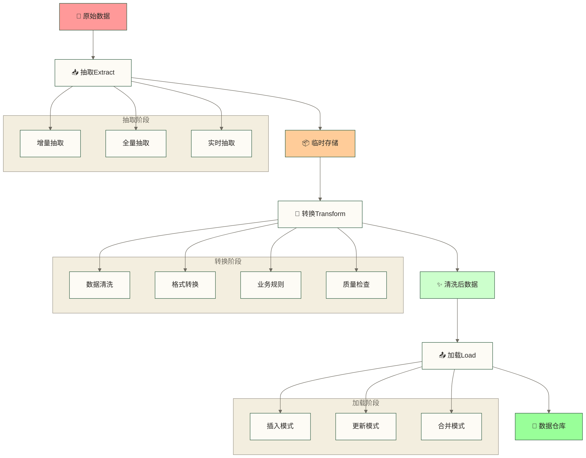

> [!TIP] 🌟 数据转换示例
> 让我们用银行转账数据来举例：
> 
> **原始数据**（来自核心银行系统）：
> - 转账ID: TXN20240101001
> - 从账户: 6228123456789
> - 到账户: 6228987654321  
> - 金额: 1000.00
> - 时间: 2024-01-01 14:30:25
> - 状态: S
> 
> **经过ETL处理后**（进入数据仓库）：
> - 交易序号: 1001
> - 客户代码: C10001 (通过账户查找到客户)
> - 交易类型: 转账
> - 交易金额: 1000.00
> - 交易日期: 2024-01-01
> - 交易时间: 14:30:25
> - 交易状态: 成功
> - 风险等级: 低风险 (根据金额自动判断)
> - 所属分行: 北京分行 (根据账户归属自动填充)

### 🎯 ETL的三个核心步骤详解

#### 📥 Extract（抽取）- 数据搬运工

> [!NOTE] 🚚 什么是数据抽取？
> **这一步在做什么？**
> 就像从不同的仓库里搬货物，ETL要从各个业务系统中把数据"搬"出来。

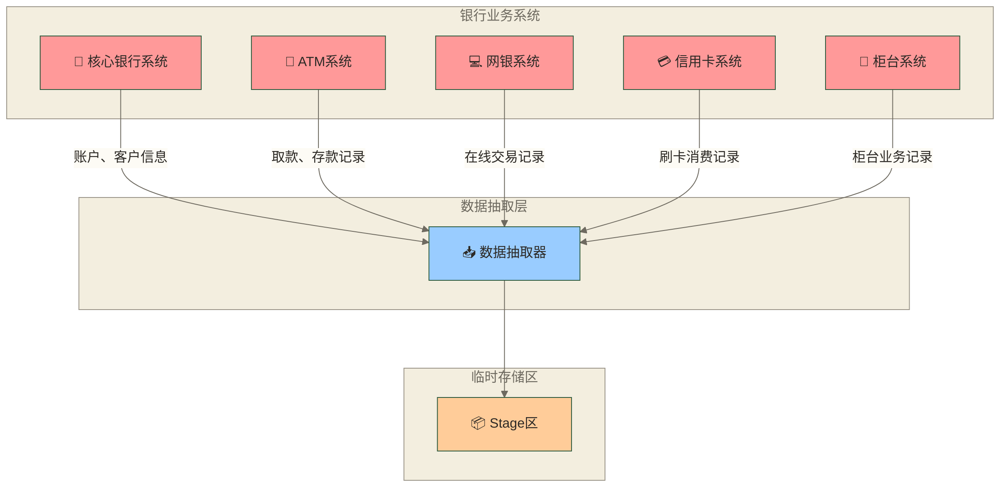

> [!IMPORTANT] ⚡ 抽取方式对比
> **全量抽取 vs 增量抽取**
> 
> | 对比项目 | 全量抽取 | 增量抽取 |
> |---------|----------|----------|
> | **速度** | 慢 ⏱️ | 快 🚀 |
> | **资源占用** | 高 📊 | 低 📈 |
> | **实现复杂度** | 简单 😊 | 复杂 🤔 |
> | **数据完整性** | 取决于源数据、抽取范围和一致性控制 | 还需维护变更捕获与水位线策略 |
> | **适用场景** | 初始化、小表 | 日常ETL、大表 |

**增量抽取的实现方法：**

```sql
-- 🎯 方法1：基于时间戳（最常用）
-- 假设我们要抽取昨天新增的客户信息

SELECT customer_id, customer_name, phone, email, create_time
FROM core_banking.customer_info  -- 核心银行系统的客户表
WHERE create_time >= TRUNC(SYSDATE) - 1  -- 昨天00:00:00开始
  AND create_time < TRUNC(SYSDATE);      -- 今天00:00:00之前

-- 💡 解释：
-- TRUNC(SYSDATE) - 1 = 昨天的00:00:00
-- TRUNC(SYSDATE) = 今天的00:00:00
-- 这样就能抓到昨天一整天新增的客户
```

```sql
-- 🎯 方法2：基于版本号或序列号
-- 假设交易表有一个自增的交易序号

SELECT trans_id, account_id, amount, trans_time
FROM core_banking.transaction_log
WHERE trans_id > 1000000  -- 上次抽取的最大序号
  AND trans_id <= 1050000; -- 本次要抽取到的序号

-- 💡 解释：
-- 每次记录抽取到哪个序号了，下次从这个序号后面开始抓
```

#### 🔄 Transform（转换）- 数据翻译官

> [!NOTE] 🔄 什么是数据转换？
> **这一步在做什么？**
> 就像翻译官，把来自不同系统的"方言"翻译成统一的"普通话"。

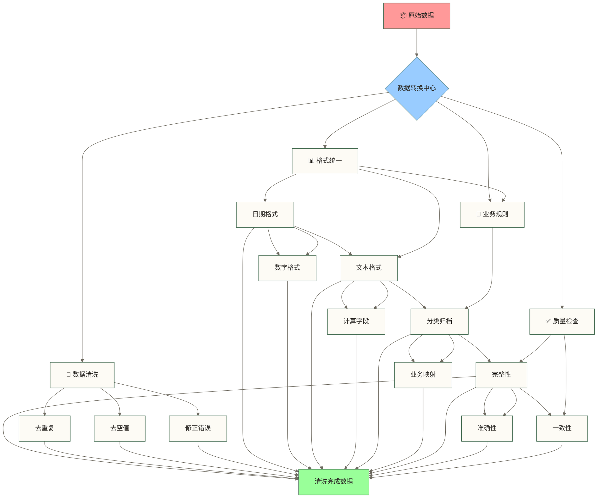

> [!IMPORTANT] 🎨 银行数据转换的常见场景

**场景1：数据格式统一**
```sql
-- 📱 不同系统的手机号格式不同，需要统一
-- 原始数据可能是：
-- 系统A：13812345678
-- 系统B：138-1234-5678  
-- 系统C：+86-138-1234-5678

-- 🛠️ 删除非数字字符（保留国家码，不保证结果为11位）
SELECT 
    customer_id,
    customer_name,
    -- 清理手机号：去掉所有非数字字符，只保留数字
    REGEXP_REPLACE(phone, '[^0-9]', '') as clean_phone
FROM stage_customer_info;

-- 💡 解释：
-- REGEXP_REPLACE(phone, '[^0-9]', '') 的意思是：
-- phone: 要处理的字段
-- '[^0-9]': 正则表达式，表示"非数字字符"
-- '': 替换成空字符，即删除
-- 结果：+86-138-1234-5678 变成 8613812345678；该表达式仅删除非数字字符，不会删除国家码
```

**场景2：业务规则转换**
```sql
-- 🏆 根据客户资产计算客户等级
SELECT 
    customer_id,
    customer_name,
    total_balance,
    -- 根据余额计算客户等级
    CASE 
        WHEN total_balance >= 1000000 THEN '钻石客户'
        WHEN total_balance >= 500000 THEN '白金客户'
        WHEN total_balance >= 100000 THEN '金卡客户'
        WHEN total_balance >= 10000 THEN '银卡客户'
        ELSE '普通客户'
    END as customer_level
FROM (
    -- 先计算每个客户的总资产
    SELECT 
        c.customer_id,
        c.customer_name,
        NVL(SUM(a.balance), 0) as total_balance
    FROM customer_info c
    LEFT JOIN account_info a ON c.customer_id = a.customer_id
    GROUP BY c.customer_id, c.customer_name
);

-- 💡 解释：
-- 1. 内层查询：计算每个客户在所有账户中的总余额
-- 2. CASE语句：根据余额范围给客户分等级
-- 3. NVL(SUM(a.balance), 0)：如果客户没有账户，总余额显示为0
```

**场景3：数据质量检查和清洗**
```sql
-- 🔍 清洗客户信息数据
SELECT 
    customer_id,
    -- 客户姓名：去掉前后空格，转成大写
    TRIM(UPPER(customer_name)) as customer_name,
    -- 身份证号：只保留数字和字母X
    UPPER(REGEXP_REPLACE(id_card, '[^0-9Xx]', '')) as clean_id_card,
    -- 邮箱：转成小写
    LOWER(TRIM(email)) as email,
    -- 年龄：根据生日计算
    FLOOR(MONTHS_BETWEEN(SYSDATE, birth_date) / 12) as age,
    -- 性别：统一编码
    CASE 
        WHEN UPPER(gender) IN ('男', 'M', 'MALE') THEN 'M'
        WHEN UPPER(gender) IN ('女', 'F', 'FEMALE') THEN 'F'
        ELSE 'U'  -- 未知
    END as gender_code
FROM stage_customer_info
WHERE 
    -- 数据质量检查：过滤掉明显错误的数据
    customer_name IS NOT NULL                    -- 姓名不能为空
    AND LENGTH(customer_name) >= 2               -- 姓名至少2个字符
    AND birth_date IS NOT NULL                   -- 生日不能为空
    AND birth_date <= SYSDATE                    -- 生日不能是未来日期
    AND MONTHS_BETWEEN(SYSDATE, birth_date) >= 0; -- 年龄不能是负数

-- 💡 解释：
-- 1. TRIM()：去掉字符串前后的空格
-- 2. UPPER()/LOWER()：大小写转换
-- 3. REGEXP_REPLACE()：正则表达式替换
-- 4. MONTHS_BETWEEN()：计算两个日期之间的月数
-- 5. WHERE条件：数据质量检查，过滤异常数据
```

#### 📤 Load（加载）- 数据整理师

> [!NOTE] 📤 什么是数据加载？
> **这一步在做什么？**
> 就像整理师，把清洗干净的数据按照规则整齐地放到数据仓库的各个"柜子"里。

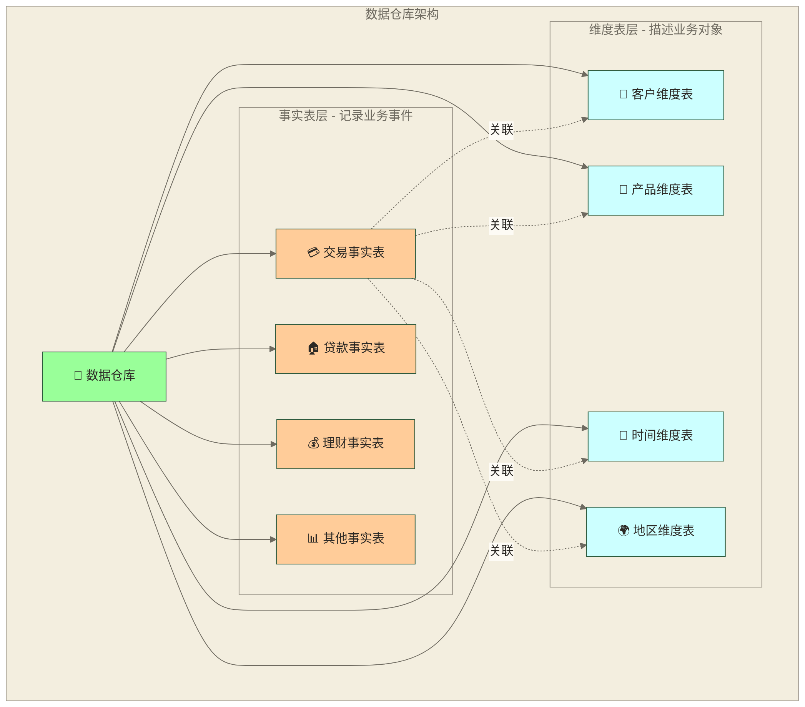

> [!TIP] 🏗️ 数据仓库结构解释
> - **事实表**：存储可度量的业务事件（如交易金额、贷款数量）
> - **维度表**：存储描述性信息（如客户姓名、产品名称）
> - **星型模式**：事实表居中，维度表围绕，便于分析查询

**加载策略的两种方式：**

**1. 插入模式（INSERT）：每次都添加新记录**
```sql
-- 🆕 插入今天的交易记录到事实表
INSERT INTO fact_transaction (
    trans_id,           -- 交易ID
    customer_key,       -- 客户代码（关联客户维度表）
    account_key,        -- 账户代码（关联账户维度表）
    product_key,        -- 产品代码（关联产品维度表）
    trans_date,         -- 交易日期
    trans_amount,       -- 交易金额
    trans_type,         -- 交易类型
    create_time         -- 记录创建时间
)
SELECT 
    t.trans_id,
    c.customer_key,     -- 通过客户ID关联到维度表获取key
    a.account_key,      -- 通过账户ID关联到维度表获取key  
    p.product_key,      -- 通过产品ID关联到维度表获取key
    TRUNC(t.trans_time), -- 交易日期（去掉时分秒）
    t.amount,
    t.trans_type,
    SYSDATE
FROM ods_transaction t              -- 已清洗的交易数据
JOIN dim_customer c ON t.customer_id = c.customer_id
JOIN dim_account a ON t.account_id = a.account_id  
JOIN dim_product p ON a.product_id = p.product_id
WHERE TRUNC(t.trans_time) = TRUNC(SYSDATE) - 1  -- 只加载昨天的数据
  AND NOT EXISTS (
      -- 防止重复插入：检查这笔交易是否已经存在
      SELECT 1 FROM fact_transaction 
      WHERE trans_id = t.trans_id
  );

-- 💡 解释：
-- 1. JOIN操作：把业务ID转换成维度表的代理键
-- 2. NOT EXISTS：防止重复插入相同的交易
-- 3. TRUNC()：截取日期，去掉时分秒部分
```

**2. 合并模式（MERGE）：存在就更新，不存在就插入**
```sql
-- 🔄 更新客户维度表（处理客户信息变更）
MERGE INTO dim_customer target
USING (
    SELECT 
        customer_id,
        customer_name,
        phone,
        email,
        address,
        customer_level  -- 新计算的客户等级
    FROM ods_customer_info
    WHERE batch_date = TRUNC(SYSDATE)  -- 今天处理的数据
) source
ON (target.customer_id = source.customer_id)  -- 匹配条件

WHEN MATCHED THEN  -- 如果客户已存在，就更新信息
    UPDATE SET
        target.customer_name = source.customer_name,
        target.phone = source.phone,
        target.email = source.email,
        target.address = source.address,
        target.customer_level = source.customer_level,
        target.update_time = SYSDATE,
        target.version = target.version + 1  -- 版本号加1

WHEN NOT MATCHED THEN  -- 如果是新客户，就插入新记录
    INSERT (
        customer_key, customer_id, customer_name, phone, email,
        address, customer_level, create_time, update_time, version
    ) VALUES (
        dim_customer_seq.NEXTVAL,  -- 自动生成主键
        source.customer_id,
        source.customer_name,
        source.phone,
        source.email,
        source.address,
        source.customer_level,
        SYSDATE,  -- 创建时间
        SYSDATE,  -- 更新时间  
        1         -- 初始版本号
    );

-- 💡 解释：
-- 1. MERGE：Oracle的"智能插入更新"语句
-- 2. ON条件：定义如何判断记录是否存在
-- 3. WHEN MATCHED：存在就执行UPDATE
-- 4. WHEN NOT MATCHED：不存在就执行INSERT
-- 5. 版本号：记录更新次数；此处覆盖旧值，不保留历史版本数据
```

## 🏗️ 第二步：搭建ETL控制框架

> [!IMPORTANT] 🎯 为什么需要ETL控制框架？
> 在银行这种对数据准确性要求极高的环境中，我们需要一个"管家"来统一管理所有的ETL作业。

### 📋 ETL控制表设计（就像作业管理系统）

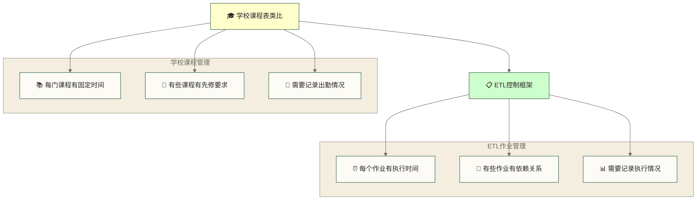

> [!NOTE] 💡 控制框架核心思想
> ETL控制表就像课程表一样，管理着所有ETL作业的执行：
> - 📅 **调度管理**：什么时候执行哪个作业
> - 🔗 **依赖管理**：哪些作业必须先完成
> - 📊 **监控管理**：作业执行状态跟踪
> - ❌ **异常管理**：出错时如何处理

```sql
-- 🎯 ETL作业控制表（就像课程表）
CREATE TABLE etl_job_control (
    job_id VARCHAR2(20),              -- 作业编号（如：JOB001）
    job_name VARCHAR2(100),           -- 作业名称（如：客户信息抽取）
    job_type VARCHAR2(30),            -- 作业类型（抽取/转换/加载）
    source_system VARCHAR2(50),       -- 来源系统（如：核心银行系统）
    target_table VARCHAR2(100),       -- 目标表名
    schedule_time VARCHAR2(20),       -- 执行时间（如：每天凌晨2点）
    is_active CHAR(1) DEFAULT 'Y',    -- 是否启用（Y/N）
    dependency_jobs VARCHAR2(500),    -- 依赖的作业（必须先完成的作业）
    max_runtime_minutes NUMBER(5),    -- 最大运行时间（分钟）
    notification_email VARCHAR2(200)  -- 出错时通知邮箱
);

-- 💡 解释：
-- 这个表就像是ETL作业的"档案册"，记录了每个作业的基本信息
-- dependency_jobs字段很重要：比如"客户等级计算"必须在"客户信息抽取"完成后才能执行
```

```sql
-- 🎯 ETL执行日志表（就像考勤记录）
CREATE TABLE etl_execution_log (
    execution_id VARCHAR2(30),        -- 执行ID（每次运行都不同）
    job_id VARCHAR2(20),              -- 作业ID（关联控制表）
    batch_date DATE,                  -- 批次日期（处理哪天的数据）
    start_time TIMESTAMP,             -- 开始时间
    end_time TIMESTAMP,               -- 结束时间
    status VARCHAR2(20),              -- 状态（运行中/成功/失败）
    records_processed NUMBER(15),     -- 处理了多少条记录
    records_inserted NUMBER(15),      -- 插入了多少条记录
    records_updated NUMBER(15),       -- 更新了多少条记录
    records_rejected NUMBER(15),      -- 拒绝了多少条记录（数据质量问题）
    error_message VARCHAR2(4000)      -- 错误信息（如果失败的话）
);

-- 💡 解释：
-- 这个表记录每次ETL作业的执行情况，就像学生的考勤记录
-- 通过这个表可以知道：哪个作业什么时候执行的，成功了吗，处理了多少数据
```

### 🎮 ETL作业调度器（就像自动排课系统）

> [!TIP] 🤖 智能调度器的工作原理
> 现在我们来创建一个"智能管家"，它能按照预定规则自动执行ETL作业：

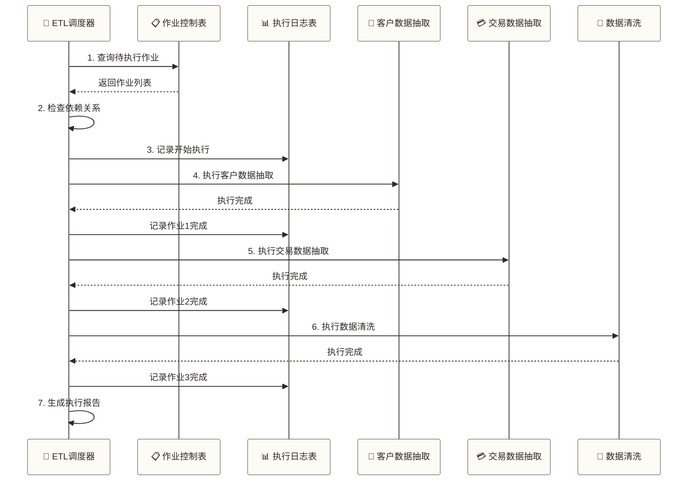

```sql
-- 🤖 ETL调度器存储过程
CREATE OR REPLACE PROCEDURE run_etl_jobs(
    p_batch_date IN DATE  -- 要处理哪天的数据
)
AS
    -- 📝 定义变量
    v_job_name VARCHAR2(100);
    v_execution_id VARCHAR2(30);
    v_can_run BOOLEAN;
    v_job_status VARCHAR2(20);
    
BEGIN
    DBMS_OUTPUT.PUT_LINE('🚀 开始执行ETL作业调度');
    DBMS_OUTPUT.PUT_LINE('📅 批次日期：' || TO_CHAR(p_batch_date, 'YYYY-MM-DD'));
    
    -- 🔍 第1步：查找所有需要执行的作业
    FOR job_rec IN (
        SELECT job_id, job_name, dependency_jobs
        FROM etl_job_control
        WHERE is_active = 'Y'          -- 只执行启用的作业
        ORDER BY 
            -- 💡 聪明的排序：没有依赖的作业优先执行
            CASE WHEN dependency_jobs IS NULL THEN 1 ELSE 2 END,
            job_id
    ) LOOP
    
        DBMS_OUTPUT.PUT_LINE('');
        DBMS_OUTPUT.PUT_LINE('📋 准备执行作业：' || job_rec.job_name);
        
        -- 🔍 第2步：检查依赖作业是否完成
        v_can_run := check_dependencies(job_rec.job_id, p_batch_date);
        
        IF v_can_run THEN
            DBMS_OUTPUT.PUT_LINE('✅ 依赖检查通过，开始执行...');
            
            -- 🚀 第3步：执行作业
            BEGIN
                -- 生成唯一的执行ID
                v_execution_id := 'EXEC_' || job_rec.job_id || '_' || 
                                 TO_CHAR(SYSDATE, 'YYYYMMDDHH24MISS');
                
                -- 记录开始执行
                INSERT INTO etl_execution_log (
                    execution_id, job_id, batch_date, start_time, status
                ) VALUES (
                    v_execution_id, job_rec.job_id, p_batch_date, SYSTIMESTAMP, 'RUNNING'
                );
                COMMIT;
                
                -- 根据作业类型执行不同的处理逻辑
                IF job_rec.job_name LIKE '%客户信息%' THEN
                    extract_customer_data(p_batch_date, v_execution_id);
                ELSIF job_rec.job_name LIKE '%交易数据%' THEN
                    extract_transaction_data(p_batch_date, v_execution_id);
                ELSIF job_rec.job_name LIKE '%数据清洗%' THEN
                    clean_data(p_batch_date, v_execution_id);
                -- 可以根据需要添加更多作业类型
                END IF;
                
                DBMS_OUTPUT.PUT_LINE('🎉 作业执行成功：' || job_rec.job_name);
                
            EXCEPTION
                WHEN OTHERS THEN
                    DBMS_OUTPUT.PUT_LINE('❌ 作业执行失败：' || job_rec.job_name);
                    DBMS_OUTPUT.PUT_LINE('错误信息：' || SQLERRM);
                    
                    -- 记录失败信息
                    UPDATE etl_execution_log
                    SET end_time = SYSTIMESTAMP,
                        status = 'FAILED',
                        error_message = SQLERRM
                    WHERE execution_id = v_execution_id;
                    COMMIT;
            END;
            
        ELSE
            DBMS_OUTPUT.PUT_LINE('⏳ 依赖作业未完成，跳过执行：' || job_rec.job_name);
        END IF;
        
    END LOOP;
    
    DBMS_OUTPUT.PUT_LINE('');
    DBMS_OUTPUT.PUT_LINE('🏁 ETL作业调度完成');
    
EXCEPTION
    WHEN OTHERS THEN
        DBMS_OUTPUT.PUT_LINE('❌ ETL调度器异常：' || SQLERRM);
        RAISE;
END run_etl_jobs;
/

-- 💡 解释：
-- 1. 这个存储过程就像一个"智能管家"，会自动安排ETL作业的执行顺序
-- 2. 它会检查每个作业的依赖关系，确保按正确顺序执行
-- 3. 如果某个作业失败了，会记录详细的错误信息
-- 4. 每个作业都有唯一的执行ID，方便跟踪和排查问题
```

```sql
-- 🔍 依赖检查函数（检查作业是否可以执行）
CREATE OR REPLACE FUNCTION check_dependencies(
    p_job_id IN VARCHAR2,     -- 要检查的作业ID
    p_batch_date IN DATE      -- 批次日期
) RETURN BOOLEAN
AS
    v_dependency_jobs VARCHAR2(500);  -- 依赖的作业列表
    v_dep_job VARCHAR2(50);           -- 单个依赖作业
    v_dep_status VARCHAR2(20);        -- 依赖作业的状态
    v_pos NUMBER := 1;                -- 字符串解析位置
    v_next_pos NUMBER;                -- 下一个逗号位置
    
BEGIN
    -- 📝 第1步：获取依赖作业列表
    SELECT dependency_jobs INTO v_dependency_jobs
    FROM etl_job_control
    WHERE job_id = p_job_id;
    
    -- ✅ 如果没有依赖，直接返回可以执行
    IF v_dependency_jobs IS NULL THEN
        RETURN TRUE;
    END IF;
    
    -- 🔍 第2步：逐个检查依赖作业的状态
    -- 依赖作业列表格式：JOB001,JOB002,JOB003
    WHILE v_pos <= LENGTH(v_dependency_jobs) LOOP
        -- 找到下一个逗号的位置
        v_next_pos := INSTR(v_dependency_jobs, ',', v_pos);
        
        IF v_next_pos = 0 THEN
            -- 最后一个作业ID
            v_dep_job := TRIM(SUBSTR(v_dependency_jobs, v_pos));
            v_pos := LENGTH(v_dependency_jobs) + 1;
        ELSE
            -- 中间的作业ID
            v_dep_job := TRIM(SUBSTR(v_dependency_jobs, v_pos, v_next_pos - v_pos));
            v_pos := v_next_pos + 1;
        END IF;
        
        -- 检查这个依赖作业是否成功完成
        BEGIN
            SELECT status INTO v_dep_status
            FROM etl_execution_log
            WHERE job_id = v_dep_job
              AND batch_date = p_batch_date
              AND execution_id = (
                  -- 获取最新的执行记录
                  SELECT MAX(execution_id)
                  FROM etl_execution_log
                  WHERE job_id = v_dep_job AND batch_date = p_batch_date
              );
            
            -- 如果依赖作业没有成功完成，返回FALSE
            IF v_dep_status != 'SUCCESS' THEN
                DBMS_OUTPUT.PUT_LINE('⚠️ 依赖作业未完成：' || v_dep_job || '（状态：' || v_dep_status || '）');
                RETURN FALSE;
            END IF;
            
        EXCEPTION
            WHEN NO_DATA_FOUND THEN
                -- 依赖作业还没有执行记录
                DBMS_OUTPUT.PUT_LINE('⚠️ 依赖作业尚未执行：' || v_dep_job);
                RETURN FALSE;
        END;
        
    END LOOP;
    
    -- 所有依赖作业都成功完成
    RETURN TRUE;
    
EXCEPTION
    WHEN OTHERS THEN
        DBMS_OUTPUT.PUT_LINE('❌ 依赖检查异常：' || SQLERRM);
        RETURN FALSE;
END check_dependencies;
/

-- 💡 解释：
-- 1. 这个函数负责检查一个作业的所有依赖是否都已完成
-- 2. 它会解析依赖作业列表（逗号分隔的字符串）
-- 3. 逐个检查每个依赖作业的最新执行状态
-- 4. 只有所有依赖作业都成功完成，才返回TRUE
```

## 🔄 第三步：数据抽取实战

> [!NOTE] 💼 实战环节开始
> 现在让我们来看看如何从银行的各个业务系统中抽取数据。

### 📊 增量抽取实战案例

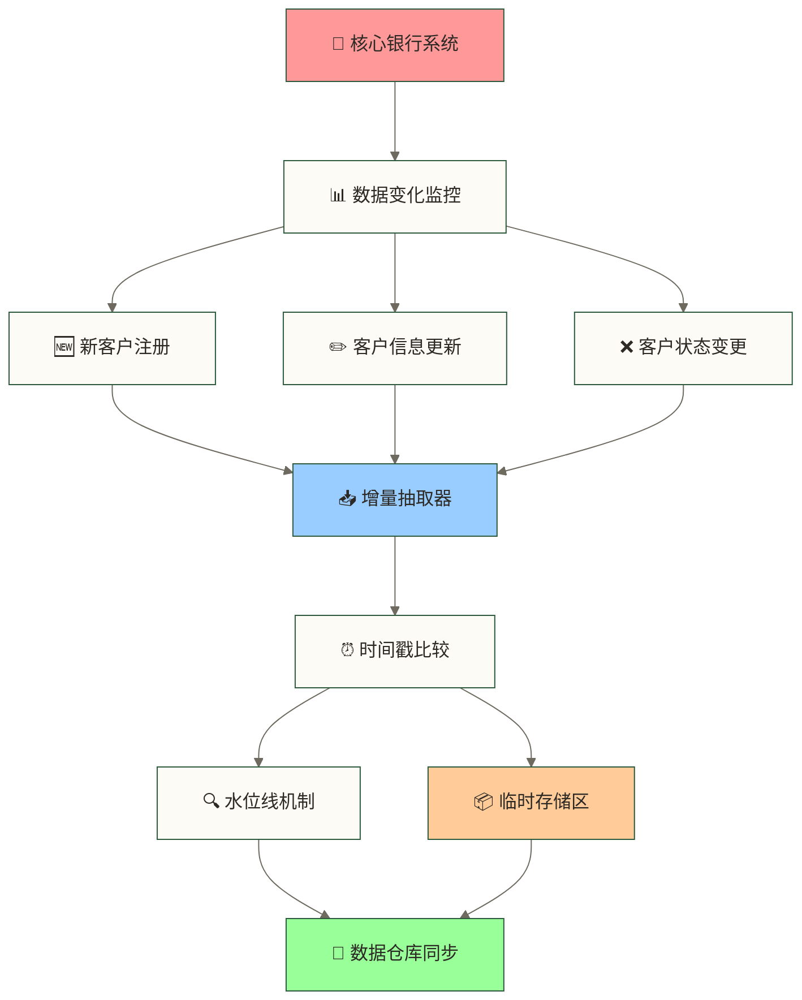

> [!IMPORTANT] 🎯 实战场景说明
> **场景：从核心银行系统抽取客户信息**
> 
> 银行的核心系统每天都会有新客户注册，老客户信息更新。我们需要把这些变化同步到数据仓库中。
> 
> **核心挑战**：
> - 🕐 如何知道哪些数据是新的或更新的？
> - 📊 如何确保不漏数据、不重复数据？
> - ⚡ 如何提高抽取效率？

```sql
-- 🎯 客户信息增量抽取存储过程
CREATE OR REPLACE PROCEDURE extract_customer_data(
    p_batch_date IN DATE,        -- 批次日期
    p_execution_id IN VARCHAR2   -- 执行ID
)
AS
    v_last_extract_time TIMESTAMP;    -- 上次抽取时间
    v_current_time TIMESTAMP;         -- 本次抽取时间
    v_extracted_count NUMBER := 0;    -- 抽取记录数
    
BEGIN
    DBMS_OUTPUT.PUT_LINE('📥 开始抽取客户信息数据');
    
    -- 🕰️ 第1步：确定抽取时间范围
    v_current_time := SYSTIMESTAMP;
    
    -- 从水位线表获取上次抽取时间
    SELECT last_extract_time INTO v_last_extract_time
    FROM etl_watermark  -- 水位线表，记录各表的抽取进度
    WHERE table_name = 'CUSTOMER_INFO'
      AND source_system = 'CORE_BANKING';
    
    DBMS_OUTPUT.PUT_LINE('⏰ 抽取时间范围：');
    DBMS_OUTPUT.PUT_LINE('  从：' || TO_CHAR(v_last_extract_time, 'YYYY-MM-DD HH24:MI:SS'));
    DBMS_OUTPUT.PUT_LINE('  到：' || TO_CHAR(v_current_time, 'YYYY-MM-DD HH24:MI:SS'));
    
    -- 📋 第2步：抽取增量数据到临时表
    INSERT INTO stage_customer_info (
        customer_id,       -- 客户ID
        customer_name,     -- 客户姓名
        id_card,          -- 身份证号
        phone,            -- 手机号
        email,            -- 邮箱
        birth_date,       -- 生日
        gender,           -- 性别
        address,          -- 地址
        annual_income,    -- 年收入
        create_time,      -- 创建时间
        update_time,      -- 更新时间
        extract_time,     -- 抽取时间（我们加的）
        batch_date,       -- 批次日期（我们加的）
        processing_status -- 处理状态（我们加的）
    )
    SELECT 
        customer_id,
        customer_name,
        id_card,
        phone,
        email,
        birth_date,
        gender,
        address,
        annual_income,
        create_time,
        update_time,
        v_current_time,        -- 记录抽取时间
        p_batch_date,          -- 记录批次日期
        'PENDING'              -- 初始状态为待处理
    FROM core_banking.customer_info@core_bank_link  -- 通过数据库链接访问核心系统
    WHERE update_time > v_last_extract_time         -- 只抓取有更新的记录
      AND update_time <= v_current_time;            -- 确保时间范围明确
    
    -- 📊 记录抽取数量
    v_extracted_count := SQL%ROWCOUNT;
    
    DBMS_OUTPUT.PUT_LINE('📈 本次抽取记录数：' || v_extracted_count);
    
    -- 💾 第3步：更新水位线（记录这次抽取到哪里了）
    UPDATE etl_watermark
    SET last_extract_time = v_current_time,
        last_extract_count = v_extracted_count,
        update_time = SYSDATE
    WHERE table_name = 'CUSTOMER_INFO'
      AND source_system = 'CORE_BANKING';
    
    -- ✅ 第4步：更新执行日志
    UPDATE etl_execution_log
    SET end_time = SYSTIMESTAMP,
        status = 'SUCCESS',
        records_processed = v_extracted_count,
        records_inserted = v_extracted_count
    WHERE execution_id = p_execution_id;
    
    COMMIT;
    
    DBMS_OUTPUT.PUT_LINE('✅ 客户信息抽取完成');
    
EXCEPTION
    WHEN NO_DATA_FOUND THEN
        -- 可能是第一次抽取，没有水位线记录
        DBMS_OUTPUT.PUT_LINE('⚠️ 未找到水位线记录，可能是首次抽取');
        -- 可以选择全量抽取或者抛出异常
        RAISE;
    WHEN OTHERS THEN
        DBMS_OUTPUT.PUT_LINE('❌ 客户信息抽取失败：' || SQLERRM);
        
        -- 回滚事务
        ROLLBACK;
        
        -- 更新执行日志
        UPDATE etl_execution_log
        SET end_time = SYSTIMESTAMP,
            status = 'FAILED',
            error_message = SQLERRM
        WHERE execution_id = p_execution_id;
        COMMIT;
        
        RAISE;
END extract_customer_data;
/

-- 💡 解释：
-- 1. 水位线机制：记录每次抽取的进度，下次从这个点继续
-- 2. 时间范围控制：限定update_time抽取区间；是否漏抓或重复还取决于源端更新时间、提交时序、时间一致性及重跑策略
-- 3. 异常处理：出错时回滚事务，记录错误信息
-- 4. 执行日志：详细记录每次执行的情况
```

```sql
-- 🎯 交易数据抽取（处理大数据量的技巧）
CREATE OR REPLACE PROCEDURE extract_transaction_data(
    p_batch_date IN DATE,
    p_execution_id IN VARCHAR2
)
AS
    v_start_time TIMESTAMP;
    v_end_time TIMESTAMP; 
    v_batch_size CONSTANT NUMBER := 50000;  -- 每批处理5万条
    v_total_count NUMBER := 0;
    v_current_batch NUMBER := 0;
    
BEGIN
    DBMS_OUTPUT.PUT_LINE('💳 开始抽取交易数据');
    
    -- 📅 确定抽取日期范围（通常抽取昨天的数据）
    v_start_time := TRUNC(p_batch_date);           -- 昨天00:00:00
    v_end_time := TRUNC(p_batch_date) + 1;         -- 今天00:00:00
    
    DBMS_OUTPUT.PUT_LINE('📊 抽取范围：' || TO_CHAR(v_start_time, 'YYYY-MM-DD HH24:MI:SS') || 
                        ' 到 ' || TO_CHAR(v_end_time, 'YYYY-MM-DD HH24:MI:SS'));
    
    -- 🔍 先统计总记录数
    SELECT COUNT(*) INTO v_total_count
    FROM core_banking.transaction_log@core_bank_link
    WHERE trans_time >= v_start_time
      AND trans_time < v_end_time;
      
    DBMS_OUTPUT.PUT_LINE('📈 预计抽取记录数：' || TO_CHAR(v_total_count, '999,999,999'));
    
    -- 💡 分批处理大数据量（避免内存溢出）
    FOR batch_rec IN (
        SELECT * FROM (
            SELECT 
                trans_id, account_id, trans_type, amount, trans_time,
                channel_code, branch_code, status, description,
                ROW_NUMBER() OVER (ORDER BY trans_time) as rn
            FROM core_banking.transaction_log@core_bank_link
            WHERE trans_time >= v_start_time
              AND trans_time < v_end_time
        )
        -- 分批查询：第1批1-50000，第2批50001-100000...
        WHERE rn BETWEEN (v_current_batch * v_batch_size + 1) 
                     AND ((v_current_batch + 1) * v_batch_size)
    ) LOOP
    
        -- 插入到临时表
        INSERT INTO stage_transaction (
            trans_id, account_id, trans_type, amount, trans_time,
            channel_code, branch_code, status, description,
            extract_time, batch_date, processing_status
        ) VALUES (
            batch_rec.trans_id, batch_rec.account_id, batch_rec.trans_type,
            batch_rec.amount, batch_rec.trans_time, batch_rec.channel_code,
            batch_rec.branch_code, batch_rec.status, batch_rec.description,
            SYSTIMESTAMP, p_batch_date, 'PENDING'
        );
        
        -- 每处理1万条记录提交一次（避免事务太大）
        IF MOD(SQL%ROWCOUNT, 10000) = 0 THEN
            COMMIT;
            DBMS_OUTPUT.PUT_LINE('📊 已处理：' || TO_CHAR(SQL%ROWCOUNT, '999,999,999') || ' 条记录');
        END IF;
        
    END LOOP;
    
    COMMIT;
    
    DBMS_OUTPUT.PUT_LINE('✅ 交易数据抽取完成，共 ' || TO_CHAR(v_total_count, '999,999,999') || ' 条记录');
    
    -- 更新执行日志
    UPDATE etl_execution_log
    SET end_time = SYSTIMESTAMP,
        status = 'SUCCESS',
        records_processed = v_total_count,
        records_inserted = v_total_count
    WHERE execution_id = p_execution_id;
    
    COMMIT;
    
EXCEPTION
    WHEN OTHERS THEN
        DBMS_OUTPUT.PUT_LINE('❌ 交易数据抽取失败：' || SQLERRM);
        
        ROLLBACK;
        
        UPDATE etl_execution_log
        SET end_time = SYSTIMESTAMP,
            status = 'FAILED',
            error_message = SQLERRM
        WHERE execution_id = p_execution_id;
        COMMIT;
        
        RAISE;
END extract_transaction_data;
/

-- 💡 解释：
-- 1. 分批处理：大数据量分成小批次处理，避免内存问题
-- 2. 定期提交：避免事务过大，提高处理效率
-- 3. 进度显示：让用户了解处理进度
-- 4. ROW_NUMBER()：Oracle的行号函数，用于分页
```

## 🛠️ 第四步：数据转换实战

> [!NOTE] 🛠️ 转换阶段目标
> 数据抽取到临时区域后，需要进行清洗和转换，确保数据质量符合数据仓库的要求。

### 🧹 数据清洗实战

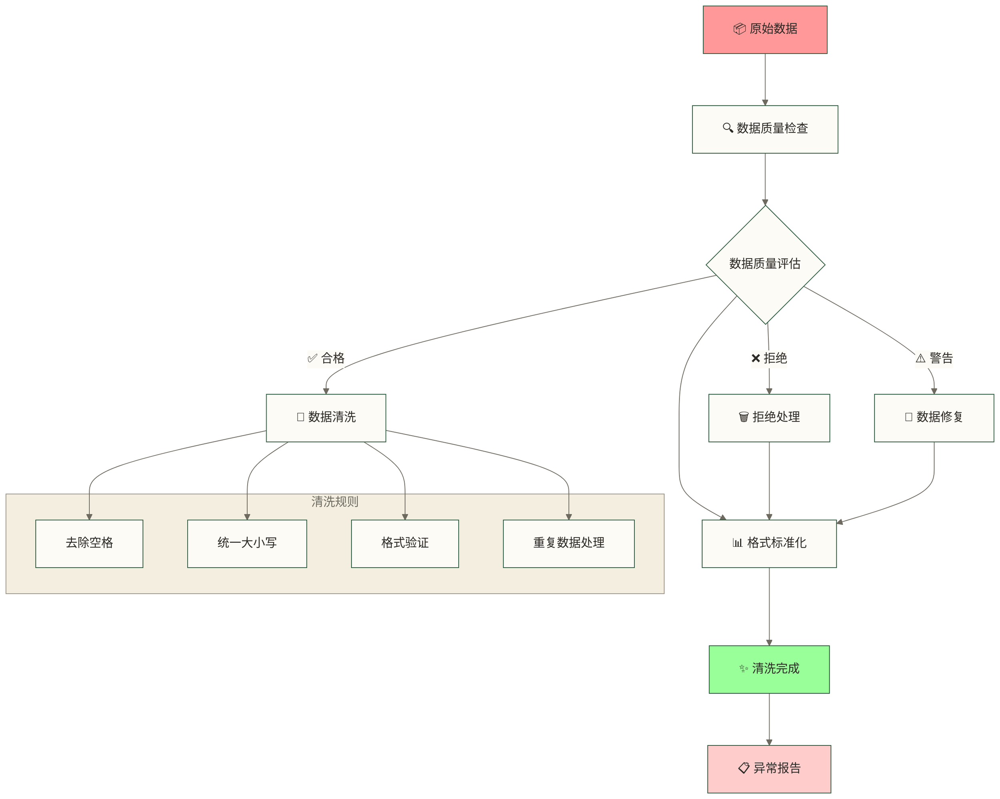

> [!IMPORTANT] 🎯 数据清洗实战场景
> **场景：清洗客户信息数据，确保数据质量**
> 
> **常见数据质量问题**：
> - 📱 手机号格式不统一：138-1234-5678、13812345678
> - 📧 邮箱大小写混乱：User@GMAIL.COM、user@gmail.com
> - 👤 姓名包含多余空格：" 张 三 "
> - 🆔 身份证号x大小写不一致：12345x、12345X

```sql
-- 🔍 数据质量检查函数
CREATE OR REPLACE FUNCTION validate_customer_info(
    p_customer_id IN VARCHAR2,      -- 客户ID
    p_customer_name IN VARCHAR2,    -- 客户姓名
    p_id_card IN VARCHAR2,          -- 身份证号
    p_phone IN VARCHAR2,            -- 手机号
    p_email IN VARCHAR2,            -- 邮箱
    p_birth_date IN DATE            -- 生日
) RETURN VARCHAR2  -- 返回验证结果
AS
    v_age NUMBER;
    
BEGIN
    -- ✅ 第1项检查：必填字段
    IF p_customer_id IS NULL THEN
        RETURN 'ERROR:客户ID不能为空';
    END IF;
    
    IF TRIM(p_customer_name) IS NULL THEN
        RETURN 'ERROR:客户姓名不能为空';
    END IF;
    
    -- ✅ 第2项检查：身份证号格式
    IF p_id_card IS NOT NULL THEN
        -- 身份证号必须是18位，前17位是数字，最后一位是数字或X
        IF NOT REGEXP_LIKE(p_id_card, '^\d{17}[\dXx]$') THEN
            RETURN 'ERROR:身份证号格式错误，应为18位数字+数字或X';
        END IF;
        
        -- 简单的身份证校验：检查生日部分是否合理
        DECLARE
            v_id_birth_year NUMBER;
        BEGIN
            v_id_birth_year := TO_NUMBER(SUBSTR(p_id_card, 7, 4));
            IF v_id_birth_year < 1900 OR v_id_birth_year > EXTRACT(YEAR FROM SYSDATE) THEN
                RETURN 'ERROR:身份证号中的出生年份不合理';
            END IF;
        EXCEPTION
            WHEN OTHERS THEN
                RETURN 'ERROR:身份证号中的日期部分格式错误';
        END;
    END IF;
    
    -- ✅ 第3项检查：手机号格式
    IF p_phone IS NOT NULL THEN
        -- 手机号必须是11位，以1开头，第二位是3-9
        IF NOT REGEXP_LIKE(p_phone, '^1[3-9]\d{9}$') THEN
            RETURN 'ERROR:手机号格式错误，应为11位数字，以1开头';
        END IF;
    END IF;
    
    -- ✅ 第4项检查：邮箱格式
    IF p_email IS NOT NULL THEN
        -- 简单的邮箱格式检查
        IF NOT REGEXP_LIKE(p_email, '^[A-Za-z0-9._%-]+@[A-Za-z0-9.-]+\.[A-Za-z]{2,}$') THEN
            RETURN 'ERROR:邮箱格式错误';
        END IF;
    END IF;
    
    -- ✅ 第5项检查：年龄合理性
    IF p_birth_date IS NOT NULL THEN
        v_age := FLOOR(MONTHS_BETWEEN(SYSDATE, p_birth_date) / 12);
        IF v_age < 0 THEN
            RETURN 'ERROR:出生日期不能是未来日期';
        ELSIF v_age > 150 THEN
            RETURN 'ERROR:年龄超过150岁，请检查出生日期';
        ELSIF v_age < 16 THEN
            RETURN 'WARNING:客户年龄小于16岁，请确认';
        END IF;
    END IF;
    
    -- 🎉 所有检查都通过
    RETURN 'PASS';
    
EXCEPTION
    WHEN OTHERS THEN
        RETURN 'ERROR:数据验证过程出错-' || SQLERRM;
END validate_customer_info;
/

-- 💡 解释：
-- 1. REGEXP_LIKE()：Oracle的正则表达式匹配函数
-- 2. ^\d{17}[\dXx]$：正则表达式，表示17位数字+1位数字或X
-- 3. MONTHS_BETWEEN()：计算两个日期之间的月数
-- 4. 分级验证：ERROR表示严重错误，WARNING表示需要关注
```

```sql
-- 🧹 客户信息数据清洗存储过程
CREATE OR REPLACE PROCEDURE clean_customer_data(
    p_batch_date IN DATE,
    p_execution_id IN VARCHAR2
)
AS
    v_total_count NUMBER := 0;      -- 总记录数
    v_valid_count NUMBER := 0;      -- 有效记录数
    v_invalid_count NUMBER := 0;    -- 无效记录数
    v_validation_result VARCHAR2(200);
    
    -- 🎯 游标：逐条处理临时表中的数据
    CURSOR c_stage_data IS
        SELECT customer_id, customer_name, id_card, phone, email, 
               birth_date, gender, address, annual_income
        FROM stage_customer_info
        WHERE batch_date = p_batch_date
          AND processing_status = 'PENDING';  -- 只处理待处理的数据
          
BEGIN
    DBMS_OUTPUT.PUT_LINE('🧹 开始清洗客户信息数据');
    
    -- 🔄 逐条处理数据
    FOR customer_rec IN c_stage_data LOOP
        v_total_count := v_total_count + 1;
        
        -- 📋 第1步：数据质量检查
        v_validation_result := validate_customer_info(
            customer_rec.customer_id,
            customer_rec.customer_name,
            customer_rec.id_card,
            customer_rec.phone,
            customer_rec.email,
            customer_rec.birth_date
        );
        
        -- 📊 第2步：根据验证结果处理数据
        IF v_validation_result = 'PASS' OR v_validation_result LIKE 'WARNING:%' THEN
            -- ✅ 数据质量检查通过，进行数据清洗
            
            UPDATE stage_customer_info SET
                -- 清洗客户姓名：去空格，统一大小写
                customer_name = TRIM(INITCAP(customer_name)),  -- 首字母大写
                
                -- 清洗手机号：去掉所有非数字字符
                phone = CASE 
                    WHEN phone IS NOT NULL THEN REGEXP_REPLACE(phone, '[^0-9]', '')
                    ELSE phone
                END,
                
                -- 清洗邮箱：转小写，去空格
                email = CASE
                    WHEN email IS NOT NULL THEN LOWER(TRIM(email))
                    ELSE email
                END,
                
                -- 清洗身份证号：转大写（X要大写）
                id_card = CASE
                    WHEN id_card IS NOT NULL THEN UPPER(TRIM(id_card))
                    ELSE id_card
                END,
                
                -- 清洗地址：去掉多余空格
                address = CASE
                    WHEN address IS NOT NULL THEN REGEXP_REPLACE(TRIM(address), '\s+', ' ')
                    ELSE address
                END,
                
                -- 更新处理状态
                processing_status = CASE 
                    WHEN v_validation_result = 'PASS' THEN 'VALIDATED'
                    ELSE 'WARNING'
                END,
                
                error_message = CASE
                    WHEN v_validation_result LIKE 'WARNING:%' THEN v_validation_result
                    ELSE NULL
                END,
                
                validation_time = SYSDATE
                
            WHERE customer_id = customer_rec.customer_id
              AND batch_date = p_batch_date;
            
            v_valid_count := v_valid_count + 1;
            
        ELSE
            -- ❌ 数据质量检查未通过，标记为拒绝
            UPDATE stage_customer_info SET
                processing_status = 'REJECTED',
                error_message = v_validation_result,
                validation_time = SYSDATE
            WHERE customer_id = customer_rec.customer_id
              AND batch_date = p_batch_date;
            
            v_invalid_count := v_invalid_count + 1;
            
            DBMS_OUTPUT.PUT_LINE('❌ 数据质量问题 - 客户ID：' || customer_rec.customer_id || 
                               '，原因：' || v_validation_result);
        END IF;
        
        -- 📊 每处理1000条记录显示一次进度
        IF MOD(v_total_count, 1000) = 0 THEN
            DBMS_OUTPUT.PUT_LINE('📈 已处理：' || v_total_count || ' 条记录');
            COMMIT;  -- 定期提交
        END IF;
        
    END LOOP;
    
    COMMIT;
    
    -- 📊 汇总统计
    DBMS_OUTPUT.PUT_LINE('');
    DBMS_OUTPUT.PUT_LINE('🎯 客户信息数据清洗完成');
    DBMS_OUTPUT.PUT_LINE('📊 处理统计：');
    DBMS_OUTPUT.PUT_LINE('  总记录数：' || TO_CHAR(v_total_count, '999,999,999'));
    DBMS_OUTPUT.PUT_LINE('  有效记录：' || TO_CHAR(v_valid_count, '999,999,999') || 
                        ' (' || ROUND(v_valid_count/v_total_count*100, 2) || '%)');
    DBMS_OUTPUT.PUT_LINE('  无效记录：' || TO_CHAR(v_invalid_count, '999,999,999') || 
                        ' (' || ROUND(v_invalid_count/v_total_count*100, 2) || '%)');
    
    -- ✅ 更新执行日志
    UPDATE etl_execution_log
    SET end_time = SYSTIMESTAMP,
        status = 'SUCCESS',
        records_processed = v_total_count,
        records_inserted = v_valid_count,
        records_rejected = v_invalid_count
    WHERE execution_id = p_execution_id;
    
    COMMIT;
    
EXCEPTION
    WHEN OTHERS THEN
        DBMS_OUTPUT.PUT_LINE('❌ 数据清洗失败：' || SQLERRM);
        
        ROLLBACK;
        
        UPDATE etl_execution_log
        SET end_time = SYSTIMESTAMP,
            status = 'FAILED',
            error_message = SQLERRM
        WHERE execution_id = p_execution_id;
        COMMIT;
        
        RAISE;
END clean_customer_data;
/

-- 💡 解释：
-- 1. INITCAP()：首字母大写函数
-- 2. REGEXP_REPLACE()：正则表达式替换，'\s+'表示一个或多个空格
-- 3. 游标处理：逐条处理数据，可以精确控制每条记录的处理逻辑
-- 4. 统计报告：提供详细的处理统计，便于监控数据质量
```

### 🎨 业务规则转换实战

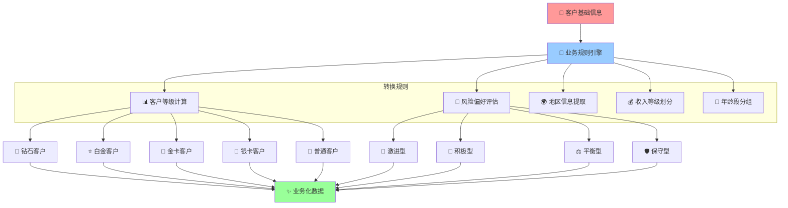

> [!TIP] 🎨 业务转换实战场景
> **场景：根据银行业务规则转换客户数据**
> 
> **转换目标**：
> - 🏆 自动计算客户等级（钻石、白金、金卡等）
> - 🎯 评估风险承受能力（激进、保守等）
> - 🌍 提取地理信息（省市区）
> - 💰 划分收入等级

```sql
-- 🎯 客户数据业务转换存储过程
CREATE OR REPLACE PROCEDURE transform_customer_data(
    p_batch_date IN DATE,
    p_execution_id IN VARCHAR2
)
AS
    v_processed_count NUMBER := 0;
    
    -- 📊 客户等级计算函数
    FUNCTION calculate_customer_level(
        p_total_balance IN NUMBER,      -- 总资产
        p_annual_income IN NUMBER,      -- 年收入
        p_account_count IN NUMBER,      -- 账户数量
        p_age IN NUMBER                 -- 年龄
    ) RETURN VARCHAR2 AS
    BEGIN
        -- 🏆 钻石客户：资产500万以上 或 年收入100万以上
        IF p_total_balance >= 5000000 OR p_annual_income >= 1000000 THEN
            RETURN 'DIAMOND';
            
        -- 💎 白金客户：资产100万以上 或 年收入50万以上 或 多账户高净值客户
        ELSIF p_total_balance >= 1000000 OR p_annual_income >= 500000 OR 
              (p_account_count >= 5 AND p_total_balance >= 500000) THEN
            RETURN 'PLATINUM';
            
        -- 🥇 金卡客户：资产10万以上 或 年收入20万以上 或 年轻高收入
        ELSIF p_total_balance >= 100000 OR p_annual_income >= 200000 OR
              (p_age BETWEEN 25 AND 35 AND p_annual_income >= 100000) THEN
            RETURN 'GOLD';
            
        -- 🥈 银卡客户：有一定资产或收入
        ELSIF p_total_balance >= 10000 OR p_annual_income >= 50000 THEN
            RETURN 'SILVER';
            
        -- 🥉 普通客户
        ELSE
            RETURN 'BRONZE';
        END IF;
    END calculate_customer_level;
    
    -- 🎯 风险偏好评估函数
    FUNCTION assess_risk_profile(
        p_age IN NUMBER,
        p_annual_income IN NUMBER,
        p_customer_level IN VARCHAR2
    ) RETURN VARCHAR2 AS
    BEGIN
        -- 💪 激进型：年轻且高收入
        IF p_age BETWEEN 25 AND 40 AND p_annual_income >= 300000 THEN
            RETURN 'AGGRESSIVE';
            
        -- 🎯 积极型：中年中高收入，或高等级客户
        ELSIF (p_age BETWEEN 30 AND 50 AND p_annual_income >= 100000) OR
              p_customer_level IN ('DIAMOND', 'PLATINUM') THEN
            RETURN 'MODERATE_AGGRESSIVE';
            
        -- ⚖️ 平衡型：中等收入中年客户
        ELSIF p_age BETWEEN 35 AND 55 AND p_annual_income >= 50000 THEN
            RETURN 'MODERATE';
            
        -- 🛡️ 保守型：年长客户或低收入客户
        ELSIF p_age >= 50 OR p_annual_income < 50000 THEN
            RETURN 'CONSERVATIVE';
            
        -- 🤔 稳健型：其他情况
        ELSE
            RETURN 'BALANCED';
        END IF;
    END assess_risk_profile;
    
BEGIN
    DBMS_OUTPUT.PUT_LINE('🎨 开始客户数据业务转换');
    
    -- 🔄 批量转换并插入到ODS层
    INSERT INTO ods_customer_info (
        customer_id,
        customer_name,
        id_card,
        phone,
        email,
        birth_date,
        age,                    -- 计算出的年龄
        age_group,              -- 年龄段
        gender,
        gender_desc,            -- 性别描述
        address,
        city,                   -- 从地址中提取的城市
        province,               -- 从地址中提取的省份
        annual_income,
        income_level,           -- 收入等级
        total_balance,          -- 总资产
        account_count,          -- 账户数量
        customer_level,         -- 客户等级
        risk_profile,           -- 风险偏好
        is_vip,                 -- 是否VIP
        create_time,
        etl_batch_id,
        etl_time
    )
    SELECT 
        sci.customer_id,
        sci.customer_name,
        sci.id_card,
        sci.phone,
        sci.email,
        sci.birth_date,
        
        -- 📊 计算年龄
        FLOOR(MONTHS_BETWEEN(SYSDATE, sci.birth_date) / 12) as age,
        
        -- 📊 年龄段分组
        CASE 
            WHEN FLOOR(MONTHS_BETWEEN(SYSDATE, sci.birth_date) / 12) < 18 THEN '未成年'
            WHEN FLOOR(MONTHS_BETWEEN(SYSDATE, sci.birth_date) / 12) < 25 THEN '青年'
            WHEN FLOOR(MONTHS_BETWEEN(SYSDATE, sci.birth_date) / 12) < 35 THEN '青年白领'
            WHEN FLOOR(MONTHS_BETWEEN(SYSDATE, sci.birth_date) / 12) < 45 THEN '中年精英'
            WHEN FLOOR(MONTHS_BETWEEN(SYSDATE, sci.birth_date) / 12) < 55 THEN '中年稳健'
            WHEN FLOOR(MONTHS_BETWEEN(SYSDATE, sci.birth_date) / 12) < 65 THEN '准退休'
            ELSE '退休'
        END as age_group,
        
        sci.gender,
        
        -- 📊 性别描述转换
        CASE 
            WHEN UPPER(sci.gender) IN ('M', '男', 'MALE') THEN '男'
            WHEN UPPER(sci.gender) IN ('F', '女', 'FEMALE') THEN '女'
            ELSE '未知'
        END as gender_desc,
        
        sci.address,
        
        -- 🌍 从地址中提取城市信息
        CASE 
            WHEN sci.address LIKE '%北京%' THEN '北京'
            WHEN sci.address LIKE '%上海%' THEN '上海'
            WHEN sci.address LIKE '%广州%' THEN '广州'
            WHEN sci.address LIKE '%深圳%' THEN '深圳'
            WHEN sci.address LIKE '%杭州%' THEN '杭州'
            WHEN sci.address LIKE '%南京%' THEN '南京'
            WHEN sci.address LIKE '%成都%' THEN '成都'
            WHEN sci.address LIKE '%武汉%' THEN '武汉'
            -- 可以根据需要添加更多城市
            ELSE '其他'
        END as city,
        
        -- 🌍 从地址中提取省份信息
        CASE 
            WHEN sci.address LIKE '%北京%' THEN '北京市'
            WHEN sci.address LIKE '%上海%' THEN '上海市'
            WHEN sci.address LIKE '%广东%' OR sci.address LIKE '%广州%' OR sci.address LIKE '%深圳%' THEN '广东省'
            WHEN sci.address LIKE '%浙江%' OR sci.address LIKE '%杭州%' THEN '浙江省'
            WHEN sci.address LIKE '%江苏%' OR sci.address LIKE '%南京%' THEN '江苏省'
            WHEN sci.address LIKE '%四川%' OR sci.address LIKE '%成都%' THEN '四川省'
            WHEN sci.address LIKE '%湖北%' OR sci.address LIKE '%武汉%' THEN '湖北省'
            -- 可以根据需要添加更多省份
            ELSE '其他'
        END as province,
        
        sci.annual_income,
        
        -- 💰 收入等级分类
        CASE 
            WHEN sci.annual_income >= 1000000 THEN '高收入'
            WHEN sci.annual_income >= 500000 THEN '中高收入'
            WHEN sci.annual_income >= 200000 THEN '中等收入'
            WHEN sci.annual_income >= 100000 THEN '中低收入'
            WHEN sci.annual_income >= 50000 THEN '低收入'
            ELSE '收入不详'
        END as income_level,
        
        -- 💎 客户资产信息（通过关联账户表获取）
        NVL(acc_info.total_balance, 0) as total_balance,
        NVL(acc_info.account_count, 0) as account_count,
        
        -- 🏆 计算客户等级
        calculate_customer_level(
            NVL(acc_info.total_balance, 0),
            NVL(sci.annual_income, 0),
            NVL(acc_info.account_count, 0),
            FLOOR(MONTHS_BETWEEN(SYSDATE, sci.birth_date) / 12)
        ) as customer_level,
        
        -- 🎯 评估风险偏好
        assess_risk_profile(
            FLOOR(MONTHS_BETWEEN(SYSDATE, sci.birth_date) / 12),
            NVL(sci.annual_income, 0),
            calculate_customer_level(
                NVL(acc_info.total_balance, 0),
                NVL(sci.annual_income, 0),
                NVL(acc_info.account_count, 0),
                FLOOR(MONTHS_BETWEEN(SYSDATE, sci.birth_date) / 12)
            )
        ) as risk_profile,
        
        -- ⭐ VIP标识
        CASE 
            WHEN calculate_customer_level(
                NVL(acc_info.total_balance, 0),
                NVL(sci.annual_income, 0),
                NVL(acc_info.account_count, 0),
                FLOOR(MONTHS_BETWEEN(SYSDATE, sci.birth_date) / 12)
            ) IN ('DIAMOND', 'PLATINUM') THEN 'Y'
            ELSE 'N'
        END as is_vip,
        
        sci.create_time,
        p_execution_id,
        SYSDATE
        
    FROM stage_customer_info sci
    LEFT JOIN (
        -- 📊 计算客户的账户汇总信息
        SELECT 
            customer_id,
            SUM(balance) as total_balance,
            COUNT(*) as account_count
        FROM account_info
        WHERE status = 'ACTIVE'  -- 只统计活跃账户
        GROUP BY customer_id
    ) acc_info ON sci.customer_id = acc_info.customer_id
    
    WHERE sci.batch_date = p_batch_date
      AND sci.processing_status = 'VALIDATED';  -- 只转换已验证的数据
    
    v_processed_count := SQL%ROWCOUNT;
    
    COMMIT;
    
    DBMS_OUTPUT.PUT_LINE('✅ 客户数据业务转换完成');
    DBMS_OUTPUT.PUT_LINE('📊 转换记录数：' || TO_CHAR(v_processed_count, '999,999,999'));
    
    -- 📊 生成转换统计报告
    FOR stat_rec IN (
        SELECT 
            customer_level,
            COUNT(*) as customer_count,
            ROUND(COUNT(*) * 100.0 / v_processed_count, 2) as percentage
        FROM ods_customer_info
        WHERE etl_batch_id = p_execution_id
        GROUP BY customer_level
        ORDER BY COUNT(*) DESC
    ) LOOP
        DBMS_OUTPUT.PUT_LINE('  ' || stat_rec.customer_level || ' 客户：' || 
                           stat_rec.customer_count || ' 人 (' || stat_rec.percentage || '%)');
    END LOOP;
    
    -- ✅ 更新执行日志
    UPDATE etl_execution_log
    SET end_time = SYSTIMESTAMP,
        status = 'SUCCESS',
        records_processed = v_processed_count,
        records_inserted = v_processed_count
    WHERE execution_id = p_execution_id;
    
    COMMIT;
    
EXCEPTION
    WHEN OTHERS THEN
        DBMS_OUTPUT.PUT_LINE('❌ 客户数据转换失败：' || SQLERRM);
        
        ROLLBACK;
        
        UPDATE etl_execution_log
        SET end_time = SYSTIMESTAMP,
            status = 'FAILED',  
            error_message = SQLERRM
        WHERE execution_id = p_execution_id;
        COMMIT;
        
        RAISE;
END transform_customer_data;
/

-- 💡 解释：
-- 1. 嵌套函数：在存储过程内部定义业务逻辑函数
-- 2. 复杂的CASE语句：实现多层次的业务规则判断
-- 3. 子查询关联：通过LEFT JOIN获取客户的账户汇总信息
-- 4. 统计报告：生成转换后的数据分布统计
```

## 🏛️ 第五步：EAST5.0标准实践项目

> [!IMPORTANT] 🏛️ EAST5.0与ETL开发
> 本节以**EAST5.0监管数据报送场景**组织ETL设计示例；下述字段、编码、阈值和报送流程不构成正式规范，实际要求及适用范围应以对应机构采用的监管文件为准。

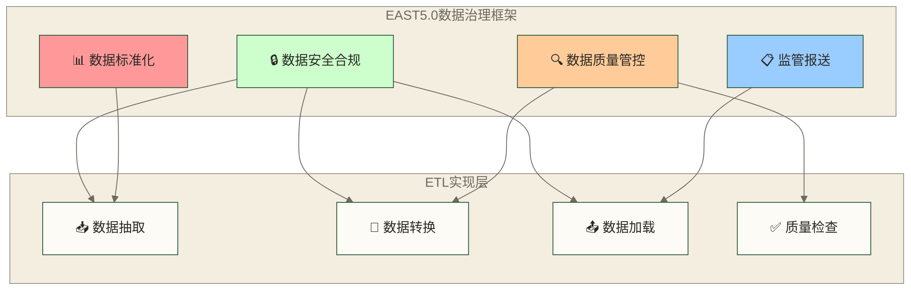

### 📊 EAST5.0数据标准化实践

> [!NOTE] 📊 EAST5.0数据标准要求
> **核心要求**：
> - 🏷️ 统一数据编码标准
> - 📏 标准化数据格式
> - 🔗 建立数据血缘关系
> - 📋 完整的元数据管理

**实践项目：构建EAST5.0标准化数据转换**

```sql
-- 🏛️ EAST5.0标准化客户信息转换
CREATE OR REPLACE PROCEDURE transform_east50_customer_data(
    p_batch_date IN DATE,
    p_execution_id IN VARCHAR2
)
AS
    v_processed_count NUMBER := 0;
    
BEGIN
    DBMS_OUTPUT.PUT_LINE('🏛️ 开始EAST5.0标准化客户数据转换');
    
    -- 🔄 按照EAST5.0标准转换客户数据
    INSERT INTO east50_customer_standard (
        east_customer_id,        -- EAST5.0标准客户编号
        customer_type_code,      -- 客户类型编码（个人P/企业C）
        id_type_code,           -- 证件类型编码
        id_number,              -- 证件号码
        customer_name_cn,       -- 中文名称
        customer_name_en,       -- 英文名称
        gender_code,            -- 性别编码（M/F/U）
        birth_date,             -- 出生日期
        nationality_code,       -- 国籍编码（ISO标准）
        residence_country,      -- 居住国家编码
        occupation_code,        -- 职业编码（EAST5.0标准）
        industry_code,          -- 行业编码（CSRC标准）
        risk_rating,            -- 风险评级（1-10级）
        kyc_level,              -- KYC等级（1-3级）
        aml_risk_score,         -- 反洗钱风险评分
        data_source,            -- 数据来源系统
        create_timestamp,       -- 创建时间戳
        update_timestamp,       -- 更新时间戳
        data_quality_score,     -- 数据质量评分
        east_version           -- EAST版本号
    )
    SELECT 
        -- 🔢 生成EAST5.0标准客户编号（bank_code + customer_seq）
        '0001' || LPAD(customer_seq.NEXTVAL, 12, '0') as east_customer_id,
        
        -- 👤 客户类型标准化
        CASE 
            WHEN customer_type = '个人' THEN 'P'
            WHEN customer_type = '企业' THEN 'C'
            ELSE 'U'  -- 未知
        END as customer_type_code,
        
        -- 🆔 证件类型标准化（按EAST5.0编码）
        CASE 
            WHEN id_type = '身份证' THEN '01'
            WHEN id_type = '护照' THEN '02'
            WHEN id_type = '军官证' THEN '03'
            WHEN id_type = '营业执照' THEN '11'
            WHEN id_type = '组织机构代码证' THEN '12'
            ELSE '99'  -- 其他
        END as id_type_code,
        
        -- 📄 证件号码标准化处理
        TRIM(REGEXP_REPLACE(UPPER(id_card), '[^A-Z0-9]', '')) as id_number,
        
        -- 📝 姓名标准化
        TRIM(customer_name) as customer_name_cn,
        NVL(TRIM(customer_name_en), TRIM(customer_name)) as customer_name_en,
        
        -- ⚥ 性别编码标准化
        CASE 
            WHEN UPPER(gender) IN ('M', '男', 'MALE', '1') THEN 'M'
            WHEN UPPER(gender) IN ('F', '女', 'FEMALE', '2') THEN 'F'
            ELSE 'U'
        END as gender_code,
        
        birth_date,
        
        -- 🌍 国籍编码（ISO 3166-1 alpha-2）
        CASE 
            WHEN nationality = '中国' THEN 'CN'
            WHEN nationality = '美国' THEN 'US'
            WHEN nationality = '英国' THEN 'GB'
            WHEN nationality = '日本' THEN 'JP'
            ELSE 'CN'  -- 默认中国
        END as nationality_code,
        
        -- 🏠 居住国家（默认与国籍相同）
        CASE 
            WHEN nationality = '中国' THEN 'CN'
            WHEN nationality = '美国' THEN 'US'
            WHEN nationality = '英国' THEN 'GB'
            WHEN nationality = '日本' THEN 'JP'
            ELSE 'CN'
        END as residence_country,
        
        -- 💼 职业编码（按国家标准GB/T 6565-2015）
        get_occupation_code(occupation) as occupation_code,
        
        -- 🏭 行业编码（证监会行业分类）
        get_industry_code(industry) as industry_code,
        
        -- 📊 风险评级计算
        calculate_risk_rating(
            total_assets,
            annual_income,
            transaction_frequency,
            geographic_risk
        ) as risk_rating,
        
        -- 🔍 KYC等级评定
        calculate_kyc_level(
            id_verification_status,
            address_verification_status,
            income_verification_status
        ) as kyc_level,
        
        -- 🚨 反洗钱风险评分
        calculate_aml_risk_score(
            transaction_pattern,
            geographic_risk,
            occupation_risk,
            customer_behavior
        ) as aml_risk_score,
        
        'CORE_BANKING' as data_source,
        SYSTIMESTAMP as create_timestamp,
        SYSTIMESTAMP as update_timestamp,
        
        -- 📈 数据质量评分
        calculate_data_quality_score(
            customer_name,
            id_card,
            phone,
            address,
            birth_date
        ) as data_quality_score,
        
        '5.0' as east_version
        
    FROM ods_customer_info
    WHERE batch_date = p_batch_date
      AND processing_status = 'VALIDATED';
    
    v_processed_count := SQL%ROWCOUNT;
    
    COMMIT;
    
    DBMS_OUTPUT.PUT_LINE('✅ EAST5.0标准化转换完成');
    DBMS_OUTPUT.PUT_LINE('📊 转换记录数：' || TO_CHAR(v_processed_count, '999,999,999'));
    
EXCEPTION
    WHEN OTHERS THEN
        DBMS_OUTPUT.PUT_LINE('❌ EAST5.0标准化转换失败：' || SQLERRM);
        ROLLBACK;
        RAISE;
END transform_east50_customer_data;
/
```

### 🔍 EAST5.0数据质量管控实践

> [!WARNING] ⚠️ EAST5.0数据质量要求
> **教学示例的假设目标，不代表EAST5.0正式要求**：
> - 📊 假设数据完整性目标不低于95%
> - 🎯 假设数据准确性目标不低于99%
> - ⏱️ 假设数据及时性目标为T+1
> - 🔗 假设数据一致性目标为100%

```sql
-- 🔍 EAST5.0数据质量检查框架
CREATE OR REPLACE PROCEDURE east50_data_quality_check(
    p_table_name IN VARCHAR2,
    p_batch_date IN DATE,
    p_execution_id IN VARCHAR2
)
AS
    v_total_records NUMBER := 0;
    v_quality_issues NUMBER := 0;
    v_completeness_score NUMBER;
    v_accuracy_score NUMBER;
    v_consistency_score NUMBER;
    v_overall_score NUMBER;
    
BEGIN
    DBMS_OUTPUT.PUT_LINE('🔍 开始EAST5.0数据质量检查：' || p_table_name);
    
    -- 📊 1. 完整性检查
    EXECUTE IMMEDIATE 
        'SELECT COUNT(*) FROM ' || p_table_name || 
        ' WHERE batch_date = :1'
    INTO v_total_records
    USING p_batch_date;
    
    -- 检查必填字段完整性
    FOR field_rec IN (
        SELECT column_name, nullable
        FROM user_tab_columns
        WHERE table_name = UPPER(p_table_name)
        AND column_name IN (
            'EAST_CUSTOMER_ID', 'CUSTOMER_TYPE_CODE', 
            'ID_TYPE_CODE', 'ID_NUMBER', 'CUSTOMER_NAME_CN'
        )
    ) LOOP
        DECLARE
            v_null_count NUMBER;
        BEGIN
            EXECUTE IMMEDIATE 
                'SELECT COUNT(*) FROM ' || p_table_name ||
                ' WHERE ' || field_rec.column_name || ' IS NULL' ||
                ' AND batch_date = :1'
            INTO v_null_count
            USING p_batch_date;
            
            IF v_null_count > 0 THEN
                v_quality_issues := v_quality_issues + v_null_count;
                
                -- 记录质量问题
                INSERT INTO east50_quality_issues (
                    issue_id, table_name, column_name, issue_type,
                    issue_count, batch_date, create_time
                ) VALUES (
                    quality_issue_seq.NEXTVAL, p_table_name, 
                    field_rec.column_name, 'COMPLETENESS',
                    v_null_count, p_batch_date, SYSDATE
                );
                
                DBMS_OUTPUT.PUT_LINE('⚠️ 完整性问题：' || field_rec.column_name || 
                                   ' 缺失 ' || v_null_count || ' 条记录');
            END IF;
        END;
    END LOOP;
    
    -- 📏 2. 准确性检查
    -- 检查证件号码格式
    DECLARE
        v_invalid_id_count NUMBER;
    BEGIN
        EXECUTE IMMEDIATE 
            'SELECT COUNT(*) FROM ' || p_table_name ||
            ' WHERE NOT REGEXP_LIKE(id_number, ''^[A-Z0-9]{15,20}$'')' ||
            ' AND batch_date = :1'
        INTO v_invalid_id_count
        USING p_batch_date;
        
        IF v_invalid_id_count > 0 THEN
            v_quality_issues := v_quality_issues + v_invalid_id_count;
            
            INSERT INTO east50_quality_issues (
                issue_id, table_name, column_name, issue_type,
                issue_count, batch_date, create_time
            ) VALUES (
                quality_issue_seq.NEXTVAL, p_table_name, 
                'ID_NUMBER', 'ACCURACY',
                v_invalid_id_count, p_batch_date, SYSDATE
            );
            
            DBMS_OUTPUT.PUT_LINE('⚠️ 准确性问题：证件号码格式错误 ' || 
                               v_invalid_id_count || ' 条记录');
        END IF;
    END;
    
    -- 🔗 3. 一致性检查
    -- 检查客户编号唯一性
    DECLARE
        v_duplicate_count NUMBER;
    BEGIN
        EXECUTE IMMEDIATE 
            'SELECT COUNT(*) - COUNT(DISTINCT east_customer_id) FROM ' || 
            p_table_name || ' WHERE batch_date = :1'
        INTO v_duplicate_count
        USING p_batch_date;
        
        IF v_duplicate_count > 0 THEN
            v_quality_issues := v_quality_issues + v_duplicate_count;
            
            INSERT INTO east50_quality_issues (
                issue_id, table_name, column_name, issue_type,
                issue_count, batch_date, create_time
            ) VALUES (
                quality_issue_seq.NEXTVAL, p_table_name, 
                'EAST_CUSTOMER_ID', 'CONSISTENCY',
                v_duplicate_count, p_batch_date, SYSDATE
            );
            
            DBMS_OUTPUT.PUT_LINE('⚠️ 一致性问题：客户编号重复 ' || 
                               v_duplicate_count || ' 条记录');
        END IF;
    END;
    
    -- 📈 计算质量评分
    v_completeness_score := ROUND((v_total_records - v_quality_issues) * 100.0 / v_total_records, 2);
    v_accuracy_score := ROUND((v_total_records - v_quality_issues) * 100.0 / v_total_records, 2);
    v_consistency_score := ROUND((v_total_records - v_quality_issues) * 100.0 / v_total_records, 2);
    v_overall_score := ROUND((v_completeness_score + v_accuracy_score + v_consistency_score) / 3, 2);
    
    -- 💾 记录质量评分
    INSERT INTO east50_quality_summary (
        summary_id, table_name, batch_date,
        total_records, quality_issues,
        completeness_score, accuracy_score, consistency_score, overall_score,
        meets_east50_std, create_time
    ) VALUES (
        quality_summary_seq.NEXTVAL, p_table_name, p_batch_date,
        v_total_records, v_quality_issues,
        v_completeness_score, v_accuracy_score, v_consistency_score, v_overall_score,
        CASE WHEN v_overall_score >= 95 THEN 'Y' ELSE 'N' END,
        SYSDATE
    );
    
    COMMIT;
    
    -- 📊 输出质量报告
    DBMS_OUTPUT.PUT_LINE('');
    DBMS_OUTPUT.PUT_LINE('📊 EAST5.0数据质量报告');
    DBMS_OUTPUT.PUT_LINE('====================');
    DBMS_OUTPUT.PUT_LINE('表名：' || p_table_name);
    DBMS_OUTPUT.PUT_LINE('总记录数：' || TO_CHAR(v_total_records, '999,999,999'));
    DBMS_OUTPUT.PUT_LINE('质量问题：' || TO_CHAR(v_quality_issues, '999,999'));
    DBMS_OUTPUT.PUT_LINE('完整性评分：' || v_completeness_score || '%');
    DBMS_OUTPUT.PUT_LINE('准确性评分：' || v_accuracy_score || '%');
    DBMS_OUTPUT.PUT_LINE('一致性评分：' || v_consistency_score || '%');
    DBMS_OUTPUT.PUT_LINE('综合评分：' || v_overall_score || '%');
    
    IF v_overall_score >= 95 THEN
        DBMS_OUTPUT.PUT_LINE('✅ 达到本示例综合评分阈值，不代表符合EAST5.0正式要求');
    ELSE
        DBMS_OUTPUT.PUT_LINE('❌ 未达到本示例综合评分阈值');
    END IF;
    
EXCEPTION
    WHEN OTHERS THEN
        DBMS_OUTPUT.PUT_LINE('❌ EAST5.0质量检查失败：' || SQLERRM);
        ROLLBACK;
        RAISE;
END east50_data_quality_check;
/
```

### 📋 EAST5.0监管报送实践

> [!NOTE] 📋 EAST5.0报送要求
> **报送标准**：
> - 📅 定期报送（月度/季度/年度）
> - 📊 标准化报表格式
> - 🔒 数据加密传输
> - ✅ 报送确认机制

```sql
-- 📋 EAST5.0监管报送数据生成
CREATE OR REPLACE PROCEDURE generate_east50_report(
    p_report_type IN VARCHAR2,     -- 报告类型：MONTHLY/QUARTERLY/YEARLY
    p_report_period IN VARCHAR2,   -- 报告期间：YYYYMM/YYYYQQ/YYYY
    p_execution_id IN VARCHAR2
)
AS
    v_report_id VARCHAR2(100);
    v_report_count NUMBER := 0;
    v_report_date DATE;
    
BEGIN
    DBMS_OUTPUT.PUT_LINE('📋 开始生成EAST5.0监管报送数据');
    DBMS_OUTPUT.PUT_LINE('报告类型：' || p_report_type);
    DBMS_OUTPUT.PUT_LINE('报告期间：' || p_report_period);
    
    -- 🆔 生成报告ID
    v_report_id := 'RPT_' || p_report_type || '_' || p_report_period || '_' || 
                   TO_CHAR(SYSDATE, 'YYYYMMDDHH24MISS');
    
    -- 📅 确定报告日期
    CASE p_report_type
        WHEN 'MONTHLY' THEN
            v_report_date := LAST_DAY(TO_DATE(p_report_period, 'YYYYMM'));
        WHEN 'QUARTERLY' THEN
            v_report_date := LAST_DAY(ADD_MONTHS(TO_DATE(SUBSTR(p_report_period, 1, 4) || '01', 'YYYYMM'), 
                                                TO_NUMBER(SUBSTR(p_report_period, 6, 1)) * 3 - 1));
        WHEN 'YEARLY' THEN
            v_report_date := TO_DATE(p_report_period || '1231', 'YYYYMMDD');
    END CASE;
    
    -- 📊 1. 客户信息报送表
    INSERT INTO east50_customer_report (
        report_id,
        report_period,
        bank_code,
        customer_id,
        customer_type,
        id_type,
        id_number,
        customer_name,
        gender,
        birth_date,
        nationality,
        occupation,
        industry,
        risk_rating,
        account_count,
        total_balance,
        create_timestamp
    )
    SELECT 
        v_report_id,
        p_report_period,
        '0001' as bank_code,
        east_customer_id,
        customer_type_code,
        id_type_code,
        id_number,
        customer_name_cn,
        gender_code,
        birth_date,
        nationality_code,
        occupation_code,
        industry_code,
        risk_rating,
        (SELECT COUNT(*) FROM account_info a WHERE a.customer_id = c.east_customer_id) as account_count,
        (SELECT NVL(SUM(balance), 0) FROM account_info a WHERE a.customer_id = c.east_customer_id) as total_balance,
        SYSTIMESTAMP
    FROM east50_customer_standard c
    WHERE c.create_timestamp <= v_report_date
      AND c.data_quality_score >= 95;  -- 只报送高质量数据
    
    v_report_count := v_report_count + SQL%ROWCOUNT;
    
    -- 📊 2. 交易信息报送表
    INSERT INTO east50_transaction_report (
        report_id,
        report_period,
        bank_code,
        transaction_id,
        customer_id,
        account_id,
        transaction_type,
        transaction_amount,
        transaction_date,
        counterparty_info,
        channel_code,
        risk_flag,
        create_timestamp
    )
    SELECT 
        v_report_id,
        p_report_period,
        '0001' as bank_code,
        trans_id,
        customer_key,
        account_key,
        trans_type,
        trans_amount,
        trans_date,
        counterparty_info,
        channel_code,
        CASE WHEN trans_amount >= 50000 THEN 'HIGH_RISK' ELSE 'NORMAL' END as risk_flag,
        SYSTIMESTAMP
    FROM fact_transaction
    WHERE trans_date BETWEEN 
        CASE p_report_type
            WHEN 'MONTHLY' THEN TRUNC(TO_DATE(p_report_period, 'YYYYMM'), 'MM')
            WHEN 'QUARTERLY' THEN TRUNC(ADD_MONTHS(TO_DATE(SUBSTR(p_report_period, 1, 4) || '01', 'YYYYMM'), 
                                                   (TO_NUMBER(SUBSTR(p_report_period, 6, 1)) - 1) * 3), 'MM')
            WHEN 'YEARLY' THEN TRUNC(TO_DATE(p_report_period, 'YYYY'), 'YYYY')
        END
        AND v_report_date;
    
    v_report_count := v_report_count + SQL%ROWCOUNT;
    
    -- 📊 3. 风险信息报送表
    INSERT INTO east50_risk_report (
        report_id,
        report_period,
        bank_code,
        customer_id,
        risk_type,
        risk_level,
        risk_score,
        risk_description,
        mitigation_measures,
        create_timestamp
    )
    SELECT 
        v_report_id,
        p_report_period,
        '0001' as bank_code,
        customer_id,
        risk_type,
        risk_level,
        risk_score,
        risk_description,
        mitigation_measures,
        SYSTIMESTAMP
    FROM customer_risk_assessment
    WHERE assessment_date <= v_report_date
      AND risk_level IN ('HIGH', 'MEDIUM');  -- 只报送中高风险客户
    
    v_report_count := v_report_count + SQL%ROWCOUNT;
    
    -- 📝 4. 生成报送汇总记录
    INSERT INTO east50_report_summary (
        report_id,
        report_type,
        report_period,
        bank_code,
        total_records,
        report_status,
        generate_time,
        execution_id
    ) VALUES (
        v_report_id,
        p_report_type,
        p_report_period,
        '0001',
        v_report_count,
        'GENERATED',
        SYSDATE,
        p_execution_id
    );
    
    COMMIT;
    
    DBMS_OUTPUT.PUT_LINE('✅ EAST5.0监管报送数据生成完成');
    DBMS_OUTPUT.PUT_LINE('📊 报告ID：' || v_report_id);
    DBMS_OUTPUT.PUT_LINE('📊 报送记录数：' || TO_CHAR(v_report_count, '999,999,999'));
    
EXCEPTION
    WHEN OTHERS THEN
        DBMS_OUTPUT.PUT_LINE('❌ EAST5.0报送数据生成失败：' || SQLERRM);
        ROLLBACK;
        RAISE;
END generate_east50_report;
/
```

### 🔒 EAST5.0数据安全合规实践

> [!WARNING] 🔒 EAST5.0安全合规要求
> **安全标准**：
> - 🔐 敏感数据加密存储
> - 👥 细粒度权限控制
> - 📋 完整审计日志
> - 🛡️ 数据脱敏处理

```sql
-- 🔒 EAST5.0数据安全合规框架
CREATE OR REPLACE PACKAGE east50_security_pkg AS
    
    -- 🔐 敏感数据加密
    FUNCTION encrypt_sensitive_data(
        p_data IN VARCHAR2,
        p_data_type IN VARCHAR2
    ) RETURN VARCHAR2;
    
    -- 🔓 敏感数据解密
    FUNCTION decrypt_sensitive_data(
        p_encrypted_data IN VARCHAR2,
        p_data_type IN VARCHAR2
    ) RETURN VARCHAR2;
    
    -- 🎭 数据脱敏处理
    FUNCTION mask_sensitive_data(
        p_data IN VARCHAR2,
        p_mask_type IN VARCHAR2
    ) RETURN VARCHAR2;
    
    -- 📋 记录数据访问日志
    PROCEDURE log_data_access(
        p_user_id IN VARCHAR2,
        p_table_name IN VARCHAR2,
        p_operation IN VARCHAR2,
        p_record_count IN NUMBER
    );
    
END east50_security_pkg;
/

CREATE OR REPLACE PACKAGE BODY east50_security_pkg AS
    
    -- 🔐 敏感数据加密实现
    FUNCTION encrypt_sensitive_data(
        p_data IN VARCHAR2,
        p_data_type IN VARCHAR2
    ) RETURN VARCHAR2 IS
        v_encrypted_data VARCHAR2(4000);
        v_encryption_key VARCHAR2(100) := 'EAST50_ENCRYPTION_KEY_2024';
    BEGIN
        -- 根据数据类型选择加密策略
        CASE p_data_type
            WHEN 'ID_NUMBER' THEN
                -- 身份证号强加密
                v_encrypted_data := DBMS_CRYPTO.ENCRYPT(
                    UTL_I18N.STRING_TO_RAW(p_data, 'AL32UTF8'),
                    DBMS_CRYPTO.ENCRYPT_AES256 + DBMS_CRYPTO.CHAIN_CBC + DBMS_CRYPTO.PAD_PKCS5,
                    UTL_I18N.STRING_TO_RAW(v_encryption_key, 'AL32UTF8')
                );
                
            WHEN 'PHONE' THEN
                -- 手机号加密
                v_encrypted_data := DBMS_CRYPTO.ENCRYPT(
                    UTL_I18N.STRING_TO_RAW(p_data, 'AL32UTF8'),
                    DBMS_CRYPTO.ENCRYPT_AES128 + DBMS_CRYPTO.CHAIN_CBC + DBMS_CRYPTO.PAD_PKCS5,
                    UTL_I18N.STRING_TO_RAW(v_encryption_key, 'AL32UTF8')
                );
                
            ELSE
                -- 默认加密
                v_encrypted_data := DBMS_CRYPTO.ENCRYPT(
                    UTL_I18N.STRING_TO_RAW(p_data, 'AL32UTF8'),
                    DBMS_CRYPTO.ENCRYPT_AES128 + DBMS_CRYPTO.CHAIN_CBC + DBMS_CRYPTO.PAD_PKCS5,
                    UTL_I18N.STRING_TO_RAW(v_encryption_key, 'AL32UTF8')
                );
        END CASE;
        
        RETURN RAWTOHEX(v_encrypted_data);
        
    EXCEPTION
        WHEN OTHERS THEN
            DBMS_OUTPUT.PUT_LINE('❌ 数据加密失败：' || SQLERRM);
            RETURN NULL;
    END encrypt_sensitive_data;
    
    -- 🎭 数据脱敏处理实现
    FUNCTION mask_sensitive_data(
        p_data IN VARCHAR2,
        p_mask_type IN VARCHAR2
    ) RETURN VARCHAR2 IS
        v_masked_data VARCHAR2(4000);
    BEGIN
        CASE p_mask_type
            WHEN 'ID_NUMBER' THEN
                -- 身份证号脱敏：保留前3位和后2位
                IF LENGTH(p_data) >= 6 THEN
                    v_masked_data := SUBSTR(p_data, 1, 3) || 
                                   RPAD('*', LENGTH(p_data) - 5, '*') || 
                                   SUBSTR(p_data, -2);
                ELSE
                    v_masked_data := RPAD('*', LENGTH(p_data), '*');
                END IF;
                
            WHEN 'PHONE' THEN
                -- 手机号脱敏：保留前3位和后2位
                IF LENGTH(p_data) >= 6 THEN
                    v_masked_data := SUBSTR(p_data, 1, 3) || 
                                   RPAD('*', LENGTH(p_data) - 5, '*') || 
                                   SUBSTR(p_data, -2);
                ELSE
                    v_masked_data := RPAD('*', LENGTH(p_data), '*');
                END IF;
                
            WHEN 'NAME' THEN
                -- 姓名脱敏：保留姓氏
                IF LENGTH(p_data) > 1 THEN
                    v_masked_data := SUBSTR(p_data, 1, 1) || RPAD('*', LENGTH(p_data) - 1, '*');
                ELSE
                    v_masked_data := '*';
                END IF;
                
            ELSE
                -- 默认脱敏：全部替换为*
                v_masked_data := RPAD('*', LENGTH(p_data), '*');
        END CASE;
        
        RETURN v_masked_data;
        
    EXCEPTION
        WHEN OTHERS THEN
            DBMS_OUTPUT.PUT_LINE('❌ 数据脱敏失败：' || SQLERRM);
            RETURN RPAD('*', LENGTH(p_data), '*');
    END mask_sensitive_data;
    
    -- 📋 数据访问日志记录
    PROCEDURE log_data_access(
        p_user_id IN VARCHAR2,
        p_table_name IN VARCHAR2,
        p_operation IN VARCHAR2,
        p_record_count IN NUMBER
    ) IS
        PRAGMA AUTONOMOUS_TRANSACTION;
    BEGIN
        INSERT INTO east50_access_log (
            log_id,
            user_id,
            table_name,
            operation_type,
            record_count,
            access_time,
            session_id,
            ip_address,
            client_info
        ) VALUES (
            access_log_seq.NEXTVAL,
            p_user_id,
            p_table_name,
            p_operation,
            p_record_count,
            SYSTIMESTAMP,
            SYS_CONTEXT('USERENV', 'SESSIONID'),
            SYS_CONTEXT('USERENV', 'IP_ADDRESS'),
            SYS_CONTEXT('USERENV', 'CLIENT_INFO')
        );
        
        COMMIT;
        
    EXCEPTION
        WHEN OTHERS THEN
            ROLLBACK;
            DBMS_OUTPUT.PUT_LINE('❌ 访问日志记录失败：' || SQLERRM);
    END log_data_access;
    
END east50_security_pkg;
/
```

### 📊 EAST5.0项目实施计划

> [!TIP] 📅 EAST5.0实施路线图
> **分阶段实施计划**：
> 
> **第一阶段（1-2个月）**：基础数据标准化
> - 建立EAST5.0数据标准
> - 完成核心客户数据转换
> - 实施基础质量检查
> 
> **第二阶段（3-4个月）**：全面质量管控
> - 完善数据质量检查框架
> - 建立质量监控体系
> - 实现自动化质量报告
> 
> **第三阶段（5-6个月）**：监管报送对接
> - 开发报送数据生成功能
> - 完成报送接口对接
> - 实现定期自动报送
> 
> **第四阶段（持续优化）**：安全合规强化
> - 完善数据安全体系
> - 优化访问控制机制
> - 持续合规性监控

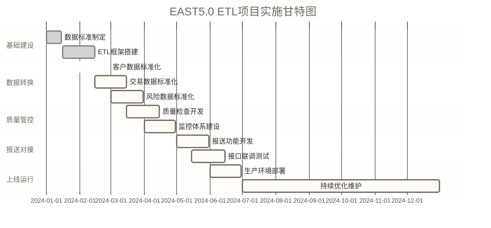

## 🎓 总结：银行ETL开发完整指南

> [!SUCCESS] 🎉 本文展示了银行ETL开发的核心思路
> 完成依赖补充、代码修正和测试练习后，可进一步学习与验证以下能力：
> - 📚 ETL的基本概念和银行应用场景
> - 🏗️ 搭建ETL控制框架
> - 🔄 数据抽取的实战技巧
> - 🛠️ 数据转换和清洗方法


> [!TIP] 💡 学习建议
> **对于初学者**：
> 1. 🎯 先理解ETL的基本概念，不要急于编写复杂代码
> 2. 🏗️ 重点掌握控制框架的设计思想
> 3. 💻 多练习SQL语句，特别是数据转换的逻辑
> 4. 📊 关注数据质量检查，这在银行业务中极其重要
> 
> **下一步学习方向**：
> - 🚀 学习更高级的ETL工具（如Kettle、DataStage）
> - 📈 掌握实时ETL和流处理技术
> - 🔒 深入了解银行数据安全和合规要求
> - 🎯 学习数据仓库建模和OLAP分析

> [!WARNING] ⚠️ 银行ETL开发注意事项
> **数据安全**：
> - 🔐 敏感数据必须加密存储和传输
> - 👥 严格控制数据访问权限
> - 📋 完整的操作审计日志
> 
> **数据准确性**：
> - ✅ 每个环节都要有数据校验
> - 🔄 建立数据对账机制
> - 📊 定期进行数据质量检查
> 
> **性能考量**：
> - ⏰ 合理安排ETL作业时间窗口
> - 📈 监控系统资源使用情况
> - 🔧 定期优化SQL语句和索引

> [!NOTE] 📚 进一步学习资源
> **推荐阅读**：
> - 《数据仓库工具箱》- 维度建模经典教材
> - 《Oracle数据库管理》- 深入理解Oracle性能优化
> - 银行业数据治理相关规范文档
> 
> **实践建议**：
> - 🏗️ 搭建个人的ETL测试环境
> - 💼 参与实际的银行数据项目
> - 🤝 加入数据工程师技术社区
> - 📈 关注最新的大数据技术发展

---

**🎯 最后的话**：ETL开发是数据工程的核心技能，在银行这样的金融机构中，ETL不仅仅是技术工作，更是保障业务连续性和数据准确性的重要环节。希望这个教程能帮助你在数据工程师的道路上走得更远！