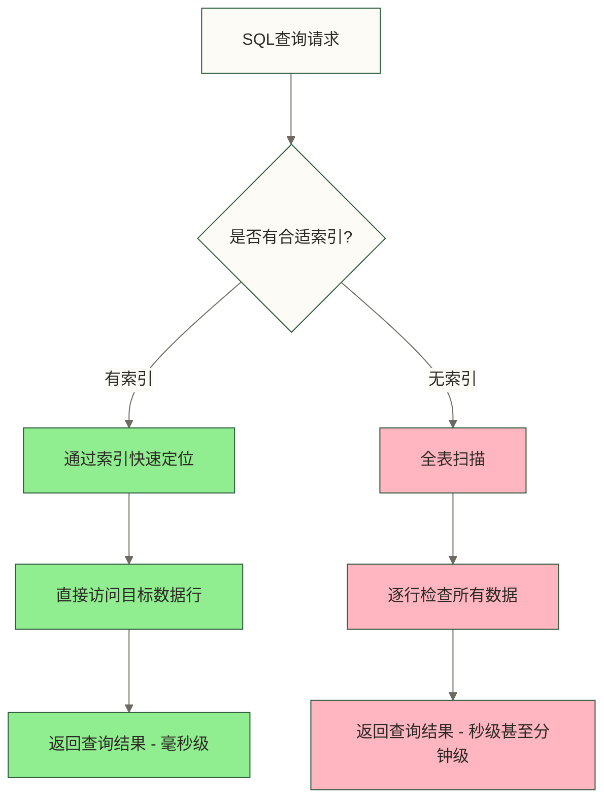
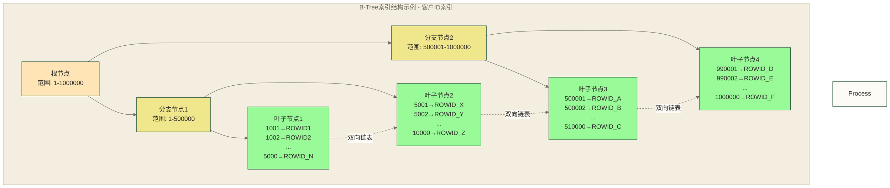

# Oracle索引设计与优化 - 银行高性能查询的核心技术

> [!IMPORTANT] 🎯 本章核心价值
> Oracle索引设计是**数据库性能优化的核心技术**，直接决定银行系统的查询效率和用户体验。在银行业务中，一个优秀的索引策略能够：
> - 🚀 **查询性能可能改善**：具体幅度及响应时间需针对查询负载和执行计划实测
> - 💰 **降低硬件成本**：减少CPU和IO资源消耗
> - 👥 **提升用户体验**：快速响应客户查询请求
> - 🔒 **支持高并发**：在大量用户同时访问时保持性能稳定

## 🔍 索引基础概念深度解析

**什么是数据库索引？**

数据库索引就像书籍的目录一样，是一种**数据结构**，它为表中的数据创建了一个**快速查找的路径**。在银行系统中，当我们需要查找某个客户的交易记录时，如果没有索引，数据库就需要逐行扫描整个交易表（可能包含数百万甚至数千万条记录）；而有了索引，数据库可以直接"跳转"到相关的数据行，大大提高查询效率。

**索引的工作机制详解：**

想象一下在银行营业厅查找客户资料的场景：
- **无索引查找**：就像在一堆乱放的档案中逐个翻找，效率极低
- **有索引查找**：就像有了一个按姓名排序的档案柜，可以快速定位



### 🌳 索引的工作原理 - B-Tree结构深度剖析

> [!NOTE] 📚 B-Tree索引原理
> B-Tree（平衡树）是Oracle默认的索引类型，它的设计非常巧妙，就像一个**倒置的树形结构**，能够保证从根节点到任意叶子节点的路径长度相同，从而确保查询性能的一致性。

**B-Tree索引的三层结构详解：**

**🌟 根节点（Root Node）**
- **作用**：索引的"入口"，包含指向分支节点的指针和范围信息
- **特点**：整个索引只有一个根节点，存储索引值的最高层范围
- **银行场景**：就像银行总行，掌握全行的客户编号范围信息

**🌿 分支节点（Branch Node）**
- **作用**：中间层，包含索引值范围和指向下级节点的指针
- **特点**：根据数据量可能有多层分支节点
- **银行场景**：就像各个分行，负责管理特定区域的客户信息

**🍃 叶子节点（Leaf Node）**
- **作用**：存储实际的索引值和对应的ROWID（行地址）
- **特点**：所有叶子节点通过双向链表连接，支持范围查询
- **银行场景**：就像具体的营业网点，存储客户的详细信息和位置



**🔍 索引查找过程详细步骤：**

以查找客户ID为"500025"的记录为例：

1. **🎯 从根节点开始**：检查客户ID 500025在根节点的范围（1-1000000）内
2. **🌿 选择分支路径**：500025 > 500000，选择右分支（分支节点2）
3. **🍃 到达叶子节点**：在分支节点2的范围内找到对应的叶子节点3
4. **📍 获取ROWID**：在对应叶子节点中查找500025的索引项及其ROWID；示意图未列出该值
5. **📋 访问表数据**：通过上一步查得的500025对应ROWID访问表中的具体数据行；图中的ROWID_A对应500001，并非本次查找值

> [!TIP] 💡 B-Tree索引的优势
> - **平衡性**：所有叶子节点距离根节点的路径长度相同，确保查询性能一致
> - **有序性**：叶子节点按索引值排序，支持范围查询和排序操作
> **高效性**：索引定位所需访问量取决于树高、缓存命中和查询范围，访问表数据还可能产生额外IO，不能保证任意表规模都只需3-4次IO

### 🎯 索引类型全面解析 - 选择最适合的索引策略

> [!IMPORTANT] 🔑 索引类型选择原则
> **不同的业务场景需要不同的索引类型**。在银行系统中，选择合适的索引类型直接影响查询性能和存储效率。以下是各种索引类型的特点和适用场景：

#### 🌳 B-Tree索引（常用索引类型，适用范围取决于查询负载）

**适用场景特征：**
- **高基数列**：列的唯一值比较多（如客户ID、账户号、交易流水号）
- **频繁的等值查询**：WHERE customer_id = '12345'
- **范围查询**：WHERE balance BETWEEN 10000 AND 100000
- **排序操作**：ORDER BY create_date

**银行业务应用举例：**
- 客户ID、身份证号、手机号（唯一性强）
- 账户余额、交易金额（数值范围大）
- 日期时间字段（时间连续性）

**性能特点：**
- 等值查询效率：⭐⭐⭐⭐⭐
- 范围查询效率：⭐⭐⭐⭐⭐
- 存储空间占用：⭐⭐⭐⭐
- 维护成本：⭐⭐⭐⭐

#### 📊 位图索引（数据仓库环境的利器）

**适用场景特征：**
- **低基数列**：列的唯一值较少（如性别、客户等级、交易类型）
- **数据仓库环境**：读多写少的分析型系统
- **复杂的多条件查询**：涉及多个低基数列的AND/OR操作

**银行业务应用举例：**
- 客户性别（男/女）
- 客户等级（普通/银卡/金卡/白金卡）
- 交易类型（存款/取款/转账/查询）
- 交易状态（成功/失败/处理中）

**性能特点：**
- 多条件查询效率：⭐⭐⭐⭐⭐
- 存储空间占用：⭐⭐⭐⭐⭐
- 并发写入性能：⭐⭐（不适合高并发写入）
- 布尔运算支持：⭐⭐⭐⭐⭐

> [!WARNING] ⚠️ 位图索引使用注意事项
> **位图索引不适合OLTP环境**！在银行的核心交易系统中应避免使用位图索引，因为它们会导致严重的锁竞争。位图索引主要用于数据仓库和报表系统。

#### 🔧 函数索引（处理复杂查询的神器）

**适用场景特征：**
- **基于计算结果的查询**：WHERE UPPER(customer_name) = 'ZHANG SAN'
- **日期函数查询**：WHERE TRUNC(trans_date) = DATE '2023-12-01'
- **数学计算查询**：WHERE balance * exchange_rate > 100000

**银行业务应用举例：**
- 客户姓名大小写不敏感查询
- 按年龄段统计客户
- 计算客户资产总值
- 按交易时间段分析

**性能特点：**
- 复杂查询支持：⭐⭐⭐⭐⭐
- 灵活性：⭐⭐⭐⭐⭐
- 维护复杂度：⭐⭐⭐
- 存储空间：⭐⭐⭐


## 🏦 银行业务索引设计实战 - 核心业务表优化策略

> [!NOTE] 📊 银行业务表索引设计理念
> 银行业务系统的索引设计需要**深度结合业务场景**，不能简单地为所有列创建索引。合理的索引设计应该遵循"**业务驱动、性能优先、成本可控**"的原则。以下将通过银行核心业务表的实际案例，展示专业的索引设计思路。

**银行业务表索引设计的关键考虑因素：**
- 🎯 **业务查询模式**：了解实际的查询场景和频率
- ⚡ **查询性能要求**：核心交易要求毫秒级响应
- 💾 **存储成本控制**：索引会增加存储空间和维护成本
- 🔄 **数据更新频率**：高频更新的表需要谨慎设计索引
- 🔒 **并发访问模式**：避免索引导致的锁竞争

### 🎯 客户信息表索引设计 - 银行CRM系统的核心

**客户信息表的业务特点分析：**

客户信息表是银行业务的**基础数据表**，具有以下特点：
- 📈 **数据量大**：大型银行可能有数千万客户记录
- 🔍 **查询频繁**：每次交易都需要验证客户信息
- 📝 **更新相对较少**：客户基本信息变更不频繁
- 🎯 **查询模式多样**：按客户号、身份证、手机号、等级等多种方式查询

> [!TIP] 💡 客户表索引设计策略
> 客户表的索引设计要**重点关注业务查询路径**：
> 1. **主要查询路径**：客户号（主键）、身份证号（唯一）、手机号（登录）
> 2. **分析查询路径**：客户等级、开户时间、所属城市（统计分析）
> 3. **复合查询路径**：状态+等级、城市+等级（营销活动）

```sql
-- 客户信息表结构设计
CREATE TABLE customer_info (
    customer_id VARCHAR2(20) PRIMARY KEY,
    customer_name VARCHAR2(100) NOT NULL,
    id_card VARCHAR2(18) UNIQUE,
    phone VARCHAR2(11),
    email VARCHAR2(100),
    customer_grade VARCHAR2(20),
    birthday DATE,
    gender CHAR(1),
    address VARCHAR2(500),
    city_code VARCHAR2(10),
    create_time DATE DEFAULT SYSDATE,
    update_time DATE DEFAULT SYSDATE,
    status CHAR(1) DEFAULT 'A'
);

-- 🔑 基础索引设计（必备索引）
-- 1. 主键索引（系统自动创建）
-- 作用：保证客户ID唯一性，支持最高频的客户查询
-- 示例负载假设：90%以上的客户查询按客户号访问；该占比不是实测结论
-- PRIMARY KEY constraint automatically creates unique index

-- 2. 唯一性索引（业务约束索引）
-- 作用：保证身份证号唯一性，防止重复开户
CREATE UNIQUE INDEX uk_customer_id_card ON customer_info(id_card);

-- 🎯 业务查询索引（高频场景优化）
-- 3.1 客户等级查询索引
-- 业务场景：VIP客户服务、等级统计、营销活动筛选
-- 查询特点：经常与状态字段组合查询
-- 验证目标：比较全表扫描与索引访问；是否采用索引及性能改善幅度须结合数据分布和执行计划实测
CREATE INDEX idx_customer_grade_status ON customer_info(customer_grade, status);

-- 3.2 手机号查询索引（移动银行登录）
-- 业务场景：手机银行登录、短信验证、联系方式查询
-- 查询特点：等值查询为主，查询频率极高
-- 优化策略：使用部分索引，只为有效手机号创建索引
CREATE INDEX idx_customer_phone ON customer_info(phone) 
WHERE phone IS NOT NULL;

-- 3.3 地域分析索引（区域营销支持）
-- 业务场景：区域客户统计、分行业绩分析、地域营销
-- 查询特点：经常需要按城市+等级+状态组合查询
-- 设计思路：将最常用的查询条件组合成复合索引
CREATE INDEX idx_customer_city_grade ON customer_info(city_code, customer_grade, status);

-- 3.4 时间范围查询索引（报表和分析）
-- 业务场景：新客户统计、月度/季度报表、客户增长分析
-- 查询特点：时间范围查询 + 状态过滤
-- 性能要求：支持快速的日期范围扫描
CREATE INDEX idx_customer_create_time ON customer_info(create_time, status);

-- ⚙️ 复合索引设计（高级优化策略）
-- 4.1 复合索引列顺序设计原则
-- 原则1：选择性高的列放在前面（过滤效果更好）
-- 原则2：查询条件中经常出现的列放在前面
-- 原则3：等值查询列优先于范围查询列
-- 原则4：考虑索引的复用性，让一个索引支持多种查询模式
CREATE INDEX idx_customer_composite ON customer_info(
    status,           -- 过滤条件，选择性中等
    customer_grade,   -- 业务查询条件，选择性中等  
    create_time       -- 范围查询，选择性高
);

-- 🔧 函数索引设计（特殊查询需求）
-- 5.1 姓名模糊查询优化
-- 业务场景：客户经理根据姓名查找客户、客服根据模糊信息定位客户
-- 技术难点：中文姓名的大小写和拼音查询
-- 解决方案：创建基于UPPER函数的索引，统一转换为大写进行查询
CREATE INDEX idx_customer_name_upper ON customer_info(UPPER(customer_name));

-- 5.2 年龄段统计索引
-- 业务场景：客户年龄结构分析、年龄段营销、产品推荐
-- 计算逻辑：根据生日计算当前年龄，按年龄段分组
-- 优化效果：将复杂的日期计算查询转换为简单的数值查询
CREATE INDEX idx_customer_age_group ON customer_info(
    FLOOR(MONTHS_BETWEEN(SYSDATE, birthday) / 12)
) WHERE birthday IS NOT NULL;
```

### 💳 账户信息表索引设计 - 金融产品管理核心

**账户信息表的业务特点分析：**

账户信息表是银行业务的**交易核心**，具有以下特点：
- 🔗 **强关联性**：与客户表和交易表密切关联
- 💰 **高频查询**：每笔交易都需要查询账户信息
- ⚡ **实时性要求**：余额查询需要极快响应
- 📈 **数据量大**：一个客户可能有多个账户（储蓄、支票、信用卡等）

> [!IMPORTANT] ⚠️ 账户表索引设计关键点
> 账户表的索引设计必须**重点关注外键索引**！在Oracle中，外键列如果没有索引，会导致严重的**锁竞争问题**，影响整个系统的并发性能。因此，应结合主表更新或删除操作、子表规模及并发情况评估外键索引需求。

```sql
-- 账户信息表
CREATE TABLE account_info (
    account_id VARCHAR2(20) PRIMARY KEY,
    customer_id VARCHAR2(20) NOT NULL,
    account_type VARCHAR2(20) NOT NULL,
    balance NUMBER(15,2) DEFAULT 0,
    currency_code CHAR(3) DEFAULT 'CNY',
    status CHAR(1) DEFAULT 'A',
    open_date DATE DEFAULT SYSDATE,
    close_date DATE,
    last_trans_date DATE,
    branch_code VARCHAR2(10),
    product_code VARCHAR2(20)
);

-- 🔑 账户表核心索引设计
-- 1. 外键索引（最重要！必须创建）
-- 作用：避免外键约束导致的表级锁，确保高并发环境下的正常运行
-- 技术原理：当删除或更新主表记录时，Oracle需要检查子表引用
-- 风险后果：无索引时会造成全表锁定，严重影响业务连续性
CREATE INDEX idx_account_customer ON account_info(customer_id);

-- 2. 业务查询索引（高频业务场景）
-- 2.1 客户账户查询索引
-- 业务场景：查询客户名下所有账户、账户统计、资产汇总
-- 查询特点：高频等值查询 + 状态过滤 + 类型分类
-- 性能要求：毫秒级响应，支持高并发访问
CREATE INDEX idx_account_cust_status ON account_info(customer_id, status, account_type);

-- 2.2 余额范围风控索引（风险管理关键）
-- 业务场景：大额账户监控、风险评估、反洗钱排查
-- 查询特点：按余额范围查询 + 状态筛选
-- 优化策略：使用部分索引，只为活跃账户创建索引
CREATE INDEX idx_account_balance_status ON account_info(balance, status) 
WHERE status = 'A';

-- 2.3 产品类型统计索引（产品运营分析）
-- 业务场景：产品余额统计、账户类型分析、货币结构分析
-- 查询特点：按类型 + 状态 + 货币组合查询
-- 设计考虑：复合索引支持多维度分析
CREATE INDEX idx_account_type_status ON account_info(account_type, status, currency_code);

-- 2.4 开户时间分析索引（运营数据分析）
-- 业务场景：新开账户统计、分行业绩、产品推广效果评估
-- 查询特点：时间范围 + 分行 + 产品类型组合查询
-- 优化重点：支持日期范围的高效扫描
CREATE INDEX idx_account_open_date ON account_info(open_date, branch_code, product_code);

-- 3. 分析型查询索引（数据仓库层面）
-- 3.1 资产综合分析索引
-- 业务场景：客户资产统计、风险暴露分析、盈利能力评估
-- 设计理念：将常用的分析维度组合成一个索引，提升OLAP查询效率
-- 优化策略：使用条件索引，只为活跃和冻结账户创建
CREATE INDEX idx_account_analysis ON account_info(
    status,
    account_type,
    currency_code,
    balance
) WHERE status IN ('A', 'F'); -- 只索引活跃和冻结账户

-- 4. 位图索引设计（仅限数据仓库环境）
-- 4.1 位图索引适用场景
-- 环境要求：只在数据仓库或报表系统中使用，禁止在OLTP环境使用
-- 优势：对于低基数列，空间占用小，复合条件查询效率高
-- 限制：不支持高并发的写入操作，会导致严重的锁竞争
CREATE BITMAP INDEX bm_account_type ON account_info(account_type);
CREATE BITMAP INDEX bm_account_status ON account_info(status);
CREATE BITMAP INDEX bm_account_currency ON account_info(currency_code);
```

### 📊 交易记录表索引设计 - 高并发交易系统的最大挑战

**交易记录表的业务特点分析：**

交易记录表是银行系统中**数据量最大、并发最高、性能要求最严格**的表：
- 📈 **数据量巨大**：大型银行每日交易量可达数百万笔，历史数据达数十亿条
- ⚡ **实时性要求**：交易查询必须在100毫秒内响应
- 🔄 **高频写入**：每秒数千笔交易并发写入
- 🔍 **查询模式复杂**：按账户、时间、金额、类型等多维度查询
- 📅 **数据生命周期长**：法规要求保存数年的交易记录

> [!WARNING] ⚠️ 交易表索引设计的挑战
> 交易表的索引设计面临**矛盾的挑战**：
> - **性能 vs 空间**：需要大量索引提升查询性能，但索引会占用大量存储空间
> - **查询 vs 写入**：索引提升查询效率，但会降低写入性能
> - **实时 vs 历史**：实时交易和历史分析需要不同的索引策略
> 
> 解决方案：使用**分区索引 + 部分索引 + 索引压缩**等高级技术

```sql
-- 交易记录表（数据量最大的表）
CREATE TABLE transaction_log (
    trans_id VARCHAR2(30) PRIMARY KEY,
    account_id VARCHAR2(20) NOT NULL,
    trans_type VARCHAR2(20) NOT NULL,
    amount NUMBER(15,2) NOT NULL,
    balance_after NUMBER(15,2),
    trans_date DATE DEFAULT SYSDATE,
    value_date DATE,
    description VARCHAR2(200),
    channel VARCHAR2(20),
    operator_id VARCHAR2(20),
    status CHAR(1) DEFAULT 'P',
    create_time DATE DEFAULT SYSDATE
);

-- 🎯 交易表核心索引设计（性能关键）
-- 1. 账户+时间组合索引（最高频查询）
-- 业务场景：客户查询交易明细、账户余额核对、交易历史查询
-- 示例负载假设：95%以上的查询包含账户ID + 时间范围；该占比不是实测结论
-- 性能目标：单次查询在10毫秒内返回结果
-- 优化策略：使用索引压缩技术，节省空间提升性能
CREATE INDEX idx_trans_account_date ON transaction_log(
    account_id, 
    trans_date, 
    status
) COMPRESS 2; -- 使用索引压缩节省空间

-- 2. 时间范围批量查询索引（日终处理核心）
-- 业务场景：日终清算、月报年报、监管报告、风险分析
-- 查询特点：大范围时间查询 + 交易类型过滤 + 状态筛选
-- 技术亮点：使用分区索引，按时间范围分区，提升大数据量查询效率
-- 维护策略：自动分区管理，旧数据分区可以单独管理和归档
CREATE INDEX idx_trans_date_type ON transaction_log(
    trans_date,
    trans_type,
    status
) 
PARTITION BY RANGE (trans_date) (
    PARTITION p_before_2023 VALUES LESS THAN (DATE '2023-01-01'),
    PARTITION p_2023_q1 VALUES LESS THAN (DATE '2023-04-01'),
    PARTITION p_2023_q2 VALUES LESS THAN (DATE '2023-07-01'),
    PARTITION p_2023_q3 VALUES LESS THAN (DATE '2023-10-01'),
    PARTITION p_2023_q4 VALUES LESS THAN (DATE '2024-01-01')
); -- 分区索引

-- 3. 大额交易监控索引（风控和反洗钱关键）
-- 业务场景：大额交易报告、可疑交易识别、风险预警
-- 查询特点：按金额阈值过滤 + 时间范围 + 交易类型
-- 智能优化：使用部分索引，只为大额交易（如50,000以上）创建索引
-- 示例空间目标：若满足条件的数据占比很低，可评估是否达到90%以上的空间节省；具体结果取决于数据分布和索引实现，本文未提供实测
CREATE INDEX idx_trans_amount_date ON transaction_log(
    amount,
    trans_date,
    trans_type
) WHERE amount >= 50000; -- 只索引大额交易

-- 4. 按状态和类型查询
CREATE INDEX idx_trans_status_type ON transaction_log(
    status,
    trans_type,
    trans_date
);

-- 5. 反向索引（适用于序列号类似的情况）
CREATE INDEX idx_trans_id_reverse ON transaction_log(trans_id) REVERSE;

-- 6. 函数索引支持复杂查询
-- 按月份统计
CREATE INDEX idx_trans_month ON transaction_log(
    TRUNC(trans_date, 'MM'),
    trans_type,
    status
) WHERE status = 'S';

-- 按小时统计（实时监控）
CREATE INDEX idx_trans_hour ON transaction_log(
    TRUNC(trans_date, 'HH24'),
    channel,
    status
) WHERE trans_date >= TRUNC(SYSDATE) - 7; -- 只索引最近7天
```

## 🚀 索引性能优化实战 - 数据库调优的核心技术

> [!IMPORTANT] 🎯 索引性能优化的价值
> 索引性能优化是**数据库调优的核心技能**，直接关系到银行系统的稳定运行。通过系统性的索引优化，可以实现：
> - 📈 **示例性能目标**：可将提升10-100倍及毫秒级响应作为待测试目标，不保证实际负载达到该结果
> - 💰 **示例成本目标**：可评估节约50-80%硬件成本的假设，但本文未提供资源测试或成本测算，索引自身也增加存储与写入维护开销
> - 🔧 **系统稳定性显著提升**：减少系统负载，降低故障风险
> - 🚀 **支持业务快速增长**：为银行数字化转型提供技术保障

**索引优化的三大核心领域：**
1. 🔍 **选择性分析**：科学评估索引的必要性和效果
2. 📊 **使用情况监控**：识别无用索引和性能瓶颈
3. 🔧 **维护策略优化**：建立自动化的索引维护机制

### 🔍 索引选择性分析 - 科学决策的基础

**什么是索引选择性？**

索引选择性是衡量索引效果的**核心指标**，计算公式为：
```text
选择性 = 不同值数量 / 总记录数
```

**选择性值的含义：**
- **1.0（完美选择性）**：每个值都唯一，如主键、身份证号
- **0.1-1.0（高选择性）**：适合B-Tree索引，如客户姓名、交易流水号
- **0.01-0.1（中选择性）**：需要结合其他列构建复合索引
- **< 0.01（低选择性）**：适合位图索引（仅数据仓库），如性别、状态

> [!TIP] 💡 选择性分析的实际意义
> 在银行业务中，选择性直接决定了索引的**过滤效果**：
> - **高选择性**：一次查询可以快速定位到少量记录
> - **低选择性**：一次查询可能返回大量记录，索引效果不佳
> 
> **实际例子**：
> - 客户ID：100万客户，100万个不同值 → 选择性 = 1.0
> - 客户等级：100万客户，5个等级 → 选择性 = 0.000005

```sql
-- 🔍 智能索引选择性分析工具
-- 功能：自动分析表中所有列的索引选择性，给出专业建议
-- 适用场景：新表索引设计、现有表索引优化、数据库健康检查
CREATE OR REPLACE FUNCTION analyze_column_selectivity(
    p_table_name VARCHAR2,
    p_column_name VARCHAR2
) RETURN NUMBER AS
    v_total_rows NUMBER;
    v_distinct_values NUMBER;
    v_selectivity NUMBER;
BEGIN
    -- 获取表总行数
    EXECUTE IMMEDIATE 'SELECT COUNT(*) FROM ' || p_table_name
    INTO v_total_rows;
    
    -- 获取唯一值数量
    EXECUTE IMMEDIATE 'SELECT COUNT(DISTINCT ' || p_column_name || ') FROM ' || p_table_name
    INTO v_distinct_values;
    
    -- 计算选择性
    v_selectivity := v_distinct_values / v_total_rows;
    
    DBMS_OUTPUT.PUT_LINE('表: ' || p_table_name);
    DBMS_OUTPUT.PUT_LINE('列: ' || p_column_name);
    DBMS_OUTPUT.PUT_LINE('总行数: ' || v_total_rows);
    DBMS_OUTPUT.PUT_LINE('唯一值数量: ' || v_distinct_values);
    DBMS_OUTPUT.PUT_LINE('选择性: ' || ROUND(v_selectivity, 4));
    
    -- 给出索引建议
    IF v_selectivity > 0.1 THEN
        DBMS_OUTPUT.PUT_LINE('建议: 适合创建B-Tree索引');
    ELSIF v_selectivity < 0.01 THEN
        DBMS_OUTPUT.PUT_LINE('建议: 适合创建位图索引（数据仓库环境）');
    ELSE
        DBMS_OUTPUT.PUT_LINE('建议: 根据查询模式决定索引类型');
    END IF;
    
    RETURN v_selectivity;
END analyze_column_selectivity;
/

-- 📊 批量表索引选择性分析工具
-- 功能：对指定表的所有列进行选择性分析，输出统一报告
-- 使用价值：帮助DBA快速识别最优索引策略，提高决策效率
CREATE OR REPLACE PROCEDURE analyze_table_indexes(p_table_name VARCHAR2) AS
BEGIN
    DBMS_OUTPUT.PUT_LINE('========================================');
    DBMS_OUTPUT.PUT_LINE('表 ' || p_table_name || ' 索引选择性分析');
    DBMS_OUTPUT.PUT_LINE('========================================');
    
    FOR col_rec IN (
        SELECT column_name 
        FROM user_tab_columns 
        WHERE table_name = UPPER(p_table_name)
        AND data_type IN ('VARCHAR2', 'CHAR', 'NUMBER', 'DATE')
        ORDER BY column_id
    ) LOOP
        BEGIN
            DBMS_OUTPUT.PUT_LINE('');
            analyze_column_selectivity(p_table_name, col_rec.column_name);
        EXCEPTION
            WHEN OTHERS THEN
                DBMS_OUTPUT.PUT_LINE('分析列 ' || col_rec.column_name || ' 时出错: ' || SQLERRM);
        END;
    END LOOP;
END analyze_table_indexes;
/
```

### 📊 索引使用情况监控 - 精准识别性能瓶颈

**为什么需要监控索引使用情况？**

在银行系统中，索引的**使用情况监控**至关重要：
- 💰 **成本控制**：无用索引浪费大量存储空间和维护成本
- ⚡ **性能优化**：过多索引会降低写入性能，影响交易处理速度
- 🔧 **维护复杂度**：减少不必要的索引维护工作量
- 📈 **容量规划**：精确评估索引空间需求，优化存储资源配置

**索引使用情况的关键指标：**
- 🎯 **访问频率**：Total Access Count - 索引被使用的总次数
- 🔄 **执行次数**：Total Execution Count - 查询执行的总次数
- 📅 **最近使用**：Recent Access - 近期是否有访问活动
- 📈 **使用效率**：Access per Execution - 平均每次执行的索引访问次数

> [!WARNING] ⚠️ 无用索引的危害
> 在银行生产环境中，无用索引的危害远超想象：
> - **存储浪费**：大型表的无用索引可能占用数GB甚至数TB空间
> - **备份成本**：增加备份时间和存储成本
> - **维护开销**：每次DML操作都需要更新无用索引
> - **系统负载**：影响整体系统性能和稳定性

```sql
-- 📈 智能索引使用情况监控视图
-- 功能：提供索引使用情况的全面视图，包括访问频率、使用效率等
-- 价值：帮助DBA快速识别高价值索引和无用索引，优化资源配置
CREATE OR REPLACE VIEW v_index_usage AS
SELECT 
    i.table_name,
    i.index_name,
    i.index_type,
    i.uniqueness,
    i.num_rows as index_rows,
    iu.total_access_count,
    iu.total_exec_count,
    iu.bucket_0_access_count + iu.bucket_1_access_count as recent_access,
    ROUND(iu.total_access_count / GREATEST(iu.total_exec_count, 1), 2) as avg_access_per_exec,
    i.last_analyzed,
    i.status
FROM user_indexes i
LEFT JOIN v$index_usage_info iu ON i.index_name = iu.name
WHERE i.table_name IN ('CUSTOMER_INFO', 'ACCOUNT_INFO', 'TRANSACTION_LOG')
ORDER BY i.table_name, iu.total_access_count DESC NULLS LAST;

-- 🔍 无用索引智能检测工具
-- 功能：自动扫描并识别所有无用索引，估算节省成本
-- 智能特性：自动排除主键和唯一约束索引，避免误报
-- 安全性：只检测不删除，需要人工确认后才执行删除操作
CREATE OR REPLACE PROCEDURE find_unused_indexes AS
    v_unused_count NUMBER := 0;
BEGIN
    DBMS_OUTPUT.PUT_LINE('未使用索引检测报告');
    DBMS_OUTPUT.PUT_LINE('====================');
    
    FOR idx_rec IN (
        SELECT i.table_name, i.index_name, i.index_type,
               ROUND(i.num_rows * 8192 / 1024 / 1024, 2) as size_mb
        FROM user_indexes i
        LEFT JOIN v$index_usage_info iu ON i.index_name = iu.name
        WHERE i.table_name IN ('CUSTOMER_INFO', 'ACCOUNT_INFO', 'TRANSACTION_LOG')
        AND (iu.total_access_count IS NULL OR iu.total_access_count = 0)
        AND i.index_type = 'NORMAL'
        AND i.uniqueness = 'NONUNIQUE' -- 排除主键和唯一约束索引
        ORDER BY i.num_rows DESC
    ) LOOP
        DBMS_OUTPUT.PUT_LINE(
            '表: ' || idx_rec.table_name || 
            ', 索引: ' || idx_rec.index_name || 
            ', 大小: ' || idx_rec.size_mb || ' MB'
        );
        v_unused_count := v_unused_count + 1;
    END LOOP;
    
    IF v_unused_count = 0 THEN
        DBMS_OUTPUT.PUT_LINE('未发现未使用的索引');
    ELSE
        DBMS_OUTPUT.PUT_LINE('');
        DBMS_OUTPUT.PUT_LINE('共发现 ' || v_unused_count || ' 个未使用的索引');
        DBMS_OUTPUT.PUT_LINE('建议: 评估这些索引是否可以删除以节省空间和维护成本');
    END IF;
END find_unused_indexes;
/
```

### 🔧 索引碎片分析和维护 - 保持持续高性能

**什么是索引碎片？**

索引碎片是指索引中存在**已删除但未释放的空间**，其中部分空间可能被后续写入复用，是否需要维护应结合实际空间使用和负载判断，导致：
- 📈 **空间浪费**：索引占用空间超过实际需要
- 🐌 **性能下降**：IO操作增加，缓存效率降低
- 🔄 **维护效率低**：索引重建和统计信息更新效率下降

**索引碎片的成因分析：**

在银行系统中，索引碎片主要由以下原因导致：
1. **大量数据删除**：历史数据清理、账户销户、交易记录归档
2. **频繁数据更新**：客户信息修改、账户状态变更
3. **不均匀数据分布**：某些时间段或区域的数据集中删除
4. **索引老化**：索引使用时间较长，自然老化现象

> [!TIP] 💡 索引碎片率的判断标准
> 以下区间仅作为演示分类，不是已证实的银行生产经验或通用重建标准：
> - **< 10%**：示例低区间，不能仅据此认定无需维护
> - **10-20%**：示例观察区间，可结合空间复用与负载评估
> - **20-30%**：示例重点评估区间，不表示性能影响必然已经显现
> - **> 30%**：示例高区间，不要求立即重建；应结合实际空间、执行计划、维护收益与业务窗口决定

```sql
-- 🔍 索引碎片深度分析工具
-- 功能：自动扫描所有索引的碎片情况，计算碎片率，给出维护建议
-- 智能特征：根据碎片程度自动生成相应的维护命令
-- 安全性：提供详细的影响评估，避免在业务高峰期执行维护
CREATE OR REPLACE PROCEDURE analyze_index_fragmentation AS
BEGIN
    DBMS_OUTPUT.PUT_LINE('索引碎片分析报告');
    DBMS_OUTPUT.PUT_LINE(RPAD('=', 60, '='));
    DBMS_OUTPUT.PUT_LINE(RPAD('索引名称', 25) || RPAD('表名', 20) || RPAD('碎片程度', 15));
    DBMS_OUTPUT.PUT_LINE(RPAD('-', 60, '-'));
    
    FOR idx_rec IN (
        SELECT index_name, table_name,
               del_lf_rows, lf_rows,
               CASE 
                   WHEN lf_rows > 0 THEN ROUND(del_lf_rows * 100 / lf_rows, 2)
                   ELSE 0
               END as fragmentation_pct
        FROM user_ind_statistics
        WHERE table_name IN ('CUSTOMER_INFO', 'ACCOUNT_INFO', 'TRANSACTION_LOG')
        AND lf_rows > 1000 -- 只分析有一定数据量的索引
        ORDER BY fragmentation_pct DESC
    ) LOOP
        DBMS_OUTPUT.PUT_LINE(
            RPAD(idx_rec.index_name, 25) ||
            RPAD(idx_rec.table_name, 20) ||
            RPAD(idx_rec.fragmentation_pct || '%', 15)
        );
        
        -- 给出重建建议
        IF idx_rec.fragmentation_pct > 20 THEN
            DBMS_OUTPUT.PUT_LINE('  -> 建议重建: ALTER INDEX ' || idx_rec.index_name || ' REBUILD;');
        END IF;
    END LOOP;
END analyze_index_fragmentation;
/

-- 🤖 智能索引自动维护工具
-- 功能：根据设定的碎片率阈值，自动重建高碎片索引
-- 实现意图：在版本、授权及索引类型允许时使用ONLINE重建，但仍可能产生锁等待和资源压力
-- 异常处理：输出失败信息，不构成维护可靠性保证；启用前须评估业务窗口、资源容量及日志持久化
CREATE OR REPLACE PROCEDURE maintain_indexes(
    p_fragmentation_threshold NUMBER DEFAULT 20
) AS
    v_rebuild_count NUMBER := 0;
BEGIN
    DBMS_OUTPUT.PUT_LINE('开始自动索引维护...');
    
    FOR idx_rec IN (
        SELECT index_name,
               del_lf_rows, lf_rows,
               ROUND(del_lf_rows * 100 / lf_rows, 2) as fragmentation_pct
        FROM user_ind_statistics
        WHERE table_name IN ('CUSTOMER_INFO', 'ACCOUNT_INFO', 'TRANSACTION_LOG')
        AND lf_rows > 1000
        AND del_lf_rows * 100 / lf_rows > p_fragmentation_threshold
        ORDER BY fragmentation_pct DESC
    ) LOOP
        BEGIN
            EXECUTE IMMEDIATE 'ALTER INDEX ' || idx_rec.index_name || ' REBUILD ONLINE';
            
            DBMS_OUTPUT.PUT_LINE(
                '重建索引: ' || idx_rec.index_name || 
                ' (碎片率: ' || idx_rec.fragmentation_pct || '%)'
            );
            
            v_rebuild_count := v_rebuild_count + 1;
            
        EXCEPTION
            WHEN OTHERS THEN
                DBMS_OUTPUT.PUT_LINE(
                    '重建索引 ' || idx_rec.index_name || ' 失败: ' || SQLERRM
                );
        END;
    END LOOP;
    
    DBMS_OUTPUT.PUT_LINE('索引维护完成，共重建 ' || v_rebuild_count || ' 个索引');
END maintain_indexes;
/
```

## 🎆 高级索引技术实战 - 解决复杂业务场景

> [!IMPORTANT] 🚀 高级索引技术的价值
> 高级索引技术是**解决复杂业务问题的利器**，在银行系统中具有不可替代的作用：
> - 🎯 **精准解决业务痛点**：针对特定业务场景的定制化优化
> - 📈 **性能突破**：在传统索引无法解决的场景下实现性能跳跃
> - 💰 **成本优化**：通过精细化管理大幅节省存储和计算资源
> - 🔮 **未来适应性**：为业务增长和变化提供灵活的技术支撑

**高级索引技术的四大核心领域：**

```mermaid
%%{init: {"theme":"base","themeVariables":{"fontFamily":"PingFang SC, -apple-system, Source Han Serif SC, serif","fontSize":"16px","background":"#FDFBF5","primaryColor":"#FDFBF5","primaryTextColor":"#2D2A26","primaryBorderColor":"#6E6A60","secondaryColor":"#E8EFE8","secondaryBorderColor":"#8FA890","secondaryTextColor":"#2D2A26","tertiaryColor":"#FDFBF5","tertiaryBorderColor":"#9A9488","tertiaryTextColor":"#6E6A60","lineColor":"#6E6A60","textColor":"#2D2A26","mainBkg":"#FDFBF5","nodeBorder":"#2D5A3D","clusterBkg":"#F3EEDF","clusterBorder":"#9A9488","edgeLabelBackground":"#FDFBF5"},"flowchart":{"htmlLabels":true,"curve":"basis","padding":20,"nodeSpacing":60,"rankSpacing":70,"useMaxWidth":false},"themeCSS":".node rect, .node polygon, .node circle { stroke-width: 1.5px; } .edgePath .path { stroke-width: 1.5px; } .cluster-label .nodeLabel, .cluster-label foreignObject { color: #2D2A26 !important; } .edgeLabel, .edgeLabel foreignObject { color: #2D2A26 !important; background-color: #FDFBF5; } .edgeLabel rect { fill: #FDFBF5; }"}}%%
flowchart TD
    classDef default fill:#FDFBF5,stroke:#6E6A60,color:#2D2A26,stroke-width:1.5px
    classDef startend fill:#2D2A26,stroke:#2D2A26,color:#FDFBF5,font-weight:bold
    classDef decision fill:#F6EAD8,stroke:#C08A1A,color:#2D2A26,font-weight:bold
    classDef hub fill:#3B5A80,stroke:#3B5A80,color:#FDFBF5,font-weight:bold
    classDef io fill:#E5EAF0,stroke:#3B5A80,color:#2D2A26
    classDef accent fill:#A6432C,stroke:#A6432C,color:#FDFBF5,font-weight:bold
    classDef storage fill:#F3EEDF,stroke:#9A9488,color:#2D2A26
mindmap
  root((高级索引技术))
    函数索引
      大小写不敏感查询
      日期函数计算
      复杂业务规则
      JSON数据索引
    部分索引
      按条件过滤
      时间窗口索引
      业务状态索引
      大数据量优化
    压缩索引
      基础压缩
      高级压缩
      空间节省
      性能平衡
    虚拟列索引
      计算列索引
      聚合计算
      动态索引
      内存优化
    class root accent
```



### 🔧 函数索引应用 - 解决复杂查询的神器

**函数索引的核心价值：**

函数索引是解决**非标准查询需求**的强大工具，在银行业务中具有独特优势：
- 🌐 **跨语言兼容**：支持中文、英文等多语言查询需求
- 📅 **时间维度优化**：针对日期时间的复杂计算查询
- 📊 **业务规则封装**：将复杂的业务逻辑直接封装在索引中
- 🚀 **性能跨越式提升**：将不能使用索引的查询转化为高效索引查询

> [!NOTE] 📚 函数索引的工作原理
> 函数索引的核心思想是**预计算**：
> 1. **预先计算**：在数据写入时，就计算好函数结果并存储在索引中
> 2. **直接查找**：查询时直接使用预计算的结果进行索引查找
> 3. **性能跳跃**：将复杂的函数计算从查询时转移到数据写入时
> 
> **示例性能目标**：可测试某个原耗时1秒的查询是否能降至1毫秒；本文未提供该结果的测试证据，实际收益取决于查询、数据和执行计划

```sql
-- 🏦 银行业务函数索引实战案例
-- 特点：结合银行业务的实际需求，展示函数索引的实用价值
-- 价值：展示可供测试的索引思路，不保证每个案例在实际环境中都有性能收益

-- 1. 支持大小写不敏感查询
CREATE INDEX idx_customer_name_ci ON customer_info(UPPER(customer_name));

-- 查询示例
SELECT * FROM customer_info 
WHERE UPPER(customer_name) = UPPER('张三');

-- 2. 支持日期范围查询优化
CREATE INDEX idx_trans_year_month ON transaction_log(
    EXTRACT(YEAR FROM trans_date),
    EXTRACT(MONTH FROM trans_date),
    trans_type
);

-- 查询示例：按年月统计交易
SELECT EXTRACT(YEAR FROM trans_date) as year,
       EXTRACT(MONTH FROM trans_date) as month,
       trans_type,
       COUNT(*) as trans_count,
       SUM(amount) as total_amount
FROM transaction_log
WHERE EXTRACT(YEAR FROM trans_date) = 2023
AND EXTRACT(MONTH FROM trans_date) BETWEEN 1 AND 6
GROUP BY EXTRACT(YEAR FROM trans_date), EXTRACT(MONTH FROM trans_date), trans_type;

-- 3. 支持计算列查询
-- 客户年龄计算索引
CREATE INDEX idx_customer_age ON customer_info(
    FLOOR(MONTHS_BETWEEN(SYSDATE, birthday) / 12)
) WHERE birthday IS NOT NULL;

-- 账户余额等级索引
CREATE INDEX idx_account_balance_level ON account_info(
    CASE 
        WHEN balance >= 1000000 THEN 'HIGH'
        WHEN balance >= 100000 THEN 'MEDIUM'
        ELSE 'LOW'
    END,
    status
) WHERE status = 'A';

-- 4. JSON数据索引（数据类型和索引语法需按Oracle版本确认）
-- 假设customer_info表有JSON列存储扩展信息
ALTER TABLE customer_info ADD (extended_info JSON);

-- 为JSON属性创建函数索引
CREATE INDEX idx_customer_json_vip ON customer_info(
    JSON_VALUE(extended_info, '$.vip_level')
) WHERE JSON_VALUE(extended_info, '$.vip_level') IS NOT NULL;
```

### 2. 部分索引和条件索引

```sql
-- 部分索引：只为特定条件的数据创建索引

-- 1. 只为活跃客户创建索引
CREATE INDEX idx_active_customer_grade ON customer_info(customer_grade)
WHERE status = 'A';

-- 2. 只为成功交易创建索引
CREATE INDEX idx_success_trans_date ON transaction_log(trans_date, amount)
WHERE status = 'S';

-- 3. 只为大额交易创建索引（反洗钱需求）
CREATE INDEX idx_large_transaction ON transaction_log(
    trans_date, account_id, amount, trans_type
) WHERE amount >= 50000;

-- 4. 只为最近数据创建索引
CREATE INDEX idx_recent_transactions ON transaction_log(
    account_id, trans_date, trans_type
) WHERE trans_date >= TRUNC(SYSDATE) - 90; -- 只索引最近90天

-- 5. 按业务规则创建条件索引
-- 只为工作日交易创建索引
CREATE INDEX idx_weekday_trans ON transaction_log(
    trans_date, channel, amount
) WHERE TO_CHAR(trans_date, 'D') NOT IN ('1', '7'); -- 排除周末

-- 只为银行营业时间交易创建索引
CREATE INDEX idx_business_hours_trans ON transaction_log(
    trans_date, operator_id, trans_type
) WHERE EXTRACT(HOUR FROM trans_date) BETWEEN 9 AND 17;
```

### 3. 压缩索引

```sql
-- 索引压缩技术

-- 1. 基本索引压缩
-- 对于重复值较多的复合索引使用压缩
CREATE INDEX idx_account_compressed ON account_info(
    customer_id, account_type, status, currency_code
) COMPRESS 2; -- 压缩前2列

-- 2. 高级索引压缩（需要许可证）
CREATE INDEX idx_trans_advanced_compress ON transaction_log(
    trans_date, trans_type, channel, status
) COMPRESS ADVANCED LOW;

-- 3. 分析索引压缩效果
SELECT index_name,
       compression,
       leaf_blocks,
       distinct_keys,
       ROUND(leaf_blocks * 8192 / 1024 / 1024, 2) as size_mb
FROM user_indexes
WHERE table_name = 'TRANSACTION_LOG'
ORDER BY leaf_blocks DESC;

-- 4. 比较压缩前后的空间使用
CREATE OR REPLACE PROCEDURE compare_index_compression(
    p_index_name VARCHAR2
) AS
    v_original_size NUMBER;
    v_compressed_size NUMBER;
    v_table_name VARCHAR2(30);
    v_columns VARCHAR2(1000);
BEGIN
    -- 获取索引信息
    SELECT table_name INTO v_table_name
    FROM user_indexes
    WHERE index_name = p_index_name;
    
    -- 获取索引列
    SELECT LISTAGG(column_name, ', ') WITHIN GROUP (ORDER BY column_position)
    INTO v_columns
    FROM user_ind_columns
    WHERE index_name = p_index_name;
    
    -- 获取当前索引大小
    SELECT ROUND(SUM(leaf_blocks * 8192) / 1024 / 1024, 2)
    INTO v_original_size
    FROM user_indexes
    WHERE index_name = p_index_name;
    
    DBMS_OUTPUT.PUT_LINE('索引: ' || p_index_name);
    DBMS_OUTPUT.PUT_LINE('表: ' || v_table_name);
    DBMS_OUTPUT.PUT_LINE('列: ' || v_columns);
    DBMS_OUTPUT.PUT_LINE('当前大小: ' || v_original_size || ' MB');
    
    -- 这里可以添加创建压缩版本并比较的逻辑
    DBMS_OUTPUT.PUT_LINE('建议: 考虑使用COMPRESS选项重建索引以节省空间');
    
END compare_index_compression;
/
```

## 索引最佳实践

### 1. 银行索引设计原则

```sql
-- 银行索引设计检查清单
CREATE OR REPLACE PROCEDURE index_design_checklist(p_table_name VARCHAR2) AS
BEGIN
    DBMS_OUTPUT.PUT_LINE('银行索引设计检查清单 - ' || p_table_name);
    DBMS_OUTPUT.PUT_LINE(RPAD('=', 50, '='));
    
    -- 1. 检查主键索引
    DECLARE
        v_pk_exists NUMBER;
    BEGIN
        SELECT COUNT(*)
        INTO v_pk_exists
        FROM user_constraints
        WHERE table_name = UPPER(p_table_name)
        AND constraint_type = 'P';
        
        IF v_pk_exists > 0 THEN
            DBMS_OUTPUT.PUT_LINE('✓ 主键索引: 已创建');
        ELSE
            DBMS_OUTPUT.PUT_LINE('✗ 主键索引: 未创建 - 建议添加主键');
        END IF;
    END;
    
    -- 2. 检查外键索引
    FOR fk_rec IN (
        SELECT constraint_name, r_constraint_name
        FROM user_constraints
        WHERE table_name = UPPER(p_table_name)
        AND constraint_type = 'R'
    ) LOOP
        DECLARE
            v_fk_index_exists NUMBER;
            v_column_name VARCHAR2(100);
        BEGIN
            -- 获取外键列名
            SELECT column_name
            INTO v_column_name
            FROM user_cons_columns
            WHERE constraint_name = fk_rec.constraint_name
            AND ROWNUM = 1;
            
            -- 检查是否有索引
            SELECT COUNT(*)
            INTO v_fk_index_exists
            FROM user_ind_columns
            WHERE table_name = UPPER(p_table_name)
            AND column_name = v_column_name;
            
            IF v_fk_index_exists > 0 THEN
                DBMS_OUTPUT.PUT_LINE('✓ 外键索引: ' || v_column_name || ' 已创建');
            ELSE
                DBMS_OUTPUT.PUT_LINE('✗ 外键索引: ' || v_column_name || ' 未创建 - 强烈建议创建');
            END IF;
        END;
    END LOOP;
    
    -- 3. 检查状态列索引
    DECLARE
        v_status_index_exists NUMBER;
    BEGIN
        SELECT COUNT(*)
        INTO v_status_index_exists
        FROM user_ind_columns ic
        JOIN user_tab_columns tc ON ic.table_name = tc.table_name 
                                AND ic.column_name = tc.column_name
        WHERE ic.table_name = UPPER(p_table_name)
        AND ic.column_name = 'STATUS';
        
        IF v_status_index_exists > 0 THEN
            DBMS_OUTPUT.PUT_LINE('✓ 状态列索引: 已创建');
        ELSE
            DBMS_OUTPUT.PUT_LINE('? 状态列索引: 建议创建复合索引包含STATUS列');
        END IF;
    END;
    
    -- 4. 检查日期列索引
    FOR date_col IN (
        SELECT column_name
        FROM user_tab_columns
        WHERE table_name = UPPER(p_table_name)
        AND data_type = 'DATE'
        AND column_name LIKE '%DATE%'
    ) LOOP
        DECLARE
            v_date_index_exists NUMBER;
        BEGIN
            SELECT COUNT(*)
            INTO v_date_index_exists
            FROM user_ind_columns
            WHERE table_name = UPPER(p_table_name)
            AND column_name = date_col.column_name;
            
            IF v_date_index_exists > 0 THEN
                DBMS_OUTPUT.PUT_LINE('✓ 日期索引: ' || date_col.column_name || ' 已创建');
            ELSE
                DBMS_OUTPUT.PUT_LINE('? 日期索引: ' || date_col.column_name || ' 建议创建（用于范围查询）');
            END IF;
        END;
    END LOOP;
    
    DBMS_OUTPUT.PUT_LINE('');
    DBMS_OUTPUT.PUT_LINE('检查完成');
    
END index_design_checklist;
/

-- 执行检查
BEGIN
    index_design_checklist('CUSTOMER_INFO');
    DBMS_OUTPUT.PUT_LINE('');
    index_design_checklist('ACCOUNT_INFO');
    DBMS_OUTPUT.PUT_LINE('');
    index_design_checklist('TRANSACTION_LOG');
END;
/
```

### 2. 索引监控和维护策略

```sql
-- 创建索引监控调度作业
BEGIN
    -- 每周分析索引碎片
    DBMS_SCHEDULER.CREATE_JOB (
        job_name => 'INDEX_FRAGMENTATION_ANALYSIS',
        job_type => 'PLSQL_BLOCK',
        job_action => 'BEGIN analyze_index_fragmentation; END;',
        start_date => SYSTIMESTAMP,
        repeat_interval => 'FREQ=WEEKLY; BYDAY=SUN; BYHOUR=2',
        enabled => TRUE,
        comments => '每周日凌晨2点分析索引碎片'
    );
    
    -- 每月检查未使用索引
    DBMS_SCHEDULER.CREATE_JOB (
        job_name => 'UNUSED_INDEX_CHECK',
        job_type => 'PLSQL_BLOCK',
        job_action => 'BEGIN find_unused_indexes; END;',
        start_date => SYSTIMESTAMP,
        repeat_interval => 'FREQ=MONTHLY; BYMONTHDAY=1; BYHOUR=3',
        enabled => TRUE,
        comments => '每月1号凌晨3点检查未使用索引'
    );
    
    -- 自动维护高碎片索引
    DBMS_SCHEDULER.CREATE_JOB (
        job_name => 'AUTO_INDEX_MAINTENANCE',
        job_type => 'PLSQL_BLOCK',
        job_action => 'BEGIN maintain_indexes(25); END;',
        start_date => SYSTIMESTAMP,
        repeat_interval => 'FREQ=MONTHLY; BYMONTHDAY=15; BYHOUR=1',
        enabled => TRUE,
        comments => '每月15号凌晨1点自动维护碎片率超过25%的索引'
    );
END;
/

-- 索引性能报告
CREATE OR REPLACE PROCEDURE generate_index_performance_report AS
    v_report CLOB;
BEGIN
    v_report := 'Oracle索引性能报告' || CHR(10) ||
                '生成时间: ' || TO_CHAR(SYSDATE, 'YYYY-MM-DD HH24:MI:SS') || CHR(10) ||
                RPAD('=', 60, '=') || CHR(10) || CHR(10);
    
    -- 索引使用情况汇总
    v_report := v_report || '一、索引使用情况汇总' || CHR(10);
    
    FOR usage_rec IN (
        SELECT 
            table_name,
            COUNT(*) as total_indexes,
            SUM(CASE WHEN iu.total_access_count > 0 THEN 1 ELSE 0 END) as used_indexes,
            ROUND(AVG(CASE WHEN iu.total_access_count > 0 THEN iu.total_access_count END), 2) as avg_access
        FROM user_indexes i
        LEFT JOIN v$index_usage_info iu ON i.index_name = iu.name
        WHERE i.table_name IN ('CUSTOMER_INFO', 'ACCOUNT_INFO', 'TRANSACTION_LOG')
        GROUP BY table_name
        ORDER BY table_name
    ) LOOP
        v_report := v_report ||
                   '  ' || usage_rec.table_name || ': ' ||
                   usage_rec.used_indexes || '/' || usage_rec.total_indexes || ' 个索引被使用' ||
                   ', 平均访问次数: ' || NVL(usage_rec.avg_access, 0) || CHR(10);
    END LOOP;
    
    -- 空间使用情况
    v_report := v_report || CHR(10) || '二、索引空间使用情况' || CHR(10);
    
    FOR space_rec IN (
        SELECT 
            table_name,
            ROUND(SUM(leaf_blocks * 8192) / 1024 / 1024, 2) as total_size_mb,
            COUNT(*) as index_count
        FROM user_indexes
        WHERE table_name IN ('CUSTOMER_INFO', 'ACCOUNT_INFO', 'TRANSACTION_LOG')
        GROUP BY table_name
        ORDER BY total_size_mb DESC
    ) LOOP
        v_report := v_report ||
                   '  ' || space_rec.table_name || ': ' ||
                   space_rec.total_size_mb || ' MB (' ||
                   space_rec.index_count || ' 个索引)' || CHR(10);
    END LOOP;
    
    -- 输出报告
    DBMS_OUTPUT.PUT_LINE(v_report);
    
    -- 保存报告到表
    INSERT INTO index_performance_reports (
        report_id, report_date, report_content
    ) VALUES (
        index_report_seq.NEXTVAL, SYSDATE, v_report
    );
    
    COMMIT;
END generate_index_performance_report;
/
```

Oracle索引设计与优化是数据库性能调优的核心技能。在银行环境中，合理的索引策略能显著提升查询性能，但也需要平衡存储空间和维护成本。定期监控和维护索引是确保数据库持续高性能运行的关键。