# 🌊 Paimon学习路线图 - 流式数据湖知识体系

> [!abstract] 📋 这份路线图你会得到什么
> - 🎯 **学习目标**:通过16个专精文档,系统掌握Apache Paimon流式数据湖技能
> - 📚 **设计理念**:单文档单概念,降低认知负担,提升学习效果
> - ⏱️ **学习时间**:各文档标注时长合计6小时20分钟,每个文档15-35分钟;包含练习与项目可按20-30小时预留学习预算,实际用时因基础和实践范围而异
> - 🎮 **学习方式**:微粒化知识单元,支持灵活的学习路径选择
> - 💡 **核心优势**:即学即用,知识点之间无断层,渐进式技能构建

假设数据工程师小李在公司面临一个需求:"我们需要一个既能支持实时查询,又能处理批量数据的存储系统,还要满足数据一致性要求。"在这个示例中,假设传统数据湖方案的实时性不足,实时数据库方案的成本又超出预算。Apache Paimon作为面向流批一体的数据湖存储系统,可以成为待评估方案之一;是否适用仍需结合查询需求、成本和一致性边界进行验证。

## 🎯 什么是Apache Paimon

Apache Paimon是一个流式数据湖存储系统,专为流批一体化数据处理设计。它结合了数据湖的灵活性和数据库的ACID特性,为实时数据处理提供了高效的存储解决方案。

### 💡 核心特性

**流批一体架构**:
- 同一份数据同时支持流式和批量读取
- 无需维护两套存储系统
- 降低数据一致性问题

**ACID事务保证**:
- 支持主键更新和删除
- 提供快照隔离级别
- 保证数据一致性

**高性能存储**:
- 基于LSM树的存储结构
- 高效的数据合并机制
- 支持增量和全量查询

**生态集成**:
- 与[[【技术与工具】/Flink/00-Flink学习路线图|Flink]]深度集成
- 支持[[【技术与工具】/Spark/00-Spark学习路线图|Spark]]批处理
- 兼容Hive生态

## 🗺️ Paimon知识地图

### 📊 知识网络架构

```mermaid
%%{init: {"theme":"base","themeVariables":{"fontFamily":"PingFang SC, -apple-system, Source Han Serif SC, serif","fontSize":"16px","background":"#FDFBF5","primaryColor":"#FDFBF5","primaryTextColor":"#2D2A26","primaryBorderColor":"#6E6A60","secondaryColor":"#E8EFE8","secondaryBorderColor":"#8FA890","secondaryTextColor":"#2D2A26","tertiaryColor":"#FDFBF5","tertiaryBorderColor":"#9A9488","tertiaryTextColor":"#6E6A60","lineColor":"#6E6A60","textColor":"#2D2A26","mainBkg":"#FDFBF5","nodeBorder":"#2D5A3D","clusterBkg":"#F3EEDF","clusterBorder":"#9A9488","edgeLabelBackground":"#FDFBF5"},"flowchart":{"htmlLabels":true,"curve":"basis","padding":20,"nodeSpacing":60,"rankSpacing":70,"useMaxWidth":false},"themeCSS":".node rect, .node polygon, .node circle { stroke-width: 1.5px; } .edgePath .path { stroke-width: 1.5px; } .cluster-label .nodeLabel, .cluster-label foreignObject { color: #2D2A26 !important; } .edgeLabel, .edgeLabel foreignObject { color: #2D2A26 !important; background-color: #FDFBF5; } .edgeLabel rect { fill: #FDFBF5; }"}}%%
flowchart TB
    subgraph "🌱 基础认知层 (4个文档)"
        A1[01-Paimon概述]
        A2[02-核心概念]
        A3[03-架构原理]
        A4[04-环境搭建]
        A1 --> A2 --> A3 --> A4
    end

    subgraph "🚀 核心技能层 (6个文档)"
        B1[05-表类型详解]
        B2[06-读写操作]
        B3[07-主键表管理]
        B4[08-Schema演进]
        B5[09-快照管理]
        B6[10-查询优化]
        B1 --> B2 --> B3 --> B4 --> B5 --> B6
    end

    subgraph "🔧 应用实践层 (3个文档)"
        C1[11-Flink集成]
        C2[12-Spark集成]
        C3[13-性能调优]
        C1 --> C2 --> C3
    end

    subgraph "🎯 综合项目层 (3个文档)"
        D1[14-实时数仓构建]
        D2[15-CDC数据同步]
        D3[16-生产最佳实践]
        D1 --> D2 --> D3
    end

    A4 --> B1
    B6 --> C1
    C3 --> D1

    style A1 fill:#e1f5fe
    style B1 fill:#f3e5f5
    style C1 fill:#fff3e0
    style D1 fill:#e8f5e8
```



### 🎯 学习密度控制标准

| 文档层次 | 核心概念数 | 新API数 | 阅读时长 | 认知负担 |
|---|---|---|---|---|
| **基础认知** | 1-2个 | 0-2个 | 15-20分钟 | 低 ⭐ |
| **核心技能** | 2-3个 | 3-5个 | 20-25分钟 | 中 ⭐⭐ |
| **应用实践** | 2-3个 | 5-8个 | 25-30分钟 | 中高 ⭐⭐⭐ |
| **综合项目** | 整合应用 | 综合运用 | 30-40分钟 | 高 ⭐⭐⭐⭐ |

---

## 📚 分层详细学习规划

### 🌱 第一层:基础认知层 (4个文档,总计70分钟)

**目标**:建立Paimon的基础认知,理解核心概念和架构设计

#### 📋 文档列表

**[[【技术与工具】/Paimon/01-Paimon概述与特性|Paimon概述与特性]]** (15分钟)
- 🎯 **单一焦点**:什么是Paimon,为什么需要它
- 📊 **内容密度**:数据湖演进 + Paimon定位 + 应用场景
- 🔗 **知识链接**:数据湖基础 → Paimon特性

**[[【技术与工具】/Paimon/02-Paimon核心概念|Paimon核心概念]]** (20分钟)
- 🎯 **单一焦点**:表、快照、文件布局等核心概念
- 📊 **内容密度**:5个核心概念 + 概念关系 + 实例说明
- 🔗 **知识链接**:01-概述 → 03-架构原理

**[[【技术与工具】/Paimon/03-Paimon架构原理|Paimon架构原理]]** (20分钟)
- 🎯 **单一焦点**:LSM树存储架构和数据组织方式
- 📊 **内容密度**:存储架构 + 读写流程 + 合并机制
- 🔗 **知识链接**:02-核心概念 → 04-环境搭建

**[[【技术与工具】/Paimon/04-Paimon环境搭建|Paimon环境搭建]]** (15分钟)
- 🎯 **单一焦点**:本地开发环境配置
- 📊 **内容密度**:环境准备 + 依赖配置 + 验证测试
- 🔗 **知识链接**:03-架构原理 → 05-表类型详解

### 🚀 第二层:核心技能层 (6个文档,总计135分钟)

**目标**:掌握Paimon的核心功能和操作技能

**[[【技术与工具】/Paimon/05-Paimon表类型详解|Paimon表类型详解]]** (20分钟)
- 🎯 **单一焦点**:主键表vs仅追加表
- 📊 **内容密度**:2种表类型 + 使用场景 + 创建示例
- 🔗 **知识链接**:04-环境搭建 → 06-读写操作

**[[【技术与工具】/Paimon/06-Paimon读写操作|Paimon读写操作]]** (25分钟)
- 🎯 **单一焦点**:数据读写的基础操作
- 📊 **内容密度**:批量读写 + 流式读写 + API使用
- 🔗 **知识链接**:05-表类型 → 07-主键表管理

**[[【技术与工具】/Paimon/07-Paimon主键表管理|Paimon主键表管理]]** (25分钟)
- 🎯 **单一焦点**:主键表的CRUD操作
- 📊 **内容密度**:插入更新 + 删除机制 + 合并策略
- 🔗 **知识链接**:06-读写操作 → 08-Schema演进

**[[【技术与工具】/Paimon/08-Paimon Schema演进|Paimon Schema演进]]** (20分钟)
- 🎯 **单一焦点**:表结构变更管理
- 📊 **内容密度**:添加列 + 修改类型 + 兼容性处理
- 🔗 **知识链接**:07-主键表 → 09-快照管理

**[[【技术与工具】/Paimon/09-Paimon快照管理|Paimon快照管理]]** (25分钟)
- 🎯 **单一焦点**:快照的概念和管理
- 📊 **内容密度**:快照创建 + 版本回溯 + 过期清理
- 🔗 **知识链接**:08-Schema演进 → 10-查询优化

**[[【技术与工具】/Paimon/10-Paimon查询优化|Paimon查询优化]]** (20分钟)
- 🎯 **单一焦点**:查询性能优化技巧
- 📊 **内容密度**:分区裁剪 + 文件过滤 + 索引使用
- 🔗 **知识链接**:09-快照管理 → 11-Flink集成

### 🔧 第三层:应用实践层 (3个文档,总计75分钟)

**目标**:掌握Paimon与主流计算引擎的集成

**[[【技术与工具】/Paimon/11-Paimon与Flink集成|Paimon与Flink集成]]** (25分钟)
- 🎯 **单一焦点**:Flink读写Paimon表
- 📊 **内容密度**:Catalog配置 + 流式写入 + 实时查询
- 🔗 **知识链接**:10-查询优化 → 12-Spark集成

**[[【技术与工具】/Paimon/12-Paimon与Spark集成|Paimon与Spark集成]]** (25分钟)
- 🎯 **单一焦点**:Spark批量处理Paimon数据
- 📊 **内容密度**:Spark配置 + 批量读写 + SQL查询
- 🔗 **知识链接**:11-Flink集成 → 13-性能调优

**[[【技术与工具】/Paimon/13-Paimon性能调优|Paimon性能调优]]** (25分钟)
- 🎯 **单一焦点**:生产环境性能优化
- 📊 **内容密度**:写入优化 + 读取优化 + 合并调优
- 🔗 **知识链接**:12-Spark集成 → 14-实时数仓构建

### 🎯 第四层:综合项目层 (3个文档,总计100分钟)

**目标**:通过实战项目整合所有技能

**[[【技术与工具】/Paimon/14-基于Paimon的实时数仓|基于Paimon的实时数仓]]** (35分钟)
- 🎯 **单一焦点**:构建实时数据仓库
- 📊 **内容密度**:架构设计 + 分层建模 + 实时更新
- 🔗 **知识链接**:13-性能调优 → 15-CDC同步

**[[【技术与工具】/Paimon/15-Paimon CDC数据同步|Paimon CDC数据同步]]** (35分钟)
- 🎯 **单一焦点**:数据库变更实时同步
- 📊 **内容密度**:CDC原理 + Flink CDC集成 + 数据一致性
- 🔗 **知识链接**:14-实时数仓 → 16-生产实践

**[[【技术与工具】/Paimon/16-Paimon生产最佳实践|Paimon生产最佳实践]]** (30分钟)
- 🎯 **单一焦点**:生产环境部署和运维
- 📊 **内容密度**:部署架构 + 监控告警 + 问题排查
- 🔗 **知识链接**:15-CDC同步 → 持续学习

---

## 🎯 学习路径定制

### 🛣️ 灵活学习路径

**🚀 快速入门路径** (适合急需上手):
```text
01 → 02 → 04 → 05 → 06 → 11
建议学习预算:2.5小时,覆盖基础开发主题;基础开发能力需通过对应实操检查点验证
```

**📚 系统学习路径** (推荐完整学习):
```text
01 → 02 → ... → 16 (按序学习)
建议阅读预算:6-8小时,覆盖Paimon各层学习主题;技能掌握还需完成对应练习与项目验证
```

**🎯 数仓工程师路径** (适合数仓开发):
```text
01 → 02 → 05 → 07 → 08 → 14 → 15
总时长:3小时,专注实时数仓场景
```

**🔧 大数据架构师路径** (适合架构设计):
```text
01 → 03 → 10 → 13 → 14 → 16
总时长:2.5小时,专注架构和性能
```

### ✅ 学习检查点

**🌱 基础层完成标志**:
- [ ] 理解Paimon的定位和核心价值
- [ ] 掌握表、快照、文件等核心概念
- [ ] 了解LSM树存储架构原理
- [ ] 成功搭建本地开发环境

**🚀 技能层完成标志**:
- [ ] 能够创建和管理主键表和仅追加表
- [ ] 掌握批量和流式读写操作
- [ ] 理解Schema演进和版本管理
- [ ] 能够进行基础的查询优化

**🔧 实践层完成标志**:
- [ ] 能够在Flink中读写Paimon表
- [ ] 掌握Spark批量处理Paimon数据
- [ ] 了解生产环境性能调优方法

**🎯 项目层完成标志**:
- [ ] 能够设计和实现实时数仓架构
- [ ] 掌握CDC数据同步最佳实践
- [ ] 具备生产环境部署和运维能力

---

## 💡 学习效果最大化策略

### 🧠 认知负担控制

**每个文档的学习体验**:
> [!note]
> 📖 阅读 (5-10分钟)
>    ↓
> 💻 实践 (5-15分钟)
>    ↓
> 🔗 链接 (3-5分钟)
>    ↓
> ✅ 检查点确认

**知识巩固策略**:
- **即时实践**:每个概念都有对应的实操示例
- **渐进复杂**:前一个文档是后一个的基础
- **场景驱动**:结合实际业务场景学习
- **对比学习**:与Hive、Iceberg等技术对比

### 🔗 知识网络构建

每个文档都包含:
- **前置链接**:明确需要的前置知识
- **核心内容**:当前文档的专精内容
- **后续链接**:指明下一步学习方向
- **相关链接**:横向关联的知识点

---

## 🚀 开始你的Paimon学习之旅

### 📅 学习计划建议

**第1周:基础认知** (每天15分钟)
- 周一:01-Paimon概述
- 周二:02-核心概念
- 周三:03-架构原理
- 周四:04-环境搭建
- 周五:复习和实践

**第2周:核心技能** (每天20分钟)
- 系统学习05-10文档
- 每学2个文档做一次综合练习

**第3周:应用实践** (每天25分钟)
- 学习11-13文档
- 重点关注与Flink/Spark的集成

**第4周:综合项目** (集中时间)
- 完成14-16项目文档
- 进行完整的实战项目

### 🎯 成功学习的关键

> [!success] 🌟 微粒化学习的成功要素
> 1. **专注当下**:每次只专注一个小知识点
> 2. **立即实践**:学完立即动手验证
> 3. **及时链接**:主动建立知识点之间的联系
> 4. **循序渐进**:严格按照路径,不跳跃学习
> 5. **场景思考**:结合实际业务场景理解技术

**现在就开始第一个15分钟的学习吧!** 🚀

---

**创建时间**:2024-12-04
**最后更新**:2024-12-04
**学习时长**:20分钟
**文档数量**:16个专精文档

#Paimon #数据湖 #流批一体 #实时数仓 #学习路线图
