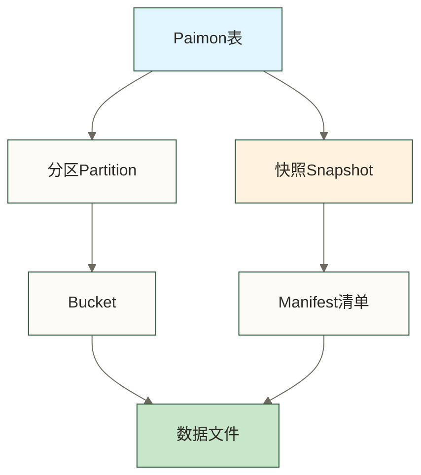

# 📚 Paimon核心概念 - 表、快照与文件布局

> [!abstract] 📋 本节概览
> - 🎯 **学习目标**:深入理解Paimon的核心概念和数据组织方式
> - 📚 **前置知识**:[[【技术与工具】/Paimon/01-Paimon概述与特性|Paimon概述与特性]]
> - ⏱️ **预计用时**:20分钟
> - 🔧 **核心内容**:表、快照、文件、分区、Bucket
> - 💡 **关键收获**:理解Paimon的数据组织逻辑

## 🎯 为什么要理解核心概念

在开始使用Paimon之前,理解其核心概念至关重要。就像开车前要了解方向盘、油门、刹车的作用一样,只有理解了这些基本概念,才能高效地使用Paimon。

**生活化类比**:理解Paimon核心概念就像理解图书馆系统
- **表**:整个图书馆
- **分区**:不同楼层(按主题分类)
- **Bucket**:每层的不同书架(按编号分组)
- **文件**:书架上的具体书籍
- **快照**:图书馆某个时刻的完整目录

## 📊 核心概念1:表(Table)

### 🎯 什么是Paimon表

**专业定义**:Paimon表是数据的逻辑组织单位,包含Schema定义、数据文件、元数据等。每个表都有唯一的标识符和独立的配置。

**表的组成部分**:
| 组成部分 | 子项 |
|----------|------|
| Schema（表结构） | 列定义、主键定义、分区键定义、表属性 |
| 快照（Snapshots） | Snapshot-1、Snapshot-2、Snapshot-N |
| 文件与元数据 | 数据文件承载数据行；Manifest描述数据文件；索引文件提供辅助索引 |

### 📋 表的类型

**1. 主键表(Primary Key Table)**

**定义**:支持按主键进行更新和删除的表。

**创建示例**:
```sql
CREATE TABLE user_profile (
    user_id BIGINT,           -- 主键字段
    name STRING,
    age INT,
    city STRING,
    update_time TIMESTAMP(3),
    PRIMARY KEY (user_id) NOT ENFORCED  -- 定义主键
) WITH (
    'bucket' = '4',           -- 设置4个bucket
    'changelog-producer' = 'input'  -- 生成changelog
);
```

**特点**:
- ✅ 支持UPDATE和DELETE操作
- ✅ 相同主键的数据自动合并
- ✅ 适合维度表、用户画像等场景
- ⚠️ 写入性能略低于仅追加表

**2. 仅追加表(Append-Only Table)**

**定义**:只支持INSERT操作的表,数据只能追加不能修改。

**创建示例**:
```sql
CREATE TABLE access_log (
    user_id BIGINT,
    action STRING,
    url STRING,
    timestamp BIGINT,
    dt STRING
) PARTITIONED BY (dt)  -- 按日期分区
WITH (
    'bucket' = '-1'  -- 仅追加表采用不分桶模式，不等同于主键表的动态分桶
);
```

**特点**:
- ✅ 只支持INSERT操作
- ✅ 仅追加写入通常避免按主键合并的开销，实际性能取决于负载与配置
- ✅ 适合日志、事件流等场景
- ⚠️ 不支持数据更新

**生活化理解**:
- **主键表**:像银行账户,可以修改余额和信息
- **仅追加表**:像交易流水,只能追加新记录

## 📸 核心概念2:快照(Snapshot)

### 🎯 什么是快照

**专业定义**:快照是表在某个时间点的完整状态快照,包含该时刻的所有数据文件引用。每次提交都会生成一个新的快照。

**快照的作用**:
```text
1. 版本管理:记录表的历史状态
2. 时间旅行:可以查询历史数据
3. 增量读取:获取两个快照之间的变更
4. 故障恢复:可以回滚到之前的快照
```

### 📊 快照的生命周期

```mermaid
%%{init: {"theme":"base","themeVariables":{"fontFamily":"PingFang SC, -apple-system, Source Han Serif SC, serif","fontSize":"16px","background":"#FDFBF5","primaryColor":"#FDFBF5","primaryTextColor":"#2D2A26","primaryBorderColor":"#6E6A60","secondaryColor":"#E8EFE8","secondaryBorderColor":"#8FA890","secondaryTextColor":"#2D2A26","tertiaryColor":"#FDFBF5","tertiaryBorderColor":"#9A9488","tertiaryTextColor":"#6E6A60","lineColor":"#6E6A60","textColor":"#2D2A26","mainBkg":"#FDFBF5","nodeBorder":"#2D5A3D","clusterBkg":"#F3EEDF","clusterBorder":"#9A9488","edgeLabelBackground":"#FDFBF5"},"flowchart":{"htmlLabels":true,"curve":"basis","padding":20,"nodeSpacing":60,"rankSpacing":70,"useMaxWidth":false},"themeCSS":".node rect, .node polygon, .node circle { stroke-width: 1.5px; } .edgePath .path { stroke-width: 1.5px; } .cluster-label .nodeLabel, .cluster-label foreignObject { color: #2D2A26 !important; } .edgeLabel, .edgeLabel foreignObject { color: #2D2A26 !important; background-color: #FDFBF5; } .edgeLabel rect { fill: #FDFBF5; }"}}%%
graph LR
    A[数据写入] --> B[提交Commit]
    B --> C[生成快照Snapshot-N]
    C --> D[快照可见]
    D --> E[保留期内]
    E --> F[过期清理]

    style C fill:#e1f5fe
    style D fill:#c8e6c9
    style F fill:#ffccbc
```



**快照示例**:
```text
快照ID: 5
提交时间: 2024-01-01 10:30:00
Schema版本: 1
文件清单:
  - manifest-list-snapshot-5
  - 100个数据文件
  - 总大小: 5GB
变更类型: APPEND (新增数据)
```

### 🔍 快照相关操作

**1. 查看快照历史**:
```sql
-- 查看表的所有快照
SELECT * FROM paimon_table$snapshots;

-- 输出示例:
snapshot_id | commit_time         | schema_id | commit_kind
------------|---------------------|-----------|------------
1           | 2024-01-01 10:00:00 | 0         | APPEND
2           | 2024-01-01 11:00:00 | 0         | APPEND
3           | 2024-01-01 12:00:00 | 0         | COMPACT
```

**2. 时间旅行查询**:
```sql
-- 查询历史快照的数据
SELECT * FROM paimon_table /*+ OPTIONS('scan.snapshot-id'='2') */;

-- 查询指定时间点的数据
SELECT * FROM paimon_table /*+ OPTIONS('scan.timestamp-millis'='1704096000000') */;
```

**3. 增量读取**:
```sql
-- 读取从快照2到快照5之间的变更
SELECT * FROM paimon_table /*+ OPTIONS(
    'incremental-between'='2,5'
) */;
```

**生活化理解**:快照就像Git的commit
- 每次提交代码生成一个commit
- 可以查看历史commit
- 可以回滚到之前的commit
- 可以比较两个commit的差异

## 📁 核心概念3:分区(Partition)

### 🎯 什么是分区

**专业定义**:分区是按照特定列的值将表数据划分成多个独立的子集,每个分区对应一个独立的目录。

**分区的价值**:
```text
✅ 查询加速:只扫描相关分区,减少数据量
✅ 数据管理:方便按分区删除历史数据
✅ 并行处理:不同分区可以并行读写
✅ 成本优化:冷数据分区可以迁移到低成本存储
```

### 📊 分区设计

**单级分区**:
```sql
CREATE TABLE orders (
    order_id BIGINT,
    user_id BIGINT,
    amount DECIMAL(10,2),
    order_time TIMESTAMP(3),
    dt STRING
) PARTITIONED BY (dt)  -- 按日期分区
WITH ('bucket' = '4');

-- 物理存储结构:
-- /warehouse/orders/dt=2024-01-01/
-- /warehouse/orders/dt=2024-01-02/
-- /warehouse/orders/dt=2024-01-03/
```

**多级分区**:
```sql
CREATE TABLE user_behavior (
    user_id BIGINT,
    action STRING,
    timestamp BIGINT,
    dt STRING,
    hour STRING
) PARTITIONED BY (dt, hour)  -- 按日期和小时分区
WITH ('bucket' = '8');

-- 物理存储结构:
-- /warehouse/user_behavior/dt=2024-01-01/hour=00/
-- /warehouse/user_behavior/dt=2024-01-01/hour=01/
-- /warehouse/user_behavior/dt=2024-01-01/hour=02/
```

### 🎯 分区策略选择

**按时间分区** (最常用):
```text
适用场景:日志、事件流、时序数据
分区粒度:天、小时、月
示例:dt=2024-01-01
```

**按业务维度分区**:
```text
适用场景:多租户系统、多地域数据
分区字段:租户ID、地域、业务线
示例:region=cn-north, tenant_id=1001
```

**组合分区**:
```text
适用场景:大规模数据,需要细粒度控制
分区字段:时间 + 业务维度
示例:dt=2024-01-01/region=cn-north
```

**生活化理解**:分区就像文件柜的抽屉
- 每个抽屉存放特定类别的文件(按日期、部门等)
- 找文件时只需打开对应抽屉,不用翻遍整个文件柜
- 清理旧文件时可以整个抽屉移除

## 🗂️ 核心概念4:Bucket

### 🎯 什么是Bucket

**专业定义**:Bucket是分区内部的数据分组机制,用于并行处理和数据分布。每个Bucket对应一组数据文件。

**Bucket的作用**:
```text
✅ 并行度控制:决定读写的并发度
✅ 数据分布:将数据均匀分散到多个文件
✅ 主键定位:主键表通过bucket快速定位数据
✅ Join优化:相同bucket的数据可以本地Join
```

### 📊 Bucket分配机制

**Hash分桶**:
```sql
CREATE TABLE user_info (
    user_id BIGINT,
    name STRING,
    PRIMARY KEY (user_id) NOT ENFORCED
) WITH (
    'bucket' = '8',  -- 设置8个bucket
    'bucket-key' = 'user_id'  -- 按user_id哈希分桶
);

-- 数据分布示意:
-- 对bucket-key计算哈希后映射到8个bucket。
-- 不能直接以user_id % 8推断实际bucket编号。
```

**仅追加表的不分桶模式**:
```sql
CREATE TABLE access_log (
    user_id BIGINT,
    action STRING,
    timestamp BIGINT,
    dt STRING
) PARTITIONED BY (dt)
WITH (
    'bucket' = '-1'  -- 此仅追加表示例采用不分桶模式
);

-- 特点:
-- 此示例说明仅追加表的不分桶模式，不表示自动扩展bucket数量。
-- 主键表的动态分桶是另一种模式，不能据此认定其不适合主键表。
```

### 🎯 Bucket数量设置

**设置原则**:
```text
小表(< 1GB):    bucket = 1-2
中表(1-100GB):  bucket = 4-8
大表(> 100GB):  bucket = 16-32

主键表: 建议设置固定bucket数
仅追加表: 可以使用bucket=-1的不分桶模式，不应将其称为主键表动态分桶
```

**影响因素**:
```text
数据量大小: 数据越大,bucket越多
写入并发: 并发越高,bucket越多
查询模式: 点查多用固定bucket,全表扫描可用动态bucket
下游消费: 下游并发度应该是bucket的整数倍
```

**生活化理解**:Bucket就像快递分拣系统
- 包裹(数据)按照地址(主键)分配到不同分拣区(bucket)
- 多个分拣区可以并行工作,提高效率
- 收件时只需要去对应分拣区找包裹

## 📦 核心概念5:文件布局

### 🎯 LSM树存储结构

Paimon主键表采用LSM(Log-Structured Merge-tree)组织按键合并的数据文件；以下层级说明针对主键表，仅追加表的文件合并不等同于主键表的LSM按键合并:

| 层级 | 状态 | 示例文件 |
|------|------|----------|
| Level 0 | 主键表中新写入的有序文件，不同文件的键范围可能重叠 | file-1.parquet, file-2.parquet, file-3.parquet |
| Level 1 | 合并形成的有序文件，层级不表示“部分排序” | file-4.parquet, file-5.parquet |
| Level 2+ | 更高层级的有序文件，文件大小取决于配置与合并结果 | file-6.parquet |

### 📊 文件类型

**1. 数据文件(Data Files)**:
```text
格式: Parquet或ORC
存储: 实际的数据行
大小: 默认128MB
位置: /bucket-{id}/data-*.parquet
```

**2. Manifest文件**:
```text
作用: 记录数据文件的元信息
内容: 文件路径、大小、行数、最小/最大值等
类型:
  - manifest-list: 快照级别的文件清单
  - manifest: 详细的文件元信息
```

**3. Schema文件**:
```text
作用: 记录表的结构定义
内容: 列名、类型、主键、分区键等
版本: 支持Schema演进,每个版本独立存储
```

### 🔄 文件合并机制

**为什么需要合并**:
```text
问题1: 小文件过多,影响查询性能
问题2: 主键表Level0中不同文件的键范围可能重叠，读取时可能需要合并多个文件中的记录
问题3: 删除的数据占用空间,需要清理

解决: 合并小文件以减少文件数量；主键表还会按键合并记录并生成有序文件，仅追加表的文件合并不执行相同的主键更新与删除合并语义
```

**合并策略**:

**1. Full Compaction(全量合并)**:
```sql
-- 手动触发全量合并
CALL sys.compact('my_db.my_table');

-- 特点:
-- ✅ 在合并范围内处理删除记录；历史文件的物理清理还受快照保留与过期清理机制约束
-- ✅ 优化查询性能
-- ⚠️ 耗时较长,消耗资源
```

**2. Incremental Compaction(增量合并)**:
```text
触发条件: 文件数量或大小达到阈值
合并范围: 部分文件
执行时机: 后台自动执行
```

**生活化理解**:文件合并就像整理房间
- **Level0文件**:每一包内部已按键整理，但不同包的键范围可能重叠；并非文件内部无序
- **合并过程**:定期整理,把同类物品放在一起
- **Level2+文件**:整理后的储物柜,物品有序,便于查找

## 🔗 概念之间的关系



**关系说明**:
```text
表 → 分区 → Bucket → 文件
     ↓
   快照 → Manifest → 文件引用
```

**完整示例**:

表名: `user_behavior`，分区: `dt=2024-01-01`，Bucket: 8个

| 层级 | 内容 |
|------|------|
| 快照5 | manifest-list-5 |
| manifest-partition-2024-01-01 | 各 bucket 的文件引用 |
| bucket-0 | file-1, file-2 |
| bucket-1 | file-3, file-4 |
| ... | ... |

---

## 📋 本节要点回顾

### ✅ 核心概念掌握检查
- [ ] 理解主键表和仅追加表的区别
- [ ] 掌握快照的概念和作用
- [ ] 理解分区的价值和设计原则
- [ ] 了解Bucket的分配机制
- [ ] 熟悉LSM树存储结构

### 🎯 实践能力检查
- [ ] 能够根据业务选择合适的表类型
- [ ] 会设计合理的分区策略
- [ ] 能够计算合适的bucket数量
- [ ] 理解文件合并的时机和策略

### 🔗 学习路径连接
**已完成**:✅ 01-Paimon概述 → ✅ 02-核心概念
**下一步**:[[【技术与工具】/Paimon/03-Paimon架构原理|Paimon架构原理]] - 深入理解LSM树和读写流程

> [!tip] 学习建议
> 这些核心概念是理解Paimon的基础,建议结合实际案例加深理解。下一节我们将深入探讨Paimon的架构原理和数据流转过程。

---

**创建时间**:2024-12-04
**最后更新**:2026-10-09
**学习时长**:20分钟
**难度等级**:⭐ (初级)

#Paimon #核心概念 #快照 #分区 #Bucket #LSM树
