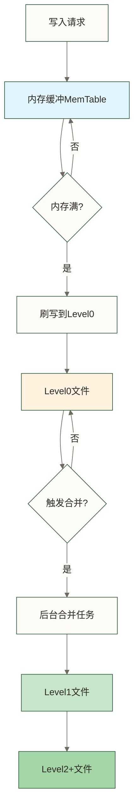
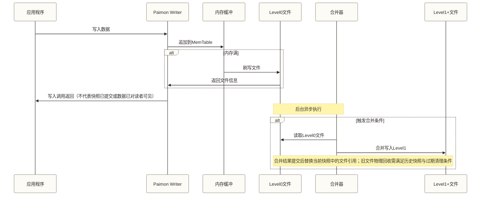
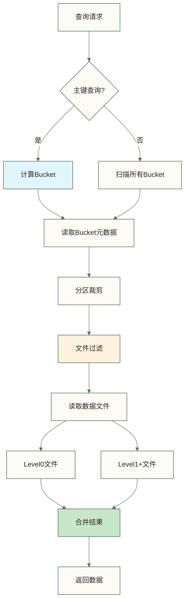

# 🏗️ Paimon架构原理 - LSM树与读写流程

> [!abstract] 📋 本节概览
> - 🎯 **学习目标**:深入理解Paimon的存储架构和数据流转机制
> - 📚 **前置知识**:[[【技术与工具】/Paimon/02-Paimon核心概念|Paimon核心概念]]
> - ⏱️ **预计用时**:25分钟
> - 🔧 **核心内容**:LSM树架构、写入流程、读取流程、合并机制
> - 💡 **关键收获**:理解Paimon如何实现高性能读写

## 🎯 为什么需要理解架构原理

理解Paimon的架构原理,就像理解汽车引擎的工作原理:
- ✅ **性能调优**:知道瓶颈在哪,如何优化
- ✅ **问题诊断**:出问题时能快速定位原因
- ✅ **合理使用**:根据原理选择最佳使用方式
- ✅ **架构设计**:设计系统时做出正确的技术选型

## 🌳 LSM树存储架构

### 📖 什么是LSM树

**LSM(Log-Structured Merge-tree)** 是一种针对写密集场景优化的数据结构,广泛应用于现代存储系统(如RocksDB、HBase、Cassandra)。

**核心思想**:
```text
1. 新数据先写入内存(MemTable)
2. 内存满后刷写到磁盘(Level0)
3. 后台异步合并,形成有序的大文件
4. 查询时需要合并多个层级的数据
```

**生活化类比**:就像学习笔记的整理过程
- **上课记笔记**:快速记录在草稿本(内存)
- **课后整理**:将笔记誊写到笔记本(Level0)
- **周末总结**:将一周笔记归纳整理(Level1+)
- **复习查找**:从各个笔记本中找到需要的内容

### 🏗️ Paimon的LSM架构



### 📊 存储层级详解

**Level 0 - 新数据层**:
特征：✅ 刚从内存刷写的文件 / ✅ 文件较小（默认128MB）/ ✅ 文件内部按键排序，不同文件的键值范围可能重叠 / ❌ 查询需要扫描多个文件

示例文件（bucket-0/）：

| 文件名 | 大小 | 时间范围 |
|--------|------|----------|
| data-level0-001.parquet | 50MB | ts: 10:00-10:05 |
| data-level0-002.parquet | 80MB | ts: 10:05-10:10 |
| data-level0-003.parquet | 120MB | ts: 10:10-10:15 |

**Level 1+ - 合并数据层**:
特征：✅ 合并后的有序文件 / ✅ 文件较大（可达数GB）/ ✅ 键值范围不重叠 / ✅ 查询性能优秀

示例文件（bucket-0/）：

| 文件名 | 大小 | key 范围 |
|--------|------|----------|
| data-level1-001.parquet | 500MB | key: 1-1000000 |
| data-level1-002.parquet | 500MB | key: 1000001-2000000 |

**层级关系**:
| 层级 | 特征 |
|------|------|
| Level 0 | 多个小文件，键值范围可能重叠 |
| Level 1 | 少量有序文件，键值范围不重叠（由 Level 0 合并而来） |
| Level 2+ | 大文件，完全有序（继续合并产生） |

## ✍️ 写入流程详解

### 📝 完整写入路径



### 🔄 写入步骤详解

**步骤1:数据路由**
```java
// 根据主键或分区键计算bucket
int bucket = hash(primaryKey) % bucketNum;

// 示例:
user_id = 1001
bucket = 1001 % 8 = 1
→ 数据写入bucket-1
```

**步骤2:内存缓冲**
```text
每个bucket维护独立的MemTable:
bucket-0: MemTable-0 (当前大小: 50MB)
bucket-1: MemTable-1 (当前大小: 120MB) ← 接近阈值
bucket-2: MemTable-2 (当前大小: 30MB)
...

当MemTable大小超过阈值(默认128MB)时触发刷写
```

**步骤3:刷写磁盘**
```text
1. 对MemTable中的数据排序(按主键)
2. 写入Parquet文件到Level0
3. 清空MemTable,释放内存
4. 更新元数据

生成文件:
/dt=2024-01-01/bucket-1/data-uuid-level0.parquet
```

**步骤4:提交快照**
```text
1. 生成Manifest文件,记录新增的数据文件
2. 生成Manifest List,引用所有Manifest
3. 创建新快照,指向Manifest List
4. 快照提交成功,数据可见
```

### ⚡ 写入性能优化

**批量写入**:
```sql
-- 不推荐:逐条插入
INSERT INTO my_table VALUES (1, 'a');
INSERT INTO my_table VALUES (2, 'b');

-- 推荐:批量插入
INSERT INTO my_table VALUES
    (1, 'a'),
    (2, 'b'),
    (3, 'c');
```

**写入并行度与缓冲配置示意（不代表启用异步刷写）**:
```java
// 写入并行度与缓冲配置示意；具体设置方式取决于执行环境
TableConfig config = new TableConfig();
config.set("sink.parallelism", "4");  // 4个并发写入
config.set("write-buffer-size", "256mb");  // 更大的缓冲
```

**生活化理解**:写入流程就像餐厅收银
- **接单**:服务员记录订单(内存缓冲)
- **汇总**:一批订单汇总后交给后厨(刷写Level0)
- **归档**:定期整理订单记录(合并到Level1+)

## 📖 读取流程详解

### 🔍 查询路径



### 📊 读取优化机制

**1. 分区裁剪(Partition Pruning)**:
```sql
-- 查询带分区条件
SELECT * FROM orders
WHERE dt = '2024-01-01' AND user_id = 1001;

优化过程:
示例假设：全部分区(365天) → 裁剪后(1天) → 候选分区数减少到原来的1/365；实际性能提升取决于数据分布、读取量及执行开销
```

**2. 文件过滤(File Filtering)**:
```text
基于文件元信息过滤:
- 主键范围过滤
- 统计信息过滤(min/max)
- Bloom Filter过滤

示例:
查询 user_id = 1001
文件A: [min=1, max=1000] → 跳过
文件B: [min=1001, max=2000] → 读取 ✓
文件C: [min=2001, max=3000] → 跳过
```

**3. 数据合并(Data Merging)**:
```text
主键表需要合并多个层级的数据:

Level0: user_id=1001, age=25, city='Beijing'
Level1: user_id=1001, age=24, city='Shanghai'

合并结果:
user_id=1001, age=25, city='Beijing'  (示例假设：采用保留最新记录的合并规则，且序列或写入顺序判定上述Level0记录较新；不能仅由文件层级判断)
```

### 🎯 查询模式优化

**批量扫描**:
```sql
-- 全表扫描,适合分析场景
SELECT COUNT(*) FROM orders WHERE dt >= '2024-01-01';

优化建议:
✅ 设置合理的并行度
✅ 使用列裁剪,减少读取数据量
✅ 定期合并,减少文件数量
```

**点查询**:
```sql
-- 主键点查,适合实时查询
SELECT * FROM user_info WHERE user_id = 1001;

优化建议:
✅ 使用主键表
✅ 设置合适的bucket数
✅ 开启Bloom Filter
```

**增量读取**:
```sql
-- 流式消费,订阅增量数据
SELECT * FROM orders /*+ OPTIONS('scan.mode'='latest') */;

适用场景:
✅ 实时数据同步
✅ 增量ETL
✅ 下游流处理
```

## 🔄 合并机制详解

### 🎯 为什么需要合并

**问题1:小文件过多**
```text
影响:
❌ 查询需要打开大量文件,性能下降
❌ 文件元数据占用内存增加
❌ 分布式系统中文件数限制

示例:
合并前: 1000个小文件(100MB each) → 打开1000次
合并后: 10个大文件(10GB each) → 打开10次
```

**问题2:读放大**
```text
主键查询需要查多个层级:
Level0: 5个文件
Level1: 3个文件
Level2: 1个文件
→ 总共读取9个文件

合并后:
Level1: 1个文件
→ 只读取1个文件
```

**问题3:空间放大**
```text
删除的数据仍占用空间:
user_id=1001: [version1, version2, version3]
实际有效: version3
占用空间: 3个版本的总和

合并后:
user_id=1001: [version3]
空间节省: 66%
```

### 📊 合并策略

**1. Universal Compaction(通用合并)**:
```text
触发条件:
- sorted run数量达到相关配置阈值（不等同于Level0文件数；具体默认值与触发规则需结合所用版本确认）
- 文件总大小达到阈值

合并范围:
所有Level0文件 + 部分Level1文件

合并结果:
生成新的合并文件；结果提交后替换当前快照中的旧文件引用，旧文件的物理回收还取决于历史快照引用及过期清理条件

配置示例:
'compaction.max-sorted-run-num' = '5'
```

**2. Full Compaction(全量合并)**:
```text
触发方式:
手动触发或定时任务

合并范围:
所有层级的所有文件

合并结果:
重写合并范围内的数据文件，并按适用的合并规则处理更新和删除；不保证历史快照引用的旧文件或已删除数据立即从存储中物理清除

执行命令:
CALL sys.compact('db.table');
```

### ⚙️ 合并配置

**合并时机控制**:
```sql
CREATE TABLE my_table (
    ...
) WITH (
    -- 自动合并
    'compaction.max-sorted-run-num' = '5',  -- sorted run数量阈值，不等同于Level0文件数

    -- 合并策略的大小放大比例阈值，并非并行度
    'compaction.max-size-amplification-percent' = '200',

    -- 合并文件大小
    'compaction.max-file-size' = '1GB'
);
```

**流式写入及内存配置示意（不是独立合并任务示例）**:
```sql
-- Flink流式写入任务示意，不是独立合并任务
INSERT INTO my_table
/*+ OPTIONS(
    'sink.use-managed-memory-allocator' = 'true',
    'sink.managed.writer-buffer-memory' = '256mb'
) */
SELECT * FROM source_table;
```

### 🎯 合并最佳实践

**场景1:高频更新的主键表**
```text
问题: 频繁更新导致大量Level0文件
方案:
✅ 降低合并阈值: 'compaction.max-sorted-run-num' = '3'
✅ 启动专门的合并任务
✅ 增加写入缓冲: 'write-buffer-size' = '256mb'
```

**场景2:大规模仅追加表**
```text
问题: 写入量大,合并跟不上
方案:
✅ 对仅追加表，可评估不分桶模式: 'bucket' = '-1'（不是主键表动态分桶；支持范围与适用条件需结合所用版本确认）
✅ 增加合并并行度
✅ 定期全量合并
```

**场景3:混合读写负载**
```text
问题: 查询和写入相互影响
方案:
✅ 读写分离: 查询走历史快照
✅ 错峰合并: 低峰期执行全量合并
✅ 资源隔离: 合并任务独立资源池
```

## 📊 架构性能特征

### ✅ 优势总结

| 特性 | 原理 | 适用场景 |
|---|---|---|
| **高吞吐写入** | 顺序写入,批量刷写 | 日志采集、埋点数据 |
| **支持更新删除** | LSM树合并机制 | 用户画像、CDC同步 |
| **查询优化** | 分区裁剪、文件过滤 | 分析查询、报表 |
| **存储高效** | 列式存储、压缩 | 海量数据存储 |

### ⚠️ 权衡与局限

**写放大**:
```text
一份数据可能被多次重写(合并过程)
影响: 增加磁盘写入量
缓解: 调整合并策略,减少合并频率
```

**读放大**:
```text
查询可能需要读取多个层级的文件
影响: 点查询性能
缓解: 及时合并,使用Bloom Filter
```

**空间放大**:
```text
删除的数据在合并前仍占用空间
影响: 存储成本
缓解: 定期全量合并
```

---

## 📋 本节要点回顾

### ✅ 核心知识点检查
- [ ] 理解LSM树的基本原理和优势
- [ ] 掌握Paimon的写入流程和优化方法
- [ ] 了解查询的执行路径和优化机制
- [ ] 理解合并的必要性和策略选择

### 🎯 实践能力检查
- [ ] 能够根据业务选择合适的合并策略
- [ ] 会分析和优化写入性能
- [ ] 能够诊断查询慢的原因
- [ ] 理解读写放大的权衡

### 🔗 学习路径连接
**已完成**:✅ 01-概述 → ✅ 02-核心概念 → ✅ 03-架构原理
**下一步**:[[【技术与工具】/Paimon/04-Paimon环境搭建|Paimon环境搭建]] - 动手搭建开发环境

> [!tip] 深入学习建议
> 架构原理是性能调优的基础。建议结合实际场景,观察不同配置下的性能表现,加深对原理的理解。

---

**创建时间**:2024-12-04
**最后更新**:2024-12-04
**学习时长**:25分钟
**难度等级**:⭐⭐ (中级)

#Paimon #架构原理 #LSM树 #读写流程 #合并机制 #性能优化
