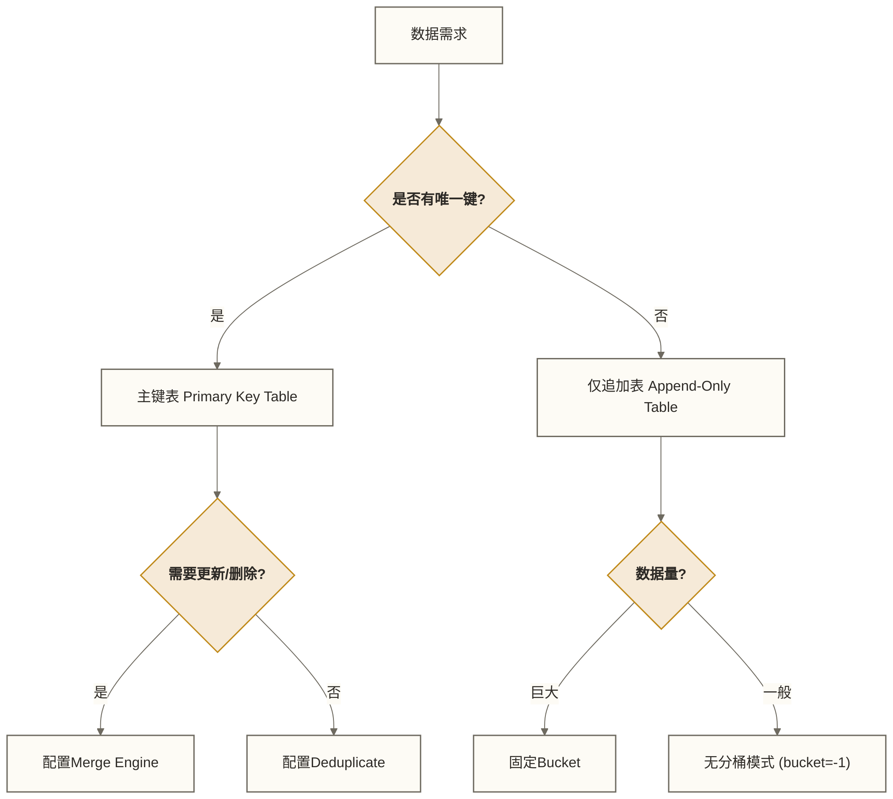

# 📋 Paimon表类型详解 - 主键表与仅追加表

> [!abstract] 📋 本节概览
> - 🎯 **学习目标**:深入理解Paimon的两大核心表类型及其应用场景
> - 📚 **前置知识**:[[【技术与工具】/Paimon/04-Paimon环境搭建|Paimon环境搭建]]
> - ⏱️ **预计用时**:20分钟
> - 🔧 **核心内容**:主键表、仅追加表、Merge Engine、Changelog Producer
> - 💡 **关键收获**:能够根据业务需求正确选择表类型和配置

## 🎯 表类型总览

Paimon主要提供两种核心表类型：**主键表(Primary Key Table)** 和 **仅追加表(Append-Only Table)**。

选择正确的表类型是构建高效数据湖的第一步：
- 需要更新、去重、CDC同步？ 👉 **主键表**
- 只需要追加写入、日志存储、高吞吐？ 👉 **仅追加表**



---

## 🔑 核心类型1:主键表 (Primary Key Table)

### 🎯 什么是主键表

主键表是Paimon中最常用的表类型，它要求定义一组主键列，通过主键来唯一标识数据。

**核心特性**：
- ✅ **数据唯一性**：保证主键唯一。
- ✅ **支持更新删除**：支持INSERT、UPDATE、DELETE操作。
- ✅ **LSM存储**：底层采用LSM Tree结构，支持高效的点查和范围查。

### 💻 创建示例

```sql
CREATE TABLE user_profile (
    user_id BIGINT,
    name STRING,
    age INT,
    score DECIMAL(10, 2),
    update_time TIMESTAMP(3),
    PRIMARY KEY (user_id) NOT ENFORCED -- 定义主键
) WITH (
    'bucket' = '4', -- 分桶数量
    'merge-engine' = 'deduplicate' -- 合并引擎(默认)
);
```

### ⚙️ 进阶配置：Merge Engine (合并引擎)

当新数据与旧数据主键冲突时，Paimon如何处理？这由`merge-engine`参数决定。

| 引擎类型 | 描述 | 适用场景 |
|---|---|---|
| **deduplicate** (默认) | **去重**：保留最新的一条数据，覆盖旧数据。 | 用户画像更新、状态同步 |
| **partial-update** | **部分更新**：非空字段覆盖旧值，null值忽略。支持多流拼接。 | 宽表构建、多源数据融合 |
| **aggregation** | **聚合**：对指定字段进行聚合计算(sum, max, min等)。 | 实时指标统计、累加器 |
| **first-row** | **保留首行**：只保留第一次写入的数据，后续更新忽略。 | 日志去重、保留首次行为 |

**示例：部分更新 (Partial Update)**
```sql
-- 场景：流A提供姓名，流B提供年龄，自动拼成完整宽表
CREATE TABLE user_wide_table (
    user_id BIGINT,
    name STRING,
    age INT,
    PRIMARY KEY (user_id) NOT ENFORCED
) WITH (
    'merge-engine' = 'partial-update',
    'changelog-producer' = 'lookup' -- 建议配合lookup使用
);
```

### 🔄 进阶配置：Changelog Producer (变更日志生成)

Paimon不仅存储数据，还能生成变更流(Changelog)，供下游流式消费。

| 模式 | 描述 | 成本 | 适用场景 |
|---|---|---|---|
| **none** (默认) | 不额外生成完整Changelog；不意味着只能读取快照，增量读取不应等同于完整撤回流。 | 低 | 不要求完整变更日志的读取场景 |
| **input** | 信任输入流的Changelog(如Flink CDC源)，直接持久化。 | 低 | 源头就是CDC数据 |
| **lookup** | 写入时查找旧值，生成完整Changelog(Op: UPDATE_BEFORE/AFTER)。 | 高(IO开销) | 源头非CDC(如Kafka JSON)，下游需要撤回流 |
| **full-compaction** | 在Full Compaction时生成Changelog。 | 中 | 延迟容忍度高，吞吐要求高 |

---

## 📝 核心类型2:仅追加表 (Append-Only Table)

### 🎯 什么是仅追加表

仅追加表没有主键，数据只能通过INSERT追加，不支持UPDATE或DELETE。

**核心特性**：
- ✅ **追加写入优势**：不需要处理主键冲突，适合追加写入；实际吞吐取决于数据格式、并行度、存储和合并配置。
- ✅ **有序性**：严格按照写入顺序存储(在同一个Bucket内)。
- ✅ **自动合并**：自动合并小文件，避免HDFS小文件问题。

### 💻 创建示例

```sql
CREATE TABLE access_log (
    request_id STRING,
    user_id BIGINT,
    url STRING,
    ts TIMESTAMP(3)
) WITH (
    'bucket' = '-1', -- 仅追加表的无分桶模式
    'file.format' = 'parquet'
);
```

### 🗂️ Bucket配置策略

对于仅追加表，Bucket配置尤为重要：

**1. 无分桶模式 (`bucket` = '-1')**
- **机制**：仅追加表不按固定 Bucket 组织数据；这不同于主键表的动态分桶。
- **优点**：无需预先配置固定 Bucket 数量。
- **适用**：普通日志存储、ODS层原始数据。

**2. 固定Bucket (`bucket` = '10')**
- **机制**：通过`bucket-key`哈希分布到固定Bucket。
- **优点**：支持按照特定字段Shuffle，利于后续按Key查询或聚合。
- **适用**：需要按用户ID分桶存储的日志。

```sql
-- 按user_id分桶的仅追加表
CREATE TABLE user_action_log (
    user_id BIGINT,
    action STRING
) WITH (
    'bucket' = '10',
    'bucket-key' = 'user_id'
);
```

---

## ⚖️ 表类型对比与选型指南

| 维度 | 主键表 (Primary Key) | 仅追加表 (Append-Only) |
|---|---|---|
| **主键约束** | 必须定义 | 无 |
| **支持操作** | INSERT, UPDATE, DELETE | 仅 INSERT |
| **存储结构** | LSM Tree (Level 0-N) | 简单的文件追加 (LSM Level 0) |
| **写入特点** | 需考虑排序和合并开销 | 以追加写入为主；性能需按实际负载评估 |
| **查询特点** | 可用于主键查询；性能取决于查询引擎、索引和数据布局 | 主要面向扫描；性能取决于裁剪条件和数据布局 |
| **典型场景** | 实时数仓DWD/DWS层、维度表、状态表 | ODS层原始数据、系统日志、流水记录 |

### 🌟 最佳实践建议

1.  **ODS层 (原始数据)**：
    -   使用 **仅追加表**。
    -   配置 `bucket = -1` (仅追加表的无分桶模式)。
    -   利用Paimon的小文件自动合并特性，替代传统的Hive/HDFS文本写入。

2.  **DWD/DWS层 (明细/汇总)**：
    -   使用 **主键表**。
    -   根据数据量、并行度和读写负载预估 `bucket` 数量；若以每Bucket约1GB作为初始估算假设，应通过实际负载测试调整，而非视为通用标准。
    -   如果多条流按同一主键提供不同字段，可考虑 `partial-update` 引擎；它不等同于一般关系型Join。
    -   如果需要流读给下游聚合，根据源头数据类型选择 `changelog-producer`。

3.  **数据去重**：
    -   使用 **主键表** 的默认 `deduplicate` 引擎，这是处理重复数据最简单高效的方法。

---

## 📋 本节要点回顾

### ✅ 核心概念掌握检查
- [ ] 理解主键表和仅追加表的根本区别
- [ ] 掌握 Merge Engine 的四种模式及其应用场景
- [ ] 理解 Changelog Producer 的作用
- [ ] 知道何时使用仅追加表的无分桶模式 (`bucket=-1`)

### 🔗 学习路径连接
**已完成**：✅ 04-环境搭建 → ✅ 05-表类型详解
**下一步**：[[【技术与工具】/Paimon/06-Paimon读写操作|Paimon读写操作]] - 掌握具体的SQL读写语法和API调用

> [!tip] 思考题
> 如果我有一个电商订单表，订单状态会不断变化(Created -> Paid -> Shipped)，我应该用什么表类型？
> *答案：主键表。主键为order_id，merge-engine为deduplicate(默认)，在更新顺序与业务状态顺序一致，或已配置适当排序字段的条件下，可用新状态覆盖旧状态；乱序输入需另行处理。*

---

**创建时间**:2024-12-05
**最后更新**:2024-12-05
**学习时长**:20分钟
**难度等级**:⭐⭐ (中级)

#Paimon #表类型 #主键表 #Append-Only #MergeEngine
