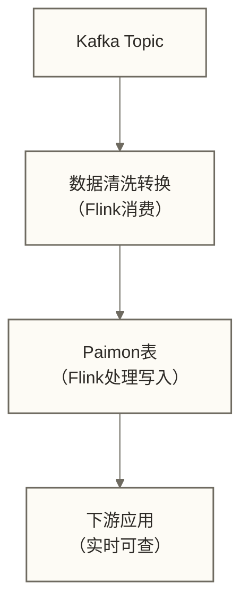
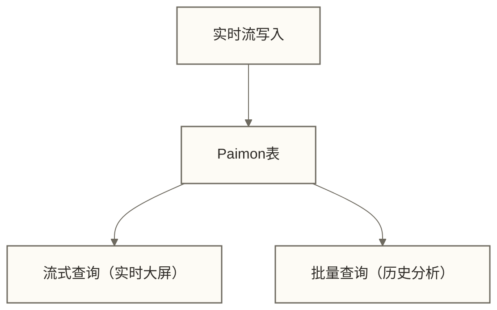
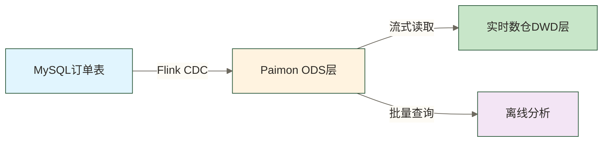

# 🔄 Paimon与Flink集成 - 流批一体实践

> [!abstract] 📋 本节概览
> - 🎯 **学习目标**:掌握Paimon与Flink的深度集成,实现流批一体数据处理
> - 📚 **前置知识**:[[【技术与工具】/Paimon/04-Paimon环境搭建|Paimon环境搭建]],[[【技术与工具】/Flink/00-Flink学习路线图|Flink]]基础
> - ⏱️ **预计用时**:30分钟
> - 🔧 **核心内容**:Catalog配置、流式写入、批量查询、CDC集成
> - 💡 **关键收获**:实现端到端的流批一体数据管道

## 🎯 为什么Paimon与Flink天生一对

### 💡 完美组合的原因

**1. 同源技术栈**:
```text
Paimon最初就是Flink Table Store
由Flink社区开发
深度理解Flink的设计理念
```

**2. 流批一体理念一致**:
```text
Flink: 流批统一的计算引擎
Paimon: 流批统一的存储系统
→ 完美的技术匹配
```

**3. 无缝集成**:
```text
✅ 原生Table API支持
✅ 自动类型映射
✅ 高效的序列化
✅ 在正确配置检查点、连接器及提交机制等条件下支持一致性处理
```

**生活化类比**:就像手机和充电器
- **官方原装充电器**:Flink + Paimon,完美适配
- **第三方充电器**:其他计算引擎,基本可用但可能有兼容性问题

## 🗄️ Paimon Catalog配置

### 📝 配置方式

**方式1:SQL DDL配置**:
```sql
-- 创建Paimon Catalog
CREATE CATALOG paimon WITH (
    'type' = 'paimon',
    'warehouse' = 'hdfs://namenode:8020/paimon-warehouse'
);

-- 切换到Paimon Catalog
USE CATALOG paimon;

-- 创建数据库
CREATE DATABASE IF NOT EXISTS my_db;
USE my_db;
```

**方式2:Table API配置**:
```java
import org.apache.flink.table.api.*;
import org.apache.flink.table.catalog.*;

public class PaimonCatalogExample {
    public static void main(String[] args) {
        // 创建Table Environment
        EnvironmentSettings settings = EnvironmentSettings
            .newInstance()
            .inStreamingMode()
            .build();

        TableEnvironment tEnv = TableEnvironment.create(settings);

        // 注册Paimon Catalog
        String catalogName = "paimon";
        String warehouse = "hdfs://namenode:8020/paimon-warehouse";

        tEnv.executeSql(String.format(
            "CREATE CATALOG %s WITH (" +
            "  'type' = 'paimon'," +
            "  'warehouse' = '%s'" +
            ")",
            catalogName, warehouse
        ));

        // 使用Catalog
        tEnv.useCatalog(catalogName);
    }
}
```

**方式3:flink-conf.yaml配置**:
```yaml
# Flink配置文件
table.sql-catalog: paimon
table.sql-catalog.paimon.type: paimon
table.sql-catalog.paimon.warehouse: hdfs://namenode:8020/paimon-warehouse
```

### 🔧 高级配置选项

**Metastore集成** (生产环境推荐):
```sql
-- 使用Hive Metastore管理元数据
CREATE CATALOG paimon_hive WITH (
    'type' = 'paimon',
    'metastore' = 'hive',
    'uri' = 'thrift://hive-metastore:9083',
    'warehouse' = 'hdfs://namenode:8020/paimon-warehouse'
);
```

**多Catalog混用**:
```sql
-- 创建多个Catalog
CREATE CATALOG paimon_dev WITH (...);
CREATE CATALOG paimon_prod WITH (...);

-- 跨Catalog查询
SELECT
    d.*,
    p.user_name
FROM paimon_dev.db.orders d
LEFT JOIN paimon_prod.db.users p
ON d.user_id = p.user_id;
```

## ✍️ 流式写入场景

### 📊 场景1:Kafka到Paimon实时同步

**架构图**:



**完整示例**:
```sql
-- 1. 创建Kafka源表
CREATE TABLE kafka_source (
    order_id BIGINT,
    user_id BIGINT,
    product_id BIGINT,
    amount DECIMAL(10, 2),
    order_time TIMESTAMP(3),
    WATERMARK FOR order_time AS order_time - INTERVAL '5' SECOND
) WITH (
    'connector' = 'kafka',
    'topic' = 'orders',
    'properties.bootstrap.servers' = 'localhost:9092',
    'properties.group.id' = 'paimon-consumer',
    'scan.startup.mode' = 'latest-offset',
    'format' = 'json'
);

-- 2. 创建Paimon目标表
CREATE TABLE paimon_orders (
    order_id BIGINT,
    user_id BIGINT,
    product_id BIGINT,
    amount DECIMAL(10, 2),
    order_time TIMESTAMP(3),
    dt STRING,                    -- 分区字段
    PRIMARY KEY (order_id) NOT ENFORCED
) PARTITIONED BY (dt)
WITH (
    'bucket' = '8',
    'changelog-producer' = 'input'
);

-- 3. 实时同步任务
INSERT INTO paimon_orders
SELECT
    order_id,
    user_id,
    product_id,
    amount,
    order_time,
    DATE_FORMAT(order_time, 'yyyy-MM-dd') as dt
FROM kafka_source;
```

### 🔄 场景2:维度表实时更新

**业务场景**:用户画像表需要实时更新

**实现方案**:
```sql
-- 1. 创建CDC源表(MySQL Binlog)
CREATE TABLE mysql_user_cdc (
    user_id BIGINT,
    username STRING,
    age INT,
    city STRING,
    level INT,
    update_time TIMESTAMP(3),
    PRIMARY KEY (user_id) NOT ENFORCED
) WITH (
    'connector' = 'mysql-cdc',
    'hostname' = 'localhost',
    'port' = '3306',
    'username' = 'root',
    'password' = 'password',
    'database-name' = 'mydb',
    'table-name' = 'users'
);

-- 2. 创建Paimon维度表
CREATE TABLE dim_user (
    user_id BIGINT,
    username STRING,
    age INT,
    city STRING,
    level INT,
    update_time TIMESTAMP(3),
    PRIMARY KEY (user_id) NOT ENFORCED
) WITH (
    'bucket' = '4',
    'changelog-producer' = 'full-compaction',
    'full-compaction.delta-commits' = '1'
);

-- 3. CDC实时同步
INSERT INTO dim_user
SELECT * FROM mysql_user_cdc;
```

### ⚡ 写入性能优化

**1. 批量提交**:
```sql
-- 配置写入选项
INSERT INTO paimon_table
/*+ OPTIONS(
    'sink.parallelism' = '8',          -- 写入并行度
    'sink.use-managed-memory-allocator' = 'true',
    'sink.managed.writer-buffer-memory' = '256mb'  -- 写缓冲
) */
SELECT * FROM source_table;
```

**2. 分桶优化**:
```java
// 代码中配置
Table result = tEnv.sqlQuery("SELECT * FROM source_table");

// 设置Table执行并行度；具体取值需结合分桶与运行资源评估
 tEnv.getConfig().getConfiguration().setInteger("parallelism.default", 8);
result.executeInsert("paimon_table");
```

**3. 检查点配置**:
```java
// 配置检查点
StreamExecutionEnvironment env = StreamExecutionEnvironment.getExecutionEnvironment();

env.enableCheckpointing(60000);  // 60秒一次检查点
env.getCheckpointConfig().setMinPauseBetweenCheckpoints(30000);
env.getCheckpointConfig().setCheckpointTimeout(300000);
```

## 📖 批量查询场景

### 📊 场景1:离线数据分析

**全表扫描**:
```sql
-- 批量分析订单数据
SELECT
    dt,
    COUNT(*) as order_count,
    SUM(amount) as total_amount,
    AVG(amount) as avg_amount
FROM paimon_orders
WHERE dt >= '2024-01-01' AND dt <= '2024-01-31'
GROUP BY dt
ORDER BY dt;
```

**分区查询**:
```sql
-- 只查询特定分区
SELECT * FROM paimon_orders
WHERE dt = '2024-01-01'
AND user_id = 1001;
```

**时间旅行**:
```sql
-- 查询历史快照
SELECT * FROM paimon_orders
/*+ OPTIONS('scan.snapshot-id' = '5') */
WHERE dt = '2024-01-01';

-- 查询指定时间点的数据
SELECT * FROM paimon_orders
/*+ OPTIONS('scan.timestamp-millis' = '1704096000000') */
WHERE dt = '2024-01-01';
```

### 🔍 场景2:增量数据处理

**增量ETL**:
```sql
-- 读取增量数据(从快照3到快照10)
CREATE TEMPORARY VIEW incremental_orders AS
SELECT * FROM paimon_orders
/*+ OPTIONS('incremental-between' = '3,10') */;

-- 处理增量数据
INSERT INTO target_table
SELECT
    order_id,
    user_id,
    SUM(amount) as total_amount
FROM incremental_orders
GROUP BY order_id, user_id;
```

**流式消费最新数据**:
```sql
-- 持续读取新数据
SELECT * FROM paimon_orders
/*+ OPTIONS(
    'scan.mode' = 'latest',           -- 只读最新数据
    'scan.bounded.watermark' = '10000'  -- 边界水印
) */;
```

## 🔄 流批混合场景

### 💡 场景:实时大屏 + 历史分析

**架构设计**:



**实现代码**:
```sql
-- 1. 流式写入任务(持续运行)
INSERT INTO paimon_orders
SELECT
    order_id,
    user_id,
    product_id,
    amount,
    order_time,
    DATE_FORMAT(order_time, 'yyyy-MM-dd') AS dt
FROM kafka_source;

-- 2. 定义实时聚合视图（尚缺目标表事件时间声明；不含查询结果消费及WebSocket推送实现）
CREATE TEMPORARY VIEW realtime_stats AS
SELECT
    window_start,
    window_end,
    COUNT(*) as order_count,
    SUM(amount) as total_amount
FROM TABLE(
    TUMBLE(TABLE paimon_orders /*+ OPTIONS('scan.mode'='latest') */,
           DESCRIPTOR(order_time),
           INTERVAL '1' MINUTE)
)
GROUP BY window_start, window_end;

-- 3. 批量分析(定时任务)
SELECT
    dt,
    user_id,
    COUNT(*) as order_count,
    SUM(amount) as total_amount
FROM paimon_orders
WHERE dt >= CURRENT_DATE - INTERVAL '7' DAY
GROUP BY dt, user_id;
```

## 🎯 实战案例:构建实时数仓ODS层

### 📋 需求场景

**业务需求**:
```text
1. 实时同步MySQL订单表到数据湖
2. 支持订单的增删改查
3. 下游实时数仓和离线分析同时使用
4. 保证数据一致性
```

### 🏗️ 架构设计



### 💻 完整实现

**步骤1:创建ODS表**:
```sql
-- ODS层:ods_orders
CREATE TABLE ods_orders (
    order_id BIGINT,
    user_id BIGINT,
    product_id BIGINT,
    quantity INT,
    amount DECIMAL(10, 2),
    status STRING,
    create_time TIMESTAMP(3),
    update_time TIMESTAMP(3),
    dt STRING,
    PRIMARY KEY (order_id) NOT ENFORCED
) PARTITIONED BY (dt)
WITH (
    'bucket' = '8',
    'changelog-producer' = 'full-compaction',
    'full-compaction.delta-commits' = '3',
    'snapshot.time-retained' = '2h',
    'snapshot.num-retained.min' = '20'
);
```

**步骤2:CDC同步任务**:
```sql
-- 创建MySQL CDC源
CREATE TABLE mysql_orders_source (
    order_id BIGINT,
    user_id BIGINT,
    product_id BIGINT,
    quantity INT,
    amount DECIMAL(10, 2),
    status STRING,
    create_time TIMESTAMP(3),
    update_time TIMESTAMP(3),
    PRIMARY KEY (order_id) NOT ENFORCED
) WITH (
    'connector' = 'mysql-cdc',
    'hostname' = 'mysql-host',
    'port' = '3306',
    'username' = 'cdc_user',
    'password' = 'password',
    'database-name' = 'ecommerce',
    'table-name' = 'orders',
    'server-time-zone' = 'Asia/Shanghai'
);

-- 实时同步
INSERT INTO ods_orders
SELECT
    order_id,
    user_id,
    product_id,
    quantity,
    amount,
    status,
    create_time,
    update_time,
    DATE_FORMAT(create_time, 'yyyy-MM-dd') as dt
FROM mysql_orders_source;
```

**步骤3:下游消费**:
```sql
-- 实时消费(DWD层)
CREATE TABLE dwd_orders AS
SELECT
    order_id,
    user_id,
    product_id,
    quantity,
    amount,
    status,
    create_time
FROM ods_orders
/*+ OPTIONS('scan.mode' = 'latest') */
WHERE status = 'PAID';

-- 离线分析
SELECT
    dt,
    COUNT(*) as order_count,
    SUM(amount) as total_amount
FROM ods_orders
WHERE dt >= '2024-01-01'
GROUP BY dt;
```

### 📊 性能监控

```sql
-- 查看表统计信息
SELECT * FROM ods_orders$snapshots;

-- 查看文件分布
SELECT
    partition,
    bucket,
    COUNT(*) as file_count,
    SUM(file_size_in_bytes) / 1024 / 1024 as total_size_mb
FROM ods_orders$files
GROUP BY partition, bucket;

-- 触发default数据库的合并操作（非只读状态查询）
CALL sys.compact_database('default');
```

## 🚀 最佳实践总结

### ✅ 配置最佳实践

**1. Catalog配置**:
```text
✅ 生产环境使用Hive Metastore
✅ 合理设置warehouse路径
✅ 配置多环境隔离(dev/test/prod)
```

**2. 表设计**:
```text
✅ 主键表用于维度数据和需要更新的事实表
✅ 仅追加表用于日志和不需要更新的事实表
✅ 合理设计分区,避免过度分区
✅ bucket数量匹配写入并行度
```

**3. 性能优化**:
```text
✅ 配置合理的检查点间隔
✅ 使用managed memory allocator
✅ 定期执行compact
✅ 监控快照数量,及时清理
```

### ⚠️ 常见陷阱

**1. 并行度设置**:
```text
❌ 错误:并行度远大于bucket数
✅ 正确:并行度 = bucket数 或 bucket数的整数倍
```

**2. 合并配置**:
```text
❌ 错误:从不合并,导致文件数暴增
✅ 正确:配置自动合并 + 定期全量合并
```

**3. 快照管理**:
```text
❌ 错误:快照无限保留,占用大量空间
✅ 正确:设置合理的保留策略
```

---

## 📋 本节要点回顾

### ✅ 核心知识点检查
- [ ] 掌握Paimon Catalog的配置方法
- [ ] 理解流式写入的实现方式
- [ ] 了解批量查询的优化技巧
- [ ] 能够实现流批混合场景
- [ ] 掌握CDC数据同步最佳实践

### 🎯 实践能力检查
- [ ] 能够配置Kafka到Paimon的实时同步
- [ ] 会实现MySQL CDC到Paimon的数据同步
- [ ] 能够进行性能调优和问题诊断
- [ ] 掌握ODS层的建设方法

### 🔗 学习路径连接
**相关主题**:
- [[【技术与工具】/Flink/00-Flink学习路线图|Flink流处理]]
- Kafka消息队列
- 数仓分层

**下一步**:
- [[【技术与工具】/Paimon/12-Paimon与Spark集成|Paimon与Spark集成]] - 学习批量处理场景
- [[【技术与工具】/Paimon/14-基于Paimon的实时数仓|基于Paimon的实时数仓]] - 完整数仓实战

> [!success] 掌握Flink集成的价值
> Flink + Paimon的组合是构建实时数据湖的黄金搭档。掌握这个组合,你就能够实现真正的流批一体数据处理架构。

---

**创建时间**:2024-12-04
**最后更新**:2024-12-04
**学习时长**:30分钟
**难度等级**:⭐⭐ (中级)

#Paimon #Flink #流批一体 #CDC #实时数仓 #数据集成
