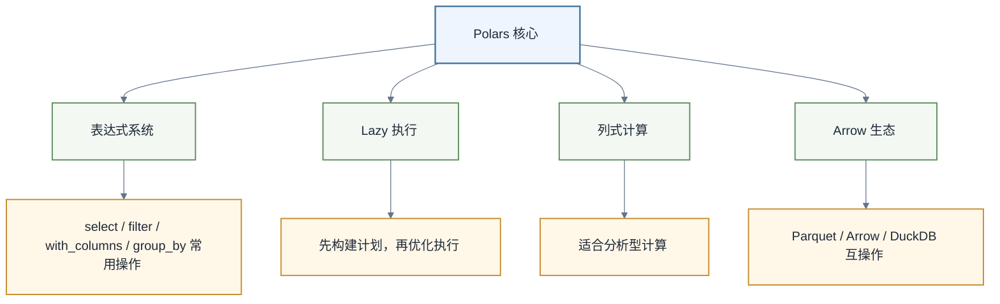

# Polars学习路线图

> [!abstract] 一句话定位
> Polars 是一个用 Rust 实现的高性能 DataFrame 库，适合在 Python 中做更快、更省内存、更表达式化的数据处理。它不是让你“抛弃 Pandas”，而是让你在 Pandas 不舒服的时候，有一把更锋利的刀。

如果你已经会 [[【技术与工具】/Python/09-Pandas数据结构|Pandas数据结构]] 和 [[【技术与工具】/Python/10-Pandas数据操作|Pandas数据操作]]，Polars 的学习会非常快。但你需要改变几个习惯：少用逐行 apply，多用表达式；少依赖 index，多用显式列；优先理解 Lazy 执行。

---

## 1. Polars的核心心智



官方 Polars 迁移指南强调，Lazy evaluation 意味着代码先添加到底层查询计划中，而不是立即执行。这个心智非常重要。

---

## 2. 学习路线

| 顺序 | 专题 | 学习结果 |
|---|---|---|
| 1 | [[【技术与工具】/Polars/01-表达式与常用数据操作\|表达式与常用数据操作]] | 用原生表达式完成清洗、聚合与连接 |
| 2 | [[【技术与工具】/Polars/02-Lazy执行与性能优化\|Lazy执行与性能优化]] | 用 scan、explain 和基准验证优化 |
| 3 | [[【技术与工具】/Polars/03-从Pandas迁移到Polars\|从Pandas迁移到Polars]] | 通过双跑与 schema 合同安全迁移 |

### 阶段一：从Pandas迁移

目标：能把常见 Pandas 操作写成 Polars。

你要掌握：

- `pl.DataFrame`
- `select`
- `filter`
- `with_columns`
- `group_by`
- `join`
- `sort`
- `pivot` / `melt`

关键变化：Polars 不鼓励复杂 index 心智模型，更多依赖显式列。

### 阶段二：表达式系统

目标：写出可优化、可组合的计算逻辑。

示例：

```python
import polars as pl

result = (
    pl.scan_parquet("orders.parquet")
    .filter(pl.col("status") == "paid")
    .with_columns(pl.col("pay_time").str.to_datetime().dt.date().alias("pay_date"))
    .group_by("pay_date")
    .agg([
        pl.col("amount").sum().alias("gmv"),
        pl.col("order_id").n_unique().alias("orders"),
    ])
    .collect()
)
```

### 阶段三：Lazy与性能优化

目标：知道什么时候用 `scan_csv` / `scan_parquet`，而不是 `read_csv` / `read_parquet`。

你要掌握：

- LazyFrame
- 查询计划
- Predicate pushdown
- Projection pushdown
- Streaming 执行思路
- Parquet 分区数据读取

### 阶段四：与DuckDB/Ibis协同

Polars 擅长 Python 表达式，DuckDB 擅长 SQL 分析，Ibis 擅长多后端统一表达。三者不是敌人。

推荐组合：

- DuckDB：SQL 探索、文件查询、多表 join。
- Polars：复杂 DataFrame 转换、特征工程、性能敏感清洗。
- Ibis：希望同一套 Python 表达式切换 DuckDB、Polars、云数仓。

---

## 3. Polars适合和不适合

| 场景 | 是否适合 | 说明 |
|---|---|---|
| 大 CSV/Parquet 清洗 | 很适合 | Lazy + 列式计算优势明显 |
| 复杂特征工程 | 适合 | 表达式组合清晰 |
| Pandas 面试准备 | 不适合作为唯一工具 | Pandas 仍是基本盘 |
| SQL 团队协作 | 不一定 | SQL 可能更易沟通 |
| 超大分布式计算 | 不适合 | Spark/Flink/Trino 更合适 |
| 本地AI作品集 | 适合 | 性能好，部署轻 |

---

## 4. AI时代为什么要学Polars

AI 生成 Pandas 代码很容易出现长链、隐式类型转换、低效 apply。Polars 的表达式系统更结构化，反而更适合作为 AI 生成数据处理逻辑的目标语言之一。

但注意：

- AI 生成 Polars 代码后仍要跑测试。
- Lazy 执行的错误可能到 collect 时才暴露。
- 类型转换、时间字段、空值处理要重点审查。

相关：[[【技术与工具】/Python/41-从Pandas到Polars与DuckDB|从Pandas到Polars与DuckDB]]。

---

## 5. 学习建议

1. 不要跳过 Pandas。
2. 从“把 Pandas 脚本改成 Polars”开始。
3. 少用逐行 apply，多用表达式。
4. 优先处理 Parquet，而不是所有数据都先转 CSV。
5. 遇到 SQL 型分析，考虑 DuckDB。

---

## 6. 外部参考

- [Polars Coming from Pandas](https://docs.pola.rs/user-guide/migration/pandas/)
- [Polars Lazy API](https://docs.pola.rs/user-guide/concepts/lazy-api/)
- [Polars Query Optimizations](https://docs.pola.rs/user-guide/lazy/optimizations/)
- [Polars Expressions API](https://docs.pola.rs/api/python/stable/reference/expressions/index.html)

---

## 7. 相关学习入口

- [[【技术与工具】/Python/41-从Pandas到Polars与DuckDB|从Pandas到Polars与DuckDB]]
- [[【技术与工具】/DuckDB/00-DuckDB学习路线图|DuckDB学习路线图]]
- [[【技术与工具】/Ibis/00-Ibis学习路线图|Ibis学习路线图]]
- [[【技术与工具】/Python/11-Pandas数据清洗|Pandas数据清洗]]
- [[【技术与工具】/Python/19-特征工程|Python特征工程]]
