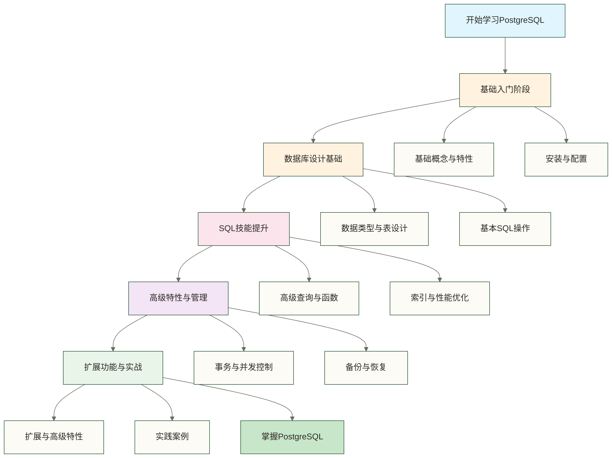

# 🐘 PostgreSQL学习路线图

## 📚 学习目标

通过本学习路线，你将能够：
- **理解PostgreSQL的核心概念**和在数据库领域的重要地位
- **掌握PostgreSQL的安装配置**和基本操作
- **熟练使用SQL语言**进行数据查询和操作
- **掌握PostgreSQL的高级特性**和性能优化技巧
- **具备实际项目开发**和数据库管理能力

> [!tip] 💡 学习建议
> PostgreSQL被称为"世界上最先进的开源数据库"，**不要被它的复杂性吓倒**。就像学习一门新语言一样，从基础语法开始，逐步深入到高级特性。**每一个概念都要通过实践来巩固**，这样才能真正掌握。

## 🗺️ PostgreSQL学习全景图

## 🎯 学习路径

### 第一阶段：基础入门 (预计时间：1-2周)

#### 1. [[【技术与工具】/PostgreSQL/01-PostgreSQL基础概念与特性|PostgreSQL基础概念与特性]]
- PostgreSQL简介和发展历史
- 与其他数据库的区别和优势
- 核心特性：ACID、多版本并发控制(MVCC)
- 适用场景和生态系统
- 数据库架构基础理解

#### 2. [[【技术与工具】/PostgreSQL/02-PostgreSQL安装与配置|PostgreSQL安装与配置]]
- 不同操作系统的安装方法（Windows、macOS、Linux）
- 基本配置和初始化
- 常用工具：psql、pgAdmin、DBeaver
- 服务启动和连接测试
- 环境变量和路径配置

> [!abstract] 📖 阶段小结
> 完成这个阶段后，你将对PostgreSQL有一个全面的认识，能够成功安装并连接数据库。**这是后续学习的重要基础**，务必确保每个步骤都能正常执行。

### 第二阶段：数据库设计基础 (预计时间：1-2周)

#### 3. [[【技术与工具】/PostgreSQL/03-PostgreSQL数据类型与表设计|PostgreSQL数据类型与表]]
- 基本数据类型：数字、文本、日期时间
- 高级数据类型：JSON/JSONB、数组、枚举、复合类型
- 表的创建和约束设计
- 主键、外键设计原则
- 数据库范式和表关系设计

#### 4. [[【技术与工具】/PostgreSQL/04-PostgreSQL基本SQL操作|PostgreSQL基本SQL操作]]
- DDL操作：CREATE、ALTER、DROP
- DML操作：INSERT、UPDATE、DELETE
- DQL操作：SELECT基础查询、过滤和排序
- 数据导入导出（CSV、JSON格式）
- 批量操作和事务基础

> [!tip] 🔧 实践建议
> 这个阶段**重点在于动手实践**，建议创建一个小型的示例数据库（如图书管理系统），通过实际操作来加深理解。不要只是看理论，每个SQL语句都要亲自执行。

### 第三阶段：SQL技能提升 (预计时间：2-3周)

#### 5. [[【技术与工具】/PostgreSQL/05-PostgreSQL高级查询与函数|PostgreSQL高级查询与函数]]
- 复杂查询：JOIN连接操作、子查询、公用表表达式(CTE)
- 聚合函数和分组操作
- 窗口函数详解与应用
- 内置函数：字符串处理、数学运算、日期时间
- 自定义函数和存储过程开发

#### 6. [[【技术与工具】/PostgreSQL/06-PostgreSQL索引与性能优化|PostgreSQL索引与性能优化]]
- 索引类型详解：B-tree、Hash、GIN、GiST、SP-GiST、BRIN
- 索引设计策略和最佳实践
- 查询执行计划分析：EXPLAIN和EXPLAIN ANALYZE
- 性能监控和调优方法
- 统计信息和查询优化器

> [!info] 📊 进阶提示
> 这个阶段是**SQL技能的关键提升期**，建议结合实际的数据分析场景来练习。比如电商销售数据分析、用户行为统计等，这样学习效果会更好。

### 第四阶段：高级特性与管理 (预计时间：2-3周)

#### 7. [[【技术与工具】/PostgreSQL/07-PostgreSQL事务与并发控制|PostgreSQL事务与并发控制]]
- 事务的ACID特性深度理解
- 四种隔离级别：读未提交、读已提交、可重复读、可序列化
- 锁机制：行级锁、表级锁、页级锁
- 死锁检测和避免策略
- 多版本并发控制(MVCC)原理和优势

#### 8. [[【技术与工具】/PostgreSQL/08-PostgreSQL备份与恢复|PostgreSQL备份与恢复]]
- 逻辑备份：pg_dump、pg_dumpall、pg_restore
- 物理备份：基础备份和增量备份
- 连续归档和预写日志(WAL)
- 时间点恢复(PITR)配置
- 高可用和灾难恢复架构

> [!warning] ⚠️ 注意事项
> 高级特性的学习需要**结合实际应用场景**，不要急于求成。每个特性都要理解其原理和适用场景，避免在生产环境中误用。

### 第五阶段：扩展功能与实战 (预计时间：2-4周)

#### 9. [[【技术与工具】/PostgreSQL/09-PostgreSQL扩展与高级特性|PostgreSQL扩展与高级特性]]
- 全文搜索：tsvector、tsquery、搜索配置
- JSON/JSONB数据处理和查询
- 数组操作和复合类型设计
- 扩展插件：PostGIS、pg_stat_statements、pg_trgm
- 分区表和表继承
- 触发器和规则系统

#### 10. [[【技术与工具】/PostgreSQL/10-PostgreSQL实践案例|PostgreSQL实践案例]]
- Web应用数据库架构设计
- 数据仓库和OLAP应用
- 地理信息系统(PostGIS)应用
- 时序数据处理
- 高可用集群架构(主从复制、流复制)
- 微服务架构下的数据库设计

> [!example] 🎯 项目导向
> 最后阶段**重点是将理论知识应用到实际项目中**。建议选择一个完整的项目来练习，比如构建一个博客系统、电商平台或数据分析应用。

## 📈 学习建议

### 🔄 循序渐进的学习方法

1. **理论与实践结合**：每学完一个概念，立即动手实践
2. **问题导向学习**：遇到问题时，深入研究背后的原理
3. **对比学习**：与MySQL、Oracle等其他数据库对比学习
4. **项目实践**：通过实际项目来巩固所学知识

### 📚 推荐学习资源

- **官方文档**：[PostgreSQL官方文档](https://www.postgresql.org/docs/)
- **在线教程**：PostgreSQL Tutorial、W3Schools
- **实践平台**：PostgreSQL Playground、DB Fiddle
- **社区资源**：Stack Overflow、PostgreSQL邮件列表

### 🤝 学习中的常见挑战

> [!tip] 💪 克服困难的方法
> 
> **挑战1：SQL语法复杂**
> - 解决方案：从简单查询开始，逐步增加复杂度
> - 建议：多写多练，建立SQL语法的肌肉记忆
> 
> **挑战2：性能优化困难**
> - 解决方案：从理解查询执行计划开始
> - 建议：使用小数据集练习，观察性能差异
> 
> **挑战3：高级特性理解困难**
> - 解决方案：结合实际业务场景来理解
> - 建议：先掌握基础功能，再学习高级特性

## 🎓 阶段性检验

### 基础阶段检验点
- [ ] 能够成功安装和连接PostgreSQL
- [ ] 理解基本的数据类型和表结构
- [ ] 掌握基本的SQL操作（增删改查）

### 进阶阶段检验点
- [ ] 能够编写复杂的查询语句
- [ ] 理解索引的作用和使用方法
- [ ] 掌握基本的性能优化技巧

### 高级阶段检验点
- [ ] 能够设计和管理复杂的数据库架构
- [ ] 掌握备份恢复和高可用配置
- [ ] 具备生产环境的运维能力
- [ ] 能够使用PostgreSQL的高级特性

## 🌟 学习成果展示

完成这个学习路径后，你将能够：

- **设计和实现**复杂的数据库应用
- **优化PostgreSQL性能**和解决实际问题
- **管理和维护**生产环境的PostgreSQL集群
- **为团队提供**数据库技术支持和指导

> [!abstract] 🎯 最终目标
> 通过系统性的学习，你不仅能够熟练使用PostgreSQL，更重要的是能够理解现代数据库系统的设计原理和最佳实践。这将为你在数据相关领域的职业发展奠定坚实基础。

## 🔗 相关学习资源

在学习PostgreSQL的过程中，建议同时了解以下相关技术：

- [[【数据分析与数据运营】/01-共同能力基础/03-工具掌握/01-SQL基本概念|共同能力基础/SQL基本概念]] - 通用SQL语言基础
- [[【技术与工具】/Python/05-Python函数编程|Python/Python函数编程]] - 数据库编程和数据处理
- [[【技术与工具】/Java/05-Java在数据开发中的应用|Java/Java在数据开发中的]] - 现代数据开发实践
- [[【技术与工具】/MySQL/00-MySQL学习路线图|MySQL/MySQL]] - 对比学习主流数据库
- Redis缓存技术 - 缓存和NoSQL补充
- Docker容器技术 - 数据库部署和容器化

## 🚀 快速入门建议

如果你是完全的初学者，建议按照以下顺序开始：

1. **先学习基础概念**：了解什么是数据库，为什么需要数据库
2. **动手安装和配置**：在本地环境搭建PostgreSQL
3. **从简单查询开始**：学会基本的SELECT语句
4. **逐步增加复杂度**：添加WHERE、JOIN等条件
5. **结合实际项目**：用PostgreSQL构建一个小型应用

---

> 💡 **记住**：学习PostgreSQL不是一蹴而就的过程，**每个人的学习节奏都不同**。重要的是保持持续学习的态度，在实践中不断提升自己的技能水平。PostgreSQL是一个功能强大的数据库系统，掌握它将为你的职业发展带来巨大价值！