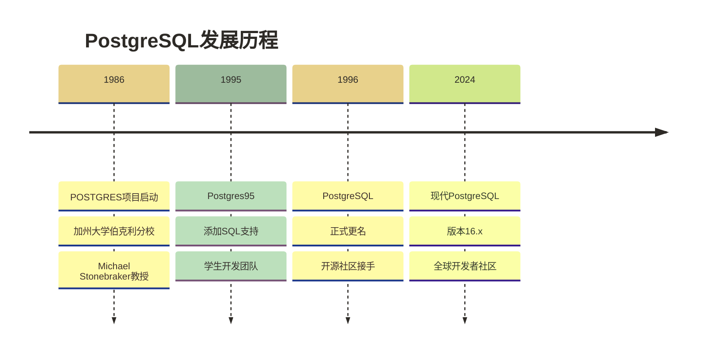
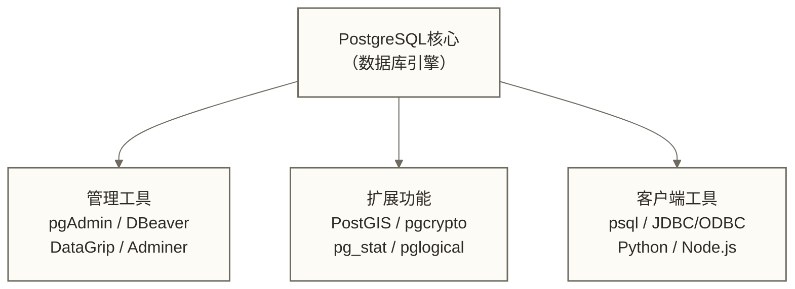

# 🐘 PostgreSQL基础概念与特性

## 📚 学习目标

通过本章节的学习，你将能够：
- **理解PostgreSQL的发展历史**和设计理念
- **掌握PostgreSQL的核心特性**和技术优势
- **了解PostgreSQL与其他数据库的差异**
- **明确PostgreSQL的适用场景**和生态系统

> [!tip] 💡 学习建议
> 刚开始学习PostgreSQL时，你可能会被各种概念和特性搞得有些晕头转向，**这是完全正常的**！就像初次接触一个新城市，需要时间来熟悉。我们会用简单易懂的方式来解释每个概念，**不要着急，慢慢来**。

## 🎯 什么是PostgreSQL

### 基本定义

**PostgreSQL** 是一个功能强大、开源的**对象-关系数据库系统**，它拥有超过35年的开发历史，以其可靠性、功能丰富性和性能著称。

> [!abstract] 📖 通俗理解
> 想象一下，如果把数据库比作一个**超级智能的图书馆**，那么PostgreSQL就是一个**既能存储传统书籍，又能存储多媒体资料、地图、音频等各种复杂资料的现代化图书馆**。它不仅能高效地存储和检索信息，还能进行复杂的数据分析和处理。

### 核心特点

1. **开源免费**：完全开源，无需许可费用
2. **ACID兼容**：保证数据的完整性和一致性
3. **高度可扩展**：支持自定义数据类型、函数和操作符
4. **标准兼容**：支持广泛的SQL标准特性，同时存在实现差异和PostgreSQL扩展
5. **跨平台**：支持多种操作系统

## 📜 PostgreSQL发展历史

### 发展时间线



### 重要里程碑

- **1986年**：Michael Stonebraker教授在加州大学伯克利分校启动POSTGRES项目
- **1995年**：添加SQL语言支持，改名为Postgres95
- **1996年**：正式更名为PostgreSQL，开始由开源社区维护
- **2005年**：成为最受欢迎的开源数据库之一
- **2010年**：开始支持流复制和热备份
- **2020年**：引入分区表改进和并行查询优化

> [!info] 📊 趣味知识
> PostgreSQL的吉祥物是一只蓝色的大象，名叫**Slonik**。这是因为PostgreSQL被认为具有"大象般的记忆力"——能够可靠地存储和检索大量数据，而且"永远不会忘记"。

## 🚀 PostgreSQL核心特性

### 1. ACID事务特性

**ACID**是数据库事务的四个基本特性：

- **原子性(Atomicity)**：事务要么全部成功，要么全部失败
- **一致性(Consistency)**：事务执行后数据库状态保持一致
- **隔离性(Isolation)**：隔离级别规定并发事务可观察的结果及允许的并发异常；不能理解为所有级别下事务完全不相互影响
- **持久性(Durability)**：已提交的数据不会丢失

```sql
-- ACID事务示例：银行转账
BEGIN;
UPDATE accounts SET balance = balance - 100 WHERE account_id = 'A';
UPDATE accounts SET balance = balance + 100 WHERE account_id = 'B';
COMMIT;  -- 要么全部成功，要么全部失败
```

### 2. 多版本并发控制(MVCC)

**MVCC**是PostgreSQL的核心特性，通过数据版本与快照支持并发访问，减少普通读取与写入之间的阻塞，但写写冲突及其他锁操作仍可能造成等待。

> [!example] 🎯 MVCC类比
> 想象一个**图书馆的借阅系统**：
> - 当有人在阅读一本书时，其他人可以同时查看该书的目录
> - 如果有人要修改书的内容，系统会创建一个新版本
> - 不同的读者可以同时看到不同版本的内容
> - 这样既保证了数据的一致性，又提高了并发性能

```sql
-- MVCC工作原理示例
-- 会话1：使用REPEATABLE READ演示事务内的固定快照
BEGIN ISOLATION LEVEL REPEATABLE READ;
SELECT * FROM products WHERE category = 'electronics';
-- 此时看到的是当前快照

-- 会话2：在另一个会话中修改数据
UPDATE products SET price = price * 1.1 WHERE category = 'electronics';
COMMIT;

-- 会话1：在REPEATABLE READ下，仍使用本事务首次查询建立的快照
SELECT * FROM products WHERE category = 'electronics';
-- 价格没有变化，这就是MVCC的效果
```

### 3. 丰富的数据类型

PostgreSQL支持多种数据类型，远超传统的关系型数据库：

#### 基本数据类型
```sql
-- 数值类型
CREATE TABLE example_types (
    id SERIAL PRIMARY KEY,
    small_num SMALLINT,          -- 2字节整数
    regular_num INTEGER,         -- 4字节整数
    big_num BIGINT,             -- 8字节整数
    decimal_num NUMERIC(10,2),   -- 精确小数
    float_num REAL,             -- 4字节浮点数
    double_num DOUBLE PRECISION  -- 8字节浮点数
);

-- 字符类型
CREATE TABLE text_types (
    id SERIAL PRIMARY KEY,
    fixed_char CHAR(10),        -- 定长字符
    var_char VARCHAR(100),      -- 变长字符
    text_field TEXT,            -- 可变长文本，不需声明长度，但仍有字段大小上限
    name_field NAME             -- 系统标识符
);

-- 日期时间类型
CREATE TABLE datetime_types (
    id SERIAL PRIMARY KEY,
    date_field DATE,                    -- 日期
    time_field TIME,                    -- 时间
    timestamp_field TIMESTAMP,          -- 时间戳
    timestamptz_field TIMESTAMPTZ,      -- 带时区的时间戳
    interval_field INTERVAL             -- 时间间隔
);
```

#### 高级数据类型
```sql
-- JSON类型
CREATE TABLE json_example (
    id SERIAL PRIMARY KEY,
    data JSON,                  -- JSON数据
    structured_data JSONB       -- 二进制JSON（推荐）
);

-- 数组类型
CREATE TABLE array_example (
    id SERIAL PRIMARY KEY,
    tags TEXT[],                -- 文本数组
    numbers INTEGER[],          -- 整数数组
    matrix INTEGER[][]          -- 二维数组
);

-- 网络地址类型
CREATE TABLE network_types (
    id SERIAL PRIMARY KEY,
    ip_address INET,            -- IP地址
    mac_address MACADDR,        -- MAC地址
    ip_network CIDR             -- 网络地址
);

-- 几何类型
CREATE TABLE geometry_types (
    id SERIAL PRIMARY KEY,
    point_field POINT,          -- 点
    line_field LINE,            -- 直线
    circle_field CIRCLE,        -- 圆
    polygon_field POLYGON       -- 多边形
);
```

### 4. 强大的索引支持

PostgreSQL支持多种索引类型，适应不同的查询需求：

```sql
-- B-tree索引（默认）
CREATE INDEX idx_product_name ON products(name);

-- 部分索引
CREATE INDEX idx_active_users ON users(email) WHERE active = true;

-- 表达式索引
CREATE INDEX idx_lower_name ON users(LOWER(name));

-- 复合索引
CREATE INDEX idx_category_price ON products(category, price);

-- GIN索引（用于数组、JSON等）
CREATE INDEX idx_tags_gin ON posts USING GIN(tags);

-- GiST索引（用于几何数据）
CREATE INDEX idx_location_gist ON locations USING GiST(coordinates);

-- 哈希索引
CREATE INDEX idx_user_id_hash ON sessions USING HASH(user_id);
```

### 5. 全文搜索功能

PostgreSQL内置了强大的全文搜索功能：

```sql
-- 创建全文搜索索引
CREATE TABLE documents (
    id SERIAL PRIMARY KEY,
    title TEXT,
    content TEXT,
    search_vector TSVECTOR
);

-- 创建全文搜索索引
CREATE INDEX idx_search_vector ON documents USING GIN(search_vector);

-- 更新搜索向量
UPDATE documents SET search_vector = 
    to_tsvector('english', title || ' ' || content);

-- 全文搜索查询
SELECT title, content 
FROM documents 
WHERE search_vector @@ to_tsquery('english', 'database & postgresql');

-- 搜索结果排序
SELECT title, content,
       ts_rank(search_vector, to_tsquery('english', 'database')) AS rank
FROM documents 
WHERE search_vector @@ to_tsquery('english', 'database')
ORDER BY rank DESC;
```

## 🔄 PostgreSQL与其他数据库的对比

> [!example] 🏠 **生活化比喻**
> 如果把数据库比作**不同的交通工具**：
> - **MySQL**就像**经济型轿车**：简单、快速、燃油经济，适合日常出行
> - **PostgreSQL**就像**全功能SUV**：功能强大、可以应对复杂路况，适合各种场景
> - **Oracle**就像**豪华商务车**：功能齐全但价格昂贵，适合大企业

### 与MySQL的对比

| 特性 | PostgreSQL | MySQL |
|---|---|---|
| **开源性** | 完全开源 | 双重许可 |
| **SQL标准** | 支持广泛的标准特性，并有实现差异与扩展 | 支持多种标准特性，并有实现差异与扩展 |
| **数据类型** | 丰富多样 | 基本类型 |
| **JSON支持** | 原生JSONB | 基本JSON |
| **复杂查询** | 强大支持 | 基本支持 |
| **扩展性** | 高度可扩展 | 有限扩展 |
| **性能** | 复杂查询优秀 | 简单查询快速 |

### 与Oracle的对比

| 特性 | PostgreSQL | Oracle | 关键差异 |
|---|---|---|---|
| **成本** | 免费开源，仍需考虑运维与支持成本 | 原文$47,500+/CPU仅可作为待确认的预算假设，不代表通用报价 | 成本取决于产品、许可计价方式、部署和支持方案 |
| **功能丰富性** | 原文覆盖90%需求仅可作为待确认的需求覆盖假设 | 企业功能取决于版本及选件 | 应按具体需求逐项比较，不能据此认定覆盖比例或功能完整性 |
| **性能** | 取决于负载、配置和优化 | 取决于负载、配置和优化 | 原文关于极端场景优劣的判断仅可作为待测试假设 |
| **学习曲线** | 中等难度 | 高难度 | PostgreSQL更易学 |
| **部署灵活性** | 高灵活性 | 复杂部署 | PostgreSQL部署更简单 |
| **企业支持** | 社区+第三方 | 官方保障 | Oracle支持更全面 |
| **云原生** | 天然支持 | 适配复杂 | PostgreSQL云优势明显 |

> [!tip] 💡 选择建议
> 
> **选择PostgreSQL的场景**：
> - 需要复杂查询和数据分析
> - 预算有限但需要企业级功能
> - 重视开源和社区支持
> - 需要JSON等现代数据类型
> - 地理信息系统(GIS)应用
> 
> **选择MySQL的场景**：
> - 简单的Web应用
> - 需要极高的读取性能
> - 团队已熟悉MySQL
> - 简单的CRUD操作

## 🌐 PostgreSQL适用场景

### 1. Web应用开发

```sql
-- 用户系统设计
CREATE TABLE users (
    id SERIAL PRIMARY KEY,
    username VARCHAR(50) UNIQUE NOT NULL,
    email VARCHAR(100) UNIQUE NOT NULL,
    password_hash VARCHAR(255) NOT NULL,
    profile JSONB,                    -- 存储用户配置
    created_at TIMESTAMP DEFAULT CURRENT_TIMESTAMP,
    updated_at TIMESTAMP DEFAULT CURRENT_TIMESTAMP
);

-- 博客文章系统
CREATE TABLE posts (
    id SERIAL PRIMARY KEY,
    user_id INTEGER REFERENCES users(id),
    title VARCHAR(200) NOT NULL,
    content TEXT,
    tags TEXT[],                      -- 标签数组
    metadata JSONB,                   -- 元数据
    published_at TIMESTAMP,
    created_at TIMESTAMP DEFAULT CURRENT_TIMESTAMP
);

-- 评论系统
CREATE TABLE comments (
    id SERIAL PRIMARY KEY,
    post_id INTEGER REFERENCES posts(id),
    user_id INTEGER REFERENCES users(id),
    content TEXT NOT NULL,
    parent_id INTEGER REFERENCES comments(id), -- 支持嵌套评论
    created_at TIMESTAMP DEFAULT CURRENT_TIMESTAMP
);
```

### 2. 数据分析和报告

```sql
-- 销售数据分析
CREATE TABLE sales (
    id SERIAL PRIMARY KEY,
    product_id INTEGER,
    customer_id INTEGER,
    amount DECIMAL(10,2),
    quantity INTEGER,
    sale_date DATE,
    region VARCHAR(50),
    metadata JSONB
);

-- 复杂分析查询
WITH monthly_sales AS (
    SELECT 
        DATE_TRUNC('month', sale_date) AS month,
        region,
        SUM(amount) AS total_amount,
        COUNT(*) AS transaction_count
    FROM sales
    WHERE sale_date >= '2024-01-01'
    GROUP BY DATE_TRUNC('month', sale_date), region
),
regional_growth AS (
    SELECT 
        month,
        region,
        total_amount,
        LAG(total_amount) OVER (PARTITION BY region ORDER BY month) AS prev_month,
        (total_amount - LAG(total_amount) OVER (PARTITION BY region ORDER BY month)) / 
        NULLIF(LAG(total_amount) OVER (PARTITION BY region ORDER BY month), 0) * 100 AS growth_rate
    FROM monthly_sales
)
SELECT 
    month,
    region,
    total_amount,
    ROUND(growth_rate, 2) AS growth_percentage
FROM regional_growth
WHERE prev_month IS NOT NULL
ORDER BY month, region;
```

### 3. 地理信息系统(GIS)

```sql
-- 需要安装PostGIS扩展
CREATE EXTENSION IF NOT EXISTS postgis;

-- 地理位置数据
CREATE TABLE locations (
    id SERIAL PRIMARY KEY,
    name VARCHAR(100),
    coordinates GEOMETRY(POINT, 4326),  -- 经纬度坐标
    region GEOMETRY(POLYGON, 4326),     -- 区域范围
    metadata JSONB
);

-- 空间查询示例
-- 查找距离某点1公里内的所有位置
SELECT name, ST_Distance(coordinates::geography, ST_GeomFromText('POINT(116.3974 39.9093)', 4326)::geography) AS distance
FROM locations
WHERE ST_DWithin(coordinates::geography, ST_GeomFromText('POINT(116.3974 39.9093)', 4326)::geography, 1000)
ORDER BY distance;

-- 查找包含某个点的区域
SELECT name 
FROM locations 
WHERE ST_Contains(region, ST_GeomFromText('POINT(116.3974 39.9093)', 4326));
```

## 🏗️ PostgreSQL生态系统

### 核心工具



### 主要扩展

1. **PostGIS**：地理信息系统扩展
2. **pgcrypto**：加密功能
3. **pg_stat_statements**：查询性能统计
4. **pglogical**：逻辑复制
5. **pg_partman**：分区管理
6. **TimescaleDB**：时间序列数据库

### 云服务提供商

- **Amazon RDS for PostgreSQL**
- **Google Cloud SQL for PostgreSQL**
- **Azure Database for PostgreSQL**
- **Heroku Postgres**
- **DigitalOcean Managed Databases**

## 📊 性能特点

### 读写性能

```sql
-- 性能优化示例
-- 1. 使用EXPLAIN分析查询计划
EXPLAIN (ANALYZE, BUFFERS) 
SELECT * FROM users 
WHERE email = 'user@example.com';

-- 2. 创建合适的索引
CREATE INDEX CONCURRENTLY idx_users_email ON users(email);

-- 3. 使用查询优化技巧
-- 使用日期范围过滤；是否采用索引及避免全表扫描需结合索引、数据分布和执行计划判断
SELECT * FROM posts 
WHERE created_at >= '2024-01-01'
  AND created_at < '2024-02-01';

-- 使用限制查询
SELECT * FROM posts 
ORDER BY created_at DESC 
LIMIT 10;
```

### 并发处理

```sql
-- 并发控制示例
-- 1. 使用适当的隔离级别
BEGIN ISOLATION LEVEL READ COMMITTED;
SELECT * FROM accounts WHERE account_id = 'A';
-- 进行业务逻辑处理
UPDATE accounts SET balance = balance - 100 WHERE account_id = 'A';
COMMIT;

-- 2. 使用乐观锁
CREATE TABLE documents (
    id SERIAL PRIMARY KEY,
    title VARCHAR(200),
    content TEXT,
    version INTEGER DEFAULT 1,
    updated_at TIMESTAMP DEFAULT CURRENT_TIMESTAMP
);

-- 更新时检查版本
UPDATE documents 
SET content = 'new content', 
    version = version + 1,
    updated_at = CURRENT_TIMESTAMP
WHERE id = 1 AND version = 1;
```

## 🎯 小结

通过本章节的学习，我们了解到：

1. **PostgreSQL**是一个功能强大、开源的对象-关系数据库系统
2. **核心特性**包括ACID事务、MVCC、丰富的数据类型和强大的索引支持
3. **适用场景**广泛，从Web应用到数据分析，从GIS到企业级应用
4. **生态系统**完善，拥有丰富的工具和扩展

> [!abstract] 📚 下一步学习
> 现在你已经了解了PostgreSQL的基本概念和特性，接下来我们将学习[[【技术与工具】/PostgreSQL/02-PostgreSQL安装与配置|PostgreSQL安装与配置]]，开始真正的动手实践。

## 🔗 相关资源

- [[【技术与工具】/PostgreSQL/00-PostgreSQL学习路线图|PostgreSQL]]
- [[【技术与工具】/MySQL/02-MySQL安装配置|MySQL/MySQL安装配置]] - 对比学习
- [[【技术与工具】/PostgreSQL/01-PostgreSQL基础概念与特性|PostgreSQL基础概念与特性]] - 数据库基础概念

---

> 💡 **记住**：PostgreSQL的强大之处在于其**灵活性和扩展性**。不要被众多的特性所overwhelm，**从基础开始，逐步深入**。每个特性都有其适用场景，在实际使用中你会逐渐理解它们的价值。**实践是最好的老师**，建议在学习过程中多动手操作！