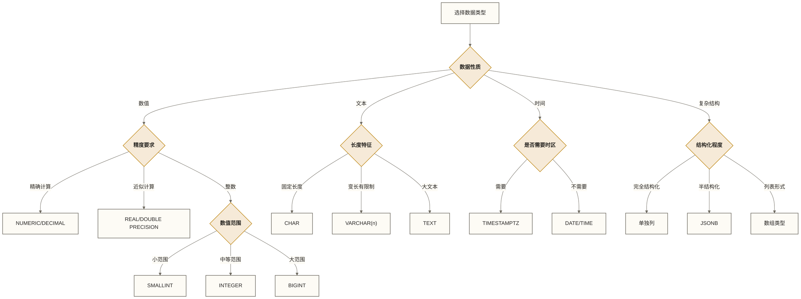

# 📊 PostgreSQL数据类型与表设计

PostgreSQL以其丰富而强大的数据类型系统著称，为数据工程师和分析师提供了构建复杂数据结构的坚实基础。掌握数据类型选择和表设计原则，是构建高性能数据系统的第一步。

## 🎯 学习目标

通过本章节的学习，你将能够：

- **精通PostgreSQL丰富的数据类型系统**，包括传统类型和先进的JSON、数组类型
- **掌握面向数据领域的表设计原则**，构建可扩展的数据架构
- **运用约束条件和索引**确保数据质量和查询性能
- **设计企业级数据系统的表结构**，满足分析和报表需求
- **应用PostgreSQL特色功能**解决实际数据工程问题

## 🏗️ 数据类型选择的艺术

在数据工程中，选择合适的数据类型就像为不同用途的数据选择最合适的"容器"。每种类型都有其最佳应用场景，理解这些特性是构建高效数据系统的关键。

> [!tip] 💡 学习方法
> 
> 数据类型的选择影响存储效率、查询性能和数据完整性。不要试图一次记住所有类型，而是：
> 1. **理解每种类型的核心特性**和适用场景
> 2. **通过实际案例**体验类型选择的影响  
> 3. **关注数据域特有需求**，如时间序列、地理信息等
> 4. **重视性能影响**，合适的类型能显著提升查询速度

## 🔢 数值类型：精确性与性能的平衡

数值类型在数据工程中至关重要，不同的类型直接影响存储空间、计算精度和查询性能。在大数据环境下，正确的类型选择能节约大量存储空间并提升处理效率。

### 整数类型家族

整数类型的选择应基于数据范围和存储效率考虑。想象它们如不同尺寸的"数字容器"：

```sql
-- 数据仓库中常见的整数应用场景
CREATE TABLE data_warehouse_metrics (
    id BIGSERIAL PRIMARY KEY,              -- 大数据量主键
    
    -- 用户行为数据
    user_id BIGINT,                        -- 用户ID，支持海量用户
    page_views INTEGER DEFAULT 0,          -- 页面浏览量
    click_count SMALLINT DEFAULT 0,        -- 单次会话点击数（小范围）
    
    -- 业务指标
    order_amount BIGINT,                   -- 订单金额（分为单位，避免小数）
    product_category_id SMALLINT,          -- 商品分类ID（数量有限）
    inventory_level INTEGER,               -- 库存水平
    
    -- 时间维度
    year SMALLINT,                         -- 年份（2024等）
    quarter SMALLINT CHECK (quarter BETWEEN 1 AND 4),
    month SMALLINT CHECK (month BETWEEN 1 AND 12),
    day_of_month SMALLINT CHECK (day_of_month BETWEEN 1 AND 31)
);
```

**类型选择指南：**
- **SMALLINT** (2字节)：分类ID、年月日、状态码等小范围数值
- **INTEGER** (4字节)：用户计数、金额（元为单位）、库存等中等规模数值  
- **BIGINT** (8字节)：大规模用户ID、交易金额（分为单位）、时间戳等

### 精确数值类型：财务级精度

在数据分析中，特别是涉及财务数据时，精确性比性能更重要：

```sql
-- 财务数据表设计示例
CREATE TABLE financial_transactions (
    transaction_id BIGSERIAL PRIMARY KEY,
    
    -- 金融数据必须使用精确类型
    amount NUMERIC(15,4),                   -- 支持到万分位的精确金额
    exchange_rate NUMERIC(10,6),            -- 汇率精确到百万分位
    commission_rate NUMERIC(5,4),           -- 手续费率：99.9999%
    
    -- 浮点类型仅用于近似计算
    risk_score REAL,                        -- 风险评分（近似值可接受）
    correlation_coefficient DOUBLE PRECISION, -- 相关系数（科学计算）
    
    -- 统计数据
    daily_return NUMERIC(8,6),              -- 日收益率
    volatility NUMERIC(8,6),                -- 波动率
    
    transaction_date DATE,
    created_at TIMESTAMPTZ DEFAULT CURRENT_TIMESTAMP
);

-- 演示精确计算与浮点计算的差异
WITH calculation_demo AS (
    SELECT 
        0.1::DOUBLE PRECISION + 0.2::DOUBLE PRECISION AS float_result, -- 显式浮点计算
        0.1::NUMERIC + 0.2::NUMERIC AS exact_result   -- 精确计算
)
SELECT 
    float_result,
    exact_result,
    float_result = 0.3::DOUBLE PRECISION AS float_equals_check, -- 比较浮点计算结果与浮点常量
    exact_result = 0.3 AS exact_equals_check          -- 确保为TRUE
FROM calculation_demo;
```

> [!warning] 数值类型关键注意事项
> 
> **浮点类型陷阱**：REAL和DOUBLE PRECISION是IEEE标准浮点数，存在精度误差
> - ✅ **科学计算、统计分析**：可以接受近似值
> - ❌ **财务计算、货币金额**：绝不能使用浮点类型
> 
> **NUMERIC/DECIMAL优势**：精确十进制表示；指定精度和小数位或进行某些运算时仍可能发生舍入
> - 👍 **精确计算**：财务、会计、法务相关数据
> - 👎 **性能开销**：比整数和浮点类型慢，占用更多空间

## 📝 文本类型：处理多样化的字符数据

在现代数据系统中，文本数据无处不在：从结构化的产品代码到非结构化的用户评论。PostgreSQL提供了灵活而强大的文本类型系统。

### 文本类型选择策略

```sql
-- 数据平台中的文本类型最佳实践
CREATE TABLE content_management_system (
    id BIGSERIAL PRIMARY KEY,
    
    -- 固定长度：用于标准化代码和标识符
    country_code CHAR(2),               -- ISO国家代码：'CN', 'US'
    currency_code CHAR(3),              -- ISO货币代码：'CNY', 'USD'  
    product_sku CHAR(12),               -- 产品编码（固定格式）
    
    -- 变长字符串：绝大多数场景的首选
    username VARCHAR(50),               -- 用户名（有长度限制）
    email VARCHAR(254),                 -- 邮箱（RFC标准最大长度）
    phone VARCHAR(20),                  -- 电话号码（国际格式）
    product_name VARCHAR(200),          -- 产品名称
    
    -- 无限制文本：大容量内容
    description TEXT,                   -- 产品描述
    user_review TEXT,                   -- 用户评价
    system_log TEXT,                    -- 系统日志
    
    -- 文档和内容
    article_content TEXT,               -- 文章内容
    json_config TEXT,                   -- JSON配置（如果不用JSONB）
    
    created_at TIMESTAMPTZ DEFAULT CURRENT_TIMESTAMP
);
```

**实际数据插入和性能对比：**

```sql
-- 演示不同文本类型的特性
INSERT INTO content_management_system (
    country_code, currency_code, product_sku,
    username, email, phone, product_name,
    description, user_review, article_content
) VALUES 
    ('CN', 'CNY', 'SKU123456789',
     '数据工程师', 'engineer@example.com', '+86-138-0013-8000',
     'PostgreSQL完全指南',
     '这是一个全面介绍PostgreSQL的产品，涵盖了从基础概念到高级特性的各个方面。',
     '这本书写得非常好！作为一名数据库管理员，我从中学到了很多实用的技巧。特别是关于性能优化的部分，对我的日常工作帮助很大。',
     '# PostgreSQL简介\n\nPostgreSQL是世界上最先进的开源关系型数据库...\n\n## 主要特性\n\n1. ACID合规\n2. 丰富的数据类型\n3. 强大的扩展性');

-- 查看存储和性能特征
SELECT 
    country_code,
    LENGTH(country_code) as country_len,        -- CHAR尾部填充空格不计入此长度
    OCTET_LENGTH(country_code) as country_bytes, -- 实际字节数
    
    username,
    LENGTH(username) as username_len,
    OCTET_LENGTH(username) as username_bytes,   -- UTF-8中文占3字节
    
    LEFT(description, 50) || '...' as desc_preview,
    LENGTH(description) as desc_len,
    
    LENGTH(article_content) as article_len
FROM content_management_system;
```

### 文本类型选择指南

| 类型 | 适用场景 | 优势 | 注意事项 |
|------|----------|------|----------|
| **CHAR(n)** | 固定长度标识符 | 固定长度语义 | 自动填充空格，不应假定比VARCHAR或TEXT更省空间或更快 |
| **VARCHAR(n)** | 绝大多数文本字段 | 灵活，有长度控制 | 推荐的默认选择 |
| **VARCHAR** | 长度不确定的文本 | 无长度限制 | 失去长度验证 |
| **TEXT** | 大文本内容 | 无长度限制，语义清晰 | 与VARCHAR本质相同 |

> [!tip] 文本类型最佳实践
> 
> **按业务约束选择VARCHAR(n)**：明确的长度限制有助于数据验证，但本身不保证性能优于VARCHAR或TEXT
> ```sql
> -- ✅ 好的做法
> email VARCHAR(254),          -- 符合RFC标准
> username VARCHAR(50),        -- 合理的用户名长度
> title VARCHAR(200)           -- 适合大多数标题
> 
> -- ❌ 避免的做法  
> email VARCHAR,               -- 缺少长度验证
> name CHAR(100)              -- 浪费空间
> ```

## ⏰ 时间类型：数据分析的时间维度

时间数据是业务分析的核心维度。PostgreSQL提供了完整的时间类型系统，支持从简单的日期到复杂的时区处理。

### 时间类型在数据分析中的应用

```sql
-- 数据仓库的时间维度设计
CREATE TABLE business_events_log (
    event_id BIGSERIAL PRIMARY KEY,
    
    -- 业务日期（不需要时区）
    business_date DATE,                     -- 会计日期、报表日期
    fiscal_year SMALLINT,                   -- 财年
    quarter SMALLINT,                       -- 季度
    
    -- 精确时间戳（需要时区支持）
    event_timestamp TIMESTAMPTZ,            -- 事件发生时间（推荐）
    server_timestamp TIMESTAMPTZ DEFAULT CURRENT_TIMESTAMP,
    
    -- 时间范围和持续时间
    processing_duration INTERVAL,           -- 处理耗时
    session_duration INTERVAL,              -- 会话时长
    
    -- 业务时间（不常用但有特定场景）
    daily_cutoff_time TIME,                 -- 每日截止时间
    
    -- 事件数据
    user_id BIGINT,
    event_type VARCHAR(50),
    event_value NUMERIC(10,2),
    
    -- 数据来源时区信息
    source_timezone VARCHAR(50)             -- 记录原始时区
);

-- 插入多时区的业务数据
INSERT INTO business_events_log (
    business_date, fiscal_year, quarter,
    event_timestamp, processing_duration, session_duration,
    daily_cutoff_time, user_id, event_type, event_value, source_timezone
) VALUES 
    ('2024-01-15', 2024, 1,
     '2024-01-15 09:30:00+08'::TIMESTAMPTZ, '2.5 seconds'::INTERVAL, '45 minutes'::INTERVAL,
     '23:59:59'::TIME, 10001, 'purchase', 299.99, 'Asia/Shanghai'),
    ('2024-01-15', 2024, 1,
     '2024-01-15 14:30:00-05'::TIMESTAMPTZ, '1.2 seconds'::INTERVAL, '32 minutes'::INTERVAL,
     '23:59:59'::TIME, 10002, 'login', 0.00, 'America/New_York'),
    ('2024-01-16', 2024, 1,
     '2024-01-16 08:15:00+00'::TIMESTAMPTZ, '800 milliseconds'::INTERVAL, '28 minutes'::INTERVAL,
     '23:59:59'::TIME, 10003, 'view_product', 0.00, 'UTC');
```

### 时间计算和分析

```sql
-- 示例统一使用UTC作为显示、EXTRACT和DATE_TRUNC的会话时区
-- 业务报表应按实际口径选择时区，而非直接沿用UTC
SET TIME ZONE 'UTC';

-- 时间数据的分析查询示例
SELECT 
    event_id,
    business_date,
    event_timestamp,
    
    -- 时间转换和显示
    event_timestamp AT TIME ZONE 'UTC' as utc_time,
    event_timestamp AT TIME ZONE 'Asia/Shanghai' as beijing_time,
    
    -- 时间提取和计算
    EXTRACT(YEAR FROM event_timestamp) as event_year,
    EXTRACT(MONTH FROM event_timestamp) as event_month,
    EXTRACT(DOW FROM event_timestamp) as day_of_week,    -- 0=Sunday
    EXTRACT(HOUR FROM event_timestamp) as event_hour,
    
    -- 时间截断（时间维度聚合的基础）
    DATE_TRUNC('hour', event_timestamp) as hourly_bucket,
    DATE_TRUNC('day', event_timestamp) as daily_bucket,
    DATE_TRUNC('month', event_timestamp) as monthly_bucket,
    
    -- 时间间隔计算
    AGE(CURRENT_TIMESTAMP, event_timestamp) as time_since_event,
    processing_duration,
    
    -- 时间格式化
    TO_CHAR(event_timestamp, 'YYYY-MM-DD HH24:MI:SS TZ') as formatted_time,
    TO_CHAR(business_date, 'Day, Mon DD, YYYY') as formatted_date
    
FROM business_events_log
ORDER BY event_timestamp;

-- 基于时间维度的业务分析
WITH hourly_metrics AS (
    SELECT 
        DATE_TRUNC('hour', event_timestamp) as hour_bucket,
        COUNT(*) as event_count,
        SUM(event_value) as total_value,
        AVG(processing_duration) as avg_processing_time,
        COUNT(DISTINCT user_id) as unique_users
    FROM business_events_log
    -- 固定窗口覆盖本文2024年样例，便于复现；实时分析再改为相对当前时间的窗口
    WHERE event_timestamp >= TIMESTAMPTZ '2024-01-15 00:00:00+00'
      AND event_timestamp < TIMESTAMPTZ '2024-01-22 00:00:00+00'
    GROUP BY DATE_TRUNC('hour', event_timestamp)
)
SELECT 
    hour_bucket,
    event_count,
    total_value,
    avg_processing_time,
    unique_users,
    -- 与上一条有数据的小时桶比较；不是同比，也不保证相隔一小时
    LAG(event_count) OVER (ORDER BY hour_bucket) as prev_hour_events,
    event_count - LAG(event_count) OVER (ORDER BY hour_bucket) as hourly_growth
FROM hourly_metrics
ORDER BY hour_bucket DESC
LIMIT 24;  -- 返回最近24个有数据的小时桶，不等于最近24小时
```

### 时间类型选择指南

| 类型 | 用途 | 存储空间 | 最佳实践 |
|------|------|----------|----------|
| **DATE** | 业务日期、生日 | 4字节 | 报表日期、会计期间 |
| **TIMESTAMPTZ** | 事件时间戳 | 8字节 | 默认选择，自动处理时区 |
| **TIMESTAMP** | 无时区时间 | 8字节 | 避免使用，除非确实不需要时区 |
| **TIME** | 时间点 | 8字节 | 营业时间、截止时间 |
| **INTERVAL** | 时间间隔 | 16字节 | 持续时间、处理耗时 |

> [!important] 时间类型关键原则
> 
> **记录实际时间点时优先使用TIMESTAMPTZ**：本地墙上时间可使用TIMESTAMP；TIMESTAMPTZ不保留原始时区名称，显示和部分时间运算依赖会话时区。
> ```sql
> -- ✅ 推荐做法
> created_at TIMESTAMPTZ DEFAULT CURRENT_TIMESTAMP,
> event_time TIMESTAMPTZ NOT NULL,
> 
> -- ❌ 避免使用
> created_at TIMESTAMP,  -- 丢失时区信息
> event_time TIMESTAMP   -- 多时区应用中会出问题
> ```
> 
> **时间计算技巧**：
> - 使用`DATE_TRUNC()`进行时间维度聚合
> - 使用`EXTRACT()`提取时间组件
> - 使用`INTERVAL`进行时间算术运算
> - 利用窗口函数进行时间序列分析

## 🔘 布尔类型和高级数据类型

### 布尔类型的数据治理应用

布尔类型在数据治理中扮演重要角色，用于标识状态、权限和数据质量标记：

```sql
-- 数据治理中的布尔字段设计
CREATE TABLE data_quality_monitoring (
    id BIGSERIAL PRIMARY KEY,
    table_name VARCHAR(100),
    
    -- 数据质量标识
    is_complete BOOLEAN DEFAULT FALSE,      -- 数据完整性检查
    has_duplicates BOOLEAN DEFAULT FALSE,   -- 重复数据标识
    is_validated BOOLEAN DEFAULT FALSE,     -- 数据验证状态
    needs_cleanup BOOLEAN DEFAULT FALSE,    -- 需要清理标识
    
    -- 处理状态
    is_processing BOOLEAN DEFAULT FALSE,    -- 正在处理
    is_archived BOOLEAN DEFAULT FALSE,      -- 已归档
    is_deleted BOOLEAN DEFAULT FALSE,       -- 软删除标记
    
    -- 权限和访问控制
    is_public BOOLEAN DEFAULT FALSE,        -- 公开数据
    requires_approval BOOLEAN DEFAULT TRUE, -- 需要审批
    is_sensitive BOOLEAN DEFAULT FALSE,     -- 敏感数据标识
    
    last_check TIMESTAMPTZ DEFAULT CURRENT_TIMESTAMP
);
```

### PostgreSQL的杀手级功能：JSON和数组类型

PostgreSQL的JSONB类型是其相对于传统关系型数据库的巨大优势，让您能够在关系型框架内处理半结构化数据：

```sql
-- 现代数据平台的混合数据设计
CREATE TABLE user_analytics_profile (
    user_id BIGSERIAL PRIMARY KEY,
    
    -- 结构化的基本信息
    email VARCHAR(254) UNIQUE,
    registration_date DATE,
    
    -- 半结构化的用户属性（JSONB的威力）
    profile_data JSONB DEFAULT '{}',        -- 灵活的用户资料
    behavior_metrics JSONB DEFAULT '{}',    -- 行为分析数据
    preferences JSONB DEFAULT '{}',         -- 用户偏好设置
    
    -- 数组类型存储标签和分类
    user_tags TEXT[] DEFAULT '{}',          -- 用户标签
    visited_pages TEXT[] DEFAULT '{}',      -- 访问页面历史
    product_categories INTEGER[] DEFAULT '{}', -- 兴趣商品分类
    
    -- 传统的结构化数据
    total_orders INTEGER DEFAULT 0,
    total_spent NUMERIC(12,2) DEFAULT 0.00,
    
    created_at TIMESTAMPTZ DEFAULT CURRENT_TIMESTAMP,
    updated_at TIMESTAMPTZ DEFAULT CURRENT_TIMESTAMP
);

-- 插入复杂的混合数据
INSERT INTO user_analytics_profile (
    email, registration_date, profile_data, behavior_metrics, 
    preferences, user_tags, visited_pages, product_categories
) VALUES (
    'analyst@example.com', '2024-01-15',
    '{"name": "数据分析师", "age": 28, "city": "北京", "company": "科技公司", "position": "高级分析师"}',
    '{"session_count": 45, "avg_session_duration": 1800, "bounce_rate": 0.12, "conversion_rate": 0.08, "last_active": "2024-01-20T10:30:00Z"}',
    '{"language": "zh-CN", "theme": "dark", "notifications": {"email": true, "push": false, "sms": true}, "privacy_level": "medium"}',
    ARRAY['数据科学', 'PostgreSQL', '机器学习', '商业分析'],
    ARRAY['/dashboard', '/reports/monthly', '/settings', '/profile'],
    ARRAY[101, 205, 312, 456]  -- 商品分类ID
);
```

### JSON数据的强大查询能力

```sql
-- JSON数据的高级查询和分析
SELECT 
    user_id,
    email,
    
    -- JSON字段提取
    profile_data->>'name' as user_name,
    profile_data->>'city' as city,
    (profile_data->>'age')::INTEGER as age,
    
    -- JSON嵌套查询
    behavior_metrics->>'session_count' as total_sessions,
    (behavior_metrics->>'conversion_rate')::DECIMAL as conversion_rate,
    
    -- JSON条件和函数
    preferences->'notifications'->>'email' as email_notifications,
    
    -- 数组操作
    user_tags,
    array_length(user_tags, 1) as tag_count,
    'PostgreSQL' = ANY(user_tags) as loves_postgresql,
    
    -- JSON聚合统计
    jsonb_object_keys(behavior_metrics) as metric_names
    
FROM user_analytics_profile
WHERE 
    -- JSON条件查询
    profile_data->>'city' = '北京'
    AND (behavior_metrics->>'conversion_rate')::DECIMAL > 0.05
    AND preferences->'notifications'->>'email' = 'true'
    -- 数组条件查询  
    AND '数据科学' = ANY(user_tags);

-- JSON数据的聚合分析：用户指标与展开后的标签分别聚合
WITH city_metrics AS (
    SELECT
        profile_data->>'city' AS city,
        COUNT(*) AS user_count,
        AVG((behavior_metrics->>'conversion_rate')::DECIMAL) AS avg_conversion,
        AVG((profile_data->>'age')::INTEGER) AS avg_age,
        jsonb_agg(DISTINCT profile_data->>'company') AS companies
    FROM user_analytics_profile
    GROUP BY profile_data->>'city'
), city_tags AS (
    SELECT
        p.profile_data->>'city' AS city,
        array_agg(DISTINCT t.tag ORDER BY t.tag) AS all_tags
    FROM user_analytics_profile AS p
    CROSS JOIN LATERAL unnest(p.user_tags) AS t(tag)
    GROUP BY p.profile_data->>'city'
)
SELECT
    m.city,
    m.user_count,
    m.avg_conversion,
    m.avg_age,
    m.companies,
    COALESCE(t.all_tags, ARRAY[]::TEXT[]) AS all_tags
FROM city_metrics AS m
LEFT JOIN city_tags AS t ON m.city IS NOT DISTINCT FROM t.city
ORDER BY m.user_count DESC;
```

> [!note] JSON vs JSONB 关键区别
> 
> **JSONB（推荐）**：
> - ✅ **二进制存储格式**：查询和索引性能优异
> - ✅ **自动去除重复键**：数据一致性更好  
> - ✅ **支持GIN索引**：复杂查询性能极佳
> - ✅ **丰富的操作符**：@>, ?, ?&, ?| 等
> 
> **JSON（传统格式）**：
> - 📄 **文本存储格式**：保持原始格式
> - 📄 **插入稍快**：无需解析和重新组织
> - 📄 **较少操作符支持**
> 
> **选择建议**：除非有特殊需求保持原始JSON格式，否则始终选择JSONB

### 数组类型和枚举类型

数组类型让您能在单个字段中存储同类型的多个值，减少表连接的需要：

```sql
-- 枚举类型：类型安全的选择列表
CREATE TYPE data_quality_status AS ENUM ('excellent', 'good', 'fair', 'poor', 'critical');
CREATE TYPE processing_stage AS ENUM ('raw', 'cleaned', 'transformed', 'enriched', 'ready');

-- 数据管道监控表
CREATE TABLE data_pipeline_status (
    pipeline_id BIGSERIAL PRIMARY KEY,
    pipeline_name VARCHAR(100),
    
    -- 枚举类型提供类型安全
    current_stage processing_stage DEFAULT 'raw',
    quality_status data_quality_status DEFAULT 'fair',
    
    -- 数组类型存储相关信息
    input_sources TEXT[] DEFAULT '{}',         -- 输入数据源列表
    processing_steps TEXT[] DEFAULT '{}',      -- 处理步骤
    quality_checks TEXT[] DEFAULT '{}',        -- 质量检查项目
    error_codes INTEGER[] DEFAULT '{}',        -- 错误代码列表
    
    -- 多维数组用于复杂数据
    performance_metrics NUMERIC[][] DEFAULT '{}', -- 性能指标矩阵
    
    created_at TIMESTAMPTZ DEFAULT CURRENT_TIMESTAMP,
    updated_at TIMESTAMPTZ DEFAULT CURRENT_TIMESTAMP
);

-- 插入示例数据
INSERT INTO data_pipeline_status (
    pipeline_name, current_stage, quality_status,
    input_sources, processing_steps, quality_checks, error_codes,
    performance_metrics
) VALUES (
    'user_behavior_etl', 'transformed', 'good',
    ARRAY['web_logs', 'mobile_events', 'email_tracking'],
    ARRAY['extract', 'validate', 'clean', 'enrich', 'aggregate'],
    ARRAY['completeness_check', 'uniqueness_check', 'format_validation'],
    ARRAY[1001, 2003],
    ARRAY[[0.95, 0.88, 0.92], [1200, 850, 950]]  -- 第一行为质量评分，第二行为处理耗时
);
```

## 🏗️ 专业表设计原则

表设计是数据架构的基础，好的设计能够支撑业务的长期发展，而糟糕的设计会成为系统的性能瓶颈。以下是经过实战验证的设计原则：

### 数据建模核心原则

```sql
-- 现代数据仓库的用户行为事实表设计示例
-- 示例按UTC月界直接对事件时间分区；业务月界需按业务时区另行确定。
-- 复合主键保证(event_id, event_timestamp)唯一，不单独约束event_id全局唯一。
CREATE TABLE user_behavior_events (
    event_id BIGSERIAL,
    
    -- 维度键（外键到维度表）
    user_id BIGINT NOT NULL,                -- 用户维度
    product_id BIGINT,                      -- 产品维度  
    session_id BIGINT NOT NULL,             -- 会话维度
    device_id BIGINT,                       -- 设备维度
    
    -- 事件属性
    event_type VARCHAR(50) NOT NULL,        -- 'view', 'click', 'purchase'等
    event_timestamp TIMESTAMPTZ NOT NULL,   -- 事件时间
    
    -- 度量值
    duration_seconds INTEGER DEFAULT 0,     -- 停留时间
    page_depth SMALLINT DEFAULT 1,          -- 页面深度
    revenue NUMERIC(10,2) DEFAULT 0.00,     -- 收入金额
    
    -- 半结构化属性
    event_properties JSONB DEFAULT '{}',    -- 灵活的事件属性
    
    -- 数据治理字段
    data_source VARCHAR(50) NOT NULL,       -- 数据来源
    batch_id BIGINT,                        -- 批次标识
    created_at TIMESTAMPTZ DEFAULT CURRENT_TIMESTAMP,
    
    -- 主键包含分区键，满足分区表的唯一性约束要求
    PRIMARY KEY (event_id, event_timestamp)
) PARTITION BY RANGE (event_timestamp);

-- 创建分区表
CREATE TABLE user_behavior_events_2024_01 PARTITION OF user_behavior_events
    FOR VALUES FROM ('2024-01-01 00:00:00+00') TO ('2024-02-01 00:00:00+00');

-- 创建高效索引
CREATE INDEX idx_user_behavior_user_time ON user_behavior_events (user_id, event_timestamp);
CREATE INDEX idx_user_behavior_type_time ON user_behavior_events (event_type, event_timestamp);
CREATE INDEX idx_user_behavior_properties ON user_behavior_events USING GIN (event_properties);
```

## 🔑 表设计最佳实践总结

### 类型选择决策树



### 设计检查清单

**数据完整性** ✅
- [ ] 主键定义清晰
- [ ] 外键关系正确
- [ ] 非空约束合理
- [ ] 检查约束有效
- [ ] 唯一约束适当

**性能优化** 🚀
- [ ] 选择最小适用的数据类型
- [ ] 关键查询字段有索引
- [ ] 实际时间点使用TIMESTAMPTZ，本地日期时间按业务语义选择类型
- [ ] JSONB用于半结构化数据
- [ ] 大表考虑分区策略

**可维护性** 🛠️
- [ ] 命名规范一致
- [ ] 注释清晰完整
- [ ] 软删除标记
- [ ] 审计字段完整
- [ ] 版本控制友好

## 🎯 核心要点

1. **类型选择影响一切**：存储效率、查询性能、数据完整性都依赖正确的类型选择
2. **JSONB是现代优势**：PostgreSQL的半结构化数据处理能力是其核心竞争力  
3. **约束确保质量**：合理的约束是数据质量的第一道防线
4. **索引策略至关重要**：好的索引设计能让查询性能提升数个量级
5. **面向未来设计**：考虑数据增长、业务变化和扩展需求

> [!success] 📈 下一步行动
> 
> 掌握了数据类型和表设计基础后，建议您：
> 1. **实践设计**：为一个具体业务场景设计完整的表结构
> 2. **性能测试**：对比不同类型选择的性能影响
> 3. **学习SQL操作**：在[[【技术与工具】/PostgreSQL/04-PostgreSQL基本SQL操作|PostgreSQL基本SQL操作]]中学习如何操作这些表结构

## 📚 拓展学习

- [[【技术与工具】/PostgreSQL/01-PostgreSQL基础概念与特性|PostgreSQL基础概念与特性]] - 理解PostgreSQL的独特优势
- [[【技术与工具】/PostgreSQL/02-PostgreSQL安装与配置|PostgreSQL安装与配置]] - 搭建实践环境  
- [[【技术与工具】/PostgreSQL/00-PostgreSQL学习路线图|PostgreSQL]] - 系统化学习路径

---

**设计即是选择的艺术**。每一个数据类型的选择、每一个约束的设定，都反映了您对业务的理解和对未来的预判。在PostgreSQL丰富的类型系统支持下，您有能力构建既满足当前需求又具备未来扩展性的数据架构。