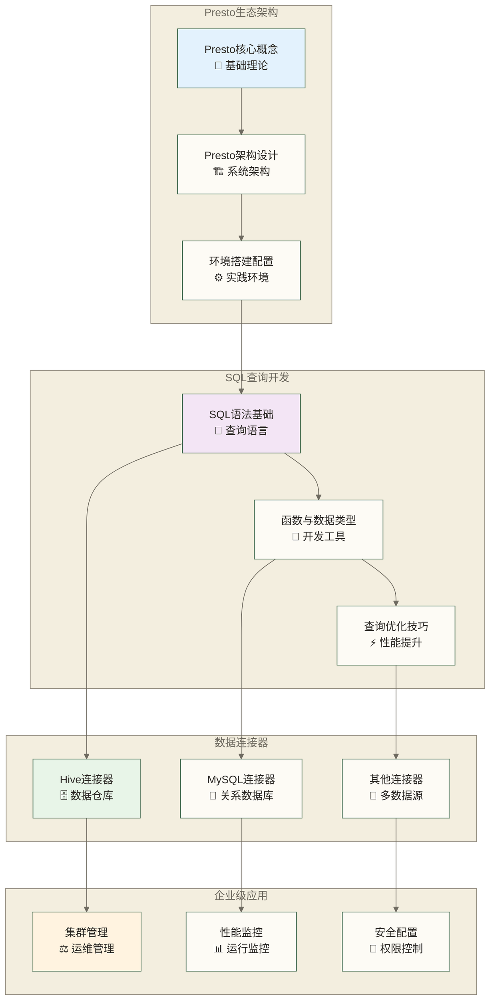
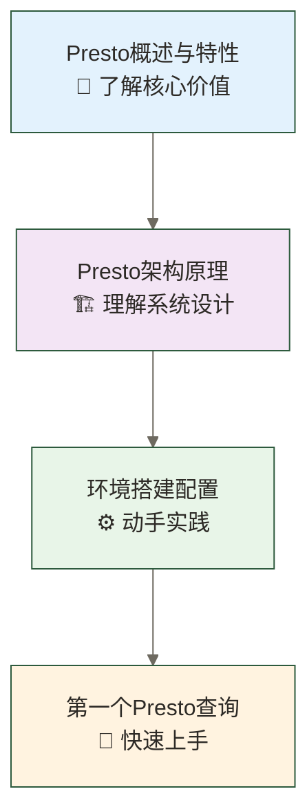
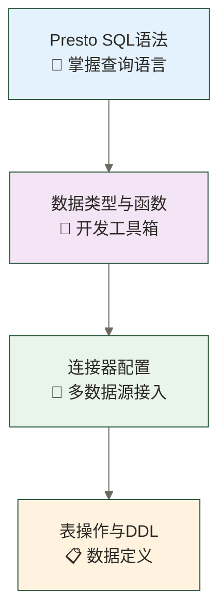
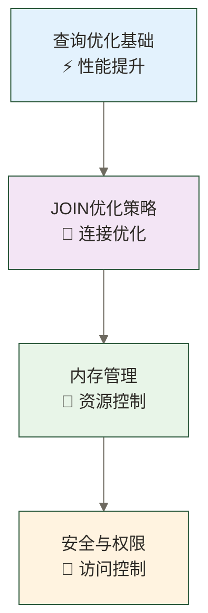
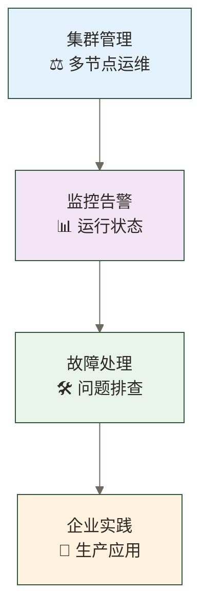

# Presto学习路线图 - 分布式SQL查询引擎全面掌握

> [!abstract] 📋 学习概览  
> 🎯 **目标**：全面掌握Presto分布式SQL查询引擎，具备企业级数据查询能力  
> ⏱️ **时长**：4-6周系统化学习  
> 🔧 **核心技能**：Presto架构、SQL优化、集群管理、性能调优

## 📊 Presto技术全景图



## 🛤️ 学习路径规划

### 🏁 第一阶段：基础概念与环境搭建（第1周）



**学习目标**：
- ✅ 理解Presto的核心概念和应用场景
- ✅ 掌握Presto的架构设计和工作原理
- ✅ 完成单机和集群环境搭建
- ✅ 能够执行基本的SQL查询

**核心文档**：
1. [[【技术与工具】/Presto/01-Presto概述与特性|Presto概述与特性]] - Presto技术概览和特性介绍
2. [[【技术与工具】/Presto/02-Presto架构原理|Presto架构]] - 深入理解分布式查询架构
3. [[【技术与工具】/Presto/03-Presto环境搭建|Presto环境搭建]] - 完整的安装配置指南
4. [[【技术与工具】/Presto/04-第一个Presto查询|第一个Presto查询]] - 快速入门实践

### 🔧 第二阶段：SQL开发与数据操作（第2周）



**学习目标**：
- ✅ 熟练使用Presto SQL语法进行数据查询
- ✅ 掌握各种数据类型和内置函数的使用
- ✅ 能够配置和使用各种数据连接器
- ✅ 理解Presto中的表操作和元数据管理

**核心文档**：
5. [[【技术与工具】/Presto/05-Presto SQL语法基础|Presto SQL语法]] - SQL查询语言详解
6. [[【技术与工具】/Presto/06-数据类型与函数|数据类型与函数]] - 类型系统和函数库
7. [[【技术与工具】/Presto/07-连接器详解|连接器]] - 多数据源连接配置
8. [[【技术与工具】/Presto/08-表操作与DDL|表操作与DDL]] - 数据定义语言操作

### ⚡ 第三阶段：性能优化与高级特性（第3周）



**学习目标**：
- ✅ 掌握查询优化的原理和方法
- ✅ 理解JOIN操作的优化策略
- ✅ 能够进行内存配置和资源管理
- ✅ 配置安全认证和权限控制

**核心文档**：
9. [[【技术与工具】/Presto/09-查询优化基础|查询优化]] - 查询执行计划优化
10. [[【技术与工具】/Presto/10-JOIN优化与子查询|JOIN优化与子查询]] - 复杂查询优化
11. [[【技术与工具】/Presto/11-内存配置与调优|内存配置与调优]] - 资源管理策略
12. [[【技术与工具】/Presto/12-安全配置与权限管理|安全配置与权限]] - 企业级安全方案

### 🏢 第四阶段：集群管理与企业应用（第4周）



**学习目标**：
- ✅ 掌握Presto集群的部署和管理
- ✅ 建立完善的监控和告警体系
- ✅ 具备故障诊断和问题解决能力
- ✅ 了解企业级应用的最佳实践

**核心文档**：
13. [[【技术与工具】/Presto/13-集群部署与管理|集群部署与]] - 多节点集群运维
14. [[【技术与工具】/Presto/14-监控与告警|监控与告警]] - 系统监控方案
15. [[【技术与工具】/Presto/15-故障诊断与调试|故障诊断与调试]] - 问题排查指南
16. [[【技术与工具】/Presto/16-企业级应用实践|企业级应用实践]] - 生产环境最佳实践

## 📚 分级学习建议

### 🟢 初学者路径（4-6周）
**适合人群**：有基本SQL基础，初次接触分布式查询引擎
```text
Week 1: 01→02→03→04 (基础概念)
Week 2: 05→06→07→08 (SQL开发)  
Week 3: 09→10 (基础优化)
Week 4: 13→14 (集群基础)
```

### 🟡 进阶者路径（3-4周）
**适合人群**：有大数据开发经验，需要深入Presto技术栈
```text
Week 1: 01→02→03→05→06 (快速上手)
Week 2: 07→08→09→10→11 (深入开发)
Week 3: 12→13→14→15 (企业应用)
Week 4: 16+实践项目 (项目实战)
```

### 🔴 专家路径（2-3周）
**适合人群**：资深大数据工程师，专项技能提升
```text
Week 1: 快速回顾01-08 → 重点11→12
Week 2: 13→14→15→16 (运维专精)
Week 3: 实际项目优化和调优实践
```

## 🎯 学习成果验收

### 📋 基础能力检查表
- [ ] 能够独立搭建Presto单机和集群环境
- [ ] 熟练使用Presto SQL进行复杂查询
- [ ] 掌握至少3种数据连接器的配置和使用
- [ ] 理解Presto的架构原理和查询执行过程

### 🚀 进阶能力检查表  
- [ ] 能够进行查询性能诊断和优化
- [ ] 具备集群监控和运维管理能力
- [ ] 掌握内存配置和资源调优技巧
- [ ] 能够设计企业级的安全访问方案

### 💼 专家能力检查表
- [ ] 能够解决复杂的性能和稳定性问题
- [ ] 具备大规模集群的架构设计能力
- [ ] 掌握Presto源码级的调优和定制
- [ ] 能够指导团队进行Presto技术选型和实施

## 🔗 相关技术栈

### 前置技能建议
- **必需**：SQL基础 - 熟练掌握SQL查询语言
- **推荐**：Hadoop生态 - 了解大数据生态
- **加分**：Java基础 - 便于理解架构和调优

### 后续发展方向
- **数据仓库**：[[【技术与工具】/Hadoop/13-Hive数据仓库|Hive数据仓库]]
- **实时计算**：Flink流处理
- **OLAP引擎**：ClickHouse分析数据库

## 💡 学习建议

### 🎯 最佳实践
1. **边学边练**：每个概念都要动手实践，理论结合实际
2. **搭建实验环境**：准备真实的数据集进行练习
3. **关注性能**：从一开始就培养性能意识和优化思维
4. **社区参与**：关注Presto官方文档和社区最佳实践

### ⚠️ 常见误区
- ❌ 把Presto当作传统数据库使用
- ❌ 忽视查询优化，导致性能问题
- ❌ 不了解连接器特性，配置不当
- ❌ 缺乏监控，生产环境出现问题无法及时发现

### 🏆 进阶建议
- 📖 深入研究Presto官方文档和源码
- 🌐 关注Presto社区动态和版本更新
- 💼 参与开源贡献，提升技术影响力
- 🎓 考虑获得相关认证，提升职业竞争力

> [!tip] 🚀 开始学习
> 
> 准备好了吗？让我们从 [[【技术与工具】/Presto/01-Presto概述与特性|Presto概述与特性]] 开始，踏上Presto技术掌握之旅！
> 
> 记住：**掌握分布式查询引擎，就是掌握了大数据分析的核心竞争力！**